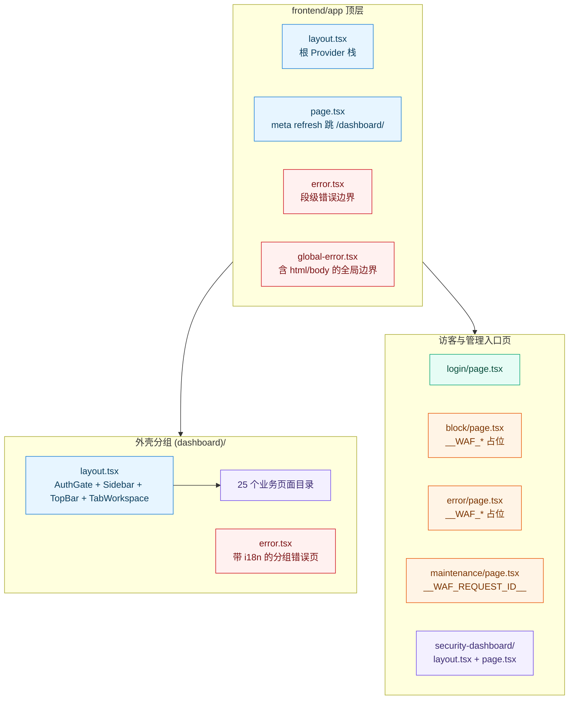
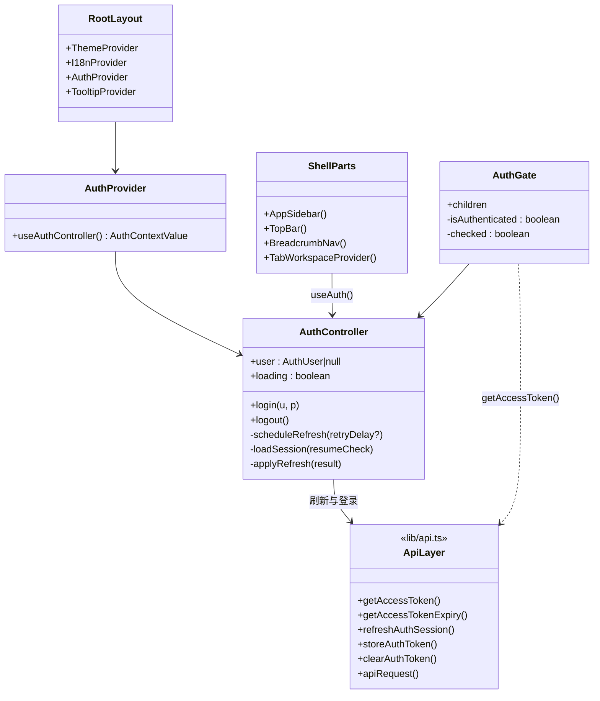
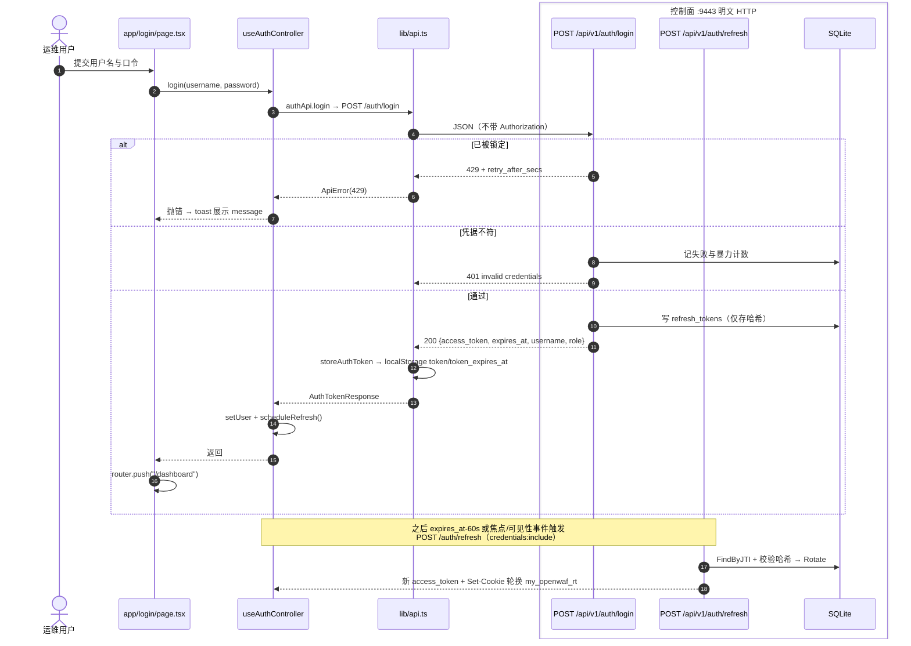
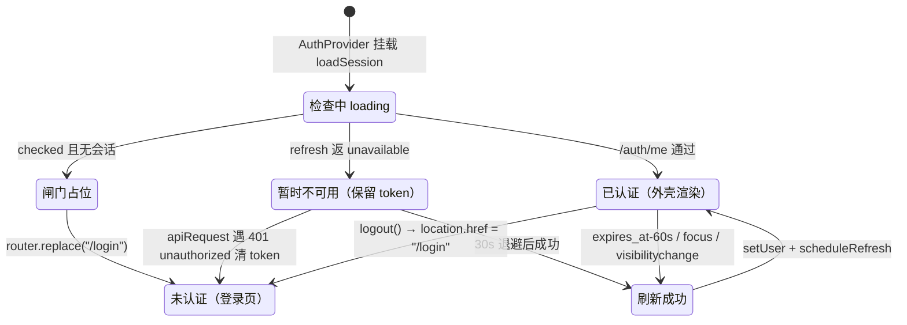
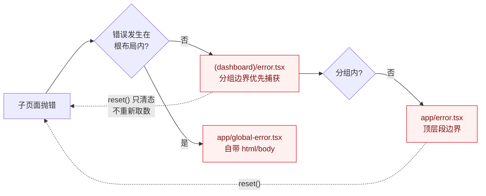
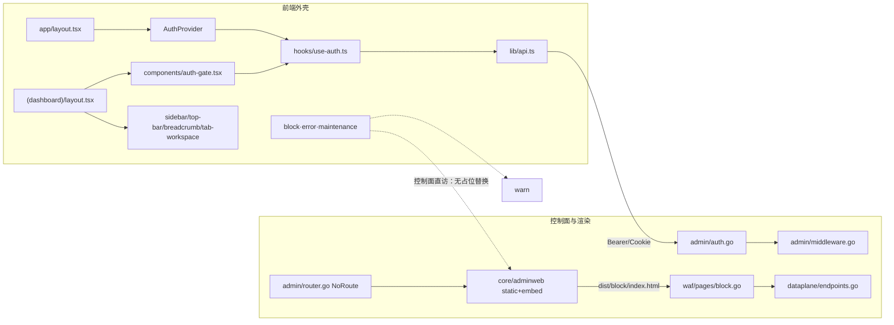
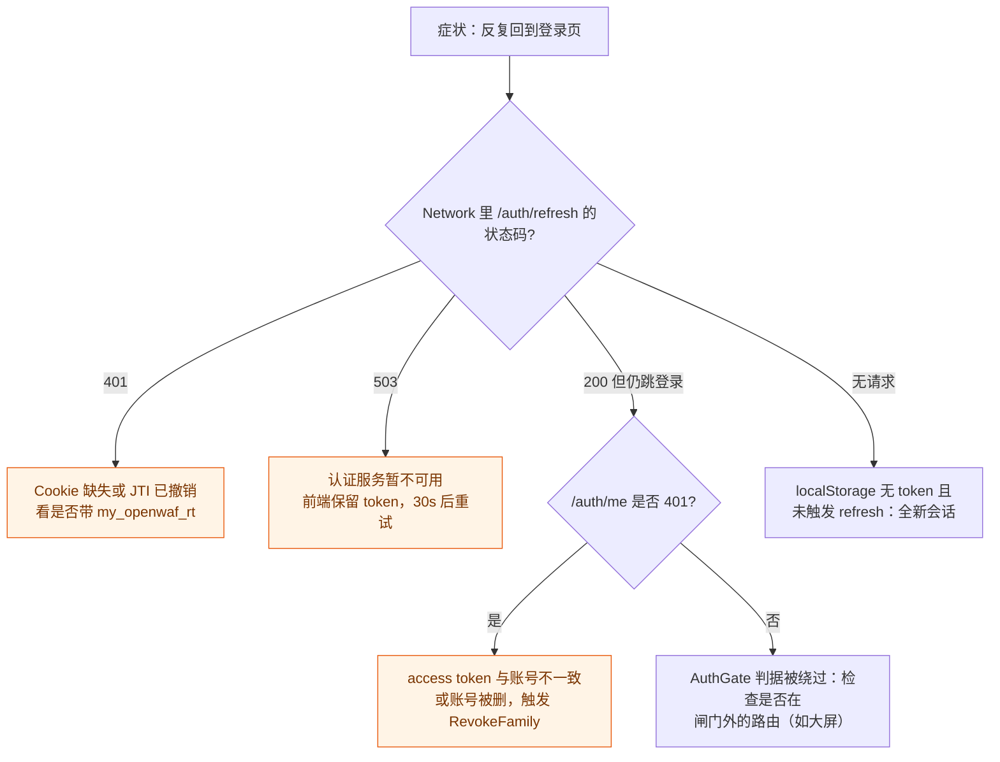

# 认证与外壳页面

<cite>
**本文档引用的文件**
- [frontend/app/page.tsx](file://frontend/app/page.tsx)
- [frontend/app/layout.tsx](file://frontend/app/layout.tsx)
- [frontend/app/error.tsx](file://frontend/app/error.tsx)
- [frontend/app/global-error.tsx](file://frontend/app/global-error.tsx)
- [frontend/app/block/page.tsx](file://frontend/app/block/page.tsx)
- [frontend/app/error/page.tsx](file://frontend/app/error/page.tsx)
- [frontend/app/maintenance/page.tsx](file://frontend/app/maintenance/page.tsx)
- [frontend/app/login/page.tsx](file://frontend/app/login/page.tsx)
- [frontend/app/security-dashboard/layout.tsx](file://frontend/app/security-dashboard/layout.tsx)
- [frontend/app/security-dashboard/page.tsx](file://frontend/app/security-dashboard/page.tsx)
- [frontend/app/(dashboard)/layout.tsx](file://frontend/app/(dashboard)/layout.tsx)
- [frontend/app/(dashboard)/error.tsx](file://frontend/app/(dashboard)/error.tsx)
- [frontend/components/auth-gate.tsx](file://frontend/components/auth-gate.tsx)
- [frontend/components/auth-provider.tsx](file://frontend/components/auth-provider.tsx)
- [frontend/components/sidebar-nav.tsx](file://frontend/components/sidebar-nav.tsx)
- [frontend/components/top-bar.tsx](file://frontend/components/top-bar.tsx)
- [frontend/components/breadcrumb-nav.tsx](file://frontend/components/breadcrumb-nav.tsx)
- [frontend/components/tab-workspace.tsx](file://frontend/components/tab-workspace.tsx)
- [frontend/hooks/use-auth.ts](file://frontend/hooks/use-auth.ts)
- [frontend/hooks/use-api.ts](file://frontend/hooks/use-api.ts)
- [frontend/hooks/use-realtime.ts](file://frontend/hooks/use-realtime.ts)
- [frontend/lib/api.ts](file://frontend/lib/api.ts)
- [frontend/lib/route-titles.ts](file://frontend/lib/route-titles.ts)
- [frontend/lib/types.ts](file://frontend/lib/types.ts)
- [frontend/next.config.ts](file://frontend/next.config.ts)
- [frontend/package.json](file://frontend/package.json)
- [frontend/node_modules/next/dist/docs/01-app/03-api-reference/03-file-conventions/error.md](file://frontend/node_modules/next/dist/docs/01-app/03-api-reference/03-file-conventions/error.md)
- [frontend/node_modules/next/dist/docs/01-app/03-api-reference/03-file-conventions/route-groups.md](file://frontend/node_modules/next/dist/docs/01-app/03-api-reference/03-file-conventions/route-groups.md)
- [frontend/node_modules/next/dist/docs/01-app/03-api-reference/03-file-conventions/unauthorized.md](file://frontend/node_modules/next/dist/docs/01-app/03-api-reference/03-file-conventions/unauthorized.md)
- [frontend/node_modules/next/dist/docs/01-app/02-guides/static-exports.md](file://frontend/node_modules/next/dist/docs/01-app/02-guides/static-exports.md)
- [internal/admin/router.go](file://internal/admin/router.go)
- [internal/admin/auth.go](file://internal/admin/auth.go)
- [internal/admin/auth_helpers.go](file://internal/admin/auth_helpers.go)
- [internal/admin/middleware.go](file://internal/admin/middleware.go)
- [internal/admin/auth/jwt.go](file://internal/admin/auth/jwt.go)
- [internal/admin/system/realtime/realtime.go](file://internal/admin/system/realtime/realtime.go)
- [internal/app/server.go](file://internal/app/server.go)
- [internal/core/adminweb/embed.go](file://internal/core/adminweb/embed.go)
- [internal/core/adminweb/static.go](file://internal/core/adminweb/static.go)
- [internal/store/auth/auth.go](file://internal/store/auth/auth.go)
- [internal/waf/pages/block.go](file://internal/waf/pages/block.go)
- [internal/dataplane/endpoints.go](file://internal/dataplane/endpoints.go)
</cite>

## 目录

1. [简介](#简介)
2. [项目结构](#项目结构)
3. [核心组件](#核心组件)
4. [架构总览](#架构总览)
5. [详细组件分析](#详细组件分析)
6. [依赖关系分析](#依赖关系分析)
7. [性能考虑](#性能考虑)
8. [故障排查指南](#故障排查指南)
9. [结论](#结论)
10. [附录](#附录)

## 简介

本篇覆盖 `(dashboard)` 之外的**应用外壳与非仪表板路由**：根 `page.tsx`/`layout.tsx`、错误边界三件套（`app/error.tsx`、`app/global-error.tsx`、`app/(dashboard)/error.tsx`）、`login/`、`block/`、`error/`、`maintenance/`、`security-dashboard/`，以及闸门组件 `components/auth-gate.tsx` 与其背后的 `AuthProvider`/`useAuthController`。dashboard 分组内的具体页面实现见 `页面实现/系统与账号页面.md` 等同级篇；服务端令牌与刷新算法的细节见 `Next.js 架构设计/登录流程与鉴权机制.md`，本篇不重复其表格，只重写外壳装配与渲染路径。

四条前置口径（均实测于代码或随包 Next 文档，非训练记忆）：

| 口径 | 实测事实 | 影响 |
|------|----------|------|
| Next 版本差异 | 本仓库为 next `16.2.6`；随包文档 `error.md:27-33`、`:329` 显示 16.2.0 起错误边界第二参数改为 `unstable_retry`，`reset` 保留但文档明确「多数场景应改用 `unstable_retry()`」 | 三处 `error.tsx` 仍取 `reset`，只清态不重取数据 |
| 静态导出边界 | `static-exports.md:277-293` 列出 `output:"export"` 不支持 Cookies()、redirects、rewrites、headers、Proxy、ISR、Server Actions、默认 `next/image` loader | 无法用框架级守卫，只能客户端 `AuthGate`；`unauthorized.js`（`unauthorized.md:7` 标 experimental）依赖服务端 `unauthorized()`，本形态不可用 |
| 凭据载体 | access token 存 `localStorage` 的 `token`/`token_expires_at`（`api.ts:28-29`）；refresh token 是 HttpOnly Cookie `my_openwaf_rt`（`auth_helpers.go:15`、`auth.go:121`） | 跨标签页靠 `storage` 事件同步；JS 无法读取 refresh |
| 根路由跳转 | `app/page.tsx:4` 在 `<main>` 内渲染 `<meta httpEquiv="refresh" content="0; url=/dashboard/">`，无任何条件判断 | 访问 `/` 无条件进仪表板；未登录时再由 `AuthGate` 替换到 `/login` |

**章节来源**
- [frontend/next.config.ts:3-14](file://frontend/next.config.ts#L3-L14)
- [frontend/package.json:22-45](file://frontend/package.json#L22-L45)
- [frontend/app/page.tsx:1-10](file://frontend/app/page.tsx#L1-L10)
- [internal/admin/auth_helpers.go:14-32](file://internal/admin/auth_helpers.go#L14-L32)

## 项目结构



**图表来源**
- [frontend/app/layout.tsx:8-29](file://frontend/app/layout.tsx#L8-L29)
- [frontend/app/(dashboard)/layout.tsx:14-37](file://frontend/app/(dashboard)/layout.tsx#L14-L37)
- [frontend/app/security-dashboard/layout.tsx:9-19](file://frontend/app/security-dashboard/layout.tsx#L9-L19)

| 路径 | 特殊文件类型 | 实际渲染面 | 鉴权 | 说明 |
|------|--------------|------------|------|------|
| `app/` | `layout.tsx` + `page.tsx` | 控制面 :9443 | 无（根页不含数据） | 唯一根布局；无 `metadata` 导出、不用 `next/font` |
| `app/error.tsx` | 段级错误边界 | 控制面 | 无 | 顶层段兜底 |
| `app/global-error.tsx` | 全局错误边界 | 控制面 | 无 | 自带 `<html>`/`<body>`，替换根布局 |
| `app/login/` | `page.tsx` | 控制面 | 无（登录入口本身公开） | 已登录时被 `useEffect` 替换走 |
| `app/(dashboard)/` | `layout.tsx` + `error.tsx` | 控制面 | `AuthGate` | 路由组不进 URL（`route-groups.md:12`） |
| `app/security-dashboard/` | `layout.tsx` + `page.tsx` | 控制面 | **无闸门** | 独立暗色全屏页 |
| `app/block/` | `page.tsx` | **数据面**（占位符替换） | 无 | 被拦截访客所见 |
| `app/error/` | `page.tsx` | 数据面 | 无 | 上游失败接管页 |
| `app/maintenance/` | `page.tsx` | 数据面 | 无 | 维护页 |

`block/`、`error/`、`maintenance/` 三页位于 `app/` 顶层而不是 `(dashboard)` 组内，这一点是刻意的：它们的 HTML 会被后端从内嵌产物树里读出来当模板用（`adminweb/embed.go:12-18`），因此不能出现「登录后可见」之类的语义泄漏。

**章节来源**
- [internal/core/adminweb/embed.go:10-18](file://internal/core/adminweb/embed.go#L10-L18)
- [frontend/app/block/page.tsx:1-56](file://frontend/app/block/page.tsx#L1-L56)
- [frontend/app/(dashboard)/layout.tsx:19-36](file://frontend/app/(dashboard)/layout.tsx#L19-L36)

## 核心组件

| 组件 | 位置 | 职责 | 关键约束 |
|------|------|------|----------|
| `RootLayout` | `app/layout.tsx:8` | 串起 `ThemeProvider → I18nProvider → AuthProvider → TooltipProvider`，末尾挂 `Toaster` | 客户端 Provider 全部在服务端外壳内包裹，顺序不可调：`useAuth` 依赖 `AuthContext`，`TopBar` 依赖两者 |
| `AuthProvider` | `components/auth-provider.tsx:6` | 全应用**只创建一个** `useAuthController()` 实例 | 避免每页各起刷新定时器 |
| `useAuthController` | `hooks/use-auth.ts:87` | 会话装载、刷新调度、登出、跨标签页同步 | 提前 60s 刷新（`:69`）、失败退避 30s（`:70`） |
| `AuthGate` | `components/auth-gate.tsx:15` | 检查完成前不挂载业务子树；明确失效才跳登录页 | 暂时不可用**不**当登出处理（`:20-23`） |
| `AppSidebar` | `components/sidebar-nav.tsx:339` | 六组导航 + 折叠 + 活动态指示条 | 页脚版本号硬编码 `v1.0.0`（`:377`） |
| `TopBar` | `components/top-bar.tsx:32` | 标题、reload 按钮、外观/语言切换、登出 | reload 仅 admin/operator 可用（`:35`） |
| `BreadcrumbNav` | `components/breadcrumb-nav.tsx:16` | 按路径片段查 `segmentKeyMap` 生成面包屑 | 缺键时回落原始片段 |
| `TabWorkspaceProvider` | `components/tab-workspace.tsx:104` | 多标签工作区，`sessionStorage` 持久化 | 必须处在 `Suspense` 内（用 `useSearchParams`） |



**图表来源**
- [frontend/app/layout.tsx:13-27](file://frontend/app/layout.tsx#L13-L27)
- [frontend/components/auth-provider.tsx:6-9](file://frontend/components/auth-provider.tsx#L6-L9)
- [frontend/hooks/use-auth.ts:288-309](file://frontend/hooks/use-auth.ts#L288-L309)
- [frontend/components/auth-gate.tsx:15-43](file://frontend/components/auth-gate.tsx#L15-L43)

**章节来源**
- [frontend/components/auth-provider.tsx:1-9](file://frontend/components/auth-provider.tsx#L1-L9)
- [frontend/components/sidebar-nav.tsx:69-74](file://frontend/components/sidebar-nav.tsx#L69-L74)
- [frontend/components/tab-workspace.tsx:24-53](file://frontend/components/tab-workspace.tsx#L24-L53)

## 架构总览

外壳的装配顺序决定了一个关键性质：**闸门在 Provider 栈之内、业务子树之外**。`AuthGate` 未通过时渲染 `role="status"` 的加载占位（`auth-gate.tsx:31-41`），业务页面根本不挂载，因此不会在旧 token 上打出成片的 401。



**图表来源**
- [internal/admin/auth.go:33-126](file://internal/admin/auth.go#L33-L126)
- [internal/admin/auth.go:131-240](file://internal/admin/auth.go#L131-L240)
- [frontend/app/login/page.tsx:32-48](file://frontend/app/login/page.tsx#L32-L48)
- [frontend/hooks/use-auth.ts:203-212](file://frontend/hooks/use-auth.ts#L203-L212)
- [frontend/lib/api.ts:728-741](file://frontend/lib/api.ts#L728-L741)

路由与守卫表（本篇范围的全部 URL；`尾斜杠` 因 `trailingSlash: true` 是规范形态，但控制面的候选解析同时接受两种写法，见 `static.go:69-83`）：

| 路由 | 源文件 | 布局链 | 守卫 | 未通过时行为 |
|------|--------|--------|------|--------------|
| `/` | `app/page.tsx` | 根布局 | 无 | 立即跳 `/dashboard/` |
| `/login/` | `app/login/page.tsx` | 根布局 | 反向守卫：已登录则离开 | `router.replace("/dashboard")`（`:28`） |
| `/dashboard/*` 25 页 | `app/(dashboard)/**` | 根布局 + 分组布局 | `AuthGate` | `router.replace("/login")`（`auth-gate.tsx:27`） |
| `/security-dashboard/` | `app/security-dashboard/page.tsx` | 根布局 + 自身布局 | **无** | 仅靠请求层 401 回落 `/login` |
| `/block/` | `app/block/page.tsx` | 根布局（数据面绕过 React） | 无（公开页） | — |
| `/error/`、`/maintenance/` | 对应 `page.tsx` | 根布局（数据面绕过 React） | 无（公开页） | — |
| 任意未知路径 | — | `NoRoute` → 静态回落 | — | 命中 `index.html` 兜底，返回 200 并再跳 `/dashboard/` |
| `/api/v1/realtime/ws` | — | 不经 React | 一次性 ticket | 票据无效返 401 JSON（`realtime.go:207-211`） |

**章节来源**
- [frontend/components/auth-gate.tsx:19-43](file://frontend/components/auth-gate.tsx#L19-L43)
- [internal/core/adminweb/static.go:54-84](file://internal/core/adminweb/static.go#L54-L84)
- [internal/admin/router.go:442-464](file://internal/admin/router.go#L442-L464)
- [frontend/app/security-dashboard/page.tsx:150-238](file://frontend/app/security-dashboard/page.tsx#L150-L238)

## 详细组件分析

### 根路由与登录跳转（app/page.tsx）

全文只有 10 行：一个居中 `main`、一个 `<meta httpEquiv="refresh" content="0; url=/dashboard/">` 和一条兜底 `<a>`（`page.tsx:4-7`）。三个事实需要固定：其一，跳转**无条件**，不读 token 也不问 `useAuth`，因此已登录与未登录者都会先被送到 `/dashboard/`，再由 `AuthGate` 决定是否退回登录页——代价是一次额外路由往返。其二，`<meta http-equiv>` 写在 `body` 内而非 `head`；本仓库无 Next `redirects` 可用（`static-exports.md:285` 明确列出不支持），故用 meta 刷新替代，React 19 会把组件内渲染的 `<meta>` 提升到文档头部（框架行为，非本仓库代码可证，此处标注为推断）。其三，该 HTML 同时是控制面的**最终兜底文件**：`routeCandidates()` 在无扩展名的未知路径候选末尾追加 `index.html`（`static.go:79-81`），所以任意拼错的后台 URL 都会拿到 200 + 这个跳转页，而不是 404——导出目录里的 `404/`、`_not-found/` 产物因此在本部署形态下不会被命中。

**章节来源**
- [frontend/app/page.tsx:1-10](file://frontend/app/page.tsx#L1-L10)
- [internal/core/adminweb/static.go:54-84](file://internal/core/adminweb/static.go#L54-L84)
- [frontend/node_modules/next/dist/docs/01-app/02-guides/static-exports.md:277-293](file://frontend/node_modules/next/dist/docs/01-app/02-guides/static-exports.md#L277-L293)

### 根布局与 Provider 栈（app/layout.tsx）

`<html lang="zh-CN" suppressHydrationWarning>` 加五层 Provider，顺序为 `ThemeProvider → I18nProvider → AuthProvider → TooltipProvider`，`Toaster` 在 `children` 之后（`layout.tsx:14-26`）。`suppressHydrationWarning` 是主题脚本改写 `class` 的必要豁免。根布局**不导出** `metadata`，也不引 `next/font`，`--font-*` 全部指向系统字体栈；这既符合静态导出形态，也让 `global-error.tsx` 不必复制一份字体加载逻辑。由于只存在一个根布局，`(dashboard)` 与顶层路由之间的跳转不会触发整页重载（`route-groups.md:28-32` 的 Caveat 只适用于多根布局）。

**章节来源**
- [frontend/app/layout.tsx:1-29](file://frontend/app/layout.tsx#L1-L29)
- [frontend/node_modules/next/dist/docs/01-app/03-api-reference/03-file-conventions/route-groups.md:10-32](file://frontend/node_modules/next/dist/docs/01-app/03-api-reference/03-file-conventions/route-groups.md#L10-L32)

### 登录页（app/login/page.tsx）

103 行的极简表单：`useState` 管两个字段（无 `react-hook-form`、无 zod 校验），提交前先做非空检查并 `toast.error`（`:34-37`），随后 `login()` → 成功 `toast` + `router.push("/dashboard")`，失败把 `err.message` 原样 toast（`:40-47`）。三点值得记录：其一，后端 429 的 `retry_after_secs` **没有被消费**，锁定剩余时间不展示（后端形态见 `auth.go:50-58`），前端只拿到 message 文本。其二，反向守卫用 `useEffect` 而非布局级守卫（`:26-30`），依赖 `authLoading && isAuthenticated`，因此已登录访问 `/login/` 会先渲染一帧表单再被替换。其三，`router.replace("/dashboard")` 与 `logout` 的 `window.location.href = "/login"`（`use-auth.ts:221`）都不带尾斜杠，与 `trailingSlash: true` 的规范形态不一致；控制面靠候选解析吸收了这个差异，但 `(dashboard)` 布局的 `PINNED_PATH = "/dashboard/"`（`tab-workspace.tsx:25`）说明**页内比较**是带斜杠的，两处口径靠 `normalizePath()` 桥接。

**章节来源**
- [frontend/app/login/page.tsx:18-103](file://frontend/app/login/page.tsx#L18-L103)
- [internal/admin/auth.go:49-58](file://internal/admin/auth.go#L49-L58)
- [frontend/hooks/use-auth.ts:214-223](file://frontend/hooks/use-auth.ts#L214-L223)
- [frontend/components/tab-workspace.tsx:24-45](file://frontend/components/tab-workspace.tsx#L24-L45)

### 认证闸门与共享控制器

`AuthGate` 的判据不是 `!!user`，而是 `!!user || (!!getAccessToken() && checked)`（`auth-gate.tsx:23`）：控制器在 `/auth/me` 因网络或 5xx 失败时会**保留** access token，此时把用户踢到登录页属于误判。只有 `apiRequest` 在 refresh 明确返回 `unauthorized` 时才会清 token 并整页跳 `/login`（`api.ts:581-591`），闸门随后才生效替换（`auth-gate.tsx:25-29`）。

控制器侧的三条不变量：

| 不变量 | 实现 | 位置 |
|--------|------|------|
| 同 token 只有一个在途 `/auth/me` | 模块级 `authMeRequest` 去重，旧 token 的请求结束不清新条目 | `use-auth.ts:36-55` |
| 登出/重登后旧响应作废 | `authEpoch` 代次；`refresh` 返回后比对 token 与代次 | `api.ts:37-47`、`:478-510` |
| 跨标签页只有一次 refresh | Web Locks 优先，缺失时退化为 `localStorage` 租约 + 意图登记 + 最小 owner 仲裁 | `api.ts:49-55`、`:307-429` |



**图表来源**
- [frontend/components/auth-gate.tsx:19-43](file://frontend/components/auth-gate.tsx#L19-L43)
- [frontend/hooks/use-auth.ts:120-201](file://frontend/hooks/use-auth.ts#L120-L201)
- [frontend/lib/api.ts:560-607](file://frontend/lib/api.ts#L560-L607)

焦点与可见性恢复检查带 30 秒节流（`RESUME_CHECK_INTERVAL_MS`，`use-auth.ts:71`、`:160-165`），而 `storage` 事件不受该节流影响（`:270-272`），因为令牌变化必须立即生效；事件里刻意**不信任** `event.newValue`，一律回读当前共享存储（`:251-254`），避免落后事件覆盖新会话。`useIsAuthenticated()`（`:315-409`）实现了另一套等价的探测逻辑，但**全库无消费者**。

**章节来源**
- [frontend/hooks/use-auth.ts:69-118](file://frontend/hooks/use-auth.ts#L69-L118)
- [frontend/hooks/use-auth.ts:155-286](file://frontend/hooks/use-auth.ts#L155-L286)
- [frontend/hooks/use-auth.ts:311-409](file://frontend/hooks/use-auth.ts#L311-L409)
- [frontend/lib/api.ts:439-518](file://frontend/lib/api.ts#L439-L518)

### 管理外壳（(dashboard)/layout 与四个部件）

`AuthGate` 包 `SidebarProvider`，内部依次 `AppSidebar`、`SidebarInset`、`TopBar`、`Suspense` 包 `TabWorkspaceProvider`，`main` 里先 `BreadcrumbNav` 再 `{children}`（`(dashboard)/layout.tsx:19-36`）。`Suspense` 的存在是 Next 16 的硬要求：`params`/`searchParams` 的同步访问已移除，`useSearchParams()` 的消费者必须包边界，否则构建期报错。

导航数据由 `useNavGroups()` 每次渲染现建（`sidebar-nav.tsx:192-334`），活动态用两个纯函数判定：`isChildActive` 做前缀匹配，`isExactOrLongestActive` 取最长匹配以防父子同时高亮（`:90-111`）。`TopBar` 的 reload 按钮实际调用 `useSystemReload()` → `POST /api/v1/reload`（`top-bar.tsx:39-47`），该端点挂在 opsGroup（`router.go:313`，`system.ReloadSnapshot(reload)`），因此 operator 点它同样成功、readonly 由前端 `canManage` 挡住。面包屑把最后一段渲染为 `BreadcrumbPage`（不可点），其余段可点，缺 `segmentKeyMap` 键时回落原始片段——`tls-fingerprints` 正缺键，会显示裸片段。

**章节来源**
- [frontend/app/(dashboard)/layout.tsx:14-37](file://frontend/app/(dashboard)/layout.tsx#L14-L37)
- [frontend/components/sidebar-nav.tsx:90-111](file://frontend/components/sidebar-nav.tsx#L90-L111)
- [frontend/components/sidebar-nav.tsx:192-334](file://frontend/components/sidebar-nav.tsx#L192-L334)
- [frontend/components/top-bar.tsx:28-70](file://frontend/components/top-bar.tsx#L28-L70)
- [frontend/lib/route-titles.ts:7-65](file://frontend/lib/route-titles.ts#L7-L65)
- [frontend/components/breadcrumb-nav.tsx:16-56](file://frontend/components/breadcrumb-nav.tsx#L16-L56)
- [internal/admin/router.go:313-313](file://internal/admin/router.go#L313-L313)

### 错误边界三件套



**图表来源**
- [frontend/node_modules/next/dist/docs/01-app/03-api-reference/03-file-conventions/error.md:96-96](file://frontend/node_modules/next/dist/docs/01-app/03-api-reference/03-file-conventions/error.md#L96-L96)
- [frontend/app/global-error.tsx:19-33](file://frontend/app/global-error.tsx#L19-L33)
- [frontend/app/(dashboard)/error.tsx:8-40](file://frontend/app/(dashboard)/error.tsx#L8-L40)

三份边界能力不同：`error.js` 包住本段以下的路由，**不包同段的 `layout.js`**，根布局错误只有 `global-error.js` 能接（`error.md:96`、`:163`），且 `global-error` 必须自带 `<html>`/`<body>` 且不支持 `metadata` 导出（`error.md:165`）——仓库实现与之吻合（`global-error.tsx:20-32`）。三处都只做「开发期 console.error + 一键重试」，但重试参数统一取 `reset`，而随包文档在 16.2.0 引入了 `unstable_retry`（重新取数并重渲染边界子树），并建议多数场景改用它（`error.md:155-157`、`:329`）。对以 SWR 拉数的后台页而言，`reset()` 与 `unstable_retry()` 的体验差异是实质的。

另一处生产差异：`error.message` 仅在开发构建被序列化到客户端（`error.md:106`），故 `(dashboard)/error.tsx:31` 在生产只会显示 i18n 兜底文案，`app/error.tsx` 干脆不渲染 message。

**章节来源**
- [frontend/app/error.tsx:6-32](file://frontend/app/error.tsx#L6-L32)
- [frontend/app/global-error.tsx:6-34](file://frontend/app/global-error.tsx#L6-L34)
- [frontend/app/(dashboard)/error.tsx:13-39](file://frontend/app/(dashboard)/error.tsx#L13-L39)
- [frontend/node_modules/next/dist/docs/01-app/03-api-reference/03-file-conventions/error.md:96-165](file://frontend/node_modules/next/dist/docs/01-app/03-api-reference/03-file-conventions/error.md#L96-L165)

### 面向访客的数据面页面（block / error / maintenance）

这三页不是「管理端页面」，而是**数据面渲染的模板源**。渲染路径与占位符替换如下：

| 场景 | 入口函数 | 站点自定义优先 | 配置态渲染 | 内嵌 HTML 兜底 | 占位符 |
|------|----------|----------------|------------|----------------|--------|
| 拦截 403 | `pages/block.go:18` `WriteBlockResponse` | `rt.BlockHTML` → `renderTemplatePage` | `sn.BlockPage` → `renderConfiguredBlockPage` | `block/index.html` | `__WAF_STATUS_CODE__`、`__WAF_REQUEST_ID__` |
| 上游失败 | `block.go:174` `WriteUpstreamErrorResponse` | 无站点覆盖 | — | `error/index.html`，失败退 `buildErrorFallbackHTML` | 同上 |
| 维护模式 | `block.go:60` `WriteMaintenanceResponse` | `rt.MaintenanceHTML`（可改状态码） | 全局 `MaintenanceGlobalHTML` | `maintenance/index.html` | 仅 `__WAF_REQUEST_ID__` |

两处安全设计必须写明：其一，模板注入被刻意收窄——`renderTemplatePage` 只把 `RequestID` 与 `StatusCode` 填进 Go `html/template`，`RuleID`/`Phase`/`Action`/`Category`/`MatchDesc` 一律留空（`block.go:191-205`），避免向被阻断访客泄漏检测细节。其二，`__WAF_RULE_ID__` 在 `block/index.html` 分支被强制置空（`block.go:226-228`）。同时所有内嵌分支都会把资源前缀从 `/_next/` 改写为 `/__owaf/_next/`（`block.go:232-234`），因为数据面只在 `/__owaf/` 前缀下提供静态资源（`endpoints.go:87-108`），`/_next/` 不在其路由表内。

同一批 HTML 从控制面访问时（例如直接在 :9443 打开 `/block/`）走 `NoRoute` → `serveStaticFile`，**不做任何占位符替换**，访客会看到字面量 `__WAF_REQUEST_ID__`，且响应是 200。这正是「这三页属于数据面渲染」的可验证证据。

**章节来源**
- [frontend/app/block/page.tsx:26-50](file://frontend/app/block/page.tsx#L26-L50)
- [frontend/app/error/page.tsx:26-50](file://frontend/app/error/page.tsx#L26-L50)
- [frontend/app/maintenance/page.tsx:26-42](file://frontend/app/maintenance/page.tsx#L26-L42)
- [internal/waf/pages/block.go:18-83](file://internal/waf/pages/block.go#L18-L83)
- [internal/waf/pages/block.go:174-245](file://internal/waf/pages/block.go#L174-L245)
- [internal/dataplane/endpoints.go:87-108](file://internal/dataplane/endpoints.go#L87-L108)

### 监控大屏（security-dashboard）

`security-dashboard/layout.tsx` 只是一个 19 行的段布局：套一层 `div.dark` 强制暗色，注释明确「根 layout 已提供 ThemeProvider、I18nProvider 和 TooltipProvider」（`layout.tsx:1-19`），因此它**不是**根布局，不会触发多根布局的整页重载。页面用 12 列网格铺三张大数字卡、Top IP、地理分布、实时攻击流与 QPS 迷你柱图，数据源全部复用仪表板 hook（`page.tsx:154-161`），并叠加 WS `security_event_snapshot`（`:165`）：WS 打开且有数据时优先用推流，否则回落轮询（`:211`、`:225-228`）。本地还有两个纯客户端定时器——1 秒走字的时钟（`:169-172`）与 `fullscreenchange` 监听（`:176-187`），QPS 历史同样在浏览器侧累积到 30 点（`:54`、`:190-206`）。

入口由仪表板 Tab 以 `<Link target="_blank" rel="noopener noreferrer">` 打开（`dashboard/page.tsx:387-397`）。该路由不在 `(dashboard)` 组内，因此**没有 `AuthGate`**：未登录直接访问时，页面会先渲染骨架并发起 ticket/summary 请求，靠 `apiRequest` 的 401 处理整页跳 `/login`。这与外壳的「闸门先行」原则不一致，已登记。

**章节来源**
- [frontend/app/security-dashboard/layout.tsx:1-19](file://frontend/app/security-dashboard/layout.tsx#L1-L19)
- [frontend/app/security-dashboard/page.tsx:150-238](file://frontend/app/security-dashboard/page.tsx#L150-L238)
- [frontend/hooks/use-realtime.ts:32-134](file://frontend/hooks/use-realtime.ts#L32-L134)
- [internal/admin/system/realtime/realtime.go:236-275](file://internal/admin/system/realtime/realtime.go#L236-L275)

### 违规点与口径偏差登记

| 编号 | 类别 | 严重度 | 标题 | 位置 | 影响 |
|------|------|:------:|------|------|------|
| W-01 | 路由守卫 | 高 | `/security-dashboard/` 不在 `(dashboard)` 组内，无 `AuthGate` | `app/security-dashboard/layout.tsx:9`、`auth-gate.tsx:15` | 未登录先渲染再靠 401 回落，与外壳原则冲突 |
| W-02 | 版本漂移 | 中 | 三处错误边界仍用 `reset`，16.2.0 起文档推荐 `unstable_retry` | `app/error.tsx:8`、`app/global-error.tsx:8`、`(dashboard)/error.tsx:10`、`error.md:155-157` | 重试不清缓存侧数据，数据源故障时重试无效 |
| W-03 | 信息展示 | 中 | 登录 429 的 `retry_after_secs` 未呈现 | `auth.go:50-58`、`login/page.tsx:44` | 用户不知锁定时长，易反复尝试 |
| W-04 | 安全 | 高 | 管理端口明文 HTTP，refresh Cookie 的 `Secure` 因此在非反代场景下不置位 | `server.go:1052`、`auth_helpers.go:27-32`、`middleware.go:315-333` | 令牌可在链路中被窃听；README 的 HTTPS 说法误导部署者 |
| W-05 | 语义 | 中 | 未知后台路径返回 200 兜底页并跳 `/dashboard/`，导出的 `404/`、`_not-found/` 永不命中 | `static.go:79-81`、`router.go:452-464` | 404 语义丢失，排障时难判断路由是否写错 |
| W-06 | 一致性 | 低 | `router.replace("/dashboard")`、`location.href = "/login"` 与 `trailingSlash:true` 的规范形态不一致 | `login/page.tsx:28`、`use-auth.ts:221`、`tab-workspace.tsx:25` | 依赖服务端候选解析吸收，深链规则改动会暴露 |
| W-07 | 映射缺失 | 低 | `routeTitleKeyMap`/`segmentKeyMap` 缺 `/tls-fingerprints`，面包屑显示裸片段 | `route-titles.ts:7-65`、`breadcrumb-nav.tsx:25-27` | 中英切换下标题不翻译 |
| W-08 | 死代码 | 低 | `useIsAuthenticated` 与 `useTabWorkspace` 无消费者 | `use-auth.ts:315`、`tab-workspace.tsx:278` | 与 `AuthGate` 判定逻辑重复，易被误接 |
| W-09 | 口径 | 低 | 侧边栏页脚 `v1.0.0` 与 `package.json` 的 `0.0.1` 不一致 | `sidebar-nav.tsx:377`、`package.json:3` | 界面版本不可信 |

**章节来源**
- [frontend/app/security-dashboard/layout.tsx:9-19](file://frontend/app/security-dashboard/layout.tsx#L9-L19)
- [frontend/app/error.tsx:6-12](file://frontend/app/error.tsx#L6-L12)
- [frontend/app/login/page.tsx:32-48](file://frontend/app/login/page.tsx#L32-L48)
- [internal/admin/auth_helpers.go:23-38](file://internal/admin/auth_helpers.go#L23-L38)
- [internal/core/adminweb/static.go:69-83](file://internal/core/adminweb/static.go#L69-L83)
- [frontend/lib/route-titles.ts:7-65](file://frontend/lib/route-titles.ts#L7-L65)

## 依赖关系分析



**图表来源**
- [frontend/app/layout.tsx:1-29](file://frontend/app/layout.tsx#L1-L29)
- [internal/admin/router.go:442-464](file://internal/admin/router.go#L442-L464)
- [internal/waf/pages/block.go:236-245](file://internal/waf/pages/block.go#L236-L245)
- [internal/admin/auth.go:131-175](file://internal/admin/auth.go#L131-L175)

凭据载体矩阵（本篇与后端契约的交叉核对）：

| 凭据 | 载体 | 可见性 | 有效期 | 轮换方 | 清除时机 |
|------|------|--------|:------:|--------|----------|
| access token | `localStorage.token` | JS 可读 | 15 分钟（`auth/jwt.go:37`） | `refresh` 响应 `setToken` | 401 且 refresh 返 unauthorized；登出 |
| expires_at | `localStorage.token_expires_at` | JS 可读 | 与 token 同步 | 同上；缺失时从 JWT `exp` 解出 | 与 token 同时删除 |
| refresh token | Cookie `my_openwaf_rt`（HttpOnly、SameSite=Lax、`Secure` 随协议） | JS 不可读 | 7 天（`auth/jwt.go:38`） | 每次 refresh `Rotate` | `clearRefreshCookie`（`auth_helpers.go:34-38`） |
| WS ticket | URL 查询参数 | 仅一次 | 60 秒（`realtime.go:190`） | 消费即失效 | `consumeTicket` |
| Basic Auth 口令 | 保护配置字段 | 读端点不回显 | 永久 | 管理页写入 | 随配置覆盖 |

**章节来源**
- [frontend/lib/api.ts:27-56](file://frontend/lib/api.ts#L27-L56)
- [frontend/lib/api.ts:141-216](file://frontend/lib/api.ts#L141-L216)
- [internal/admin/auth_helpers.go:14-58](file://internal/admin/auth_helpers.go#L14-L58)
- [internal/admin/auth/jwt.go:35-40](file://internal/admin/auth/jwt.go#L35-L40)
- [internal/admin/system/realtime/realtime.go:187-214](file://internal/admin/system/realtime/realtime.go#L187-L214)

## 性能考虑

- 单一控制器带来的收益：`AuthProvider` 只创建一次 `useAuthController`（`auth-provider.tsx:6-9`），全应用共享一个刷新定时器与一组 `focus`/`visibilitychange`/`storage` 监听，避免 25 个页面各起定时器；`loadSession` 的恢复检查再叠加 30 秒节流（`use-auth.ts:160-165`）。
- 闸门挡掉请求风暴：`checked` 之前不渲染子树（`auth-gate.tsx:31-41`），旧 token 场景不会先让每个页面的 SWR 各打一发 401 再统一刷新。
- refresh 去重：`refreshPromise` 单飞 + 500ms 结果缓存（`api.ts:439-476`），并发 401 只发一次刷新请求；不支持 Web Locks 的浏览器进入租约分支（`:307-400`），轮询间隔 50ms、等待上限 20s，属有界退化而非死等。
- 外壳重渲染面：`useNavGroups()` 每次渲染重建导航数组（`sidebar-nav.tsx:192`），`TopBar` 与 `BreadcrumbNav` 都订阅 `usePathname()`；页面级状态变化不会波及它们，但主题/语言切换会整侧栏重算。建议后续把 `navGroups` 用 `useMemo` 收敛到 `[t]`。
- 大屏定时器：1 秒时钟（`security-dashboard/page.tsx:169-172`）与 QPS 追加以及时钟 setState 都会重渲染整棵树，卡片本身无 memo。长期挂屏建议把时钟下移到叶子组件。

[本节为总结，无需特定文件来源]

## 故障排查指南



**图表来源**
- [internal/admin/auth.go:131-182](file://internal/admin/auth.go#L131-L182)
- [frontend/lib/api.ts:478-510](file://frontend/lib/api.ts#L478-L510)
- [frontend/components/auth-gate.tsx:19-29](file://frontend/components/auth-gate.tsx#L19-L29)

| 症状 | 原因 | 排查 | 方案 |
|------|------|------|------|
| 刷新页面就掉登录 | 浏览器禁用存储或隐私模式（租约与 token 都写不进） | `localStorage.token` 是否存在 | 换正常上下文 |
| 登录后一直转圈 | `checked` 为真但会话判定失败，停在闸门占位 | 看 `/auth/me` 响应与 `loading` | 清 `token` 后重登 |
| refresh 报 malformed | Cookie 值分隔符必须是点号：Hertz 写时 QueryEscape、读时不解码 | `auth_helpers.go:17-22` 注释 | 用当前版本；旧冒号形态已兼容处理 |
| 被拦截页显示 `__WAF_REQUEST_ID__` | 该 HTML 从控制面直访，未走占位替换 | 对比数据面响应与 `block.go:183` | 只经数据面访问 |
| 大屏 401 跳登录 | 无 `AuthGate`，靠请求层回落（W-01） | Network 中 ticket 请求 | 先登录再打开 |
| 页面报错后重试无效 | 边界用 `reset` 只清态（W-02） | 看是否重新取数 | 手工刷新；改造时用 `unstable_retry` |

诊断命令（管理端口明文 HTTP）：

```bash
# 登录：观察 Set-Cookie 的 HttpOnly/SameSite/Secure 与 expires_at
curl -i -s -X POST http://127.0.0.1:9443/api/v1/auth/login \
  -H 'Content-Type: application/json' \
  -d '{"username":"{用户}","password":"{口令}"}'

# 用返回的 access_token 验闸门背后的读端点
curl -s -H "Authorization: Bearer {ACCESS_TOKEN}" \
  http://127.0.0.1:9443/api/v1/auth/me

# 访客页：控制面直取（应见未替换的 __WAF_ 占位）
curl -s http://127.0.0.1:9443/block/ | grep -o '__WAF_[A-Z_]*__'

# 外壳契约自检
cd frontend && bun run check:login-form-contract
cd frontend && bun run check:auth-refresh-contract
```

**章节来源**
- [internal/admin/auth_helpers.go:14-58](file://internal/admin/auth_helpers.go#L14-L58)
- [internal/waf/pages/block.go:181-186](file://internal/waf/pages/block.go#L181-L186)
- [internal/admin/router.go:88-110](file://internal/admin/router.go#L88-L110)
- [frontend/package.json:12-20](file://frontend/package.json#L12-L20)

## 结论

成果：把外壳的装配顺序（Provider 栈 → 闸门 → 侧栏/顶栏/工作区）、鉴权状态机、登录与刷新链路、以及三个访客页的**双渲染面**事实（数据面替换 / 控制面原样输出）全部落到行级证据；同时依据随包 Next 16 文档纠正了两处易凭记忆写错的约定——错误边界的 `unstable_retry` 与 `output:"export"` 的能力清单。

原则复盘：KISS 体现在 `AuthGate` 用一条判据（`user || (token && checked)`）区分「未登录」与「暂不可用」；SRP 体现在 `auth-provider` 只创建控制器、`use-auth` 只管会话、`api.ts` 只管传输与代次；DRY 体现在 `route-titles.ts` 作为 top-bar/面包屑/标签页的单一标题源；YAGNI 的负面案例是 `useIsAuthenticated`（与 `AuthGate` 重复且无人使用）。

下一步：给 `/security-dashboard/` 补闸门或显式声明其为公开投影页；错误边界迁到 `unstable_retry`；登录页展示锁定时长；未知路径改为返回真实 404；补齐 `/tls-fingerprints` 的标题映射；README 的 HTTPS 表述需与 `server.go:1052` 对齐。

[本节为总结，无需特定文件来源]

## 附录

### 外壳文件速查

| 文件 | 行数 | 类型 | 一句话职责 |
|------|:----:|------|------------|
| `app/page.tsx` | 10 | 页面 | 无条件 meta 刷新到 `/dashboard/` |
| `app/layout.tsx` | 29 | 根布局 | 四层 Provider + Toaster |
| `app/error.tsx` | 32 | 段边界 | 顶层兜底，不显示 message |
| `app/global-error.tsx` | 34 | 全局边界 | 自带 html/body |
| `app/login/page.tsx` | 103 | 页面 | 口令登录与反向守卫 |
| `app/block/page.tsx` | 56 | 数据面模板 | 拦截页，两个占位符 |
| `app/error/page.tsx` | 56 | 数据面模板 | 上游错误页 |
| `app/maintenance/page.tsx` | 48 | 数据面模板 | 维护页，仅请求号 |
| `app/security-dashboard/layout.tsx` | 19 | 段布局 | 强制暗色壳 |
| `app/security-dashboard/page.tsx` | 538 | 页面 | 12 列大屏 |
| `app/(dashboard)/layout.tsx` | 37 | 分组布局 | 闸门 + 外壳装配 |
| `app/(dashboard)/error.tsx` | 40 | 段边界 | 带 i18n 的分组错误页 |
| `components/auth-gate.tsx` | 44 | 组件 | 认证闸门 |
| `components/auth-provider.tsx` | 9 | 组件 | 单例控制器 |
| `hooks/use-auth.ts` | 409 | Hook | 会话生命周期 |

**章节来源**
- [frontend/app/(dashboard)/layout.tsx:19-36](file://frontend/app/(dashboard)/layout.tsx#L19-L36)
- [frontend/app/login/page.tsx:18-103](file://frontend/app/login/page.tsx#L18-L103)

### 能力兼容矩阵

| 能力 | Next 16 支持 | `output:"export"` 可用 | 本仓库用法 | 备注 |
|------|:------------:|:----------------------:|------------|------|
| 路由组 `(dashboard)` | ✓ | ✓ | ✓ | 不进 URL；仅一个根布局 |
| `error.tsx` / `global-error.tsx` | ✓ | ✓ | ✓ | 第二参数文档推荐 `unstable_retry` |
| `unauthorized.tsx` | ✓（experimental） | ✗ | ✗ | 依赖服务端 `unauthorized()` |
| `redirects` / `rewrites` / `headers` | ✓ | ✗ | ✗ | 用 `<meta http-equiv=refresh>` 替代 |
| `cookies()` 读取 | ✓ | ✗ | ✗ | refresh 由浏览器自动携带 |
| Server Actions | ✓ | ✗ | ✗ | 全部写操作走 POST REST |
| `useSearchParams()` | ✓ | ✓ | ✓ | 消费者须在 `Suspense` 内 |
| 默认 `next/image` loader | ✓ | ✗ | ✗ | 未使用 `next/image` |

**章节来源**
- [frontend/node_modules/next/dist/docs/01-app/02-guides/static-exports.md:275-293](file://frontend/node_modules/next/dist/docs/01-app/02-guides/static-exports.md#L275-L293)
- [frontend/node_modules/next/dist/docs/01-app/03-api-reference/03-file-conventions/unauthorized.md:1-8](file://frontend/node_modules/next/dist/docs/01-app/03-api-reference/03-file-conventions/unauthorized.md#L1-L8)
- [frontend/node_modules/next/dist/docs/01-app/03-api-reference/03-file-conventions/error.md:150-190](file://frontend/node_modules/next/dist/docs/01-app/03-api-reference/03-file-conventions/error.md#L150-L190)

### 术语表

| 术语 | 含义 | 易混 | 出处 |
|------|------|------|------|
| 闸门（AuthGate） | 会话确认前不渲染业务子树 | 不等于后端鉴权 | `auth-gate.tsx:15` |
| 代次（authEpoch） | 隔离登出/重登与在途 refresh 的自增计数 | 与快照 `revision` 无关 | `api.ts:37-47` |
| 固定标签 | `PINNED_PATH = "/dashboard/"`，不可关闭 | 带尾斜杠，页内比较专用 | `tab-workspace.tsx:25` |
| 数据面模板 | 被 Go 读取并替换占位符的导出 HTML | 与控制面同源但不同渲染链 | `block.go:236-245` |

**章节来源**
- [frontend/hooks/use-auth.ts:29-67](file://frontend/hooks/use-auth.ts#L29-L67)
- [frontend/components/tab-workspace.tsx:24-53](file://frontend/components/tab-workspace.tsx#L24-L53)
- [internal/waf/pages/block.go:174-245](file://internal/waf/pages/block.go#L174-L245)
