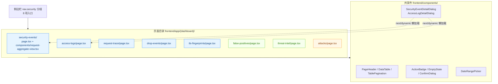
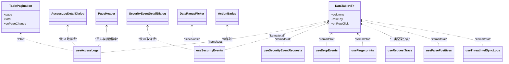
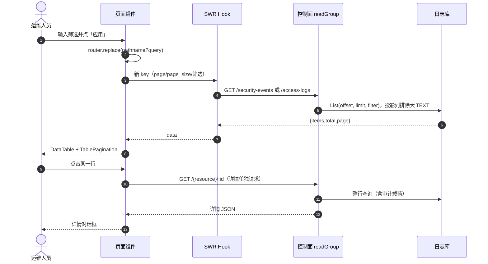
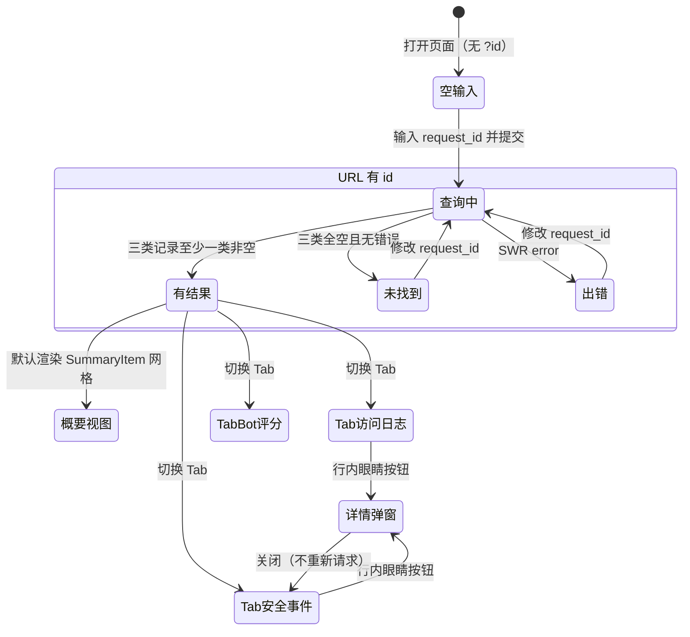
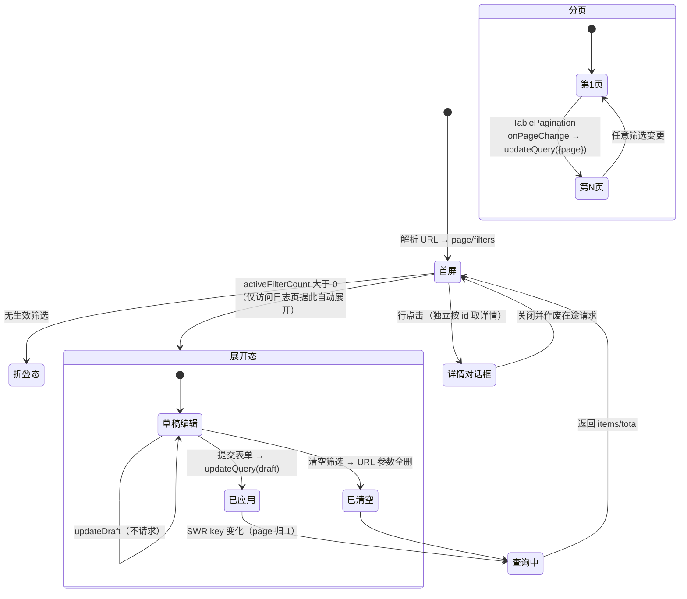
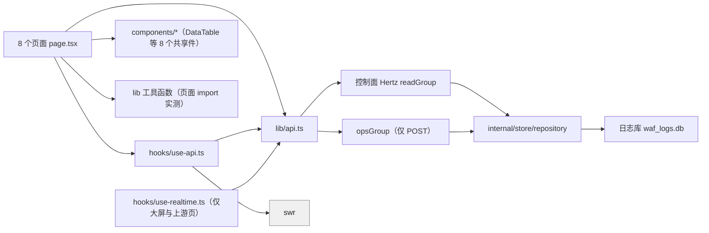
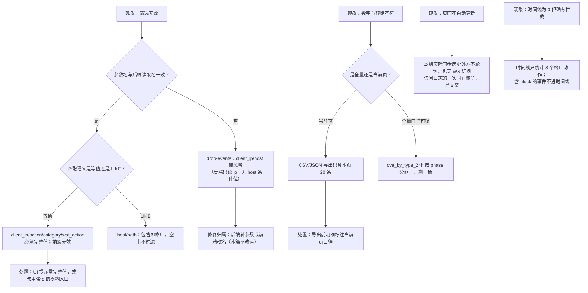

# 事件与日志页面

<cite>
**本文档引用的文件**
- [frontend/app/(dashboard)/access-logs/page.tsx](file://frontend/app/(dashboard)/access-logs/page.tsx)
- [frontend/app/(dashboard)/security-events/page.tsx](file://frontend/app/(dashboard)/security-events/page.tsx)
- [frontend/app/(dashboard)/security-events/components/request-aggregate-view.tsx](file://frontend/app/(dashboard)/security-events/components/request-aggregate-view.tsx)
- [frontend/app/(dashboard)/drop-events/page.tsx](file://frontend/app/(dashboard)/drop-events/page.tsx)
- [frontend/app/(dashboard)/attacks/page.tsx](file://frontend/app/(dashboard)/attacks/page.tsx)
- [frontend/app/(dashboard)/false-positives/page.tsx](file://frontend/app/(dashboard)/false-positives/page.tsx)
- [frontend/app/(dashboard)/request-trace/page.tsx](file://frontend/app/(dashboard)/request-trace/page.tsx)
- [frontend/app/(dashboard)/tls-fingerprints/page.tsx](file://frontend/app/(dashboard)/tls-fingerprints/page.tsx)
- [frontend/app/(dashboard)/threat-intel/page.tsx](file://frontend/app/(dashboard)/threat-intel/page.tsx)
- [frontend/app/(dashboard)/layout.tsx](file://frontend/app/(dashboard)/layout.tsx)
- [frontend/components/sidebar-nav.tsx](file://frontend/components/sidebar-nav.tsx)
- [frontend/components/date-range-picker.tsx](file://frontend/components/date-range-picker.tsx)
- [frontend/hooks/use-api.ts](file://frontend/hooks/use-api.ts)
- [frontend/hooks/use-realtime.ts](file://frontend/hooks/use-realtime.ts)
- [frontend/lib/api.ts](file://frontend/lib/api.ts)
- [frontend/lib/route-titles.ts](file://frontend/lib/route-titles.ts)
- [internal/admin/router.go](file://internal/admin/router.go)
- [internal/admin/event/access.go](file://internal/admin/event/access.go)
- [internal/admin/event/security.go](file://internal/admin/event/security.go)
- [internal/admin/event/false_positive.go](file://internal/admin/event/false_positive.go)
- [internal/admin/protect/drop/drop.go](file://internal/admin/protect/drop/drop.go)
- [internal/admin/system/dashboard/dashboard.go](file://internal/admin/system/dashboard/dashboard.go)
- [internal/admin/detect/owasprules/owasp_rules.go](file://internal/admin/detect/owasprules/owasp_rules.go)
- [internal/admin/detect/owasprules/owasp_read_query.go](file://internal/admin/detect/owasprules/owasp_read_query.go)
- [internal/store/repository/access_log.go](file://internal/store/repository/access_log.go)
- [internal/store/repository/security_event.go](file://internal/store/repository/security_event.go)
- [internal/store/repository/security_event_aggregate_cache.go](file://internal/store/repository/security_event_aggregate_cache.go)
- [internal/store/repository/drop_event.go](file://internal/store/repository/drop_event.go)
- [internal/utils/utils.go](file://internal/utils/utils.go)
- [internal/core/rules/phases.go](file://internal/core/rules/phases.go)
- [internal/waf/owasp/owasp.go](file://internal/waf/owasp/owasp.go)
</cite>

## 目录

1. [简介](#简介)
2. [项目结构](#项目结构)
3. [核心组件](#核心组件)
4. [架构总览](#架构总览)
5. [详细组件分析](#详细组件分析)
6. [依赖关系分析](#依赖关系分析)
7. [性能考虑](#性能考虑)
8. [故障排查指南](#故障排查指南)
9. [结论](#结论)
10. [附录](#附录)

## 简介

「事件与日志页面」是控制台的事后取证与情报运营入口，共 8 个页面目录，隶属侧边栏 `nav.security` 分组与情报分组：访问日志、安全事件、请求追踪、丢弃事件、TLS 指纹、误报反馈、威胁情报，以及挂在安全分组下的攻击防护快捷配置页。覆盖行数：`access-logs/`（679）、`security-events/`（769 + `components/request-aggregate-view.tsx` 165）、`drop-events/`（183）、`attacks/`（1525）、`false-positives/`（399）、`request-trace/`（828）、`tls-fingerprints/`（261）、`threat-intel/`（910）。

四条实测口径必须先立清楚，后续所有结论都依赖它们：

| 口径 | 实测事实 | 反直觉之处 |
|------|----------|------------|
| 实时通道 | `/api/v1/realtime/ws` 是 **WebSocket**，前端 `use-realtime.ts:59` 用 `new WebSocket`；全库无 `EventSource` | `internal/dataplane/sse.go` 是面向**客户上游**的事件流透传，与控制台实时推送无关 |
| 本 8 页是否用 WS | **都不使用**。`useRealtimeEvents` 的消费者是 `app/security-dashboard/page.tsx`，`useRealtimeOverview` 是 `upstream-status` | `access-logs` 页头有「实时」徽章与 `accessLogs.liveBadge`，但该页既无 WS 订阅也无 `refreshInterval` |
| 列表载荷 | 列表查询显式排除大 TEXT 审计列，详情按需单独取 | 见 `access_log.go:313-324` 与 `security_event.go:98-106` |
| 写操作 | 全部为 POST（`/update`、`/delete`、`/sync`、`/status`） | 前端 `api.ts` 的 `put()`/`del()` 无调用方 |

另需明确：`attacks/` 目录名易被误读为「攻击日志」，实测它是**全局 OWASP 快捷配置页**（模块模式、全局灵敏度、升级阶梯、按阶段跳过路径），不查询任何日志表；它被排在安全分组里是导航归组选择，不是数据归属。章节级的通用组件与 CRUD 组合模式见 `../组件设计模式/CRUD 页面组件.md`，SWR 与缓存失效的整体策略见 `../状态管理策略.md`。

**章节来源**
- [frontend/hooks/use-realtime.ts:11-134](file://frontend/hooks/use-realtime.ts#L11-L134)
- [frontend/app/(dashboard)/access-logs/page.tsx:407-430](file://frontend/app/(dashboard)/access-logs/page.tsx#L407-L430)
- [internal/store/repository/access_log.go:313-324](file://internal/store/repository/access_log.go#L313-L324)
- [internal/store/repository/security_event.go:98-106](file://internal/store/repository/security_event.go#L98-L106)
- [frontend/components/sidebar-nav.tsx:204-249](file://frontend/components/sidebar-nav.tsx#L204-L249)

## 项目结构

**图表来源**
- [frontend/components/sidebar-nav.tsx:204-249](file://frontend/components/sidebar-nav.tsx#L204-L249)
- [frontend/app/(dashboard)/access-logs/page.tsx:34-38](file://frontend/app/(dashboard)/access-logs/page.tsx#L34-L38)
- [frontend/app/(dashboard)/security-events/page.tsx:55-59](file://frontend/app/(dashboard)/security-events/page.tsx#L55-L59)
- [frontend/app/(dashboard)/request-trace/page.tsx:48-57](file://frontend/app/(dashboard)/request-trace/page.tsx#L48-L57)

| 目录 | 子文件 | 页面类型 | 状态载体 | 写操作 |
|------|--------|----------|----------|--------|
| `access-logs/` | 仅 `page.tsx` | 只读列表 + 详情弹窗 | URL 查询参数 | 无 |
| `security-events/` | `page.tsx` + `components/request-aggregate-view.tsx` | 双视图列表 + 批量写 | URL 查询参数 | `POST /ip-lists` |
| `request-trace/` | 仅 `page.tsx` | 单请求三联详情 | URL `?id=` | 无 |
| `drop-events/` | 仅 `page.tsx` | 只读列表 | 组件内 `useState` | 无 |
| `tls-fingerprints/` | 仅 `page.tsx` | 只读列表 + 本地详情弹窗 | 组件内 `useState` | 无 |
| `false-positives/` | 仅 `page.tsx` | 审批列表 | 组件内 `useState` | `POST /false-positives/:id/status`、`/delete` |
| `threat-intel/` | 仅 `page.tsx`（内部两 Tab） | CRUD + 同步历史 | 组件内 `useState` | `POST /threat-intel-feeds*` |
| `attacks/` | 仅 `page.tsx` | 快捷配置（非日志） | 组件内 `useState` | `POST /owasp-rules/batch`、`/protection-settings`、`/protection/global/*` |

技术栈约束（实测于代码而非推断，与 `../Next.js 架构设计/` 一致）：项目为 `output: "export"` 静态导出且 `trailingSlash: true`；每个使用 `useSearchParams()` 的页面必须处在 `Suspense` 边界内——本组中 `access-logs`、`request-trace` 自建边界（各自 `page.tsx` 末尾的 `Suspense` 包裹），其余复用 `(dashboard)/layout.tsx:25` 的统一边界。

**章节来源**
- [frontend/app/(dashboard)/layout.tsx:19-36](file://frontend/app/(dashboard)/layout.tsx#L19-L36)
- [frontend/app/(dashboard)/access-logs/page.tsx:653-679](file://frontend/app/(dashboard)/access-logs/page.tsx#L653-L679)
- [frontend/app/(dashboard)/request-trace/page.tsx:820-828](file://frontend/app/(dashboard)/request-trace/page.tsx#L820-L828)
- [frontend/app/(dashboard)/drop-events/page.tsx:18-46](file://frontend/app/(dashboard)/drop-events/page.tsx#L18-L46)
- [frontend/app/(dashboard)/tls-fingerprints/page.tsx:50-58](file://frontend/app/(dashboard)/tls-fingerprints/page.tsx#L50-L58)

## 核心组件

页面清单表（主组件为该目录默认导出；端点为读链路首站）：

| 页面 | 目录:行 | 主组件 | 调用端点 | 刷新方式 |
|------|---------|--------|----------|----------|
| 访问日志 | `access-logs/page.tsx:673` | `AccessLogsPage` → `AccessLogsContent` | `GET /access-logs`、`GET /access-logs/:id` | URL 变化触发 SWR；无轮询 |
| 安全事件 | `security-events/page.tsx:97` | `SecurityEventsPage` | `GET /security-events`、`GET /security-events/:id` | URL 变化触发 SWR；无轮询 |
| 请求聚合视图 | `security-events/components/request-aggregate-view.tsx:46` | `RequestAggregateView` | `GET /security-events/requests` | 父页 URL 参数驱动 |
| 丢弃事件 | `drop-events/page.tsx:18` | `DropEventsPage` | `GET /drop-events` | 本地 `page`/`filters` 状态 |
| 攻击防护 | `attacks/page.tsx:1020` | `AttacksPage` | `GET /owasp-rules`、`GET /protection-settings`、`GET /protection/global/{sensitivity,escalation}` | 手动 `mutate()` 重试 |
| 误报反馈 | `false-positives/page.tsx:75` | `FalsePositivesPage` | `GET /false-positives` | 本地 `page`/`status` 状态 |
| 请求追踪 | `request-trace/page.tsx:820` | `RequestTracePage` → `RequestTraceContent` | `GET /request/:request_id`、`GET /sites/:id` | 输入 `request_id` 后 `router.replace` |
| TLS 指纹 | `tls-fingerprints/page.tsx:50` | `TLSFingerprintsPage` | `GET /fingerprints` | 本地 `page` 状态 |
| 威胁情报 | `threat-intel/page.tsx:99` | `ThreatIntelPage` → `FeedsTab` / `SyncHistoryTab` | `GET /threat-intel-feeds`、`GET /threat-intel-sync-logs` | 订阅源手动 `refresh()`；历史 30s 轮询 |

Hook 与端点的绑定集中在 `hooks/use-api.ts`，请求构造集中在 `lib/api.ts`。本组页面涉及的读 Hook 与其 SWR key 前缀：

| Hook | SWR key 前缀 | 定义行 | 轮询 |
|------|--------------|--------|:----:|
| `useAccessLogs` | `access-logs` | `use-api.ts:560` | 无 |
| `useSecurityEvents` | `security-events` | `use-api.ts:522` | 无 |
| `useSecurityEventRequests` | `security-event-requests` | `use-api.ts:554` | 无 |
| `useSecurityEventStats` | `security-event-stats` | `use-api.ts:528` | 无（**全库无消费者**） |
| `useDropEvents` | `drop-events` | `use-api.ts:600` | 无 |
| `useFingerprints` | `fingerprints` | `use-api.ts:1483` | 无 |
| `useRequestTrace` | `request-trace` | `use-api.ts:568` | 无 |
| `useFalsePositives` | `false-positives` | `use-api.ts:1293` | 无 |
| `useThreatIntelFeeds` | `threat-intel-feeds` | `use-api.ts:938` | 无 |
| `useThreatIntelSyncLogs` | `threat-intel-sync-logs` | `use-api.ts:978` | 30000ms |
| `useOwaspRules` | `owasp-rules` | `use-api.ts:588` | 无（`dedupingInterval` 30s） |

写链路的缓存失效统一走 5 个具名函数（`invalidateAllAPICaches`、`invalidateIPListCaches`、`invalidateSiteCaches`、`invalidateCVERuleCaches`、`invalidateOWASPRuleCaches`）加 `useMutation` 的 `invalidateKeys` 前缀数组；本组页面实际用到的是 `invalidateIPListCaches`（安全事件批量拉黑）与 `invalidateKeys: ["false-positives"]`、`["threat-intel-feeds", "ip-lists"]`、`["owasp-rules", "owasp-stats"]`。不存在 `load()` 式手工重载约定。

**图表来源**
- [frontend/app/(dashboard)/access-logs/page.tsx:237-405](file://frontend/app/(dashboard)/access-logs/page.tsx#L237-L405)
- [frontend/app/(dashboard)/security-events/page.tsx:384-479](file://frontend/app/(dashboard)/security-events/page.tsx#L384-L479)
- [frontend/app/(dashboard)/tls-fingerprints/page.tsx:60-171](file://frontend/app/(dashboard)/tls-fingerprints/page.tsx#L60-L171)
- [frontend/hooks/use-api.ts:522-572](file://frontend/hooks/use-api.ts#L522-L572)
- [frontend/hooks/use-api.ts:978-990](file://frontend/hooks/use-api.ts#L978-L990)

**章节来源**
- [frontend/app/(dashboard)/access-logs/page.tsx:673-679](file://frontend/app/(dashboard)/access-logs/page.tsx#L673-L679)
- [frontend/app/(dashboard)/security-events/page.tsx:97-120](file://frontend/app/(dashboard)/security-events/page.tsx#L97-L120)
- [frontend/app/(dashboard)/threat-intel/page.tsx:99-132](file://frontend/app/(dashboard)/threat-intel/page.tsx#L99-L132)
- [frontend/hooks/use-api.ts:191-247](file://frontend/hooks/use-api.ts#L191-L247)
- [frontend/hooks/use-api.ts:522-602](file://frontend/hooks/use-api.ts#L522-L602)
- [frontend/hooks/use-api.ts:1293-1331](file://frontend/hooks/use-api.ts#L1293-L1331)
- [frontend/hooks/use-api.ts:1483-1490](file://frontend/hooks/use-api.ts#L1483-L1490)

## 架构总览

浏览器侧的读链路只有一条：页面 → SWR Hook → `lib/api.ts` 的 `get()` → 控制面 Hertz 路由（`readGroup`）→ 仓储层 → 日志库 `waf_logs.db`；WebSocket 通道独立存在，只服务监控大屏与上游状态页，不参与本组页面。

**图表来源**
- [frontend/app/(dashboard)/access-logs/page.tsx:153-235](file://frontend/app/(dashboard)/access-logs/page.tsx#L153-L235)
- [frontend/app/(dashboard)/security-events/page.tsx:130-149](file://frontend/app/(dashboard)/security-events/page.tsx#L130-L149)
- [internal/admin/event/access.go:15-86](file://internal/admin/event/access.go#L15-L86)
- [internal/admin/event/security.go:41-52](file://internal/admin/event/security.go#L41-L52)
- [internal/store/repository/access_log.go:313-326](file://internal/store/repository/access_log.go#L313-L326)

分层归属与端点前缀（`readGroup` = 只读权限即可访问，`opsGroup` = operator 及以上，`adminGroup` = 仅 admin）：

| 层 | 实体 | 关键位置 |
|----|------|----------|
| 页面 | 8 个 `page.tsx` + 1 个子视图 | `frontend/app/(dashboard)/` |
| 状态与传输 | SWR key + `useState` 草稿 → `get()`/`post()` | `hooks/use-api.ts`、`lib/api.ts:913-953`、`1184-1208`、`1270-1285`、`1362-1365` |
| 路由 | `GET /access-logs{,/:id}`、`/security-events{,/requests,/timeline,:id}`、`/fingerprints`、`/request/:request_id`、`/drop-events`、`/false-positives`、`/threat-intel-{feeds,sync-logs}` | `internal/admin/router.go:157-191`、`244`（`readGroup` 只读，`opsGroup` 需 operator 及以上，`adminGroup` 仅 admin） |
| 仓储 | `AccessLogRepo`、`SecurityEventRepo`、`DropEventRepo`、`ThreatIntelSyncLogRepo`、`FalsePositiveRepo` → 日志库 `waf_logs.db` | `internal/store/repository/` |

`GET /fingerprints` 名义上是「指纹」，实测处理器是 `event.ListTLSFingerprints(r.AccessLog)`（`router.go:178`），数据来自 `AccessLogRepo.ListFingerprints`（`access_log.go:526`）——即**访问日志的 TLS 字段聚合**，不是独立指纹表。

**章节来源**
- [internal/admin/router.go:157-191](file://internal/admin/router.go#L157-L191)
- [internal/admin/router.go:244](file://internal/admin/router.go#L244)
- [internal/store/repository/access_log.go:526](file://internal/store/repository/access_log.go#L526)
- [frontend/lib/api.ts:913-953](file://frontend/lib/api.ts#L913-L953)
- [frontend/lib/api.ts:1362-1365](file://frontend/lib/api.ts#L1362-L1365)

## 详细组件分析

### 访问日志页（access-logs）

页面主体是无导出状态的函数组件 `AccessLogsContent`，URL 即唯一真值来源：`readFilters()` 从 `searchParams` 读 6 个筛选键，`parsePositivePage()` 只接受 ≥1 的整数页码，非法值回落 1（`page.tsx:62-80`）。筛选草稿用「按 URL 快照判定新鲜度」的模式：`draftState.source === queryString` 时才使用草稿，否则回落 URL 值（`page.tsx:135-139`），因此浏览器前进/后退与外部深链不会把过期草稿带进查询。

列定义共 7 列，每列把两个语义相近的字段压进同一格以省横向宽度：

| 列 key | 标题 i18n | 宽度 | 渲染内容 |
|---------|-----------|------|----------|
| `created_at` | `accessLogs.time` | 168px | 秒级时间 + `request_id`（缺失时显示 `#id`） |
| `client` | `accessLogs.ip` | 190px | `client_ip` + `host` |
| `request` | `accessLogs.path` | `min(34vw, 420px)` | `method` 徽章 + `path` 两行截断 |
| `verdict` | `accessLogs.wafAction` | 148px | 状态码徽章（按区间着色）+ `ActionBadge` + 来源徽章 |
| `performance` | `requestTrace.upstreamLatency` | 150px | 上游耗时 + 请求/响应体积 |
| `upstream` | `requestTrace.upstream` | 210px | 上游地址 + 前后端协议转换 + `cache_state` |
| `operations` | `common.action` | 84px | 详情按钮 + 「追踪本请求」深链到 `/request-trace?id=` |

详情走 `accessLogApi.get(row.id)` 单独拉取，并用 `detailRequestRef` 单调递增序号丢弃过期响应，避免快速点击多行时旧请求覆盖新数据（`page.tsx:199-235`）。`onRowClick` 与行内按钮 `stopPropagation` 并用，保证按钮点击不会重复触发行级打开。

页头的 `accessLogs.realtimeTotal` + 青色圆点 + `accessLogs.liveBadge`（「实时 / Live」）是纯静态文案徽章：该页没有 WS 订阅、`useAccessLogs` 也没有 `refreshInterval`，数值只在 URL 变化或组件重挂载时更新。按项目「前端统计卡不得冒充全量/实时指标」的既有约定，这一徽章的措辞与实际刷新能力不符，已登记在故障排查一节。

**章节来源**
- [frontend/app/(dashboard)/access-logs/page.tsx:40-80](file://frontend/app/(dashboard)/access-logs/page.tsx#L40-L80)
- [frontend/app/(dashboard)/access-logs/page.tsx:113-235](file://frontend/app/(dashboard)/access-logs/page.tsx#L113-L235)
- [frontend/app/(dashboard)/access-logs/page.tsx:237-405](file://frontend/app/(dashboard)/access-logs/page.tsx#L237-L405)
- [frontend/app/(dashboard)/access-logs/page.tsx:407-430](file://frontend/app/(dashboard)/access-logs/page.tsx#L407-L430)
- [internal/admin/event/access.go:15-86](file://internal/admin/event/access.go#L15-L86)

### 安全事件页（security-events）

同一套筛选参数服务两个视图：`view=events`（逐条）与 `view=requests`（按 `request_id` 聚合）。`parseViewMode()` 只接受 `requests`，其余一律回落事件视图（`page.tsx:80-95`），因此 `eventQueryParams` 在请求视图下置为 `null` 以彻底跳过事件查询（`page.tsx:190-198`），两视图不会同时打两个列表请求。

批量选择的范围被显式钉在「当前页 + 当前筛选」：`selectionScope = page:JSON(filters)`，作用域一变即视为选择失效（`page.tsx:202-210`）。批量加入黑名单按 `client_ip` 去重后逐条 `POST /ip-lists`，统计成功/失败数，仅在 `success > 0` 时调用 `invalidateIPListCaches()`（`page.tsx:338-382`）。动作筛选下拉复用 `actionLabelMap` 的 13 个取值（`page.tsx:100-114`），比访问日志页的 7 个动作多出 `captcha_challenge`、`shield_challenge`、`chain_challenge`、`drop`、`redirect`、`tag`，与 WAF 动作语义对齐。

导出 CSV/JSON 的数据源是 `items`，即**当前页**，不是全量：

| 动作 | 数据源 | 口径标注 | 代码位置 |
|------|--------|----------|----------|
| 导出 CSV | `items`（当前页 20 条） | 文件名含时间戳，无「当前页」提示 | `page.tsx:271-311` |
| 导出 JSON | `items`（当前页） | 同上 | `page.tsx:313-321` |
| 页头总数徽章 | 后端 `total`（全量） | `securityEvents.total` | `page.tsx:486-492` |
| 请求视图总数 | 后端 `total`（去重请求数） | `securityEvents.requests.totalScope` 显式说明口径 | `request-aggregate-view.tsx:132-139` |

CSV 单元格统一加引号并对 `"` 双写转义，输出前插 UTF-8 BOM（`page.tsx:302-306`），Excel 中文不乱码；`match_desc` 先经 `localizeMatchDesc()` 本地化再导出。

**章节来源**
- [frontend/app/(dashboard)/security-events/page.tsx:80-114](file://frontend/app/(dashboard)/security-events/page.tsx#L80-L114)
- [frontend/app/(dashboard)/security-events/page.tsx:130-210](file://frontend/app/(dashboard)/security-events/page.tsx#L130-L210)
- [frontend/app/(dashboard)/security-events/page.tsx:271-382](file://frontend/app/(dashboard)/security-events/page.tsx#L271-L382)
- [frontend/app/(dashboard)/security-events/page.tsx:682-755](file://frontend/app/(dashboard)/security-events/page.tsx#L682-L755)
- [frontend/app/(dashboard)/security-events/components/request-aggregate-view.tsx:5-59](file://frontend/app/(dashboard)/security-events/components/request-aggregate-view.tsx#L5-L59)

### 请求级聚合视图

`RequestAggregateView` 是纯展示子组件：筛选参数与分页状态都由父页持有，自己只调用 `useSecurityEventRequests({page, page_size, ...filterParams})`。它的 `total` 语义在文件头注释里写明是**按 `request_id` 去重后的请求数，不是事件条数**（`request-aggregate-view.tsx:5-11`），这是本组页面里唯一把统计口径同时写在代码注释与界面文案两处的视图，符合「不得用局部数字冒充全量指标」的项目约定。

三列 `request_id` / `event_count` / `last_seen`，两个入口（ID 文本按钮与行尾图标）都走 `router.push("/request-trace?id=...")`。`rowKey` 用 `request_id` 而非自增 ID，因为聚合行没有唯一数字主键；`formatLastSeen()` 对非法时间串返回 `-`，避免表格出现 `Invalid Date`。

**章节来源**
- [frontend/app/(dashboard)/security-events/components/request-aggregate-view.tsx:5-165](file://frontend/app/(dashboard)/security-events/components/request-aggregate-view.tsx#L5-L165)
- [internal/admin/event/security.go:66-77](file://internal/admin/event/security.go#L66-L77)
- [internal/store/repository/security_event.go:194](file://internal/store/repository/security_event.go#L194)

### 丢弃事件页（drop-events）

最短的一页：6 列表格（时间、IP、来源、Host、路径）+ 3 个筛选项（Source、IP、Host），全部状态在组件内 `useState`，不入 URL，因此不可深链、刷新即丢。

该页存在一处**已核实的过滤失效缺陷**：前端提交 `client_ip` 与 `host`，而全局端点 `GetDropEvents` 只读 `ip` 与 `source`：

| 参数 | 前端来源 | 后端读取字段 | 是否生效 |
|------|----------|--------------|:--------:|
| `page` | `drop-events/page.tsx:29` | `ip` 之外的分页：`drop.go:150` | 是 |
| `page_size` | `drop-events/page.tsx:29` | `drop.go:151` | 是 |
| `source` | `drop-events/page.tsx:129` | `drop.go:156` → `DropEventFilter.Source`（`drop_event.go:44`） | 是 |
| `client_ip` | `drop-events/page.tsx:139` | **无**（后端只读 `ip`，`drop.go:155`） | 否 |
| `host` | `drop-events/page.tsx:149` | **无**（`DropEventFilter` 无 Host 字段，`drop_event.go:41-47`） | 否 |

`ip` 精确匹配（`drop_event.go:97` 用 `client_ip = ?`），即便前端改名也必须精确 IP 才有效果；`host` 则在仓储层根本没有条件位，属结构性缺失而非参数名不一致。`start_time`/`end_time` 两个 RFC3339 时间窗参数后端支持（`drop.go:158-167`）但前端未暴露。

**章节来源**
- [frontend/app/(dashboard)/drop-events/page.tsx:18-183](file://frontend/app/(dashboard)/drop-events/page.tsx#L18-L183)
- [internal/admin/protect/drop/drop.go:148-176](file://internal/admin/protect/drop/drop.go#L148-L176)
- [internal/store/repository/drop_event.go:41-107](file://internal/store/repository/drop_event.go#L41-L107)

### 筛选参数与后端读取对照

访问日志与安全事件的读端点共用一张过滤能力表。前端来源为 URL 参数名，后端来源为查询取值语句，语义来自仓储层过滤实现。

| 参数 | 前端来源 | 后端读取字段 | 是否生效 |
|------|----------|--------------|:--------:|
| `waf_action` | `access-logs/page.tsx:73` | `access.go:29` | 是（等值，`access_log.go:961`） |
| `status_group` | `access-logs/page.tsx:74` | `access.go:31` | 是（区间，`access_log.go:966-975`） |
| `client_ip` | `access-logs/page.tsx:75` | `access.go:24` | 是（**精确等值**，`access_log.go:946`） |
| `host` / `path` | `access-logs/page.tsx:76-77` | `access.go:25-26` | 是（`LIKE %v%`，`access_log.go:949/952`） |
| `site_id` | `access-logs/page.tsx:78` | `access.go:47-51` | 是（等值，`access_log.go:933`） |
| `page` / `page_size` | `access-logs/page.tsx:141-148` | `access.go:17-19` | 是；`page_size` 上限 200（`utils.go:9`） |
| `status_code` | 旧深链残留 | **无** | 否；`updateQuery` 主动 `delete("status_code")`（`access-logs/page.tsx:156`） |
| `action` / `category` | `security-events/page.tsx:155-156` | `security.go:93/95` | 是（均为**等值**，`security_event.go:659/665`） |
| `client_ip` / `host` / `path` | `security-events/page.tsx:157-159` | `security.go:96-98` | 是（IP 等值 `:671`，后两者 `LIKE` `:674/677`） |
| `site_id` | `security-events/page.tsx:160` | `security.go:122-126` | 是（等值） |
| `since` / `until` | `DateRangePicker` → `toISOString()` | `security.go:127-137` | 是（RFC3339 解析失败则静默忽略） |
| `phase`/`q`/`request_id`/`rule_id_str`/TLS 系列 | 前端未暴露 | `security.go:91-110` | 后端可用、控制台无入口 |
| `status` | `false-positives/page.tsx:90-94` | `false_positive.go:30` | 是 |
| `feed_id` / `status` | `threat-intel/page.tsx:718-729` | `router.go:158` 对应处理器 | 是 |

`category` 后端是等值匹配，前端却是自由文本输入框（`security-events/page.tsx:618-625`，占位符为「类别」提示），输入 `sql` 或 `Sqli` 都会得到空结果而非模糊命中——这是「输入框承载等值过滤」的交互风险，应在文档层面记为待改进项，不改代码。

**章节来源**
- [frontend/app/(dashboard)/access-logs/page.tsx:141-196](file://frontend/app/(dashboard)/access-logs/page.tsx#L141-L196)
- [frontend/app/(dashboard)/security-events/page.tsx:150-175](file://frontend/app/(dashboard)/security-events/page.tsx#L150-L175)
- [frontend/components/date-range-picker.tsx:105-122](file://frontend/components/date-range-picker.tsx#L105-L122)
- [internal/admin/event/access.go:15-61](file://internal/admin/event/access.go#L15-L61)
- [internal/admin/event/security.go:89-137](file://internal/admin/event/security.go#L89-L137)
- [internal/admin/event/false_positive.go:22-30](file://internal/admin/event/false_positive.go#L22-L30)
- [internal/store/repository/access_log.go:927-987](file://internal/store/repository/access_log.go#L927-L987)
- [internal/store/repository/security_event.go:643-688](file://internal/store/repository/security_event.go#L643-L688)
- [internal/utils/utils.go:8-37](file://internal/utils/utils.go#L8-L37)

### 请求追踪页（request-trace）

一次 `GET /request/:request_id` 同时返回三种记录（`access_logs` / `security_events` / `bot_scores`），页面按三个 Tab 展示，Tab 切换不产生任何新请求。输入框用「草稿带来源戳」模式（`page.tsx:121-127`），回车与按钮都走 `router.replace("/request-trace?id=...")`。

概要卡字段的取值优先级是显式编排的：以访问日志为首选，安全事件次之，Bot 评分兜底（`page.tsx:171-232`）。两条细节构成正确性支点：`waf_action` 缺失时会从事件里挑第一个**非 `observe` 非 `allow`** 的动作，再兜底首个事件动作，最终才是 `-`；TLS SNI 的「有/无/未知」判定标记必须与 SNI 名**同源同序**取用（`accessLog → securityEvent → botScore`），避免名字来自日志、判定来自事件的错配（`page.tsx:208-215` 的注释明确这一点）。

站点名不做全量站点扫描，而是从记录里的第一个 `site_id > 0` 反查单站点（`page.tsx:132-140`），避免为一个站点名分页读取最多 2000 条站点。详情弹窗复用同一套共享对话框组件，且这里**直接用列表行数据**打开（`setSelectedLog(row)`），因为追踪端点已返回整行，不需要二次按 ID 取详情。

**图表来源**
- [frontend/app/(dashboard)/request-trace/page.tsx:116-168](file://frontend/app/(dashboard)/request-trace/page.tsx#L116-L168)
- [frontend/app/(dashboard)/request-trace/page.tsx:171-232](file://frontend/app/(dashboard)/request-trace/page.tsx#L171-L232)
- [frontend/app/(dashboard)/request-trace/page.tsx:734-815](file://frontend/app/(dashboard)/request-trace/page.tsx#L734-L815)

三张子表分别是访问日志 7 列、安全事件 7 列、Bot 评分 6 列。访问日志列与 `access-logs` 页口径一致，差异在于这里的数据来自追踪端点的整行；安全事件列多出 `phase`（用 `phaseLabel()` 本地化）与 `match_desc`（过 `localizeMatchDesc()`）；Bot 评分列把 `geoip`/`fingerprint`/`behavior`/`ip_rep` 四项分项内联在总分格内，另设指纹列展示 TLS 版本、SNI 判定、ALPN、JA4 与 JA3 摘要五行堆叠。

**章节来源**
- [frontend/app/(dashboard)/request-trace/page.tsx:6-14](file://frontend/app/(dashboard)/request-trace/page.tsx#L6-L14)
- [frontend/app/(dashboard)/request-trace/page.tsx:116-232](file://frontend/app/(dashboard)/request-trace/page.tsx#L116-L232)
- [frontend/app/(dashboard)/request-trace/page.tsx:234-560](file://frontend/app/(dashboard)/request-trace/page.tsx#L234-L560)
- [internal/admin/router.go:179](file://internal/admin/router.go#L179)

### TLS 指纹页（tls-fingerprints）

9 列表格 + 一个纯本地的详情 `Dialog`（详情内容来自列表行对象，**不发起第二次请求**）。主指纹标识优先 `tls_ja4`，缺失时回退 `tls_ja3_hash`（`page.tsx:28-31`），`rowKey` 直接用该主指纹串。

详情弹窗列出 9 个字段（JA4、SNI、JA3 摘要、扩展、曲线、点格式、UA、客户端 IP、头序），其中 SNI 一格复用 `isClientSentNoSNI()` 判定，把「客户端确实未发送 SNI」与「字段为空」区分显示。该页的已知一致性缺口是**标题映射缺项**：`lib/route-titles.ts` 的 `routeTitleKeyMap`/`segmentKeyMap` 收录了 `/drop-events`、`/false-positives`、`/threat-intel`、`/request-trace` 等（`route-titles.ts:23-62`），但没有 `/tls-fingerprints`，而侧边栏却有该项（`sidebar-nav.tsx:247-249`）→ 面包屑与页标题会回落。

**章节来源**
- [frontend/app/(dashboard)/tls-fingerprints/page.tsx:23-31](file://frontend/app/(dashboard)/tls-fingerprints/page.tsx#L23-L31)
- [frontend/app/(dashboard)/tls-fingerprints/page.tsx:60-258](file://frontend/app/(dashboard)/tls-fingerprints/page.tsx#L60-L258)
- [frontend/lib/route-titles.ts:23-62](file://frontend/lib/route-titles.ts#L23-L62)
- [frontend/components/sidebar-nav.tsx:245-249](file://frontend/components/sidebar-nav.tsx#L245-L249)

### 误报反馈页（false-positives）

审批型列表：10 列，行内可展开「命中详情」面板（在表格下方渲染 `pre` 块，非行内展开行，`page.tsx:346-374`），展开态只保存一个 `expandedId`，切页不保留。

权限分两档：`canReview`（admin 或 operator）可改状态，`isAdmin`（仅 admin）可删除（`page.tsx:77-79`）。状态取值三种（`pending`/`confirmed`/`rejected`），写操作是 `POST /false-positives/:id/status`，失效键 `["false-positives"]`；删除走 `ConfirmDialog` 二段确认。筛选只有一个 `status` 下拉，且「全部」用哨兵值 `all` 而非空串（`page.tsx:310-312`），提交前转成 `undefined`（`page.tsx:93`），避免把空串发给后端。

**章节来源**
- [frontend/app/(dashboard)/false-positives/page.tsx:47-138](file://frontend/app/(dashboard)/false-positives/page.tsx#L47-L138)
- [frontend/app/(dashboard)/false-positives/page.tsx:140-276](file://frontend/app/(dashboard)/false-positives/page.tsx#L140-L276)
- [frontend/app/(dashboard)/false-positives/page.tsx:299-396](file://frontend/app/(dashboard)/false-positives/page.tsx#L299-L396)
- [frontend/hooks/use-api.ts:1293-1331](file://frontend/hooks/use-api.ts#L1293-L1331)
- [frontend/lib/api.ts:1270-1285](file://frontend/lib/api.ts#L1270-L1285)

### 威胁情报页（threat-intel）

单文件内两 Tab：`FeedsTab`（订阅源 CRUD + 手动同步，11 列）与 `SyncHistoryTab`（同步历史，7 列 + 两个筛选下拉 + 30 秒轮询）。两 Tab 各自调用 `useThreatIntelFeeds()`，靠 SWR `deduping` 合并，不是两份状态。

行内启用开关是**局部合并写**：只提交 `{ enabled }` 一个字段，由后端在现有记录上合并（`page.tsx:237-248`），不重发整份表单，符合「快捷开关不得制造第二配置源」的项目约定。新建/编辑则提交完整 `payload`，其中作用域 `site_id` 在无站点时显式传 `null`、鉴权头名/值空串传 `null`（`page.tsx:214-224`）。同步历史的成功率口径必须写清：`entries_added` 仅成功时显示，失败行显示 `-`（`page.tsx:808-816`）；`total` 来自后端分页聚合，不是当前页计数。三个筛选项中「全部」一律用哨兵值再转 `undefined`，避免把空串发给后端（`page.tsx:718-729`）。

三个写端点（`create`/`update`/`delete`）与手动 `sync` 全部挂 `reload`，因此保存即触发快照重建；失效键统一为 `["threat-intel-feeds", "ip-lists"]`，因为同步产物落在 IP 名单表。

**章节来源**
- [frontend/app/(dashboard)/threat-intel/page.tsx:61-97](file://frontend/app/(dashboard)/threat-intel/page.tsx#L61-L97)
- [frontend/app/(dashboard)/threat-intel/page.tsx:137-266](file://frontend/app/(dashboard)/threat-intel/page.tsx#L137-L266)
- [frontend/app/(dashboard)/threat-intel/page.tsx:280-444](file://frontend/app/(dashboard)/threat-intel/page.tsx#L280-L444)
- [frontend/app/(dashboard)/threat-intel/page.tsx:707-908](file://frontend/app/(dashboard)/threat-intel/page.tsx#L707-L908)
- [frontend/hooks/use-api.ts:938-990](file://frontend/hooks/use-api.ts#L938-L990)
- [internal/admin/router.go:157-158](file://internal/admin/router.go#L157-L158)
- [internal/admin/router.go:293-296](file://internal/admin/router.go#L293-L296)

### 攻击防护快捷配置页（attacks）

该页不读日志，但排在安全分组，必须按配置页口径审阅。页面由 5 个区块组成：防护模式（跟随全局/自定义）、全局内置 OWASP 开关、按类别灵敏度、升级阶梯、按阶段跳过路径，末尾是 10 个攻击模块的档位卡片。模块档位到后端字段是纯函数映射 `modeToOverride()`（`page.tsx:224-239`）：

| 模式 | `enabled` | `action` | `sensitivity` | 推断条件（`inferMode`） |
|------|:---------:|----------|---------------|--------------------------|
| `disabled` | false | 空 | 空 | 该类别全部规则 `enabled` 为假 |
| `observe` | true | `observe` | 空 | 全部规则启用且动作为 `observe` |
| `balanced`（默认） | true | `intercept` | `medium` | 其余混合情况兜底 |
| `strict` | true | `intercept` | `high` | 全部启用、动作 `intercept` 或空、敏感度 `high`/`strict` |

保存分两条路（`page.tsx:1137-1200`）：「跟随全局」提交 `{policy_id, reset_all: true}`，后端拒绝与 `ids`/`rules` 混用（`owasp_rules.go:431-432`），语义是清空该策略全部 OWASP 覆盖；「自定义」把 10 个模块的档位展开成逐规则 `{id, enabled, action, sensitivity}` 批量提交。

两处口径必须如实标注，避免误读为全量能力。其一，`MODULES` 只有 **10** 项（`page.tsx:110-181`），而后端 OWASP 类别有 **18** 项（`SENSITIVITY_CATEGORIES`，`page.tsx:290-313`）——灵敏度区块覆盖 18 类、快捷档位卡片只覆盖 10 类，二者不是同一集合。其二，`reset_all` 的作用域是**该策略全部规则**，宽于可见的 10 个模块，用户点一次「跟随全局」会连带清掉不可见类别的覆盖，这是本页最容易造成非预期回退的路径。

规则来源为 `useOwaspRules({page_size: 500})`（`page.tsx:1026-1033`）。该端点走自己的钳制 `paginateOWASPViews`（上限 500，缺省与越界都取上限 500，`owasp_read_query.go`），与全站 `MaxPageSize = 200` 不是同一条路径；`grouped` 由**分页后的视图**构造（`owasp_rules.go:112-126`），因此目录规模一旦超过 500，模块推断将只基于首页数据（当前注册表 361 条，尚在单页内）。灵敏度区块的保存是「先铺满再覆盖」：把 18 个类别当前值（缺省填 `mid`）整体展开再叠加草稿（`page.tsx:511-527`），效果是为原本未设置的类别落一个显式 `mid`，把「未配置」变成「已配置为 mid」——不改变检测行为，但继承显示不再是「未覆盖」。档位显示为 6 项（`page.tsx:318-325`）与后端一致；本页提交 `mid`，OWASP 目录页显示 `medium`，两者都被后端识别为同一档（`owasp.go:840-892`）。

**章节来源**
- [frontend/app/(dashboard)/attacks/page.tsx:110-239](file://frontend/app/(dashboard)/attacks/page.tsx#L110-L239)
- [frontend/app/(dashboard)/attacks/page.tsx:275-325](file://frontend/app/(dashboard)/attacks/page.tsx#L275-L325)
- [frontend/app/(dashboard)/attacks/page.tsx:491-610](file://frontend/app/(dashboard)/attacks/page.tsx#L491-L610)
- [frontend/app/(dashboard)/attacks/page.tsx:1020-1046](file://frontend/app/(dashboard)/attacks/page.tsx#L1020-L1046)
- [frontend/app/(dashboard)/attacks/page.tsx:1137-1200](file://frontend/app/(dashboard)/attacks/page.tsx#L1137-L1200)
- [internal/admin/detect/owasprules/owasp_rules.go:100-129](file://internal/admin/detect/owasprules/owasp_rules.go#L100-L129)
- [internal/admin/detect/owasprules/owasp_rules.go:411-446](file://internal/admin/detect/owasprules/owasp_rules.go#L411-L446)
- [internal/admin/detect/owasprules/owasp_read_query.go:84-102](file://internal/admin/detect/owasprules/owasp_read_query.go#L84-L102)
- [internal/waf/owasp/owasp.go:840-892](file://internal/waf/owasp/owasp.go#L840-L892)

### 统计口径与时间线语义

跨页复用时必须统一三个口径，否则同一数字在两处不一致：

| 指标 | 统计口径 | 实测依据 |
|------|----------|----------|
| 事件时间线 | **只统计终止动作**：`intercept`/`drop`/`rate_limit`/`challenge`/`captcha_challenge`/`shield_challenge`/`chain_challenge`/`redirect` 共 8 项 | `security_event.go:617` 定义 `terminalSecurityEventActions`，`:625`/`:636` 在时间线查询加 `action IN (...)` |
| 访问日志拦截数 | 终止动作集合是**另一套**：`intercept`/`block`/`drop`/`challenge`/`captcha_challenge`/`shield_challenge`/`chain_challenge`/`rate_limit` | `access_log.go:415`；注意含 `block` 不含 `redirect` |
| 事件统计挑战数 | 四类挑战动作之和 | `security_event.go:618` 的 `challengeSecurityEventActions` |
| `total`（事件视图） | 满足筛选的事件条数 | `security.go:45` |
| `total`（请求视图） | 按 `request_id` 去重的请求数 | `request-aggregate-view.tsx:5-11` |
| CSV/JSON 导出 | **当前页**条目 | `security-events/page.tsx:286`、`page.tsx:315` |
| `cve_by_type_24h` | 名为「按类型」，实为按 `phase` 分组 | `dashboard.go:247-254`；CVE 阶段名固定为 `cve_detection`（`phases.go:780`）→ 结果只剩一桶 |

两套终止动作集合的差异（`block` 对 `redirect`）意味着「安全事件时间线的拦截趋势」与「访问日志统计的拦截数」在含 `block`/`redirect` 动作的站点上必然不相等。这是既有实现事实，本篇如实登记，不做代码改动。

**章节来源**
- [internal/store/repository/security_event.go:617-640](file://internal/store/repository/security_event.go#L617-L640)
- [internal/store/repository/access_log.go:415-417](file://internal/store/repository/access_log.go#L415-L417)
- [internal/store/repository/security_event_aggregate_cache.go:269-289](file://internal/store/repository/security_event_aggregate_cache.go#L269-L289)
- [internal/admin/system/dashboard/dashboard.go:247-254](file://internal/admin/system/dashboard/dashboard.go#L247-L254)
- [internal/core/rules/phases.go:780](file://internal/core/rules/phases.go#L780)

### 筛选与分页状态机

`access-logs` 与 `security-events` 两页共享同一状态模型：URL 为唯一真值，草稿为临时视图，任何筛选变更都会把页码重置为 1。

**图表来源**
- [frontend/app/(dashboard)/access-logs/page.tsx:119-196](file://frontend/app/(dashboard)/access-logs/page.tsx#L119-L196)
- [frontend/app/(dashboard)/access-logs/page.tsx:228-235](file://frontend/app/(dashboard)/access-logs/page.tsx#L228-L235)
- [frontend/app/(dashboard)/security-events/page.tsx:150-248](file://frontend/app/(dashboard)/security-events/page.tsx#L150-L248)
- [frontend/app/(dashboard)/security-events/page.tsx:682-719](file://frontend/app/(dashboard)/security-events/page.tsx#L682-L719)

两个细节构成该状态机的正确性支点：`updateQuery` 在更新对象不含 `page` 时才把页码重置为 1（`access-logs/page.tsx:161`、`security-events/page.tsx:186`），因此翻页不会清掉筛选、改筛选必然回首页；`drop-events`、`tls-fingerprints`、`false-positives` 三页用 `handleFilterChange`/`setStatus` 里手动 `setPage(1)` 达成同一效果，代价是它们的状态不入 URL，无法深链复现。

**章节来源**
- [frontend/app/(dashboard)/access-logs/page.tsx:153-196](file://frontend/app/(dashboard)/access-logs/page.tsx#L153-L196)
- [frontend/app/(dashboard)/security-events/page.tsx:176-248](file://frontend/app/(dashboard)/security-events/page.tsx#L176-L248)
- [frontend/app/(dashboard)/drop-events/page.tsx:38-46](file://frontend/app/(dashboard)/drop-events/page.tsx#L38-L46)
- [frontend/app/(dashboard)/false-positives/page.tsx:309-314](file://frontend/app/(dashboard)/false-positives/page.tsx#L309-L314)

## 依赖关系分析

**图表来源**
- [frontend/app/(dashboard)/access-logs/page.tsx:3-32](file://frontend/app/(dashboard)/access-logs/page.tsx#L3-L32)
- [frontend/app/(dashboard)/security-events/page.tsx:3-53](file://frontend/app/(dashboard)/security-events/page.tsx#L3-L53)
- [frontend/hooks/use-api.ts:1-46](file://frontend/hooks/use-api.ts#L1-L46)
- [frontend/hooks/use-realtime.ts:1-23](file://frontend/hooks/use-realtime.ts#L1-L23)

依赖矩阵（纵为页面，横为被依赖项，`✓` 表示实际 import）：

| 页面 | use-api | lib/api 直调 | DataTable | TablePagination | 动态详情弹窗 | useAuth | 动态图标库 |
|------|:-------:|:------------:|:---------:|:---------------:|:------------:|:-------:|:----------:|
| access-logs | ✓ | `accessLogApi.get` | ✓ | ✓ | ✓ | — | ✓ |
| security-events | ✓ | `securityEventApi.get`、`ipListApi.create` | ✓ | ✓ | ✓ | — | ✓ |
| request-aggregate-view | ✓ | — | ✓ | ✓ | — | — | ✓ |
| drop-events | ✓ | — | ✓ | ✓ | — | — | ✓ |
| attacks | ✓ | — | — | — | — | ✓ | ✓ |
| false-positives | ✓ | — | ✓ | ✓ | — | ✓ | ✓ |
| request-trace | ✓ | — | ✓ | — | ✓ | — | ✓ |
| tls-fingerprints | ✓ | — | ✓ | ✓ | 本地 `Dialog` | — | ✓ |
| threat-intel | ✓ | — | ✓ | ✓ | 本地 `Dialog` | ✓ | ✓ |

三个观察值得记录：`attacks` 与其余 7 页无共享表件，它是配置页；`request-trace` 的分页由「一次请求返回全量三类记录」替代，因此不依赖 `TablePagination`；只有 `access-logs`、`security-events` 两页绕过 Hook 直接调 API 取详情，因为详情是一次性副作用而非可缓存状态。外部依赖：`swr`（^2.4.2）、`react-i18next`（全部页面使用 `useTranslation`）、`date-fns`（时间格式化与 CSV 文件名）、`sonner`（写操作反馈）、`@tabler/icons-react`（唯一图标库，`lucide-react` 未在依赖中声明，只残留在 `next.config.ts` 的 `optimizePackageImports`）。

**章节来源**
- [frontend/app/(dashboard)/access-logs/page.tsx:3-32](file://frontend/app/(dashboard)/access-logs/page.tsx#L3-L32)
- [frontend/app/(dashboard)/security-events/page.tsx:3-53](file://frontend/app/(dashboard)/security-events/page.tsx#L3-L53)
- [frontend/app/(dashboard)/attacks/page.tsx:3-63](file://frontend/app/(dashboard)/attacks/page.tsx#L3-L63)
- [frontend/app/(dashboard)/request-trace/page.tsx:16-46](file://frontend/app/(dashboard)/request-trace/page.tsx#L16-L46)
- [frontend/app/(dashboard)/threat-intel/page.tsx:3-58](file://frontend/app/(dashboard)/threat-intel/page.tsx#L3-L58)

## 性能考虑

问题：日志表是全站最大的写量表，列表页若整行返回，一次分页可能带出请求体、响应头与审计证据。

优化：仓储层用显式列白名单投影。访问日志列表只取 37 列（`access_log.go:316-324`），把请求体、响应头等大 TEXT 载荷排除；安全事件列表同样使用 `securityEventListColumns`（`security_event.go:100-106`），保留 `match_desc` 与 `request_body_truncated` 这类可读摘要。`Get` 与 `FindByRequestID` **有意**保留整行查询，供详情弹窗与请求追踪使用（`access_log.go:313-315` 的注释即为该契约）。

效果：列表页每行只承载渲染所需字段，详情体积只在用户点开一行时付出。前端进一步用 `next/dynamic` 把两个详情对话框拆出主包（`access-logs/page.tsx:34-38`、`security-events/page.tsx:55-59`、`request-trace/page.tsx:48-57`），未打开时不进首屏 chunk。其它已落实的节流手段：

| 维度 | 取值 | 位置 |
|------|------|------|
| 默认页大小 | 20（`PAGE_SIZE` 常量或 `useState(20)`） | `access-logs/page.tsx:41`、`security-events/page.tsx:119`、`drop-events/page.tsx:21` |
| 后端页大小上限 | 200（超限钳制） | `utils.go:9` 与 `utils.go:35-37` |
| 读缓存 | 计数缓存 + Redis 热缓存双层，键含偏移与页长 | `access_log.go:326-334`、`security_event.go:109-123` |
| 详情竞态 | 单调序号 `detailRequestRef`；弹窗关闭时递增作废 | `access-logs/page.tsx:200-235` |
| 派生值稳定 | `useMemo` 包裹 `filters`/`activeFilterParams`/`queryParams`/`columns`，顶层 `accessLogRowKey` | `access-logs/page.tsx:108-148`、`request-trace/page.tsx:234-560` |
| 轮询 | 本组仅同步历史 30s；列表页一律不轮询 | `use-api.ts:987` |

需要留意的成本点：`LIKE '%v%'` 类筛选（`host`、`path`、`query_string`）无法用索引（`access_log.go:949-956`、`security_event.go:674-681`），而 `client_ip` 是等值查询。安全事件页与访问日志页都把 IP 输入框做成自由文本，用户输入前缀（如 `10.`）不会命中，反而会产生一次全表扫。批量拉黑是**逐条串行 POST**（`security-events/page.tsx:346-359`），选中 20 行即 20 次请求，无批量端点可用。

**章节来源**
- [internal/store/repository/access_log.go:313-334](file://internal/store/repository/access_log.go#L313-L334)
- [internal/store/repository/security_event.go:98-123](file://internal/store/repository/security_event.go#L98-L123)
- [internal/utils/utils.go:8-37](file://internal/utils/utils.go#L8-L37)
- [frontend/app/(dashboard)/access-logs/page.tsx:108-148](file://frontend/app/(dashboard)/access-logs/page.tsx#L108-L148)
- [frontend/app/(dashboard)/access-logs/page.tsx:199-235](file://frontend/app/(dashboard)/access-logs/page.tsx#L199-L235)
- [frontend/app/(dashboard)/security-events/page.tsx:338-382](file://frontend/app/(dashboard)/security-events/page.tsx#L338-L382)

## 故障排查指南

**图表来源**
- [frontend/app/(dashboard)/drop-events/page.tsx:29-46](file://frontend/app/(dashboard)/drop-events/page.tsx#L29-L46)
- [internal/admin/protect/drop/drop.go:148-176](file://internal/admin/protect/drop/drop.go#L148-L176)
- [internal/store/repository/security_event.go:617-640](file://internal/store/repository/security_event.go#L617-L640)
- [internal/admin/system/dashboard/dashboard.go:247-254](file://internal/admin/system/dashboard/dashboard.go#L247-L254)

问题检测登记表（均为实测确认，不在本次改动范围内）：

| 编号 | 位置 | 症状 | 根因 | 严重度 |
|:----:|------|------|------|:------:|
| E1 | `drop-events/page.tsx:22-26` vs `drop.go:155` | IP 与 Host 筛选无效 | 前端传 `client_ip`/`host`，全局端点只读 `ip`；`DropEventFilter` 无 Host 字段 | 中 |
| E2 | `dashboard.go:249-251` | 「CVE 按类型」图只剩一桶 | 以 `phase` 分组，而 CVE 阶段名恒为 `cve_detection`（`phases.go:780`） | 中 |
| E3 | `access-logs/page.tsx:412-422` | 「实时」徽章误导 | 该页无 WS、无 `refreshInterval`，徽章为静态文案 | 中 |
| E4 | `route-titles.ts:23-62` | `/tls-fingerprints` 标题回落 | `routeTitleKeyMap`/`segmentKeyMap` 缺该项，而 `sidebar-nav.tsx:247` 有 | 低 |
| E5 | `use-api.ts:528` | 死 Hook | `useSecurityEventStats` 全库无消费者 | 低 |
| E6 | `use-api.ts:596-598`、`:1209` | 死 Hook | `useDropPolicy`/`useDropPolicyUpdate` 无消费者 | 低 |
| E7 | `security-events/page.tsx:618-625` | 类别筛选输入 `sql` 无结果 | 后端 `category` 为等值匹配（`security_event.go:665`），前端却给自由文本框 | 中 |
| E8 | `security-events/page.tsx:271-321` | 导出量与页面总数不符 | 导出源为 `items`（当前页），界面未标注口径 | 中 |
| E9 | `hooks/use-auth.ts` 的 `useIsAuthenticated`、`components/tab-workspace.tsx` 的 `useTabWorkspace` | 抽象已建但全库无调用方 | 页面直接用 `useAuth()` 取 `user.role`（如 `false-positives/page.tsx:77-79`），未走这两个封装 | 低 |
| E11 | `attacks/page.tsx:1144-1146` | 「跟随全局」清掉不可见类别覆盖 | `reset_all` 作用域是全策略规则，而可见模块仅 10/18 类 | 中 |

排查动作速查（只读请求，不改配置）：

| 目的 | 请求 |
|------|------|
| 确认 drop 过滤参数名 | `GET /api/v1/drop-events?ip=10.0.0.1` 对比 `?client_ip=10.0.0.1`，观察 `total` 是否变化 |
| 确认列表不含大字段、详情按需可取 | `GET /api/v1/access-logs?page=1&page_size=1` 与 `GET /api/v1/access-logs/:id` 对比字段数 |
| 确认时间线只含终止动作 | `GET /api/v1/security-events/timeline?hours=24` 与带 `action=observe` 的列表计数对比 |

**章节来源**
- [frontend/app/(dashboard)/drop-events/page.tsx:18-46](file://frontend/app/(dashboard)/drop-events/page.tsx#L18-L46)
- [internal/admin/protect/drop/drop.go:148-176](file://internal/admin/protect/drop/drop.go#L148-L176)
- [internal/admin/system/dashboard/dashboard.go:247-254](file://internal/admin/system/dashboard/dashboard.go#L247-L254)
- [frontend/app/(dashboard)/access-logs/page.tsx:407-430](file://frontend/app/(dashboard)/access-logs/page.tsx#L407-L430)
- [frontend/lib/route-titles.ts:23-62](file://frontend/lib/route-titles.ts#L23-L62)
- [frontend/hooks/use-api.ts:522-602](file://frontend/hooks/use-api.ts#L522-L602)
- [frontend/hooks/use-api.ts:1209-1214](file://frontend/hooks/use-api.ts#L1209-L1214)
- [frontend/app/(dashboard)/security-events/page.tsx:618-625](file://frontend/app/(dashboard)/security-events/page.tsx#L618-L625)
- [frontend/app/(dashboard)/attacks/page.tsx:1144-1146](file://frontend/app/(dashboard)/attacks/page.tsx#L1144-L1146)
- [internal/admin/detect/owasprules/owasp_read_query.go:84-102](file://internal/admin/detect/owasprules/owasp_read_query.go#L84-L102)

## 结论

成果方面，本组 8 个页面在实现上高度同构：URL 驱动的两页（访问日志、安全事件）状态可深链、可前进后退；本地状态的四页（丢弃事件、TLS 指纹、误报反馈、威胁情报）结构简单、心智负担低；请求追踪页把三类记录合并在一次请求内，是这组页面里数据组织最紧凑的一篇。KISS 体现在「草稿带来源戳」这一统一而轻量的模式上，YAGNI 体现在攻击防护页没有为不可见类别硬造 UI。

优势清单：列表/详情分离有明确的仓储级契约，前端 `next/dynamic` 与之配套；写操作全部为 POST 且带缓存失效，批量拉黑按 IP 去重、按结果失效，没有第二配置源；统计口径在请求聚合视图与站点列表已有显式标注，终止动作集合有具名常量。

待改进（不改代码，仅登记与文档约束）：`drop-events` 的参数名与 `host` 条件缺失、`cve_by_type_24h` 名实不符、访问日志「实时」徽章措辞、类别输入框承载等值过滤、导出未标注当前页口径、攻击防护「跟随全局」作用域宽于可见模块、`/tls-fingerprints` 标题缺项与三个死 Hook。下一步按收益排序：先补齐 drop 过滤参数与导出/徽章的口径文案（低风险、直接消除误读），再做类别下拉替换输入框，最后清理死 Hook 与标题映射；实时性若确有需求，应复用 `use-realtime.ts` 的 WS 通道而不是给列表页加轮询。

**章节来源**
- [本节为总结，无需特定文件来源]

## 附录

### 端点与权限速查

| 方法 | 路径 | 权限组 | 消费页面 |
|:----:|------|--------|----------|
| GET | `/api/v1/access-logs{,/:id}` | readGroup | 访问日志（列表/详情） |
| GET | `/api/v1/security-events{,/requests,/:id}` | readGroup | 安全事件、聚合视图、详情弹窗 |
| GET | `/api/v1/security-events/timeline` | readGroup | 仪表板（非本组页面） |
| GET | `/api/v1/request/:request_id` | readGroup | 请求追踪 |
| GET | `/api/v1/fingerprints` | readGroup | TLS 指纹（访问日志聚合） |
| GET | `/api/v1/drop-events` | readGroup | 丢弃事件 |
| GET | `/api/v1/false-positives` | readGroup | 误报反馈 |
| GET | `/api/v1/threat-intel-{feeds,sync-logs}` | readGroup | 威胁情报两 Tab |
| GET | `/api/v1/owasp-rules` | readGroup | 攻击防护 |
| POST | `/api/v1/ip-lists` | opsGroup | 批量加入黑名单 |
| POST | `/api/v1/false-positives/:id/{status,delete}` | ops / admin | 审批与删除 |
| POST | `/api/v1/threat-intel-feeds{,/:id/{update,delete,sync}}` | opsGroup | 情报源维护 |
| POST | `/api/v1/owasp-rules/batch` | opsGroup | 模块档位/跟随全局 |
| POST | `/api/v1/protection-settings` | opsGroup | 内置 OWASP 开关、跳过路径 |
| POST | `/api/v1/protection/:id/{sensitivity,escalation}` | opsGroup | 灵敏度、升级阶梯 |

**章节来源**
- [internal/admin/router.go:152-191](file://internal/admin/router.go#L152-L191)
- [internal/admin/router.go:234-244](file://internal/admin/router.go#L234-L244)
- [internal/admin/router.go:287](file://internal/admin/router.go#L287)
- [internal/admin/router.go:293-340](file://internal/admin/router.go#L293-L340)
- [internal/admin/router.go:365-415](file://internal/admin/router.go#L365-L415)

### 术语与口径对照

| 术语 | 英文 | 含义 | 易混点 |
|------|------|------|--------|
| 终止动作 | terminal action | 会真正结束请求处理的动作集合 | 事件侧与访问日志侧集合不同 |
| 请求级聚合 | request aggregate | 按 `request_id` 去重的视图 | `total` 是请求数不是事件数 |
| 跟随全局 | follow global | 清除策略级 OWASP 覆盖 | 不等于「不生效」，是回到默认 |

**章节来源**
- [internal/store/repository/security_event.go:617-640](file://internal/store/repository/security_event.go#L617-L640)
- [frontend/app/(dashboard)/attacks/page.tsx:1137-1158](file://frontend/app/(dashboard)/attacks/page.tsx#L1137-L1158)

### 刷新与轮询口径

本组页面只有「威胁情报 / 同步历史」带自动轮询（`refreshInterval` 30000ms），其余依赖 URL 或本地状态变更触发 SWR 重验，写后靠 `invalidateKeys` 与前缀失效函数收敛；`useThreatIntelFeeds` 在两 Tab 各调用一次，由 SWR 去重合并。

**章节来源**
- [frontend/hooks/use-api.ts:938-990](file://frontend/hooks/use-api.ts#L938-L990)
- [internal/admin/router.go:287-340](file://internal/admin/router.go#L287-L340)
