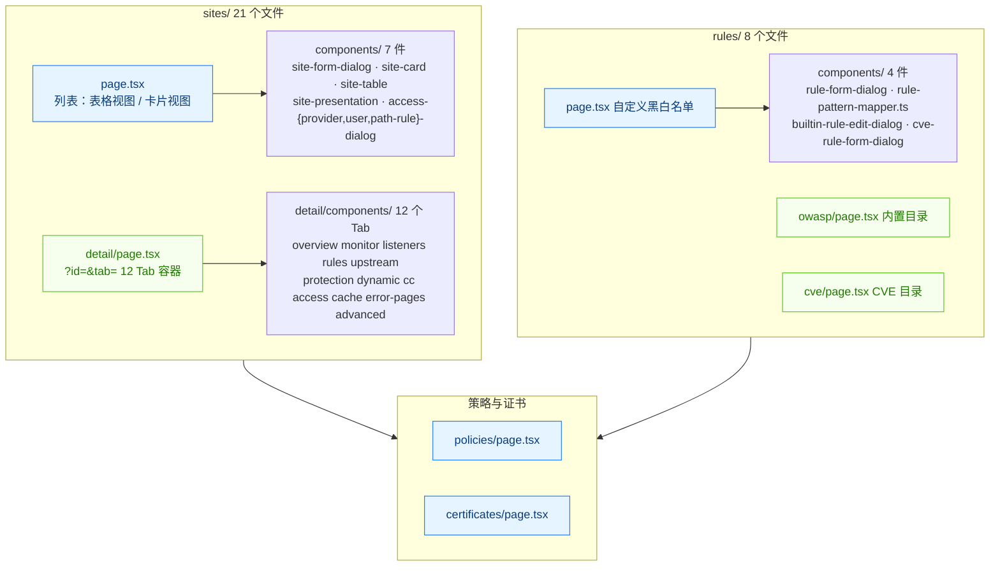
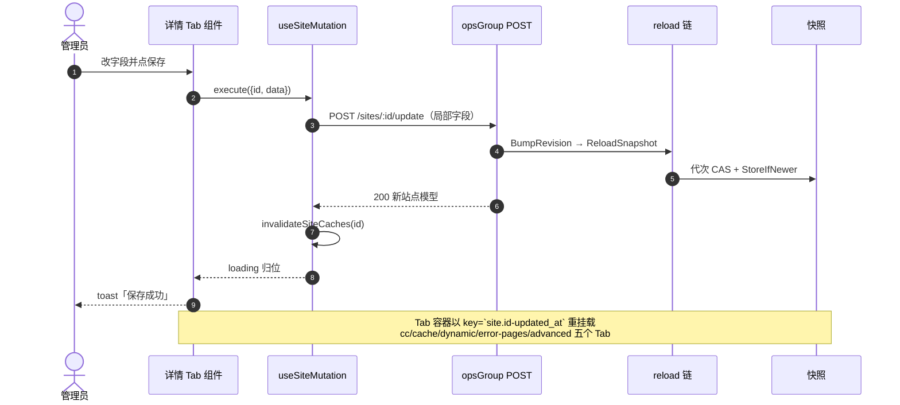
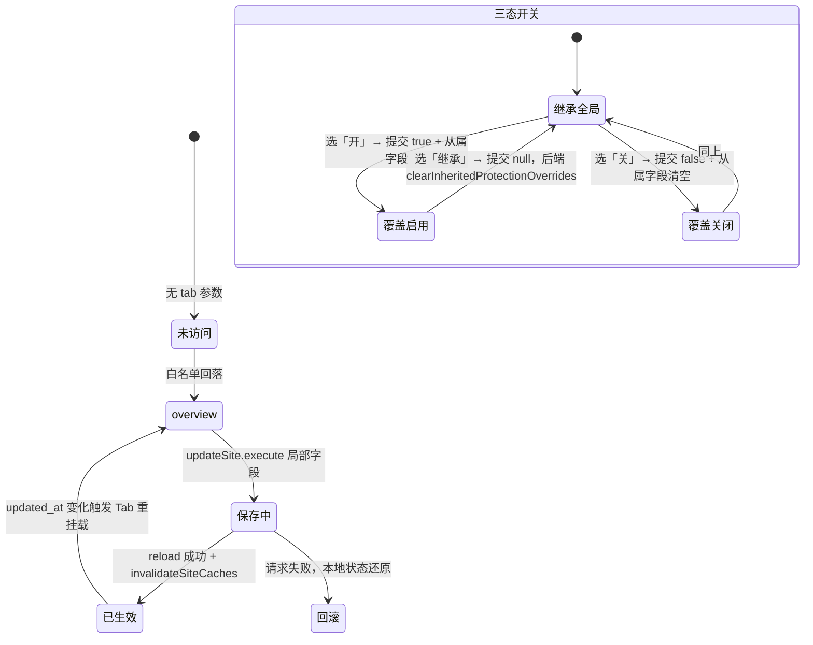
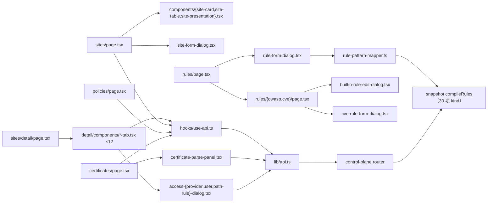
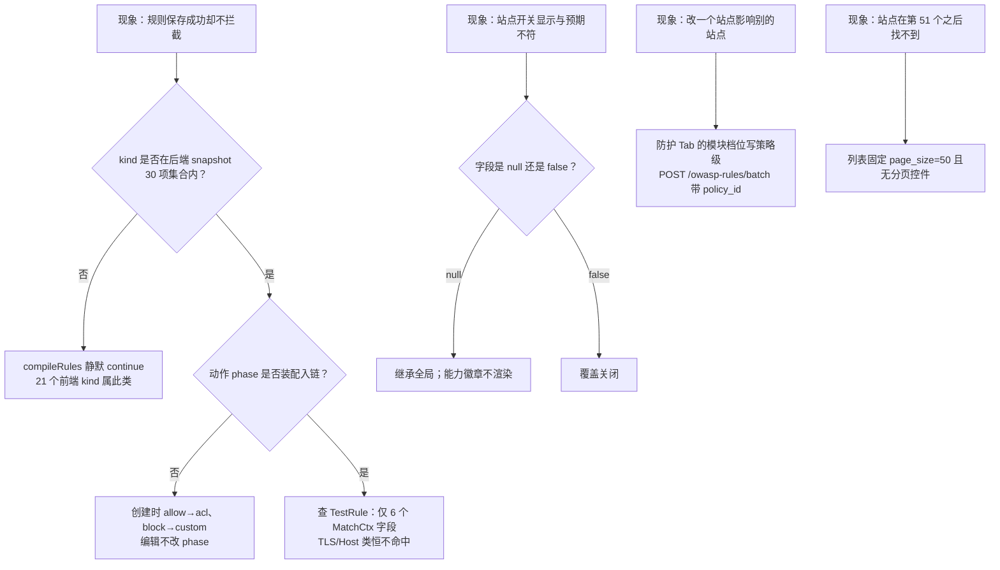

# 站点与规则页面

<cite>
**本文档引用的文件**
- [frontend/app/(dashboard)/sites/page.tsx](file://frontend/app/(dashboard)/sites/page.tsx)
- [frontend/app/(dashboard)/sites/detail/page.tsx](file://frontend/app/(dashboard)/sites/detail/page.tsx)
- [frontend/app/(dashboard)/sites/components/site-card.tsx](file://frontend/app/(dashboard)/sites/components/site-card.tsx)
- [frontend/app/(dashboard)/sites/components/site-table.tsx](file://frontend/app/(dashboard)/sites/components/site-table.tsx)
- [frontend/app/(dashboard)/sites/components/site-presentation.tsx](file://frontend/app/(dashboard)/sites/components/site-presentation.tsx)
- [frontend/app/(dashboard)/sites/components/site-form-dialog.tsx](file://frontend/app/(dashboard)/sites/components/site-form-dialog.tsx)
- [frontend/app/(dashboard)/sites/components/access-provider-dialog.tsx](file://frontend/app/(dashboard)/sites/components/access-provider-dialog.tsx)
- [frontend/app/(dashboard)/sites/components/access-user-dialog.tsx](file://frontend/app/(dashboard)/sites/components/access-user-dialog.tsx)
- [frontend/app/(dashboard)/sites/components/access-path-rule-dialog.tsx](file://frontend/app/(dashboard)/sites/components/access-path-rule-dialog.tsx)
- [frontend/app/(dashboard)/sites/detail/components/overview-tab.tsx](file://frontend/app/(dashboard)/sites/detail/components/overview-tab.tsx)
- [frontend/app/(dashboard)/sites/detail/components/monitor-tab.tsx](file://frontend/app/(dashboard)/sites/detail/components/monitor-tab.tsx)
- [frontend/app/(dashboard)/sites/detail/components/listeners-tab.tsx](file://frontend/app/(dashboard)/sites/detail/components/listeners-tab.tsx)
- [frontend/app/(dashboard)/sites/detail/components/rules-tab.tsx](file://frontend/app/(dashboard)/sites/detail/components/rules-tab.tsx)
- [frontend/app/(dashboard)/sites/detail/components/upstream-tab.tsx](file://frontend/app/(dashboard)/sites/detail/components/upstream-tab.tsx)
- [frontend/app/(dashboard)/sites/detail/components/protection-tab.tsx](file://frontend/app/(dashboard)/sites/detail/components/protection-tab.tsx)
- [frontend/app/(dashboard)/sites/detail/components/dynamic-protection-tab.tsx](file://frontend/app/(dashboard)/sites/detail/components/dynamic-protection-tab.tsx)
- [frontend/app/(dashboard)/sites/detail/components/cc-protection-tab.tsx](file://frontend/app/(dashboard)/sites/detail/components/cc-protection-tab.tsx)
- [frontend/app/(dashboard)/sites/detail/components/access-control-tab.tsx](file://frontend/app/(dashboard)/sites/detail/components/access-control-tab.tsx)
- [frontend/app/(dashboard)/sites/detail/components/cache-tab.tsx](file://frontend/app/(dashboard)/sites/detail/components/cache-tab.tsx)
- [frontend/app/(dashboard)/sites/detail/components/error-pages-tab.tsx](file://frontend/app/(dashboard)/sites/detail/components/error-pages-tab.tsx)
- [frontend/app/(dashboard)/sites/detail/components/advanced-tab.tsx](file://frontend/app/(dashboard)/sites/detail/components/advanced-tab.tsx)
- [frontend/app/(dashboard)/rules/page.tsx](file://frontend/app/(dashboard)/rules/page.tsx)
- [frontend/app/(dashboard)/rules/components/rule-form-dialog.tsx](file://frontend/app/(dashboard)/rules/components/rule-form-dialog.tsx)
- [frontend/app/(dashboard)/rules/components/rule-pattern-mapper.ts](file://frontend/app/(dashboard)/rules/components/rule-pattern-mapper.ts)
- [frontend/app/(dashboard)/rules/components/builtin-rule-edit-dialog.tsx](file://frontend/app/(dashboard)/rules/components/builtin-rule-edit-dialog.tsx)
- [frontend/app/(dashboard)/rules/components/cve-rule-form-dialog.tsx](file://frontend/app/(dashboard)/rules/components/cve-rule-form-dialog.tsx)
- [frontend/app/(dashboard)/rules/cve/page.tsx](file://frontend/app/(dashboard)/rules/cve/page.tsx)
- [frontend/app/(dashboard)/rules/owasp/page.tsx](file://frontend/app/(dashboard)/rules/owasp/page.tsx)
- [frontend/app/(dashboard)/policies/page.tsx](file://frontend/app/(dashboard)/policies/page.tsx)
- [frontend/app/(dashboard)/certificates/page.tsx](file://frontend/app/(dashboard)/certificates/page.tsx)
- [frontend/app/(dashboard)/layout.tsx](file://frontend/app/(dashboard)/layout.tsx)
- [frontend/components/sidebar-nav.tsx](file://frontend/components/sidebar-nav.tsx)
- [frontend/hooks/use-api.ts](file://frontend/hooks/use-api.ts)
- [frontend/lib/api.ts](file://frontend/lib/api.ts)
- [frontend/lib/types.ts](file://frontend/lib/types.ts)
- [internal/admin/router.go](file://internal/admin/router.go)
- [internal/admin/site/site.go](file://internal/admin/site/site.go)
- [internal/admin/rule/rule.go](file://internal/admin/rule/rule.go)
- [internal/admin/rule/validate.go](file://internal/admin/rule/validate.go)
- [internal/admin/detect/owasprules/owasp_rules.go](file://internal/admin/detect/owasprules/owasp_rules.go)
- [internal/admin/detect/owasprules/owasp_read_query.go](file://internal/admin/detect/owasprules/owasp_read_query.go)
- [internal/waf/owasp/owasp.go](file://internal/waf/owasp/owasp.go)
- [internal/admin/system/certificate/certificate.go](file://internal/admin/system/certificate/certificate.go)
- [internal/store/policy.go](file://internal/store/policy.go)
- [internal/admin/system/policy/policy.go](file://internal/admin/system/policy/policy.go)
- [internal/admin/site/observability/observability.go](file://internal/admin/site/observability/observability.go)
- [internal/core/rules/compiler.go](file://internal/core/rules/compiler.go)
- [internal/snapshot/build.go](file://internal/snapshot/build.go)
- [internal/utils/utils.go](file://internal/utils/utils.go)
</cite>

## 目录

1. [简介](#简介)
2. [项目结构](#项目结构)
3. [核心组件](#核心组件)
4. [架构总览](#架构总览)
5. [详细组件分析](#详细组件分析)
6. [依赖关系分析](#依赖关系分析)
7. [性能考虑](#性能考虑)
8. [故障排查指南](#故障排查指南)
9. [结论](#结论)
10. [附录](#附录)

## 简介

本篇覆盖控制台的配置侧四大页面族：**站点**（`sites/` 431 行 + 21 个子文件）、**规则**（`rules/` 528 行 + 7 个子文件）、**策略**（`policies/` 228 行）、**证书**（`certificates/` 1001 行）。它们共同构成 WAF 的「配置写入口」，与事件侧只读页面形成对照。

三条结构性事实决定了这一组页面的全部形态：

| 事实 | 实测依据 | 影响 |
|------|----------|------|
| 站点详情是**查询参数路由** `?id=&tab=`，不是动态段 | `sites/detail/page.tsx:80-91`；`ALLOWED_TABS` 12 项白名单校验 | 静态导出可预渲染单页；Tab 可深链、可前进后退 |
| 站点级开关是**三态**（`null` 继承 / `true` 开 / `false` 关） | `protection-tab.tsx:327-368` 的 `toTriState`/`fromTriState` | 前端必须显式表达「继承全局 / 覆盖启用 / 覆盖关闭」 |
| 规则条件的真值链有三套 kind 白名单 | `compiler.go:119-142`（57）、`build.go:1205-1215`（30）、`rule-pattern-mapper.ts` 产出 33 | 校验/测试通过不代表快照编译后仍生效 |

通用组合件（`PageHeader` + `DataTable` + `TablePagination` + `ConfirmDialog` + `EmptyState` + `MetricTile`）与写链路的具名失效函数在 `../组件设计模式/CRUD 页面组件.md` 与 `../状态管理策略.md` 已述，本篇不重复，只写各页面的真实字段、真实端点与真实风险。

**章节来源**
- [frontend/app/(dashboard)/sites/detail/page.tsx:58-96](file://frontend/app/(dashboard)/sites/detail/page.tsx#L58-L96)
- [frontend/app/(dashboard)/sites/detail/components/protection-tab.tsx:312-382](file://frontend/app/(dashboard)/sites/detail/components/protection-tab.tsx#L312-L382)
- [frontend/app/(dashboard)/rules/components/rule-pattern-mapper.ts:1-60](file://frontend/app/(dashboard)/rules/components/rule-pattern-mapper.ts#L1-L60)
- [internal/core/rules/compiler.go:117-142](file://internal/core/rules/compiler.go#L117-L142)

## 项目结构

**图表来源**
- [frontend/app/(dashboard)/sites/detail/page.tsx:34-46](file://frontend/app/(dashboard)/sites/detail/page.tsx#L34-L46)
- [frontend/app/(dashboard)/sites/page.tsx:39-42](file://frontend/app/(dashboard)/sites/page.tsx#L39-L42)
- [frontend/app/(dashboard)/rules/page.tsx:49-72](file://frontend/app/(dashboard)/rules/page.tsx#L49-L72)
- [frontend/components/sidebar-nav.tsx:258-280](file://frontend/components/sidebar-nav.tsx#L258-L280)

| 目录 | 文件构成 | 行数 | 视图形态 | 主要写端点 |
|------|----------|:----:|----------|------------|
| `sites/` | 1 页 + 7 组件 + 1 详情页 + 12 Tab | 431 + 21 子文件 | 双视图 + 12 Tab | `POST /sites{,/:id/update,/:id/delete,/:id/start,/:id/stop}` |
| `sites/detail/components/` | 12 个 `*-tab.tsx` | 118–1286 | 页签内联区 | `POST /sites/:id/update`、`/listeners`、`/access*`、`/error-pages` |
| `rules/` | 1 页 + 4 组件 + 2 子页 | 528 + 7 子文件 | 列表 + 目录 | `POST /rules{,/:id/update,/:id/delete,/import}` |
| `rules/owasp/` | 1 页 | 1008 | 内置目录 | `POST /owasp-rules/{:id/update,/:id/reset,/batch}` |
| `rules/cve/` | 1 页 | 815 | 内置目录 + 自定义 CRUD | `POST /cve-rules/{,:id/update,:id/delete,:id/patch,:id/reset,:id/toggle}` |
| `policies/` | 1 页 | 228 | 页内 Card 表单 + 表 | `POST /policies{,/:id/update,/:id/delete,/:id/set-default}` |
| `certificates/` | 1 页 | 1001 | 表 + 三态弹窗（create/edit/view） | `POST /certificates{,/:id/update,/:id/delete,/parse}` |

Next.js 侧约束（实测）：`output: "export"` + `trailingSlash: true`，因此详情深链写作 `/sites/detail/?id=`（`site-table.tsx:82`、`site-card.tsx:59`）；`useSearchParams()` 必须落在 `Suspense` 边界内，`sites/detail/page.tsx:312-317` 自建边界，`rules/page.tsx:80` 与 `rules/{cve,owasp}/page.tsx` 则依赖 `(dashboard)/layout.tsx:25` 的统一边界（CVE/OWASP 两页另在自身默认导出外再包一层 `Suspense`）。项目无 `next lint`，静态校验走 `package.json` 的 `check:*` 契约脚本。

**章节来源**
- [frontend/app/(dashboard)/sites/page.tsx:97-152](file://frontend/app/(dashboard)/sites/page.tsx#L97-L152)
- [frontend/app/(dashboard)/sites/detail/page.tsx:73-96](file://frontend/app/(dashboard)/sites/detail/page.tsx#L73-L96)
- [frontend/app/(dashboard)/sites/components/site-table.tsx:79-84](file://frontend/app/(dashboard)/sites/components/site-table.tsx#L79-L84)
- [frontend/app/(dashboard)/layout.tsx:19-36](file://frontend/app/(dashboard)/layout.tsx#L19-L36)
- [internal/admin/router.go:258-285](file://internal/admin/router.go#L258-L285)

## 核心组件

页面清单表（主组件为该文件默认导出；端点只列读链路首站）：

| 页面 | 目录:行 | 主组件 | 调用端点 | 刷新方式 |
|------|---------|--------|----------|----------|
| 站点列表 | `sites/page.tsx:97` | `SitesPage` | `GET /sites` | `invalidateSiteCaches` 后 SWR 重验 |
| 站点详情容器 | `sites/detail/page.tsx:73` | `SiteDetailContent` | `GET /sites/:id`、`GET /sites/:id/rules` | URL 参数 `tab` 变更 |
| 站点表单 | `sites/components/site-form-dialog.tsx:137` | `SiteFormDialog` | `GET /certificates`、`GET /policies` | 弹窗 `open` 时才拉引用数据 |
| 监听端口 Tab | `sites/detail/components/listeners-tab.tsx:55` | `ListenerFormDialog` + `ListenersTab` | `GET /sites/:id/listeners` | `invalidateSiteCaches(siteId)` |
| 防护配置 Tab | `sites/detail/components/protection-tab.tsx:312` | `ProtectionTab` | `GET /owasp-rules`、`GET /policies/default` | 站点写后具名失效 |
| 访问控制 Tab | `sites/detail/components/access-control-tab.tsx:54` | `AccessControlTab` | `GET /sites/:id/access{,/providers,/users,/rules}` | 各 mutation 的 `invalidateKeys` |
| 监控 Tab | `sites/detail/components/monitor-tab.tsx:94` | `MonitorTab` | `GET /sites/:id/security-events/{stats,timeline}` | 30 秒轮询 |
| 自定义规则 | `rules/page.tsx:78` | `RulesPage` | `GET /rules`、`GET /policies` | 写后失效 `rules`/`site-rules` |
| 规则编辑器 | `rules/components/rule-form-dialog.tsx` | `RuleFormDialog` | `POST /rules/validate` | 打开时 `next/dynamic` 懒加载 |
| OWASP 目录 | `rules/owasp/page.tsx:126` | `OWASPRulesPage` | `GET /owasp-rules` | `invalidateOWASPRuleCaches` |
| CVE 目录 | `rules/cve/page.tsx:88` | `CVERulesPage` | `GET /cve-rules` | `invalidateCVERuleCaches` |
| 策略 | `policies/page.tsx:30` | `PoliciesPage` | `GET /policies` | 手动 `mutate()` |
| 证书 | `certificates/page.tsx:117` | `CertificatesPage` | `GET /certificates`、`GET /certificates/:id`、`GET /certificates/acme/status` | `mutate()` + 5 分钟 `dedupingInterval` |

引用数据聚合有硬上限：`usePolicies()`、`useAllSites()` 走 `getReferencePages`，单页 200 条、最多 10 页，超出即截断并在结果上封顶（`use-api.ts:95-138`），避免异常 `total` 触发无限请求；`REFERENCE_QUERY_OPTIONS` 给这类低频元数据 5 分钟 `dedupingInterval` 与 `keepPreviousData`。

写失效按作用域分层，共 5 个具名函数 + `invalidateKeys`：`invalidateSiteCaches(id)` 精确匹配 8 个站点子键（`site`、`site-listeners`、`site-rules`、`site-recorded-resources`、`site-stats`、`site-timeline`、`site-access-stats`、`site-error-pages`），`invalidateCVERuleCaches` 与 `invalidateOWASPRuleCaches` 各清两类前缀（`use-api.ts:200-247`）。策略类 mutation 的 `invalidateKeys` 最长，覆盖 10 个前缀（`use-api.ts:745-802`），因为策略变更会同时影响规则视图与站点视图。

**章节来源**
- [frontend/hooks/use-api.ts:89-151](file://frontend/hooks/use-api.ts#L89-L151)
- [frontend/hooks/use-api.ts:191-247](file://frontend/hooks/use-api.ts#L191-L247)
- [frontend/hooks/use-api.ts:745-802](file://frontend/hooks/use-api.ts#L745-L802)
- [frontend/app/(dashboard)/sites/page.tsx:112-115](file://frontend/app/(dashboard)/sites/page.tsx#L112-L115)
- [frontend/app/(dashboard)/certificates/page.tsx:121-148](file://frontend/app/(dashboard)/certificates/page.tsx#L121-L148)

## 架构总览

配置写的闭环是本页组与事件页组最大的差别：每一次写都要经 `reload` 触发快照重建，页面才能声称「已生效」。

**图表来源**
- [frontend/hooks/use-api.ts:666-707](file://frontend/hooks/use-api.ts#L666-L707)
- [frontend/app/(dashboard)/sites/detail/page.tsx:264-298](file://frontend/app/(dashboard)/sites/detail/page.tsx#L264-L298)
- [internal/admin/router.go:258-265](file://internal/admin/router.go#L258-L265)

作用域分层与文件归属：

| 层 | 实体 | 关键位置 |
|----|------|----------|
| 页面/组件 | `sites` 21 文件、`rules` 8 文件、`policies`、`certificates` | `frontend/app/(dashboard)/` |
| 表单层 | `react-hook-form` + `zod`（站点、规则）、受控 `useState`（Tab、证书、情报） | `site-form-dialog.tsx:148-200`、`rule-form-dialog.tsx` |
| 状态层 | SWR key + 具名失效 | `hooks/use-api.ts:191-297` |
| 传输层 | `get()`/`post()`；写全部为 POST | `lib/api.ts:746-876` |
| 控制面 | `site`、`rule`、`policy`、`certificate`、`detect/{owasprules,cverules}`、`access` | `internal/admin/router.go:127-148`、`258-285` |
| 快照层 | `compileRules` 消费规则 kind，白名单与校验层不同 | `internal/snapshot/build.go:920-936` |

`GET /sites` 在返回站点行的同时批量补齐每个站点的启用监听器（`site.go:87-101`），因此列表页无需再逐站点请求监听端口；`utils.Paginate` 对 `page_size` 施加 200 上限（`utils.go:9`、`utils.go:35-37`）。

**章节来源**
- [internal/admin/router.go:127-148](file://internal/admin/router.go#L127-L148)
- [internal/admin/router.go:258-285](file://internal/admin/router.go#L258-L285)
- [internal/admin/site/site.go:76-101](file://internal/admin/site/site.go#L76-L101)
- [internal/utils/utils.go:8-37](file://internal/utils/utils.go#L8-L37)
- [internal/snapshot/build.go:920-936](file://internal/snapshot/build.go#L920-L936)

## 详细组件分析

### 站点列表页（sites/page.tsx）

数据源固定为 `useSites({ page: 1, page_size: 50 })`（`page.tsx:112`）。页内搜索与运行状态筛选都在**已加载的 50 条内**做客户端过滤（`page.tsx:140-148`），页面本身没有分页控件，因此站点数超过 50 时后续站点不可达，只能借 `useAllSites()` 的引用聚合路径访问——这是该页的结构性上限，不是缺陷修复项。

四张 `MetricTile` 严格遵守「局部统计必须标注口径」的项目约定：`total` 取后端全局总数，运行中 / 已停止 / 维护中三张只基于 `allItems` 计数，并在 `total > loadedCount` 时把描述文案切换为「当前页 N 条」口径（`page.tsx:125-135` 的注释与 `sites.stats.currentPageScope` 分支）。

视图偏好（表格/卡片）用 `useSyncExternalStore` 承载而非 `useState` 初值读 `localStorage`（`page.tsx:52-95`）：预渲染阶段的快照固定返回 `"table"`，客户端水合后再切到用户偏好，避免静态导出下的水合不一致与 effect 级联渲染。两个视图共享 `site-presentation.tsx` 的 7 个展示件（状态点、防护模式徽章、监听徽章、上游、能力徽章、快捷入口、操作菜单），其中能力徽章只渲染**显式开启**的项，`null`（继承全局）不渲染，避免把继承态误读为站点自身配置（`site-presentation.tsx:273-301`）。

**章节来源**
- [frontend/app/(dashboard)/sites/page.tsx:44-95](file://frontend/app/(dashboard)/sites/page.tsx#L44-L95)
- [frontend/app/(dashboard)/sites/page.tsx:112-196](file://frontend/app/(dashboard)/sites/page.tsx#L112-L196)
- [frontend/app/(dashboard)/sites/page.tsx:233-279](file://frontend/app/(dashboard)/sites/page.tsx#L233-L279)
- [frontend/app/(dashboard)/sites/components/site-presentation.tsx:263-301](file://frontend/app/(dashboard)/sites/components/site-presentation.tsx#L263-L301)
- [frontend/app/(dashboard)/sites/components/site-table.tsx:44-132](file://frontend/app/(dashboard)/sites/components/site-table.tsx#L44-L132)
- [frontend/app/(dashboard)/sites/components/site-card.tsx:20-60](file://frontend/app/(dashboard)/sites/components/site-card.tsx#L20-L60)

### 站点表单对话框

`SiteFormDialog` 是本页组唯一使用 `react-hook-form` + `zodResolver` 的表单，schema 只暴露后端真实存在的字段：`host`（多域名，`parseSiteHosts` 校验非空）、`listeners[]`（端口 1-65535 + `tls_enabled`，至少 1 项）、`cert_id`、`policy_id`（可空）、`upstreams[]`（scheme 白名单校验，至少 1 项）、`upstream_host`（`site-form-dialog.tsx:64-108`）。

一条跨层校验值得注意：schema 用 `.refine` 强制「任一监听端口启用 TLS 必须绑定证书」，注释明确这是为了对齐后端 `shared.ValidateSiteTLSCertificate`（`site-form-dialog.tsx:104-108`）。提交语义按新建/编辑分岔：新建时第一个端口作为站点主 `bind`（写 `0.0.0.0:<port>`），其余端口循环调用 `POST /sites/:id/listeners` 建为监听器；编辑时只更新主配置，额外监听器交由详情页的「监听端口」Tab 管理（`site-form-dialog.tsx:203-245`）。两种情形结束都调用 `invalidateSiteCaches(savedSiteId)`。

引用数据按需加载：`useCertificates(open)` 与 `usePolicies(open)` 以弹窗开关作为 SWR key 生效条件，关闭时不发请求（`site-form-dialog.tsx:144-146`），与 `listeners-tab.tsx:64-65` 的同一手法一致。

**章节来源**
- [frontend/app/(dashboard)/sites/components/site-form-dialog.tsx:55-126](file://frontend/app/(dashboard)/sites/components/site-form-dialog.tsx#L55-L126)
- [frontend/app/(dashboard)/sites/components/site-form-dialog.tsx:137-245](file://frontend/app/(dashboard)/sites/components/site-form-dialog.tsx#L137-L245)

### 站点详情的 Tab 容器与三态语义

容器把 12 个页签名放在 `ALLOWED_TABS` 白名单里，URL 传入未知值一律回落 `overview`（`sites/detail/page.tsx:58-84`），切页时同时回写 `id` 与 `tab`，因此深链可复现（`sites/detail/page.tsx:86-91`）。规则列表只在 `overview` 与 `rules` 两个页签下加载（`shouldLoadRules`，`sites/detail/page.tsx:94-96`），避免打开其它页签时扫描策略。五个「草稿型」页签（`dynamic`、`cc`、`cache`、`error-pages`、`advanced`）以 `key={site.id-site.updated_at}` 强制重挂载，使服务端值成为唯一初值，取消即还原。

**图表来源**
- [frontend/app/(dashboard)/sites/detail/page.tsx:58-96](file://frontend/app/(dashboard)/sites/detail/page.tsx#L58-L96)
- [frontend/app/(dashboard)/sites/detail/components/protection-tab.tsx:425-440](file://frontend/app/(dashboard)/sites/detail/components/protection-tab.tsx#L425-L440)
- [frontend/hooks/use-api.ts:666-683](file://frontend/hooks/use-api.ts#L666-L683)

`ProtectionTab` 的三态实现与后端契约严格对齐：`owasp_enabled`/`cve_enabled`/`bot_protection_enabled`/`rate_limit_enabled` 经 `fromTriState` 写回 `*bool`，选「继承」时**同时清空从属字段**（`owasp_sensitivity`、`owasp_action` 等），注释直接点名 `clearInheritedProtectionOverrides`（`protection-tab.tsx:431-439`）。限流参数则按「>0 才覆盖」的语义显示：`rate_limit_window` 为 0 时 UI 回落显示 60、`rate_limit_max` 显示 300（`protection-tab.tsx:355-366`），此时实际生效的是全局值，界面显示的是兜底值——这一差异属于口径提示，排查时应以 `anti_replay_*` 之类是否显式为 `null` 为准。

**跨作用域写入风险**：该页签的 10 个攻击模块档位写入的是 `POST /owasp-rules/batch`，载荷 `{policy_id: effectivePolicyId, rules: [...]}`（`protection-tab.tsx:641`），即**策略级覆盖**而非站点级。在同一策略下的所有站点共享这份覆盖，在一个站点上改档位会改变其它站点的有效防护强度。按项目「快捷配置页不得制造第二配置源」的规则，此处虽无字段重复，但作用域提示缺失，应登记为交互风险。

**章节来源**
- [frontend/app/(dashboard)/sites/detail/page.tsx:58-96](file://frontend/app/(dashboard)/sites/detail/page.tsx#L58-L96)
- [frontend/app/(dashboard)/sites/detail/components/protection-tab.tsx:312-440](file://frontend/app/(dashboard)/sites/detail/components/protection-tab.tsx#L312-L440)
- [frontend/app/(dashboard)/sites/detail/components/protection-tab.tsx:630-650](file://frontend/app/(dashboard)/sites/detail/components/protection-tab.tsx#L630-L650)

### 其余站点详情 Tab 的载荷口径

每个 Tab 只提交自己负责的字段，避免整份 `protection` 覆盖无关配置：

| Tab | 提交端点 | 载荷字段 | 备注 |
|-----|----------|----------|------|
| `overview-tab` | 只读 | `GET /sites/:id/access-logs/stats`、`/security-events/stats`、`/listeners` | 「今日请求」文案实际是滚动 24 小时窗口（`hours` 默认 24），非自然日 |
| `monitor-tab` | 只读 | `useSiteStats`/`useSiteTimeline` + `hours`（24 或 168） | 30 秒轮询，趋势桶只取时分 |
| `listeners-tab` | `POST /sites/:id/listeners{,/:lid/update,/:lid/delete}` | `bind`、`tls_enabled`、`cert_id`、`enabled` | TLS 开启未选证书在前端即拦 |
| `rules-tab` | `POST /rules/:id/update`、`/:id/delete` | 只切 `enabled` | 复用 `useSiteRules(site.id)` |
| `upstream-tab` | `POST /sites/:id/update` | `upstream_urls`、`upstream_host`、`upstream_tls_skip_verify`、`upstream_tls_server_name`、客户端证书 | 客户端私钥**只写不读**：留空且证书也空时才显式清空 |
| `dynamic-protection-tab` | `POST /sites/:id/update` | `dynamic_*`（含 `dynamic_js_mode`/`paths`/`decrypt_cache_ttl`） | 初值懒加载自 `GET /sites/:id/recorded-resources` |
| `cc-protection-tab` | `POST /sites/:id/update` | `cc_use_custom` + 仅 custom 模式下发 `cc_rules` | `cc_rules` 显式 `JSON.stringify` 匹配持久化契约 |
| `access-control-tab` | `POST /sites/:id/access{,/providers,/users,/rules}` | 开关 + 会话 TTL + 共享口令清除位 | 三个对话框组件分别负责 provider/user/path-rule |
| `cache-tab` | `POST /sites/:id/update` | `cache_enabled`、`cache_default_ttl`、`cache_rules` | 先本地校验再提交 |
| `error-pages-tab` | `POST /sites/:id/error-pages` | `error_pages`（深拷贝） | 与 `GET /error-pages/defaults` 对照做覆盖 |
| `advanced-tab` | `POST /sites/:id/update` | 反重放三态即时保存单字段；其余批量字段一次提交 | 三态 `null` 用 `null` 而非空串表达继承 |

`advanced-tab` 的一处细节最体现三态正确性：`anti_replay_cookie_mode` 与 `challenge_action`、`captcha_type` 在「留空」时提交 `null`，注释明确「不得写成字符串 `""`」（`advanced-tab.tsx:230-236`）。

**章节来源**
- [frontend/app/(dashboard)/sites/detail/components/overview-tab.tsx:30-93](file://frontend/app/(dashboard)/sites/detail/components/overview-tab.tsx#L30-L93)
- [frontend/app/(dashboard)/sites/detail/components/monitor-tab.tsx:85-120](file://frontend/app/(dashboard)/sites/detail/components/monitor-tab.tsx#L85-L120)
- [frontend/app/(dashboard)/sites/detail/components/listeners-tab.tsx:55-95](file://frontend/app/(dashboard)/sites/detail/components/listeners-tab.tsx#L55-L95)
- [frontend/app/(dashboard)/sites/detail/components/rules-tab.tsx:18-48](file://frontend/app/(dashboard)/sites/detail/components/rules-tab.tsx#L18-L48)
- [frontend/app/(dashboard)/sites/detail/components/upstream-tab.tsx:40-66](file://frontend/app/(dashboard)/sites/detail/components/upstream-tab.tsx#L40-L66)
- [frontend/app/(dashboard)/sites/detail/components/dynamic-protection-tab.tsx:130-200](file://frontend/app/(dashboard)/sites/detail/components/dynamic-protection-tab.tsx#L130-L200)
- [frontend/app/(dashboard)/sites/detail/components/cc-protection-tab.tsx:85-140](file://frontend/app/(dashboard)/sites/detail/components/cc-protection-tab.tsx#L85-L140)
- [frontend/app/(dashboard)/sites/detail/components/access-control-tab.tsx:54-100](file://frontend/app/(dashboard)/sites/detail/components/access-control-tab.tsx#L54-L100)
- [frontend/app/(dashboard)/sites/detail/components/cache-tab.tsx:100-125](file://frontend/app/(dashboard)/sites/detail/components/cache-tab.tsx#L100-L125)
- [frontend/app/(dashboard)/sites/detail/components/error-pages-tab.tsx:145-160](file://frontend/app/(dashboard)/sites/detail/components/error-pages-tab.tsx#L145-L160)
- [frontend/app/(dashboard)/sites/detail/components/advanced-tab.tsx:190-240](file://frontend/app/(dashboard)/sites/detail/components/advanced-tab.tsx#L190-L240)
- [internal/admin/site/observability/observability.go:88-92](file://internal/admin/site/observability/observability.go#L88-L92)

### 访问控制三对话框与机密处理

`AccessProviderDialog` 管理 OAuth2/OIDC 提供方：`name`、`priority`、`enabled`、`type` 与 8 个 OAuth 字段（`client_id`、`client_secret`、`auth_url`、`token_url`、`userinfo_url`、`issuer`、`scopes`、`redirect_path`、`use_pkce`）。编辑态把 `client_secret` 初值置空字符串，即**密钥不回显**，只有重新输入才会提交（`access-provider-dialog.tsx:78-90`、`:105-119`），与「审计与表单不回传机密」的项目要求一致。`scopes` 以空格分隔输入、提交前拆数组并去空。

`AccessUserDialog` 在编辑态只允许重置密码与切换启用，用户名不可改（`access-user-dialog.tsx:31-63`）；`AccessPathRuleDialog` 提交 `path`、`action`、`priority`、`enabled` 四项（`access-path-rule-dialog.tsx:55-84`）。三个对话框都按「父组件以 key 重挂载触发刷新」的模式初始化本地状态，避免在 effect 内 `setState`。

**章节来源**
- [frontend/app/(dashboard)/sites/components/access-provider-dialog.tsx:74-160](file://frontend/app/(dashboard)/sites/components/access-provider-dialog.tsx#L74-L160)
- [frontend/app/(dashboard)/sites/components/access-user-dialog.tsx:30-95](file://frontend/app/(dashboard)/sites/components/access-user-dialog.tsx#L30-L95)
- [frontend/app/(dashboard)/sites/components/access-path-rule-dialog.tsx:55-90](file://frontend/app/(dashboard)/sites/components/access-path-rule-dialog.tsx#L55-L90)
- [frontend/lib/api.ts:1211-1268](file://frontend/lib/api.ts#L1211-L1268)

### 自定义规则列表页（rules/page.tsx）

`PAGE_SIZE` 为 50，策略选择器 + 动作筛选（`all`/`allow`/`intercept`）+ 分页构成三输入（`rules/page.tsx:45`、`:201-210`、`:422-464`）。策略作用域的解析有明确优先级：本地选择 > `?policy_id=` 深链 > 默认策略，且**深链值必须存在于策略列表中**才被采纳，否则回落默认（`rules/page.tsx:100-120`）。`?create=1` 深链只在鉴权完成、策略可解析后消费一次（`createRequestConsumed` 哨兵），避免首帧角色未知时永久丢失新建入口（`rules/page.tsx:184-199`）。

导入导出成对：导出取 `GET /rules/export` 生成 JSON 文件；导入读本地 JSON，把每条规则的 `id` 归零、`policy_id` 改写为当前所选策略、时间串清空后调用 `POST /rules/import`（`rules/page.tsx:122-182`）。因此导出文件是全局集合、导入目标锁定当前策略，后端忽略其中 ID。规则编辑器用 `next/dynamic` 懒加载，加载态是自建骨架屏而非默认空白（`rules/page.tsx:48-72`）。

删除最后一条时会把页码回退一页（`rules/page.tsx:254`），避免停留在空页。

**章节来源**
- [frontend/app/(dashboard)/rules/page.tsx:45-72](file://frontend/app/(dashboard)/rules/page.tsx#L45-L72)
- [frontend/app/(dashboard)/rules/page.tsx:100-217](file://frontend/app/(dashboard)/rules/page.tsx#L100-L217)
- [frontend/app/(dashboard)/rules/page.tsx:248-344](file://frontend/app/(dashboard)/rules/page.tsx#L248-L344)
- [frontend/app/(dashboard)/rules/page.tsx:422-503](file://frontend/app/(dashboard)/rules/page.tsx#L422-L503)

### 规则编辑器与条件映射器

编辑器用 `{target, method, content}` 三元组表达条件，按「组内 AND、组间 OR」组织成 `ConditionRow[][]`，序列化交给 `serializeGroupsToPattern()` 产出 compound JSON（`rule-form-dialog.tsx:50-52`、`rule-pattern-mapper.ts:568`）。下拉实际取值集合为 **14 个匹配目标 × 12 个匹配方式**（`rule-form-dialog.tsx:55-86`），而映射器头注释写的是「不破坏现有 9 个 matchMethods / 13 个 matchTargets 形态」（`rule-pattern-mapper.ts:16-17`）——注释与实现不符，登记为文档性缺陷。

映射器把三元组翻译成后端 `{kind, arg}`，产出 33 个 kind（`translateRow()` 与 `tls_ja4` 分支，`rule-pattern-mapper.ts:72-445`）。这三套白名单必须一起看，否则无法解释「保存成功但不拦截」：

| 白名单位置 | 数量 | 用途 | 越界后果 |
|------------|:----:|------|----------|
| `internal/core/rules/compiler.go:119-142` `knownPrefixes` | 57 | `rules.ParsePattern` 与 `validateSimplePattern` 的判定集 | 不在集合 → 校验报「不支持的 kind」 |
| `internal/snapshot/build.go:1205-1215` 局部 `ParsePattern` 前缀表 | 30 | 快照构建期解析规则 pattern | 不在集合 → `kind` 为空 |
| `internal/snapshot/build.go:920-936` `compileRules` | — | 逐条编译规则 | `kind == ""` → `continue`，**静默丢弃** |
| `rule-pattern-mapper.ts` 前端产出 | 33 | 编辑器可表达的全部 kind | 其中 **21 项**不在 30 项集合内 |

这 21 项是：`block_header_exact`、`block_header_not_exact`、`block_header_prefix`、`body_not_exact`、`body_wildcard`、`full_url_contains`、`full_url_not_exact`、`full_url_regex`、`full_url_wildcard`、`geo_block`、`header_wildcard`、`host_contains`、`host_full`、`host_not_exact`、`host_regex`、`host_wildcard`、`path_contains`、`path_not_exact`、`path_wildcard`、`query_param_not_exact`、`query_param_regex`。它们都在 57 项集合内，因此 `POST /rules/validate`（`validate.go:51` 调 `rules.ParsePattern`）会返回 `valid: true`，前端二次校验放行、规则落库成功；但快照构建走 30 项集合，`compileRules` 直接把该条跳过。结果是一条**在校验与 UI 上都合法、在数据面永不装配**的规则。同理，`POST /rules/test` 走 `rules.ParsePattern` + `rules.Compile`（`rule.go:232-240`），测试通过也不代表线上生效，且 `TestRule` 只填 `MatchCtx` 的 6 个字段（`rule.go:251-258`：`ClientIP`、`Method`、`Path`、`Query`、`Headers`、`Body`），TLS/Host/`header_order` 类 kind 恒不命中。

前端侧唯一能挡住这条链的机制是 `uneditable` 标记与 `source` 原样回传：反解析得到的叶子若无法安全映射，仅允许查看、禁止覆盖保存（`rule-pattern-mapper.ts:20-45`）。提交前的 `validateConditions()` 会先序列化再调用 `/rules/validate`，失败即拒绝提交并显示后端错误串（`rule-form-dialog.tsx:386-415`）。创建时补齐 `phase`（`allow → acl`，`block → custom`）与 `status_code: 403`；更新时**刻意省略** `phase`、`status_code`、`priority`、`redirect_to`，由后端保留原值，避免编辑覆盖其它管理入口维护的配置（`rule-form-dialog.tsx:452-459`）。

规则动作下拉只有 `captcha_challenge` 与 `block` 两项（`rule-form-dialog.tsx:88-92`），验证码类型四项（数学/点选/滑块/旋转）为硬编码中文文案（`rule-form-dialog.tsx:94-99`），未走 i18n key，与全站文案规范不一致。频次参数 `window_seconds`/`request_count` 与 `captcha_minutes` 在清空时统一折算成 0，注释说明这是「0 = 未配置」契约，且更新时也显式下发以便真正取消限制（`rule-form-dialog.tsx:437-449`）。

**章节来源**
- [frontend/app/(dashboard)/rules/components/rule-form-dialog.tsx:50-109](file://frontend/app/(dashboard)/rules/components/rule-form-dialog.tsx#L50-L109)
- [frontend/app/(dashboard)/rules/components/rule-form-dialog.tsx:380-477](file://frontend/app/(dashboard)/rules/components/rule-form-dialog.tsx#L380-L477)
- [frontend/app/(dashboard)/rules/components/rule-pattern-mapper.ts:1-72](file://frontend/app/(dashboard)/rules/components/rule-pattern-mapper.ts#L1-L72)
- [frontend/app/(dashboard)/rules/components/rule-pattern-mapper.ts:72-445](file://frontend/app/(dashboard)/rules/components/rule-pattern-mapper.ts#L72-L445)
- [internal/admin/rule/validate.go:34-59](file://internal/admin/rule/validate.go#L34-L59)
- [internal/admin/rule/rule.go:224-267](file://internal/admin/rule/rule.go#L224-L267)
- [internal/core/rules/compiler.go:117-167](file://internal/core/rules/compiler.go#L117-L167)
- [internal/snapshot/build.go:920-936](file://internal/snapshot/build.go#L920-L936)
- [internal/snapshot/build.go:1197-1222](file://internal/snapshot/build.go#L1197-L1222)

### 内置规则目录页（rules/owasp 与 rules/cve）

两页形态近似（策略/作用域选择 + 去抖搜索 + 分页 + 行内启停 + 批量操作），差异集中在作用域模型与写端点集合。

| 维度 | OWASP 目录 | CVE 目录 |
|------|------------|----------|
| 作用域 | 仅 `policy_id`（默认策略兜底） | `scope = global / policy / site` 三档 |
| 去抖 | 300ms（`SEARCH_DEBOUNCE_MS`） | 300ms（`CVE_SEARCH_DEBOUNCE_MS`） |
| 页大小 | 50 | 50 |
| 列表参数 | `policy_id`、`page`、`page_size`、`include_grouped: false`、`category`、`q` | `scope`、`policy_id`/`site_id`、`page`、`page_size`、`q` |
| 陈旧数据防护 | `data.policy_id === effectivePolicyId` 才采纳 | `data.scope === scope && data.scope_id === effectiveScopeID` 才采纳 |
| 深链 | `?q=` 携带 `rule_id_str`，挂载读一次 | `?q=` 携带剥掉 `cve:` 前缀的编号 |
| 批量上限 | `BATCH_MAX_RULES = 1000`，注释对齐后端 `owaspRuleBatchMaxEntries` | 逐条 `patch` |
| 写端点 | `POST /owasp-rules/:id/update`、`/:id/reset`、`/batch` | `POST /cve-rules/{,:id/update,:id/delete,:id/patch,:id/reset,:id/toggle,/batch,/sync}` |
| 自定义规则 | 无 | 有，且 `canManageCustom` 仅 admin |
| 环境覆盖 | 无 | `EnvOverrideDomainCard` + 5 个键（`cve_enabled`、`cve_feed_enabled`、`cve_feed_interval`、`nvd_api_key`、`cve_auto_approve`），写权限独立门控为 admin |

两页都用「作用域一致性」门控把过期响应挡在渲染之外（`rules/owasp/page.tsx:185-189`、`rules/cve/page.tsx:170-174`），这是 `RULE_QUERY_OPTIONS` 开启 `keepPreviousData` 后的必要配套：缓存里可能是上一个作用域的数据，字段没有作用域标识时不能直接展示。

灵敏度取值存在两套字面量：OWASP 目录页用 `medium` 并在比较前做 `normalizeSensitivity`（`mid → medium`，`rules/owasp/page.tsx:107-109`），后端把 `mid`/`medium` 视为同一档（`internal/waf/owasp/owasp.go:840-892`）；`builtin-rule-edit-dialog` 的补丁字段包含 `enabled`、`action`、`sensitivity`、`status_code`、`redirect_to`、白名单与备注（`builtin-rule-edit-dialog.tsx:101-123`），由两页各自映射到对应的 update/patch 端点。

**章节来源**
- [frontend/app/(dashboard)/rules/owasp/page.tsx:72-189](file://frontend/app/(dashboard)/rules/owasp/page.tsx#L72-L189)
- [frontend/app/(dashboard)/rules/owasp/page.tsx:283-409](file://frontend/app/(dashboard)/rules/owasp/page.tsx#L283-L409)
- [frontend/app/(dashboard)/rules/cve/page.tsx:51-174](file://frontend/app/(dashboard)/rules/cve/page.tsx#L51-L174)
- [frontend/app/(dashboard)/rules/cve/page.tsx:194-245](file://frontend/app/(dashboard)/rules/cve/page.tsx#L194-L245)
- [frontend/app/(dashboard)/rules/cve/page.tsx:260-365](file://frontend/app/(dashboard)/rules/cve/page.tsx#L260-L365)
- [frontend/app/(dashboard)/rules/components/builtin-rule-edit-dialog.tsx:74-123](file://frontend/app/(dashboard)/rules/components/builtin-rule-edit-dialog.tsx#L74-L123)
- [frontend/app/(dashboard)/rules/components/cve-rule-form-dialog.tsx:56-130](file://frontend/app/(dashboard)/rules/components/cve-rule-form-dialog.tsx#L56-L130)
- [internal/admin/detect/owasprules/owasp_read_query.go:84-102](file://internal/admin/detect/owasprules/owasp_read_query.go#L84-L102)
- [internal/waf/owasp/owasp.go:840-892](file://internal/waf/owasp/owasp.go#L840-L892)

### 列表筛选参数生效表

| 参数 | 前端来源 | 后端读取字段 | 是否生效 |
|------|----------|--------------|:--------:|
| `page` / `page_size` | `rules/page.tsx:201-210` | `utils.Paginate`（上限 200） | 是 |
| `policy_id` | `rules/page.tsx:202` | 规则列表作用域参数 | 是；缺失时 `useRules(null)` 直接不发请求 |
| `action` | `rules/page.tsx:207` | 黑白名单动作等值过滤 | 是（仅 `allow`/`intercept`） |
| `policy_id`（OWASP） | `rules/owasp/page.tsx:171-181` | `resolveOWASPPolicyID`（`owasp_rules.go:67-97`） | 是；参数缺省（未传）时取 `default_slot = 1` 的策略，传非数字或 0 直接返 400 |
| `category`（OWASP） | `rules/owasp/page.tsx:177` | 类别等值过滤 | 是 |
| `q`（OWASP） | `rules/owasp/page.tsx:178` 去抖 300ms | 规则 ID/名称模糊查询 | 是 |
| `include_grouped` | `rules/owasp/page.tsx:176` 传 `false` | `owasp_rules.go:119` | 是；省掉 `grouped` 冗余载荷 |
| `scope` / `site_id`（CVE） | `rules/cve/page.tsx:145-155` | `scope` 三分支 | 是；作用域不匹配时前端拒用数据 |
| `q`（CVE） | `rules/cve/page.tsx:153` | 页面注释声明后端只覆盖 `cve_id` 与 `description`（`rules/cve/page.tsx:107-108`） | 是，但**不覆盖 pattern/author** |
| `enabled` | 行内开关 | `POST /owasp-rules/:id/update`、`/cve-rules/:id/toggle` | 是（写路径，非筛选） |
| `hours`（站点监控） | `monitor-tab.tsx:97-107` | 站点 stats/timeline 窗口参数 | 是 |
| `create` / `policy_id`（深链） | `rules/page.tsx:100-105`、`:184-199` | 纯前端消费 | 是（不进请求） |

**章节来源**
- [frontend/app/(dashboard)/rules/page.tsx:100-210](file://frontend/app/(dashboard)/rules/page.tsx#L100-L210)
- [frontend/app/(dashboard)/rules/owasp/page.tsx:171-189](file://frontend/app/(dashboard)/rules/owasp/page.tsx#L171-L189)
- [frontend/app/(dashboard)/rules/cve/page.tsx:107-174](file://frontend/app/(dashboard)/rules/cve/page.tsx#L107-L174)
- [internal/admin/detect/owasprules/owasp_rules.go:67-97](file://internal/admin/detect/owasprules/owasp_rules.go#L67-L97)
- [internal/utils/utils.go:8-37](file://internal/utils/utils.go#L8-L37)

### 策略页与证书页

`PoliciesPage` 把「新建」做成页内 Card 表单（名称 + 描述 + 添加按钮），列表三列（名称/描述、引用计数、操作），`site_count` 与 `rule_count` 直接来自后端聚合（`policies/page.tsx:93-152`、`:186-217`）。默认策略既不能设默认也不能删除，前端在两处按钮上分别 `disabled` 并做二次拦截（`policies/page.tsx:78-81`、`:135-144`）。三个 mutation 的 `invalidateKeys` 覆盖 10 个前缀，因此改策略会连带刷新规则与站点视图。但「引用计数」列不可信：`store.Policy` 只有 `id/created_at/updated_at/name/description/default_slot/is_default` 六个对外字段（`internal/store/policy.go:10-20`），`ListPolicies` 又原样返回 items（`internal/admin/system/policy/policy.go:14-26`），后端从不产出 `site_count`/`rule_count`；前端 `Policy` 类型把它们声明为可选（`frontend/lib/types.ts:279-280`）并用 `?? 0` 兜底，因此该列恒显示「站点引用 0 · 规则引用 0」。按项目「统计值必须来自后端真实聚合，不得用假数据冒充」的约定，这属于必须登记的展示层缺陷（下表 R13），不在本次改动范围。

`CertificatesPage` 列表不分页，`certificateApi.list()` 在传输层就把 `{items,total}` 削成数组（`lib/api.ts:817-821`），配合 5 分钟 `dedupingInterval` 复用。列定义为 6 列：名称、域名、来源（`manual`/`acme`/`self_signed`）、到期日（≤30 天显示剩余天数徽章、已过期显示红色徽章）、自动续期、操作（`certificates/page.tsx:307-412`）。弹窗按 `create`/`edit`/`view` 三态复用同一表单，`view` 态额外触发 `POST /certificates/parse` 并用 `CertificateParsePanel` 展示 CN/SAN/到期与命中站点。

两处机密处理值得单列：`certificateToForm()` 在编辑态把 `key_pem` 初值置空（`certificates/page.tsx:87-97`），后端 `UpdateCertificate` 用留库私钥与新证书做 `tls.X509KeyPair` 配对校验，不匹配返 400（`internal/admin/system/certificate/certificate.go:226-227`）；前端因此预置 `needsMatchingKey` 拦截——改了 PEM 却没重贴私钥时直接提示并阻止提交（`certificates/page.tsx:154-163`、`:247-267`）。删除失败时解析 `ApiError.data` 里的 `site_refs`/`listener_refs` 拼进确认框描述（`certificates/page.tsx:99-115`、`:285-305`）。页面还按 `kind === "tls_certificate"` 过滤 `runtime-config` 的诊断项，并把 `GET /certificates/acme/status` 渲染为状态卡（`certificates/page.tsx:125-129`、`:458`）。

**章节来源**
- [frontend/app/(dashboard)/policies/page.tsx:30-152](file://frontend/app/(dashboard)/policies/page.tsx#L30-L152)
- [frontend/app/(dashboard)/policies/page.tsx:186-227](file://frontend/app/(dashboard)/policies/page.tsx#L186-L227)
- [frontend/app/(dashboard)/certificates/page.tsx:56-163](file://frontend/app/(dashboard)/certificates/page.tsx#L56-L163)
- [frontend/app/(dashboard)/certificates/page.tsx:245-424](file://frontend/app/(dashboard)/certificates/page.tsx#L245-L424)
- [internal/store/policy.go:10-25](file://internal/store/policy.go#L10-L25)
- [internal/admin/system/policy/policy.go:14-26](file://internal/admin/system/policy/policy.go#L14-L26)
- [frontend/lib/types.ts:272-281](file://frontend/lib/types.ts#L272-L281)
- [internal/admin/system/certificate/certificate.go:214-240](file://internal/admin/system/certificate/certificate.go#L214-L240)
- [frontend/lib/api.ts:817-837](file://frontend/lib/api.ts#L817-L837)

## 依赖关系分析

**图表来源**
- [frontend/app/(dashboard)/rules/components/rule-form-dialog.tsx:38-49](file://frontend/app/(dashboard)/rules/components/rule-form-dialog.tsx#L38-L49)
- [frontend/app/(dashboard)/sites/components/site-form-dialog.tsx:6-20](file://frontend/app/(dashboard)/sites/components/site-form-dialog.tsx#L6-L20)
- [frontend/app/(dashboard)/certificates/page.tsx:1-30](file://frontend/app/(dashboard)/certificates/page.tsx#L1-L30)

依赖矩阵（✓ 表示实际 import 并在本页生效）：

| 页面族 | react-hook-form + zod | TabWorkspaceProvider | 三态 `fromTriState` | JSON 序列化字段 | 去抖输入 | 具名失效函数 |
|--------|:---:|:---:|:---:|:---:|:---:|:---:|
| `sites` + `sites/detail` | ✓（仅表单对话框） | — | ✓ | ✓（`cc_rules`、`cache_rules`、`dynamic_js_paths`） | — | `invalidateSiteCaches` |
| `rules` + 编辑器 | ✓（规则表单） | — | — | ✓（compound JSON） | — | `invalidateKeys: ["rules","site-rules"]` |
| `rules/owasp`、`rules/cve` | — | — | — | ✓（白名单条目） | ✓ | `invalidateOWASPRuleCaches`、`invalidateCVERuleCaches` |
| `policies` | — | — | — | — | — | `invalidateKeys`（10 前缀） |
| `certificates` | — | — | — | — | — | `invalidateKeys: ["certificates"]` |

一个跨模块事实：`components/tab-workspace.tsx` 与 `TabWorkspaceProvider` 确实在 `(dashboard)/layout.tsx:26` 挂载，但其导出的 `useTabWorkspace` 在本页组乃至全库**没有消费者**；站点详情的 Tab 状态完全由 URL 承担，与工作区 Hook 无关。同理 `useIsAuthenticated` 无消费者，各页统一用 `useAuth().user.role` 做 `canManage`/`canReview` 门控。

外部实体：`@tabler/icons-react`（唯一图标库）、`react-i18next`、`sonner`、`react-hook-form` + `zod`（站点与规则两处）、`date-fns`（仅事件侧页面使用）。`lucide-react` 未在依赖中声明，仅残留在 `next.config.ts` 的 `optimizePackageImports`。

**章节来源**
- [frontend/app/(dashboard)/rules/page.tsx:1-44](file://frontend/app/(dashboard)/rules/page.tsx#L1-L44)
- [frontend/app/(dashboard)/sites/detail/components/cc-protection-tab.tsx:115-135](file://frontend/app/(dashboard)/sites/detail/components/cc-protection-tab.tsx#L115-L135)
- [frontend/app/(dashboard)/sites/detail/components/cache-tab.tsx:57-75](file://frontend/app/(dashboard)/sites/detail/components/cache-tab.tsx#L57-L75)
- [frontend/hooks/use-api.ts:245-247](file://frontend/hooks/use-api.ts#L245-L247)
- [frontend/hooks/use-api.ts:717-742](file://frontend/hooks/use-api.ts#L717-L742)
- [frontend/app/(dashboard)/layout.tsx:6-32](file://frontend/app/(dashboard)/layout.tsx#L6-L32)

## 性能考虑

问题：本页组同时存在「大列表」「高频引用数据」和「写后强制重载」三类成本。

优化与实测取值：

| 手段 | 取值 | 位置 |
|------|------|------|
| 引用数据聚合封顶 | 单页 200、最多 10 页，异常 `total` 不触发无限请求 | `use-api.ts:95-138` |
| 引用数据缓存 | `dedupingInterval` 5 分钟 + `keepPreviousData` | `use-api.ts:89-93` |
| 规则查询缓存 | `dedupingInterval` 30 秒 + `errorRetryCount: 1`；无作用域标识时关 `keepPreviousData` | `use-api.ts:140-151` |
| 重表单懒加载 | 规则编辑器 `next/dynamic` + 骨架屏 loading | `rules/page.tsx:48-72` |
| 按需加载 | `useCertificates(open)`/`usePolicies(open)` 关闭即不发请求；`useSiteRules` 仅在 overview/rules 加载 | `site-form-dialog.tsx:144-146`、`sites/detail/page.tsx:94-96` |
| 载荷裁剪 | OWASP 目录列表传 `include_grouped: false` | `rules/owasp/page.tsx:176` |
| 输入去抖 | 300ms 去抖 + 去抖期重置页码 | `rules/{cve,owasp}/page.tsx` |
| 列表批量补全 | 站点列表一次带回启用监听器，免 N 次请求 | `site.go:87-101` |
| 局部字段写 | 每个 Tab 只提交自身字段对象 | `advanced-tab.tsx:196-236` 等 |

需要正视的代价：`invalidateSiteCaches` 采用「按前缀匹配 + 重新验证」，一次站点写会让 8 类站点键全部重验；`ProtectionTab` 为推断档位而拉取 `page_size: 500` 的 OWASP 规则集（`protection-tab.tsx:319`），这是单次最重的读请求。该端点的钳制与全站不同：上限 500、缺省与非法值都取上限 500（`owasp_read_query.go` 的 `paginateOWASPViews`），因此能一次取回当前 361 条注册规则；一旦目录规模越过 500，档位推断将只看首页数据。

**章节来源**
- [frontend/hooks/use-api.ts:89-151](file://frontend/hooks/use-api.ts#L89-L151)
- [frontend/hooks/use-api.ts:200-237](file://frontend/hooks/use-api.ts#L200-L237)
- [frontend/app/(dashboard)/sites/detail/components/protection-tab.tsx:316-325](file://frontend/app/(dashboard)/sites/detail/components/protection-tab.tsx#L316-L325)
- [internal/admin/detect/owasprules/owasp_read_query.go:84-102](file://internal/admin/detect/owasprules/owasp_read_query.go#L84-L102)
- [internal/admin/site/site.go:87-101](file://internal/admin/site/site.go#L87-L101)

## 故障排查指南

**图表来源**
- [internal/snapshot/build.go:920-936](file://internal/snapshot/build.go#L920-L936)
- [frontend/app/(dashboard)/rules/components/rule-form-dialog.tsx:452-459](file://frontend/app/(dashboard)/rules/components/rule-form-dialog.tsx#L452-L459)
- [internal/admin/rule/rule.go:251-258](file://internal/admin/rule/rule.go#L251-L258)
- [frontend/app/(dashboard)/sites/components/site-presentation.tsx:273-301](file://frontend/app/(dashboard)/sites/components/site-presentation.tsx#L273-L301)
- [frontend/app/(dashboard)/sites/detail/components/protection-tab.tsx:630-645](file://frontend/app/(dashboard)/sites/detail/components/protection-tab.tsx#L630-L645)
- [frontend/app/(dashboard)/sites/page.tsx:112-135](file://frontend/app/(dashboard)/sites/page.tsx#L112-L135)

问题检测登记表（实测确认，本次不改代码）：

| 编号 | 位置 | 症状 | 根因 | 严重度 |
|:----:|------|------|------|:------:|
| R1 | `rule-pattern-mapper.ts` 33 kind vs `build.go:1205-1215` 30 | 规则落库但数据面不装配 | `compileRules` 对 `kind==""` 直接 `continue`，21 项越界静默丢弃 | **高** |
| R2 | `validate.go:51`、`rule.go:232` | 校验/测试通过却无实际效果 | 两处走 57 项集合，与快照 30 项集合不同源 | **高** |
| R3 | `rule.go:251-258` | `TestRule` 对 TLS/Host 类恒不命中 | 只填 6/15 个 `MatchCtx` 字段 | 中 |
| R4 | `rule-pattern-mapper.ts:16-17` vs `rule-form-dialog.tsx:55-86` | 注释与实际选项不符 | 头注释写 9 方法/13 目标，实为 12/14 | 低 |
| R5 | `protection-tab.tsx:641` | 站点页改档位影响同策略全部站点 | 写入策略级 OWASP 覆盖，UI 无作用域提示 | 中 |
| R6 | `overview-tab.tsx:37-38` + `observability.go:88-92` | 「今日请求」与实际窗口不符 | 后端是 `hours` 默认 24 的滚动窗口，非自然日 | 中 |
| R7 | `sites/page.tsx:112` | 第 51 个站点后不可达 | `page_size: 50` 且页面无分页控件 | 中 |
| R8 | `lib/api.ts:851`、`:831`、`:833-836` | 后端能力无前端入口 | `POST /rules/test`、`/certificates/:id/apply-to-sites`、`/certificates/acme/{apply,:id/renew}`、`PUT acme/config` 全无调用方 | 中 |
| R9 | `lib/api.ts:769-806` | 站点级只读端点无入口 | `siteApi.getSecurityEvents`、`getAccessLogs`、`getRouteRules`、`clearRecordedResources` 无消费者（`/sites/:id/drop-events` 更连 api 层绑定都没有） | 低 |
| R10 | `use-api.ts:596-598`、`:1209`、`:1479` | 死 Hook | `useDropPolicy`、`useDropPolicyUpdate`、`useACMEConfig` 无消费者 | 低 |
| R11 | `useTabWorkspace`、`useIsAuthenticated` | 抽象无消费者 | 页面直接用 `useAuth()`；Tab 状态走 URL | 低 |
| R12 | `rule-form-dialog.tsx:94-99` | 文案硬编码中文 | 验证码类型未走 i18n key | 低 |
| R13 | `policies/page.tsx:119-124` + `internal/store/policy.go:10-20` | 引用计数恒为 0 | 后端不产出 `site_count`/`rule_count`，前端 `?? 0` 把它变成假数据 | **高** |

排查动作速查（只读为主）：

| 目的 | 做法 |
|------|------|
| 判断某条规则是否被快照丢弃 | 比对 `pattern` 的 kind 与 `internal/snapshot/build.go:1205-1215` 的 30 项前缀表 |
| 判断字段是继承还是覆盖 | `GET /api/v1/sites/:id`，区分 `null` / `false` / `0` |
| 判断档位改动的作用域 | 看请求体是否携带 `policy_id`（策略级）而非站点 ID |
| 判断列表是否已截断 | `GET /api/v1/sites?page=1&page_size=50` 对比响应 `total` |

**章节来源**
- [internal/snapshot/build.go:920-936](file://internal/snapshot/build.go#L920-L936)
- [internal/snapshot/build.go:1197-1222](file://internal/snapshot/build.go#L1197-L1222)
- [internal/admin/rule/validate.go:34-59](file://internal/admin/rule/validate.go#L34-L59)
- [internal/admin/rule/rule.go:224-267](file://internal/admin/rule/rule.go#L224-L267)
- [frontend/app/(dashboard)/rules/components/rule-form-dialog.tsx:88-99](file://frontend/app/(dashboard)/rules/components/rule-form-dialog.tsx#L88-L99)
- [frontend/app/(dashboard)/sites/detail/components/overview-tab.tsx:33-38](file://frontend/app/(dashboard)/sites/detail/components/overview-tab.tsx#L33-L38)
- [frontend/lib/api.ts:769-806](file://frontend/lib/api.ts#L769-L806)
- [frontend/lib/api.ts:829-856](file://frontend/lib/api.ts#L829-L856)
- [frontend/hooks/use-api.ts:596-601](file://frontend/hooks/use-api.ts#L596-L601)
- [frontend/hooks/use-api.ts:1475-1481](file://frontend/hooks/use-api.ts#L1475-L1481)

## 结论

本页组的实现质量总体扎实：站点详情用查询参数 + 白名单页签做到可深链、可复现；所有写操作都走 POST 并统一经 `reload` + 具名失效收敛；三态字段严格用 `null` 表达继承，并在注释中点出后端对应的清理函数；机密字段（证书私钥、上游客户端私钥、OAuth client_secret、访问用户口令）一律不回显；局部统计卡显式标注「当前页」口径；作用域切换用一致性门控挡住过期响应。KISS 体现在每个 Tab 只提交自身字段集合，YAGNI 体现在没有引入通用 CRUD 抽象层。

主要遗留风险集中在**规则 kind 的三处白名单不同源**（R1/R2/R3）：这是唯一会造成「用户以为已生效」的高严重度问题，且前端已具备拦截能力（`validateConditions` 走的是与快照不同的集合），修复方向明确——要么把快照解析统一到 `rules.ParsePattern`，要么在前端把 21 项越界 kind 标记为不可提交。其次是两处口径文案（R5 档位作用域、R6 今日请求）与站点列表的 50 条上限（R7），以及一批无入口的后端能力与死 Hook（R8–R11）。

下一步建议顺序：先统一 kind 白名单来源并补一条契约校验（当前契约脚本只守 phase 键，57 与 30 无人比对），再补档位作用域提示与「滚动 24 小时」文案，然后为站点列表加分页或改走 `useAllSites`，最后清理死 Hook 与未接线的端点入口。

**章节来源**
- [本节为总结，无需特定文件来源]

## 附录

### 站点详情字段与载荷速查

| 字段 | 所属 Tab | 提交形态 | 后端语义 |
|------|----------|----------|----------|
| `owasp_enabled` / `cve_enabled` / `bot_protection_enabled` / `rate_limit_enabled` | protection | `true`/`false`/`null` | `*bool`，`null` = 继承全局 |
| `owasp_sensitivity` / `owasp_action` / `cve_action` / `rate_limit_action` | protection | 值或空串 | 主开关为 `null` 时被 `clearInheritedProtectionOverrides` 清空 |
| `attack_protection_level` | protection | `protect` / `observe` | 历史默认 `default` 不进下拉，显示时回落 `protect` |
| `rate_limit_window` / `rate_limit_max` | protection | 数字，0 表示未覆盖 | 仅 `>0` 才覆盖全局 |
| `cc_use_custom` + `cc_rules` | cc | 布尔 + JSON 串 | 非 custom 模式不下发规则串 |
| `cache_enabled` / `cache_default_ttl` / `cache_rules` | cache | 布尔 + 数字 + JSON 串 | 提交前本地校验规则 |
| `dynamic_js_enabled` / `dynamic_js_mode` / `dynamic_js_paths` / `dynamic_decrypt_cache_ttl` | dynamic | 布尔 + 模式 + JSON 串 + 数字 | 非 `on` 时从属字段清空 |
| `anti_replay_enabled` / `anti_replay_ttl` / `anti_replay_action` / `anti_replay_cookie_mode` | advanced | 三态 + 数字 + 值或 `null` | `null` = 继承，禁止用空串代替 |
| `maintenance_enabled` | advanced | 布尔 | 即时单字段保存 |
| `upstream_tls_client_key_pem` | upstream | 仅重新粘贴或显式清空时提交 | 接口不回传明文 |
| `error_pages` | error-pages | 深拷贝对象数组 | 与 `GET /error-pages/defaults` 对照 |

**章节来源**
- [frontend/app/(dashboard)/sites/detail/components/protection-tab.tsx:327-382](file://frontend/app/(dashboard)/sites/detail/components/protection-tab.tsx#L327-L382)
- [frontend/app/(dashboard)/sites/detail/components/advanced-tab.tsx:196-240](file://frontend/app/(dashboard)/sites/detail/components/advanced-tab.tsx#L196-L240)
- [frontend/app/(dashboard)/sites/detail/components/dynamic-protection-tab.tsx:180-195](file://frontend/app/(dashboard)/sites/detail/components/dynamic-protection-tab.tsx#L180-L195)
- [frontend/app/(dashboard)/sites/detail/components/error-pages-tab.tsx:244-266](file://frontend/app/(dashboard)/sites/detail/components/error-pages-tab.tsx#L244-L266)

### kind 白名单三源对照

| 集合 | 数量 | 来源文件 | 缺失后果 |
|------|:----:|----------|----------|
| 核心编译 `knownPrefixes` | 57 | `internal/core/rules/compiler.go:119-142` | 校验直接报错（可见） |
| 快照解析前缀 | 30 | `internal/snapshot/build.go:1205-1215` | 规则被跳过（不可见） |
| 前端编辑器产出 | 33 | `rules/components/rule-pattern-mapper.ts` | 21 项与快照集合差，构成静默失效面 |

**章节来源**
- [internal/core/rules/compiler.go:117-142](file://internal/core/rules/compiler.go#L117-L142)
- [internal/snapshot/build.go:1205-1222](file://internal/snapshot/build.go#L1205-L1222)
- [frontend/app/(dashboard)/rules/components/rule-pattern-mapper.ts:395-445](file://frontend/app/(dashboard)/rules/components/rule-pattern-mapper.ts#L395-L445)
- [frontend/app/(dashboard)/sites/detail/components/advanced-tab.tsx:225-240](file://frontend/app/(dashboard)/sites/detail/components/advanced-tab.tsx#L225-L240)
- [frontend/app/(dashboard)/sites/detail/components/upstream-tab.tsx:40-60](file://frontend/app/(dashboard)/sites/detail/components/upstream-tab.tsx#L40-L60)
- [frontend/app/(dashboard)/sites/detail/components/cc-protection-tab.tsx:115-130](file://frontend/app/(dashboard)/sites/detail/components/cc-protection-tab.tsx#L115-L130)
- [frontend/app/(dashboard)/sites/detail/components/cache-tab.tsx:108-120](file://frontend/app/(dashboard)/sites/detail/components/cache-tab.tsx#L108-L120)
- [frontend/app/(dashboard)/sites/detail/components/dynamic-protection-tab.tsx:180-195](file://frontend/app/(dashboard)/sites/detail/components/dynamic-protection-tab.tsx#L180-L195)
