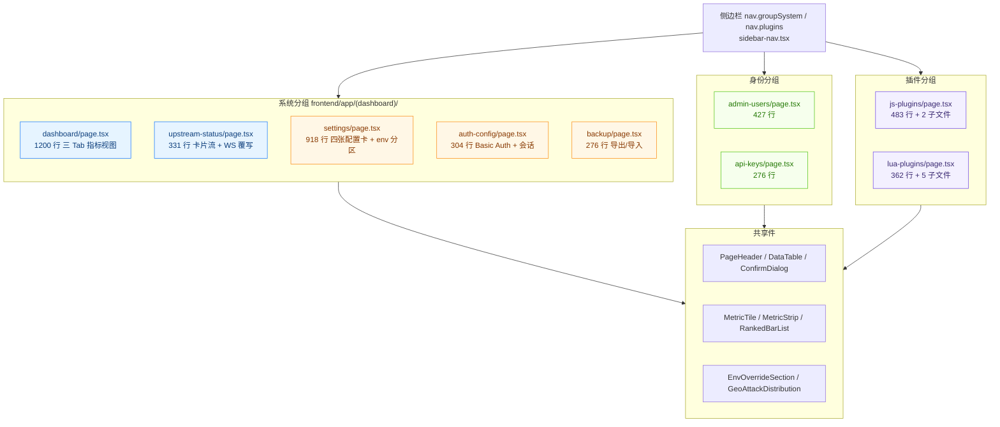
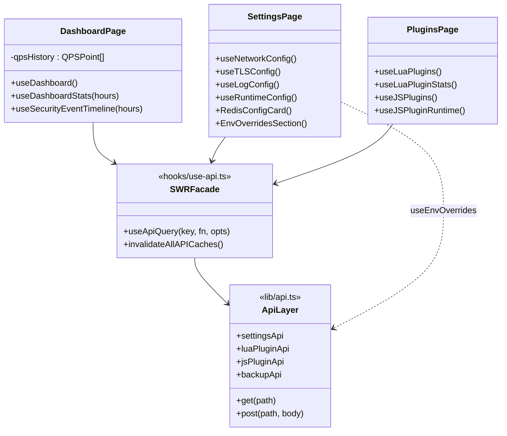
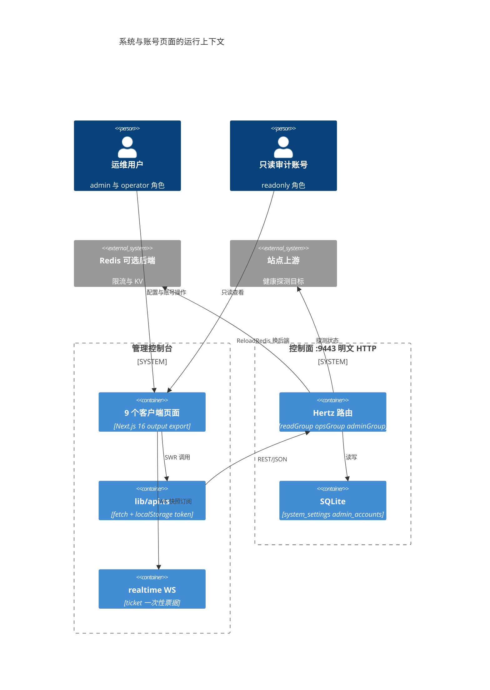
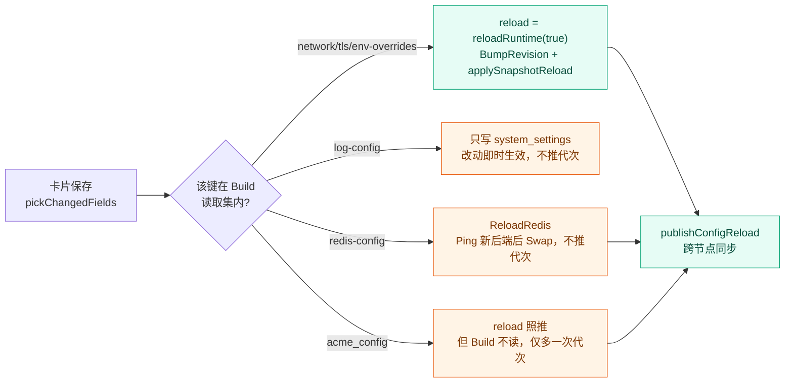
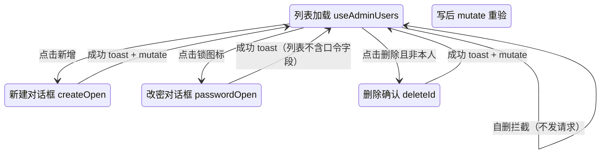
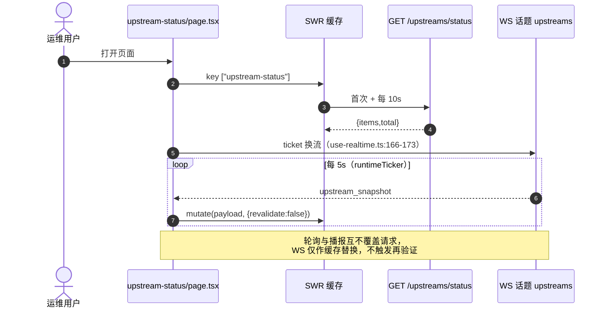
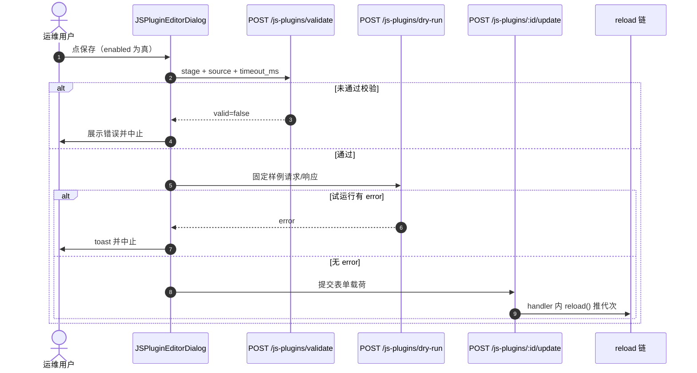
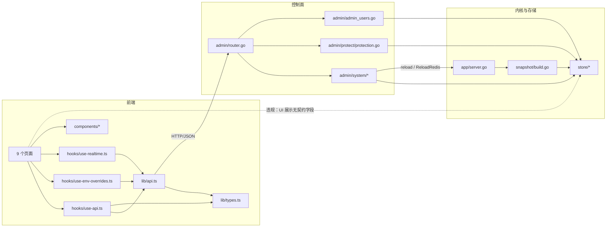
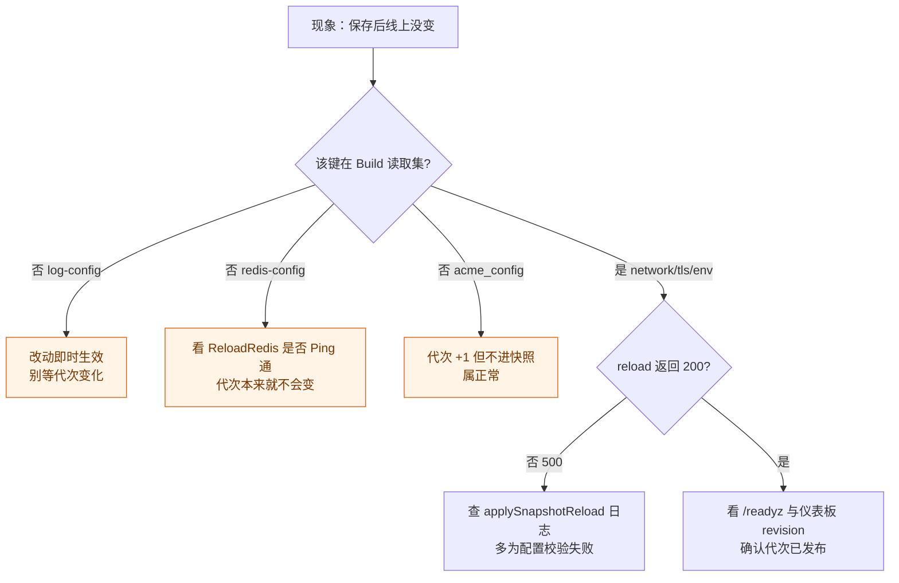

# 系统与账号页面

<cite>
**本文档引用的文件**
- [frontend/app/(dashboard)/dashboard/page.tsx](file://frontend/app/(dashboard)/dashboard/page.tsx)
- [frontend/app/(dashboard)/settings/page.tsx](file://frontend/app/(dashboard)/settings/page.tsx)
- [frontend/app/(dashboard)/admin-users/page.tsx](file://frontend/app/(dashboard)/admin-users/page.tsx)
- [frontend/app/(dashboard)/api-keys/page.tsx](file://frontend/app/(dashboard)/api-keys/page.tsx)
- [frontend/app/(dashboard)/auth-config/page.tsx](file://frontend/app/(dashboard)/auth-config/page.tsx)
- [frontend/app/(dashboard)/backup/page.tsx](file://frontend/app/(dashboard)/backup/page.tsx)
- [frontend/app/(dashboard)/upstream-status/page.tsx](file://frontend/app/(dashboard)/upstream-status/page.tsx)
- [frontend/app/(dashboard)/js-plugins/page.tsx](file://frontend/app/(dashboard)/js-plugins/page.tsx)
- [frontend/app/(dashboard)/js-plugins/components/plugin-editor-dialog.tsx](file://frontend/app/(dashboard)/js-plugins/components/plugin-editor-dialog.tsx)
- [frontend/app/(dashboard)/js-plugins/components/js-help-panel.tsx](file://frontend/app/(dashboard)/js-plugins/components/js-help-panel.tsx)
- [frontend/app/(dashboard)/lua-plugins/page.tsx](file://frontend/app/(dashboard)/lua-plugins/page.tsx)
- [frontend/app/(dashboard)/lua-plugins/components/plugin-editor-dialog.tsx](file://frontend/app/(dashboard)/lua-plugins/components/plugin-editor-dialog.tsx)
- [frontend/app/(dashboard)/lua-plugins/components/dry-run-panel.tsx](file://frontend/app/(dashboard)/lua-plugins/components/dry-run-panel.tsx)
- [frontend/app/(dashboard)/lua-plugins/components/runtime-stats.tsx](file://frontend/app/(dashboard)/lua-plugins/components/runtime-stats.tsx)
- [frontend/app/(dashboard)/lua-plugins/components/lua-help-panel.tsx](file://frontend/app/(dashboard)/lua-plugins/components/lua-help-panel.tsx)
- [frontend/app/(dashboard)/lua-plugins/components/examples.ts](file://frontend/app/(dashboard)/lua-plugins/components/examples.ts)
- [frontend/app/(dashboard)/layout.tsx](file://frontend/app/(dashboard)/layout.tsx)
- [frontend/components/metric-tile.tsx](file://frontend/components/metric-tile.tsx)
- [frontend/components/ranked-bar-list.tsx](file://frontend/components/ranked-bar-list.tsx)
- [frontend/components/env-override-card.tsx](file://frontend/components/env-override-card.tsx)
- [frontend/components/top-bar.tsx](file://frontend/components/top-bar.tsx)
- [frontend/components/sidebar-nav.tsx](file://frontend/components/sidebar-nav.tsx)
- [frontend/hooks/use-api.ts](file://frontend/hooks/use-api.ts)
- [frontend/hooks/use-env-overrides.ts](file://frontend/hooks/use-env-overrides.ts)
- [frontend/hooks/use-realtime.ts](file://frontend/hooks/use-realtime.ts)
- [frontend/lib/api.ts](file://frontend/lib/api.ts)
- [frontend/lib/types.ts](file://frontend/lib/types.ts)
- [frontend/next.config.ts](file://frontend/next.config.ts)
- [frontend/package.json](file://frontend/package.json)
- [internal/admin/router.go](file://internal/admin/router.go)
- [internal/admin/system/network.go](file://internal/admin/system/network.go)
- [internal/admin/system/settings.go](file://internal/admin/system/settings.go)
- [internal/admin/system/backup.go](file://internal/admin/system/backup.go)
- [internal/admin/system/apikey/apikey.go](file://internal/admin/system/apikey/apikey.go)
- [internal/admin/system/upstream/upstream.go](file://internal/admin/system/upstream/upstream.go)
- [internal/admin/system/dashboard/dashboard.go](file://internal/admin/system/dashboard/dashboard.go)
- [internal/admin/system/jsplugin/js_plugin.go](file://internal/admin/system/jsplugin/js_plugin.go)
- [internal/admin/system/luaplugin/lua_plugin.go](file://internal/admin/system/luaplugin/lua_plugin.go)
- [internal/admin/system/realtime/realtime.go](file://internal/admin/system/realtime/realtime.go)
- [internal/admin/admin_users.go](file://internal/admin/admin_users.go)
- [internal/admin/protect/protection.go](file://internal/admin/protect/protection.go)
- [internal/store/backup.go](file://internal/store/backup.go)
- [internal/store/auth/auth.go](file://internal/store/auth/auth.go)
- [internal/store/auth/seed.go](file://internal/store/auth/seed.go)
- [internal/store/migrate.go](file://internal/store/migrate.go)
- [internal/store/migrations/api_key_owner.go](file://internal/store/migrations/api_key_owner.go)
- [internal/store/site.go](file://internal/store/site.go)
- [internal/store/repository/security_event_aggregate_cache.go](file://internal/store/repository/security_event_aggregate_cache.go)
- [internal/snapshot/build.go](file://internal/snapshot/build.go)
- [internal/snapshot/js.go](file://internal/snapshot/js.go)
- [internal/app/server.go](file://internal/app/server.go)
- [internal/waf/jsplugin/quickjs_cgo.go](file://internal/waf/jsplugin/quickjs_cgo.go)
- [internal/waf/jsplugin/quickjs_stub.go](file://internal/waf/jsplugin/quickjs_stub.go)
- [internal/waf/luaplugin/dryrun.go](file://internal/waf/luaplugin/dryrun.go)
- [README.md](file://README.md)
</cite>

## 目录

1. [简介](#简介)
2. [项目结构](#项目结构)
3. [核心组件](#核心组件)
4. [架构总览](#架构总览)
5. [详细组件分析](#详细组件分析)
6. [依赖关系分析](#依赖关系分析)
7. [性能考虑](#性能考虑)
8. [故障排查指南](#故障排查指南)
9. [结论](#结论)
10. [附录](#附录)

## 简介

本篇覆盖控制台 9 个「系统与账号」类页面目录：`dashboard/`、`settings/`、`admin-users/`、`api-keys/`、`auth-config/`、`backup/`、`upstream-status/`、`js-plugins/`、`lua-plugins/`。它们共同构成运维面：一类是**指标只读视图**（仪表板、上游状态），一类是**进程级配置写入**（设置、认证配置、备份），一类是**身份与凭据管理**（管理员账号、API 密钥），一类是**插件运行时管理**（Lua/JavaScript 策略脚本）。站点/规则/事件日志类页面见 `站点与规则页面.md`、`事件与日志页面.md`；外壳与非 dashboard 路由见 `../认证与外壳页面.md`；通用组合式组件见 `../组件设计模式/CRUD 页面组件.md`。

四条实测口径必须先立清楚，本篇所有结论都依赖它们：

| 口径 | 实测事实 | 反直觉之处 |
|------|----------|------------|
| 写操作 | 控制面**只有 POST**：`/update`、`/delete`、`/toggle`、`/start`、`/stop`；PUT/DELETE 路由零注册 | 前端 `lib/api.ts:672-684` 仍导出 `put()`/`del()`，但全库无调用方 |
| 管理端口 | `:9443` 实为**明文 HTTP**：`server.go:1052` 的 `adminSrv` 只传 `WithHostPorts`，未挂 TLS | `README.md:21` 与 `README.md:291` 写成 HTTPS，属文档错误 |
| 无鉴权探针 | `/healthz`、`/readyz`、`/status`、`/metrics` 直接注册在 `adminSrv` 上（`server.go:1053-1056`），位于 `api` 分组之外 | `AuthMiddleware` 只在 `router.go:110` 的 `api` 分组挂载，`/metrics` 还在管理端口，暴露面比预期大 |
| 重载触发 | `log-config` 不触发 reload；`redis-config` 走 `ReloadRedis` 仅换后端；`acme_config` 会 reload 但不在 `Build` 读取集 | 三者都不递增代次，与「保存即推代次」的直觉不符 |

**章节来源**
- [frontend/lib/api.ts:659-684](file://frontend/lib/api.ts#L659-L684)
- [internal/app/server.go:1052-1056](file://internal/app/server.go#L1052-L1056)
- [internal/admin/router.go:108-125](file://internal/admin/router.go#L108-L125)

## 项目结构



**图表来源**
- [frontend/components/sidebar-nav.tsx:195-334](file://frontend/components/sidebar-nav.tsx#L195-L334)
- [frontend/app/(dashboard)/dashboard/page.tsx:185-185](file://frontend/app/(dashboard)/dashboard/page.tsx#L185-L185)
- [frontend/app/(dashboard)/lua-plugins/page.tsx:56-56](file://frontend/app/(dashboard)/lua-plugins/page.tsx#L56-L56)

页面清单（行号为页面默认导出所在行，端点与刷新方式取自 `hooks/use-api.ts` 的 SWR 选项实测值）：

| 页面 | 目录:行 | 主组件 | 调用端点 | 刷新方式 |
|------|---------|--------|----------|----------|
| 仪表板 | `dashboard/page.tsx:185` | `DashboardPage` | `GET /dashboard/summary`、`GET /security-events/stats`、`GET /security-events/timeline` | SWR 轮询 10s / 30s；时间范围切换即重算 key |
| 系统设置 | `settings/page.tsx:122` | `SettingsPage` | `GET·POST /network-config`、`/tls-config`、`/log-config`、`/redis-config`、`GET /runtime-config`、`GET·POST /runtime-config/env-overrides` | 无轮询；保存后按 `invalidateKeys` 重验单键 |
| 管理员账号 | `admin-users/page.tsx:56` | `AdminUsersPage` | `GET /admin-users`、`POST /admin-users`、`/admin-users/:id/update-role`、`/update-password`、`/delete` | 无轮询；写成功后显式 `mutate()` |
| API 密钥 | `api-keys/page.tsx:31` | `ApiKeysPage` | `GET /api-keys`、`POST /api-keys`、`/api-keys/:id/delete` | 无轮询；写成功后 `await mutate()` |
| 认证配置 | `auth-config/page.tsx:34` | `AuthConfigPage` | `GET·POST /protection-settings`、`GET /auth/sessions`、`POST /auth/sessions/force-logout` | 无轮询；强退后失效 `admin-sessions` |
| 配置备份 | `backup/page.tsx:47` | `BackupPage` | `GET /backup/export`、`POST /backup/import` | 无 SWR；导入后 `invalidateAllAPICaches()` 全量重验 |
| 上游状态 | `upstream-status/page.tsx:233` | `UpstreamStatusPage` | `GET /upstreams/status`、WS 话题 `upstreams` | SWR 10s 轮询 + WS 快照 `mutate(..., {revalidate:false})` |
| JS 插件 | `js-plugins/page.tsx:50` | `JSPluginsPage` | `GET /js-plugins`、`/js-plugins/stats`、`/js-plugins/runtime`、`POST /js-plugins*`（含 `/validate`、`/dry-run`） | stats/runtime 15s 轮询；列表写后 `refresh()` |
| Lua 插件 | `lua-plugins/page.tsx:56` | `LuaPluginsPage` | `GET /lua-plugins`、`/lua-plugins/stats`、`POST /lua-plugins*`（含 `/validate`、`/dry-run`） | stats 15s 轮询；列表写后 `refresh()` |

技术栈约束（实测非推断）：`next.config.ts:4-6` 为 `output:"export"` + `trailingSlash:true`，因此不存在 Server Actions、`cookies()`、rewrites/redirects；上述 9 页全部是 `"use client"` 客户端组件，鉴权与数据获取都在浏览器侧完成；站点详情这类需要 `useSearchParams()` 的页面靠 `(dashboard)/layout.tsx:25` 的统一 `Suspense` 边界兜底，本组页面均不读 `searchParams`（仪表板的钻取是 `<Link href="/security-events?...">` 出站跳转）。

**章节来源**
- [frontend/next.config.ts:3-14](file://frontend/next.config.ts#L3-L14)
- [frontend/app/(dashboard)/layout.tsx:19-36](file://frontend/app/(dashboard)/layout.tsx#L19-L36)
- [frontend/hooks/use-api.ts:534-578](file://frontend/hooks/use-api.ts#L534-L578)

## 核心组件

| 组件 | 位置 | 职责 | 消费页面 |
|------|------|------|----------|
| `MetricTile` | `components/metric-tile.tsx:128` | 单指标卡；`rawValue===0` 时整卡降为 neutral 并取消竖条 | dashboard 首屏 4 卡、报告 Tab |
| `RankedBarList` | `components/ranked-bar-list.tsx:40` | 排行条形列表；长度相对**最大值**而非总量 | dashboard 类别分布、规则命中 Top |
| `EnvOverrideSection` | `components/env-override-card.tsx:195` | 按域渲染环境变量覆盖卡，脏键集驱动保存 | settings 的 env 分区 |
| `DataTable` / `ConfirmDialog` | `admin-users/page.tsx:279`、`api-keys/page.tsx:192` | 列定义表 + 破坏性操作二次确认 | admin-users、api-keys、js/lua-plugins |
| `PluginEditorDialog`（Lua） | `lua-plugins/components/plugin-editor-dialog.tsx:147` | 脚本编辑/试运行/契约三 Tab | lua-plugins |
| `JSPluginEditorDialog` | `js-plugins/components/plugin-editor-dialog.tsx:222` | 同上，另带样例请求/响应构造 | js-plugins |
| `useEnvOverrides` | `hooks/use-env-overrides.ts:78` | env 覆盖读写；写后用响应直接回填缓存并触发 `runtime-config` 重验 | settings |
| `useRealtimeOverview` | `hooks/use-realtime.ts:143` | 订阅 WS `upstream_snapshot` | upstream-status |



**图表来源**
- [frontend/hooks/use-api.ts:156-165](file://frontend/hooks/use-api.ts#L156-L165)
- [frontend/hooks/use-api.ts:190-193](file://frontend/hooks/use-api.ts#L190-L193)
- [frontend/lib/api.ts:1066-1106](file://frontend/lib/api.ts#L1066-L1106)
- [frontend/lib/api.ts:1290-1357](file://frontend/lib/api.ts#L1290-L1357)

**章节来源**
- [frontend/components/metric-tile.tsx:99-142](file://frontend/components/metric-tile.tsx#L99-L142)
- [frontend/components/ranked-bar-list.tsx:7-66](file://frontend/components/ranked-bar-list.tsx#L7-L66)
- [frontend/components/env-override-card.tsx:178-237](file://frontend/components/env-override-card.tsx#L178-L237)
- [frontend/hooks/use-env-overrides.ts:78-126](file://frontend/hooks/use-env-overrides.ts#L78-L126)

## 架构总览



**图表来源**
- [internal/admin/router.go:124-125](file://internal/admin/router.go#L124-L125)
- [internal/admin/router.go:255-256](file://internal/admin/router.go#L255-L256)
- [internal/admin/router.go:372-374](file://internal/admin/router.go#L372-L374)
- [internal/app/server.go:1052-1056](file://internal/app/server.go#L1052-L1056)

控制面按角色切三个互斥分组，本篇 9 页的端点落位如下（`RequireRole` 逐条取自 `router.go`）：

| 分组 | 角色集合 | 本组页面涉及的读端点 | 本组页面涉及的写端点 |
|------|----------|----------------------|----------------------|
| `readGroup` | admin / operator / readonly | `/dashboard/summary`、`/security-events/stats`、`/upstreams/status`、`/network-config`、`/tls-config`、`/log-config`、`/redis-config`、`/runtime-config`、`/js-plugins*`、`/lua-plugins*`、`/admin-users`、`/api-keys`、`/protection-settings` | — |
| `opsGroup` | admin / operator | — | `/protection-settings`、`/js-plugins*`、`/lua-plugins*` |
| `adminGroup` | admin | `/backup/export` | `/backup/import`、`/network-config`、`/tls-config`、`/log-config`、`/redis-config`、`/runtime-config/env-overrides`、`/admin-users*`、`/api-keys*` |

这里存在一处**必须写明的口径落差**：后端分组是权威的，前端各页的 `canManage` 判定并不与之一一对应。`settings` 页把 `canManage` 收敛为「仅 admin」（`settings/page.tsx:125-129`，注释明确说写端点全在 adminGroup），而 `backup` 页对导出/导入**完全没有角色守卫**（`backup/page.tsx:173`、`backup/page.tsx:252` 的按钮只受 `exporting`/`fileData` 约束），readonly 用户进入该页可以看到并可点「恢复备份」，最终由后端 403 兜住。

**章节来源**
- [internal/admin/router.go:124-406](file://internal/admin/router.go#L124-L406)
- [frontend/app/(dashboard)/settings/page.tsx:122-130](file://frontend/app/(dashboard)/settings/page.tsx#L122-L130)
- [frontend/app/(dashboard)/backup/page.tsx:155-273](file://frontend/app/(dashboard)/backup/page.tsx#L155-L273)

## 详细组件分析

### 仪表板页（dashboard）

页面把**两套互不通约的口径**物理分区，这是该页最容易读错的地方：

| 区块 | 端点 | 口径 | 随时间范围变化 | 轮询 |
|------|------|------|:--------------:|:----:|
| 首屏 4 张 `MetricTile`、两张 `RankedBarList`、`GeoAttackDistribution` | `/security-events/stats?hours=` | 日志库窗口聚合 | 是 | 30s |
| 访问/拦截趋势面积图 | `/security-events/timeline?hours=` | 窗口内全部安全事件 `COUNT(*)` | 是 | 无独立轮询 |
| `MetricStrip` 运行时计数、QPS、访客构成、Bot/CVE/Drop 24h | `/dashboard/summary` | 进程内原子计数 + 24h 日志聚合 | 否（重启归零） | 10s |

三条实现细节值得登记：其一，`/dashboard/summary` 在**服务端**还有两级缓存——进程内 `dashboardCacheTTL = 30s`（`dashboard.go:34`）与 Redis 键 `dashboard:summary` 同 TTL（`dashboard.go:160-162`），而前端按 10s 轮询，因此 24h 类数值实际最快 30s 才变一次；`qps_*`、`requests_total` 等原子量每次请求都是实时的（`dashboard.go:125`）。其二，聚合仓储对 `top_ips`/`top_paths`/`top_rules` 一律 `limit 10`（`security_event_aggregate_cache.go:218`、`:247`），只有 `categories` 是完整 GROUP BY，所以页面用 `categories.length` 当「攻击类型数」是真实聚合，而 `top_rules` 的长度不可当总数（`page.tsx:266-268` 的注释已固化这一判断）。其三，QPS 迷你序列是**浏览器侧累积**：`MAX_QPS_POINTS = 60`，每次 `data` 引用变化追加一点（`page.tsx:193-214`），刷新页面即丢失历史，且横轴时间取自客户端时钟。

访客构成饼图的分母口径处理得当：优先用后端 `visit_kind_total_24h`，缺失时才退回三类之和（`page.tsx:600-611`），并在卡下固定一段口径说明（`page.tsx:744-749`），符合项目「统计卡必须标注口径」的约束。

**章节来源**
- [frontend/app/(dashboard)/dashboard/page.tsx:185-286](file://frontend/app/(dashboard)/dashboard/page.tsx#L185-L286)
- [frontend/app/(dashboard)/dashboard/page.tsx:596-750](file://frontend/app/(dashboard)/dashboard/page.tsx#L596-L750)
- [internal/admin/system/dashboard/dashboard.go:33-35](file://internal/admin/system/dashboard/dashboard.go#L33-L35)

### 系统设置页（settings）

设置分组表是本节的核心可核对物。「后端读取」列指向快照 `Build` 的真实读取点，`Build` 只读 `network_config`、`tls_default_config`、`protection`、`bot_settings`、`runtime_config_overrides` 这几个键，其余键由进程内其它路径消费：

| 分组 | 字段 | 后端读取:行 | 是否触发 reload | 站点可否覆盖 |
|------|------|-------------|-----------------|--------------|
| 网络 | `ipv6_enabled`、`http3_enabled`、`http3_bind`、`http3_per_port_enabled`、`default_alpn`、`default_network` | `snapshot/build.go:1237`（`network_config`） | 是，写后 `reload()` 推代次（`router.go:390`） | 仅 `network`/`alpn` 有站点字段（`store/site.go:49`、`:57`）；IPv6/HTTP/3 为进程级 |
| TLS | `min_version`、`max_version`、`cipher_suites`、`default_alpn`、`curve_preferences`、`prefer_server_cipher_suites`、`session_tickets_enabled`、`self_signed_on_ip`、`allow_0rtt` | `snapshot/build.go:1246`（`tls_default_config`） | 是（`router.go:396`） | 是：`min_tls_version`/`max_tls_version`/`cipher_suites`/`alpn` 均可站点覆盖（`store/site.go:53-57`） |
| 日志 | `level`、`file_path`、`also_stdout` | 不在 `Build` 读取集；读端点回读运行态 `logger.GetLevel()`（`system/network.go:260`） | **否**：`UpdateLogConfig` 未收 reload（`router.go:395`、`system/network.go:266`） | 否 |
| Redis | `enabled`、`redis_addr`、`redis_password`、`redis_db` | 不在 `Build` 读取集 | 走 `ReloadRedis`：仅 Ping + 换客户端（`server.go:926-945`、`router.go:394`），**不推代次** | 否 |
| 运行时/env 覆盖 | 8 个域的键（`network`、`observability`、`limits`、`cache`、`queue`、`http3`、`bootstrap`、`internal`） | `snapshot/build.go:1261`（`runtime_config_overrides`） | 是（`router.go:391`） | 三态逐键覆盖，站点级仅对 `protection` 族有意义 |
| ACME（对照项，实际在证书页） | `acme_config` | **不在** `Build` 读取集 | 是（`router.go:397`），故只多推一次代次 | 否 |

保存后的 reload 分流如下：



**图表来源**
- [internal/app/server.go:1031-1032](file://internal/app/server.go#L1031-L1032)
- [internal/app/server.go:925-945](file://internal/app/server.go#L925-L945)
- [internal/admin/router.go:390-397](file://internal/admin/router.go#L390-L397)
- [internal/snapshot/build.go:1236-1262](file://internal/snapshot/build.go#L1236-L1262)

实现要点：三张卡各自维护 `localNetwork`/`localTLS`/`localLog` 草稿，保存时用 `pickChangedFields` 只带上「显式改动过的键」（`page.tsx:112-120`），空载荷直接 return，不发无效 POST。`allow_0rtt` 被特殊处理——`inherit` 提交 `null`、`on` 提交 `true`、`off` 提交 `false`，并且只有 `hasOwnProperty` 命中才随请求带上（`page.tsx:106-110`、`:214-216`），这是项目「站点级 nullable 三态」约定在全局层的同构实现。Redis 密码走 `passwordTouched` 哨兵：输入框初始恒为空，只有用户真正键入才提交 `redis_password`（`page.tsx:773`、`:792-794`），配合后端只回 `password_set` 不回显真值（`system/network.go:73`、`:531`）。页顶还会渲染 `runtime-config` 携带的 `config_diagnostics` 列表，逐条展示 `source.field`、错误原因与处理策略（`page.tsx:279-340`）。

**章节来源**
- [frontend/app/(dashboard)/settings/page.tsx:59-237](file://frontend/app/(dashboard)/settings/page.tsx#L59-L237)
- [frontend/app/(dashboard)/settings/page.tsx:579-760](file://frontend/app/(dashboard)/settings/page.tsx#L579-L760)
- [frontend/app/(dashboard)/settings/page.tsx:762-918](file://frontend/app/(dashboard)/settings/page.tsx#L762-L918)

### 管理员账号页（admin-users）

该页是 `PageHeader + DataTable + Dialog + ConfirmDialog` 的组合，5 列（用户名、角色、创建时间、最后登录、操作），角色列直接内联 `Select` 改角色，写后立即 `mutate()`。与首启引导的关系是这里的关键：`SeedDefaults`（`store/auth/seed.go:26`）在启动链路里只创建**一个** `admin` 账号并生成随机口令，**不预置任何 API 令牌**（`seed.go:15-17` 的注释明确写"令牌一律由已登录的管理员在自己的账号下主动创建"）。因此在干净库上，本页面初始只有 1 行、`api-keys` 页初始为空。

一处升级时序缺陷必须如实登记：V15 迁移会把 `admin_api_keys.user_id` 为 0 的历史令牌回填到「role=admin 的最小 id 账号」（`migrations/api_key_owner.go:21-48`），无 admin 账号时**不回填并保持令牌失效**。而 `AutoMigrate`（含 V15）在 `server.go:249` 执行，`SeedDefaults` 在 `server.go:267` 执行——旧库升级后首次启动时账号还不存在，回填必然落空，既有 API 令牌会失效一次，需管理员登录后在本页确认账号、再去 `api-keys` 页重建。

角色守卫：`canManage = user?.role === "admin"`（`page.tsx:59`），与后端 adminGroup 一致；自删保护在前端（`page.tsx:126-133` 用 `username === currentUser` 拦截）与后端 `revokeCredentials`（`router.go:404-406`）双重实现。



**图表来源**
- [frontend/app/(dashboard)/admin-users/page.tsx:67-145](file://frontend/app/(dashboard)/admin-users/page.tsx#L67-L145)
- [frontend/app/(dashboard)/admin-users/page.tsx:288-424](file://frontend/app/(dashboard)/admin-users/page.tsx#L288-L424)

**违规登记**：`last_login` 列（`page.tsx:210-218`）读取 `row.last_login`，但后端 `AdminAccount` 模型只有 `id/username/password_hash/role/created_at/updated_at`（`store/auth/auth.go:28-35`），`ListAdminUsers` 原样返回账号（`admin_users.go:22-31`），全库无任何 `last_login` 字段。该列因此**恒显示「从未登录」**，而前端类型把它声明为可选（`lib/types.ts:1600`）掩盖了契约缺失。登录成功只更新 `LoginAttempt` 审计记录与会话表，不回写账号行。

**章节来源**
- [frontend/app/(dashboard)/admin-users/page.tsx:56-145](file://frontend/app/(dashboard)/admin-users/page.tsx#L56-L145)
- [frontend/app/(dashboard)/admin-users/page.tsx:160-249](file://frontend/app/(dashboard)/admin-users/page.tsx#L160-L249)
- [internal/store/auth/seed.go:13-54](file://internal/store/auth/seed.go#L13-L54)

### API 密钥页（api-keys）

语义要点是「明文只出现一次」：`POST /api-keys` 返回 `{token,id,name}`（`apikey.go:70-77`），前端把 token 存进组件态并打开结果对话框供复制（`page.tsx:55-62`、`:237-263`），关闭即清空（`page.tsx:239-242`）；复制失败时退到 `document.execCommand("copy")`（`page.tsx:73-80`）。列表侧后端只回 `id/name/user_id/created_at/last_used_at` 与归属用户名（`apikey.go:26-33` + `decorateKeysWithOwner`），模型里 `Prefix` 与 `TokenHash` 都是 `json:"-"`（`store/auth/auth.go:22-23`），因此令牌不可再读。

一处**归属语义落差**需要写明：创建端点把令牌挂到**当前登录账号**上（`apikey.go:44-53`，取 `currentUsername(c)` 并在找不到账号时返 403），页面没有任何「选择归属账号」的控件。admin 无法在本页为 operator 代建令牌——要建谁的令牌就得谁登录。而列表页又把 `owner` 作为一列展示（`page.tsx:110-117`），读者容易误以为可选归属。

**违规登记**：`key_preview` 列（`page.tsx:119-126`）的 `render` 完全忽略 `row`，恒定渲染 `t("apiKeys.hidden")`。后端不存在 `key_preview` 字段，列 key 只是装饰性标签。另：新增对话框的确认按钮 `disabled` 未含 `!canManage`（`page.tsx:226-231`），与 admin-users 页同类按钮口径不一致，实际防线只在 `handleCreate` 的早退里（`page.tsx:53`）。

**章节来源**
- [frontend/app/(dashboard)/api-keys/page.tsx:31-96](file://frontend/app/(dashboard)/api-keys/page.tsx#L31-L96)
- [frontend/app/(dashboard)/api-keys/page.tsx:98-161](file://frontend/app/(dashboard)/api-keys/page.tsx#L98-L161)
- [frontend/app/(dashboard)/api-keys/page.tsx:200-273](file://frontend/app/(dashboard)/api-keys/page.tsx#L200-L273)

### 认证配置页（auth-config）

本页承载**数据面 HTTP Basic Auth**（不是控制台登录），写入目标是全局 `protection` 键的三个字段 `basic_auth_enabled`/`basic_auth_username`/`basic_auth_password`（`page.tsx:29-32`）。它符合项目「快捷配置页不得制造第二配置源」的约定：`useProtectionSettingsUpdate` 在提交前先 `protectionApi.getSettings()` 再展开合并（`use-api.ts:856-866`），因此不会把其余保护字段覆盖成默认值；密码框为空时干脆不带该键（`page.tsx:64-66`）。读侧后端会显式 `delete(out, "basic_auth_password")`（`protect/protection.go:34`），所以「密码永远回显为空」是设计而非缺陷，占位文案承担提示职责。会话超时一项被做成只读卡，明确标注固定值（`page.tsx:188-195`），不提供伪可编辑控件。

下半区 `ActiveSessionsCard` 列 `GET /auth/sessions` 的 `username/ip/user_agent/login_at/last_active_at`，强退按 `jti` 走 `POST /auth/sessions/force-logout`；`canForceLogout` 收敛为 admin（`page.tsx:38`），与 `router.go:116` 的 `RequireRole(RoleAdmin)` 对齐，而写 `protection-settings` 本身在 opsGroup，所以本页 `canManage = admin || operator`（`page.tsx:37`）——同一页面内两档权限并存，UI 用按钮 `disabled` 分别表达。

**章节来源**
- [frontend/app/(dashboard)/auth-config/page.tsx:34-104](file://frontend/app/(dashboard)/auth-config/page.tsx#L34-L104)
- [frontend/app/(dashboard)/auth-config/page.tsx:180-304](file://frontend/app/(dashboard)/auth-config/page.tsx#L180-L304)
- [frontend/hooks/use-api.ts:853-866](file://frontend/hooks/use-api.ts#L853-L866)
- [internal/admin/protect/protection.go:18-45](file://internal/admin/protect/protection.go#L18-L45)

### 配置备份页（backup）

对接的是 `GET /api/v1/backup/export` 与 `POST /api/v1/backup/import`（`router.go:381-382`，均在 adminGroup）。注意常见误记：导出是 **GET**，`backupApi.export()` 也确实是 `get`（`lib/api.ts:1291`）；写侧只有导入用 POST。导出后前端用 `Blob` + `URL.createObjectURL` 触发下载（`page.tsx:59-88`），文件名由客户端日期生成，与后端的 `owaf-backup-<时间戳>.json` 头（`system/backup.go:44-45`）不同名，属两套命名。

备份载荷覆盖 18 张配置表，凭据与机密的处理是本节的核对重点：

| 项 | 导出行为 | 代码位置 | 导入后必须做什么 |
|----|----------|----------|------------------|
| `jwt_secret` | **不导出**：属 `internalSettingKeys`，被 `filterInternalSettingItems` 整条剔除 | `system/settings.go:13-16`、`:83-92`、`system/backup.go:38` | 换机后由新库自举，旧令牌全部失效 |
| `api_key_seed_marker` | 同上，整条剔除 | `system/settings.go:15` | — |
| `redis_config` 密码 | JSON 内 `password` 改写为 `[redacted]` | `system/settings.go:60-76` | 必须在设置页重设，否则 Redis 认证失败 |
| 威胁情报 `auth_header_value` | 掩码（长值留前 4 位 + `***`） | `system/backup.go:42`、`:56-60` | 重新录入订阅凭据 |
| OAuth `client_secret` | 掩码；密文本身跨机不可解 | `system/backup.go:43`、`:71-80` | 重新录入 |
| 管理员账号与 API 令牌 | 不在 `BackupData` 结构内 | `store/backup.go:32-49` | 在新实例另行创建 |

导入侧的语义：`version` 缺失或超过 `store.BackupVersion`（当前为 1，`store/backup.go:58-59`）直接 400；`replace_mode` 为真时先清空配置表再导入；成功后调用 `reload`，失败会明确返回「imported but reload failed」（`system/backup.go:117-157`），并且导入后会撤销访问会话（`router.go:382-388`）。前端在导入成功后调 `invalidateAllAPICaches()`（`use-api.ts:191-193`，`mutate(() => true, ...)` 全量重验）再提示成功计数。

`isBackupData` 只校验 `version>0`、`sites`/`rules` 是数组、`js_plugins` 若存在须为数组（`page.tsx:32-42`），比后端校验宽松，因此坏文件可能在服务端才被拒。

另需纠正一个高频误解：**主库没有应用侧 checkpoint**，`cp data/waf.db` 不是备份——WAL 模式下复制主文件不带 `-wal`/`-shm`，会得到不一致快照。配置类备份的正确来源就是本页的 `backup/export`，它逐表 `Find` 后以逻辑 JSON 导出（`store/backup.go:96-160`）。

**章节来源**
- [frontend/app/(dashboard)/backup/page.tsx:32-153](file://frontend/app/(dashboard)/backup/page.tsx#L32-L153)
- [frontend/lib/api.ts:1287-1294](file://frontend/lib/api.ts#L1287-L1294)
- [internal/admin/system/backup.go:21-80](file://internal/admin/system/backup.go#L21-L80)

### 上游状态页（upstream-status）

数据面是 `GET /upstreams/status` → `BuildUpstreamStatus(pool)`（`system/upstream/upstream.go:28-58`）：从连接池快照逐条读出 `healthy/fail_count/last_failure_kind/last_error/last_latency_ms/average_latency_ms/checked_at/last_success_at`，并显式区分 `configured_protocol` 与 `last_http_protocol`，UI 用 `ProtocolPair` 渲染成「配置 → 实际」的协议降级对照（`page.tsx:54-81`）。结果按 URL 字典序排序，保证轮询之间行序稳定。

刷新是双通道合并：



**图表来源**
- [frontend/app/(dashboard)/upstream-status/page.tsx:233-259](file://frontend/app/(dashboard)/upstream-status/page.tsx#L233-L259)
- [frontend/hooks/use-realtime.ts:143-238](file://frontend/hooks/use-realtime.ts#L143-L238)
- [internal/admin/system/realtime/realtime.go:236-262](file://internal/admin/system/realtime/realtime.go#L236-L262)
- [frontend/hooks/use-api.ts:633-639](file://frontend/hooks/use-api.ts#L633-L639)

页头三个计数徽章（总数/健康/异常）来自 `items` 现场遍历（`page.tsx:251-259`），而 `total` 优先取后端字段（`page.tsx:239`）——两者在同一份 `items` 上计算，不存在「当前页冒充全量」的问题，因为该端点本身不分页。异常态渲染有两条独立阈值：`latencyClass` 以 100ms/500ms 分三色（`page.tsx:30-35`），失败信息块只在 `fail_count>0` 或有 `last_failure_kind`/`last_error` 时出现（`page.tsx:85-86`）。

一处实现瑕疵：合并 WS 数据的 `useEffect` 依赖 `[mutate, realtime]`（`page.tsx:243-249`），而 `useRealtimeOverview` 在无数据时每次返回新建的字面量对象（`use-realtime.ts:237`），依赖项引用不稳定会让该 effect 每轮渲染都执行一次；目前靠 `items.length === 0` 早退避免了 `mutate` 风暴，属于潜在重写点而非现网故障。

**章节来源**
- [frontend/app/(dashboard)/upstream-status/page.tsx:30-86](file://frontend/app/(dashboard)/upstream-status/page.tsx#L30-L86)
- [frontend/app/(dashboard)/upstream-status/page.tsx:233-331](file://frontend/app/(dashboard)/upstream-status/page.tsx#L233-L331)
- [internal/admin/system/upstream/upstream.go:12-58](file://internal/admin/system/upstream/upstream.go#L12-L58)

### JavaScript 边缘插件页（js-plugins）

门控是 `cgo && quickjs` **双条件**：真实实现受 `//go:build cgo && quickjs` 约束（`quickjs_cgo.go:1`），否则落入 stub，`RuntimeAvailable()` 直接返回 false、所有执行返回 `ErrCGODisabled`（`quickjs_stub.go:13-31`）。管理端把这一状态原样转成 503 与 `jsRuntimeUnavailableMessage`（`system/jsplugin/js_plugin.go:25`、`:167-168`、`:458`），并在构建条件注释里钉住「逐字来自 quickjs_cgo.go 的 //go:build 约束」（`js_plugin.go:32-34`）。页面据此把运行时卡与列表解耦：`useJSPluginRuntime` 15s 轮询，展示 `backend`/`engine_ready`/`compiled`/`enabled`/阶段支持四项（`page.tsx:349-389`），字段形状取自 `runtime` 响应结构（`js_plugin.go:66-73`）；`useJSPluginStats` 独立轮询，失败只降级统计列不动列表（`page.tsx:188-210`）。

保存链路把「校验 + 试运行」做成启用前置条件：`enabled === true` 时先 `validate`，再对固定样例 `ENABLEMENT_SAMPLE`/`ENABLEMENT_SAMPLE_RESPONSE` 做 `dryRun`，任一失败即中止保存（`js-plugins/components/plugin-editor-dialog.tsx:334-364`），把「启用即影响线上」的风险挡在写库之前。改动 `source` 或 `stage` 会同时作废校验、运行时提示与试运行结果（`plugin-editor-dialog.tsx:244-249`）。三张读端点与六张写端点全部经 `JS_MUTATION_KEYS` 一次失效三个 key（`use-api.ts:1091-1095`），避免出现「新脚本 + 旧计数」。



**图表来源**
- [frontend/app/(dashboard)/js-plugins/components/plugin-editor-dialog.tsx:316-369](file://frontend/app/(dashboard)/js-plugins/components/plugin-editor-dialog.tsx#L316-L369)
- [internal/admin/router.go:306-311](file://internal/admin/router.go#L306-L311)
- [internal/admin/system/jsplugin/js_plugin.go:440-490](file://internal/admin/system/jsplugin/js_plugin.go#L440-L490)

**章节来源**
- [frontend/app/(dashboard)/js-plugins/page.tsx:50-118](file://frontend/app/(dashboard)/js-plugins/page.tsx#L50-L118)
- [frontend/app/(dashboard)/js-plugins/page.tsx:185-211](file://frontend/app/(dashboard)/js-plugins/page.tsx#L185-L211)
- [frontend/app/(dashboard)/js-plugins/page.tsx:321-399](file://frontend/app/(dashboard)/js-plugins/page.tsx#L321-L399)

### Lua 策略脚本页（lua-plugins）

与 JS 页的最大差异是**试运行本身是批量语义**：请求带 `iterations`（面板默认 2，`dry-run-panel.tsx:148`），后端返回 `DryRunBatchResult{iterations, kv_available, runs[]}`（`waf/luaplugin/dryrun.go:29-39`），`runs[]` 每项含 `iteration`/`decision`/`elapsed_ms`。面板把 `kv_available` 直接做成徽章（`dry-run-panel.tsx:526-531`），并在说明文案里点明试运行「不连生产 Redis、`ctx.kv.available()` 固定 false、线上 Engine 在 KV 不可用时 fail-open」（`dry-run-panel.tsx:210-213`）——示例脚本因此保留 `available()` 分支以准确展示降级路径（`examples.ts:20-40`）。`phase`/`action` 两个样例字段只在 `post` 阶段才提交（`dry-run-panel.tsx:184-187`）。

运行时统计的呈现策略值得单独记录。`GET /lua-plugins/stats` 的计数器只存在于引擎内存，任何配置变更都会重编译并归零，因此写操作必须连带失效 `lua-plugin-stats`（`use-api.ts:998-1015`）。`runtime-stats.tsx` 给占比设了样本门限与分级线：`MIN_RATE_SAMPLE = 100`（`:24`）以下一律中性配色；超时告警线 `0.01`/危险线 `0.05`（`:34-35`）显著宽于失败线 `0.005`/`0.02`（`:43-44`），理由是默认 50ms 挂钟与脚本微秒级耗时之间隔着三个数量级的运行时抖动。极小占比格式化为 `<0.01%` 而非 `0.00%`（`:115-120`），避免与「从未发生」混读。索引键用持久化 `id` 而非脚本名（`:58-94`），与 `api.ts:1334` 的注释「按脚本名聚合，不含数据库 id」相反——**实际以后端 `id` 为准**，前端注释需修正。

子文件清单：

| 文件 | 规模(行) | 职责 |
|------|:--------:|------|
| `components/plugin-editor-dialog.tsx` | 506 | 脚本/试运行/契约三 Tab，启用前强制 `validate`（`:215-224`） |
| `components/dry-run-panel.tsx` | 681 | 样例请求构造与批量结果渲染 |
| `components/runtime-stats.tsx` | 531 | 统计索引、分级配色、汇总卡与告警条 |
| `components/lua-help-panel.tsx` | 262 | `CTX_FIELDS`/`KV_METHODS`/`LUA_DECISION_LIMITS` 契约展示与一键填入示例 |
| `components/examples.ts` | — | `LUA_EXAMPLES`/`LUA_SKELETON`/`LUA_ACTIONS`，源码均已用后端 dry-run 实测 |

站点作用域方面，本页只在「有脚本挂站点或对话框打开」时才拉站点引用（`page.tsx:82-89`），比 JS 页无条件 `useAllSites()`（`js-plugins/page.tsx:61`）更省一次全量分页聚合；`scope` 列对 `site_id` 为 `null` 显示「全站生效」，对无法解析的 id 回落 `#<id>`（`page.tsx:162-170`）。更新载荷必须显式传 `site_id: null` 才能改回全站（`plugin-editor-dialog.tsx:202-212`），这一 `json.RawMessage` 三态语义在 `api.ts:1312-1317` 有注释固定。

**章节来源**
- [frontend/app/(dashboard)/lua-plugins/page.tsx:56-128](file://frontend/app/(dashboard)/lua-plugins/page.tsx#L56-L128)
- [frontend/app/(dashboard)/lua-plugins/page.tsx:244-256](file://frontend/app/(dashboard)/lua-plugins/page.tsx#L244-L256)
- [frontend/app/(dashboard)/lua-plugins/page.tsx:315-333](file://frontend/app/(dashboard)/lua-plugins/page.tsx#L315-L333)
- [frontend/app/(dashboard)/lua-plugins/components/dry-run-panel.tsx:140-215](file://frontend/app/(dashboard)/lua-plugins/components/dry-run-panel.tsx#L140-L215)
- [frontend/app/(dashboard)/lua-plugins/components/runtime-stats.tsx:18-120](file://frontend/app/(dashboard)/lua-plugins/components/runtime-stats.tsx#L18-L120)

### 违规点与口径偏差登记

以下为逐页核对项目约定得到的事实登记，**只登记不改代码**：

| 编号 | 类别 | 严重度 | 标题 | 位置 | 影响 |
|------|------|:------:|------|------|------|
| V-01 | 数据契约 | 高 | `last_login` 列无后端字段，恒显示「从未登录」 | `admin-users/page.tsx:210-218`、`store/auth/auth.go:28-35` | 审计误判账号长期未使用 |
| V-02 | 数据契约 | 中 | `key_preview` 列 render 忽略行数据，后端无此字段 | `api-keys/page.tsx:119-126` | 列名暗示存在预览值，实为占位 |
| V-03 | 权限守卫 | 高 | 备份页无角色守卫，readonly/operator 可见并可点导入 | `backup/page.tsx:173`、`:252`、`router.go:381-382` | 依赖后端 403 兜底，前端无提示 |
| V-04 | 口径展示 | 中 | 规则命中 Top 榜的占比分母是截断后的 Top10 之和，未标注 | `dashboard/page.tsx:275-278`、`ranked-bar-list.tsx:51`、`security_event_aggregate_cache.go:247` | 长尾被忽略，百分比被放大 |
| V-05 | 一致性 | 低 | api-keys 新建确认按钮未随 `canManage` 置灰，与 admin-users 不一致 | `api-keys/page.tsx:226-231` | 防线仅剩 handler 早退 |
| V-06 | 文档漂移 | 低 | `js-help-panel.tsx:15-16` 称响应阶段「后端没有执行入口」，实际响应阶段已接通 | `quickjs_cgo.go:641-647`、`js.go:106`、`js_plugin.go:479-481` | 误导使用者以为只能 request 阶段 |
| V-07 | 注释漂移 | 低 | `api.ts:1334` 称 Lua 统计「按脚本名聚合不含 id」，后端按 `id` 索引 | `runtime-stats.tsx:58-94`、`lua_plugin.go:206-235` | 排查时找错聚合键 |
| V-08 | 版本口径 | 低 | 侧边栏页脚硬编码 `v1.0.0`，`package.json` 为 `0.0.1` | `sidebar-nav.tsx:375-379`、`package.json:3` | 界面版本不可信 |
| V-09 | 死代码 | 低 | `useIsAuthenticated`、`useTabWorkspace` 全库无消费者 | `use-auth.ts:315`、`tab-workspace.tsx:278` | 维护负担与误用风险 |

**章节来源**
- [frontend/app/(dashboard)/admin-users/page.tsx:210-218](file://frontend/app/(dashboard)/admin-users/page.tsx#L210-L218)
- [frontend/app/(dashboard)/api-keys/page.tsx:119-126](file://frontend/app/(dashboard)/api-keys/page.tsx#L119-L126)
- [frontend/app/(dashboard)/backup/page.tsx:173-259](file://frontend/app/(dashboard)/backup/page.tsx#L173-L259)
- [frontend/app/(dashboard)/dashboard/page.tsx:275-278](file://frontend/app/(dashboard)/dashboard/page.tsx#L275-L278)
- [frontend/components/ranked-bar-list.tsx:51-83](file://frontend/components/ranked-bar-list.tsx#L51-L83)

## 依赖关系分析



**图表来源**
- [frontend/hooks/use-api.ts:13-46](file://frontend/hooks/use-api.ts#L13-L46)
- [internal/admin/router.go:200-250](file://internal/admin/router.go#L200-L250)
- [internal/admin/router.go:372-406](file://internal/admin/router.go#L372-L406)
- [internal/app/server.go:1002-1032](file://internal/app/server.go#L1002-L1032)

外部依赖按「断了会怎样」逐项核对：

| 依赖 | 用途 | 接入方式 | 配置来源 | 超时 | 降级 | 可用性影响 |
|------|------|----------|----------|:----:|------|------------|
| SQLite 主库 | 全部配置与账号 | GORM | 启动参数 | 未设置（风险） | 无（风险） | 读写全失败 |
| SQLite 日志库 | 仪表板 24h 聚合 | GORM | 启动参数 | 未设置（风险） | 回退上一份缓存（`dashboard.go:148-153`） | 24h 数值停更 |
| Redis | 限流/KV/仪表板缓存 | rueidis | `redis_config` | Ping 3s（`server.go:938`） | 空实例 5s 熔断 | 限流与跨节点同步退化 |
| QuickJS | JS 插件执行 | cgo + `quickjs` 标签 | 编译期 | 脚本 `timeout_ms` | stub 返 503 | JS 页只剩列表 |
| 站点上游 | 状态探测 | `upstream.Pool` | 站点配置 | 探活 2s | 记 `last_failure_kind` | 上游页显示异常 |

依赖矩阵口径未单列：上表的 `graph LR` 已穷举本组页面的全部跨层边，且本组**不存在 `✗` 反向依赖**——前端不直连 `store`，`store` 不反向引用 `admin`，唯一的「违规」是 V-01/V-02 的展示层字段脱钩，属契约问题而非依赖方向问题。

**章节来源**
- [internal/admin/router.go:36-79](file://internal/admin/router.go#L36-L79)
- [internal/app/server.go:925-945](file://internal/app/server.go#L925-L945)
- [internal/admin/system/dashboard/dashboard.go:147-163](file://internal/admin/system/dashboard/dashboard.go#L147-L163)
- [internal/waf/jsplugin/quickjs_stub.go:13-31](file://internal/waf/jsplugin/quickjs_stub.go#L13-L31)

## 性能考虑

问题 / 优化 / 效果三段（全部取自本组实测）：

- 问题：仪表板 3 个 hook 同屏、QPS 序列每帧复制数组。优化：`MetricStrip` 把 12 项累计量折叠成紧凑条，`qpsHistoryRef` 与 `setQpsHistory([...next])` 分离引用，容量硬上限 60 点（`dashboard/page.tsx:204-209`）。效果：单帧最大重排集合受控，长时间挂屏内存不增。
- 问题：`useAllSites()` 走 200×10 分页聚合（`use-api.ts:95-138`），插件页无条件拉取会白付一次全站扫描。优化：Lua 页用 `needsSiteReferences` 作 SWR key 开关（`lua-plugins/page.tsx:82-84`）。效果：全站无站点脚本时省一次聚合；但 JS 页仍是无条件调用（`js-plugins/page.tsx:61`），两页口径未同步。
- 问题：备份导入后缓存一致性。优化：`invalidateAllAPICaches()` 用 `mutate(() => true, ...)` 只重验当前挂载视图（`use-api.ts:190-193`）。效果：不为未挂载页面发无效请求。
- 问题：插件统计轮询与写操作竞态。优化：`LUA_MUTATION_KEYS`/`JS_MUTATION_KEYS` 把列表与统计同时失效。效果：不出现「新脚本 + 旧计数」。
- 建议：`upstream-status` 的 WS 合并 effect 应把依赖收敛到 `realtime.items`/`realtime.total` 两个原始值，消除每轮渲染重跑 effect 的开销；仪表板 10s 轮询的收益上限是服务端 30s 缓存，可下调为 30s 以减三成请求。

**章节来源**
- [frontend/app/(dashboard)/dashboard/page.tsx:193-214](file://frontend/app/(dashboard)/dashboard/page.tsx#L193-L214)
- [frontend/hooks/use-api.ts:95-138](file://frontend/hooks/use-api.ts#L95-L138)
- [frontend/app/(dashboard)/upstream-status/page.tsx:243-249](file://frontend/app/(dashboard)/upstream-status/page.tsx#L243-L249)

## 故障排查指南



**图表来源**
- [internal/app/server.go:1002-1032](file://internal/app/server.go#L1002-L1032)
- [internal/admin/router.go:390-397](file://internal/admin/router.go#L390-L397)
- [internal/snapshot/build.go:1236-1262](file://internal/snapshot/build.go#L1236-L1262)

| 症状 | 原因 | 排查 | 方案 |
|------|------|------|------|
| 仪表板 24h 数字 10s 内不动 | 服务端 30s/45s 两级缓存 | `dashboard.go:34`、`security_event_aggregate_cache.go:16` | 以 30s 为观察粒度 |
| 设置页保存报 403 | 写端点在 adminGroup，当前是 operator | `router.go:372-374` | 换 admin 账号 |
| 备份页点了导入无反应 | 后端 403，前端无角色提示（V-03） | `router.go:381-382` | 用 admin 账号操作 |
| 导入成功但配置未生效 | reload 失败被单列报错 | 响应含 `backup imported but reload failed` | 查日志并手工 reload |
| 升级后所有 API 令牌失效 | V15 回填早于 `SeedDefaults` | `migrate.go:110` 对 `server.go:249`/`:267` | 登录后台重建令牌 |
| JS 页显示运行时不可用 | 构建未带 `quickjs` 或 cgo 关闭 | `GET /js-plugins/runtime` 的 `available`/`backend` | 按双条件重新构建 |
| Lua 保存 400 | 后端保存前编译校验 | 透出消息即语法错误 | 先在试运行 Tab 复现 |

诊断命令按实测端口写（管理端口明文 HTTP，探针无鉴权）：

```bash
# 探针与指标：无需凭据，可直接 curl
curl -s http://127.0.0.1:9443/readyz
curl -s http://127.0.0.1:9443/status
curl -s http://127.0.0.1:9443/metrics | grep openwaf_dataplane_qps

# 业务端点需要 Bearer（值来自浏览器 localStorage 的 token 键）
curl -s -H "Authorization: Bearer ${ACCESS_TOKEN}" \
  http://127.0.0.1:9443/api/v1/dashboard/summary

# 前端契约自检（逐条对应 package.json 的 check:* 脚本）
cd frontend && bun run check:auth-refresh-contract
cd frontend && bun run check:env-override-contract
```

**章节来源**
- [internal/app/server.go:1052-1056](file://internal/app/server.go#L1052-L1056)
- [internal/admin/system/backup.go:145-157](file://internal/admin/system/backup.go#L145-L157)
- [internal/admin/system/realtime/realtime.go:187-214](file://internal/admin/system/realtime/realtime.go#L187-L214)
- [frontend/package.json:6-20](file://frontend/package.json#L6-L20)

## 结论

成果：9 个页面的端点、刷新机制、权限口径与重载语义已全部落到行级证据；设置分组表首次把「哪个键进 `Build` 读取集、哪个键推代次」逐项钉死，纠正了 `log-config`/`redis-config`/`acme_config` 三处高频误述；备份一节明确了 `jwt_secret` 不导出、Redis 口令 `[redacted]`、主库无应用侧 checkpoint 三个易错点，并登记 9 项口径偏差。

原则复盘：KISS 体现在「口径分区」——仪表板把窗口聚合与进程累计两套数值物理分开并各标徽章；DRY 体现在 `useProtectionSettingsUpdate` 的读-合并-写与两插件页共用的 `*_MUTATION_KEYS` 失效清单；SRP 上 `runtime-stats.tsx` 只负责分级配色、`dry-run-panel.tsx` 只管样例构造，边界清晰；YAGNI 的反例是 `put()`/`del()`、`useIsAuthenticated`、`useTabWorkspace` 这类无消费者接口，以及 `last_login`/`key_preview` 两个无契约支撑的列。

下一步：统一备份页与设置页的角色守卫口径；把规则命中榜的占比改为显式「Top10 内占比」标注；收敛 JS 页的 `useAllSites` 开关；修正 3 处注释漂移；补齐账号登录时间字段的后端契约或删除该列。

[本节为总结，无需特定文件来源]

## 附录

### 端点与权限速查

| 端点 | 方法 | 分组 | 角色 | 触发 reload |
|------|:----:|------|------|:-----------:|
| `/dashboard/summary`、`/security-events/stats`、`/timeline`、`/upstreams/status` | GET | readGroup | 三角色 | 否 |
| `/network-config`、`/tls-config`、`/runtime-config/env-overrides` | POST | adminGroup | admin | 是 |
| `/log-config` | POST | adminGroup | admin | 否 |
| `/redis-config` | POST | adminGroup | admin | `ReloadRedis`，不推代次 |
| `/protection-settings` | GET·POST | read·ops | 读三角色 / 写 admin+operator | 是 |
| `/js-plugins*`、`/lua-plugins*` | GET·POST | read·ops | 读三角色 / 写 admin+operator | 是（validate/dry-run 不触发） |
| `/admin-users*`、`/api-keys*` | GET·POST | read·admin | 读三角色 / 写 admin | 否 |
| `/backup/export`、`/backup/import` | GET·POST | adminGroup | admin | 导入触发 |
| `/auth/sessions`、`/auth/sessions/force-logout` | GET·POST | readGroup + admin | 读三角色 / 强退 admin | 否 |
| `/realtime/ws` | GET（升级） | `api` 分组之外 | 一次性 ticket | 否 |

**章节来源**
- [internal/admin/router.go:124-406](file://internal/admin/router.go#L124-L406)
- [internal/admin/router.go:418-436](file://internal/admin/router.go#L418-L436)

### 刷新与轮询口径

| Hook | key | `refreshInterval` | 失效触发 |
|------|-----|:-----------------:|----------|
| `useDashboard` | `["dashboard"]` | 10s | 随挂载 |
| `useDashboardStats` | `["dashboard-stats", {hours}]` | 30s | 时间范围变化 |
| `useSecurityEventTimeline` | `["security-event-timeline", {hours}]` | 无 | 时间范围变化 |
| `useUpstreamStatus` | `["upstream-status"]` | 10s | WS 快照覆写缓存 |
| `useLuaPluginStats` / `useJSPluginStats` / `useJSPluginRuntime` | 各自单键 | 15s | 写后随 `*_MUTATION_KEYS` |
| `useAdminUsers` / `useApiKeys` / `useProtectionSettings` | 各自单键 | 无 | 显式 `mutate()` |
| `useEnvOverrides` | `["env-overrides"]` | 无 | 写后用响应回填并再验 `runtime-config` |

**章节来源**
- [frontend/hooks/use-api.ts:534-578](file://frontend/hooks/use-api.ts#L534-L578)
- [frontend/hooks/use-api.ts:994-1090](file://frontend/hooks/use-api.ts#L994-L1090)
- [frontend/hooks/use-env-overrides.ts:78-114](file://frontend/hooks/use-env-overrides.ts#L78-L114)

### 术语与口径对照

| 术语 | 含义 | 易混点 | 出处 |
|------|------|--------|------|
| 推代次 | `BumpRevision` 递增 `config_revisions.revision` 并广播 | `ReloadRedis` 不推代次 | `server.go:1002-1010` |
| `Build` 读取集 | 快照构建实际读取的 `system_settings` 键 | 不在集内的键改了也不进快照 | `build.go:1237`、`:1246`、`:1261` |
| 三态覆盖 | `inherit`/`on`/`off` → `null`/`true`/`false` | `??` 会把 `null` 当未设置 | `settings/page.tsx:91-110` |
| 启用前置校验 | 保存启用态插件前强制 validate + dry-run | 关闭态保存不校验 | `plugin-editor-dialog.tsx:334-364` |
| 窗口口径 vs 累计口径 | 日志库时间窗聚合 vs 进程内原子计数 | 重启只影响后者 | `dashboard/page.tsx:259-268` |

**章节来源**
- [frontend/app/(dashboard)/settings/page.tsx:91-110](file://frontend/app/(dashboard)/settings/page.tsx#L91-L110)
- [internal/app/server.go:1002-1010](file://internal/app/server.go#L1002-L1010)
- [internal/snapshot/build.go:1236-1262](file://internal/snapshot/build.go#L1236-L1262)

