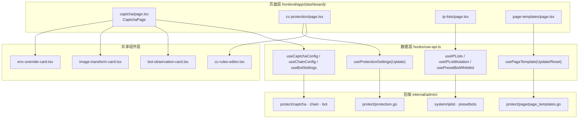
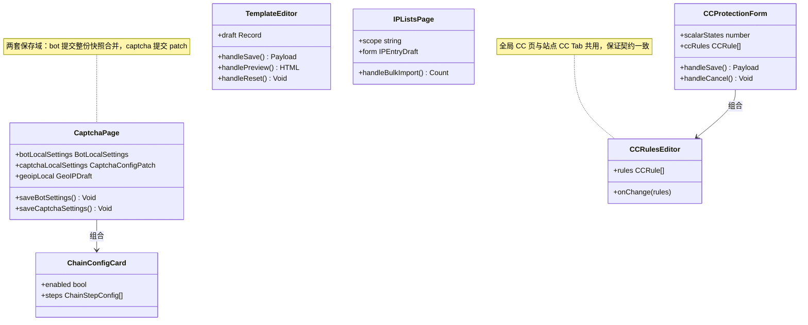
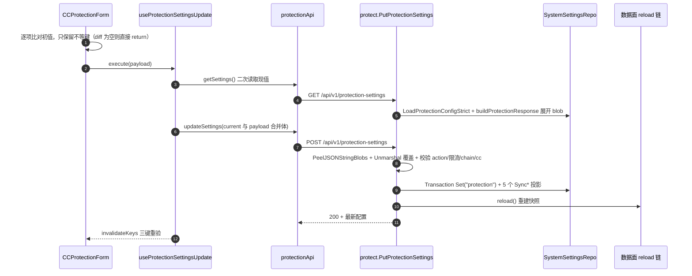
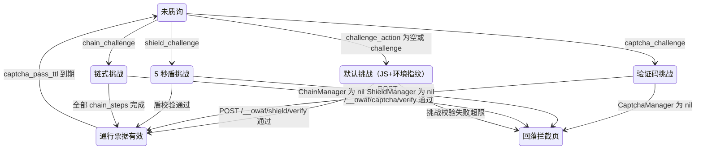
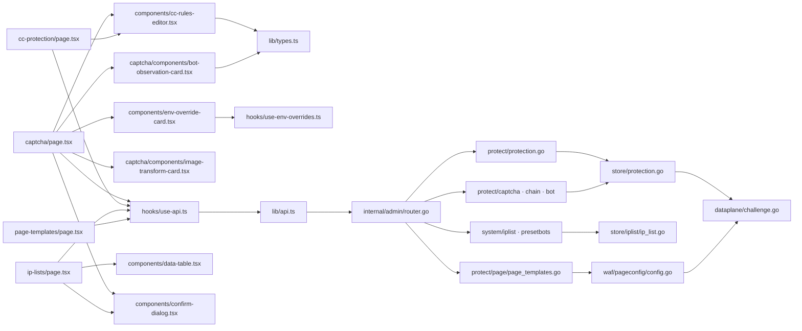

# 防护配置页面

<cite>
**本文档引用的文件**
- [frontend/app/(dashboard)/captcha/page.tsx](file://frontend/app/(dashboard)/captcha/page.tsx)
- [frontend/app/(dashboard)/captcha/components/bot-observation-card.tsx](file://frontend/app/(dashboard)/captcha/components/bot-observation-card.tsx)
- [frontend/app/(dashboard)/captcha/components/image-transform-card.tsx](file://frontend/app/(dashboard)/captcha/components/image-transform-card.tsx)
- [frontend/app/(dashboard)/cc-protection/page.tsx](file://frontend/app/(dashboard)/cc-protection/page.tsx)
- [frontend/app/(dashboard)/ip-lists/page.tsx](file://frontend/app/(dashboard)/ip-lists/page.tsx)
- [frontend/app/(dashboard)/page-templates/page.tsx](file://frontend/app/(dashboard)/page-templates/page.tsx)
- [frontend/components/cc-rules-editor.tsx](file://frontend/components/cc-rules-editor.tsx)
- [frontend/components/env-override-card.tsx](file://frontend/components/env-override-card.tsx)
- [frontend/components/data-table.tsx](file://frontend/components/data-table.tsx)
- [frontend/hooks/use-api.ts](file://frontend/hooks/use-api.ts)
- [frontend/lib/api.ts](file://frontend/lib/api.ts)
- [frontend/lib/types.ts](file://frontend/lib/types.ts)
- [internal/admin/router.go](file://internal/admin/router.go)
- [internal/admin/protect/protection.go](file://internal/admin/protect/protection.go)
- [internal/admin/protect/captcha/captcha.go](file://internal/admin/protect/captcha/captcha.go)
- [internal/admin/protect/bot/bot.go](file://internal/admin/protect/bot/bot.go)
- [internal/admin/protect/chain/chain.go](file://internal/admin/protect/chain/chain.go)
- [internal/admin/protect/page/page_templates.go](file://internal/admin/protect/page/page_templates.go)
- [internal/admin/system/iplist/iplist.go](file://internal/admin/system/iplist/iplist.go)
- [internal/admin/system/presetbots/preset_bots.go](file://internal/admin/system/presetbots/preset_bots.go)
- [internal/store/protection.go](file://internal/store/protection.go)
- [internal/store/iplist/ip_list.go](file://internal/store/iplist/ip_list.go)
- [internal/store/repository/iplist/ip_list.go](file://internal/store/repository/iplist/ip_list.go)
- [internal/waf/pageconfig/config.go](file://internal/waf/pageconfig/config.go)
- [internal/waf/challenge/shield.go](file://internal/waf/challenge/shield.go)
- [internal/dataplane/challenge.go](file://internal/dataplane/challenge.go)
- [internal/app/server.go](file://internal/app/server.go)
- [internal/utils/utils.go](file://internal/utils/utils.go)
</cite>

## 目录

1. [简介](#简介)
2. [项目结构](#项目结构)
3. [核心组件](#核心组件)
4. [架构总览](#架构总览)
5. [详细组件分析](#详细组件分析)
6. [依赖关系分析](#依赖关系分析)
7. [性能考虑](#性能考虑)
8. [故障排查指南](#故障排查指南)
9. [结论](#结论)
10. [附录](#附录)

## 简介

本篇覆盖控制台「防护配置」切面的 4 个页面目录，它们都是**全局配置的写入口**，不做列表取证，也不含站点级覆盖：

| 页面 | 目录行数 | 写入的配置载体 | 端点前缀 |
|------|:--------:|----------------|----------|
| 验证码与质询 | `captcha/` 1916 + 2 子文件（346、234） | `protection` + `bot_settings` + `image_transform` + `env-overrides` | `/captcha`、`/chain`、`/bot-*`、`/image-transform` |
| CC 防护 | `cc-protection/` 509 | `protection`（限流与自定义 CC 规则） | `/protection-settings` |
| IP 名单 | `ip-lists/` 723 | `ip_list_entries` 表 | `/ip-lists`、`/preset-bot-whitelist` |
| 页面模板 | `page-templates/` 350 | `page_template_{captcha,challenge,block}` 三键 | `/page-templates/:type` |

站点级三态覆盖与规则表单见同目录 [站点与规则页面.md](./站点与规则页面.md)，只读取证页见 [事件与日志页面.md](./事件与日志页面.md)。四条口径必须先立清楚：

| 口径 | 实测事实 | 依据 |
|------|----------|------|
| 写操作只有 POST | 4 个页面的全部写请求都是 POST，无 PUT/DELETE | `router.go:287`、`:289-291`、`:330`、`:333-335`、`:337` |
| 保存必触发重载 | 4 个页面的写端点全部带 `reload` 回调，保存成功即重建快照 | `router.go:287`、`:315`、`:330`、`:333`、`:337`、`:393` |
| 第二配置源防护 | CC 页走「先 GET 再合并再 POST」；验证码/链式页由后端做字段级指针合并 | `use-api.ts:856-866`、`captcha.go:134-182`、`chain.go:108-119` |
| 三态语义归属 | 这 4 页都是全局值，本身无「继承全局」态；页面内只有 3 处「空值＝继承」语义 | `cc-rules-editor.tsx:37-38`、`page.tsx:90-96`、`page.tsx:160-164` |

**章节来源**
- [frontend/hooks/use-api.ts:856-897](file://frontend/hooks/use-api.ts#L856-L897)
- [internal/admin/protect/captcha/captcha.go:115-206](file://internal/admin/protect/captcha/captcha.go#L115-L206)
- [internal/admin/protect/chain/chain.go:97-135](file://internal/admin/protect/chain/chain.go#L97-L135)
- [internal/admin/router.go:287-340](file://internal/admin/router.go#L287-L340)

## 项目结构

防护配置切面在仓库里分三层落位：页面层只负责表单态与局部合并语义，Hook 层负责读后合并与缓存失效，API 层与后端处理器负责字段级指针合并和投影同步。

```text
frontend/app/(dashboard)/
├── captcha/page.tsx                     # 1916 行：验证码/盾/链式/动态保护/防重放/签名/GeoIP 七块卡片
├── captcha/components/                  # bot-observation-card 346 行、image-transform-card 234 行
├── cc-protection/page.tsx               # 509 行：请求/错误频率限制 + 自定义 CC 规则
├── ip-lists/page.tsx                    # 723 行：黑白名单增删、批量导入、预置爬虫白名单
└── page-templates/page.tsx              # 350 行：三类面向客户页面的品牌与文案
frontend/components/
├── cc-rules-editor.tsx                  # CC 规则编辑器（全局页与站点 CC Tab 共用）
└── env-override-card.tsx                # 环境变量覆盖卡（与 settings 页共用数据源）
```

| 路径 | 行数 | 职责 | 导出符号 | 对外暴露 |
|------|:----:|------|----------|:--------:|
| `captcha/page.tsx` | 1916 | 质询与 Bot 侧全局配置表单 | `CaptchaPage`（默认导出） | 否 |
| `captcha/components/bot-observation-card.tsx` | 346 | Bot/Drop 观测卡 | `BotObservationCard` | 否 |
| `captcha/components/image-transform-card.tsx` | 234 | 图像转换配置卡 | `ImageTransformCard` | 否 |
| `cc-protection/page.tsx` | 509 | 全局限流与 CC 规则 | `CCProtectionPage`、内部 `CCProtectionForm` | 否 |
| `ip-lists/page.tsx` | 723 | IP 名单 CRUD 与批量导入 | `IPListsPage` | 否 |
| `page-templates/page.tsx` | 350 | 页面模板编辑与预览 | `PageTemplatesPage`、内部 `TemplateEditor` | 否 |
| `components/cc-rules-editor.tsx` | 648 | CC 规则编辑与运行时校验 | `CCRulesEditor`、`CC_ACTION_OPTIONS`、`toCCRules`、`isCCRule`、`emptyCCRule` | 是（站点 CC Tab 复用） |
| `components/env-override-card.tsx` | 307 | 环境变量覆盖渲染 | `EnvOverrideDomainCard` | 是（`rules/cve` 页复用） |



**图表来源**
- [frontend/app/(dashboard)/captcha/page.tsx:50-78](file://frontend/app/(dashboard)/captcha/page.tsx#L50-L78)
- [frontend/app/(dashboard)/cc-protection/page.tsx:24-34](file://frontend/app/(dashboard)/cc-protection/page.tsx#L24-L34)
- [frontend/app/(dashboard)/ip-lists/page.tsx:7-16](file://frontend/app/(dashboard)/ip-lists/page.tsx#L7-L16)
- [frontend/app/(dashboard)/page-templates/page.tsx:33-39](file://frontend/app/(dashboard)/page-templates/page.tsx#L33-L39)
- [frontend/hooks/use-api.ts:482-520](file://frontend/hooks/use-api.ts#L482-L520)

**章节来源**
- [frontend/app/(dashboard)/captcha/page.tsx:1-88](file://frontend/app/(dashboard)/captcha/page.tsx#L1-L88)
- [frontend/components/cc-rules-editor.tsx:21-73](file://frontend/components/cc-rules-editor.tsx#L21-L73)

## 核心组件

| 组件 | 位置 | 职责 | 本地状态 | 提交方式 | 权限门控 |
|------|------|------|----------|----------|----------|
| `CCProtectionForm` | `cc-protection/page.tsx:56-459` | 请求/错误限流与 CC 规则的差量编辑 | 15 个 `useState` 标量 + `ccRules` 数组 | 仅提交与初值不等的键 | `canManage`（admin/operator） |
| `CCProtectionPage` | `cc-protection/page.tsx:461-509` | 载入态/错误态分流，取消时换 `key` 重挂载 | `formKey` | — | — |
| `CaptchaPage` | `captcha/page.tsx:708-1916` | 七块配置卡 + 双保存域（bot / captcha） | `botLocalSettings`、`captchaLocalSettings`、`geoipLocal`、`preview` | patch 合并提交 | `canManage` 与 `canManageOverrides` 两套 |
| `ChainConfigCard` | `captcha/page.tsx:364-595` | 链式步骤编排与指纹档位条件 | `enabled`、`steps` | 全量 `chain_steps` 数组 | `canManage` |
| `ChainSessionsCard` | `captcha/page.tsx:612-706` | 半途挑战会话列举与清除 | `pendingId` | 单条 POST delete | `canManage` |
| `BotObservationCard` | `captcha/components/bot-observation-card.tsx:95-346` | Bot 24 小时聚合 + 高风险明细 + Drop 归因 | 无（纯派生） | 只读 | 只读 |
| `ImageTransformCard` | `captcha/components/image-transform-card.tsx:34-234` | 图像转换开关与 8 项限额 | `draft`（仅改动键） | 局部合并 | 复用页面 `canManage`（存在口径偏差，见排障） |
| `IPListsPage` | `ip-lists/page.tsx:51-723` | 名单列表、作用域并集、批量与预置导入 | `scope`、`form`、`bulkText`、`filterKind` 等 | 逐条 POST 创建 | `canManage` |
| `TemplateEditor` | `page-templates/page.tsx:44-312` | 三类页面的品牌与文案草稿、预览、重置 | `draft`、`showPreview`、`previewHtml` | 全量对象 POST | `canManage` + `fieldset disabled` |
| `CCRulesEditor` | `components/cc-rules-editor.tsx:157-648` | CC 规则新增/编辑/启停/删除与运行时校验 | `editingRuleIndex`、`editingRule` | 受控上抛 `onChange` | `disabled` prop |



**图表来源**
- [frontend/app/(dashboard)/cc-protection/page.tsx:56-167](file://frontend/app/(dashboard)/cc-protection/page.tsx#L56-L167)
- [frontend/app/(dashboard)/captcha/page.tsx:364-435](file://frontend/app/(dashboard)/captcha/page.tsx#L364-L435)
- [frontend/app/(dashboard)/captcha/page.tsx:708-1007](file://frontend/app/(dashboard)/captcha/page.tsx#L708-L1007)
- [frontend/app/(dashboard)/page-templates/page.tsx:44-137](file://frontend/app/(dashboard)/page-templates/page.tsx#L44-L137)
- [frontend/app/(dashboard)/ip-lists/page.tsx:148-241](file://frontend/app/(dashboard)/ip-lists/page.tsx#L148-L241)

### 表单本地态的三种实现取向

四个页面对「服务端值 → 本地草稿」用了三套不同做法，各自的取舍与风险不同：

| 取向 | 使用者 | 做法 | 取消复位 | 风险点 |
|------|--------|------|----------|--------|
| 挂载时 lazy 初始化 + 键控重挂载 | `CCProtectionForm`（`page.tsx:65-105`、`500-507`） | `useState(() => settings.x ?? 默认值)`，取消时父级 `setFormKey(k => k+1)` | 靠重挂载还原服务端初值 | 重挂载后 `settings` 仍是旧缓存，未重新拉取 |
| 草稿只在改动时创建 | `TemplateEditor`（`page.tsx:52-69`）、`ImageTransformCard`（`38-50`） | `form = draft ?? data`，无 effect 同步 | `setDraft(null)` / `setDraft({})` | 后台重验证不会覆盖草稿，但已改字段以草稿为准 |
| 双 Map 叠加读取 | `CaptchaPage`（`page.tsx:883-924`） | `getBotValue`/`getCaptchaValue` 先查 local Map 再回落到服务端值 | `setBotLocalSettings({})` / `setCaptchaLocalSettings({})` | GeoIP 例外：走 `useRef` 一次性水合（`page.tsx:785-797`） |

三者共同点是**都不在 effect 里同步服务端值**（GeoIP 水合是唯一例外，用 `geoipHydrated` 只做一次）。

**章节来源**
- [frontend/app/(dashboard)/cc-protection/page.tsx:50-105](file://frontend/app/(dashboard)/cc-protection/page.tsx#L50-L105)
- [frontend/app/(dashboard)/cc-protection/page.tsx:500-508](file://frontend/app/(dashboard)/cc-protection/page.tsx#L500-L508)
- [frontend/app/(dashboard)/page-templates/page.tsx:52-69](file://frontend/app/(dashboard)/page-templates/page.tsx#L52-L69)
- [frontend/app/(dashboard)/captcha/components/image-transform-card.tsx:38-50](file://frontend/app/(dashboard)/captcha/components/image-transform-card.tsx#L38-L50)
- [frontend/app/(dashboard)/captcha/page.tsx:785-797](file://frontend/app/(dashboard)/captcha/page.tsx#L785-L797)
- [frontend/app/(dashboard)/captcha/page.tsx:883-924](file://frontend/app/(dashboard)/captcha/page.tsx#L883-L924)

## 架构总览

一次「快捷配置页保存」的端到端行为是本篇最核心的链路：前端只提交差量，Hook 再读一次现值做合并，后端做指针级合并与校验，落库后立即重建快照。



**图表来源**
- [frontend/app/(dashboard)/cc-protection/page.tsx:107-167](file://frontend/app/(dashboard)/cc-protection/page.tsx#L107-L167)
- [frontend/hooks/use-api.ts:856-866](file://frontend/hooks/use-api.ts#L856-L866)
- [frontend/lib/api.ts:878-892](file://frontend/lib/api.ts#L878-L892)
- [internal/admin/protect/protection.go:96-299](file://internal/admin/protect/protection.go#L96-L299)
- [internal/app/server.go:640-673](file://internal/app/server.go#L640-L673)

三个关键分界：**差量计算**只在前端（空 diff 不发请求）、**合并**在前端 Hook（整对象）与后端处理器（逐字段指针）同时存在、**校验与投影**只在后端（`ValidateChallengeConfig`、`validateRateLimitConfig`、5 个 `Sync*`）。各页分步细节见「详细组件分析」。

**章节来源**
- [internal/admin/protect/protection.go:96-300](file://internal/admin/protect/protection.go#L96-L300)
- [internal/admin/router.go:287-340](file://internal/admin/router.go#L287-L340)
- [frontend/hooks/use-api.ts:856-897](file://frontend/hooks/use-api.ts#L856-L897)

## 详细组件分析

### 页面清单与刷新方式

| 页面 | 目录:行 | 主组件 | 调用端点 | 刷新方式 |
|------|---------|--------|----------|----------|
| 验证码与质询 | `captcha/page.tsx:708` | `CaptchaPage` | GET `/bot-settings`、`/captcha/config`、`/chain/config`；POST `/bot-settings/update`、`/captcha/config`、`/captcha/test`、`/chain/config` | `bot-stats`/`bot-scores` 30s、`chain-sessions` 20s 轮询；配置块无轮询，保存后 `mutate()` + `invalidateKeys` |
| CC 防护 | `cc-protection/page.tsx:461` | `CCProtectionPage` | GET/POST `/protection-settings` | 无轮询；保存后 `invalidateKeys` 三键，取消靠 `key` 重挂载 |
| IP 名单 | `ip-lists/page.tsx:51` | `IPListsPage` | GET `/ip-lists`、`/sites`、`/preset-bot-whitelist`；POST `/ip-lists`、`/ip-lists/:id/delete`、`/preset-bot-whitelist/seed` | 无轮询；页面内 `refresh()` 显式 `mutateGlobal`/`mutateSite` |
| 页面模板 | `page-templates/page.tsx:314` | `PageTemplatesPage` | GET `/page-templates/:type`；POST `/page-templates/:type`、`/:type/preview`、`/:type/reset` | 无轮询；保存与重置后 `await mutate()` |
| 子卡：Bot 观测 | `captcha/components/bot-observation-card.tsx:95` | `BotObservationCard` | GET `/bot-stats`、`/bot-scores?high_risk=true&page_size=10`、`/drop-stats` | 前两个 30s 轮询，`drop-stats` 无轮询 |
| 子卡：图像转换 | `captcha/components/image-transform-card.tsx:34` | `ImageTransformCard` | GET `/image-transform`；POST `/image-transform` | 无轮询；`invalidateKeys(["image-transform"])` |
| 子卡：链式会话 | `captcha/page.tsx:612` | `ChainSessionsCard` | GET `/chain/sessions`；POST `/chain/sessions/:id/delete` | 20s 轮询 + 删除后 `mutate()` |

**章节来源**
- [frontend/app/(dashboard)/captcha/page.tsx:708-742](file://frontend/app/(dashboard)/captcha/page.tsx#L708-L742)
- [frontend/app/(dashboard)/cc-protection/page.tsx:461-509](file://frontend/app/(dashboard)/cc-protection/page.tsx#L461-L509)
- [frontend/app/(dashboard)/ip-lists/page.tsx:51-130](file://frontend/app/(dashboard)/ip-lists/page.tsx#L51-L130)
- [frontend/app/(dashboard)/page-templates/page.tsx:314-350](file://frontend/app/(dashboard)/page-templates/page.tsx#L314-L350)
- [frontend/hooks/use-api.ts:1499-1543](file://frontend/hooks/use-api.ts#L1499-L1543)

### CC 防护页：差量提交与键控重挂载

**职责**：把全局 `ProtectionConfig` 的请求频率限制、错误频率限制、自定义 CC 规则三组共 14 个字段呈现在两个 Tab 里，并以最小差量写回同一份 `protection`。要点：

- **差量而非全量**：`handleSave` 为每个字段单独算一次 `initial*`，只有 `!==` 才写入 `payload`（`page.tsx:110-157`），`cc_rules` 用 `JSON.stringify` 比较（`:155`）。
- **不制造第二配置源**：提交前由 `useProtectionSettingsUpdate` 再发一次 GET 取现值并 `{...current, ...data}`（`use-api.ts:859-860`），因此未展示的 `builtin_owasp_*`、`escalation_*` 等字段不会被零值覆盖。
- **启用态才渲染子字段**：三块 Card 的窗口/配额/动作输入都在 `if (xxxEnabled)` 分支内（`:219`、`:294`、`:428`），关闭态不产生草稿，避免把隐藏值当成 0 提交。
- **CC 规则编辑器共用**：`CCRulesEditor` 同时服务本页与站点详情的 CC Tab，`CC_ACTION_OPTIONS` 是 8 个动作的单一前端真值源（`cc-rules-editor.tsx:49-58`）。

**章节来源**
- [frontend/app/(dashboard)/cc-protection/page.tsx:56-172](file://frontend/app/(dashboard)/cc-protection/page.tsx#L56-L172)
- [frontend/components/cc-rules-editor.tsx:30-142](file://frontend/components/cc-rules-editor.tsx#L30-L142)
- [internal/admin/protect/protection.go:177-249](file://internal/admin/protect/protection.go#L177-L249)
- [internal/store/protection.go:12-45](file://internal/store/protection.go#L12-L45)

### 验证码与质询页：双保存域与三套合并语义

**职责**：`captcha/page.tsx` 是全仓最大的表单页（1916 行），承载验证码、5 秒盾、链式验证、动态保护、图像转换、防重放、浏览器签名、GeoIP 与 Bot 观测九个块。要点：

- **一个页面两个保存域**：`saveCaptchaSettings` 只提交 `captchaLocalSettings`（patch），由后端指针合并；`saveBotSettings` 提交 `{...botSettings, ...botLocalSettings, geoip…}`（整份快照合并），两者不可混用（`page.tsx:942-994`）。
- **只有一处显式跨域注释**：`page.tsx:949` 明确「CAPTCHA/Shield 不从此处写入」，把 `captcha_enabled` 的写入权独占给 captcha 域。
- **GeoIP 三态草稿**：`GeoIPMode` 用 `env`/`custom` 两个显式档位表达「沿用环境变量」与「自定义路径」，保存时 `mode === "env"` 强制写空串（`page.tsx:957`），后端 `loadBotGeoConfig` 对空路径保留环境变量兜底（`server.go:666`）。
- **ASN 文本校验不丢原值**：`serializeAsnText` 非法时返回 `null`，UI 保留输入并置 `asnTextError`，`geoipDirty` 把「有校验错误」也算作脏（`page.tsx:881`），保存时先拦截（`page.tsx:944-947`）。
- **链式步骤双侧归一化**：前端 `normalizeChainSteps`（`page.tsx:111-143`）与后端 `NormalizeChainStepPayload`（`chain.go:55-95`）用同一套 type/condition 白名单，且都强制 `captcha` 步骤条件为 `all`。

| 步 | 动作 | 执行位置 | 输入 | 输出 | 失败分支 | 可观测点 |
|:--:|------|----------|------|------|----------|----------|
| 1 | 并行拉两个配置 | `page.tsx:718-737` | GET `bot-settings`/`captcha-config`/`chain/config` | 三份 data | 任一 error → 顶部 Alert | `botIsLoading \|\| captchaIsLoading` |
| 2 | GeoIP 一次性水合 | `page.tsx:785-797` | `botSettings` | `geoipLocal` | 已水合则跳过 | `geoipHydrated` ref |
| 3 | 编辑并累积 patch | `page.tsx:909-924` | 表单事件 | `botLocalSettings`/`captchaLocalSettings` | — | `hasBotChanges`/`hasCaptchaChanges` |
| 4a | 保存 captcha 域 | `page.tsx:982-994` → `captcha.go:115` | patch | 合并后 cfg | toast `captchaSaveFailed` | `present` map（`captcha.go:123-132`） |
| 4b | 保存 bot 域 | `page.tsx:942-980` → `bot.go:113` | 整份快照 | `bot_settings` + 投影 | toast `botSaveFailed` | 5 个 `Sync*ToProtection` |
| 5 | 质询预览 | `page.tsx:996-1007` → `captcha.go:209` | `captcha_type` | 图/提示/尺寸 | 503 `captcha manager not initialized` | `preview.fallback` 恒 false |
| 6 | 链式会话清理 | `page.tsx:621-634` → `chain.go:148` | session id | 200/404 | toast `sessionDeleteFailed` | 列表 20s 轮询 |

**章节来源**
- [frontend/app/(dashboard)/captcha/page.tsx:111-197](file://frontend/app/(dashboard)/captcha/page.tsx#L111-L197)
- [frontend/app/(dashboard)/captcha/page.tsx:708-1007](file://frontend/app/(dashboard)/captcha/page.tsx#L708-L1007)
- [internal/admin/protect/captcha/captcha.go:115-256](file://internal/admin/protect/captcha/captcha.go#L115-L256)
- [internal/admin/protect/bot/bot.go:113-276](file://internal/admin/protect/bot/bot.go#L113-L276)
- [internal/admin/protect/chain/chain.go:55-135](file://internal/admin/protect/chain/chain.go#L55-L135)

### 挑战档位与页面模板的分工

AGENTS.md 要求挑战 UI 按 action 语义建模。实测这条链路的档位选择与本篇配置项的对应关系如下：档位由 `challenge_action` 决定（站点覆盖 → 全局 → 空回落原动作），验证码类型由三级回落决定（规则级 → 站点 `ChallengeCaptchaType` → 全局 `CaptchaType` → `math`），页面模板只提供品牌与文案。



**图表来源**
- [internal/dataplane/challenge.go:488-532](file://internal/dataplane/challenge.go#L488-L532)
- [internal/dataplane/challenge.go:582-604](file://internal/dataplane/challenge.go#L582-L604)
- [internal/dataplane/challenge.go:708-737](file://internal/dataplane/challenge.go#L708-L737)
- [internal/waf/challenge/shield.go:512-541](file://internal/waf/challenge/shield.go#L512-L541)
- [frontend/app/(dashboard)/page-templates/page.tsx:41-42](file://frontend/app/(dashboard)/page-templates/page.tsx#L41-L42)

档位与配置项的归属对照（前端页 → 数据面消费点）：

| 档位 | 前端入口 | 渲染用页面模板 | 数据面消费 | 备注 |
|------|----------|---------------|-----------|------|
| `captcha_challenge` | `page.tsx:1080`（类型下拉） | `page_template_captcha` | `challenge.go:582-587` 以 `effectiveCaptchaType` + `sn.CaptchaPage` | 类型 math/click/slide/rotate |
| `shield_challenge` | `page.tsx:1206-1266` | 内置 `templates/shield.html` | `shield.go:512-539` 用 `ShieldConfig` | **不吃页面模板**，品牌与文案改动无效 |
| `chain_challenge` | `page.tsx:364-595`（步骤编排） | 无模板参数 | `challenge.go:594-598`、`server.go:656` `parseChainSteps` | 步骤数组驱动 |
| 默认 `challenge` | 无开关 | `page_template_challenge` | `challenge.go:599-602` 传 `sn.ChallengePage` | 由 `ShieldEnableEnvCheck` 决定是否带环境指纹 |
| `intercept`/限流页 | 页面模板 block 页签 | `page_template_block` | `challenge.go:604` `WriteBlockResponse` | 同一处理器兼作降级出口 |

**章节来源**
- [internal/dataplane/challenge.go:488-604](file://internal/dataplane/challenge.go#L488-L604)
- [internal/app/server.go:640-673](file://internal/app/server.go#L640-L673)
- [internal/waf/challenge/shield.go:311-321](file://internal/waf/challenge/shield.go#L311-L321)
- [frontend/app/(dashboard)/captcha/page.tsx:1080-1340](file://frontend/app/(dashboard)/captcha/page.tsx#L1080-L1340)
- [frontend/app/(dashboard)/page-templates/page.tsx:116-137](file://frontend/app/(dashboard)/page-templates/page.tsx#L116-L137)

### IP 名单页：作用域并集与批量写入

**职责**：黑白名单的唯一写入口，同时提供按行批量导入与预置爬虫白名单播种。要点：

- **并集展示靠前端合并**：后端 `List` 在传 `site_id` 时**只返回该站点条目**、不传时**只返回全局条目**（`repository/iplist/ip_list.go:19-23`），页面因此同时挂两个查询并把 `[...siteItems, ...globalItems]` 拼成并集（`ip-lists/page.tsx:124-129`），与实际防护的并集语义一致。
- **白名单动作被后端强制**：`kind === "whitelist"` 时后端无条件把 `action` 改写为 `intercept`（`iplist.go:84-86`、`:151-153`），前端也同步只做展示不提供选择（`page.tsx:503-507`），无第二配置源。
- **批量导入是逐条串行 POST**：`handleBulkImport` 按行 `await mutateIP` 循环（`page.tsx:181-194`），成功/失败各计数后一次 toast，中间态不发 `invalidateKeys` 之外的合并请求。
- **预置白名单只在对话框打开时拉取**：`usePresetBotWhitelist(presetDialogOpen)` 用 `enabled` 开关省掉首屏请求（`page.tsx:99-100`、`use-api.ts:920-924`）；播种由后端一次性判重（`preset_bots.go:65-78`）。

| 步 | 动作 | 执行位置 | 输入 | 输出 | 失败分支 | 可观测点 |
|:--:|------|----------|------|------|----------|----------|
| 1 | 双作用域查询 | `page.tsx:70-84` | `scope` | 两份 items | `globalError \|\| siteError` → Alert | SWR key `["ip-lists", params]` |
| 2 | 单条新增 | `page.tsx:148-166` | `form` | 201 | toast `createFailed` | `!form.value.trim()` 禁用按钮 |
| 3 | 后端校验值 | `iplist.go:70-83` | `value`/`kind`/`action` | 归一化条目 | 400 三类文案 | `validIPListValue` |
| 4 | 批量导入 | `page.tsx:168-201` | 多行文本 | success/fail 计数 | 空行过滤后为 0 → `ipLists.bulkEmpty` | 逐条 POST，无事务 |
| 5 | 预置播种 | `page.tsx:216-231` | — | `added`/`skipped` | `presetBots.applyFailed` | 只写全局白名单 |
| 6 | 删除 | `page.tsx:203-213` | `deleteId` | 204 | `deleteFailed` | `ConfirmDialog` 二次确认 |

**章节来源**
- [frontend/app/(dashboard)/ip-lists/page.tsx:51-241](file://frontend/app/(dashboard)/ip-lists/page.tsx#L51-L241)
- [internal/admin/system/iplist/iplist.go:60-193](file://internal/admin/system/iplist/iplist.go#L60-L193)
- [internal/store/repository/iplist/ip_list.go:14-33](file://internal/store/repository/iplist/ip_list.go#L14-L33)
- [internal/store/iplist/ip_list.go:16-30](file://internal/store/iplist/ip_list.go#L16-L30)
- [internal/admin/system/presetbots/preset_bots.go:61-118](file://internal/admin/system/presetbots/preset_bots.go#L61-L118)

### 页面模板页：草稿态、CSP 沙箱预览与重置

**职责**：编辑三类面向客户页面（验证码页、JS 挑战页、拦截与限流页）的品牌与文案。要点：

- **类型白名单在前端硬编码为 3 项**：`TEMPLATE_TYPES = ["captcha","challenge","block"]`（`page.tsx:41`）与后端 `switch pageType` 的三个分支一一对应（`page_templates.go:65-96`），越界值后端返 400。
- **专属字段随类型追加**：`extraFields` 按类型追加 3/4/4 个键（`page.tsx:116-137`），与 Go 结构体扩展字段严格对齐（`config.go:36-63`），无多余字段、无遗漏字段。
- **预览走 draft 端点且沙箱化**：`pageTemplateApi.previewDraft` 打到 `POST /page-templates/:type/preview`（不落库，`page_templates.go:168-204`），返回 HTML 被包进带 `default-src 'none'` CSP 的文档并以 `sandbox=""` 的 iframe 渲染（`page.tsx:61-64`、`299-305`）。
- **非 JSON 响应解包在 API 边界完成**：`unwrapTextResponse` 只在页面模板 API 内把 `{text}` 还原为字符串（`api.ts:1165-1172`），不改变其他调用方契约。
- **重置是真删除**：`ResetPageTemplate` 调 `repo.Delete(settingKey)`（`page_templates.go:131`），下次读取由 `Parse*PageConfig` 回落内置默认（`config.go:70-75`）。

| 项 | 前端行为 | 后端行为 | 一致性依据 |
|----|----------|----------|-----------|
| 保存 | 提交整个 `form` 对象 | 反序列化为对应 cfg 后清洗 CSS 再 `Set` | `page_templates.go:66-98` |
| CSS 清洗 | 无本地清洗 | `sanitizePageCSS` → `pageconfig.SanitizeCSS` | `page_templates.go:221-223` |
| 预览 | `previewDraft(type, form)` | 同一次清洗 + 渲染，不写库 | `page_templates.go:180-181` |
| 重置 | `execute(type)` + 清草稿 | 删除设置键 + reload | `page_templates.go:116-144` |
| 只读 | `fieldset disabled` + Alert | `opsGroup`（admin/operator） | `page.tsx:162-171`、`router.go:333` |

**章节来源**
- [frontend/app/(dashboard)/page-templates/page.tsx:41-137](file://frontend/app/(dashboard)/page-templates/page.tsx#L41-L137)
- [frontend/app/(dashboard)/page-templates/page.tsx:294-312](file://frontend/app/(dashboard)/page-templates/page.tsx#L294-L312)
- [internal/admin/protect/page/page_templates.go:53-204](file://internal/admin/protect/page/page_templates.go#L53-L204)
- [internal/waf/pageconfig/config.go:10-75](file://internal/waf/pageconfig/config.go#L10-L75)
- [frontend/lib/api.ts:1146-1172](file://frontend/lib/api.ts#L1146-L1172)

### 表单字段映射与三态语义

三张表分别覆盖三个配置载体。列口径统一：`表单项` 为 UI 可见控件，`state` 为前端本地状态名，`提交字段` 为实际发出的 JSON 键，`后端字段` 为持久化模型字段与行号，`三态语义` 只登记「空值＝继承/回落」的真实情况——全局开关本身没有第三态。

CC 防护页（载体 `protection`，`store/protection.go`）：

| 表单项 | state | 提交字段 | 后端字段:行 | 三态语义 |
|--------|-------|----------|-------------|----------|
| 请求频率限制开关 | `requestRateLimitEnabled` | `request_ratelimit_enabled` | `RequestRateLimitEnabled` protection.go:14 | 无（布尔二态） |
| 请求窗口/配额 | `requestRateLimitWindow`/`Max` | `request_ratelimit_window`/`_max` | :15-16 | 无；`<=0` 且启用时后端拒绝 |
| 请求动作 | `requestRateLimitAction` | `request_ratelimit_action` | :17 | `""` 不校验（`present` 门控） |
| 错误频率限制开关 | `errorRateLimitEnabled` | `error_ratelimit_enabled` | :19 | 无 |
| 错误窗口/上限 | `errorRateLimitWindow`/`Max` | `error_ratelimit_window`/`_max` | :20-21 | 无 |
| 计入 4xx/5xx/拦截 | `errorRateLimitCount4xx`/`5xx`/`Block` | `error_ratelimit_count_4xx`/`_5xx`/`_block` | :22-24 | `?? true`/`?? true`/`?? false` 为前端默认 |
| 错误动作 | `errorRateLimitAction` | `error_ratelimit_action` | :25 | 同上 |
| 自定义规则总开关 | `ccUseCustom` | `cc_use_custom` | `CCUseCustom` :43 | 关闭时规则不参与快照 |
| 规则数组 | `ccRules` | `cc_rules` | `CCRules string` :44 | 存字符串，API 层展开为数组 |
| 规则内验证码类型 | `editingRule.captcha_type` | `cc_rules[].captcha_type` | `ChallengeCaptchaType` 回落链 | `""`＝继承全局验证码类型 |
| 规则时长单位 | `editingRule.duration_unit` | `cc_rules[].duration_unit` | — | 缺省时编辑器显示 `minutes` |

**章节来源**
- [frontend/app/(dashboard)/cc-protection/page.tsx:65-157](file://frontend/app/(dashboard)/cc-protection/page.tsx#L65-L157)
- [internal/store/protection.go:12-116](file://internal/store/protection.go#L12-L116)
- [frontend/components/cc-rules-editor.tsx:33-142](file://frontend/components/cc-rules-editor.tsx#L33-L142)
- [internal/dataplane/challenge.go:512-532](file://internal/dataplane/challenge.go#L512-L532)

验证码与质询页（载体 `protection` + `bot_settings`）：

| 表单项 | state | 提交字段 | 后端字段:行 | 三态语义 |
|--------|-------|----------|-------------|----------|
| 启用验证码 | `captchaLocalSettings.captcha_enabled` | `captcha_enabled` | :72 | 无（且数据面不消费，见排障） |
| 验证码类型 | `captcha_type` | `captcha_type` | `CaptchaType` :73 | 链式步骤内 `""`＝继承全局 |
| 超时/通行 TTL | `captcha_timeout`/`captcha_pass_ttl` | 同名 | :74-75 | TTL 被 `challengePassTTL` 消费 |
| 5 秒盾开关 | `shield_enabled` | `shield_enabled` | :87 | 无（数据面不消费） |
| 盾难度/超时/延迟/重试 | `shield_difficulty` 等 | 同名 | :88-91 | 无；难度后端限定 1-7 |
| 盾协议要求 | `shield_require_http2`/`_http3`/`_allow_http1` | 同名 | :93-95 | 无 |
| 链式总开关 | `ChainConfigCard.enabled` | `chain_enabled` | :100 | 无（数据面不消费） |
| 链式步骤 | `steps[]` | `chain_steps` | `ChainSteps string` :101 | `condition` 非法→后端归零为 `""` |
| 动态保护四开关 | `botLocalSettings` 四项 | `dynamic_protection_enabled`/`html_obfuscation`/`js_obfuscation`/`image_watermark` | `bot_settings` 键 | 无 |
| 防重放开关/模式 | `anti_replay_enabled`/`_cookie_mode` | 同名 | :82、:85 | 模式 `""`→后端回落 `standard` |
| 浏览器签名三字段 | `browser_sign_*` | 同名 | :112-116 | TTL/action 仅 `>0`/非空才覆盖 |
| HTML→Markdown | `html_to_markdown_enabled` | 同名 | `bot_settings` 键 | 无；不受动态保护总开关约束 |
| GeoIP 模式 | `geoipLocal.mode` | `geoip_db_path` | `bot_settings` 键 | `env`＝写空串沿用环境变量 |
| 高风险国家/机房 ASN | `geoipLocal.countries`/`datacenterText` | 同名数组 | `bot_settings` 键 | 空数组＝不限制 |
| 图像转换 8 字段 | `draft` 仅含改动键 | 同名 | `image_transform` 键 | 缺席字段保留旧值 |

**章节来源**
- [frontend/app/(dashboard)/captcha/page.tsx:80-109](file://frontend/app/(dashboard)/captcha/page.tsx#L80-L109)
- [frontend/app/(dashboard)/captcha/page.tsx:1065-1430](file://frontend/app/(dashboard)/captcha/page.tsx#L1065-L1430)
- [frontend/app/(dashboard)/captcha/page.tsx:942-994](file://frontend/app/(dashboard)/captcha/page.tsx#L942-L994)
- [frontend/app/(dashboard)/captcha/components/image-transform-card.tsx:98-135](file://frontend/app/(dashboard)/captcha/components/image-transform-card.tsx#L98-L135)
- [internal/store/protection.go:72-116](file://internal/store/protection.go#L72-L116)
- [internal/admin/protect/bot/bot.go:18-42](file://internal/admin/protect/bot/bot.go#L18-L42)

IP 名单页与页面模板页（载体 `ip_list_entries` 表 + 三个 `page_template_*` 键）：

| 表单项 | state | 提交字段 | 后端字段:行 | 三态语义 |
|--------|-------|----------|-------------|----------|
| IP/CIDR | `form.value`（`maxLength=64`） | `value` | `Value` ip_list.go:24 | 无；非法值 400 |
| 类型 | `form.kind` | `kind` | `Kind` :23 | 无 |
| 动作 | `form.action` | `action` | `Action` :27 | 白名单被强制 `intercept` |
| 作用域 | `form.scope`（`SCOPE_GLOBAL`） | `site_id` | `SiteID *uint` :28 | `null`＝全局，非站点级三态 |
| 备注 | `form.note`（`maxLength=255`） | `note`（空则 `undefined`） | `Note` :25 | `undefined` 不覆盖 |
| 启用（后端有、前端无） | — | — | `Enabled` :26 | 该页无启停开关，恒为默认 true |
| 品牌名/主色/渐变/Logo | `draft.brand_name` 等 | 同名 | config.go:24-27 | 空串走 `Safe*` 净化 |
| 页面标题/页脚/自定义 CSS | `draft.title`/`footer_text`/`custom_css` | 同名 | config.go:28-30 | 空＝用默认 |
| 验证码页文案三键 | `draft.subtitle`/`subtitle_zh`/`submit_text` | 同名 | config.go:38-40 | 空＝用默认 |
| 挑战页文案四键 | `checking_text` 等 | 同名 | config.go:48-51 | 空＝用默认 |
| 拦截/限流文案四键 | `block_title` 等 | 同名 | config.go:59-62 | 空＝用默认 |

**章节来源**
- [frontend/app/(dashboard)/ip-lists/page.tsx:104-166](file://frontend/app/(dashboard)/ip-lists/page.tsx#L104-L166)
- [frontend/app/(dashboard)/ip-lists/page.tsx:440-545](file://frontend/app/(dashboard)/ip-lists/page.tsx#L440-L545)
- [internal/store/iplist/ip_list.go:16-30](file://internal/store/iplist/ip_list.go#L16-L30)
- [internal/waf/pageconfig/config.go:23-63](file://internal/waf/pageconfig/config.go#L23-L63)
- [frontend/app/(dashboard)/page-templates/page.tsx:116-137](file://frontend/app/(dashboard)/page-templates/page.tsx#L116-L137)

## 依赖关系分析



**图表来源**
- [frontend/app/(dashboard)/captcha/page.tsx:50-78](file://frontend/app/(dashboard)/captcha/page.tsx#L50-L78)
- [frontend/app/(dashboard)/cc-protection/page.tsx:24-34](file://frontend/app/(dashboard)/cc-protection/page.tsx#L24-L34)
- [internal/admin/router.go:152-340](file://internal/admin/router.go#L152-L340)
- [internal/admin/protect/protection.go:11-16](file://internal/admin/protect/protection.go#L11-L16)

### 依赖矩阵

| 调用方 ↓ / 被调方 → | `cc-rules-editor` | `use-api` | `lib/api` | `protection.go` | `bot.go` | `pageconfig` |
|---------------------|:---:|:---:|:---:|:---:|:---:|:---:|
| `cc-protection` | ✓ | ✓ | ✓ | ✓ | ✗ | — |
| `captcha` | ✓ | ✓ | ✓ | ✓ | ✓ | — |
| `ip-lists` | — | ✓ | ✓ | — | — | — |
| `page-templates` | — | ✓ | ✓ | — | — | ✓ |

`✗` 说明：`cc-protection` 只引用 `CC_ACTION_OPTIONS`，不依赖 `bot.go`；bot 阈值与 Drop 策略的联动完全在后端 `SyncBotThresholdToDropPolicy`（`bot.go:257-261`），前端不感知。

**章节来源**
- [frontend/app/(dashboard)/cc-protection/page.tsx:28-34](file://frontend/app/(dashboard)/cc-protection/page.tsx#L28-L34)
- [internal/admin/protect/bot/bot.go:225-262](file://internal/admin/protect/bot/bot.go#L225-L262)

### 外部实体与跨存储投影

| 实体 | 类型 | 方向 | 方式 | 触发时机 | 数据内容 | 失败影响 | 容错处理 |
|------|------|------|------|----------|----------|----------|----------|
| `protection` 设置键 | 持久化 | 双向 | JSON 文本 | 任一限流/质询保存 | 全量 `ProtectionConfig` | 校验失败 400，配置不变 | `LoadProtectionConfigStrict` 拒绝脏数据 |
| `bot_settings` 设置键 | 持久化 | 双向 | JSON 文本 | Bot 域保存 | 混淆/防重放/签名/GeoIP | 与 `protection` 可能不一致 | GET 时以 `protection` 回填 5 字段 |
| `drop_policy` 设置键 | 持久化 | 单向出 | `Sync*ToDropPolicy` | 改 `score_threshold` | bot 分数阈值 | 阈值不生效 | 读取时 `>0` 才覆盖默认 60 |
| `image_transform` 设置键 | 持久化 | 双向 | 局部合并 | 图像转换保存 | 开关与 8 项限额 | 403（admin 独占端点） | 缺席字段保留 |
| `page_template_*` 三键 | 持久化 | 双向 | 全量替换 | 模板保存/重置 | 品牌与文案 | 客户页面仍用旧值 | 重置为删除键后回落默认 |
| GeoIP mmdb 文件 | 外部文件 | 入向 | mmap 重开 | `geoip_db_path` 变更 | MaxMind 库 | 地理维度分数失效 | 仅路径变化时 `Reload` |
| 快照重载 | 进程内 | 出向 | `reload()` | 每个写端点末尾 | 新代次快照 | 500 `applied but reload failed` | 配置已落库，下次重载生效 |

**章节来源**
- [internal/admin/protect/bot/bot.go:76-111](file://internal/admin/protect/bot/bot.go#L76-L111)
- [internal/admin/protect/protection.go:256-288](file://internal/admin/protect/protection.go#L256-L288)
- [internal/app/server.go:663-673](file://internal/app/server.go#L663-L673)
- [internal/admin/protect/page/page_templates.go:98-144](file://internal/admin/protect/page/page_templates.go#L98-L144)

## 性能考虑

### 首屏请求放大与常驻轮询

- **问题**：`captcha` 页首屏并发 8 个 GET（3 个配置 + `image-transform` + 观测卡 3 个 + `env-overrides`），而 `isLoading` 只等前两个（`page.tsx:940`），链式块另走 `chainIsLoading` 骨架；观测卡还带常驻轮询——`useBotStats`/`useBotScores` 各 30 秒、`useChainSessions` 20 秒（`use-api.ts:1501`、`:1515`、`:1541`），且 `revalidateOnFocus` 全局关闭（`use-api.ts:162`），页面停留期间持续产生聚合查询。
- **优化**：`useChainConfig` 用 `REFERENCE_QUERY_OPTIONS`（`dedupingInterval` 5 分钟 + `keepPreviousData`，`use-api.ts:500-505`）；`EnvOverrideDomainCard` 与 settings 页共用 `env-overrides` 缓存键（`env-override-card.tsx:260-276`）；`usePresetBotWhitelist` 用 `enabled` 延迟到对话框打开；配置表单类一律不设 `refreshInterval`，写后靠 `invalidateKeys` 精确重验。
- **效果**：轮询只落在只读观测卡，写链路零额外轮询；`bot-stats` 走 `BotScoreRepo.Stats24h` 单查询（`bot.go:278-287`）。无实测数字，属推断。

[本节为通用指导，无需特定文件来源]

### 批量导入的串行重载放大

- **问题**：IP 批量导入按行逐条 POST（`ip-lists/page.tsx:181-194`），每条在 `iplist.go:91-94` 独立触发一次 `reload()`，N 行即 N 次快照重建。
- **优化**：列表缓存失效由 `invalidateKeys(["ip-lists"])` 在 Hook 层统一处理，导入过程用计数 toast 而非逐条 toast。
- **效果**：后端无批量创建端点可替代，属已知成本，应登记为改进项而非视为已优化。

[本节为通用指导，无需特定文件来源]

## 故障排查指南

### 问题：保存了「启用验证码/5 秒盾/链式验证」开关，但客户侧行为没变

**症状**：三个开关保存成功（toast 正常、GET 回读值正确），流量却照旧。

**可能原因**：`captcha_enabled`、`shield_enabled`、`chain_enabled` 三个布尔位在全仓**只有读写 API 与测试引用，数据面没有消费点**（实测 `CaptchaEnabled`/`ShieldEnabled`/`ChainEnabled` 的非测试引用仅出现在 `store/protection.go`、`admin/shared/helpers.go`、`admin/protect/bot/bot.go`）；真正的档位由动作 `captcha_challenge`/`shield_challenge`/`chain_challenge` 与对应 Manager 是否非 nil 决定（`challenge.go:582-598`），`chain_steps`/`shield_difficulty`/`captcha_type` 才在 `server.go:656` 被消费。

**排查步骤**：确认命中规则的动作值属于哪一档位（`/api/v1/security-events` 的 `action` 字段）。；核对 `challenge_action`（站点覆盖 → 全局 → 空回落）解析顺序，见 `challenge.go:493-509`。
3. 若要改盾参数，改 `shield_difficulty` 等被消费字段而非 `shield_enabled`。

**解决方案**：以动作与参数为准做配置；三个 `*_enabled` 目前只承担 `bot_settings ↔ protection` 的投影一致性职责，登记为「配置无消费方」缺口。

**章节来源**
- [internal/dataplane/challenge.go:488-604](file://internal/dataplane/challenge.go#L488-L604)
- [internal/app/server.go:640-673](file://internal/app/server.go#L640-L673)
- [internal/store/protection.go:72-101](file://internal/store/protection.go#L72-L101)

### 问题：operator 角色保存图像转换配置失败

**症状**：`captcha` 页其他块 operator 可正常保存，但图像转换卡点保存报权限错误。

**可能原因**：`POST /image-transform` 挂在 `adminGroup`（`router.go:393`，`RequireRole(RoleAdmin)`），而 `ImageTransformCard` 复用的是页面级 `canManage = admin || operator`（`page.tsx:1434`）。同页的 `EnvOverrideDomainCard` 已改用独立的 `canManageOverrides = user?.role === "admin"`（`page.tsx:717`），图像转换卡未同步该口径。

**排查步骤**：看响应是 403 还是 500；403 即权限口径不一致。；对照 `router.go:372-373` 的组定义与卡片传入的 `canManage`。

**解决方案**：把该卡的写权限门控改为「仅 admin」，与同页 env 覆盖卡一致；这是本篇发现的一处前端权限口径不一致。

**章节来源**
- [internal/admin/router.go:372-393](file://internal/admin/router.go#L372-L393)
- [frontend/app/(dashboard)/captcha/page.tsx:712-717](file://frontend/app/(dashboard)/captcha/page.tsx#L712-L717)
- [frontend/app/(dashboard)/captcha/page.tsx:1434](file://frontend/app/(dashboard)/captcha/page.tsx#L1434)
- [frontend/app/(dashboard)/captcha/components/image-transform-card.tsx:52-61](file://frontend/app/(dashboard)/captcha/components/image-transform-card.tsx#L52-L61)

### 问题：名单只看到 20 条，搜索也搜不到已存在的条目

**症状**：数据库里名单条目远多于界面显示，且搜索框对「看不到的条目」无结果。

**可能原因**：页面调用 `useIPLists()` 未传 `page_size`，后端 `utils.Paginate` 默认 `pageSize = 20`（`utils.go:32-33`）；`DataTable` 只渲染传入的 `data`，自身无分页能力（`data-table.tsx:29-50` 的 props 无分页字段，`data-table.tsx:53-169` 为整表渲染），本页也未挂 `TablePagination`；搜索与类型过滤都在已返回的行上做（`page.tsx:133-140`）。

**排查步骤**：直接请求 `GET /api/v1/ip-lists?page_size=500` 比对 `total` 与界面行数。；确认作用域：切到站点视图会再叠加一次独立 20 条上限。

**解决方案**：需要显式分页或传 `page_size`；当前实现下「界面即全量」的假设不成立，登记为展示完整性缺口。

**章节来源**
- [frontend/app/(dashboard)/ip-lists/page.tsx:70-84](file://frontend/app/(dashboard)/ip-lists/page.tsx#L70-L84)
- [frontend/app/(dashboard)/ip-lists/page.tsx:133-140](file://frontend/app/(dashboard)/ip-lists/page.tsx#L133-L140)
- [internal/utils/utils.go:28-45](file://internal/utils/utils.go#L28-L45)
- [frontend/components/data-table.tsx:29-50](file://frontend/components/data-table.tsx#L29-L50)

### 问题：并发保存导致无关字段被回退

**症状**：A 改 CC 限流、B 同时改 OWASP 灵敏度，后保存者把先保存者的改动写回旧值。

**可能原因**：`useProtectionSettingsUpdate` 是「读—合并—整体写」，读取到发送之间无版本校验（`use-api.ts:859-860`）；`PutProtectionSettings` 对请求体中出现的每个键都做非指针覆盖（`protection.go:141`），因此回显的旧值会如实落库。`saveBotSettings` 同理，用的是页面渲染时的 `botSettings` 快照而非保存时重读（`page.tsx:950-958`）。

**排查步骤**：比对两次 POST 的请求体键集合与时间戳。；查 `system_settings` 的 `protection` 值变化次数与 `reload` 代次。

**解决方案**：并发场景应串行保存；`useProtectionSettings` 与 `useBotSettings` 都没有 `refreshInterval`，长驻页面编辑前建议手动重验。

**章节来源**
- [frontend/hooks/use-api.ts:856-866](file://frontend/hooks/use-api.ts#L856-L866)
- [frontend/app/(dashboard)/captcha/page.tsx:942-980](file://frontend/app/(dashboard)/captcha/page.tsx#L942-L980)
- [internal/admin/protect/protection.go:131-145](file://internal/admin/protect/protection.go#L131-L145)

### 问题：链式步骤保存后类型或条件被改写

**症状**：给 `captcha` 步骤设了条件，保存后条件变成「总是执行」；或自定义类型被清空。

**可能原因**：后端 `NormalizeChainStepPayload` 对 `captcha` 步骤无条件把 `condition` 置为 `all`（`chain.go:82-84`），非法 `captcha_type` 直接整体拒绝（`:75-81`）；前端 `normalizeChainSteps` 在读入时同样把 captcha 步骤条件写死为 `all`（`page.tsx:136-140`）。

**排查步骤**：读 `GET /api/v1/chain/config` 的 `chain_steps` 原样内容。；检查 `enabled && steps.length === 0` 是否被前端拦截（`page.tsx:408-411`）。

**解决方案**：这是设计约束而非缺陷；需要在「条件只对 `env`/`pow` 步骤有效」的心智模型下配置链式验证。

**章节来源**
- [internal/admin/protect/chain/chain.go:55-95](file://internal/admin/protect/chain/chain.go#L55-L95)
- [frontend/app/(dashboard)/captcha/page.tsx:111-143](file://frontend/app/(dashboard)/captcha/page.tsx#L111-L143)
- [frontend/app/(dashboard)/captcha/page.tsx:406-435](file://frontend/app/(dashboard)/captcha/page.tsx#L406-L435)

## 结论

这 4 个页面对外只有一个真配置源：`protection` 与三个 `page_template_*` 键加 `ip_list_entries` 表。AGENTS.md 的「快捷配置页不得制造第二配置源」在实现上分两条防线落地并全部核实通过：前端侧 `useProtectionSettingsUpdate` 的读后合并（`use-api.ts:859-860`），后端侧 `captcha`/`chain`/`bot` 的指针级字段合并与 `Sync*` 投影（`captcha.go:134-182`、`chain.go:108-119`、`bot.go:113-262`）。`BotObservationCard` 的四张统计卡全部来自 `bot-stats`/`drop-stats` 的真实聚合，不存在局部假数据。

- **优势**：三种表单态取向都避开 effect 内同步服务端值；差量提交 + 空 diff 短路让无关字段零风险；CC 规则编辑器全局与站点共用契约；模板预览 CSP + `sandbox=""` 双重隔离。
- **发现的偏差（只登记，不改代码）**：
  - `captcha_enabled`/`shield_enabled`/`chain_enabled` 三开关在数据面无消费点，属「双写无读」的第二配置源镜像问题。
  - `ImageTransformCard` 复用 `canManage`（admin/operator）而写端点属 `adminGroup`，与同页 env 覆盖卡的 `canManageOverrides` 口径不一致。
  - `bot_settings` 与 `protection` 双写 `captcha_enabled`，`UpdateBotSettings` 用客户端回显值覆盖权威值（`bot.go:147` 再 `:168-170`），存在陈旧回写窗口。
  - IP 名单页无分页控件、`useIPLists` 不传 `page_size`，界面行数上限为 20。
  - `emptyCCRule()` 默认 `duration_unit: "seconds"`，编辑器对缺省值却显示 `minutes`（`:140` vs `:598`）；验证码类型选项用 i18n 默认值硬编码中文兜底（`:383-413`）；`usePageTemplatePreview` 无使用者，预览实际直连 `pageTemplateApi.previewDraft`。
- **建议**：按此顺序推进——先补齐 `*_enabled` 的消费或从 API 移除，再统一图像转换卡权限口径，最后给 IP 名单接 `TablePagination`；另需把 5 秒盾页纳入页面模板可覆盖范围。

[本节为总结，无需特定文件来源]

## 附录

### 端点与权限速查

| 方法 | 路径 | 用途 | 权限组 | 幂等 | 触发重载 | 处理位置 |
|------|------|------|--------|:----:|:--------:|----------|
| GET | `/api/v1/protection-settings` | 读全量防护配置 | readGroup（含 readonly） | 是 | 否 | `router.go:152` |
| POST | `/api/v1/protection-settings` | 写全量防护配置 | opsGroup | 否 | 是 | `router.go:287` |
| GET | `/api/v1/captcha/config` | 读质询配置 | readGroup | 是 | 否 | `router.go:229` |
| POST | `/api/v1/captcha/config` | 写质询配置（指针合并） | opsGroup | 否 | 是 | `router.go:330` |
| POST | `/api/v1/captcha/test` | 生成预览图 | opsGroup | 否 | 否 | `router.go:331` |
| GET | `/api/v1/chain/config` | 读链式步骤 | readGroup | 是 | 否 | `router.go:231` |
| POST | `/api/v1/chain/config` | 写链式步骤 | opsGroup | 否 | 是 | `router.go:337` |
| GET | `/api/v1/chain/sessions` | 半途会话列表 | readGroup | 是 | 否 | `router.go:232` |
| POST | `/api/v1/chain/sessions/:id/delete` | 清除单个会话 | opsGroup | 否 | 否 | `router.go:338` |
| GET | `/api/v1/bot-settings` | 读 bot 设置（含投影回填） | readGroup | 是 | 否 | `router.go:216` |
| POST | `/api/v1/bot-settings/update` | 写 bot 设置 + 5 路投影 | opsGroup | 否 | 是 | `router.go:315` |
| GET | `/api/v1/bot-stats` | 24 小时聚合 | readGroup | 是 | 否 | `router.go:217` |
| GET | `/api/v1/bot-scores` | 评分明细（默认 20 条） | readGroup | 是 | 否 | `router.go:218` |
| GET | `/api/v1/drop-stats` | Drop 归因聚合 | readGroup | 是 | 否 | `router.go:243` |
| GET | `/api/v1/image-transform` | 读图像转换配置 | readGroup | 是 | 否 | `router.go:212` |
| POST | `/api/v1/image-transform` | 写图像转换配置 | adminGroup（仅 admin） | 否 | 是 | `router.go:393` |
| GET | `/api/v1/ip-lists` | 名单列表（作用域互斥） | readGroup | 是 | 否 | `router.go:154` |
| POST | `/api/v1/ip-lists` | 新建条目 | opsGroup | 否 | 是 | `router.go:289` |
| POST | `/api/v1/ip-lists/:id/update` | 更新条目 | opsGroup | 是 | 是 | `router.go:290` |
| POST | `/api/v1/ip-lists/:id/delete` | 删除条目 | opsGroup | 是 | 是 | `router.go:291` |
| GET | `/api/v1/page-templates/:type` | 读单个模板 | readGroup | 是 | 否 | `router.go:251` |
| POST | `/api/v1/page-templates/:type` | 全量替换模板 | opsGroup | 是 | 是 | `router.go:333` |
| POST | `/api/v1/page-templates/:type/preview` | 草稿预览（不落库） | opsGroup | 是 | 否 | `router.go:335` |
| POST | `/api/v1/page-templates/:type/reset` | 删除模板键 | opsGroup | 是 | 是 | `router.go:334` |

**章节来源**
- [internal/admin/router.go:124-406](file://internal/admin/router.go#L124-L406)
- [internal/admin/protect/protection.go:18-27](file://internal/admin/protect/protection.go#L18-L27)
- [internal/admin/protect/captcha/captcha.go:208-256](file://internal/admin/protect/captcha/captcha.go#L208-L256)

### 缓存失效键与术语约定

| 失效来源 | 键集合 | 定义位置 |
|----------|--------|----------|
| `useProtectionSettingsUpdate` | `protection-settings`、`captcha-config`、`bot-settings` | `use-api.ts:863` |
| `useBotSettingsUpdate` | `bot-settings`、`protection-settings`、`captcha-config` | `use-api.ts:878` |
| `useCaptchaConfigUpdate` | `captcha-config`、`protection-settings`、`bot-settings` | `use-api.ts:887` |
| `useChainConfigUpdate` | `chain-config` | `use-api.ts:895` |
| `useIPListMutation`/`useIPListDelete`/`usePresetBotWhitelistSeed` | `ip-lists` | `use-api.ts:907`、`:913`、`:931` |
| `usePageTemplateUpdate`/`usePageTemplateReset` | `page-template-captcha`、`page-template-challenge`、`page-template-block` | `use-api.ts:1347-1352`、`:1358-1362` |
| `useImageTransformConfigUpdate` | `image-transform` | `use-api.ts:1587` |
| `invalidateIPListCaches()`（跨页调用） | `ip-lists` 前缀 | `use-api.ts:196-198` |

术语与易混口径：

| 术语 | 本篇口径 | 易混点 |
|------|----------|--------|
| 全局质询动作 | `protection.challenge_action`，空＝默认 `challenge` | 与规则动作 `*_challenge` 系列不是同一字段 |
| 5 秒盾 / 链式验证 | `shield_*` 参数组与 `chain_steps` 数组才决定行为 | `shield_enabled`/`chain_enabled` 均不控行为；步骤内 `captcha_type` 空＝继承全局 |

**章节来源**
- [frontend/hooks/use-api.ts:190-198](file://frontend/hooks/use-api.ts#L190-L198)
- [frontend/hooks/use-api.ts:856-935](file://frontend/hooks/use-api.ts#L856-L935)
- [frontend/hooks/use-api.ts:1342-1364](file://frontend/hooks/use-api.ts#L1342-L1364)
- [internal/store/protection.go:77-101](file://internal/store/protection.go#L77-L101)
