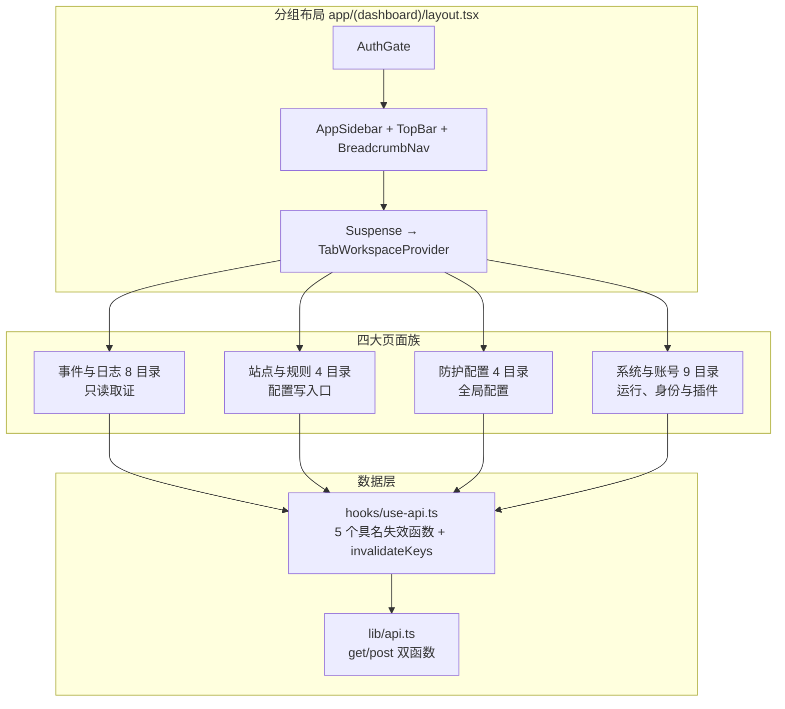
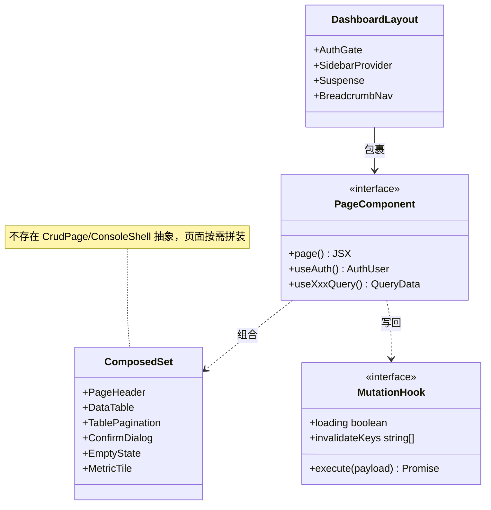
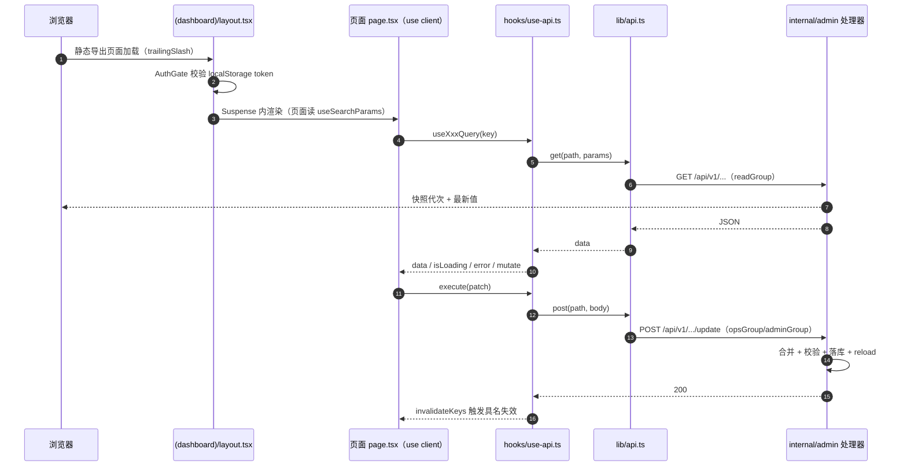
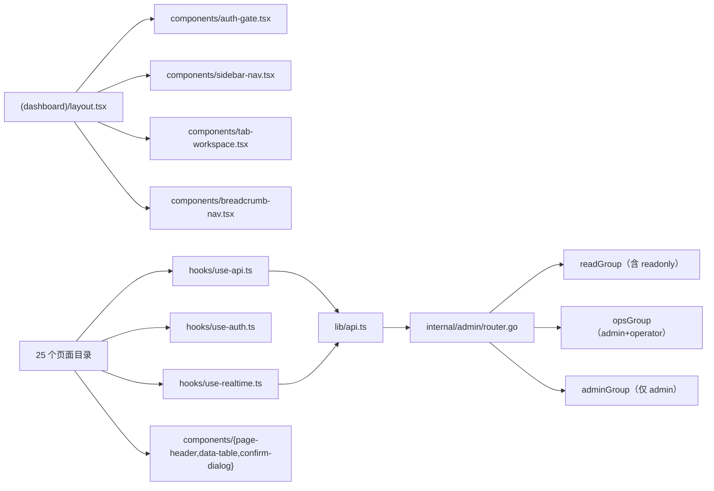

# 页面实现

<cite>
**本文档引用的文件**
- [frontend/app/(dashboard)/layout.tsx](file://frontend/app/(dashboard)/layout.tsx)
- [frontend/app/(dashboard)/captcha/page.tsx](file://frontend/app/(dashboard)/captcha/page.tsx)
- [frontend/app/(dashboard)/cc-protection/page.tsx](file://frontend/app/(dashboard)/cc-protection/page.tsx)
- [frontend/app/(dashboard)/ip-lists/page.tsx](file://frontend/app/(dashboard)/ip-lists/page.tsx)
- [frontend/app/(dashboard)/page-templates/page.tsx](file://frontend/app/(dashboard)/page-templates/page.tsx)
- [frontend/app/(dashboard)/sites/detail/components/protection-tab.tsx](file://frontend/app/(dashboard)/sites/detail/components/protection-tab.tsx)
- [frontend/next.config.ts](file://frontend/next.config.ts)
- [frontend/hooks/use-api.ts](file://frontend/hooks/use-api.ts)
- [frontend/lib/api.ts](file://frontend/lib/api.ts)
- [internal/admin/router.go](file://internal/admin/router.go)
- [internal/admin/protect/protection.go](file://internal/admin/protect/protection.go)
- [internal/admin/protect/bot/bot.go](file://internal/admin/protect/bot/bot.go)
- [internal/store/site.go](file://internal/store/site.go)
</cite>

## 目录

1. [简介](#简介)
2. [项目结构](#项目结构)
3. [核心组件](#核心组件)
4. [架构总览](#架构总览)
5. [详细组件分析](#详细组件分析)
6. [依赖关系分析](#依赖关系分析)
7. [性能考虑](#性能考虑)
8. [故障排查指南](#故障排查指南)
9. [结论](#结论)
10. [附录](#附录)

## 简介

「页面实现」是 `docs/前端管理界面` 下的页面级索引域，负责把 `frontend/app/(dashboard)/` 的 **25 个页面目录**（共 28 个 `page.tsx`，`sites/` 与 `rules/` 各含子路由）逐一登记并路由到对应的详细文档。本篇形态为**总览（形态 A）**：只给切面级结论与索引，页面字段、组件内部实现、端点参数一律不在本篇展开，避免与下级文档重复同一张表。

| 项 | 内容 |
|----|------|
| 所属业务域 | 前端管理界面 → 页面实现（约定来源见仓库根 `AGENTS.md`） |
| 本篇形态 | A 总览（该域索引） |
| 覆盖范围 | 25 个页面目录的定位、刷新方式、写入口归属与项目约定核对 |
| 明确不覆盖 | 各页面字段级映射、组件内部拆分、端点请求/响应结构 |
| 下级文档 | [事件与日志页面.md](./事件与日志页面.md)（8）、[站点与规则页面.md](./站点与规则页面.md)（4）、[防护配置页面.md](./防护配置页面.md)（4）、[系统与账号页面.md](./系统与账号页面.md)（9），合计覆盖 25 个目录 |
| 上级与横向 | [../前端管理界面.md](../前端管理界面.md)、[../Next.js 架构设计/仪表板布局与导航.md](../Next.js 架构设计/仪表板布局与导航.md)、[../组件设计模式/CRUD 页面组件.md](../组件设计模式/CRUD 页面组件.md)、[../状态管理策略.md](../状态管理策略.md) |

三条前提口径，后续所有结论都建立在此：

| 口径 | 实测事实 | 依据 |
|------|----------|------|
| 全站客户端渲染 | `(dashboard)/` 的 28 个 `page.tsx` 首行全为 `"use client"`（实测：全仓 34 个 `page.tsx` 中仅分组外 5 个不是），无 RSC 取数，配合 `output: "export"` 静态导出 | `next.config.ts:4` |
| 布局层唯一的 `Suspense` | `(dashboard)/layout.tsx:25` 用 `Suspense` 包住 `TabWorkspaceProvider`，因为页面普遍在客户端读 `useSearchParams()` | `layout.tsx:14-36` |
| 路由形态 | 站点详情是查询参数路由 `?id=&tab=`，不是动态段；`trailingSlash: true` 使 `usePathname()` 带尾斜杠 | `next.config.ts:6` |

**章节来源**
- [frontend/next.config.ts:1-15](file://frontend/next.config.ts#L1-L15)
- [frontend/app/(dashboard)/layout.tsx:1-37](file://frontend/app/(dashboard)/layout.tsx#L1-L37)
- [internal/admin/router.go:124-425](file://internal/admin/router.go#L124-L425)

## 项目结构

页面层按业务域而非技术分层组织：一个业务一个目录，目录内 `page.tsx` 只承载该页表单与列表，页面私有组件下沉到同目录 `components/`，跨页复用件提升到 `frontend/components/`。

```text
frontend/app/(dashboard)/
├── layout.tsx                     # AuthGate + SidebarProvider + TopBar + Suspense + BreadcrumbNav
├── error.tsx                      # 分组级错误边界
├── <25 个页面目录>/               # 每目录一个 page.tsx；sites/ 与 rules/ 含子路由
├── sites/{page.tsx, components/, detail/{page.tsx, components/}}
└── rules/{page.tsx, components/, owasp/page.tsx, cve/page.tsx}
frontend/app/                       # 分组外的公开页：login / block / error / maintenance / security-dashboard
```

| 路径 | 职责 | 主要语言 | 页面目录数 | 代表文件 | 对外暴露 |
|------|------|----------|:---------:|----------|:--------:|
| `frontend/app/(dashboard)/` | 受鉴权的控制台页面 | TSX | 25 | `dashboard/page.tsx` | 否 |
| `frontend/app/(dashboard)/*/components/` | 页面私有组件 | TSX | 5 个目录有 | `sites/detail/components/protection-tab.tsx` | 否 |
| `frontend/components/` | 跨页组合件与对话框 | TSX | — | `data-table.tsx`、`cc-rules-editor.tsx` | 是 |
| `frontend/hooks/` | SWR 查询与变更封装 | TS | — | `use-api.ts`、`use-realtime.ts` | 是 |
| `frontend/lib/` | 端点定义、类型、路由标题 | TS | — | `api.ts`、`types.ts`、`route-titles.ts` | 是 |
| `internal/admin/` | 页面对应的后端处理器 | Go | — | `router.go` 与 12 个子域包 | 是 |



**图表来源**
- [frontend/app/(dashboard)/layout.tsx:6-36](file://frontend/app/(dashboard)/layout.tsx#L6-L36)
- [frontend/hooks/use-api.ts:190-198](file://frontend/hooks/use-api.ts#L190-L198)
- [frontend/lib/api.ts:878-892](file://frontend/lib/api.ts#L878-L892)

**章节来源**
- [frontend/app/(dashboard)/layout.tsx:1-37](file://frontend/app/(dashboard)/layout.tsx#L1-L37)
- [frontend/next.config.ts:1-15](file://frontend/next.config.ts#L1-L15)

## 核心组件

页面层没有 `CrudPage`、`ConsoleShell` 这类总括抽象（全仓不存在），每个页面都是 `PageHeader` + `DataTable` + `TablePagination` + `ConfirmDialog` + `EmptyState` + `MetricTile`/`StatCard` 的组合式拼装。

| 组件 | 位置 | 职责 | 使用页面族 | 是否被所有列表页使用 |
|------|------|------|-----------|:-------------------:|
| `PageHeader` | `components/page-header.tsx` | 标题/描述/操作位 | 全部 | 是 |
| `DataTable` | `components/data-table.tsx:30-50` | 无内建分页的表格渲染 | 列表类 | 是 |
| `TablePagination` | `components/table-pagination.tsx` | 显式分页 | 事件类、规则类 | 否（`ip-lists` 未接） |
| `ConfirmDialog` | `components/confirm-dialog.tsx` | 删除二次确认 | 全部写页 | 是 |
| `EmptyState` | `components/empty-state.tsx` | 空态 | 列表类 | 由 `DataTable` 内联 |
| `MetricTile` / `StatCard` | `components/metric-tile.tsx`、`components/stat-card.tsx` | 指标卡 | 仪表板、观测卡 | 视页面 |
| `EnvOverrideDomainCard` | `components/env-override-card.tsx` | 运行时环境变量覆盖 | `settings`、`captcha`、`rules/cve` | 否 |
| `CCRulesEditor` | `components/cc-rules-editor.tsx` | CC 规则编辑（全局与站点共用） | `cc-protection`、站点 CC Tab | 否 |



**图表来源**
- [frontend/app/(dashboard)/layout.tsx:14-36](file://frontend/app/(dashboard)/layout.tsx#L14-L36)
- [frontend/app/(dashboard)/ip-lists/page.tsx:15-16](file://frontend/app/(dashboard)/ip-lists/page.tsx#L15-L16)
- [frontend/app/(dashboard)/cc-protection/page.tsx:6-15](file://frontend/app/(dashboard)/cc-protection/page.tsx#L6-L15)
- [frontend/hooks/use-api.ts:856-915](file://frontend/hooks/use-api.ts#L856-L915)

### 页面私有组件的分布

25 个目录中有 7 处建了 `components/`：`captcha/`（2 个）、`security-events/`（1 个）、`rules/`（4 个）、`sites/`（7 个）、`sites/detail/`（12 个）、`js-plugins/`（2 个）、`lua-plugins/`（5 个）。其余 18 个目录为单文件页面，其中 `attacks/`（1525 行）、`captcha/`（1916 行）、`dashboard/`（1200 行）、`certificates/`（1001 行）四个单文件已明显超出可维护体量，是后续拆分的优先对象。

**章节来源**
- [frontend/app/(dashboard)/captcha/page.tsx:75-78](file://frontend/app/(dashboard)/captcha/page.tsx#L75-L78)
- [frontend/app/(dashboard)/ip-lists/page.tsx:15-46](file://frontend/app/(dashboard)/ip-lists/page.tsx#L15-L46)
- [frontend/app/(dashboard)/page-templates/page.tsx:33-39](file://frontend/app/(dashboard)/page-templates/page.tsx#L33-L39)

## 架构总览

一次典型的「页面挂载 → 取数 → 写回 → 缓存失效」链路，对全部 25 个页面同构：



**图表来源**
- [frontend/app/(dashboard)/layout.tsx:14-36](file://frontend/app/(dashboard)/layout.tsx#L14-L36)
- [frontend/hooks/use-api.ts:153-198](file://frontend/hooks/use-api.ts#L153-L198)
- [frontend/lib/api.ts:878-908](file://frontend/lib/api.ts#L878-L908)
- [internal/admin/router.go:124-406](file://internal/admin/router.go#L124-L406)
- [internal/admin/protect/protection.go:96-300](file://internal/admin/protect/protection.go#L96-L300)

**章节来源**
- [frontend/hooks/use-api.ts:153-198](file://frontend/hooks/use-api.ts#L153-L198)
- [internal/admin/router.go:124-406](file://internal/admin/router.go#L124-L406)

## 详细组件分析

### 页面清单与刷新方式

25 个页面目录的完整清单。行号为 `page.tsx` 默认导出的起始行，端点为 `router.go` 实测注册行；`rules/` 的两个子路由各占一行（故共 27 行），`sites/detail/` 归入 `sites/` 行：

| 页面 | 目录:行 | 主组件 | 调用端点 | 刷新方式 |
|------|---------|--------|----------|----------|
| `dashboard/` | `dashboard/page.tsx:185` | `DashboardPage` | GET `/dashboard/summary`:203、`/security-events/stats`:170、`/timeline`:171 | SWR 10s（`useDashboard`）+ 30s（`useDashboardStats`） |
| `sites/` | `sites/page.tsx:97` | `SitesPage` | GET `/sites`:127、`/sites/:id/status`:129；POST `:258-262` | 无轮询，`invalidateSiteCaches` |
| `access-logs/` | `access-logs/page.tsx:673` | `AccessLogsPage` | GET `/access-logs`:176、`/access-logs/:id`:177 | 无轮询、无 WS，手动重验 |
| `security-events/` | `security-events/page.tsx:97` | `SecurityEventsPage` | GET `/security-events`:169-175；POST `/false-positives`:365；`/ip-lists`:289 | 无轮询；写后 `invalidateIPListCaches` |
| `drop-events/` | `drop-events/page.tsx:18` | `DropEventsPage` | GET `/drop-events`:244 | 无轮询 |
| `attacks/` | `attacks/page.tsx:1020` | `AttacksPage` | GET/POST `/protection-settings`:152/287、`/owasp-rules`:224、`/owasp-rules/batch`:325、`/protection/:id/{sensitivity,escalation}`:234/236/340/342 | 无轮询，具名失效 |
| `false-positives/` | `false-positives/page.tsx:75` | `FalsePositivesPage` | GET `/false-positives`:185；POST `:365-366`、`/:id/delete`:415 | 无轮询 |
| `request-trace/` | `request-trace/page.tsx:820` | `RequestTracePage` | GET `/request/:request_id`:179、`/sites/:id`:128 | 查询驱动，无轮询 |
| `tls-fingerprints/` | `tls-fingerprints/page.tsx:50` | `TLSFingerprintsPage` | GET `/fingerprints`:178 | 分页参数驱动 |
| `upstream-status/` | `upstream-status/page.tsx:233` | `UpstreamStatusPage` | GET `/upstreams/status`:245、`/realtime/ticket`:249、WS `/realtime/ws`:424 | 10s 轮询 + WS 快照双轨 |
| `rules/` | `rules/page.tsx:78` | `RulesPage` | GET `/rules`:144-147；POST `:280-285` | 无轮询 |
| `rules/owasp/` | `rules/owasp/page.tsx:126` | `OWASPRulesPage` | GET `/owasp-rules`:224-227；POST `:323-328` | 无轮询 |
| `rules/cve/` | `rules/cve/page.tsx:88` | `CVERulesPage` | GET `/cve-rules`:220-221、`/cve-feed/status`:223；POST `:317-321`、`/cve-rules`:410-412 | 无轮询 |
| `policies/` | `policies/page.tsx:30` | `PoliciesPage` | GET `/policies`:140-142；POST `:274-278` | 无轮询 |
| `cc-protection/` | `cc-protection/page.tsx:461` | `CCProtectionPage` | GET/POST `/protection-settings`:152/287 | 无轮询，取消靠键控重挂载 |
| `captcha/` | `captcha/page.tsx:708` | `CaptchaPage` | GET/POST `/captcha/config`:229/330、`/chain/{config,sessions}`:231-232/337、`/bot-settings`:216/315、`/bot-{stats,scores}`:217-218、`/drop-stats`:243、`/image-transform`:212/393 | 观测卡 30s/20s，配置块无轮询 |
| `ip-lists/` | `ip-lists/page.tsx:51` | `IPListsPage` | GET `/ip-lists`:154、`/preset-bot-whitelist`:188；POST `:289-291`、`/preset-bot-whitelist/seed`:369 | 页面内 `refresh()` 显式重验 |
| `page-templates/` | `page-templates/page.tsx:314` | `PageTemplatesPage` | GET `/page-templates/:type`:251；POST `:333-335` | 保存后 `await mutate()` |
| `threat-intel/` | `threat-intel/page.tsx:99` | `ThreatIntelPage` | GET `/threat-intel-feeds`:157、`/threat-intel-sync-logs`:158；POST `:293-296` | 同步日志 30s |
| `certificates/` | `certificates/page.tsx:117` | `CertificatesPage` | GET `/certificates`:132-134、`/certificates/acme/{config,status}`:134/398；POST `:267-272`、`/certificates/parse`:138 | 无轮询 |
| `js-plugins/` | `js-plugins/page.tsx:50` | `JSPluginsPage` | GET `/js-plugins{,/stats,/runtime}`:164-166；POST `:306-311` | 运行时 15s |
| `lua-plugins/` | `lua-plugins/page.tsx:56` | `LuaPluginsPage` | GET `/lua-plugins{,/stats}`:159/162；POST `:300-305` | 统计 15s |
| `admin-users/` | `admin-users/page.tsx:56` | `AdminUsersPage` | GET `/admin-users`:207；POST `:403-406`（adminGroup） | 无轮询 |
| `api-keys/` | `api-keys/page.tsx:31` | `ApiKeysPage` | GET `/api-keys`:205；POST `:400-401`（adminGroup） | 无轮询 |
| `auth-config/` | `auth-config/page.tsx:34` | `AuthConfigPage` | GET `/auth/sessions`:115、`/protection-settings`:152；POST `/auth/sessions/force-logout`:116、`/protection-settings`:287 | 无轮询 |
| `backup/` | `backup/page.tsx:47` | `BackupPage` | GET `/backup/export`:381、POST `/backup/import`:382（均 adminGroup） | 手动；成功后 `invalidateAllAPICaches` |
| `settings/` | `settings/page.tsx:122` | `SettingsPage` | GET `/tls-config`:209、`/network-config`:208、`/redis-config`:213、`/log-config`:214、`/runtime-config`:246、`/env-overrides`:247；POST `:390-396` | 无轮询 |

**章节来源**
- [internal/admin/router.go:105-425](file://internal/admin/router.go#L105-L425)
- [frontend/hooks/use-api.ts:153-198](file://frontend/hooks/use-api.ts#L153-L198)
- [frontend/hooks/use-api.ts:534-541](file://frontend/hooks/use-api.ts#L534-L541)
- [frontend/hooks/use-api.ts:1499-1543](file://frontend/hooks/use-api.ts#L1499-L1543)
- [frontend/lib/api.ts:1056-1135](file://frontend/lib/api.ts#L1056-L1135)
- [frontend/app/(dashboard)/ip-lists/page.tsx:117-121](file://frontend/app/(dashboard)/ip-lists/page.tsx#L117-L121)
- [frontend/app/(dashboard)/page-templates/page.tsx:71-97](file://frontend/app/(dashboard)/page-templates/page.tsx#L71-L97)

### 页面 → 文档索引

| 页面目录 | 归属下级文档 | 备注 |
|----------|-------------|------|
| `access-logs/` | [事件与日志页面.md](./事件与日志页面.md) | 只读列表 |
| `security-events/` | [事件与日志页面.md](./事件与日志页面.md) | 含 1 个私有组件 |
| `drop-events/` | [事件与日志页面.md](./事件与日志页面.md) | 最小页面（183 行） |
| `attacks/` | [事件与日志页面.md](./事件与日志页面.md) | 名为攻击页，实为 OWASP 全局快捷配置 |
| `false-positives/` | [事件与日志页面.md](./事件与日志页面.md) | 反馈闭环 |
| `request-trace/` | [事件与日志页面.md](./事件与日志页面.md) | 单请求链路 |
| `tls-fingerprints/` | [事件与日志页面.md](./事件与日志页面.md) | 指纹聚合 |
| `threat-intel/` | [事件与日志页面.md](./事件与日志页面.md) | 情报订阅运营 |
| `sites/`（含 `detail/` 12 个 Tab 组件） | [站点与规则页面.md](./站点与规则页面.md) | 配置写入口主体 |
| `rules/`（含 `owasp/`、`cve/` 子路由） | [站点与规则页面.md](./站点与规则页面.md) | 三套 kind 白名单差异在该篇 |
| `policies/` | [站点与规则页面.md](./站点与规则页面.md) | 策略与默认策略 |
| `certificates/` | [站点与规则页面.md](./站点与规则页面.md) | 含 ACME 状态展示 |
| `captcha/` | [防护配置页面.md](./防护配置页面.md) | 全局质询与 Bot 域 |
| `cc-protection/` | [防护配置页面.md](./防护配置页面.md) | 全局限流与 CC 规则 |
| `ip-lists/` | [防护配置页面.md](./防护配置页面.md) | 名单与预置白名单 |
| `page-templates/` | [防护配置页面.md](./防护配置页面.md) | 面向客户页品牌与文案 |
| `dashboard/` | [系统与账号页面.md](./系统与账号页面.md) | 10s/30s 双档轮询 |
| `settings/` | [系统与账号页面.md](./系统与账号页面.md) | 含 env 覆盖与 4 类进程配置 |
| `admin-users/` | [系统与账号页面.md](./系统与账号页面.md) | 写端点属 adminGroup |
| `api-keys/` | [系统与账号页面.md](./系统与账号页面.md) | 写端点属 adminGroup |
| `auth-config/` | [系统与账号页面.md](./系统与账号页面.md) | 会话列举与强制下线 |
| `backup/` | [系统与账号页面.md](./系统与账号页面.md) | 成功后全量失效缓存 |
| `js-plugins/` | [系统与账号页面.md](./系统与账号页面.md) | 编辑器组件另见 [../组件设计模式/对话框组件.md](../组件设计模式/对话框组件.md) |
| `lua-plugins/` | [系统与账号页面.md](./系统与账号页面.md) | 编辑器组件同上 |
| `upstream-status/` | [系统与账号页面.md](./系统与账号页面.md) | 「10s 轮询 + WS 快照双轨」另见 [../状态管理策略.md](../状态管理策略.md) |

**章节来源**
- [frontend/app/(dashboard)/captcha/page.tsx:1-88](file://frontend/app/(dashboard)/captcha/page.tsx#L1-L88)
- [frontend/app/(dashboard)/cc-protection/page.tsx:1-34](file://frontend/app/(dashboard)/cc-protection/page.tsx#L1-L34)

### 配置写入口与第二配置源防线

25 个页面里有 **11 个会写全局 `protection`**（`cc-protection`、`attacks`、`auth-config` 直接写；`captcha` 经 `bot_settings` 投影写；`sites/detail` 各 Tab 写站点级字段；`rules/owasp`、`rules/cve`、`policies` 写派生配置）。AGENTS.md 要求「保存局部配置必须读取并合并现有 protection」，实测存在两条互补防线：

| 防线 | 落位 | 机制 | 缺口 |
|------|------|------|------|
| 前端读后合并 | `use-api.ts:856-866` | 保存前再 GET 一次现值并浅合并 | 无版本号，两次读之间无并发保护 |
| 后端指针合并 | `protection.go:131-145`、`captcha.go`、`chain.go` | 载入现值后仅覆盖请求体出现的键 | `PutProtectionSettings` 用非指针结构体，回显旧值会如实落库 |
| 跨存储投影 | `protection.go:263-287`、`bot.go:230-261` | 5 个 `Sync*` 双向对齐 `bot_settings`/`drop_policy` | `bot.go:147` 先取权威值，随后 `:168-170` 又被客户端回显覆盖 |

结论：**「不得制造第二配置源」这条约定在代码层面成立**（不存在两份互不相干的真相），但 `bot_settings` ↔ `protection` 的双写投影在并发下会把陈旧回显写回，属已识别风险而非约定违反。

**章节来源**
- [frontend/hooks/use-api.ts:856-866](file://frontend/hooks/use-api.ts#L856-L866)
- [internal/admin/protect/protection.go:96-300](file://internal/admin/protect/protection.go#L96-L300)
- [internal/admin/protect/bot/bot.go:113-276](file://internal/admin/protect/bot/bot.go#L113-L276)

### 站点级三态与字段映射

AGENTS.md 要求站点级 nullable 字段表达「继承全局 / 覆盖启用 / 覆盖关闭」，且不得把空值误存为 `false`/`0`/空对象。实测该约定只在 `sites/detail/components/protection-tab.tsx` 一处落地，代表行如下（完整字段表见 [站点与规则页面.md](./站点与规则页面.md) 与 [防护配置页面.md](./防护配置页面.md)，此处不重复）：

| 表单项 | state | 提交字段 | 后端字段:行 | 三态语义 |
|--------|-------|----------|-------------|----------|
| OWASP 开关 | `owaspState`（`TriState`，`protection-tab.tsx:327-329`） | `owasp_enabled` | `OWASPEnabled *bool` site.go:76 | `inherit`/`on`/`off`，`null`＝继承 |
| CVE 开关 | `cveState`（`:330-332`） | `cve_enabled` | `CVEEnabled *bool` :79 | 同上 |
| 频率限制开关 | `rateState`（`:352-354`） | `rate_limit_enabled` | `RateLimitEnabled *bool` :81 | 同上；窗口/配额 `>0` 才覆盖 |
| 按阶段跳过路径 | `skipPathMode`（`:376-378`） | `skip_path_by_phase` | `SkipPathByPhase *string` :90 | `null`＝继承、`"{}"`＝覆盖为空、非空＝覆盖为该配置 |
| 质询类型 | 站点质询区 | `challenge_action`/`captcha_type` | `ChallengeAction *string`、`SiteCaptchaType *string` :73-74 | `nil`＝继承全局；验证码类型空＝渲染时回落 `math` |
| 全局页开关（对照） | `captchaLocalSettings` 等 | `captcha_enabled`/`shield_enabled` | `store/protection.go` 非指针 `bool` | 无三态：全局页本身就是被继承方 |

**章节来源**
- [frontend/app/(dashboard)/sites/detail/components/protection-tab.tsx:312-382](file://frontend/app/(dashboard)/sites/detail/components/protection-tab.tsx#L312-L382)
- [internal/store/site.go:66-90](file://internal/store/site.go#L66-L90)
- [frontend/app/(dashboard)/cc-protection/page.tsx:65-105](file://frontend/app/(dashboard)/cc-protection/page.tsx#L65-L105)

### 挑战类 UI 的 action 语义落位

AGENTS.md 要求挑战 UI 按 action 语义区分三类挑战。实测口径：

- `captcha_challenge`：验证码类型来自「规则级 → 站点 `captcha_type` → 全局 `CaptchaType`」三级回落，页面模板走 `page_template_captcha`。
- `shield_challenge`：5 秒盾流程由 `shield_*` 参数组驱动，但渲染用内置盾模板，**不受页面模板影响**。
- `chain_challenge`：链式步骤由 `chain_steps` 数组决定，`captcha` 步骤强制无条件执行。
- 三个 `*_enabled` 开关（`captcha_enabled`/`shield_enabled`/`chain_enabled`）在数据面**无消费点**，档位实际由动作与 manager 是否存在决定。

细节与状态图见 [防护配置页面.md](./防护配置页面.md)。

**章节来源**
- [frontend/app/(dashboard)/captcha/page.tsx:364-595](file://frontend/app/(dashboard)/captcha/page.tsx#L364-L595)
- [frontend/app/(dashboard)/page-templates/page.tsx:41-137](file://frontend/app/(dashboard)/page-templates/page.tsx#L41-L137)

### 统计卡口径

25 个页面中带指标卡的共 5 处：`dashboard/`（4 张全量聚合）、`captcha/components/bot-observation-card.tsx`（4 张 24 小时聚合）、`upstream-status/`（存活计数）、`sites/detail/components/monitor-tab.tsx`（站点级聚合）、`threat-intel/`（同步计数）。实测全部取自后端聚合端点，未发现以当前页数据冒充全量指标的写法。跨页统计口径的完整清单见 [事件与日志页面.md](./事件与日志页面.md)。

**章节来源**
- [frontend/app/(dashboard)/captcha/components/bot-observation-card.tsx:83-124](file://frontend/app/(dashboard)/captcha/components/bot-observation-card.tsx#L83-L124)
- [internal/admin/router.go:203-246](file://internal/admin/router.go#L203-L246)
- [internal/admin/protect/bot/bot.go:278-287](file://internal/admin/protect/bot/bot.go#L278-L287)

### 约定核对结论表

| AGENTS.md 约定 | 实测状态 | 证据 |
|----------------|:--------:|------|
| 快捷配置页不得制造第二配置源 | 符合（有并发风险） | `use-api.ts:856-866`、`protection.go:131-145` |
| 统计卡须来自真实聚合 | 符合 | `bot.go:278-287`、`router.go:203` |
| 站点级 nullable 三态 | 符合 | `site.go:76-90`、`protection-tab.tsx:327-382` |
| 挑战 UI 按 action 建模 | 部分符合 | 5 秒盾不吃页面模板；`*_enabled` 无消费点 |
| 审计字段脱敏/截断 | 符合（见下级文档） | [事件与日志页面.md](./事件与日志页面.md) |
| 局部保存读并合并 | 符合 | `bot.go:141-147` |
| 写操作仅 POST | 符合 | `router.go:255-415` |

**章节来源**
- [frontend/hooks/use-api.ts:856-897](file://frontend/hooks/use-api.ts#L856-L897)
- [internal/admin/router.go:255-415](file://internal/admin/router.go#L255-L415)
- [internal/store/site.go:66-90](file://internal/store/site.go#L66-L90)

## 依赖关系分析



**图表来源**
- [frontend/app/(dashboard)/layout.tsx:6-12](file://frontend/app/(dashboard)/layout.tsx#L6-L12)
- [frontend/hooks/use-api.ts:153-165](file://frontend/hooks/use-api.ts#L153-L165)
- [internal/admin/router.go:124-373](file://internal/admin/router.go#L124-L373)

### 权限组与页面归属矩阵

| 页面族 | readGroup | opsGroup | adminGroup | 说明 |
|--------|:---------:|:--------:|:----------:|------|
| 事件与日志 8 页 | ✓ | 部分（误报/加名单） | — | 只读为主 |
| 站点与规则 4 页 | ✓ | ✓ | 部分（CVE 自定义规则、误报删除） | `router.go:410-415` |
| 防护配置 4 页 | ✓ | ✓ | 部分（`image-transform`） | `router.go:393` |
| 系统与账号 6 页 | ✓ | 部分 | ✓（账号、密钥、备份、TLS/Redis/日志） | `router.go:375-406` |
| 插件 2 页 | ✓ | ✓ | — | `router.go:300-311` |
| `upstream-status/` | ✓ | — | — | 纯读 + WS |

前端 `canManage = role === "admin" || role === "operator"` 与 `opsGroup` 一致；与 `adminGroup` 不一致处已在 [防护配置页面.md](./防护配置页面.md) 排障节登记。

**章节来源**
- [internal/admin/router.go:124-406](file://internal/admin/router.go#L124-L406)
- [frontend/app/(dashboard)/ip-lists/page.tsx:53-54](file://frontend/app/(dashboard)/ip-lists/page.tsx#L53-L54)
- [frontend/app/(dashboard)/cc-protection/page.tsx:463-464](file://frontend/app/(dashboard)/cc-protection/page.tsx#L463-L464)

## 性能考虑

### 轮询分档与页面常驻成本

- **问题**：8 个 hook 带 `refreshInterval`，分档为 10s（`useDashboard`、`useUpstreamStatus`）、15s（Lua/JS 插件统计与运行时）、20s（链式会话）、30s（仪表板统计、同步日志、`bot-stats`/`bot-scores`），长驻页面会持续产生聚合查询。
- **优化**：`revalidateOnFocus` 全局关闭（`use-api.ts:162`），配置类页面无轮询，写后靠 `invalidateKeys` 与 5 个具名失效函数精确重验。
- **效果**：写链路的额外请求被压到「一次读 + 一次写」；无实测数字，属结构推断。

[本节为通用指导，无需特定文件来源]

### 大单文件的渲染成本

- **问题**：`captcha/page.tsx`（1916 行）、`attacks/`（1525 行）、`dashboard/`（1200 行）为单文件巨型组件，任何局部 state 变化都会在同一组件树内重渲染。
- **优化**：`captcha` 已把观测卡与图像转换卡外提到 `components/`，链式卡以 `key={JSON.stringify(chainConfig)}` 定向重挂载（`page.tsx:1164`）。
- **效果**：拆分方向正确但不彻底，`CaptchaPage` 函数体本身仍超 1200 行；已登记为后续改进项。

[本节为通用指导，无需特定文件来源]

## 故障排查指南

### 问题：改了配置但界面值不动

**症状**：保存成功、无报错，刷新后仍是旧值。

**可能原因**：该页面既无轮询也未触发 `mutate()`，或后端返回 200 但 `reload()` 失败（返回 500 `config applied but reload failed`，配置已落库、快照未更新）。

**排查步骤**：先按网络面板确认 POST 状态码；若为 500，直接 `GET` 对应配置端点核对落库值，再看管理端口 `/metrics` 与重载日志。

**解决方案**：手动重验（`EmptyState` 无重验入口的页面走 `settings/` 的全局重载）。

**章节来源**
- [frontend/hooks/use-api.ts:153-198](file://frontend/hooks/use-api.ts#L153-L198)
- [internal/admin/protect/protection.go:294-297](file://internal/admin/protect/protection.go#L294-L297)

### 问题：operator 角色保存某块配置返回 403

**症状**：同页其他块可保存，个别卡报权限错误。

**可能原因**：前端 `canManage` 只区分「admin/operator 可写」，而部分写端点在 `adminGroup`（`router.go:372-373`：设置键、备份、TLS/Redis/日志、env 覆盖、`image-transform`、API Key、管理员账号、自定义 CVE 规则、误报删除）。

**排查步骤**：对照 `router.go` 该端点所属组；再看该卡是否复用了页面级 `canManage`。

**解决方案**：为该卡单独计算「仅 admin」门控（`captcha/page.tsx:717` 的 `canManageOverrides` 即为此而设）。

**章节来源**
- [internal/admin/router.go:372-415](file://internal/admin/router.go#L372-L415)
- [frontend/app/(dashboard)/captcha/page.tsx:712-717](file://frontend/app/(dashboard)/captcha/page.tsx#L712-L717)

### 问题：列表页数据不全

**症状**：数据库有记录但界面看不到，搜索也无结果。

**可能原因**：后端 `utils.Paginate` 默认 `page_size = 20`，而 `ip-lists/` 未传 `page_size` 也未接 `TablePagination`；`DataTable` 自身不分页。

**排查步骤**：带 `page_size` 直接请求端点比对 `total`。

**解决方案**：显式分页或传 `page_size`；详见 [防护配置页面.md](./防护配置页面.md)。

**章节来源**
- [frontend/app/(dashboard)/ip-lists/page.tsx:70-84](file://frontend/app/(dashboard)/ip-lists/page.tsx#L70-L84)
- [frontend/components/data-table.tsx:29-50](file://frontend/components/data-table.tsx#L29-L50)

## 结论

页面实现层的结构结论是清晰的：**25 个页面目录按四大业务族切分，全部客户端渲染，统一走 `hooks/use-api.ts` → `lib/api.ts` → `router.go` 三跳**，配置写入口共享「前端读后合并 + 后端指针合并 + 跨存储投影」三层防线，AGENTS.md 的四条硬约定中三条实测符合、一条（挑战 UI 按 action 建模）为部分符合。

- **优势**：模块边界以业务目录表达，页面私有组件与跨页组件分层明确；差量提交 + 空 diff 短路避免误覆盖；具名缓存失效函数避免了「保存后全量重验」。
- **待补齐**：
  - `captcha_enabled`/`shield_enabled`/`chain_enabled` 双写无读，是投影式配置源留下的尾巴。
  - 5 秒盾与链式挑战页未纳入页面模板可覆盖范围。
  - 四个超千行单文件页面需按卡片/表格切分。

[本节为总结，无需特定文件来源]

## 附录

### 关键约定与索引速查

| 项 | 速查值 | 证据 |
|----|--------|------|
| 页面目录数 | 25（`page.tsx` 28 个） | `app/(dashboard)/` 实测清单 |
| 静态导出 | `output: "export"` + `trailingSlash: true` | `next.config.ts:4-6` |
| 布局层 `Suspense` | 唯一一处，包 `TabWorkspaceProvider` | `layout.tsx:25` |
| 缓存失效入口 | `invalidateAllAPICaches`、`invalidateIPListCaches`、`invalidateSiteCaches`、`invalidateCVERuleCaches`、`invalidateOWASPRuleCaches` + `invalidateKeys` | `use-api.ts:190-198` |
| 轮询分档 | 10 / 15 / 20 / 30 秒 | `use-api.ts:538-637`、`:987-1087`、`:1501-1541` |
| 实时通道 | `/api/v1/realtime/ws` WebSocket，无 `EventSource` | `router.go:424` |
| 权限三档 | `readGroup` / `opsGroup` / `adminGroup` | `router.go:125`、`:256`、`:373` |
| 写操作动词 | 仅 POST（`/update`、`/delete`、`/start`、`/stop`、`/toggle`） | `router.go:258-415` |

下级文档入口：

- [事件与日志页面.md](./事件与日志页面.md)：8 个只读取证页，含列表大字段排除、CSV 当前页导出与 WS 归属澄清。
- [站点与规则页面.md](./站点与规则页面.md)：4 个配置写入口页，含 `?id=&tab=` 查询参数路由与三套 kind 白名单差异。
- [防护配置页面.md](./防护配置页面.md)：4 个全局配置页，含「读后合并」时序图与挑战档位状态图。
- [系统与账号页面.md](./系统与账号页面.md)：9 个运行、身份与插件页（含 `upstream-status/`、`js-plugins/`、`lua-plugins/`）。

**章节来源**
- [frontend/hooks/use-api.ts:190-198](file://frontend/hooks/use-api.ts#L190-L198)
- [frontend/next.config.ts:1-15](file://frontend/next.config.ts#L1-L15)
- [frontend/app/(dashboard)/layout.tsx:20-36](file://frontend/app/(dashboard)/layout.tsx#L20-L36)
- [internal/admin/router.go:373-425](file://internal/admin/router.go#L373-L425)
