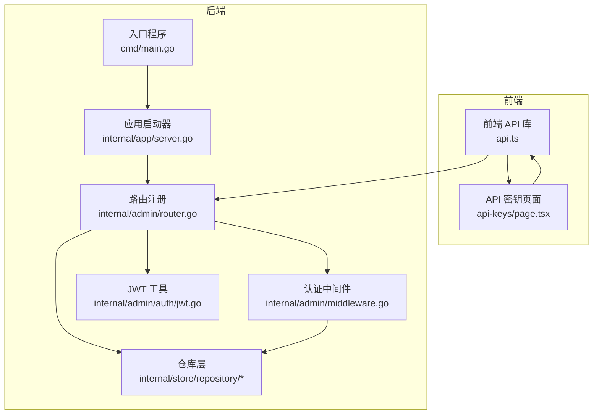
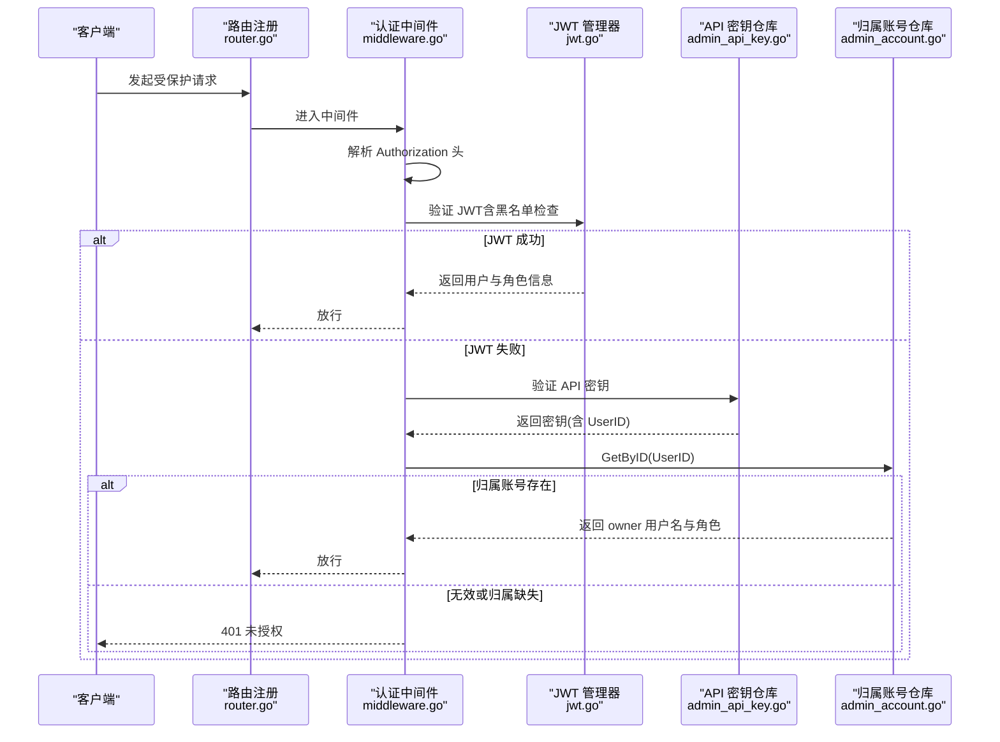
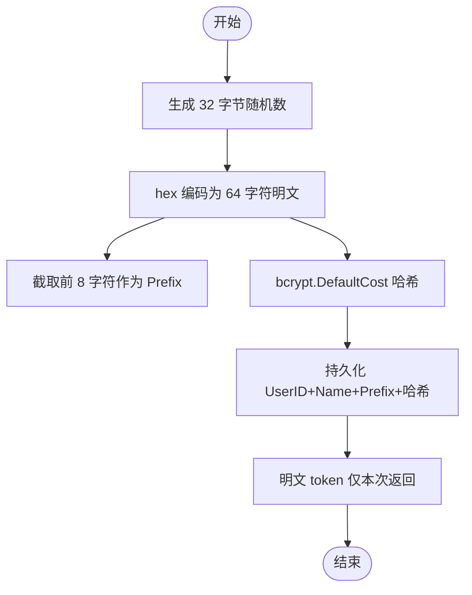
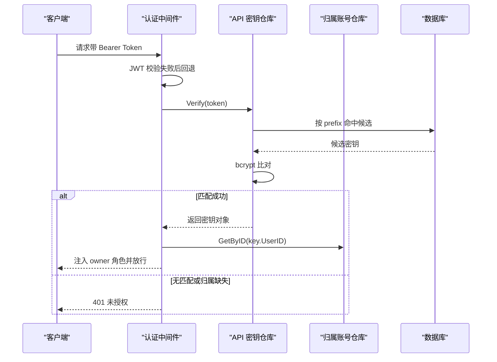
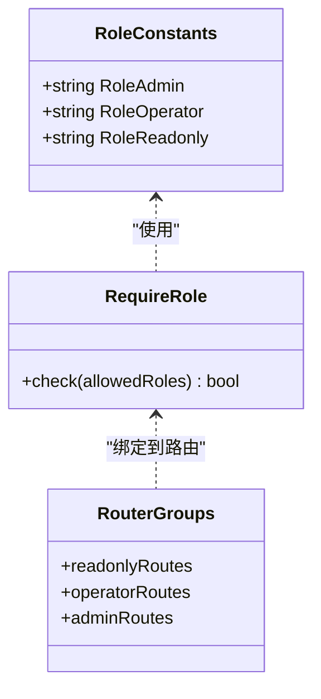
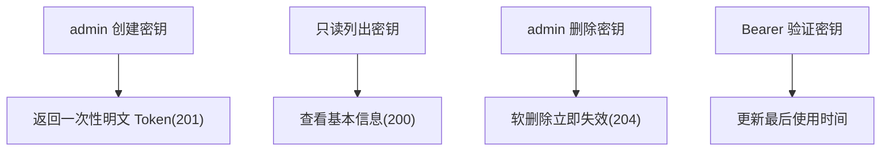
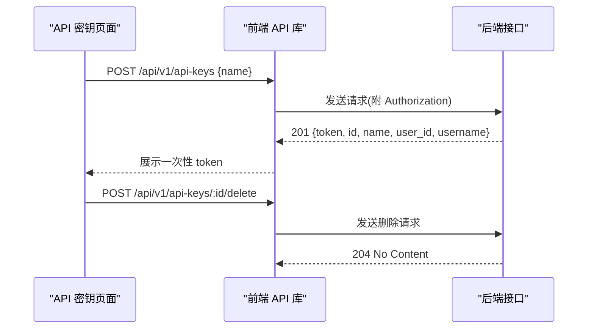
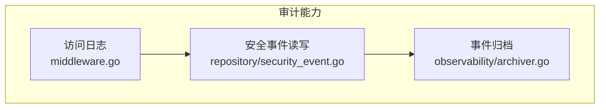
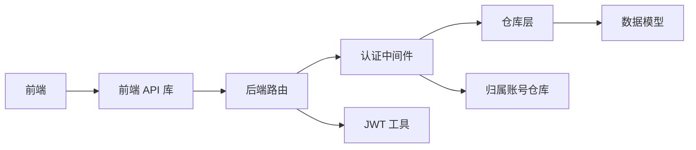

# API 密钥管理

> [返回 安全机制](安全机制.md)

<cite>
**本文档引用的文件**
- [cmd/main.go](file://cmd/main.go)
- [server.go](file://internal/app/server.go)
- [router.go](file://internal/admin/router.go)
- [middleware.go](file://internal/admin/middleware.go)
- [apikey.go](file://internal/admin/system/apikey/apikey.go)
- [jwt.go](file://internal/admin/auth/jwt.go)
- [admin_api_key.go](file://internal/store/repository/authn/admin_api_key.go)
- [admin_account.go](file://internal/store/repository/authn/admin_account.go)
- [auth.go](file://internal/store/auth/auth.go)
- [repository.go](file://internal/store/repository/repository.go)
- [security_event.go](file://internal/store/repository/security_event.go)
- [archiver.go](file://internal/observability/archiver.go)
- [page.tsx](file://frontend/app/(dashboard)/api-keys/page.tsx)
- [api.ts](file://frontend/lib/api.ts)
</cite>

## 目录

1. [简介](#简介)
2. [项目结构](#项目结构)
3. [核心组件](#核心组件)
4. [架构总览](#架构总览)
5. [详细组件分析](#详细组件分析)
6. [依赖关系分析](#依赖关系分析)
7. [性能考虑](#性能考虑)
8. [故障排查指南](#故障排查指南)
9. [结论](#结论)
10. [附录](#附录)

## 简介
本文件为 API 密钥管理系统的综合技术文档，覆盖密钥生成、存储、权限控制、生命周期管理、使用方式、密钥轮换策略以及安全审计功能。系统支持两种认证方式：基于 Bearer Token 的 API 密钥与基于 JWT 的用户会话。API 密钥采用一次性展示设计，密钥内容仅在创建时可见，后续不再回显；密钥验证通过哈希比对实现，确保安全性与可追溯性。

## 项目结构
系统采用前后端分离架构：
- 后端服务（Go）：负责 API 密钥的生成、存储、验证与权限控制，提供 REST 接口与前端静态资源托管。
- 前端应用（Next.js）：提供 API 密钥管理界面，支持创建、删除与查看密钥列表。

**图表来源**
- [cmd/main.go:13-51](file://cmd/main.go#L13-L51)
- [server.go:624-717](file://internal/app/server.go#L624-L717)
- [router.go:110-401](file://internal/admin/router.go#L110-L401)
- [middleware.go:42-123](file://internal/admin/middleware.go#L42-L123)
- [admin_api_key.go:16-67](file://internal/store/repository/authn/admin_api_key.go#L16-L67)
- [repository.go:29-54](file://internal/store/repository/repository.go#L29-L54)
- [jwt.go:45-156](file://internal/admin/auth/jwt.go#L45-L156)

**章节来源**
- [cmd/main.go:13-51](file://cmd/main.go#L13-L51)
- [server.go:624-717](file://internal/app/server.go#L624-L717)
- [router.go:110-401](file://internal/admin/router.go#L110-L401)

## 核心组件

| 组件 | 位置 | 职责 | 关键符号 |
|------|------|------|----------|
| API 密钥仓库 | [admin_api_key.go:16-106](file://internal/store/repository/authn/admin_api_key.go#L16-L106) | 密钥生成、bcrypt 哈希存储、前缀快路径校验、删除 | `AdminAPIKeyRepo.Create`/`Verify`/`Delete` |
| 数据模型 `AdminAPIKey` | [auth.go:15-25](file://internal/store/auth/auth.go#L15-L25) | 令牌字段约束（归属 `UserID`、`Prefix`、`TokenHash`） | `AdminAPIKey` |
| 认证中间件 | [middleware.go:42-123](file://internal/admin/middleware.go#L42-L123) | Bearer 优先 JWT，回退 API Key，注入归属账号身份与角色 | `AuthMiddleware` |
| 密钥处理器 | [apikey.go:26-150](file://internal/admin/system/apikey/apikey.go#L26-L150) | 列表/创建/删除 HTTP 端点，归属取自 `auth_username` | `ListAPIKeys`/`CreateAPIKey`/`DeleteAPIKey` |
| 路由与权限 | [router.go:205-401](file://internal/admin/router.go#L205-L401) | GET 只读组、创建与删除限 `admin` 组 | `readGroup`/`adminGroup` |
| 前端界面 | [page.tsx:31-131](file://frontend/app/(dashboard)/api-keys/page.tsx#L31-L131) | 密钥创建、一次性展示、删除 | `ApiKeysPage` |

**章节来源**
- [admin_api_key.go:16-106](file://internal/store/repository/authn/admin_api_key.go#L16-L106)
- [auth.go:15-25](file://internal/store/auth/auth.go#L15-L25)
- [middleware.go:42-123](file://internal/admin/middleware.go#L42-L123)
- [apikey.go:26-150](file://internal/admin/system/apikey/apikey.go#L26-L150)
- [router.go:205-401](file://internal/admin/router.go#L205-L401)
- [page.tsx:31-131](file://frontend/app/(dashboard)/api-keys/page.tsx#L31-L131)

## 架构总览
系统通过认证中间件统一拦截请求，优先尝试 JWT 验证，若失败则回退至 API 密钥验证。API 密钥验证成功后，从归属账号解析用户名与角色注入上下文，随后按角色组策略放行到对应路由。

**图表来源**
- [router.go:110-110](file://internal/admin/router.go#L110-L110)
- [middleware.go:42-123](file://internal/admin/middleware.go#L42-L123)
- [jwt.go:131-156](file://internal/admin/auth/jwt.go#L131-L156)
- [admin_api_key.go:70-102](file://internal/store/repository/authn/admin_api_key.go#L70-L102)
- [admin_account.go:19-22](file://internal/store/repository/authn/admin_account.go#L19-L22)

## 详细组件分析

### 组件一：API 密钥生成与存储
- 密钥生成：`crypto/rand` 取 32 字节随机数，`hex.EncodeToString` 编码为 64 字符十六进制明文，仅在创建响应中返回一次。
- 存储机制：仅保存 bcrypt 哈希（`bcrypt.DefaultCost`），不落明文；数据库保留归属 `UserID`、名称 `Name`、前 8 字符 `Prefix`、哈希 `TokenHash`、`LastUsedAt`。
- 唯一性：随机 32 字节碰撞概率极低；`AdminAPIKey` 仅自增主键与 `Prefix`/`UserID`/`DeletedAt` 索引，无令牌哈希唯一索引。
- 脱敏：`TokenHash`、`Prefix`、`DeletedAt` 的 JSON tag 均为 `-`，永不随列表接口回显。

**图表来源**
- [admin_api_key.go:50-66](file://internal/store/repository/authn/admin_api_key.go#L50-L66)
- [auth.go:15-25](file://internal/store/auth/auth.go#L15-L25)

| 阶段 | 起点形态 | 转换动作 | 终点形态 | 位置 | 敏感处理 |
|------|----------|----------|----------|------|----------|
| 生成 | 32 字节随机 | hex 编码 | 64 字符明文 | [admin_api_key.go:51-55](file://internal/store/repository/authn/admin_api_key.go#L51-L55) | 明文只出现在响应一次 |
| 派生前缀 | 明文 | 取前 8 字符 | `Prefix` | [admin_api_key.go:60](file://internal/store/repository/authn/admin_api_key.go#L60) | 前缀可索引，非机密 |
| 哈希落库 | 明文 | bcrypt | `TokenHash` | [admin_api_key.go:56-61](file://internal/store/repository/authn/admin_api_key.go#L56-L61) | 不存明文 |
| 列表回显 | `AdminAPIKey` | `decorateKeysWithOwner` | id/name/created_at/last_used_at/user_id/username | [apikey.go:109-131](file://internal/admin/system/apikey/apikey.go#L109-L131) | 哈希与前缀被 JSON `-` 屏蔽 |

**章节来源**
- [admin_api_key.go:50-66](file://internal/store/repository/authn/admin_api_key.go#L50-L66)
- [auth.go:15-25](file://internal/store/auth/auth.go#L15-L25)
- [apikey.go:109-131](file://internal/admin/system/apikey/apikey.go#L109-L131)

### 组件二：API 密钥验证与使用
- 验证流程：先以令牌前 8 字符走 `prefix` 索引快路径命中候选再做 bcrypt 比对；无前缀的 legacy 记录回退全表扫描，命中后回填前缀。匹配成功后更新 `last_used_at`。
- 使用方式：客户端在请求头添加 `Authorization: Bearer <token>`；后端中间件解析、验证，并从归属账号注入身份与角色。
- 错误处理：缺失或格式错误的头返回 401；无效密钥返回 401；归属账号不存在返回 401；权限不足返回 403。

**图表来源**
- [admin_api_key.go:70-102](file://internal/store/repository/authn/admin_api_key.go#L70-L102)
- [middleware.go:92-120](file://internal/admin/middleware.go#L92-L120)

| 序 | 中间件 | 位置 | 作用范围 | 短路行为 | 跳过条件 |
|:--:|--------|------|----------|----------|----------|
| 1 | `SecurityHeaders` | [middleware.go:172-192](file://internal/admin/middleware.go#L172-L192) | 全局 | 无 | 无 |
| 2 | `AccessLog` | [middleware.go:149-170](file://internal/admin/middleware.go#L149-L170) | 全局 | 无 | 无 |
| 3 | `AuthMiddleware` | [middleware.go:42-123](file://internal/admin/middleware.go#L42-L123) | `api` 组 | 401/503 | health/login/refresh/logout |
| 4 | `RequireRole` | [middleware.go:125-147](file://internal/admin/middleware.go#L125-L147) | 分组 | 403 | 视角色集合 |

**章节来源**
- [admin_api_key.go:70-102](file://internal/store/repository/authn/admin_api_key.go#L70-L102)
- [middleware.go:42-147](file://internal/admin/middleware.go#L42-L147)

### 组件三：权限控制与角色模型
- 角色常量：`admin`（全权）、`operator`（运维）、`readonly`（只读），定义于 [auth.go:85-89](file://internal/store/auth/auth.go#L85-L89)。
- 中间件校验：`RequireRole` 将当前认证角色与允许集合比较，无角色或不匹配返回 403。
- 路由分组：只读、运维、管理员三组分别绑定不同角色集合。
- **API 密钥角色来源**：API 密钥的 `auth_role` 取自其归属 `AdminAccount.Role`，**不再无条件赋予 admin**；归属账号缺失即 401（[middleware.go:103-120](file://internal/admin/middleware.go#L103-L120)）。

**图表来源**
- [middleware.go:125-147](file://internal/admin/middleware.go#L125-L147)
- [router.go:124-401](file://internal/admin/router.go#L124-L401)

| 能力（示例端点） | readonly | operator | admin | 分组 |
|------|:--------:|:--------:|:-----:|------|
| GET `/api-keys`（列表） | ✓ | ✓ | ✓ | readGroup |
| POST `/api-keys`（创建） | ✗ | ✗ | ✓ | adminGroup |
| POST `/api-keys/:id/delete`（删除） | ✗ | ✗ | ✓ | adminGroup |
| GET `/sites`（站点读） | ✓ | ✓ | ✓ | readGroup |
| POST `/sites`（站点写） | ✗ | ✓ | ✓ | opsGroup |

> 只读组用 `RequireRole(admin, operator, readonly)`，运维组用 `RequireRole(admin, operator)`，管理员组用 `RequireRole(admin)`（[router.go:125-373](file://internal/admin/router.go#L125-L373)）。API 密钥本身没有独立角色，权限完全跟随归属账号。

**章节来源**
- [auth.go:85-89](file://internal/store/auth/auth.go#L85-L89)
- [middleware.go:103-147](file://internal/admin/middleware.go#L103-L147)
- [router.go:124-401](file://internal/admin/router.go#L124-L401)

### 组件四：生命周期管理
- 创建：`admin` 经 `POST /api/v1/api-keys` 创建，归属账号取自 `auth_username`，响应 201 返回一次性明文 `token` 与 id/name/user_id/username。
- 列表：`GET /api/v1/api-keys`（readGroup，含只读）返回每项 id/created_at/updated_at/name/last_used_at/user_id/username。
- 删除：`admin` 经 `POST /api/v1/api-keys/:id/delete` 删除指定密钥，响应 204；软删除后令牌随之失效。
- 最后使用时间：验证成功后更新 `last_used_at`，便于审计与清理。

| 阶段 | 端点 | 方法 | 角色 | 响应 | 位置 |
|------|------|:----:|------|------|------|
| 创建 | `/api/v1/api-keys` | POST | admin | 201 + 明文 token | [apikey.go:46-85](file://internal/admin/system/apikey/apikey.go#L46-L85) |
| 列表 | `/api/v1/api-keys` | GET | readonly+ | 200 + items | [apikey.go:26-35](file://internal/admin/system/apikey/apikey.go#L26-L35) |
| 删除 | `/api/v1/api-keys/:id/delete` | POST | admin | 204 | [apikey.go:133-150](file://internal/admin/system/apikey/apikey.go#L133-L150) |
| 验证 | （中间件内） | — | — | 注入 owner 角色 | [admin_api_key.go:70-102](file://internal/store/repository/authn/admin_api_key.go#L70-L102) |

**图表来源**
- [router.go:205-401](file://internal/admin/router.go#L205-L401)
- [apikey.go:26-150](file://internal/admin/system/apikey/apikey.go#L26-L150)
- [admin_api_key.go:50-106](file://internal/store/repository/authn/admin_api_key.go#L50-L106)

**章节来源**
- [router.go:205-401](file://internal/admin/router.go#L205-L401)
- [apikey.go:26-150](file://internal/admin/system/apikey/apikey.go#L26-L150)
- [admin_api_key.go:50-106](file://internal/store/repository/authn/admin_api_key.go#L50-L106)

### 组件五：前端使用与集成
- 令牌存储：前端把访问令牌存入 `localStorage` 键 `token` 与 `token_expires_at`（[api.ts:28-29](file://frontend/lib/api.ts#L28-L29)），**不是 sessionStorage，也不是 `owaf_access_token`**；刷新令牌由后端 httpOnly Cookie 持有，前端不可读取。
- 前端 API 库：统一封装 fetch 自动附加 `Authorization` 头；401 且存在旧 token 时尝试刷新访问令牌。
- 登录与登出：`storeAuthToken` 写入两个 localStorage 键（[api.ts:200-205](file://frontend/lib/api.ts#L200-L205)）；登出 `clearToken` 移除并调用后端注销接口（[api.ts:210-216](file://frontend/lib/api.ts#L210-L216)）。
- API 密钥页面：`canManage = role === "admin"` 门控创建/删除（[page.tsx:34](file://frontend/app/(dashboard)/api-keys/page.tsx#L34)）；创建成功后展示一次性 token。

**图表来源**
- [api.ts:189-216](file://frontend/lib/api.ts#L189-L216)
- [page.tsx:31-90](file://frontend/app/(dashboard)/api-keys/page.tsx#L31-L90)
- [router.go:400-401](file://internal/admin/router.go#L400-L401)

**章节来源**
- [api.ts:28-29](file://frontend/lib/api.ts#L28-L29)
- [api.ts:189-216](file://frontend/lib/api.ts#L189-L216)
- [page.tsx:31-90](file://frontend/app/(dashboard)/api-keys/page.tsx#L31-L90)
- [router.go:400-401](file://internal/admin/router.go#L400-L401)

### 组件六：密钥轮换策略
- 自动轮换：系统未内置 API 密钥自动轮换机制；建议定期创建新密钥并替换旧密钥。
- 手动更新：`admin` 在前端删除旧密钥并创建新密钥，以最小化停机时间。
- 迁移流程：先创建新密钥，验证新密钥可用后再删除旧密钥，避免服务中断。

**章节来源**
- [router.go:400-401](file://internal/admin/router.go#L400-L401)
- [page.tsx:52-90](file://frontend/app/(dashboard)/api-keys/page.tsx#L52-L90)

### 组件七：安全审计与合规
- 使用日志：中间件统一记录请求 ID、方法、路径、状态码与认证方式，便于审计追踪。
- 异常检测：登录失败触发暴力破解检测器，超过阈值临时锁定账户。
- 合规报告：安全事件读写由 `SecurityEventRepo` 承担，事件归档与保留由 `observability` 归档器按周期清理。

**图表来源**
- [middleware.go:149-170](file://internal/admin/middleware.go#L149-L170)
- [security_event.go:109-410](file://internal/store/repository/security_event.go#L109-L410)
- [archiver.go:38-125](file://internal/observability/archiver.go#L38-L125)

**章节来源**
- [middleware.go:149-170](file://internal/admin/middleware.go#L149-L170)
- [security_event.go:109-410](file://internal/store/repository/security_event.go#L109-L410)
- [archiver.go:38-125](file://internal/observability/archiver.go#L38-L125)

## 依赖关系分析
- 组件耦合：认证中间件依赖仓库层进行密钥验证；路由层依赖中间件与仓库层；前端依赖后端接口。
- 外部依赖：bcrypt 用于密钥哈希；GORM 用于数据库访问；JWT 用于用户会话管理。
- 循环依赖：未发现循环依赖迹象，模块职责清晰。`Repos` 聚合结构在 [repository.go:29-54](file://internal/store/repository/repository.go#L29-L54) 集中装配各仓库句柄。

**图表来源**
- [router.go:110-401](file://internal/admin/router.go#L110-L401)
- [middleware.go:42-123](file://internal/admin/middleware.go#L42-L123)
- [admin_api_key.go:16-106](file://internal/store/repository/authn/admin_api_key.go#L16-L106)
- [repository.go:29-54](file://internal/store/repository/repository.go#L29-L54)

| 符号 | 位置 | 职责 | 上游调用者 | 下游依赖 | 副作用 | 影响面 |
|------|------|------|------------|----------|--------|--------|
| `AdminAPIKeyRepo.Create` | [admin_api_key.go:50-66](file://internal/store/repository/authn/admin_api_key.go#L50-L66) | 生成并落库新密钥 | `CreateAPIKey`（[apikey.go:72](file://internal/admin/system/apikey/apikey.go#L72)） | `crypto/rand`、`bcrypt`、`db.Create` | 写库 | 高 |
| `AdminAPIKeyRepo.Verify` | [admin_api_key.go:70-102](file://internal/store/repository/authn/admin_api_key.go#L70-L102) | 前缀快路径校验令牌 | `AuthMiddleware`（[middleware.go:96](file://internal/admin/middleware.go#L96)） | `db` 前缀查询、`bcrypt` | 回填前缀 + 更新 `last_used_at` | 高 |
| `AdminAccountRepo.GetByID` | [admin_account.go:19-22](file://internal/store/repository/authn/admin_account.go#L19-L22) | 解析令牌归属账号 | `AuthMiddleware`（[middleware.go:107](file://internal/admin/middleware.go#L107)）、`decorateKeysWithOwner` | `db.First` | 无 | 中 |
| `CreateAPIKey` | [apikey.go:46-85](file://internal/admin/system/apikey/apikey.go#L46-L85) | 以当前账号名义创建密钥 | router `adminGroup`（[router.go:400](file://internal/admin/router.go#L400)） | `GetByUsername`、`Create` | 写库 + 一次性明文 | 高 |
| `DeleteAPIKey` | [apikey.go:133-150](file://internal/admin/system/apikey/apikey.go#L133-L150) | 删除指定密钥 | router `adminGroup`（[router.go:401](file://internal/admin/router.go#L401)） | `Get`、`Delete` | 软删除 | 中 |

**章节来源**
- [router.go:110-401](file://internal/admin/router.go#L110-L401)
- [middleware.go:42-123](file://internal/admin/middleware.go#L42-L123)
- [admin_api_key.go:16-106](file://internal/store/repository/authn/admin_api_key.go#L16-L106)
- [admin_account.go:19-22](file://internal/store/repository/authn/admin_account.go#L19-L22)
- [apikey.go:46-150](file://internal/admin/system/apikey/apikey.go#L46-L150)
- [repository.go:29-54](file://internal/store/repository/repository.go#L29-L54)

## 性能考虑
- 验证复杂度：`Verify` 先按 8 字符 `prefix` 走索引快路径命中候选再做 bcrypt 比对，正常令牌无需全表扫描；仅无前缀的 legacy 记录回退逐条比对。
- 存储开销：bcrypt `DefaultCost` 计算成本高，应避免对同一请求重复校验；可缓存近期活跃密钥。
- 前端刷新：前端在 401 时自动刷新访问令牌，减少用户交互成本，但需注意网络抖动与重试策略。

**章节来源**
- [admin_api_key.go:70-102](file://internal/store/repository/authn/admin_api_key.go#L70-L102)
- [api.ts:200-216](file://frontend/lib/api.ts#L200-L216)

## 故障排查指南
- 401 未授权：检查 Authorization 头是否为 `Bearer <token>`；确认密钥未被删除；归属账号缺失同样返回 401（[middleware.go:111-115](file://internal/admin/middleware.go#L111-L115)）。
- 403 权限不足：确认当前认证主体角色是否满足目标路由 `RequireRole` 集合；API 密钥角色随归属账号，非默认 admin。
- 刷新失败：前端 401 时尝试刷新访问令牌，若仍失败则清空 `localStorage` 的 `token`/`token_expires_at` 并跳转登录页。
- 登录失败：检查用户名/密码；暴力破解防护会在阈值后临时锁定。

**章节来源**
- [middleware.go:42-147](file://internal/admin/middleware.go#L42-L147)
- [api.ts:189-216](file://frontend/lib/api.ts#L189-L216)

## 结论
本系统提供了完整的 API 密钥管理能力：安全的密钥生成与存储、按归属账号取角色的权限控制、完善的审计日志与合规支持。建议在生产环境中配合定期轮换、最小权限原则与监控告警，进一步提升安全性与可维护性。

## 附录

### API 端点速查

| 操作 | 方法 | 路径 | 角色 | 请求体 | 成功响应 |
|------|:----:|------|:----:|--------|----------|
| 创建密钥 | POST | `/api/v1/api-keys` | admin | `{ "name": "{占位}" }` | 201 `{ token, id, name, user_id, username }` |
| 列出密钥 | GET | `/api/v1/api-keys` | readonly+ | 无 | 200 `{ items: [{ id, name, created_at, last_used_at, user_id, username }] }` |
| 删除密钥 | POST | `/api/v1/api-keys/:id/delete` | admin | 无 | 204 No Content |

> 密钥明文 `token` 仅在创建响应的本次返回中可见，列表与详情接口均不回显；示例中的 name/token 一律脱敏为 `{占位}`。

**章节来源**
- [router.go:205-401](file://internal/admin/router.go#L205-L401)
- [apikey.go:26-150](file://internal/admin/system/apikey/apikey.go#L26-L150)