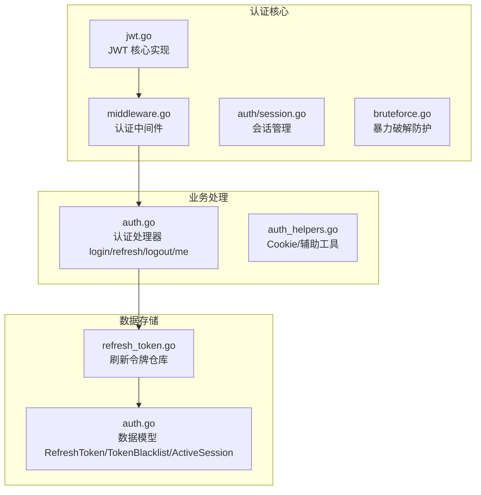
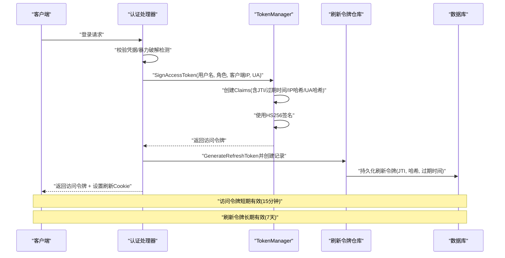
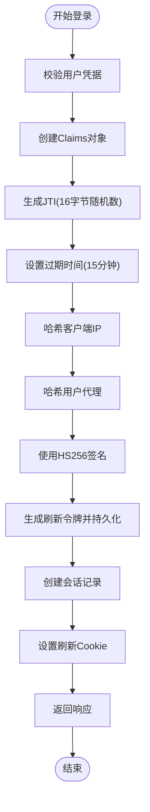
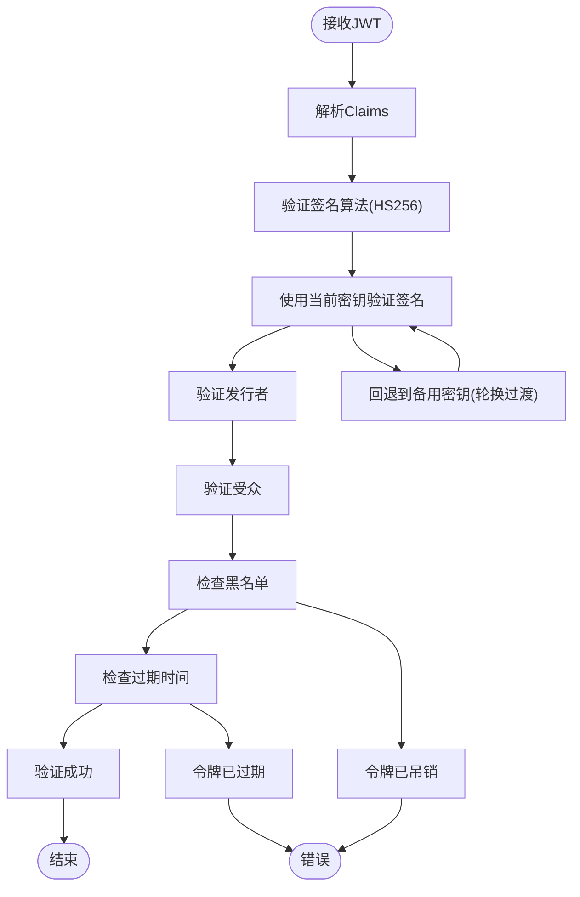
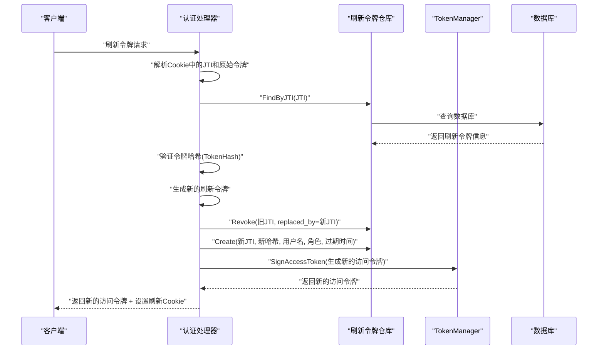
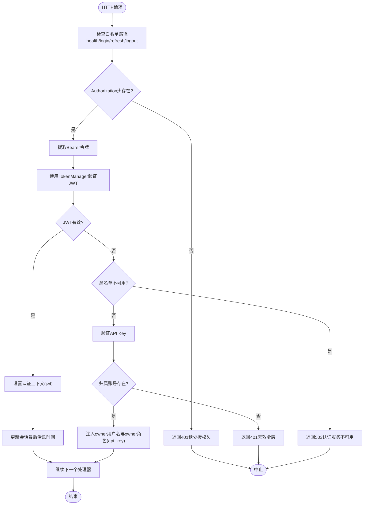
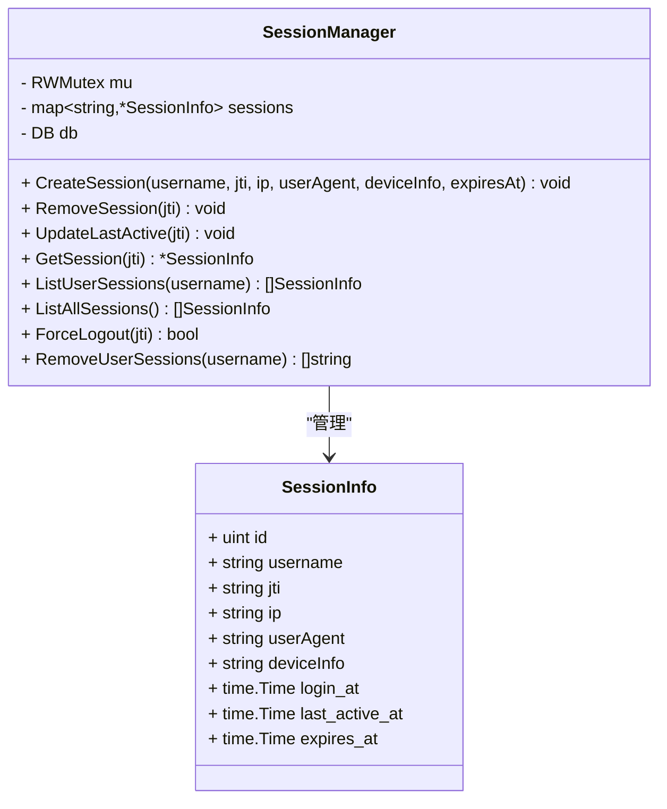
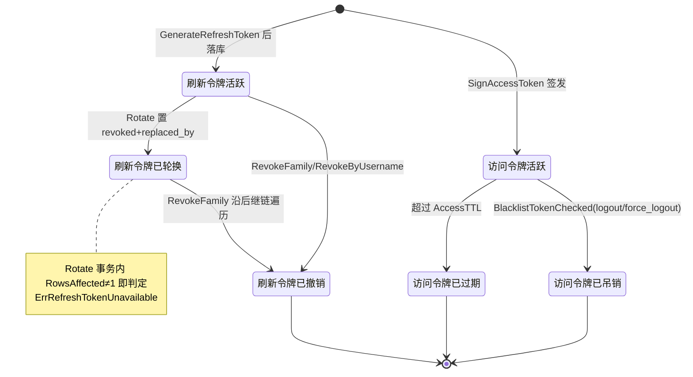
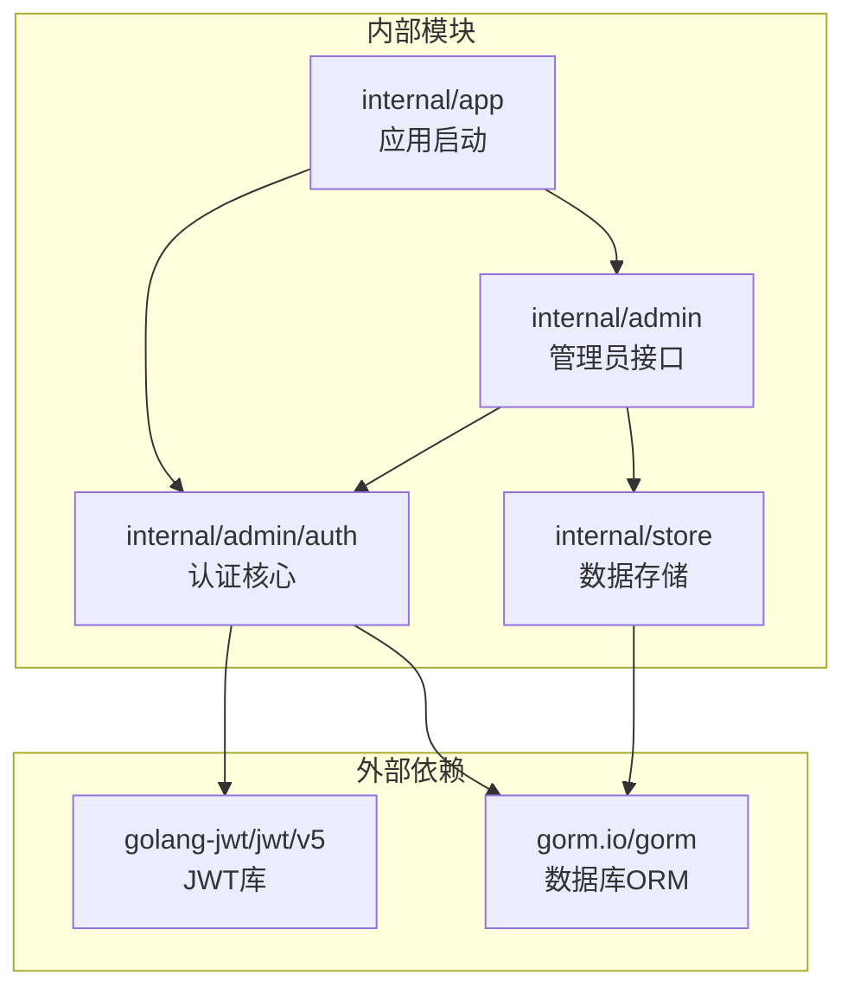

# JWT 认证机制

> [返回 安全机制](安全机制.md)

<cite>
**本文档引用的文件**
- [jwt.go](file://internal/admin/auth/jwt.go)
- [auth.go](file://internal/admin/auth.go)
- [auth_helpers.go](file://internal/admin/auth_helpers.go)
- [middleware.go](file://internal/admin/middleware.go)
- [router.go](file://internal/admin/router.go)
- [refresh_token.go](file://internal/store/repository/authn/refresh_token.go)
- [auth.go](file://internal/store/auth/auth.go)
- [session.go](file://internal/admin/auth/session.go)
- [bruteforce.go](file://internal/admin/auth/bruteforce.go)
- [auth_session.go](file://internal/admin/auth_session.go)
- [server.go](file://internal/app/server.go)
- [api.ts](file://frontend/lib/api.ts)
- [README.md](file://README.md)
- [go.mod](file://go.mod)
</cite>

## 目录

1. [简介](#简介)
2. [项目结构](#项目结构)
3. [核心组件](#核心组件)
4. [架构总览](#架构总览)
5. [详细组件分析](#详细组件分析)
6. [依赖关系分析](#依赖关系分析)
7. [性能考虑](#性能考虑)
8. [故障排查指南](#故障排查指南)
9. [结论](#结论)
10. [附录](#附录)

## 简介
本文件面向 My-OpenWaf 项目的 JWT 认证机制，系统性阐述短期访问令牌与长期刷新令牌的设计理念、JWT 结构与签名算法（HMAC-SHA256）、有效期管理策略、令牌生成与验证流程、刷新令牌的存储与撤销机制，以及安全最佳实践与性能优化建议。目标读者既包括需要快速上手的开发者，也包括希望深入理解实现细节的架构师。

## 项目结构
JWT 认证机制在项目中的组织围绕“认证核心”“业务处理”“数据存储”“应用启动”四个层面展开，形成清晰的分层职责与依赖关系。

**图表来源**
- [jwt.go:1-295](file://internal/admin/auth/jwt.go#L1-L295)
- [middleware.go:1-130](file://internal/admin/middleware.go#L1-L130)
- [auth.go:1-233](file://internal/admin/auth.go#L1-L233)
- [auth_helpers.go:1-49](file://internal/admin/auth_helpers.go#L1-L49)
- [refresh_token.go](file://internal/store/repository/authn/refresh_token.go)
- [auth.go](file://internal/store/auth/auth.go)

**章节来源**
- [jwt.go:1-295](file://internal/admin/auth/jwt.go#L1-L295)
- [middleware.go:1-130](file://internal/admin/middleware.go#L1-L130)
- [auth.go:1-233](file://internal/admin/auth.go#L1-L233)
- [auth_helpers.go:1-49](file://internal/admin/auth_helpers.go#L1-L49)
- [refresh_token.go](file://internal/store/repository/authn/refresh_token.go)
- [auth.go](file://internal/store/auth/auth.go)

## 核心组件
本节聚焦 JWT Claims 结构、TokenManager 的职责边界，以及会话管理与暴力破解防护的关键要素。四类令牌与密钥各有独立的生命周期与撤销方式，下表穷举其载体与风险。

- Claims 结构：注册声明包含 ID(JTI)、发行者、受众、主题、过期时间、签发时间；自定义声明为用户名、角色、客户端 IP 哈希、设备指纹哈希（`ip_hash`、`device_hash`，缺省时省略）。作为访问令牌的载体，承载认证与授权所需信息。

### 核心组件清单

| 组件 | 位置 | 职责 | 关键方法/字段 | 并发原语 |
|------|------|------|---------------|----------|
| `Claims` | [jwt.go:28-34](file://internal/admin/auth/jwt.go#L28-L34) | 访问令牌声明载体 | `Username`/`Role`/`IPHash`/`DeviceHash` | — |
| `TokenManager` | [jwt.go:45-59](file://internal/admin/auth/jwt.go#L45-L59) | 签发/校验/密钥轮换/JTI 黑名单 | `SignAccessToken`、`VerifyAccessToken`、`BlacklistTokenChecked`、`RotateKey` | `RWMutex` + `sync.Map` + `atomic.Bool` |
| `BruteForceDetector` | [bruteforce.go:10-17](file://internal/admin/auth/bruteforce.go#L10-L17) | 登录失败计数与锁定 | `IsLocked`、`RecordFailure`、`RemainingAttempts` | `RWMutex` |
| `SessionManager` | [session.go:28-36](file://internal/admin/auth/session.go#L28-L36) | 活跃会话内存 + 数据库双写 | `CreateSessionWithRefresh`、`UpdateLastActive`、`ForceLogout` | `RWMutex` |
| `RefreshTokenRepo` | [refresh_token.go:14-18](file://internal/store/repository/authn/refresh_token.go#L14-L18) | 刷新令牌持久化与轮换链 | `Create`、`FindByJTI`、`Rotate`、`RevokeFamily` | GORM 事务 |

**章节来源**
- [jwt.go:28-59](file://internal/admin/auth/jwt.go#L28-L59)
- [bruteforce.go:10-17](file://internal/admin/auth/bruteforce.go#L10-L17)
- [session.go:28-36](file://internal/admin/auth/session.go#L28-L36)
- [refresh_token.go:14-18](file://internal/store/repository/authn/refresh_token.go#L14-L18)

### 令牌与密钥生命周期

| 种类 | 存放位置 | 有效期 | 载体 | 撤销方式 | 风险 |
|------|----------|--------|------|----------|------|
| 访问令牌 access JWT | 前端 `localStorage` 键 `token`（[api.ts:28-29](file://frontend/lib/api.ts#L28-L29)），服务端不落库 | `AccessTTL` 15 分钟（[jwt.go:37](file://internal/admin/auth/jwt.go#L37)） | `Authorization: Bearer <token>` | JTI 入黑名单 `BlacklistTokenChecked`（[jwt.go:252-272](file://internal/admin/auth/jwt.go#L252-L272)） | 短生命周期泄露窗口小；黑名单依赖存储健康，未就绪时 fail closed（[jwt.go:161-182](file://internal/admin/auth/jwt.go#L161-L182)） |
| 刷新令牌 refresh | httpOnly Cookie `my_openwaf_rt`（[auth_helpers.go:15](file://internal/admin/auth_helpers.go#L15)）；DB 仅存 SHA-256 哈希 | `RefreshTTL` 7 天（[jwt.go:38](file://internal/admin/auth/jwt.go#L38)） | `Set-Cookie`，值 `jti.raw` 以点号分隔（[auth_helpers.go:21](file://internal/admin/auth_helpers.go#L21)） | `RevokeFamily` 沿 `replaced_by` 链整族撤销（[refresh_token.go:43-85](file://internal/store/repository/authn/refresh_token.go#L43-L85)） | 刷新分支空用户名回落 `admin`（[auth.go:170-173](file://internal/admin/auth.go#L170-L173)，风险） |
| JWT 签名密钥 | 环境变量 `MY_OPENWAF_JWT_SECRET` 或 DB 设置项（[server.go:1455-1476](file://internal/app/server.go#L1455-L1476)） | 进程生命周期 | HS256 共享密钥 | `RotateKey` 主备切换（[jwt.go:88-93](file://internal/admin/auth/jwt.go#L88-L93)） | 无环境变量时自动生成 32 字节随机密钥并明文落库（[server.go:1468-1473](file://internal/app/server.go#L1468-L1473)） |

> 算法与有效期只取代码中真实存在的取值：签名算法唯一为 `jwt.SigningMethodHS256`（[jwt.go:124](file://internal/admin/auth/jwt.go#L124)、[jwt.go:224](file://internal/admin/auth/jwt.go#L224)），校验时拒绝任何非 HMAC 方法（[jwt.go:186-188](file://internal/admin/auth/jwt.go#L186-L188)）；不存在 RS256/none 等其他算法分支。

**章节来源**
- [jwt.go:37-42](file://internal/admin/auth/jwt.go#L37-L42)
- [jwt.go:124-188](file://internal/admin/auth/jwt.go#L124-L188)
- [auth.go:170-173](file://internal/admin/auth.go#L170-L173)
- [auth_helpers.go:15-21](file://internal/admin/auth_helpers.go#L15-L21)
- [refresh_token.go:43-85](file://internal/store/repository/authn/refresh_token.go#L43-L85)
- [server.go:1455-1476](file://internal/app/server.go#L1455-L1476)
- [README.md:323](file://README.md#L323)
- [api.ts:28-29](file://frontend/lib/api.ts#L28-L29)

## 架构总览
下图展示从登录到访问令牌发放、再到刷新令牌存储与会话建立的整体流程，以及后续刷新令牌请求的处理链路。

**图表来源**
- [auth.go:82-118](file://internal/admin/auth.go#L82-L118)
- [jwt.go:84-109](file://internal/admin/auth/jwt.go#L84-L109)
- [refresh_token.go:15-24](file://internal/store/repository/authn/refresh_token.go#L15-L24)

**章节来源**
- [auth.go:82-118](file://internal/admin/auth.go#L82-L118)
- [jwt.go:84-109](file://internal/admin/auth/jwt.go#L84-L109)
- [refresh_token.go:15-24](file://internal/store/repository/authn/refresh_token.go#L15-L24)

## 详细组件分析

### 访问令牌生成流程
访问令牌生成包含凭据校验、Claims 构造、JTI 生成、过期时间设定、IP/UA 哈希、HS256 签名、刷新令牌生成与会话记录等步骤。

**图表来源**
- [auth.go:82-118](file://internal/admin/auth.go#L82-L118)
- [jwt.go:84-109](file://internal/admin/auth/jwt.go#L84-L109)

**章节来源**
- [auth.go:82-118](file://internal/admin/auth.go#L82-L118)
- [jwt.go:84-109](file://internal/admin/auth/jwt.go#L84-L109)

### 令牌验证机制
验证流程支持算法校验、密钥轮换回退、黑名单检查、过期时间检查，并在中间件中统一接入。

**图表来源**
- [jwt.go:111-154](file://internal/admin/auth/jwt.go#L111-L154)
- [middleware.go:44-57](file://internal/admin/middleware.go#L44-L57)

**章节来源**
- [jwt.go:111-154](file://internal/admin/auth/jwt.go#L111-L154)
- [middleware.go:44-57](file://internal/admin/middleware.go#L44-L57)

### 刷新令牌机制
刷新令牌用于在访问令牌过期后换取新的访问令牌，同时完成旧令牌的撤销与新令牌的发放。

**图表来源**
- [auth.go:121-193](file://internal/admin/auth.go#L121-L193)
- [refresh_token.go:15-39](file://internal/store/repository/authn/refresh_token.go#L15-L39)

> [!WARNING] 已知风险（只记录，不改动）：`RefreshHandler` 在 `rt.Username` 为空串时回落到硬编码 `"admin"`（[auth.go:170-173](file://internal/admin/auth.go#L170-L173)）。当历史刷新令牌记录的 `username` 列为空时，会以 `admin` 身份换取新访问令牌。当前仅在账号确实存在时继续，删除态由 `RevokeFamily` 兜底，但空用户名到 `admin` 的映射仍属潜在提权面，应作为待评估问题跟踪。

**章节来源**
- [auth.go:121-193](file://internal/admin/auth.go#L121-L193)
- [refresh_token.go:15-39](file://internal/store/repository/authn/refresh_token.go#L15-L39)

### 中间件认证流程
认证中间件优先处理白名单路径，随后尝试 JWT 验证，失败则回退到 API Key 验证，并在成功时注入认证上下文。当 JWT 校验返回 `ErrTokenBlacklistUnavailable` 时短路为 503（而非误判为无效令牌），保证黑名单持久化未就绪时 fail closed。管理端全局中间件顺序由 [router.go:91-116](file://internal/admin/router.go#L91-L116) 装配固定。

**图表来源**
- [middleware.go:42-123](file://internal/admin/middleware.go#L42-L123)

| 序 | 中间件 | 位置 | 作用范围 | 前置依赖 | 短路行为 | 跳过条件 |
|:--:|--------|------|----------|----------|----------|----------|
| 1 | `SecurityHeaders` | [middleware.go:172-192](file://internal/admin/middleware.go#L172-L192) | 全局 `h.Use` | 无 | 无 | 无 |
| 2 | `AccessLog` | [middleware.go:149-170](file://internal/admin/middleware.go#L149-L170) | 全局 `h.Use` | SecurityHeaders | 无（记录后放行） | 无 |
| 3 | `AuthMiddleware` | [middleware.go:42-123](file://internal/admin/middleware.go#L42-L123) | `api` 组 | AccessLog | 401 / 503 | 白名单：health/login/refresh/logout |
| 4 | `RequireRole` | [middleware.go:125-147](file://internal/admin/middleware.go#L125-L147) | 分组路由 | AuthMiddleware | 403 | 视分组角色集合 |

**章节来源**
- [middleware.go:42-147](file://internal/admin/middleware.go#L42-L147)
- [router.go:89-125](file://internal/admin/router.go#L89-L125)

### 会话管理系统
会话管理器负责活跃会话的内存与持久化同步、按用户列出会话、强制登出与过期清理。

**图表来源**
- [session.go:25-41](file://internal/admin/auth/session.go#L25-L41)

**章节来源**
- [session.go:25-167](file://internal/admin/auth/session.go#L25-L167)

### 令牌与凭据的数据流转换
从明文口令到持久化哈希，凭据在链路中逐段变形，敏感项只保留派生形态。

| 阶段 | 起点形态 | 转换动作 | 终点形态 | 位置 | 敏感处理 |
|------|----------|----------|----------|------|----------|
| 登录提交 | 明文用户名/口令 JSON | bcrypt 比对，不持久化口令 | 校验结果 | [auth.go:60-77](file://internal/admin/auth.go#L60-L77) | 口令明文不进日志 |
| 访问令牌签发 | `Claims` 结构 | HS256 签名 | JWT 字符串 | [jwt.go:103-127](file://internal/admin/auth/jwt.go#L103-L127) | IP/UA 取 SHA-256 前 8 字节哈希 |
| 刷新令牌生成 | 32 字节随机数 | hex 得明文，SHA-256 得哈希 | raw（下发）+ hash（落库） | [jwt.go:338-358](file://internal/admin/auth/jwt.go#L338-L358) | DB 仅存哈希，明文只进 Cookie |
| Cookie 载体 | `jti` + `raw` | 点号拼接写入 httpOnly Cookie | `Set-Cookie` | [auth_helpers.go:26-31](file://internal/admin/auth_helpers.go#L26-L31) | SameSite=Lax，Secure 随 https/h3 |
| 令牌校验 | JWT 字符串 | 解析 + 黑名单检查 | `Claims` / 错误 | [jwt.go:131-156](file://internal/admin/auth/jwt.go#L131-L156) | 主密钥失败回退备用密钥 |

**章节来源**
- [auth.go:60-77](file://internal/admin/auth.go#L60-L77)
- [jwt.go:103-156](file://internal/admin/auth/jwt.go#L103-L156)
- [jwt.go:338-358](file://internal/admin/auth/jwt.go#L338-L358)
- [auth_helpers.go:26-31](file://internal/admin/auth_helpers.go#L26-L31)

### 令牌生命周期状态机
访问令牌与刷新令牌各自迁移，刷新轮换通过 `replaced_by` 形成可整链撤销的后继链。

**图表来源**
- [jwt.go:103-127](file://internal/admin/auth/jwt.go#L103-L127)
- [jwt.go:246-272](file://internal/admin/auth/jwt.go#L246-L272)
- [refresh_token.go:36-115](file://internal/store/repository/authn/refresh_token.go#L36-L115)

**章节来源**
- [jwt.go:103-272](file://internal/admin/auth/jwt.go#L103-L272)
- [refresh_token.go:36-127](file://internal/store/repository/authn/refresh_token.go#L36-L127)

### 认证核心符号的代码上下文

| 符号 | 位置 | 职责 | 上游调用者 | 下游依赖 | 副作用 | 影响面 |
|------|------|------|------------|----------|--------|--------|
| `SignAccessToken` | [jwt.go:103-127](file://internal/admin/auth/jwt.go#L103-L127) | 签发访问令牌 | Login/Refresh（[auth.go:97](file://internal/admin/auth.go#L97)、[auth.go:199](file://internal/admin/auth.go#L199)） | `jwt.SignedString` | 无 | 高：全链路 |
| `VerifyAccessToken` | [jwt.go:131-156](file://internal/admin/auth/jwt.go#L131-L156) | 校验访问令牌与黑名单 | AuthMiddleware（[middleware.go:71](file://internal/admin/middleware.go#L71)） | `verifyWithKey`、`IsBlacklisted` | 惰性删除过期黑名单项 | 高 |
| `BlacklistTokenChecked` | [jwt.go:252-272](file://internal/admin/auth/jwt.go#L252-L272) | 拉黑 JTI 并落库 | Logout/ForceLogout（[auth.go:274](file://internal/admin/auth.go#L274)、[auth_session.go:64](file://internal/admin/auth_session.go#L64)） | `db` upsert `TokenBlacklist` | 写库 | 高 |
| `GenerateRefreshToken` | [jwt.go:338-352](file://internal/admin/auth/jwt.go#L338-L352) | 生成刷新令牌 | Login/Refresh（[auth.go:106](file://internal/admin/auth.go#L106)、[auth.go:208](file://internal/admin/auth.go#L208)） | `crypto/rand`、`HashToken` | 无 | 中 |
| `RevokeFamily` | [refresh_token.go:43-85](file://internal/store/repository/authn/refresh_token.go#L43-L85) | 撤销整链刷新令牌 | Logout/ForceLogout（[auth.go:258](file://internal/admin/auth.go#L258)、[auth_session.go:73](file://internal/admin/auth_session.go#L73)） | `db` 事务 | 批量置 revoked | 高 |
| `ReplaceSessionForRefresh` | [session.go:107-156](file://internal/admin/auth/session.go#L107-L156) | 就地轮换会话 | RefreshHandler（[auth.go:228](file://internal/admin/auth.go#L228)） | `db` Update `ActiveSession` | 删旧建新映射 | 中 |

**章节来源**
- [jwt.go:103-352](file://internal/admin/auth/jwt.go#L103-L352)
- [auth.go:97-274](file://internal/admin/auth.go#L97-L274)
- [refresh_token.go:43-85](file://internal/store/repository/authn/refresh_token.go#L43-L85)
- [session.go:107-156](file://internal/admin/auth/session.go#L107-L156)
- [auth_session.go:64-73](file://internal/admin/auth_session.go#L64-L73)

## 依赖关系分析
JWT 认证机制的依赖关系清晰，外部依赖集中在 JWT 库与数据库 ORM，内部模块之间通过明确的接口耦合。

**图表来源**
- [jwt.go:3-15](file://internal/admin/auth/jwt.go#L3-L15)
- [auth.go:15-25](file://internal/admin/auth.go#L15-L25)

| 依赖 | 用途 | 接入方式 | 取值/来源 |
|------|------|----------|-----------|
| `golang-jwt/jwt/v5` | HS256 签发与校验 | 库调用 | v5.3.1（[go.mod:16](file://go.mod#L16)） |
| `gorm.io/gorm` | 黑名单/会话/刷新令牌持久化 | DB 句柄 | `TokenManager.db`、`SessionManager.db` |
| `golang.org/x/crypto/bcrypt` | 口令与 API Key 哈希 | 库调用 | `bcrypt.DefaultCost` |
| `MY_OPENWAF_JWT_SECRET` | JWT 签名主密钥 | 环境变量或 DB 设置 | 自动生成并持久化（[server.go:1455-1476](file://internal/app/server.go#L1455-L1476)、[README.md:323](file://README.md#L323)） |

**章节来源**
- [jwt.go:3-15](file://internal/admin/auth/jwt.go#L3-L15)
- [auth.go:15-25](file://internal/admin/auth.go#L15-L25)
- [go.mod:16](file://go.mod#L16)
- [server.go:1455-1476](file://internal/app/server.go#L1455-L1476)
- [README.md:323](file://README.md#L323)

## 性能考虑
- 内存缓存策略
  - 令牌黑名单使用并发安全 map，支持高频查找。
  - 会话信息内存存储，降低数据库压力。
  - 后台定时清理 goroutine，避免内存泄漏与数据膨胀。

- 并发安全
  - TokenManager 使用读写锁，读多写少场景性能更优。
  - 无锁读取优化常见场景，原子操作保证状态一致性。

- 资源管理
  - 定期清理 goroutine 生命周期可控。
  - 数据库连接池与索引设计（如 TokenBlacklist.ExpiresAt、RefreshToken.JTI 等）提升查询效率。

**章节来源**
- [jwt.go:237-253](file://internal/admin/auth/jwt.go#L237-L253)
- [session.go:190-208](file://internal/admin/auth/session.go#L190-L208)

## 故障排查指南
- 令牌验证失败
  - 检查 JWT 密钥是否正确配置（主密钥与备用密钥轮换期间的过渡）。
  - 验证发行者与受众声明是否匹配。
  - 确认令牌未被加入黑名单（JTI 黑名单或强制登出导致）。

- 刷新令牌失效
  - 检查刷新令牌是否过期或已被撤销。
  - 验证原始令牌哈希是否与数据库记录一致。
  - 确认旧刷新令牌已被正确撤销并替换为新令牌。
  - 若历史记录 `username` 为空，刷新会回落 `admin`（[auth.go:170-173](file://internal/admin/auth.go#L170-L173)）；属已知风险，排查异常登录身份时优先核对。

- 认证中间件异常
  - 检查 Authorization 头格式是否为 Bearer <token>。
  - 确认白名单路径配置正确，避免对健康检查与认证端点误拦截。
  - 收到 503 表示黑名单持久化未就绪触发 fail closed（[middleware.go:85-88](file://internal/admin/middleware.go#L85-L88)），应先恢复存储而非判定令牌无效。
  - 核对会话最后活跃时间更新逻辑，防止因长时间无活动导致的异常。

- 安全最佳实践
  - 密钥管理：使用强随机密钥（至少 256 位），定期轮换，环境变量安全存储。
  - 令牌安全：启用 HTTPS 传输，设置 Cookie Secure/SameSite 属性，实施令牌黑名单与短生命周期访问令牌。
  - 会话管理：实现会话超时与强制登出，监控异常登录行为，定期清理过期会话。

**章节来源**
- [auth_helpers.go:13-25](file://internal/admin/auth_helpers.go#L13-L25)
- [auth.go:32-118](file://internal/admin/auth.go#L32-L118)
- [jwt.go:196-224](file://internal/admin/auth/jwt.go#L196-L224)

## 结论
My-OpenWaf 的 JWT 认证机制以短期访问令牌与长期刷新令牌为核心，结合 HS256 签名、密钥轮换、令牌黑名单与会话管理，构建了兼顾安全性与可用性的认证体系。通过严格的 Claims 结构、完善的验证流程与后台清理机制，系统在生产环境中具备良好的稳定性与可维护性。建议在部署时遵循安全最佳实践，并根据业务场景调整有效期与防护策略。

## 附录

### 关键参数速查

| 参数 | 取值 | 位置 |
|------|------|------|
| `AccessTTL` | 15 分钟 | [jwt.go:37](file://internal/admin/auth/jwt.go#L37) |
| `RefreshTTL` | 7 天 | [jwt.go:38](file://internal/admin/auth/jwt.go#L38) |
| `Issuer` / `Audience` | `my-openwaf` / `my-openwaf-admin` | [jwt.go:40-41](file://internal/admin/auth/jwt.go#L40-L41) |
| 访问令牌 JTI | 16 字节随机数 hex | [jwt.go:360-364](file://internal/admin/auth/jwt.go#L360-L364) |
| 刷新令牌明文 | 32 字节随机数 hex | [jwt.go:345-349](file://internal/admin/auth/jwt.go#L345-L349) |
| IP/UA 指纹 | SHA-256 前 8 字节 hex | [jwt.go:366-372](file://internal/admin/auth/jwt.go#L366-L372) |
| 黑名单清理周期 | 10 分钟 | [jwt.go:303](file://internal/admin/auth/jwt.go#L303) |
| 会话活跃落库节流 | 30 秒 | [session.go:181](file://internal/admin/auth/session.go#L181) |
| 暴力破解默认阈值/锁定 | 5 次 / 15 分钟 | [bruteforce.go:29-33](file://internal/admin/auth/bruteforce.go#L29-L33) |

**章节来源**
- [jwt.go:37-41](file://internal/admin/auth/jwt.go#L37-L41)
- [jwt.go:303-372](file://internal/admin/auth/jwt.go#L303-L372)
- [session.go:181](file://internal/admin/auth/session.go#L181)
- [bruteforce.go:29-33](file://internal/admin/auth/bruteforce.go#L29-L33)

### 相关文档
访问令牌的调用链装配、Cookie 属性与前端鉴权集成分别由 [认证授权机制](../管理 API 系统/REST API 设计规范/认证授权机制.md) 与 [登录流程与鉴权机制](../前端管理界面/Next.js 架构设计/登录流程与鉴权机制.md) 覆盖。前端将访问令牌存于 `localStorage` 键 `token` 与 `token_expires_at`（[api.ts:28-29](file://frontend/lib/api.ts#L28-L29)），刷新令牌则由后端以 httpOnly Cookie 持有，前端不可读取。

**章节来源**
- [本节为通用指导，无需特定文件来源]