# 会话管理

> [返回 安全机制](安全机制.md)

<cite>
**本文档引用的文件**
- [session.go](file://internal/admin/auth/session.go)
- [middleware.go](file://internal/admin/middleware.go)
- [auth.go](file://internal/admin/auth.go)
- [auth_helpers.go](file://internal/admin/auth_helpers.go)
- [jwt.go](file://internal/admin/auth/jwt.go)
- [bruteforce.go](file://internal/admin/auth/bruteforce.go)
- [auth_session.go](file://internal/admin/auth_session.go)
- [router.go](file://internal/admin/router.go)
- [admin_api_key.go](file://internal/store/repository/authn/admin_api_key.go)
- [admin_account.go](file://internal/store/repository/authn/admin_account.go)
- [refresh_token.go](file://internal/store/repository/authn/refresh_token.go)
- [access_log.go](file://internal/store/repository/access_log.go)
- [session.go](file://internal/waf/accessgate/session.go)
</cite>

## 目录

1. [简介](#简介)
2. [项目结构](#项目结构)
3. [核心组件](#核心组件)
4. [架构总览](#架构总览)
5. [详细组件分析](#详细组件分析)
6. [依赖关系分析](#依赖关系分析)
7. [性能考虑](#性能考虑)
8. [故障排查指南](#故障排查指南)
9. [结论](#结论)
10. [附录](#附录)

## 简介
本文件面向会话管理系统，围绕以下目标展开：会话生命周期（创建、维护、销毁）、中间件认证机制（白名单路径、JWT 与 API Key 的优先级）、访问日志统一生成（请求 ID 注入、方法路径记录、状态码统计与耗时计算）、安全头设置策略（X-Content-Type-Options、X-Frame-Options、Referrer-Policy、Content-Security-Policy），并提供最佳实践与常见问题解决方案。

## 项目结构
会话管理相关代码按职责分布在以下模块：

| 路径 | 语言 | 职责 | 代表文件 |
|------|------|------|----------|
| `internal/admin/auth/` | Go | 会话管理器、JWT 管理器、暴力破解防护 | [session.go](file://internal/admin/auth/session.go)、[jwt.go](file://internal/admin/auth/jwt.go) |
| `internal/admin/` | Go | 认证中间件、登录/刷新/登出处理器、会话管理处理器 | [middleware.go](file://internal/admin/middleware.go)、[auth.go](file://internal/admin/auth.go) |
| `internal/admin/` | Go | 路由挂载、中间件顺序、Cookie 辅助 | [router.go](file://internal/admin/router.go)、[auth_helpers.go](file://internal/admin/auth_helpers.go) |
| `internal/store/repository/authn/` | Go | 管理员账户、API Key、刷新令牌持久化 | [admin_account.go](file://internal/store/repository/authn/admin_account.go)、[refresh_token.go](file://internal/store/repository/authn/refresh_token.go) |
| `internal/store/repository/` | Go | 访问日志查询 | [access_log.go](file://internal/store/repository/access_log.go) |

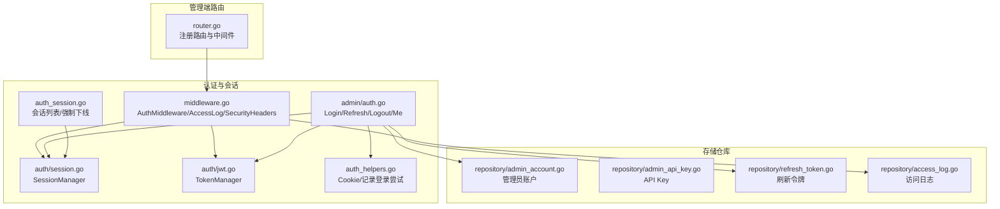

**图表来源**
- [internal/admin/router.go:89-116](file://internal/admin/router.go#L89-L116)
- [internal/admin/middleware.go:42-192](file://internal/admin/middleware.go#L42-L192)
- [internal/admin/auth/session.go:28-354](file://internal/admin/auth/session.go#L28-L354)
- [internal/admin/auth/jwt.go:45-323](file://internal/admin/auth/jwt.go#L45-L323)
- [internal/admin/auth.go:33-291](file://internal/admin/auth.go#L33-L291)
- [internal/admin/auth_helpers.go:15-75](file://internal/admin/auth_helpers.go#L15-L75)
- [internal/admin/auth_session.go:13-89](file://internal/admin/auth_session.go#L13-L89)
- [internal/store/repository/authn/admin_account.go:14-52](file://internal/store/repository/authn/admin_account.go#L14-L52)
- [internal/store/repository/authn/admin_api_key.go:50-106](file://internal/store/repository/authn/admin_api_key.go#L50-L106)
- [internal/store/repository/authn/refresh_token.go:20-127](file://internal/store/repository/authn/refresh_token.go#L20-L127)
- [internal/store/repository/access_log.go:326](file://internal/store/repository/access_log.go#L326)

**章节来源**
- [internal/admin/router.go:89-116](file://internal/admin/router.go#L89-L116)
- [internal/admin/middleware.go:42-192](file://internal/admin/middleware.go#L42-L192)

## 核心组件

| 组件 | 位置 | 职责 | 关键能力 |
|------|------|------|----------|
| 会话管理器 `SessionManager` | [session.go:28-36](file://internal/admin/auth/session.go#L28-L36) | 内存跟踪活动会话并双写数据库 | 创建/轮换、活跃时间节流、按用户/全局列出、强制下线、定时清理 |
| JWT 管理器 `TokenManager` | [jwt.go:45-59](file://internal/admin/auth/jwt.go#L45-L59) | 签发与校验短期访问令牌 | 主/备密钥轮换、JTI 粒度黑名单持久化与清理 |
| 认证中间件 `AuthMiddleware` | [middleware.go:42-123](file://internal/admin/middleware.go#L42-L123) | 统一鉴权入口 | 白名单放行、JWT 优先、API Key 回退、注入认证上下文、更新会话活跃 |
| 访问日志中间件 `AccessLog` | [middleware.go:149-170](file://internal/admin/middleware.go#L149-L170) | 请求可观测 | 注入 `X-Request-ID`，记录方法/路径/状态码/耗时/认证方式 |
| 安全头中间件 `SecurityHeaders` | [middleware.go:172-192](file://internal/admin/middleware.go#L172-L192) | 响应安全加固 | X-Content-Type-Options、X-Frame-Options、Referrer-Policy、CSP、`/api/v1/` no-store |
| 登录/刷新/登出处理器 | [auth.go:33-291](file://internal/admin/auth.go#L33-L291) | 会话建立与销毁 | 口令校验、令牌签发、刷新轮换整链、登出撤销与拉黑 |
| 会话管理处理器 | [auth_session.go:13-89](file://internal/admin/auth_session.go#L13-L89) | 会话查询与强制下线 | 列表（本人/全部）、按 JTI 强退并撤销刷新链 |
| API Key 仓库 | [admin_api_key.go:50-102](file://internal/store/repository/authn/admin_api_key.go#L50-L102) | 令牌签发与校验 | 一次性明文、bcrypt 哈希存储、前缀快路径校验、更新最后使用时间 |
| 刷新令牌仓库 | [refresh_token.go:20-127](file://internal/store/repository/authn/refresh_token.go#L20-L127) | 刷新令牌持久化 | 按 JTI 查询、原子轮换、整链撤销、清理过期 |
| 访问日志仓库 | [access_log.go:326](file://internal/store/repository/access_log.go#L326) | 访问日志查询 | 分页、过滤、按请求追踪读取 |

**章节来源**
- [internal/admin/auth/session.go:25-209](file://internal/admin/auth/session.go#L25-L209)
- [internal/admin/auth/jwt.go:43-253](file://internal/admin/auth/jwt.go#L43-L253)
- [internal/admin/middleware.go:16-129](file://internal/admin/middleware.go#L16-L129)
- [internal/admin/auth.go:32-221](file://internal/admin/auth.go#L32-L221)
- [internal/store/repository/authn/admin_api_key.go:48-63](file://internal/store/repository/authn/admin_api_key.go#L48-L63)
- [internal/store/repository/authn/refresh_token.go:26-39](file://internal/store/repository/authn/refresh_token.go#L26-L39)
- [internal/store/repository/access_log.go:95-117](file://internal/store/repository/access_log.go#L95-L117)

## 架构总览
会话管理贯穿“路由注册 → 中间件链 → 处理器 → 仓储”的调用链路。认证中间件负责白名单放行与 JWT/API Key 校验；处理器在成功登录/刷新后创建会话；登出时撤销刷新令牌并加入访问令牌黑名单同时删除会话；访问日志中间件统一注入请求 ID 并记录关键指标。

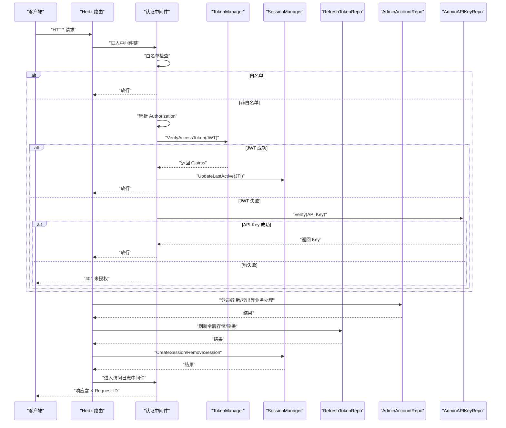

**图表来源**
- [internal/admin/middleware.go:42-123](file://internal/admin/middleware.go#L42-L123)
- [internal/admin/auth/jwt.go:131-156](file://internal/admin/auth/jwt.go#L131-L156)
- [internal/admin/auth/session.go:158-191](file://internal/admin/auth/session.go#L158-L191)
- [internal/admin/auth.go:33-291](file://internal/admin/auth.go#L33-L291)
- [internal/store/repository/authn/admin_account.go:19-27](file://internal/store/repository/authn/admin_account.go#L19-L27)
- [internal/store/repository/authn/admin_api_key.go:70-102](file://internal/store/repository/authn/admin_api_key.go#L70-L102)
- [internal/store/repository/authn/refresh_token.go:20-127](file://internal/store/repository/authn/refresh_token.go#L20-L127)

## 详细组件分析

### 会话生命周期管理
- 创建：登录/刷新成功后，根据访问令牌的 JTI、客户端 IP、UA、过期时间在内存与数据库中创建会话记录。
- 维护：每次通过 JWT 认证的请求都会更新对应会话的“最后活跃时间”。
- 销毁：登出时撤销刷新令牌、将访问令牌 JTI 加入黑名单并在会话表中删除；也可通过“强制下线”接口按 JTI 删除会话并加入黑名单。
- 清理：后台定时任务每 5 分钟清理过期会话并同步数据库。

会话以访问令牌 JTI 为主键，在内存与数据库间双写；刷新时按 `refresh_jti` 就地轮换而非新建行，避免每次刷新堆积会话记录。

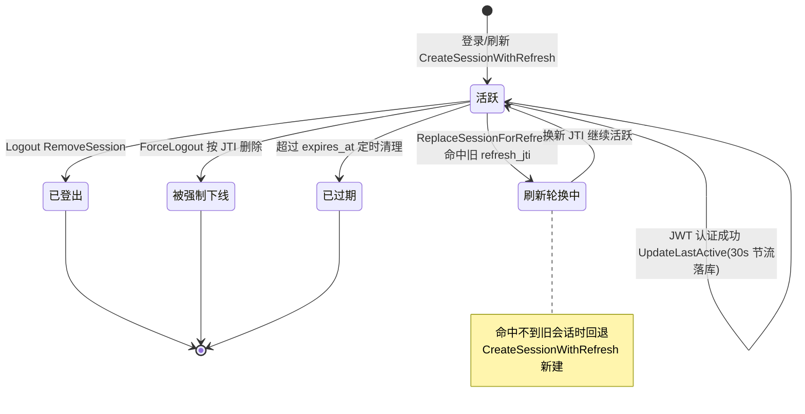

**图表来源**
- [internal/admin/auth/session.go:57-191](file://internal/admin/auth/session.go#L57-L191)
- [internal/admin/auth/session.go:329-354](file://internal/admin/auth/session.go#L329-L354)

| 状态迁移 | 触发条件 | 执行位置 | 落库动作 |
|----------|----------|----------|----------|
| 创建为活跃 | 登录成功、`accessJTI` 非空 | [auth.go:117-119](file://internal/admin/auth.go#L117-L119) | `Create` ActiveSession |
| 活跃续期 | JWT 认证成功命中 JTI | [session.go:170-191](file://internal/admin/auth/session.go#L170-L191) | 距上次持久化 ≥30s 才 `Update` |
| 刷新轮换 | 旧 `refresh_jti` 命中内存会话 | [session.go:107-156](file://internal/admin/auth/session.go#L107-L156) | `Updates` 覆盖 jti/refresh_jti |
| 登出移除 | 调用登出 | [auth.go:276](file://internal/admin/auth.go#L276) | `Delete` by jti |
| 强制下线 | 管理员强退 | [auth_session.go:57](file://internal/admin/auth_session.go#L57) | `Delete` by jti + 拉黑 + 撤销刷新链 |
| 过期清理 | 定时器每 5 分钟 | [session.go:329-354](file://internal/admin/auth/session.go#L329-L354) | `Delete` by expires_at |

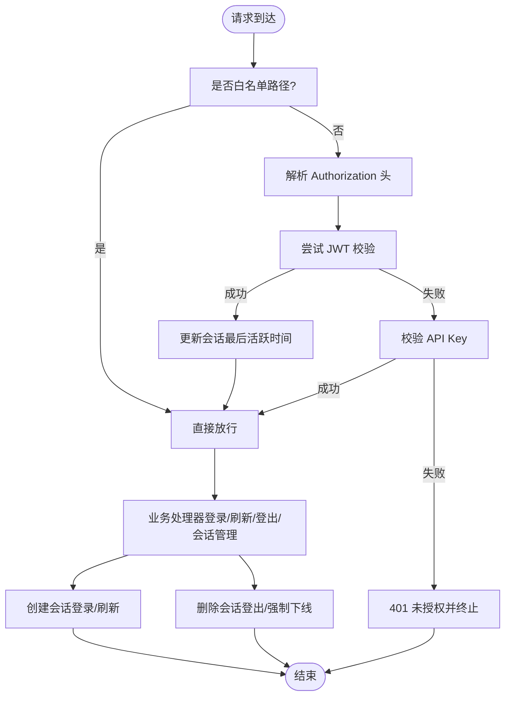

**图表来源**
- [internal/admin/middleware.go:16-72](file://internal/admin/middleware.go#L16-L72)
- [internal/admin/auth/session.go:43-94](file://internal/admin/auth/session.go#L43-L94)
- [internal/admin/auth.go:196-221](file://internal/admin/auth.go#L196-L221)
- [internal/admin/auth_session.go:36-65](file://internal/admin/auth_session.go#L36-L65)

**章节来源**
- [internal/admin/auth/session.go:43-209](file://internal/admin/auth/session.go#L43-L209)
- [internal/admin/auth.go:32-221](file://internal/admin/auth.go#L32-L221)
- [internal/admin/auth_session.go:12-65](file://internal/admin/auth_session.go#L12-L65)

### 中间件认证机制与白名单
- 白名单路径：`/api/v1/health` 与认证端点（login/refresh/logout）不进行认证。
- 认证优先级：先尝试 JWT（Bearer），失败再尝试 API Key；成功后注入认证用户、角色、方法等上下文。
- 会话活跃更新：JWT 成功后更新对应会话的最后活跃时间。
- API Key 角色来源：令牌的 `auth_username` 与 `auth_role` 均取自其归属 `AdminAccount`，账号被删除则立即 401，**不再无条件赋予 admin 角色**（[middleware.go:103-120](file://internal/admin/middleware.go#L103-L120)）。
- fail closed：JWT 返回 `ErrTokenBlacklistUnavailable` 时短路为 503，避免把"存储未就绪"误判为"令牌无效"。

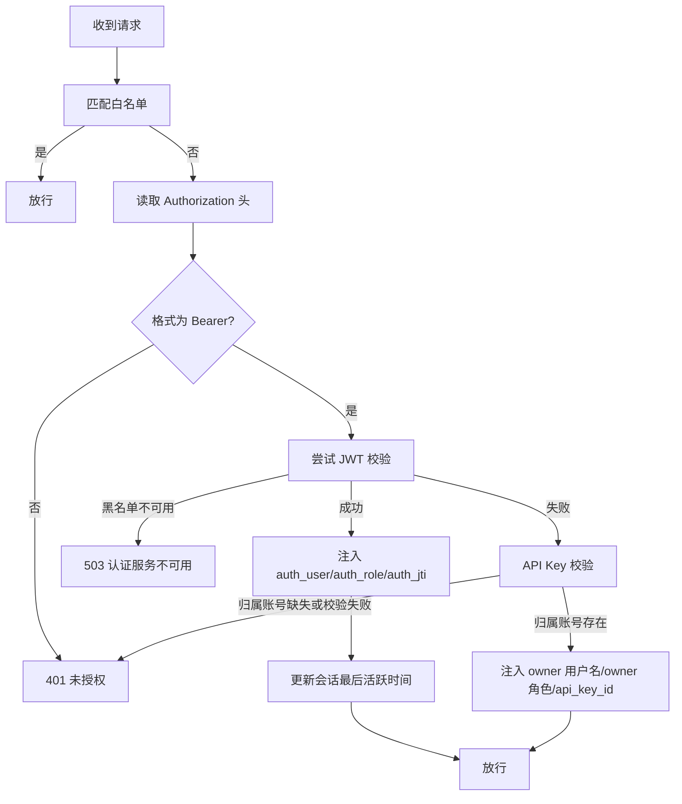

**图表来源**
- [internal/admin/middleware.go:42-123](file://internal/admin/middleware.go#L42-L123)
- [internal/admin/auth/jwt.go:131-156](file://internal/admin/auth/jwt.go#L131-L156)
- [internal/admin/auth/session.go:170-191](file://internal/admin/auth/session.go#L170-L191)

| 序 | 中间件 | 位置 | 作用范围 | 短路行为 | 跳过条件 |
|:--:|--------|------|----------|----------|----------|
| 1 | `SecurityHeaders` | [middleware.go:172-192](file://internal/admin/middleware.go#L172-L192) | 全局 | 无 | 无 |
| 2 | `AccessLog` | [middleware.go:149-170](file://internal/admin/middleware.go#L149-L170) | 全局 | 无 | 无 |
| 3 | `AuthMiddleware` | [middleware.go:42-123](file://internal/admin/middleware.go#L42-L123) | `api` 组 | 401 / 503 | health/login/refresh/logout |
| 4 | `RequireRole` | [middleware.go:125-147](file://internal/admin/middleware.go#L125-L147) | 分组 | 403 | 视角色集合 |

| 阶段 | 起点形态 | 转换动作 | 终点形态 | 位置 | 敏感处理 |
|------|----------|----------|----------|------|----------|
| 头解析 | `Authorization` 原始头 | 去空白、剥 `Bearer ` 前缀 | 令牌字符串 | [middleware.go:55-67](file://internal/admin/middleware.go#L55-L67) | 原令牌不进日志 |
| JWT 分支 | JWT 字符串 | `VerifyAccessToken` | Claims | [middleware.go:70-90](file://internal/admin/middleware.go#L70-L90) | 黑名单 fail closed |
| 上下文注入 | Claims | `c.Set` 用户名/角色/jti/方法 | 请求上下文 | [middleware.go:72-80](file://internal/admin/middleware.go#L72-L80) | 仅存派生信息 |
| API Key 分支 | 令牌字符串 | `Verify` + 归属账号解析 | owner 用户名/角色 | [middleware.go:92-120](file://internal/admin/middleware.go#L92-L120) | 角色取账号非默认 admin |

**章节来源**
- [internal/admin/middleware.go:42-147](file://internal/admin/middleware.go#L42-L147)
- [internal/admin/auth/jwt.go:131-156](file://internal/admin/auth/jwt.go#L131-L156)
- [internal/admin/auth/session.go:170-191](file://internal/admin/auth/session.go#L170-L191)

### 访问日志统一生成机制
- 请求 ID 注入：在进入访问日志中间件前生成 UUID 并写入响应头与上下文。
- 记录内容：方法、路径、状态码、耗时、认证方式（jwt/api_key）。
- 日志输出：使用 slog 记录统一格式的日志项。

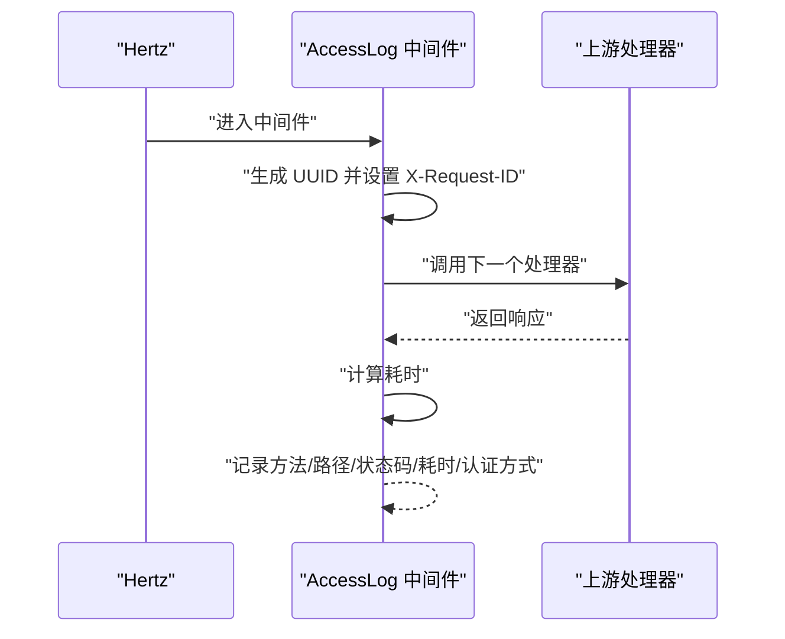

**图表来源**
- [internal/admin/middleware.go:149-170](file://internal/admin/middleware.go#L149-L170)

**章节来源**
- [internal/admin/middleware.go:149-170](file://internal/admin/middleware.go#L149-L170)

### 安全头设置策略
`SecurityHeaders` 对每个响应固定注入四类基础安全头，并对 `/api/v1/` 路径追加 `Cache-Control: no-store`；HSTS、X-XSS-Protection、Public-Key-Pins 则由快照开关与请求协议（https/h3）条件触发。

| 安全头 | 取值 | 触发条件 | 位置 |
|--------|------|----------|------|
| `X-Content-Type-Options` | `nosniff` | 全部响应 | [middleware.go:174](file://internal/admin/middleware.go#L174) |
| `X-Frame-Options` | `DENY` | 全部响应 | [middleware.go:175](file://internal/admin/middleware.go#L175) |
| `Referrer-Policy` | `strict-origin-when-cross-origin` | 全部响应 | [middleware.go:176](file://internal/admin/middleware.go#L176) |
| `Content-Security-Policy` | `default-src 'self'; script-src 'self' 'unsafe-inline'; style-src 'self' 'unsafe-inline'` | 全部响应 | [middleware.go:177](file://internal/admin/middleware.go#L177) |
| `Cache-Control` | `no-store` | 路径以 `/api/v1/` 开头 | [middleware.go:180-186](file://internal/admin/middleware.go#L180-L186) |
| `Strict-Transport-Security` | `max-age=31536000` | `HSTSEnabled` 且协议 https/h3 | [middleware.go:204-211](file://internal/admin/middleware.go#L204-L211) |

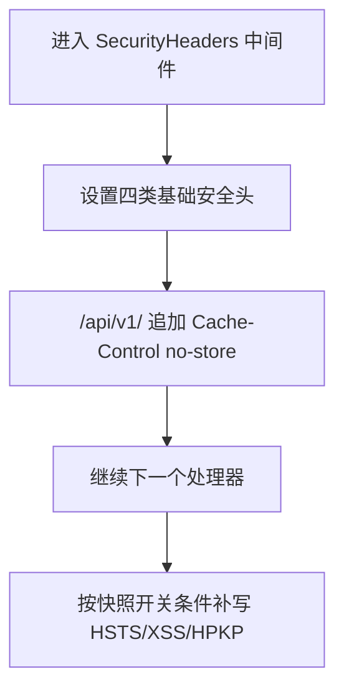

**图表来源**
- [internal/admin/middleware.go:172-248](file://internal/admin/middleware.go#L172-L248)

**章节来源**
- [internal/admin/middleware.go:172-248](file://internal/admin/middleware.go#L172-L248)

### 登录/刷新/登出流程
- 登录：校验密码，触发暴力破解检测；成功后签发短期访问令牌与刷新令牌，创建会话；设置刷新令牌 Cookie。
- 刷新：从 httpOnly Cookie `my_openwaf_rt`（值 `jti.raw`，点号分隔）解析并校验哈希与有效性；撤销旧刷新令牌并发放新刷新令牌与新的短期访问令牌；就地轮换会话。
- 登出：撤销整条刷新令牌轮换链；将访问令牌 JTI 加入黑名单并在会话表中删除；清除刷新令牌 Cookie。

> [!WARNING] 已知风险（只记录，不改动）：`RefreshHandler` 在刷新记录 `username` 为空时回落 `"admin"`（[auth.go:170-173](file://internal/admin/auth.go#L170-L173)）；账号删除态由 `RevokeFamily` 兜底，但空用户名→admin 的映射仍属潜在提权面，应纳入待评估问题清单。

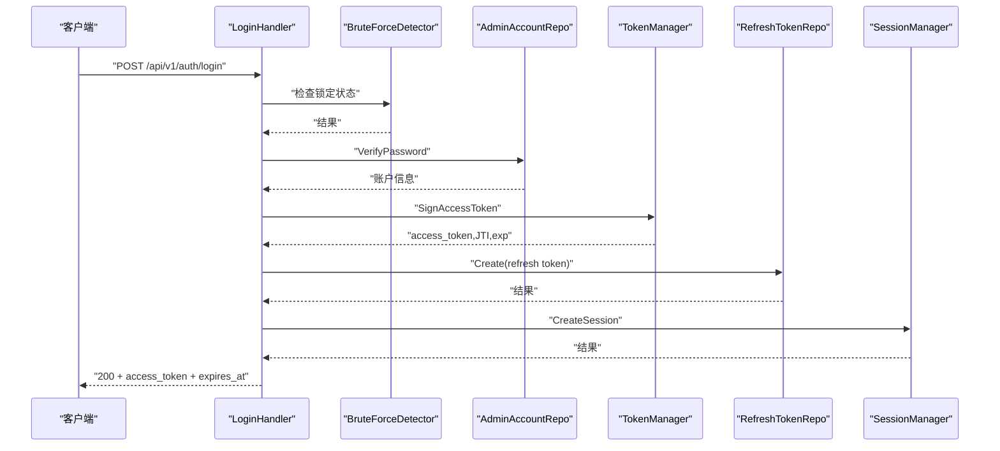

**图表来源**
- [internal/admin/auth.go:32-119](file://internal/admin/auth.go#L32-L119)
- [internal/admin/auth/jwt.go:84-109](file://internal/admin/auth/jwt.go#L84-L109)
- [internal/store/repository/authn/admin_account.go:19-27](file://internal/store/repository/authn/admin_account.go#L19-L27)
- [internal/store/repository/authn/refresh_token.go:15-24](file://internal/store/repository/authn/refresh_token.go#L15-L24)
- [internal/admin/auth/session.go:43-74](file://internal/admin/auth/session.go#L43-L74)

**章节来源**
- [internal/admin/auth.go:121-194](file://internal/admin/auth.go#L121-L194)
- [internal/admin/auth.go:196-221](file://internal/admin/auth.go#L196-L221)

### API Key 与 JWT 的优先级与回退
- 优先级：Authorization 头以 Bearer 开头时，先尝试 JWT 校验；JWT 失败（且非黑名单不可用）才回退到 API Key 校验。
- API Key 校验：先按令牌前 8 字符 `prefix` 走索引快路径命中候选再 bcrypt 比对；无前缀的 legacy 记录回退全表扫描，命中后回填前缀并更新最后使用时间。
- 角色来源：校验通过后从 `UserID` 解析归属 `AdminAccount`，注入其用户名与角色，归属账号缺失即 401。

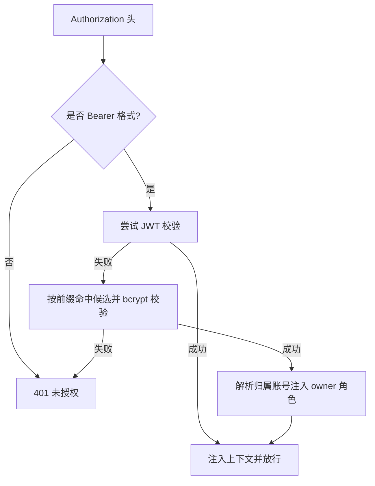

**图表来源**
- [internal/admin/middleware.go:92-120](file://internal/admin/middleware.go#L92-L120)
- [internal/store/repository/authn/admin_api_key.go:70-102](file://internal/store/repository/authn/admin_api_key.go#L70-L102)

**章节来源**
- [internal/admin/middleware.go:92-120](file://internal/admin/middleware.go#L92-L120)
- [internal/store/repository/authn/admin_api_key.go:70-102](file://internal/store/repository/authn/admin_api_key.go#L70-L102)
- [internal/store/repository/authn/admin_account.go:19-22](file://internal/store/repository/authn/admin_account.go#L19-L22)

### 会话管理 API
- 列出当前用户会话或全部会话：仅当 `?all=true` 且角色为 `admin` 时返回全部会话，否则返回本人会话。
- 强制下线指定会话：按 JTI 删除会话、将访问令牌 JTI 拉黑，并撤销其关联的整条刷新令牌轮换链。

| 端点 | 方法 | 角色要求 | 处理函数 | 位置 |
|------|:----:|----------|----------|------|
| `/api/v1/auth/sessions` | GET | 已登录（`?all=true` 需 admin） | `ListSessionsHandler` | [auth_session.go:13-35](file://internal/admin/auth_session.go#L13-L35) |
| `/api/v1/auth/sessions/force-logout` | POST | `admin`（`RequireRole`） | `ForceLogoutSessionHandler` | [auth_session.go:38-89](file://internal/admin/auth_session.go#L38-L89) |

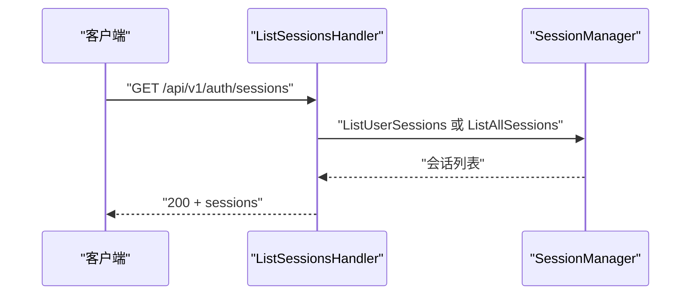

**图表来源**
- [internal/admin/auth_session.go:13-35](file://internal/admin/auth_session.go#L13-L35)
- [internal/admin/auth/session.go:216-246](file://internal/admin/auth/session.go#L216-L246)

| 符号 | 位置 | 职责 | 上游调用者 | 下游依赖 | 副作用 | 影响面 |
|------|------|------|------------|----------|--------|--------|
| `SessionManager.CreateSessionWithRefresh` | [session.go:57-102](file://internal/admin/auth/session.go#L57-L102) | 登记活跃会话并关联 refresh JTI | LoginHandler（[auth.go:118](file://internal/admin/auth.go#L118)） | `ActiveSession` 落库 | 写内存 map + DB | 中 |
| `SessionManager.UpdateLastActive` | [session.go:170-191](file://internal/admin/auth/session.go#L170-L191) | 刷新最后活跃时间 | AuthMiddleware（[middleware.go:80](file://internal/admin/middleware.go#L80)） | `ActiveSession.Update` | 30s 节流内不写库 | 中 |
| `SessionManager.ForceLogout` | [session.go:257-269](file://internal/admin/auth/session.go#L257-L269) | 删除会话并回报存在性 | ForceLogoutSessionHandler（[auth_session.go:57](file://internal/admin/auth_session.go#L57)） | `ActiveSession.Delete` | 写库删除 | 高 |
| `TokenManager.VerifyAccessToken` | [jwt.go:131-156](file://internal/admin/auth/jwt.go#L131-L156) | 校验访问令牌与黑名单 | AuthMiddleware（[middleware.go:71](file://internal/admin/middleware.go#L71)） | `verifyWithKey`、黑名单 | 惰性删除过期项 | 高 |
| `RefreshTokenRepo.RevokeFamily` | [refresh_token.go:43-85](file://internal/store/repository/authn/refresh_token.go#L43-L85) | 整链撤销刷新令牌 | 登出/强退（[auth.go:258](file://internal/admin/auth.go#L258)、[auth_session.go:73](file://internal/admin/auth_session.go#L73)） | `db` 事务 | 批量置 revoked | 高 |

| 字段 | 是否落日志 | 是否回显 | 脱敏位置 |
|------|:----------:|:--------:|----------|
| 口令 `password` | 否 | 否 | 仅 bcrypt 比对（[admin_account.go:43-52](file://internal/store/repository/authn/admin_account.go#L43-L52)） |
| 访问令牌 JWT | 否 | 是（响应 `access_token`） | 中间件不把原令牌写入日志（[middleware.go:160-168](file://internal/admin/middleware.go#L160-L168)） |
| 刷新令牌明文 raw | 否 | 否 | 落库仅 SHA-256 哈希（[jwt.go:350-358](file://internal/admin/auth/jwt.go#L350-L358)） |
| `refreshJTI` | 否 | 否 | `SessionInfo.refreshJTI` 非导出，JSON 不序列化（[session.go:18](file://internal/admin/auth/session.go#L18)） |
| 客户端 IP / UA / DeviceInfo | 摘要级 | 会话列表可见本人 | `ActiveSession` 仅记录不对外广播（[auth.go:83-118](file://internal/admin/auth.go#L83-L118)） |

**章节来源**
- [internal/admin/auth_session.go:13-89](file://internal/admin/auth_session.go#L13-L89)
- [internal/admin/auth/session.go:57-269](file://internal/admin/auth/session.go#L57-L269)
- [internal/admin/auth/jwt.go:131-156](file://internal/admin/auth/jwt.go#L131-L156)
- [internal/admin/auth.go:118-258](file://internal/admin/auth.go#L118-L258)
- [internal/admin/middleware.go:71-168](file://internal/admin/middleware.go#L71-L168)
- [internal/store/repository/authn/admin_account.go:43-52](file://internal/store/repository/authn/admin_account.go#L43-L52)
- [internal/store/repository/authn/refresh_token.go:43-85](file://internal/store/repository/authn/refresh_token.go#L43-L85)

### 管理面与数据面会话存储对照
本仓库存在两套彼此独立的会话实现，读者需区分：管理端登录会话由 `SessionManager` 负责，站点访问控制门（OAuth/访客登录）的令牌由数据面 `MemorySessionStore` 负责，二者键空间与撤销路径不同。

| 维度 | 管理面 `SessionManager` | 数据面 `MemorySessionStore` |
|------|-------------------------|-----------------------------|
| 位置 | [session.go:28-36](file://internal/admin/auth/session.go#L28-L36) | [session.go:11-21](file://internal/waf/accessgate/session.go#L11-L21) |
| 会话键 | 访问令牌 JTI（服务端签发 JWT） | 32 字节随机 hex token |
| 持久化 | 内存 + `ActiveSession` 表双写 | 仅内存 map（生产可替换 Redis/DB） |
| 撤销 | 黑名单 + 删除行 + 撤销刷新链 | `Revoke`/`RevokeAll`/`CleanExpired` |
| 归属信息 | username/ip/userAgent/deviceInfo | siteID/identity/provider |

**章节来源**
- [internal/admin/auth/session.go:28-36](file://internal/admin/auth/session.go#L28-L36)
- [internal/waf/accessgate/session.go:11-86](file://internal/waf/accessgate/session.go#L11-L86)

## 依赖关系分析
- 路由注册顺序：全局中间件（安全头、访问日志）先于认证中间件执行；认证中间件再应用于受保护的 API 分组。
- 认证依赖：AuthMiddleware 依赖 TokenManager（JWT 校验）与 SessionManager（活跃时间更新）；API Key 依赖 AdminAPIKeyRepo。
- 业务处理依赖：Login/Refresh/Logout 依赖 AdminAccountRepo、RefreshTokenRepo、TokenManager、SessionManager。
- 访问日志依赖：AccessLog 依赖 slog 记录器。

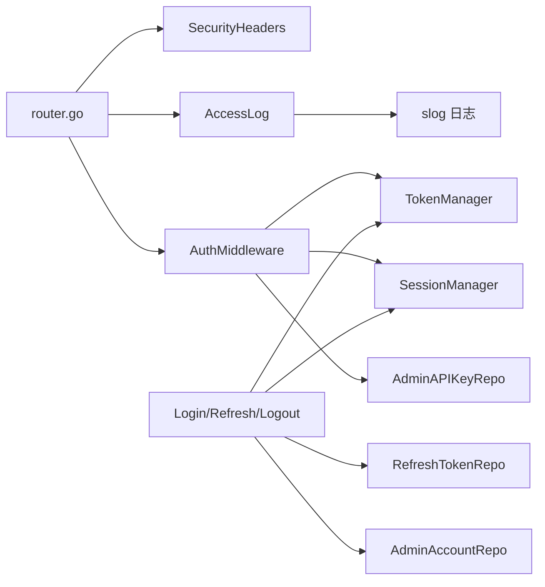

**图表来源**
- [internal/admin/router.go:46-72](file://internal/admin/router.go#L46-L72)
- [internal/admin/middleware.go:16-129](file://internal/admin/middleware.go#L16-L129)
- [internal/admin/auth.go:32-221](file://internal/admin/auth.go#L32-L221)

**章节来源**
- [internal/admin/router.go:46-72](file://internal/admin/router.go#L46-L72)

## 性能考虑
- 会话存储：内存 + 数据库双写，后台每 5 分钟清理过期会话，避免内存膨胀；活跃时间按 30 秒节流落库，减少每请求一次 UPDATE 的写放大。
- JWT 黑名单：内存 `sync.Map` O(1) 查询，每 10 分钟清理过期条目并删除数据库过期行。
- API Key 校验：按 8 字符前缀索引命中候选再 bcrypt 比对，避免全表扫描；无前缀的 legacy 记录才回退逐条比对。
- 访问日志：统一注入请求 ID，便于跨服务追踪；注意日志落盘与异步写入策略，避免阻塞请求处理。

**章节来源**
- [internal/admin/auth/session.go:170-191](file://internal/admin/auth/session.go#L170-L191)
- [internal/admin/auth/session.go:329-354](file://internal/admin/auth/session.go#L329-L354)
- [internal/admin/auth/jwt.go:274-323](file://internal/admin/auth/jwt.go#L274-L323)
- [internal/store/repository/authn/admin_api_key.go:70-102](file://internal/store/repository/authn/admin_api_key.go#L70-L102)

## 故障排查指南
- 401 未授权
  - 检查 Authorization 头格式是否为 Bearer。
  - 若使用 API Key，请确认密钥有效且未过期。
  - 若使用 JWT，请确认签名密钥正确、未被撤销（JTI 在黑名单中）。
- 403 权限不足
  - 检查 RequireRole 中间件配置的角色集合。
- 登录频繁失败被锁定
  - 查看暴力破解检测状态与剩余尝试次数。
- 会话无法列出或活跃时间未更新
  - 确认 JWT 校验成功且 JTI 正确；检查 SessionManager 的活跃时间更新逻辑。
- 登出后仍可访问
  - 确认刷新令牌已撤销、访问令牌 JTI 已加入黑名单且会话已删除。
- 访问日志缺失
  - 确认中间件顺序：SecurityHeaders → AccessLog → 其他处理器；检查 slog 输出配置。

**章节来源**
- [internal/admin/middleware.go:42-123](file://internal/admin/middleware.go#L42-L123)
- [internal/admin/auth/jwt.go:246-323](file://internal/admin/auth/jwt.go#L246-L323)
- [internal/admin/auth.go:33-221](file://internal/admin/auth.go#L33-L221)
- [internal/admin/auth_session.go:38-89](file://internal/admin/auth_session.go#L38-L89)

## 结论
该会话管理系统通过“JWT + API Key”的双轨认证、统一的安全头与访问日志中间件，以及内存+数据库的会话持久化策略，实现了高可用、可审计的管理端认证与会话控制。配合定时清理与黑名单机制，能够有效抵御常见攻击并满足运维审计需求。

## 附录
- 最佳实践
  - 使用 HTTPS 发送刷新令牌 Cookie，并启用 Secure 与 SameSite 属性。
  - 定期轮换 JWT 密钥，确保主/备密钥切换平滑。
  - 控制 API Key 数量与权限范围，定期轮换与审计。
  - 启用访问日志并集中化存储，结合请求 ID 实现端到端追踪。
  - 对会话与黑名单实施定期巡检，清理过期数据。
- 常见问题
  - JWT 无法校验：检查签发方、受众、签名密钥与时间偏移。
  - API Key 校验失败：确认 bcrypt 哈希一致且未被删除。
  - 会话活跃时间不更新：确认 JWT 成功且 JTI 正确传递。
  - 登出无效：确认刷新令牌撤销、访问令牌 JTI 黑名单与会话删除均执行。

**章节来源**
- [internal/admin/auth_helpers.go:15-38](file://internal/admin/auth_helpers.go#L15-L38)
- [internal/admin/auth/jwt.go:88-93](file://internal/admin/auth/jwt.go#L88-L93)
- [internal/admin/auth.go:243-291](file://internal/admin/auth.go#L243-L291)