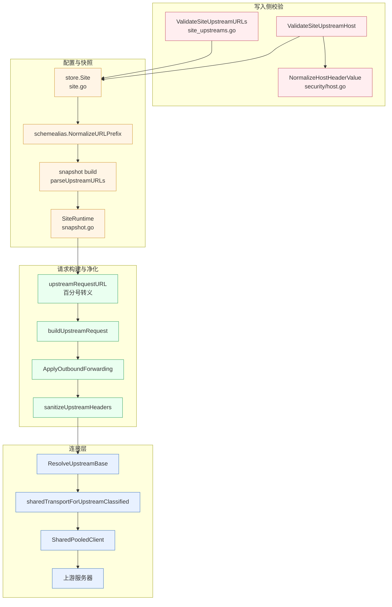
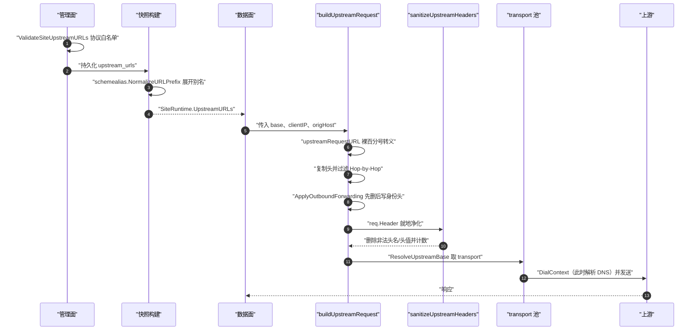
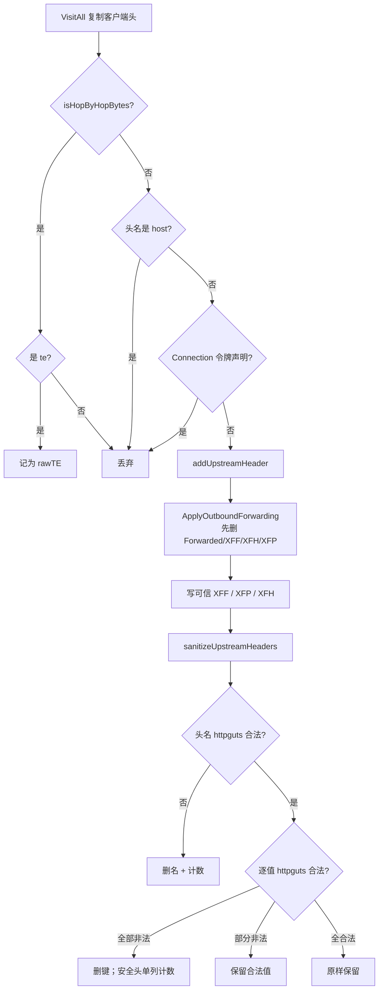
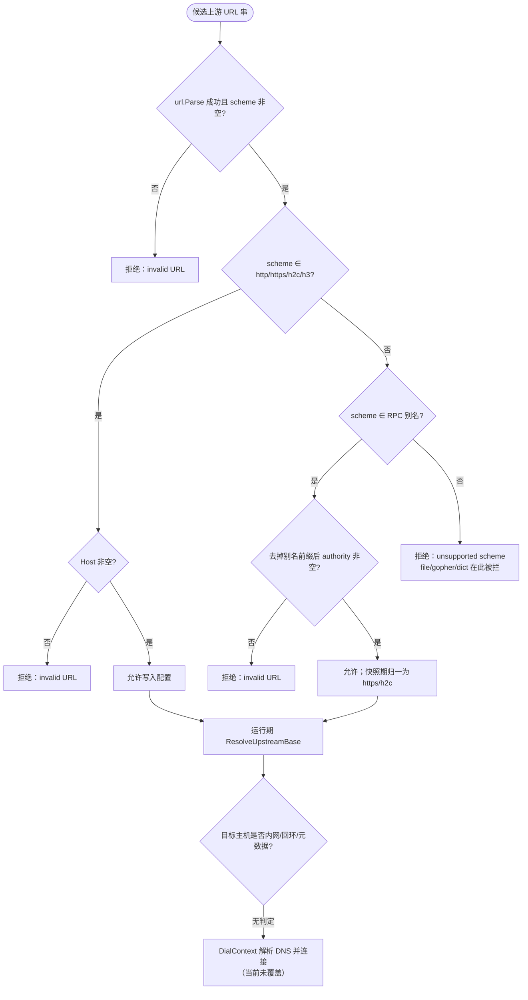
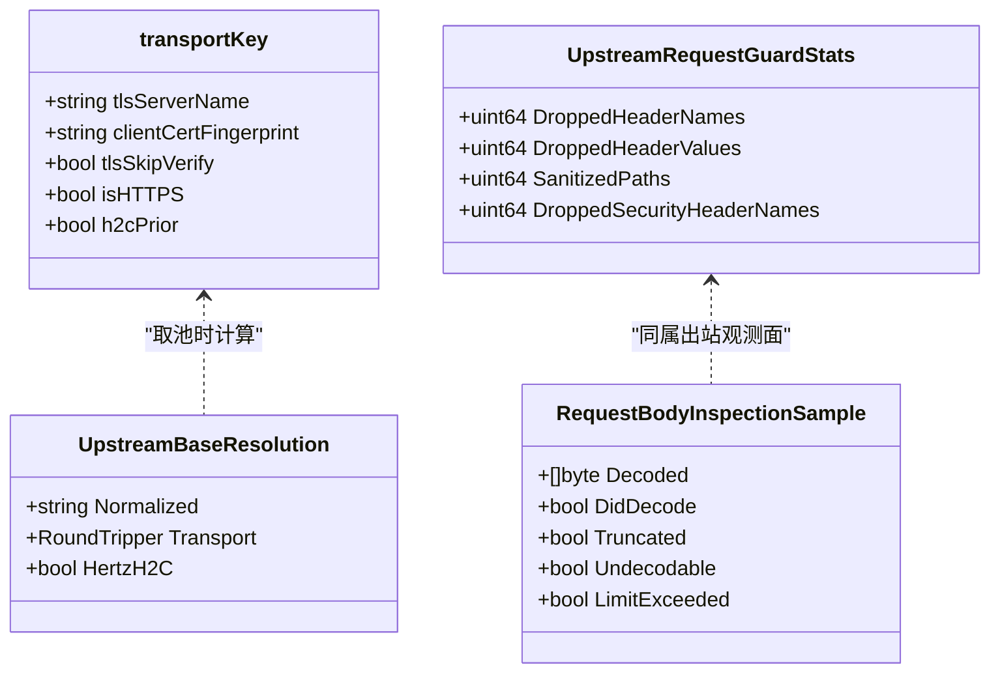
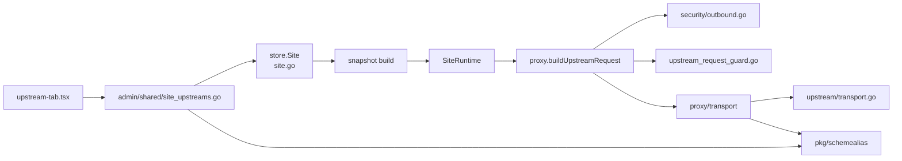

# 出站安全控制

> [返回 安全机制](安全机制.md)

<cite>
**本文档引用的文件**
- [proxy.go](file://internal/proxy/proxy.go)
- [upstream_request_guard.go](file://internal/proxy/upstream_request_guard.go)
- [request_inspection.go](file://internal/proxy/request_inspection.go)
- [compression_events.go](file://internal/proxy/compression_events.go)
- [transport.go](file://internal/proxy/transport/transport.go)
- [transport.go](file://internal/upstream/transport.go)
- [health.go](file://internal/upstream/health.go)
- [http3.go](file://internal/app/http3.go)
- [schemealias.go](file://internal/pkg/schemealias/schemealias.go)
- [site_upstreams.go](file://internal/admin/shared/site_upstreams.go)
- [outbound.go](file://internal/security/outbound.go)
- [clientip.go](file://internal/security/clientip.go)
- [host.go](file://internal/security/host.go)
- [snapshot.go](file://internal/snapshot/snapshot.go)
- [build.go](file://internal/snapshot/build.go)
- [site.go](file://internal/store/site.go)
- [request_ctx.go](file://internal/dataplane/request_ctx.go)
- [params.go](file://internal/imagery/params.go)
- [cisco_asa.go](file://internal/waf/owasp/cisco_asa.go)
- [upstream-tab.tsx](file://frontend/app/(dashboard)/sites/detail/components/upstream-tab.tsx)
- [advanced-tab.tsx](file://frontend/app/(dashboard)/sites/detail/components/advanced-tab.tsx)
- [types.ts](file://frontend/lib/types.ts)
</cite>

## 目录

1. [简介](#简介)
2. [项目结构](#项目结构)
3. [核心组件](#核心组件)
4. [架构总览](#架构总览)
5. [详细组件分析](#详细组件分析)
6. [依赖关系分析](#依赖关系分析)
7. [性能考虑](#性能考虑)
8. [故障排查指南](#故障排查指南)
9. [结论](#结论)
10. [附录](#附录)

## 简介
本文件面向「出站安全控制」，说明 WAF 作为反向代理向上游发起请求时实际施加的约束，以及**没有**施加的约束。覆盖：
- 上游目标地址的写入侧校验：协议白名单、authority 合法性、`upstream_host` 模板校验
- 协议别名归一：RPC 前缀到传输 scheme 的单一实现点
- 出站请求净化：非法头名/头值丢弃、安全相关头单列计数、裸 `%` 转义
- 转发身份头重建：先删客户端自带值，再写可信值
- 连接层：按 TLS 配置分池的 `http.Transport`、最小 TLS 版本、mTLS 客户端证书
- SSRF 相关能力的真实覆盖面与未覆盖情形

关于 SSRF 必须先说清边界：本仓库的出站目标是**管理面配置的上游地址**，不是客户端可任意指定的 URL。因此风险模型与「用户可控 URL 抓取器」不同。已实现的校验集中在协议与语法层；**内网/链路本地/云元数据地址不拦截、重定向逐跳不复校验、DNS 解析结果不与地址集合比对**，这三项在当前代码中没有对应实现，本文逐项标注「当前未覆盖」并给出证据位置。

## 项目结构
与出站安全控制直接相关的代码分布：
- 管理面写入校验：`internal/admin/shared/site_upstreams.go` 决定哪些上游地址可以进入配置
- 协议归一：`internal/pkg/schemealias`，快照构建期与运行期共用
- 请求构建与净化：`internal/proxy` 的 `proxy.go` 与 `upstream_request_guard.go`
- 连接层：`internal/proxy/transport`，另有 `internal/upstream` 提供探活与 h3 侧 TLS 配置
- 转发头与 Host：`internal/security`
- 采样解码边界：`internal/proxy/request_inspection.go`
- 前端：站点详情的「上游」标签页与「高级」标签页

| 层次 | 文件 | 关键符号 | 行号 |
|------|------|----------|------|
| 写入校验 | `internal/admin/shared/site_upstreams.go` | `ValidateSiteUpstreamURLs` | 24-53 |
| 写入校验 | `internal/admin/shared/site_upstreams.go` | `ValidateSiteUpstreamHost` | 97-112 |
| 协议别名 | `internal/pkg/schemealias/schemealias.go` | `NormalizeURLPrefix` | 51-56 |
| 快照落地 | `internal/snapshot/build.go` | `parseUpstreamURLs` | 824-841 |
| 运行分派 | `internal/proxy/transport/transport.go` | `ResolveUpstreamBase` | 800-844 |
| 请求构建 | `internal/proxy/proxy.go` | `buildUpstreamRequest` | 622-763 |
| 请求净化 | `internal/proxy/upstream_request_guard.go` | `sanitizeUpstreamHeaders` | 58-122 |
| 身份重建 | `internal/security/outbound.go` | `RebuildOutboundForwardingHeaders` | 36-56 |
| 连接池 | `internal/proxy/transport/transport.go` | `sharedTransportForUpstreamClassified` | 137-206 |

**章节来源**
- [site_upstreams.go:24-112](file://internal/admin/shared/site_upstreams.go#L24-L112)
- [schemealias.go:51-56](file://internal/pkg/schemealias/schemealias.go#L51-L56)
- [build.go:824-841](file://internal/snapshot/build.go#L824-L841)
- [transport.go:800-844](file://internal/proxy/transport/transport.go#L800-L844)
- [proxy.go:622-763](file://internal/proxy/proxy.go#L622-L763)
- [upstream_request_guard.go:58-122](file://internal/proxy/upstream_request_guard.go#L58-L122)
- [outbound.go:36-56](file://internal/security/outbound.go#L36-L56)

**图表来源**
- [site_upstreams.go:24-112](file://internal/admin/shared/site_upstreams.go#L24-L112)
- [host.go:13-27](file://internal/security/host.go#L13-L27)
- [site.go:44-46](file://internal/store/site.go#L44-L46)
- [schemealias.go:51-56](file://internal/pkg/schemealias/schemealias.go#L51-L56)
- [build.go:824-841](file://internal/snapshot/build.go#L824-L841)
- [snapshot.go:44-66](file://internal/snapshot/snapshot.go#L44-L66)
- [proxy.go:523-558](file://internal/proxy/proxy.go#L523-L558)
- [proxy.go:622-763](file://internal/proxy/proxy.go#L622-L763)
- [outbound.go:74-81](file://internal/security/outbound.go#L74-L81)
- [upstream_request_guard.go:58-122](file://internal/proxy/upstream_request_guard.go#L58-L122)
- [transport.go:137-206](file://internal/proxy/transport/transport.go#L137-L206)
- [transport.go:800-844](file://internal/proxy/transport/transport.go#L800-L844)

**章节来源**
- [transport.go:955-1013](file://internal/proxy/transport/transport.go#L955-L1013)
- [proxy.go:1037](file://internal/proxy/proxy.go#L1037)

## 核心组件
- **上游地址校验器**：`ValidateSiteUpstreamURLs` 对每条上游做 `url.Parse` + 协议白名单；`ValidateSiteUpstreamHost` 对 Host 覆写值做模板或字面校验
- **协议别名归一器**：`schemealias` 提供映射表与两个入口（`Scheme`、`AliasForURL`），`NormalizeURLPrefix` 是跨包唯一切换点
- **请求净化器**：`sanitizeUpstreamHeaders` 就地删除无法通过 `net/http` 出站校验的头，并对安全相关头单列计数
- **路径转义器**：`sanitizeRawPercentEscapes` 把裸 `%` 改写为 `%25`
- **转发身份重建器**：`RebuildOutboundForwardingHeaders` + `ApplyOutboundForwarding`
- **连接池与 TLS 装配**：`transportKey` 分池、`ResolveUpstreamBase` 分派 h2c/h3/别名/常规四种传输
- **观测面**：`UpstreamRequestGuardSnapshot` 四计数、`logUpstreamRequestError` 上游错误日志

| 组件 | 位置 | 触发时机 | 失败处置 |
|------|------|----------|----------|
| `ValidateSiteUpstreamURLs` | `site_upstreams.go:24` | 管理面保存站点 | 返回错误，拒绝保存 |
| `ValidateSiteUpstreamHost` | `site_upstreams.go:97` | 管理面保存站点 | 返回错误，拒绝保存 |
| `schemealias.NormalizeURLPrefix` | `schemealias.go:51` | 快照构建期 | 未命中别名原样返回 |
| `upstreamRequestURL` | `proxy.go:523` | 每次出站构建 | 转义后继续，不拒绝 |
| `buildUpstreamRequest` | `proxy.go:622` | 每次出站 | `http.NewRequestWithContext` 出错即上抛 |
| `sanitizeUpstreamHeaders` | `upstream_request_guard.go:58` | 出站请求组装末尾 | 删头并计数，请求继续 |
| `ApplyOutboundForwarding` | `outbound.go:74` | 净化之前 | 覆盖写可信头 |
| `ResolveUpstreamBase` | `transport.go:800` | 取 transport 时 | 归一为 `http(s)://` 后取池 |

**章节来源**
- [site_upstreams.go:24-112](file://internal/admin/shared/site_upstreams.go#L24-L112)
- [schemealias.go:51-56](file://internal/pkg/schemealias/schemealias.go#L51-L56)
- [proxy.go:523-763](file://internal/proxy/proxy.go#L523-L763)
- [upstream_request_guard.go:44-122](file://internal/proxy/upstream_request_guard.go#L44-L122)
- [outbound.go:74-81](file://internal/security/outbound.go#L74-L81)
- [transport.go:800-844](file://internal/proxy/transport/transport.go#L800-L844)

## 架构总览
一次出站请求的安全控制点按顺序排列如下。

**图表来源**
- [site_upstreams.go:24-53](file://internal/admin/shared/site_upstreams.go#L24-L53)
- [build.go:836](file://internal/snapshot/build.go#L836)
- [snapshot.go:44-48](file://internal/snapshot/snapshot.go#L44-L48)
- [proxy.go:523-558](file://internal/proxy/proxy.go#L523-L558)
- [proxy.go:661-677](file://internal/proxy/proxy.go#L661-L677)
- [proxy.go:760-761](file://internal/proxy/proxy.go#L760-L761)
- [upstream_request_guard.go:58-122](file://internal/proxy/upstream_request_guard.go#L58-L122)
- [transport.go:800-844](file://internal/proxy/transport/transport.go#L800-L844)
- [transport.go:175](file://internal/proxy/transport/transport.go#L175)

## 详细组件分析

### 中间件链：出站请求构建顺序
`buildUpstreamRequest` 是单函数流水线，步骤顺序即安全语义顺序，任何一步都不改写前一步的结论。

| 序 | 步骤 | 实现行号 | 安全作用 | 失败行为 |
|:--:|------|----------|----------|----------|
| 1 | 拼 URL：base + 原始 path + query | `proxy.go:523-558` | 保留原始 path，不做二次解码 | path 空时补 `/` |
| 2 | 裸 `%` 转义 | `upstream_request_guard.go:157-173`，调用点 `proxy.go:532` | 阻断解析器差异型走私 | 无需转义时返回 nil |
| 3 | 方法归一 | `proxy.go:567-604` | 常量串复用，减少分配 | 未知方法原样透传 |
| 4 | 请求创建 | `proxy.go:648-651` | 绑定 context 取消 | `error` 上抛 |
| 5 | 头复制 | `proxy.go:663-677` | 过滤 Hop-by-Hop 与 Connection 令牌 | 命中即跳过 |
| 6 | TE 白名单 | `proxy.go:679-681`、`proxy.go:765` | 只放行可转发的 TE 值 | 置空即不写 |
| 7 | 请求体解码/降级 | `proxy.go:683-743` | 压缩炸弹超限降级为原始字节转发 | 记事件，不拒绝 |
| 8 | Trailer 同步 | `proxy.go:745-758` | 保留分块尾语义 | 无尾则跳过 |
| 9 | 身份头重建 | `outbound.go:74-81`，调用点 `proxy.go:760` | 客户端伪造值先删后写 | 值为空则不写 |
| 10 | 头净化 | `upstream_request_guard.go:58-122`，调用点 `proxy.go:761` | 删除 net/http 会拒绝的头 | 删头并计数 |

关键顺序约束是 **9 在 10 之前**：可信身份头写入后仍会被净化复校一次，若其本身含非法字节也会被删除并计入 `DroppedSecurityHeaderNames`（`upstream_request_guard.go:89-91`）。

**图表来源**
- [proxy.go:661-681](file://internal/proxy/proxy.go#L661-L681)
- [proxy.go:760-761](file://internal/proxy/proxy.go#L760-L761)
- [proxy.go:829](file://internal/proxy/proxy.go#L829)
- [proxy.go:2817](file://internal/proxy/proxy.go#L2817)
- [proxy.go:2878](file://internal/proxy/proxy.go#L2878)
- [outbound.go:36-56](file://internal/security/outbound.go#L36-L56)
- [upstream_request_guard.go:58-122](file://internal/proxy/upstream_request_guard.go#L58-L122)

**章节来源**
- [proxy.go:523-763](file://internal/proxy/proxy.go#L523-L763)
- [proxy.go:2817](file://internal/proxy/proxy.go#L2817)
- [proxy.go:2878](file://internal/proxy/proxy.go#L2878)
- [compression_events.go:72](file://internal/proxy/compression_events.go#L72)
- [compression_events.go:174](file://internal/proxy/compression_events.go#L174)
- [outbound.go:36-81](file://internal/security/outbound.go#L36-L81)
- [upstream_request_guard.go:44-173](file://internal/proxy/upstream_request_guard.go#L44-L173)

### 净化器观测面
`UpstreamRequestGuardSnapshot` 暴露四个累计计数（`upstream_request_guard.go:44-51`），与结构体字段一一对应（`upstream_request_guard.go:26-37`）。

| 计数字段 | 含义 | 递增位置 | 是否落日志 |
|----------|------|----------|:----------:|
| `DroppedHeaderNames` | 非法头名个数（按头字段计） | `upstream_request_guard.go:99` | DEBUG 抽样 |
| `DroppedHeaderValues` | 非法头值个数 | `upstream_request_guard.go:100` | DEBUG 抽样 |
| `SanitizedPaths` | 做过裸 `%` 转义的请求个数 | `upstream_request_guard.go:162` | 否 |
| `DroppedSecurityHeaderNames` | 安全相关头被整体丢弃个数 | `upstream_request_guard.go:103` | WARN 抽样 |

安全相关头名单在 `isSecurityRelevantOutboundHeader`（`upstream_request_guard.go:130-144`）：`Authorization`、`Cookie`、`Proxy-Authorization`、`X-Forwarded-For`、`X-Forwarded-Host`、`X-Forwarded-Proto`、`X-Real-Ip`、`Client-Ip`、`Forwarded`。这类丢弃不改变请求成败，客户端与上游都看不到异常，因此单独升 WARN，并沿用上游错误的抽样规则（首见 + 每 1024 条，`upstream_request_guard.go:117-121`、`proxy.go:434`）。日志只记截断后的**头名**样本，最多 4 个、每个 64 字节，完整取值一律不落日志（`upstream_request_guard.go:20-23`、`upstream_request_guard.go:66-72`、`upstream_request_guard.go:146-155`）。

**章节来源**
- [upstream_request_guard.go:13-155](file://internal/proxy/upstream_request_guard.go#L13-L155)
- [proxy.go:434](file://internal/proxy/proxy.go#L434)

### SSRF 防护的真实覆盖面
下表逐项给出实现位置与结论。凡写「当前未覆盖」的都是全仓检索后确认没有对应实现的能力，不是「未统计」。

| 校验项 | 覆盖状态 | 证据与行为 |
|--------|:--------:|------------|
| 协议白名单（写入侧） | ✓ 已实现 | `site_upstreams.go:37-50`：仅 `http`/`https`/`h2c`/`h3` 与 `tls`/`grpc`/`grpcs`/`grpc+tls`/`grpc+https`；其余落 `default` 返回 `errSiteUpstreamsUnsupportedScheme`（`site_upstreams.go:18`、`site_upstreams.go:48-49`）。`file`、`gopher`、`dict` 等**无法写入配置** |
| scheme 语法合法性 | ✓ 已实现 | `url.Parse` 失败或 scheme 为空即拒绝（`site_upstreams.go:33-36`）；标准 scheme 必须带非空 Host（`site_upstreams.go:41-43`） |
| RPC 别名 authority 兜底 | ✓ 已实现 | `url.Parse` 认不出 `tls://` 的 Host，改由 `siteUpstreamRPCURLHasAuthority` 判定（`site_upstreams.go:44-47`、`site_upstreams.go:85-96`），`grpc:///path` 被拒 |
| 上游地址非空 | ✓ 已实现 | 空列表返回 `errSiteUpstreamsRequired`（`site_upstreams.go:29-31`） |
| Host 覆写值合法性 | ✓ 已实现 | 模板形态经 `text/template` + `missingkey=error` 解析（`site_upstreams.go:102-106`）；字面形态经 `NormalizeHostHeaderValue` 做 punycode 与 `ValidHostHeader`（`site_upstreams.go:108`、`host.go:19-25`） |
| 协议别名归一 | ✓ 已实现 | 快照构建期展开（`build.go:836` 调 `schemealias.NormalizeURLPrefix`，映射表 `schemealias.go:7-13`）；运行期分派 `transport.go:800-844` |
| 客户端可控目标地址 | ✓ 不构成风险 | `base` 只来自 `SiteRuntime.UpstreamURLs`（`snapshot.go:48`），客户端只贡献 path/query（`proxy.go:523-558`），authority 段不接受客户端输入 |
| 客户端 Host 影响拨号目标 | ✓ 不构成风险 | `preserve_original_host` 只改 `req.Header`/`req.Host`（`outbound.go:53-55`、`outbound.go:76-80`），Go 的 `Transport` 按 `req.URL.Host` 拨号，目标不变 |
| 内网地址（RFC1918）拦截 | ✗ 当前未覆盖 | 全仓 `internal/` 无出站侧 `net.IP.IsPrivate` 调用；配置 `http://10.0.0.0/8` 类上游不会被拒绝 |
| 回环地址拦截 | ✗ 当前未覆盖 | `isLoopbackNetAddr` 仅服务入站可信判定（`request_ctx.go:344-375`），出站路径无对应调用点 |
| 链路本地/云元数据地址拦截 | ✗ 当前未覆盖 | 全仓无 `IsLinkLocalUnicast` 调用，无 `169.254.169.254` 或元数据域名的特殊处置 |
| 逐跳重定向再校验 | ✗ 当前未覆盖 | 全仓无 `CheckRedirect`/`RedirectPolicy`；`http.Client` 构造点均未设置该字段（`transport.go:246`、`transport.go:265`、`transport.go:984`、`transport.go:1001`、`transport.go:1013`），沿用 Go 默认最多 10 次跟随 |
| DNS 解析结果比对（rebinding） | ✗ 当前未覆盖 | 解析发生在 `DialContext` 的 `net.Dialer`（`transport.go:175`、`transport.go:117-122`），即**每条新连接建立时**解析一次，结果不与任何地址集合比对；连接复用期内不再解析 |
| IP 字面量与主机名一致性 | ✗ 当前未覆盖 | 无 pinning，无「解析一次后固定」的实现 |
| 客户端指令触发的外部拉取 | ✓ 已实现（图像侧） | `image_process` 的 watermark `image_`/`text_` 等参数一律拒绝（`params.go:518-520`），理由见注释 `params.go:496-501` |
| 入站载荷中的 SSRF 特征 | ✓ 属另一层 | OWASP 族的 `CatSSRF` 命中（如 `cisco_asa.go:167-170`）是**请求检测**，不约束本仓库的出站目标 |

**图表来源**
- [site_upstreams.go:24-96](file://internal/admin/shared/site_upstreams.go#L24-L96)
- [schemealias.go:7-13](file://internal/pkg/schemealias/schemealias.go#L7-L13)
- [build.go:824-841](file://internal/snapshot/build.go#L824-L841)
- [transport.go:800-844](file://internal/proxy/transport/transport.go#L800-L844)
- [transport.go:117-122](file://internal/proxy/transport/transport.go#L117-L122)
- [transport.go:175](file://internal/proxy/transport/transport.go#L175)

**章节来源**
- [site_upstreams.go:14-112](file://internal/admin/shared/site_upstreams.go#L14-L112)
- [host.go:10-27](file://internal/security/host.go#L10-L27)
- [schemealias.go:5-56](file://internal/pkg/schemealias/schemealias.go#L5-L56)
- [build.go:824-841](file://internal/snapshot/build.go#L824-L841)
- [transport.go:800-844](file://internal/proxy/transport/transport.go#L800-L844)
- [snapshot.go:44-66](file://internal/snapshot/snapshot.go#L44-L66)
- [request_ctx.go:344-375](file://internal/dataplane/request_ctx.go#L344-L375)
- [params.go:518-520](file://internal/imagery/params.go#L518-L520)
- [cisco_asa.go:167-170](file://internal/waf/owasp/cisco_asa.go#L167-L170)

### 协议别名与传输分派
`schemealias` 是全仓唯一的别名实现，映射表固定五条（`schemealias.go:7-13`）：`tls`/`grpcs`/`grpc+tls`/`grpc+https` → `https`，`grpc` → `h2c`。

- `Scheme` 折叠大小写后查表，入参不带 `://`（`schemealias.go:18-24`）
- `IsRPCScheme` 允许带或不带 `://` 两种形态（`schemealias.go:28-32`）
- `AliasForURL` 按「完整别名 + ://」做前缀比较，避免 `grpcs` 被 `grpc` 抢先匹配（`schemealias.go:38-44`）
- `NormalizeURLPrefix` 未命中时原样返回，保证旧四前缀行为不变（`schemealias.go:51-56`）

运行期分派 `ResolveUpstreamBase` 的四条分支（`transport.go:800-844`）：

| 输入前缀 | 归一结果 | 使用的 transport | 判定行号 |
|----------|----------|------------------|----------|
| `h2c://` | `http://` + 余串 | h2c 单例 | `transport.go:802-810` |
| `h3://` | `https://` + 余串 | 按上游主机分池的 h3 | `transport.go:811-823` |
| RPC 别名 | 命中 `h2c` 或 `https` | 对应池 | `transport.go:824-838` |
| 其余 | 原串 | 按 `isHTTPS` 取共享池 | `transport.go:839-843` |

注释明确指出别名分支在量产数据面上不可达，因为快照构建期已展开（`transport.go:825`）；它保留的是语义完整性。`isHTTPSUpstreamBase` 同样对别名做前缀折叠（`transport.go:208-229`）。

探活侧另有一套等价归一：`parseUpstreamURL` 先试标准解析、失败后按别名重试（`health.go:136-156`），`protocolPreference` 按 `h3 > h2c > https > 其余` 排序（`health.go:381-402`），`normalizeUpstreamBase` 只在 scheme 或大小写需要变化时重写串（`health.go:869-920`），`isValidUpstreamScheme` 只做 RFC 3986 字符集检查而**不是白名单**（`health.go:922-935`）。

**章节来源**
- [schemealias.go:5-56](file://internal/pkg/schemealias/schemealias.go#L5-L56)
- [transport.go:208-229](file://internal/proxy/transport/transport.go#L208-L229)
- [transport.go:800-844](file://internal/proxy/transport/transport.go#L800-L844)
- [health.go:136-156](file://internal/upstream/health.go#L136-L156)
- [health.go:381-402](file://internal/upstream/health.go#L381-L402)
- [health.go:869-935](file://internal/upstream/health.go#L869-L935)

### 连接池与 TLS 装配
池键由五元组构成（`transport.go:76-80`）：`tlsServerName`、`tlsSkipVerify`、`clientCertFingerprint`、`isHTTPS`、`h2cPrior`。非 HTTPS 时前三项不参与键计算（`transport.go:138-145`）。

| 参数 | 取值 | 行号 | 说明 |
|------|:----:|------|------|
| `MaxIdleConns` | 256 | `transport.go:157` | 空闲连接总量 |
| `MaxIdleConnsPerHost` | 32 | `transport.go:159` | 单上游空闲上限 |
| `IdleConnTimeout` | 30s | `transport.go:161` | 峰值后更快释放 |
| `ReadBufferSize` / `WriteBufferSize` | 16KiB | `transport.go:163-164` | 预分配缓冲 |
| `ExpectContinueTimeout` | 1s | `transport.go:166` | 100-continue 等待 |
| `ForceAttemptHTTP2` | 真 | `transport.go:168` | 强制尝试 h2 |
| `DisableCompression` | 真 | `transport.go:170` | 禁用透明压缩 |
| `MaxConnsPerHost` | 256 | `transport.go:172` | 单上游并发上限 |
| `DialContext` | `net.Dialer` 10s / keepalive 30s | `transport.go:175`、`transport.go:110-122` | DNS 在此刻解析 |
| `TLSHandshakeTimeout` | 10s | `transport.go:176` | 与探活同量级 |
| `ResponseHeaderTimeout` | 30s | `transport.go:177` | 只约束首字节 |
| `MinVersion` | TLS 1.2 | `transport.go:183` | HTTPS 上游 |
| `ClientSessionCache` | LRU 32 | `transport.go:187` | 与单主机空闲数对齐 |
| h2c 单例 | 512 / 128 / 90s | `transport.go:872-875` | 全进程一份 |
| 客户端整体超时 | 30s | `proxy.go:1037` | 缓冲路径 |

两条 TLS 配置的版本下限**不同**，这是容易踩坑之处：

- 反向代理主路径用 `transport.go:180-188` 的内联配置，`MinVersion = tls.VersionTLS12`
- `internal/upstream/transport.go:33-44` 的 `HTTPSClientTLSConfigWithClientCert` 用 `MinVersion = tls.VersionTLS10`（`internal/upstream/transport.go:37`）并附带遗留套件白名单（`internal/upstream/transport.go:38`、`internal/upstream/transport.go:46-78`），供探活 transport（`health.go:698`）与 HTTP/3 回环自检配置使用；后者两处调用均以 `skipVerify` 为真构造（`internal/app/http3.go:1108-1120`）

mTLS 客户端证书在快照构建期解析，请求期只回放（`internal/upstream/transport.go:156-174`）；不可解析的配对以 `badpair` 哨兵表达（`site.go:199-210`），指纹取证书链 DER 前 16 字节 SHA-256（`site.go:212-216`），避免 PEM 明文进入池键（`transport.go:74-77`）。取证书失败时只告警并继续无客户端证书握手（`transport.go:189-195`）。

**图表来源**
- [transport.go:76-80](file://internal/proxy/transport/transport.go#L76-L80)
- [transport.go:794-798](file://internal/proxy/transport/transport.go#L794-L798)
- [upstream_request_guard.go:26-37](file://internal/proxy/upstream_request_guard.go#L26-L37)
- [request_inspection.go:48-54](file://internal/proxy/request_inspection.go#L48-L54)

**章节来源**
- [transport.go:74-206](file://internal/proxy/transport/transport.go#L74-L206)
- [transport.go:872-875](file://internal/proxy/transport/transport.go#L872-L875)
- [transport.go:33-44](file://internal/upstream/transport.go#L33-L44)
- [transport.go:156-187](file://internal/upstream/transport.go#L156-L187)
- [health.go:698](file://internal/upstream/health.go#L698)
- [http3.go:1108-1120](file://internal/app/http3.go#L1108-L1120)
- [site.go:199-216](file://internal/store/site.go#L199-L216)
- [proxy.go:1037](file://internal/proxy/proxy.go#L1037)

### 请求体与采样解码边界
出站路径存在两套刻意分开的解码：转发要完整明文，采样只要够填检测窗的前缀（`request_inspection.go:8-34`）。三态语义在 `RequestBodyInspectionSample` 中显式建模（`request_inspection.go:48-54`）：

| 状态位 | 含义 | 调用方处置 | 行号 |
|--------|------|------------|------|
| `Truncated` | 样本不完整，已解出的明文可信 | 照常送检 | `request_inspection.go:97`、`request_inspection.go:100-103` |
| `Undecodable` | 编码受支持却一个字节都没解出 | 降级：不解压、按原始压缩字节转发并记事件 | `request_inspection.go:106` |
| `LimitExceeded` | 解压产物触及压缩炸弹上限 | 同上降级 | `request_inspection.go:75-78`、`request_inspection.go:98` |

产出上限以 `io.LimitReader(reader, max+1)` 表达，多读的那一字节只用于判定截断（`request_inspection.go:88-91`）。转发侧的降级决策在 `proxy.go:683-743`：`SkippedRequestBodyDecode` 为真时保留原 `Content-Encoding` 直接转发（`proxy.go:688`、`compression_events.go:72`），解码失败经 `ObserveUpstreamRequestBodyDecodeFailure` 记事件（`compression_events.go:174`、调用点 `proxy.go:692` 等），不因畸形压缩体返回 502。

**章节来源**
- [request_inspection.go:8-108](file://internal/proxy/request_inspection.go#L8-L108)
- [proxy.go:683-743](file://internal/proxy/proxy.go#L683-L743)
- [compression_events.go:72](file://internal/proxy/compression_events.go#L72)
- [compression_events.go:174](file://internal/proxy/compression_events.go#L174)

### 转发身份与协议可信来源
`X-Forwarded-Proto` 的取值不来自客户端头，而来自连接实际协商结果：HTTP/3 需被显式标记（`outbound.go:19-33`、`outbound.go:60-62`），否则检查连接是否暴露 `ConnectionState()` 且版本非零（`outbound.go:63-69`），最后回落 `http`（`outbound.go:70`）。数据面版本在调用它之前先校验内部 HTTP/3 标记与回环对端（`request_ctx.go:443-469`、`request_ctx.go:452-456`）。

`ApplyOutboundForwarding` 的 Host 决策优先使用显式 `upstreamHost`，其次才是保留的原始 Host（`outbound.go:76-80`）；反向代理主路径当前传空串，即由 `preserve_original_host` 决定（`proxy.go:760`）。客户端自带的 `Forwarded` 与三类 `X-Forwarded-*` 在写入可信值之前被整体删除（`outbound.go:37-45`）。

**章节来源**
- [outbound.go:17-81](file://internal/security/outbound.go#L17-L81)
- [request_ctx.go:443-469](file://internal/dataplane/request_ctx.go#L443-L469)
- [proxy.go:760](file://internal/proxy/proxy.go#L760)
- [clientip.go:17-35](file://internal/security/clientip.go#L17-L35)

### 数据流转换表
出站方向每一次数据形态转换与施加的约束。

| 阶段 | 输入 | 转换 | 输出 | 位置 |
|------|------|------|------|------|
| 1 | `upstream_urls` 文本 | JSON 数组或逗号分隔拆分 | `[]string` | `site_upstreams.go:55-68` |
| 2 | 单条 URL | 协议白名单 + `url.Parse` | 合法 URL 或错误 | `site_upstreams.go:32-50` |
| 3 | 合法 URL | `schemealias.NormalizeURLPrefix` | `http(s)://`/`h2c://`/`h3://` 前缀 | `build.go:836` |
| 4 | 运行时 base | `ResolveUpstreamBase` | `Normalized` + transport | `transport.go:800-844` |
| 5 | 原始 path 字节 | 裸 `%` → `%25` | 安全 path | `upstream_request_guard.go:157-173` |
| 6 | base+path+query | 一次性 append 拼装 | 完整 URL 串 | `proxy.go:545-557` |
| 7 | Hertz 请求头 | 过滤 Hop-by-Hop 后复制 | `http.Header` | `proxy.go:663-677` |
| 8 | `http.Header` | 删除并重建身份头 | 可信转发头 | `outbound.go:36-56` |
| 9 | `http.Header` | `httpguts` 双重复校 | 净化后的头 | `upstream_request_guard.go:58-122` |
| 10 | 压缩请求体 | 解码或降级回放 | 明文/原始压缩字节 | `proxy.go:683-743` |

**章节来源**
- [site_upstreams.go:32-68](file://internal/admin/shared/site_upstreams.go#L32-L68)
- [build.go:824-841](file://internal/snapshot/build.go#L824-L841)
- [transport.go:800-844](file://internal/proxy/transport/transport.go#L800-L844)
- [proxy.go:545-557](file://internal/proxy/proxy.go#L545-L557)
- [proxy.go:523-743](file://internal/proxy/proxy.go#L523-L743)
- [upstream_request_guard.go:58-173](file://internal/proxy/upstream_request_guard.go#L58-L173)

## 依赖关系分析
- 运行时参数来源：`SiteRuntime`（`snapshot.go:44-66`）持有上游地址列表、转发设置与 TLS 相关站点字段
- 配置持久化：`store.Site` 保存 `upstream_urls`、`upstream_host`、`upstream_tls_skip_verify`、`upstream_tls_server_name`、mTLS 证书对（`site.go:44-46`、`site.go:98-105`）
- 前端入口：站点详情「上游」标签页读写四项上游字段（`upstream-tab.tsx:25-30`、`upstream-tab.tsx:41-45`），私钥只写不读（`upstream-tab.tsx:34`、`upstream-tab.tsx:47-55`）；「高级」标签页负责 `preserve_original_host`（`advanced-tab.tsx:171`）
- 池修剪：`PruneInactiveUpstreamTransports` 逐条上游构建活跃键集合，避免只取首条导致在用 transport 被误删（`transport.go:1044-1057`）

| 依赖方 | 被依赖方 | 契约 | 方向 |
|--------|----------|------|------|
| `internal/proxy` | `internal/security` | 身份头重建与可信 proto | 单向 |
| `internal/proxy` | `internal/snapshot` | `SiteRuntime` 只读 | 单向 |
| `internal/proxy/transport` | `internal/upstream` | mTLS 证书回放与别名表 | 单向 |
| `internal/snapshot` | `internal/pkg/schemealias` | URL 前缀归一 | 单向 |
| `internal/admin/shared` | `internal/security`、`internal/upstream` | 写入校验与 authority 兜底 | 单向 |
| `internal/imagery` | 无出站依赖 | 参数级 SSRF 拒绝 | 独立 |

**图表来源**
- [site.go:44-105](file://internal/store/site.go#L44-L105)
- [snapshot.go:44-66](file://internal/snapshot/snapshot.go#L44-L66)
- [proxy.go:622-763](file://internal/proxy/proxy.go#L622-L763)
- [outbound.go:36-81](file://internal/security/outbound.go#L36-L81)
- [upstream_request_guard.go:58-122](file://internal/proxy/upstream_request_guard.go#L58-L122)
- [transport.go:800-844](file://internal/proxy/transport/transport.go#L800-L844)
- [transport.go:33-44](file://internal/upstream/transport.go#L33-L44)
- [schemealias.go:51-56](file://internal/pkg/schemealias/schemealias.go#L51-L56)
- [site_upstreams.go:24-96](file://internal/admin/shared/site_upstreams.go#L24-L96)
- [upstream-tab.tsx:25-45](file://frontend/app/(dashboard)/sites/detail/components/upstream-tab.tsx#L25-L45)

**章节来源**
- [snapshot.go:44-66](file://internal/snapshot/snapshot.go#L44-L66)
- [site.go:44-105](file://internal/store/site.go#L44-L105)
- [transport.go:1044-1057](file://internal/proxy/transport/transport.go#L1044-L1057)
- [upstream-tab.tsx:25-55](file://frontend/app/(dashboard)/sites/detail/components/upstream-tab.tsx#L25-L55)
- [advanced-tab.tsx:171](file://frontend/app/(dashboard)/sites/detail/components/advanced-tab.tsx#L171)
- [types.ts:115-116](file://frontend/lib/types.ts#L115-L116)

## 性能考虑
- 连接复用：池键只包含 TLS 相关维度，非 HTTPS 上游共用一个键（`transport.go:138-145`），避免同 scheme 反复建池
- 会话恢复：HTTPS 上游独享 `ClientSessionCache`，LRU 容量与单主机空闲数对齐（`transport.go:187`）
- URL 拼装：三段长度已知，一次 `make` + `append`，避免 `strings.Builder.Grow` 的超额预留（`proxy.go:542-557`）
- 别名前缀比较按字节折叠大小写，未命中不分配（`transport.go:208-229`）
- 净化器就地修改头 map，不复制整个头集合（`upstream_request_guard.go:58-95`）
- 丢弃计数走 `atomic.Uint64`，无锁（`upstream_request_guard.go:13-18`）
- 客户端整体超时 30s 与响应头超时 30s 同量级，避免长尾请求占住连接池（`proxy.go:1037`、`transport.go:177`）

[本节为通用性能建议，不直接分析具体文件]

## 故障排查指南
- 症状：保存站点提示 `upstream_urls supports only http, https, h2c, h3, tls, grpc, grpcs, grpc+tls, grpc+https`
  - 原因：scheme 不在白名单内（`site_upstreams.go:18`、`site_upstreams.go:48-49`）
  - 排查：确认是否误写 `tcp://`、`unix://`、`file://`
  - 方案：改用受支持前缀，或用监听层做协议适配
- 症状：提示 `upstream_urls contains invalid URL`
  - 原因：标准 scheme 无 Host，或 RPC 别名去前缀后 authority 为空（`site_upstreams.go:41-46`、`site_upstreams.go:85-96`）
  - 方案：补全 `scheme://host:port`
- 症状：上游看不到客户端真实 IP
  - 排查：确认站点 XFF 模式与可信网段（`clientip.go:17-35`），以及解析结果非 `nil`（`clientip.go:19-21`）
  - 说明：`X-Forwarded-For` 只写单个解析结果，不透传整条链（`outbound.go:47-49`）
- 症状：上游收到被改写的请求头
  - 排查：查 `UpstreamRequestGuardSnapshot` 的四个计数（`upstream_request_guard.go:44-51`），并开 DEBUG 日志看抽样头名（`upstream_request_guard.go:106-113`）
  - 说明：安全相关头被丢弃会额外出 WARN，且日志只含截断头名（`upstream_request_guard.go:117-121`、`upstream_request_guard.go:146-155`）
- 症状：上游 TLS 握手失败
  - 排查：确认 `upstream_tls_server_name` 与上游证书 CN/SAN 匹配（`transport.go:181`），注意主路径下限是 TLS 1.2（`transport.go:183`），探活与 h3 侧下限是 TLS 1.0（`internal/upstream/transport.go:37`）
  - 方案：`upstream_tls_skip_verify` 仅限测试环境（`site.go:98`）；生产改用可信证书或 mTLS
- 症状：连接频繁重建
  - 排查：确认不同站点的 SNI/跳过校验/证书指纹是否一致，三者任一不同即分池（`transport.go:138-145`）
- 症状：担心 WAF 被当作内网跳板
  - 结论：上游目标只能由管理面配置且协议受限，但内网地址、重定向逐跳、DNS 解析结果均无校验（见「SSRF 防护的真实覆盖面」）
  - 方案：以管理面权限收敛为边界，上游网段用网络策略兜底，避免把 WAF 部署在可直达云元数据的位置

**章节来源**
- [site_upstreams.go:14-96](file://internal/admin/shared/site_upstreams.go#L14-L96)
- [clientip.go:17-35](file://internal/security/clientip.go#L17-L35)
- [outbound.go:47-55](file://internal/security/outbound.go#L47-L55)
- [upstream_request_guard.go:44-155](file://internal/proxy/upstream_request_guard.go#L44-L155)
- [transport.go:138-183](file://internal/proxy/transport/transport.go#L138-L183)
- [transport.go:37](file://internal/upstream/transport.go#L37)
- [site.go:98](file://internal/store/site.go#L98)

## 结论
本次逐文件核对得到清晰结论：出站安全控制的**实现重心在请求净化与连接治理**，而不是目标地址筛选。

已实现且可靠：
- 写入侧协议白名单与 authority 校验（`site_upstreams.go:24-96`），非法协议无法进入配置
- Host 覆写的模板与字面双形态校验（`site_upstreams.go:97-112`）
- 出站头两级复校：可信重建 + `httpguts` 净化（`outbound.go:36-56`、`upstream_request_guard.go:58-122`），并有四个计数与抽样日志支撑可观测性
- 裸 `%` 转义与压缩体降级放行，避免解析器差异与解压放大（`upstream_request_guard.go:157-173`、`proxy.go:683-743`）
- 按 TLS 语义分池、mTLS 指纹入键、会话缓存复用（`transport.go:137-206`）

当前未覆盖（不构成缺陷断言，属能力边界）：
- 内网、回环、链路本地与云元数据地址的出站拦截
- 重定向逐跳的再校验，沿用 Go 默认最多 10 次跟随
- DNS 解析结果与地址集合的比对，因此无 DNS rebinding 防护

建议：把「谁可以改上游配置」当作主要信任边界管理；若需要把 WAF 用于多租户自配上游的场景，应先补齐地址段黑名单与解析后校验，再放开写入。

[本节为总结，无需特定文件来源]

## 附录

### 配置项速查
| 字段 | JSON 键 | 存储列 | 默认 | 校验位置 | 生效位置 |
|------|---------|--------|------|----------|----------|
| 上游地址列表 | `upstream_urls` | `site.go:45` | 必填 | `site_upstreams.go:24` | `transport.go:800` |
| Host 覆写 | `upstream_host` | `site.go:46` | 空 | `site_upstreams.go:97` | `outbound.go:76-77` |
| 跳过上游 TLS 校验 | `upstream_tls_skip_verify` | `site.go:98` | 假 | 前端直传（`upstream-tab.tsx:27`） | `transport.go:143`、`transport.go:182` |
| 上游 TLS SNI | `upstream_tls_server_name` | `site.go:99` | 空 | 前端直传（`upstream-tab.tsx:28-30`） | `transport.go:142`、`transport.go:181` |
| mTLS 客户端证书 | `upstream_tls_client_cert_pem` | `site.go:104` | 空 | 构建期解析（`site.go:180-220`） | `transport.go:189-195` |
| mTLS 客户端私钥 | `upstream_tls_client_key_pem` | `site.go:105` | 空 | 构建期解析（`site.go:205-210`） | 不出现在池键，仅指纹入键 |
| 保留原始 Host | `preserve_original_host` | `site.go:95` | 假 | 前端直传（`advanced-tab.tsx:171`） | `outbound.go:53-55` |

私钥与证书明文一律以 `{占位}` 表示，管理面输出前脱敏，前端不回显私钥（`upstream-tab.tsx:34`、`upstream-tab.tsx:47-51`）。

**章节来源**
- [site.go:44-105](file://internal/store/site.go#L44-L105)
- [site.go:180-220](file://internal/store/site.go#L180-L220)
- [site_upstreams.go:24-112](file://internal/admin/shared/site_upstreams.go#L24-L112)
- [transport.go:138-195](file://internal/proxy/transport/transport.go#L138-L195)
- [outbound.go:53-77](file://internal/security/outbound.go#L53-L77)
- [upstream-tab.tsx:25-55](file://frontend/app/(dashboard)/sites/detail/components/upstream-tab.tsx#L25-L55)
- [advanced-tab.tsx:171](file://frontend/app/(dashboard)/sites/detail/components/advanced-tab.tsx#L171)

### 协议支持矩阵
| scheme | 写入允许 | 归一结果 | 传输实现 | 备注 |
|--------|:--------:|----------|----------|------|
| `http` | ✓ | 原样 | 共享 `http.Transport` | `transport.go:839-843` |
| `https` | ✓ | 原样 | 共享 transport + TLS1.2 | `transport.go:180-188` |
| `h2c` | ✓ | `http://` | Hertz 客户端 / h2c 单例 | `transport.go:802-810` |
| `h3` | ✓ | `https://` | `http3.Transport` 分池 | `transport.go:811-823` |
| `tls` | ✓ | `https` | 同 https | `schemealias.go:8` |
| `grpcs` | ✓ | `https` | 同 https | `schemealias.go:9` |
| `grpc+tls` | ✓ | `https` | 同 https | `schemealias.go:10` |
| `grpc+https` | ✓ | `https` | 同 https | `schemealias.go:11` |
| `grpc` | ✓ | `h2c` | 同 h2c | `schemealias.go:12` |
| `file` | ✗ | — | — | 白名单拒绝，`site_upstreams.go:48-49` |
| `gopher` | ✗ | — | — | 同上 |
| `dict` | ✗ | — | — | 同上 |
| `unix` | ✗ | — | — | 同上 |

**章节来源**
- [site_upstreams.go:37-50](file://internal/admin/shared/site_upstreams.go#L37-L50)
- [schemealias.go:7-13](file://internal/pkg/schemealias/schemealias.go#L7-L13)
- [build.go:836](file://internal/snapshot/build.go#L836)
- [transport.go:802-843](file://internal/proxy/transport/transport.go#L802-L843)
- [transport.go:180-188](file://internal/proxy/transport/transport.go#L180-L188)

### 能力与限制
- 上游地址只接受管理面配置，客户端无法影响 authority 段，这与「用户可控 URL 抓取器」的风险模型不同
- `DisableCompression` 为真（`transport.go:170`），出站不做透明解压，响应解压由 `internal/proxy/compression.go` 独立处理
- 重定向跟随能力存在但不可配置：无 `CheckRedirect` 注入点（`transport.go:246`、`transport.go:265`、`transport.go:984`、`transport.go:1001`、`transport.go:1013`）
- 净化器只删不改：不存在「改写非法头值后放行」的路径（`upstream_request_guard.go:78-94`）
- 头名单截断策略固定为 64 字节 × 最多 4 个样本（`upstream_request_guard.go:20-23`）
- `internal/upstream` 的别名表与 `internal/pkg/schemealias` 语义一致但分属两处调用面（`health.go:381-402`），修改时须同步

[本节为总结，无需特定文件来源]
