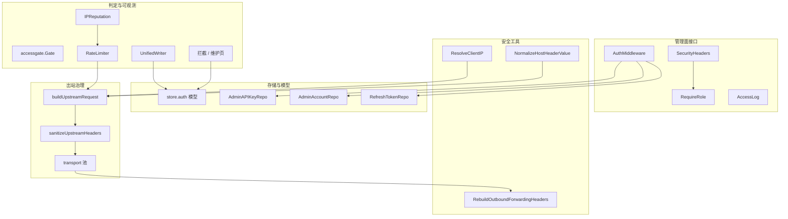
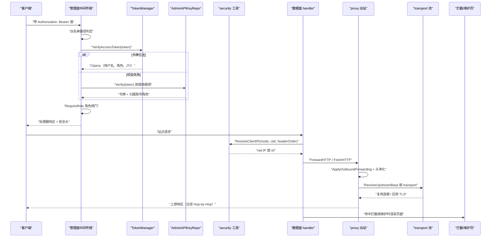
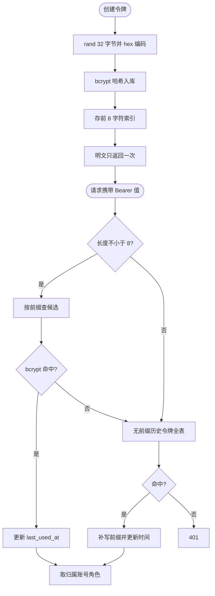
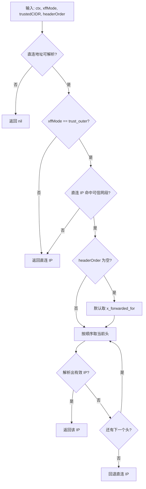
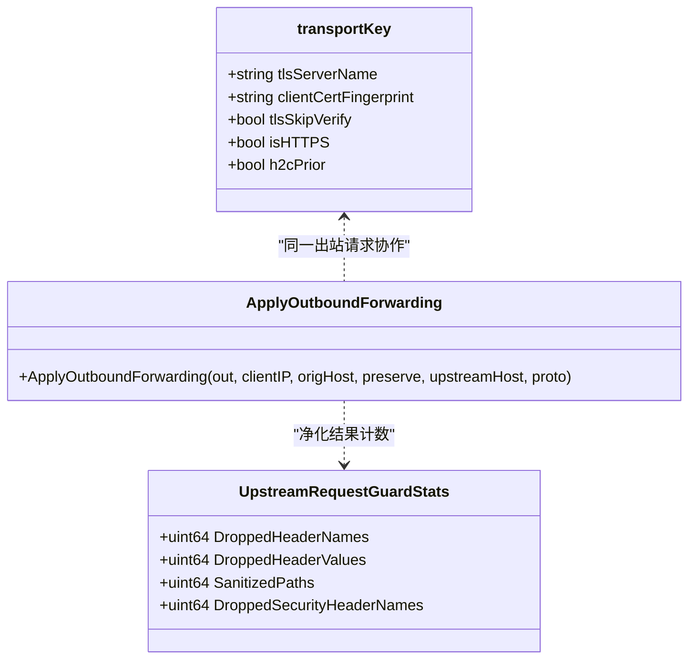
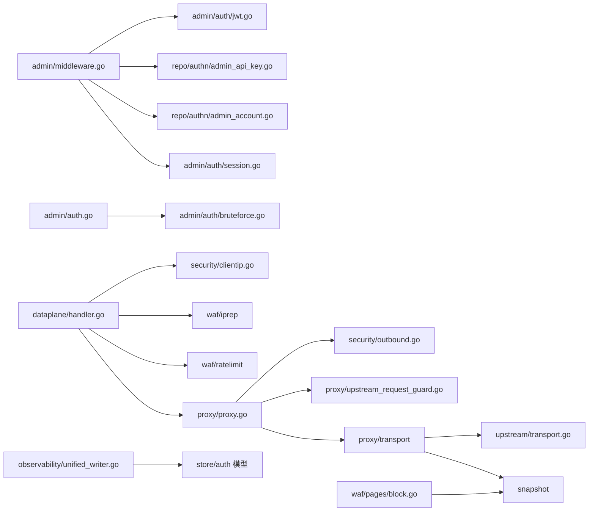

# 安全机制

<cite>
**本文档引用的文件**
- [main.go](file://cmd/main.go)
- [router.go](file://internal/admin/router.go)
- [middleware.go](file://internal/admin/middleware.go)
- [auth.go](file://internal/admin/auth.go)
- [jwt.go](file://internal/admin/auth/jwt.go)
- [session.go](file://internal/admin/auth/session.go)
- [bruteforce.go](file://internal/admin/auth/bruteforce.go)
- [auth.go](file://internal/store/auth/auth.go)
- [admin_account.go](file://internal/store/repository/authn/admin_account.go)
- [admin_api_key.go](file://internal/store/repository/authn/admin_api_key.go)
- [refresh_token.go](file://internal/store/repository/authn/refresh_token.go)
- [clientip.go](file://internal/security/clientip.go)
- [outbound.go](file://internal/security/outbound.go)
- [host.go](file://internal/security/host.go)
- [proxy.go](file://internal/proxy/proxy.go)
- [upstream_request_guard.go](file://internal/proxy/upstream_request_guard.go)
- [transport.go](file://internal/proxy/transport/transport.go)
- [transport.go](file://internal/upstream/transport.go)
- [handler.go](file://internal/dataplane/handler.go)
- [request_ctx.go](file://internal/dataplane/request_ctx.go)
- [gate.go](file://internal/waf/accessgate/gate.go)
- [iprep.go](file://internal/waf/iprep/iprep.go)
- [ratelimit.go](file://internal/waf/ratelimit/ratelimit.go)
- [block.go](file://internal/waf/pages/block.go)
- [unified_writer.go](file://internal/observability/unified_writer.go)
- [site.go](file://internal/store/site.go)
</cite>

> **子页面分类索引**
>
> 本模块按安全主题将子页面分为三类：
>
> #### 认证与令牌管理
> - [JWT 认证机制](JWT 认证机制.md) — 短期访问令牌与刷新令牌的签发、HS256 签名校验、令牌黑名单与会话绑定机制
> - [API 密钥管理](API 密钥管理.md) — 一次性明文密钥生成、bcrypt 哈希存储、权限控制与密钥轮换策略
>
> #### 会话与访问控制
> - [会话管理](会话管理.md) — 认证中间件链、白名单路径、访问日志、安全头与会话生命周期管理
>
> #### 请求溯源与出站安全
> - [客户端 IP 获取](客户端 IP 获取.md) — XFF 代理链解析、可信 CIDR 策略、真实 IP 识别与隐私保护
> - [出站安全控制](出站安全控制.md) — 上游 TLS 配置、共享传输层连接池复用、X-Forwarded-For/Host 出站头转发策略
>
> **模块整体架构概述**：安全机制模块贯穿请求从进入管理端/数据平面到出站转发的全链路。管理端通过 JWT 与 API 令牌实现双轨认证，由会话管理器维护活跃状态；数据平面通过客户端 IP 解析与可信网段策略识别真实来源，并借助按 TLS 语义分池的传输层安全转发至上游。各子系统通过中间件、安全工具与存储仓库分层协作，形成认证、溯源、判定、出站治理与审计的完整体系。

## 目录

1. [简介](#简介)
2. [项目结构](#项目结构)
3. [核心组件](#核心组件)
4. [架构总览](#架构总览)
5. [详细组件分析](#详细组件分析)
6. [依赖关系分析](#依赖关系分析)
7. [性能考虑](#性能考虑)
8. [故障排查指南](#故障排查指南)
9. [结论](#结论)
10. [附录](#附录)

## 简介
本文件系统性梳理 My-OpenWaf 的安全机制与实现，覆盖以下主题：
- 认证与令牌：JWT 签发校验、刷新令牌轮换与吊销、黑名单 fail-closed
- API 令牌管理：一次性明文生成、bcrypt 哈希存储、角色归属
- 会话与访问控制：中间件链、白名单路径、访问日志与安全头
- 请求溯源：客户端 IP 解析、可信网段前提、出站转发头重建
- 访问判定：IP 信誉黑白名单与自动封禁、站点访问控制网关、登录暴力破解锁定
- 出站安全控制：上游协议白名单、请求净化、连接池与 TLS 装配
- 审计与事件：安全事件缓冲与异步批量写入
- 响应处置：拦截页与维护页渲染、速率限制

同时明确能力边界：**入站检测**由引擎阶段链承担（见 [安全防护功能](../安全防护功能/安全防护功能.md)），本文只覆盖认证、溯源、出站治理与审计。出站方向上，内网/回环/链路本地/云元数据地址拦截、重定向逐跳复校验、DNS 解析结果比对这三项在当前代码中没有实现，逐项证据见 [出站安全控制](出站安全控制.md) 的「SSRF 防护的真实覆盖面」。

## 项目结构
安全能力按职责分层，不按技术栈堆叠：

- 管理面认证层：`internal/admin` 与 `internal/admin/auth`
- 安全工具层：`internal/security`（IP 解析、转发头重建、Host 规范化）
- 访问判定层：`internal/waf/iprep`、`internal/waf/accessgate`、`internal/waf/ratelimit`
- 出站治理层：`internal/proxy`（请求构建与净化）与 `internal/proxy/transport`（连接池）
- 处置渲染层：`internal/waf/pages`
- 审计层：`internal/observability`
- 模型层：`internal/store/auth` 与 `internal/store/repository/authn`

### 安全能力全景表

| 能力域 | 承载包 | 关键符号与行号 | 作用面 | 详解文档 |
|--------|--------|----------------|--------|----------|
| 访问令牌 | `internal/admin/auth` | `TokenManager.SignAccessToken`（`jwt.go:103`） | 管理面 | [JWT 认证机制](JWT 认证机制.md) |
| 令牌吊销 | `internal/admin/auth` | `VerifyAccessToken`（`jwt.go:131`） | 管理面 | [JWT 认证机制](JWT 认证机制.md) |
| 刷新轮换 | `internal/store/repository/authn` | `Rotate`（`refresh_token.go:88`） | 管理面 | [会话管理](会话管理.md) |
| API 令牌 | `internal/store/repository/authn` | `Create`（`admin_api_key.go:50`） | 管理面 | [API 密钥管理](API 密钥管理.md) |
| 认证中间件 | `internal/admin` | `AuthMiddleware`（`middleware.go:42`） | 管理面 | [会话管理](会话管理.md) |
| 角色鉴权 | `internal/admin` | `RequireRole`（`middleware.go:127`） | 管理面 | [会话管理](会话管理.md) |
| 安全响应头 | `internal/admin` | `SecurityHeaders`（`middleware.go:172`） | 管理面 | [会话管理](会话管理.md) |
| 登录锁定 | `internal/admin/auth` | `BruteForceDetector`（`bruteforce.go:10`） | 管理面 | 本文 |
| 客户端 IP | `internal/security` | `ResolveClientIP`（`clientip.go:17`） | 数据面 | [客户端 IP 获取](客户端 IP 获取.md) |
| 可信网段校验 | `internal/security` | `ValidateTrustedCIDR`（`clientip.go:198`） | 管理面写入 | [客户端 IP 获取](客户端 IP 获取.md) |
| IP 信誉 | `internal/waf/iprep` | `Check`（`iprep.go:105`） | 数据面 | 本文 |
| 站点访问控制 | `internal/waf/accessgate` | `Gate.CheckAccess`（`gate.go:85`） | 数据面 | 本文 |
| 出站净化 | `internal/proxy` | `sanitizeUpstreamHeaders`（`upstream_request_guard.go:58`） | 数据面出站 | [出站安全控制](出站安全控制.md) |
| 连接池与 TLS | `internal/proxy/transport` | `sharedTransportForUpstreamClassified`（`transport.go:137`） | 数据面出站 | [出站安全控制](出站安全控制.md) |
| 拦截与维护页 | `internal/waf/pages` | `WriteBlockResponse`（`block.go:20`） | 数据面响应 | 本文 |
| 速率限制 | `internal/waf/ratelimit` | `RateLimiter`（`ratelimit.go:20`） | 数据面 | 本文 |
| 事件审计 | `internal/observability` | `UnifiedWriter`（`unified_writer.go:31`） | 数据面→存储 | 本文 |

**图表来源**
- [middleware.go:42-172](file://internal/admin/middleware.go#L42-L172)
- [clientip.go:17-35](file://internal/security/clientip.go#L17-L35)
- [outbound.go:36-56](file://internal/security/outbound.go#L36-L56)
- [host.go:13-27](file://internal/security/host.go#L13-L27)
- [proxy.go:622-763](file://internal/proxy/proxy.go#L622-L763)
- [upstream_request_guard.go:58-122](file://internal/proxy/upstream_request_guard.go#L58-L122)
- [transport.go:137-206](file://internal/proxy/transport/transport.go#L137-L206)
- [admin_api_key.go:16-101](file://internal/store/repository/authn/admin_api_key.go#L16-L101)
- [iprep.go:20-137](file://internal/waf/iprep/iprep.go#L20-L137)
- [gate.go:73-115](file://internal/waf/accessgate/gate.go#L73-L115)
- [block.go:20-86](file://internal/waf/pages/block.go#L20-L86)

**章节来源**
- [main.go:13-51](file://cmd/main.go#L13-L51)
- [jwt.go:103-155](file://internal/admin/auth/jwt.go#L103-L155)
- [refresh_token.go:88-115](file://internal/store/repository/authn/refresh_token.go#L88-L115)
- [admin_api_key.go:50-101](file://internal/store/repository/authn/admin_api_key.go#L50-L101)
- [clientip.go:17-198](file://internal/security/clientip.go#L17-L198)
- [transport.go:137-206](file://internal/proxy/transport/transport.go#L137-L206)
- [unified_writer.go:31-108](file://internal/observability/unified_writer.go#L31-L108)

## 核心组件
- 令牌管理器 `TokenManager`：HS256 签发与校验、主备密钥轮换、持久化黑名单 fail-closed
- 会话管理器 `SessionManager`：内存与数据库双写，按 JTI 跟踪活跃会话
- 暴力破解检测器 `BruteForceDetector`：纯 IP 与 `IP|用户名` 双维度计数
- API 令牌仓库 `AdminAPIKeyRepo`：32 字节随机明文一次性返回、bcrypt 哈希、前缀快路径
- 客户端 IP 解析器 `ResolveClientIP`：模式与可信网段的合取前提，按头优先级取第一个有效地址
- 出站净化器与转发头重建器：`sanitizeUpstreamHeaders` + `RebuildOutboundForwardingHeaders`
- 访问判定件：`IPReputation`、`accessgate.Gate`
- 处置与审计件：`WriteBlockResponse`、`RateLimiter`、`UnifiedWriter`

### 机制清单表

| 机制 | 实现符号与行号 | 默认参数 | 触发点 | 失效处置 |
|------|----------------|----------|--------|----------|
| 访问令牌校验 | `jwt.go:131` | TTL 15 分钟（`jwt.go:37`） | 每个管理面请求 | 401 |
| 签发者/受众校验 | `jwt.go:184-201` | 固定串（`jwt.go:40-41`） | 校验时 | 校验失败 |
| 令牌黑名单 | `jwt.go:161-182` | 1 秒退避重试 | 每次校验 | 503，fail closed |
| 刷新令牌轮换 | `refresh_token.go:88-115` | TTL 7 天（`jwt.go:38`） | 刷新端点 | 原子失败 |
| 家族撤销 | `refresh_token.go:43-85` | 沿 `replaced_by` 链 | 登出 | 链断即停 |
| API 令牌校验 | `admin_api_key.go:70-102` | 前缀 8 字符 | JWT 失败后回退 | 401 |
| 角色闸门 | `middleware.go:127-147` | 三角色（`auth.go:85-89`） | 分组路由 | 403 |
| 登录锁定 | `bruteforce.go:68-78` | 5 次 / 15 分钟（`bruteforce.go:27-33`） | 登录入口 | 429 |
| 客户端 IP 解析 | `clientip.go:17-35` | 模式 strip（`site.go:92`） | 站点命中后 | 回落直连地址 |
| 可信网段校验 | `clientip.go:198-214` | 空串合法 | 站点保存 | 拒绝保存 |
| IP 信誉判定 | `iprep.go:105-137` | 阈值 10 / 窗 60 / 时长 3600（`iprep.go:44-47`） | 引擎信誉阶段 | 按条目动作 |
| 站点访问控制 | `gate.go:85-115` | 默认要求认证（`gate.go:124`） | 站点请求入口 | 重定向登录 |
| 出站头净化 | `upstream_request_guard.go:58-122` | 样本 4 个 / 64 字节（`upstream_request_guard.go:20-23`） | 每次出站 | 删头 + 计数 |
| 连接池 TLS | `transport.go:137-206` | TLS 下限 1.2（`transport.go:183`） | 取 transport 时 | 握手失败上抛 |
| 速率限制 | `ratelimit.go:19-51` | 参数非法即整体停用 | 引擎限流阶段 | 429 |
| 事件批量写入 | `unified_writer.go:31-119` | 队列 1M / 批次 1 万 / 间隔 60 秒 | 判定与响应后 | 计数丢弃 |

**章节来源**
- [jwt.go:27-201](file://internal/admin/auth/jwt.go#L27-L201)
- [session.go:14-102](file://internal/admin/auth/session.go#L14-L102)
- [bruteforce.go:10-106](file://internal/admin/auth/bruteforce.go#L10-L106)
- [refresh_token.go:20-153](file://internal/store/repository/authn/refresh_token.go#L20-L153)
- [admin_api_key.go:41-102](file://internal/store/repository/authn/admin_api_key.go#L41-L102)
- [auth.go:15-89](file://internal/store/auth/auth.go#L15-L89)
- [middleware.go:42-172](file://internal/admin/middleware.go#L42-L172)
- [clientip.go:17-214](file://internal/security/clientip.go#L17-L214)
- [iprep.go:42-167](file://internal/waf/iprep/iprep.go#L42-L167)
- [gate.go:73-125](file://internal/waf/accessgate/gate.go#L73-L125)
- [upstream_request_guard.go:20-122](file://internal/proxy/upstream_request_guard.go#L20-L122)
- [transport.go:137-206](file://internal/proxy/transport/transport.go#L137-L206)
- [ratelimit.go:19-61](file://internal/waf/ratelimit/ratelimit.go#L19-L61)
- [unified_writer.go:31-119](file://internal/observability/unified_writer.go#L31-L119)

## 架构总览
下图展示管理面请求与数据面请求两条路径上，安全机制各自在哪个环节生效。

**图表来源**
- [middleware.go:42-123](file://internal/admin/middleware.go#L42-L123)
- [jwt.go:131-156](file://internal/admin/auth/jwt.go#L131-L156)
- [admin_api_key.go:70-102](file://internal/store/repository/authn/admin_api_key.go#L70-L102)
- [clientip.go:17-35](file://internal/security/clientip.go#L17-L35)
- [outbound.go:74-81](file://internal/security/outbound.go#L74-L81)
- [upstream_request_guard.go:58-122](file://internal/proxy/upstream_request_guard.go#L58-L122)
- [transport.go:800-844](file://internal/proxy/transport/transport.go#L800-L844)
- [handler.go:170](file://internal/dataplane/handler.go#L170)
- [block.go:20-58](file://internal/waf/pages/block.go#L20-L58)

**章节来源**
- [middleware.go:42-147](file://internal/admin/middleware.go#L42-L147)
- [clientip.go:17-35](file://internal/security/clientip.go#L17-L35)
- [handler.go:170](file://internal/dataplane/handler.go#L170)
- [proxy.go:760-761](file://internal/proxy/proxy.go#L760-L761)

## 详细组件分析

### 认证与令牌机制
- 有效期：访问令牌 15 分钟（`jwt.go:37`），刷新令牌 7 天（`jwt.go:38`），签发者与受众固定并在校验时强制（`jwt.go:191-192`）
- 签名：HS256（`jwt.go:124`），非 HMAC 算法直接拒绝（`jwt.go:186-189`）
- Claims 载荷：`username`、`role`、`ip_hash`、`device_hash`（`jwt.go:28-34`），IP 与 UA 只存短哈希（`jwt.go:117-118`）
- 轮换：主密钥变更后备用密钥参与验证（`jwt.go:88-93`、`jwt.go:138-142`）
- 吊销：JTI 命中黑名单即拒绝（`jwt.go:151-153`）；黑名单未加载成功返回 `ErrTokenBlacklistUnavailable`，认证 fail closed 并 1 秒退避重试（`jwt.go:161-182`）
- 刷新轮换：`Rotate` 在单事务内消费旧令牌并创建替代者，`RowsAffected != 1` 判不可用（`refresh_token.go:96-110`）；`RevokeFamily` 沿 `replaced_by` 链带行锁与环检测（`refresh_token.go:43-85`）
- 过期清理：`CleanExpired` 默认单批 64 条（`refresh_token.go:134-153`）

**章节来源**
- [jwt.go:27-201](file://internal/admin/auth/jwt.go#L27-L201)
- [refresh_token.go:20-153](file://internal/store/repository/authn/refresh_token.go#L20-L153)
- [session.go:53-107](file://internal/admin/auth/session.go#L53-L107)
- [middleware.go:70-90](file://internal/admin/middleware.go#L70-L90)

### API 令牌与角色归属
- 生成：32 字节随机值 hex 编码，明文只在创建响应中出现一次；bcrypt 默认代价因子哈希入库，前 8 字符作快路径索引（`admin_api_key.go:50-66`）
- 校验：先按前缀查候选集逐个比对，无前缀的历史令牌全表回退并在命中后补写前缀，随后更新 `last_used_at`（`admin_api_key.go:70-101`）
- 归属：令牌不携带独立权限，身份与角色一律取归属 `AdminAccount`（`middleware.go:103-120`）；账号被删除后令牌立即失效并 401（`middleware.go:111-115`）
- 账号口令同为 bcrypt 哈希（`admin_account.go:30-41`、`admin_account.go:54-61`）
- 轮换：先建新再删旧；账号级吊销可撤销名下全部活跃刷新令牌（`refresh_token.go:117-127`）

**图表来源**
- [admin_api_key.go:50-101](file://internal/store/repository/authn/admin_api_key.go#L50-L101)
- [middleware.go:92-121](file://internal/admin/middleware.go#L92-L121)
- [auth.go:15-25](file://internal/store/auth/auth.go#L15-L25)

**章节来源**
- [admin_api_key.go:41-106](file://internal/store/repository/authn/admin_api_key.go#L41-L106)
- [admin_account.go:30-61](file://internal/store/repository/authn/admin_account.go#L30-L61)
- [middleware.go:92-121](file://internal/admin/middleware.go#L92-L121)
- [auth.go:9-25](file://internal/store/auth/auth.go#L9-L25)

### 会话管理与访问控制
- 白名单四条：健康检查与 login/refresh/logout 直接放行（`middleware.go:46-53`）；登录端点因此只受暴力破解锁定保护
- 缺 `Authorization` 头 401；前缀不是 `Bearer ` 也 401（`middleware.go:55-67`）
- 先试 JWT；若失败原因是黑名单不可用则 503，**不降级**到令牌校验（`middleware.go:70-90`）
- 回退 API 令牌后注入 `auth_username`、`auth_role`、`api_key_id`（`middleware.go:116-120`）
- 会话：内存字典与 `ActiveSession` 行双写（`session.go:59-102`），刷新时原地替换会话避免逐次堆积（`session.go:104-120`），JTI 更新最后活跃时间（`middleware.go:78-81`）
- 访问日志：每请求生成 UUID 写入 `X-Request-ID`，记录方法、路径、状态码、耗时与认证方式（`middleware.go:150-169`）
- 安全头：固定四项 `nosniff`/`DENY`/`strict-origin-when-cross-origin`/内置 CSP（`middleware.go:174-177`），`/api/v1/` 前后两次 `no-store`（`middleware.go:178-186`），HSTS 与 HPKP 系列按快照条件追加（`middleware.go:194-313`）
- 角色闸门：`readGroup` 允许 admin/operator/readonly（`router.go:124-125`）

**章节来源**
- [middleware.go:42-192](file://internal/admin/middleware.go#L42-L192)
- [middleware.go:194-313](file://internal/admin/middleware.go#L194-L313)
- [session.go:28-120](file://internal/admin/auth/session.go#L28-L120)
- [auth.go:33-83](file://internal/admin/auth.go#L33-L83)
- [router.go:89-125](file://internal/admin/router.go#L89-L125)

### 中间件链表

| 序 | 中间件 | 注册位置 | 作用 | 短路行为 |
|:--:|--------|----------|------|----------|
| 1 | `SecurityHeaders` | `router.go:91` | 安全响应头与 no-store | 不短路 |
| 2 | `AccessLog` | `router.go:92` | 请求 ID 与耗时审计 | 不短路 |
| 3 | `AuthMiddleware` | `router.go:110` | JWT / API 令牌认证 | 401 或 503 + Abort |
| 4 | `RequireRole` | `router.go:125` 等分组 | 角色白名单 | 403 + Abort |
| 5 | 业务处理器 | 各分组 | 读写操作 | 由处理器决定 |

登录锁定的双维度计数：`RecordFailure` 同时递增纯 IP 与 `IP|用户名`（`bruteforce.go:96-106`），`IsLocked` 先看 IP 级再看组合级（`bruteforce.go:68-78`），锁定过期后重新给额度而非立刻再锁（`bruteforce.go:113-119`），成功登录只清组合级计数（`bruteforce.go:127-132`）。

**章节来源**
- [middleware.go:42-192](file://internal/admin/middleware.go#L42-L192)
- [middleware.go:194-313](file://internal/admin/middleware.go#L194-L313)
- [router.go:89-125](file://internal/admin/router.go#L89-L125)
- [session.go:28-120](file://internal/admin/auth/session.go#L28-L120)
- [auth.go:33-83](file://internal/admin/auth.go#L33-L83)
- [bruteforce.go:63-132](file://internal/admin/auth/bruteforce.go#L63-L132)

### 客户端 IP 获取与隐私保护
- 模式常量 `strip_all_and_set_remote` / `trust_outer_waf_cidr_then_take_leftmost`（`site.go:17-18`），站点未设置时快照构建期回落 strip，详见 [客户端 IP 获取](客户端 IP 获取.md)
- 合取前提：模式与可信网段**必须同时满足**，任一不成立即返回直连 IP（`clientip.go:23-25`）；可信网段为空等同 strip（`clientip.go:172-175`）
- 头优先级：`x_forwarded_for`、`x_real_ip`、`forwarded` 可排序，空列表退化为只查 XFF（`clientip.go:26-33`）
- 归一化：`netip.ParseAddr` + `Unmap()`，IPv4 映射地址统一还原（`clientip.go:159-169`）
- 出站：上游 `X-Forwarded-For` 只写单个解析结果，不透传整条链（`outbound.go:47-49`）；`X-Forwarded-Host` 仅在保留原始 Host 且值非空时写入（`outbound.go:53-55`）

**图表来源**
- [clientip.go:17-35](file://internal/security/clientip.go#L17-L35)
- [clientip.go:159-195](file://internal/security/clientip.go#L159-L195)
- [site.go:16-22](file://internal/store/site.go#L16-L22)

**章节来源**
- [clientip.go:17-35](file://internal/security/clientip.go#L17-L35)
- [clientip.go:159-195](file://internal/security/clientip.go#L159-L195)
- [outbound.go:36-56](file://internal/security/outbound.go#L36-L56)
- [jwt.go:103-119](file://internal/admin/auth/jwt.go#L103-L119)
- [site.go:16-22](file://internal/store/site.go#L16-L22)

### 访问判定：IP 信誉与站点访问网关
- `IPReputation.Check` 顺序为全局白名单、黑名单、自动封禁（`iprep.go:105-137`），`nil` IP 直接放行（`iprep.go:106-108`）
- 自动封禁默认阈值 10 / 窗口 60 秒 / 时长 3600 秒 / 动作 `intercept`（`iprep.go:44-47`）；不支持的动作值一律回退 `intercept`（`iprep.go:85-95`）
- 白名单 IP 不参与违规计数（`iprep.go:144-147`），窗口过期重置计数（`iprep.go:157-160`），清理协程每 5 分钟回收（`iprep.go:249-271`）
- 条目支持 CIDR 与单 IP，过期时间参与判定（`iprep.go:213-224`）
- `Gate.CheckAccess` 未启用时全放行，路径规则首匹配决定 allow/deny/require_auth，默认要求认证（`gate.go:85-125`）；Cookie 按站点隔离命名（`gate.go:162-165`），令牌为 32 字节随机 hex（`gate.go:167-174`），口令一律 bcrypt 比对（`gate.go:127-140`）

**章节来源**
- [iprep.go:42-271](file://internal/waf/iprep/iprep.go#L42-L271)
- [gate.go:14-192](file://internal/waf/accessgate/gate.go#L14-L192)

### 出站安全控制
- 准入：上游协议白名单只允许 `http`/`https`/`h2c`/`h3` 与五个 RPC 别名，其余（含 `file`、`gopher`）在保存阶段即被拒绝；Host 覆写值经 punycode 与 `ValidHostHeader` 校验（`host.go:19-25`）
- 分池：键为 `(SNI, skipVerify, 客户端证书指纹, isHTTPS, h2cPrior)`（`transport.go:76-80`、`transport.go:137-145`），非 HTTPS 时前三项不入键
- 池参数：空闲 256 / 单主机 32 / 30 秒（`transport.go:157-161`），单主机并发 256（`transport.go:172`），强制尝试 h2 且禁用透明压缩（`transport.go:168`、`transport.go:170`）
- TLS：HTTPS 上游装配 TLS 配置，下限 1.2（`transport.go:179-188`）；会话缓存 LRU 32（`transport.go:187`）；mTLS 证书快照期解析、请求期回放（`transport.go:189-195`、`internal/upstream/transport.go:156-174`）
- 版本差异：探活与 HTTP/3 内部拨号走 `HTTPSClientTLSConfig`，下限为 TLS 1.0 并附遗留套件（`internal/upstream/transport.go:37-38`），与主路径不同
- 净化：删除无法通过 `httpguts` 校验的头名与头值，安全相关头单列计数（`upstream_request_guard.go:58-144`）；裸 `%` 统一转义为 `%25`（`upstream_request_guard.go:157-173`）
- 能力边界：内网、回环、链路本地与云元数据地址**当前未覆盖**；重定向逐跳复校验与 DNS 解析结果比对亦**当前未覆盖**，逐项证据见 [出站安全控制](出站安全控制.md)

**图表来源**
- [transport.go:76-80](file://internal/proxy/transport/transport.go#L76-L80)
- [transport.go:137-206](file://internal/proxy/transport/transport.go#L137-L206)
- [upstream_request_guard.go:26-51](file://internal/proxy/upstream_request_guard.go#L26-L51)
- [outbound.go:74-81](file://internal/security/outbound.go#L74-L81)
- [internal/upstream/transport.go:33-44](file://internal/upstream/transport.go#L33-L44)

**章节来源**
- [transport.go:76-206](file://internal/proxy/transport/transport.go#L76-L206)
- [upstream_request_guard.go:26-173](file://internal/proxy/upstream_request_guard.go#L26-L173)
- [outbound.go:36-81](file://internal/security/outbound.go#L36-L81)
- [host.go:10-27](file://internal/security/host.go#L10-L27)
- [internal/upstream/transport.go:33-44](file://internal/upstream/transport.go#L33-L44)
- [internal/upstream/transport.go:156-187](file://internal/upstream/transport.go#L156-L187)

### 数据流转换表
安全语义在请求生命周期中被逐段改写，下表给出转换点与施加者。

| 阶段 | 输入 | 施加者 | 转换结果 | 位置 |
|------|------|--------|----------|------|
| 1 | `Authorization` 头 | `AuthMiddleware` | 上下文键 `auth_username`/`auth_role` | `middleware.go:55-120` |
| 2 | API 令牌明文 | `AdminAPIKeyRepo.Verify` | 归属账号 + 角色 | `admin_api_key.go:70-102` |
| 3 | `RemoteAddr` + 转发头 | `ResolveClientIP` | `net.IP` 单一可信来源 | `clientip.go:17-35` |
| 4 | `net.IP` | `IPReputation.Check` | `IPDecision` | `iprep.go:105-137` |
| 5 | Hertz 请求头 | `buildUpstreamRequest` | `http.Header`（去 Hop-by-Hop） | `proxy.go:663-677` |
| 6 | 客户端转发身份头 | `RebuildOutboundForwardingHeaders` | 可信 `X-Forwarded-*` | `outbound.go:36-56` |
| 7 | `http.Header` | `sanitizeUpstreamHeaders` | 净化头部 + 四项计数 | `upstream_request_guard.go:58-122` |
| 8 | 原始 path | `sanitizeRawPercentEscapes` | 裸 `%` 转义后 path | `upstream_request_guard.go:157-173` |
| 9 | 判定结果 | `WriteBlockResponse` | 站点页 / 全局页 / 内置模板 | `block.go:20-58` |
| 10 | 安全事件 | `UnifiedWriter` | 批量落库或丢弃计数 | `unified_writer.go:31-108` |

**章节来源**
- [middleware.go:55-120](file://internal/admin/middleware.go#L55-L120)
- [admin_api_key.go:70-102](file://internal/store/repository/authn/admin_api_key.go#L70-L102)
- [clientip.go:17-35](file://internal/security/clientip.go#L17-L35)
- [iprep.go:105-137](file://internal/waf/iprep/iprep.go#L105-L137)
- [proxy.go:663-677](file://internal/proxy/proxy.go#L663-L677)
- [outbound.go:36-56](file://internal/security/outbound.go#L36-L56)
- [upstream_request_guard.go:58-173](file://internal/proxy/upstream_request_guard.go#L58-L173)
- [block.go:20-58](file://internal/waf/pages/block.go#L20-L58)
- [unified_writer.go:31-108](file://internal/observability/unified_writer.go#L31-L108)

### 审计、处置与限流
- 通道：四类独立有界队列——安全事件、访问日志、Drop 事件、Bot 计分（`unified_writer.go:31-34`）；批次阈值与单次取数上限由构造函数注入（`unified_writer.go:41-44`）
- 上限：队列容量 1M 条、批次 1 万条、刷新间隔 60 秒、慢速宽限 5 分钟（`unified_writer.go:113-119`）
- 丢弃可见：四类丢弃计数（`unified_writer.go:46-49`），默认队列满即丢弃并计数以保证热路径非阻塞；宽限大于 0 时改为有界等待（`unified_writer.go:73-85`）
- 关停：`closed` 闸门让入队在排空开始前停止（`unified_writer.go:62-66`），`abortWaitCh` 与 `abortOnce`/`closeOnce` 分离保证慢速等待者立即退回丢弃路径（`unified_writer.go:67-89`）
- 限流：固定窗口以调用方组合的键计数（`ratelimit.go:19-34`），参数非法时**整体按未启用处理**，避免 `max=0` 把首个请求判 429（`ratelimit.go:36-41`）；`RateLimiterBackend` 使本地与 Redis 两套实现可互换（`ratelimit.go:10-17`）
- 拦截页回退顺序：站点 HTML → 快照全局默认 → 快照配置页 → 内置模板（`block.go:24-57`）；响应写 `X-Request-ID` 并删除 `Server`（`block.go:21-22`）；429 与 403 追加状态标签（`block.go:48-52`）
- 维护页：站点 HTML 优先，其次全局 HTML 与状态码，最后内置模板，默认 503（`block.go:61-86`）

**章节来源**
- [unified_writer.go:31-119](file://internal/observability/unified_writer.go#L31-L119)
- [ratelimit.go:10-70](file://internal/waf/ratelimit/ratelimit.go#L10-L70)
- [block.go:19-86](file://internal/waf/pages/block.go#L19-L86)

## 依赖关系分析
- 耦合：认证中间件依赖令牌管理器、令牌仓库与账号仓库，角色一律取归属账号；出站治理依赖安全工具与传输层，传输层依赖站点运行时快照
- 反向通知：审计模块通过窄接口 `countCacheInvalidator` 让控制面失效 COUNT 缓存，避免直接依赖仓库（`unified_writer.go:103-107`）
- 外部依赖：JWT 库、bcrypt、GORM、Hertz、crypto/tls、`golang.org/x/net/http/httpguts`
- 循环依赖：未发现；`internal/security` 只依赖 `internal/store` 的常量，不反向依赖数据面

**图表来源**
- [middleware.go:13-18](file://internal/admin/middleware.go#L13-L18)
- [auth.go:23](file://internal/admin/auth.go#L23)
- [handler.go:170](file://internal/dataplane/handler.go#L170)
- [proxy.go:760-761](file://internal/proxy/proxy.go#L760-L761)
- [transport.go:137-206](file://internal/proxy/transport/transport.go#L137-L206)
- [unified_writer.go:103-107](file://internal/observability/unified_writer.go#L103-L107)
- [block.go:9-17](file://internal/waf/pages/block.go#L9-L17)

### 代码上下文表

| 上下文 | 文件 | 关键符号 | 行号 | 依赖 |
|--------|------|----------|------|------|
| 认证入口 | `internal/admin/middleware.go` | `AuthMiddleware` | 42-123 | `TokenManager`、`AdminAPIKeyRepo`、`SessionManager` |
| 角色闸门 | `internal/admin/middleware.go` | `RequireRole` | 127-147 | 上下文键 `auth_role` |
| 安全头 | `internal/admin/middleware.go` | `SecurityHeaders` | 172-192 | `snapshot.Holder` |
| 令牌签发 | `internal/admin/auth/jwt.go` | `SignAccessToken` | 103-127 | `Claims`、HS256 |
| 令牌校验 | `internal/admin/auth/jwt.go` | `VerifyAccessToken` | 131-156 | 黑名单、主备密钥 |
| 会话登记 | `internal/admin/auth/session.go` | `CreateSessionWithRefresh` | 59-102 | `store/auth.ActiveSession` |
| 登录锁定 | `internal/admin/auth/bruteforce.go` | `RecordFailure` | 97-125 | 双维度字典 |
| IP 解析 | `internal/security/clientip.go` | `ResolveClientIP` | 17-35 | `store` 常量、Hertz 上下文 |
| 出站重建 | `internal/security/outbound.go` | `ApplyOutboundForwarding` | 74-81 | `net/http` 请求对象 |
| 请求净化 | `internal/proxy/upstream_request_guard.go` | `sanitizeUpstreamHeaders` | 58-122 | `httpguts` |
| 连接池 | `internal/proxy/transport/transport.go` | `sharedTransportForUpstreamClassified` | 137-206 | `snapshot.SiteRuntime` |
| IP 信誉 | `internal/waf/iprep/iprep.go` | `Check` | 105-137 | `RWMutex` + `sync.Map` |
| 访问网关 | `internal/waf/accessgate/gate.go` | `CheckAccess` | 85-115 | `SessionStore` 接口 |
| 页面渲染 | `internal/waf/pages/block.go` | `WriteBlockResponse` | 20-58 | `snapshot`、`pageconfig` |

**章节来源**
- [middleware.go:42-192](file://internal/admin/middleware.go#L42-L192)
- [jwt.go:103-156](file://internal/admin/auth/jwt.go#L103-L156)
- [session.go:59-102](file://internal/admin/auth/session.go#L59-L102)
- [bruteforce.go:97-125](file://internal/admin/auth/bruteforce.go#L97-L125)
- [clientip.go:17-35](file://internal/security/clientip.go#L17-L35)
- [outbound.go:74-81](file://internal/security/outbound.go#L74-L81)
- [upstream_request_guard.go:58-122](file://internal/proxy/upstream_request_guard.go#L58-L122)
- [transport.go:137-206](file://internal/proxy/transport/transport.go#L137-L206)
- [iprep.go:105-137](file://internal/waf/iprep/iprep.go#L105-L137)
- [gate.go:85-115](file://internal/waf/accessgate/gate.go#L85-L115)
- [block.go:20-58](file://internal/waf/pages/block.go#L20-L58)

### 信任边界表

| 边界 | 信任输入 | 不受信输入 | 判定依据 | 位置 |
|------|----------|------------|----------|------|
| 管理面认证 | `Authorization` 头令牌 | 令牌内容本身 | 签名 + 过期 + 签发者受众 + 黑名单 | `jwt.go:184-201` |
| 管理面授权 | 上下文键 `auth_role` | 客户端自报身份 | 归属账号角色 | `middleware.go:103-120` |
| 数据面来源 | 直连地址 | 所有转发头 | 模式 + 可信网段合取 | `clientip.go:23-25` |
| 入站协议 | 连接协商结果 | `X-Forwarded-Proto` 头 | TLS 状态 / 回环 + 内部标记 | `outbound.go:59-71`、`request_ctx.go:443-457` |
| 出站目标 | 管理面配置的上游列表 | 客户端 path/query | 协议白名单（保存阶段） | 见 [出站安全控制](出站安全控制.md) |
| 出站头部 | WAF 自身写入值 | 客户端同名头 | 先删后写 + `httpguts` 复校 | `outbound.go:37-45`、`upstream_request_guard.go:58-95` |
| 站点访问控制 | 服务端会话令牌 | 客户端 Cookie 值 | 存储校验 + 站点 ID + 过期 | `gate.go:99-114` |

**章节来源**
- [jwt.go:184-201](file://internal/admin/auth/jwt.go#L184-L201)
- [middleware.go:103-120](file://internal/admin/middleware.go#L103-L120)
- [clientip.go:23-25](file://internal/security/clientip.go#L23-L25)
- [outbound.go:37-71](file://internal/security/outbound.go#L37-L71)
- [upstream_request_guard.go:58-95](file://internal/proxy/upstream_request_guard.go#L58-L95)
- [request_ctx.go:443-457](file://internal/dataplane/request_ctx.go#L443-L457)
- [gate.go:99-114](file://internal/waf/accessgate/gate.go#L99-L114)

## 性能考虑
- 连接池复用：按 TLS 语义分池并复用 `ClientSessionCache`，命中时跳过完整握手
- 头部处理：净化器就地修改头映射，不复制集合；计数走原子变量，无锁
- 异步审计：四类通道各自有界，默认队列满即丢弃并计数，热路径不被数据库拖住
- 限流与信誉：`sync.Map` 加每键互斥，配合 5 分钟周期清理，读路径无全局锁
- IP 解析：字节级扫描加零拷贝转换，无正则；可信网段逐 token 解析，条目越多开销越大
- TLS：仅 HTTPS 上游装配 TLS；出站不做透明解压

[本节为通用性能建议，不直接分析具体文件]

## 故障排查指南

| 症状 | 可能原因 | 排查步骤 | 处置 |
|------|----------|----------|------|
| 401 `missing Authorization header` | 未带认证头 | 确认客户端注入逻辑 | 补 `Authorization: Bearer {占位}` |
| 401 `invalid Authorization format` | 前缀不是 `Bearer ` | 检查拼写与大小写 | 修正前缀（`middleware.go:62-67`） |
| 503 `authentication service unavailable` | 黑名单未加载 | 查数据库可用性与退避 | 存储恢复后自动放行（`jwt.go:161-182`） |
| 401 `api key owner account no longer exists` | 归属账号被删除 | 核对令牌 `user_id` | 重建令牌（`middleware.go:111-115`） |
| 403 `access denied: no role` | 上下文未写角色 | 确认经过认证中间件 | 修正路由分组（`middleware.go:133-138`） |
| 429 登录被锁 | 双维度计数达阈值 | 读剩余次数与锁定剩余时长 | 等待或调整阈值（`bruteforce.go:27-33`） |
| 客户端 IP 判定错误 | 模式或可信网段不匹配 | 按解析优先级逐项核对 | 见 [客户端 IP 获取](客户端 IP 获取.md) |
| 上游看不到真实 IP | 解析为 `nil` 或配置未启用 | 查上游头是否单值 | 修正站点配置（`outbound.go:47-49`） |
| 上游请求头被删 | 头名或头值不合校验 | 读净化器四项计数 | 修正调用方头格式（`upstream_request_guard.go:44-51`） |
| 上游 TLS 握手失败 | SNI 不匹配或版本下限 | 区分主路径 1.2 与探活 1.0 | 修正 SNI（`transport.go:181-183`） |
| 连接频繁重建 | 池键不一致 | 比对 SNI/跳过校验/证书指纹 | 统一配置（`transport.go:138-145`） |
| 审计事件缺失 | 队列满被丢弃或批写失败 | 查丢弃计数与失败记录数 | 扩容或启用宽限（`unified_writer.go:46-58`） |
| 拦截页不符合预期 | 多级回退顺序 | 站点 → 全局 → 配置页 → 内置 | 核对站点页配置（`block.go:24-57`） |

**章节来源**
- [middleware.go:55-147](file://internal/admin/middleware.go#L55-L147)
- [jwt.go:161-182](file://internal/admin/auth/jwt.go#L161-L182)
- [bruteforce.go:27-171](file://internal/admin/auth/bruteforce.go#L27-L171)
- [outbound.go:47-49](file://internal/security/outbound.go#L47-L49)
- [upstream_request_guard.go:44-51](file://internal/proxy/upstream_request_guard.go#L44-L51)
- [transport.go:138-183](file://internal/proxy/transport/transport.go#L138-L183)
- [unified_writer.go:46-58](file://internal/observability/unified_writer.go#L46-L58)
- [block.go:24-57](file://internal/waf/pages/block.go#L24-L57)

## 结论
本模块的安全基础设施按职责分层落地：

- 认证与授权：双轨令牌加归属账号角色，黑名单 fail-closed，密钥轮换有主备过渡
- 会话与登录：内存与数据库双写，双维度暴力破解计数
- 请求溯源：模式与可信网段的合取前提，出站身份头先删后写
- 访问判定：IP 信誉、站点访问网关、固定窗口限流三件独立可组合
- 出站治理：协议白名单在写入阶段把关，净化器在发送前复校，连接池按 TLS 语义分池
- 审计与处置：四类通道异步落库，拦截与维护页多级回退

需要正视的三点边界：
- 管理面登录锁定使用 Hertz 内置 `ClientIP()`，其默认可信范围覆盖全网，与站点可信网段无关
- 出站方向不拦截内网、回环、链路本地与云元数据地址，也不复校验重定向与 DNS 解析结果
- `HTTPSClientTLSConfig` 的下限是 TLS 1.0，与反向代理主路径的 TLS 1.2 不一致

建议：上游配置写入权限按角色收敛；生产强制 TLS 且不开启跳过校验；令牌按账号最小授权并定期轮换；把解析后的客户端 IP 作为唯一风控输入口径。

[本节为总结，无需特定文件来源]

## 附录

### 安全默认值速查

| 项 | 默认值 | 位置 |
|----|--------|------|
| 访问令牌有效期 | 15 分钟 | `jwt.go:37` |
| 刷新令牌有效期 | 7 天 | `jwt.go:38` |
| 签发者 / 受众 | `my-openwaf` / `my-openwaf-admin` | `jwt.go:40-41` |
| 口令与令牌哈希 | bcrypt 默认代价因子 | `admin_account.go:31`、`admin_api_key.go:56` |
| 登录锁定阈值 / 时长 | 5 次 / 15 分钟 | `bruteforce.go:28-33` |
| 锁定记录清理周期 | 5 分钟，空闲超两倍时长删除 | `bruteforce.go:185-204` |
| IP 信誉阈值 / 窗口 / 时长 | 10 / 60 秒 / 3600 秒 | `iprep.go:44-47` |
| 信誉记录清理周期 | 5 分钟 | `iprep.go:251` |
| 访问控制 Cookie 名 | `__owaf_access_{siteID}` | `gate.go:163-165` |
| 访问控制令牌 | 32 字节随机 hex | `gate.go:167-174` |
| 上游空闲连接 | 256 / 单主机 32 / 30 秒 | `transport.go:157-161` |
| 上游并发连接 | 单主机 256 | `transport.go:172` |
| 上游 TLS 下限 | 1.2（主路径），1.0（探活与 h3） | `transport.go:183`、`internal/upstream/transport.go:37` |
| 客户端整体超时 | 30 秒 | `proxy.go:1037` |
| 拦截 / 维护状态码 | 403 / 503 | `block.go:66`、`site.go:120-123` |
| 净化日志头名样本 | 最多 4 个，每个 64 字节 | `upstream_request_guard.go:20-23` |
| 审计队列上限 | 1M 条 / 批次 1 万 / 间隔 60 秒 | `unified_writer.go:113-119` |

**章节来源**
- [jwt.go:36-41](file://internal/admin/auth/jwt.go#L36-L41)
- [admin_account.go:30-41](file://internal/store/repository/authn/admin_account.go#L30-L41)
- [admin_api_key.go:50-66](file://internal/store/repository/authn/admin_api_key.go#L50-L66)
- [bruteforce.go:25-33](file://internal/admin/auth/bruteforce.go#L25-L33)
- [bruteforce.go:185-204](file://internal/admin/auth/bruteforce.go#L185-L204)
- [iprep.go:42-51](file://internal/waf/iprep/iprep.go#L42-L51)
- [iprep.go:249-271](file://internal/waf/iprep/iprep.go#L249-L271)
- [gate.go:162-174](file://internal/waf/accessgate/gate.go#L162-L174)
- [transport.go:157-183](file://internal/proxy/transport/transport.go#L157-L183)
- [internal/upstream/transport.go:33-44](file://internal/upstream/transport.go#L33-L44)
- [proxy.go:1037](file://internal/proxy/proxy.go#L1037)
- [block.go:66](file://internal/waf/pages/block.go#L66)
- [site.go:120-123](file://internal/store/site.go#L120-L123)
- [upstream_request_guard.go:20-23](file://internal/proxy/upstream_request_guard.go#L20-L23)
- [unified_writer.go:113-119](file://internal/observability/unified_writer.go#L113-L119)

### 术语表

| 术语 | 含义 | 易混点 | 出处 |
|------|------|--------|------|
| 访问令牌 | 15 分钟有效的 HS256 JWT | 与 API 令牌不同源 | `jwt.go:103` |
| 刷新令牌 | 服务端存 JTI 与哈希的长会话凭据 | 不携带角色权限 | `auth.go:37-48` |
| API 令牌 | 静态长期令牌，权限取归属账号 | 不是独立身份 | `auth.go:9-25` |
| 可信网段 | 允许其转发头被采信的**代理**地址集合 | 不是访问白名单 | `clientip.go:171` |
| 令牌黑名单 | 已吊销 JTI 集合，加载失败即拒绝认证 | 与 IP 黑名单无关 | `jwt.go:61-63` |
| 自动封禁 | 违规计数达临时封禁 | 与静态黑名单分列 | `iprep.go:124-135` |
| 请求净化器 | 出站前删除非法头并计数 | 不改写值 | `upstream_request_guard.go:58` |
| 直连 IP | 内核给出的对端地址 | 不等于客户端真实 IP | `clientip.go:18` |

**章节来源**
- [jwt.go:61-63](file://internal/admin/auth/jwt.go#L61-L63)
- [auth.go:9-48](file://internal/store/auth/auth.go#L9-L48)
- [clientip.go:18-171](file://internal/security/clientip.go#L18-L171)
- [iprep.go:124-135](file://internal/waf/iprep/iprep.go#L124-L135)
- [upstream_request_guard.go:44-58](file://internal/proxy/upstream_request_guard.go#L44-L58)

### 子文档索引
- [JWT 认证机制](JWT 认证机制.md)：令牌结构、轮换与吊销细节
- [API 密钥管理](API 密钥管理.md)：令牌生命周期与管理端点
- [会话管理](会话管理.md)：会话表、活跃更新与撤销路径
- [客户端 IP 获取](客户端 IP 获取.md)：解析优先级、取位规则与信任边界
- [出站安全控制](出站安全控制.md)：协议白名单、净化链与 SSRF 覆盖面

[本节为索引，无需特定文件来源]

### 安全最佳实践
- 凭据管理：账号口令与 API 令牌均为 bcrypt 哈希存储，明文只在创建响应中出现一次；私钥与令牌值一律以 `{占位}` 表达，不进入日志与文档
- 权限最小化：API 令牌权限取归属账号角色，只读场景使用 `readonly`；账号删除即令牌失效
- 溯源一致性：数据面所有风控输入统一走 `ResolveClientIP`，避免自建解析分支
- 出站治理：上游列表只由管理面配置并按角色收敛写入权限，生产禁用跳过校验
- 审计完整性：关注丢弃计数与批写失败数，队列容量按峰值 QPS 预留
- 响应口径：拦截与维护页统一使用内置模板或经评审的自定义 HTML，避免泄露内部信息

[本节为通用指导，无需特定文件来源]
