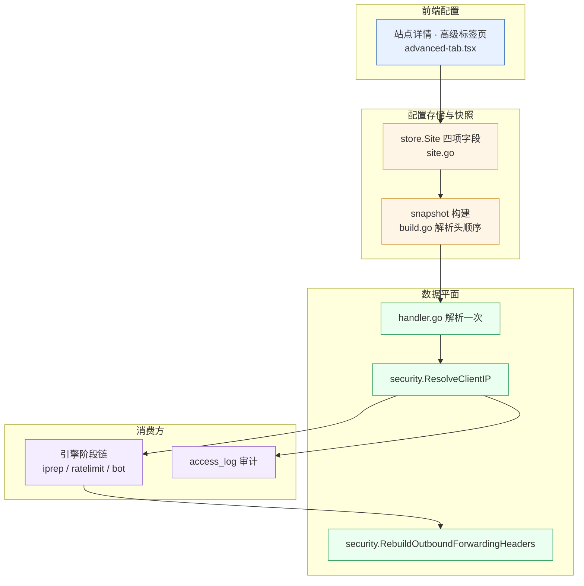
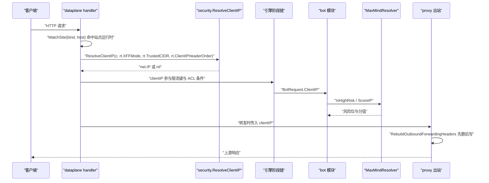
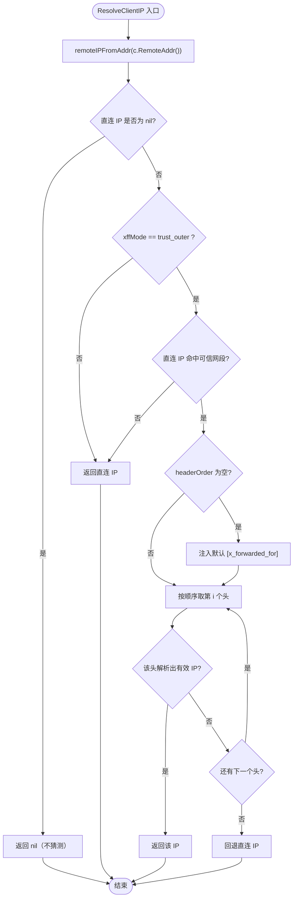
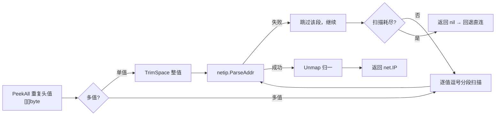
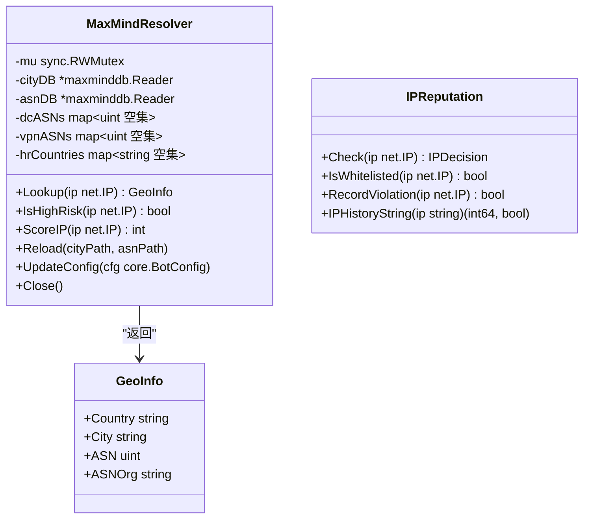
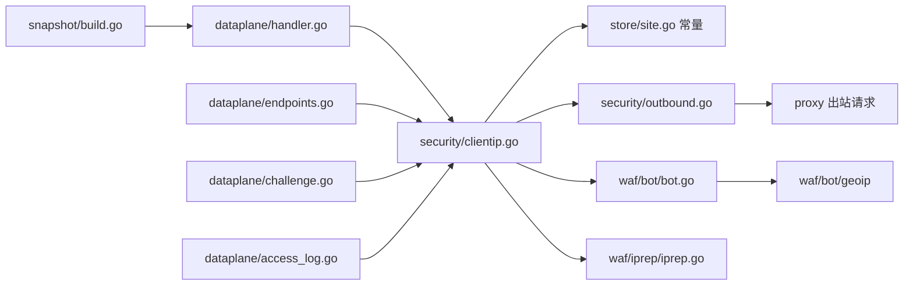

# 客户端 IP 获取

> [返回 安全机制](安全机制.md)

<cite>
**本文档引用的文件**
- [clientip.go](file://internal/security/clientip.go)
- [outbound.go](file://internal/security/outbound.go)
- [forwarded_for.go](file://internal/security/forwarded_for.go)
- [host.go](file://internal/security/host.go)
- [handler.go](file://internal/dataplane/handler.go)
- [endpoints.go](file://internal/dataplane/endpoints.go)
- [challenge.go](file://internal/dataplane/challenge.go)
- [access_log.go](file://internal/dataplane/access_log.go)
- [request_ctx.go](file://internal/dataplane/request_ctx.go)
- [site.go](file://internal/store/site.go)
- [build.go](file://internal/snapshot/build.go)
- [http2.go](file://internal/snapshot/http2.go)
- [server.go](file://internal/app/server.go)
- [middleware.go](file://internal/admin/middleware.go)
- [auth.go](file://internal/admin/auth.go)
- [bruteforce.go](file://internal/admin/auth/bruteforce.go)
- [iprep.go](file://internal/waf/iprep/iprep.go)
- [geoip.go](file://internal/waf/bot/geoip/geoip.go)
- [bot.go](file://internal/waf/bot/bot.go)
- [single_site.go](file://internal/store/migrations/single_site.go)
- [advanced-tab.tsx](file://frontend/app/(dashboard)/sites/detail/components/advanced-tab.tsx)
- [types.ts](file://frontend/lib/types.ts)
</cite>

## 目录

1. [简介](#简介)
2. [项目结构](#项目结构)
3. [核心组件](#核心组件)
4. [架构总览](#架构总览)
5. [详细组件分析](#详细组件分析)
6. [依赖关系分析](#依赖关系分析)
7. [性能考虑](#性能考虑)
8. [故障排查指南](#故障排查指南)
9. [结论](#结论)
10. [附录](#附录)

## 简介
本文件详细说明 My-OpenWaf 中客户端 IP 的获取与代理链处理机制。内容覆盖：
- 解析入口与优先级：`ResolveClientIP` 的五步判定与头优先级列表
- 头部取位规则：X-Forwarded-For 最左有效值、X-Real-IP、RFC 7239 `Forwarded`
- 可信前提：XFF 模式与站点可信网段的合取关系，以及判定失败的回落行为
- 配置校验：可信网段 token 语法与头优先级 JSON 的写入侧校验
- 长度与规模上限：入站协议层头部上限对 XFF 链长的实际约束
- 出站重建：转发身份头的先删后写语义，避免客户端自带值透传上游
- 下游消费：IP 信誉、限流键、暴力破解锁定与 GeoIP 风险评分

需要明确区分的是：**数据面**的客户端 IP 一律经 `security.ResolveClientIP` 按站点配置解析；**管理端**目前存在两条独立路径，登录锁定用的是 Hertz 自带的 `c.ClientIP()`，其信任前提与本仓库的可信网段配置无关，详见「管理端与数据面的解析差异」。

## 项目结构
客户端 IP 获取机制涉及以下模块：
- 安全模块：解析真实客户端 IP、校验可信网段、重建出站转发头
- 数据平面：在站点匹配之后立即解析 IP，并把结果交给引擎、日志与限流
- 存储与快照：站点模型定义 XFF 模式、可信网段、头优先级、Host 保留；快照构建期完成解析与归一
- Bot 与信誉模块：把解析结果作为风险评分与封禁判定的输入
- 管理端：登录锁定与协议判定各自使用不同的 IP 来源
- 前端界面：站点详情的「高级」标签页提供四项转发配置

| 模块 | 关键文件 | 行号 | 职责 |
|------|----------|------|------|
| 解析核心 | `internal/security/clientip.go` | 17-35 | XFF 语义判定与回落 |
| 头部取值 | `internal/security/clientip.go` | 37-110 | 三类头各自的取位实现 |
| 可信网段 | `internal/security/clientip.go` | 171-222 | 命中判定与写入侧校验 |
| 出站重建 | `internal/security/outbound.go` | 36-81 | 先删后写转发身份头 |
| 数据面入口 | `internal/dataplane/handler.go` | 170-174 | 每请求解析一次 |
| 快照装配 | `internal/snapshot/build.go` | 299-307、443-446 | 默认模式与头顺序解析 |
| 入站上限 | `internal/dataplane/handler.go` | 129-134 | 头字段超限返回 431 |
| IP 信誉 | `internal/waf/iprep/iprep.go` | 105-137 | 黑白名单与自动封禁 |
| 前端配置 | `frontend/app/(dashboard)/sites/detail/components/advanced-tab.tsx` | 166-171、242-245 | 四项字段读写 |

**图表来源**
- [advanced-tab.tsx:166-171](file://frontend/app/(dashboard)/sites/detail/components/advanced-tab.tsx#L166-L171)
- [site.go:92-95](file://internal/store/site.go#L92-L95)
- [build.go:299-307](file://internal/snapshot/build.go#L299-L307)
- [handler.go:170](file://internal/dataplane/handler.go#L170)
- [clientip.go:17-35](file://internal/security/clientip.go#L17-L35)
- [outbound.go:36-56](file://internal/security/outbound.go#L36-L56)

**章节来源**
- [clientip.go:17-35](file://internal/security/clientip.go#L17-L35)
- [outbound.go:36-56](file://internal/security/outbound.go#L36-L56)
- [site.go:92-95](file://internal/store/site.go#L92-L95)
- [build.go:299-307](file://internal/snapshot/build.go#L299-L307)
- [build.go:443-446](file://internal/snapshot/build.go#L443-L446)
- [handler.go:170](file://internal/dataplane/handler.go#L170)
- [handler.go:129-134](file://internal/dataplane/handler.go#L129-L134)
- [iprep.go:105-137](file://internal/waf/iprep/iprep.go#L105-L137)
- [advanced-tab.tsx:166-171](file://frontend/app/(dashboard)/sites/detail/components/advanced-tab.tsx#L166-L171)

## 核心组件
- 客户端 IP 解析器 `ResolveClientIP`：以「模式 + 可信网段」为合取前提，按头优先级列表取第一个可解析地址
- 头部取值器：`forwardedForFirstValidIPBytes`、`singleHeaderFirstValidIP`、`forwardedHeaderFirstValidIP` 三条独立取位实现
- 可信网段判定器 `remoteInTrustedCIDR` 与写入侧校验器 `ValidateTrustedCIDR`：共用同一 token 词法
- 头优先级校验器 `ValidateClientIPHeaderOrder`：限制为去重后的合法头 JSON 数组
- 出站头重建器 `RebuildOutboundForwardingHeaders` / `ApplyOutboundForwarding`：先删客户端自带值再写入可信值
- 消费方：IP 信誉、限流键、挑战令牌、访问审计、GeoIP 风险评分

| 组件 | 实现位置 | 输入 | 输出 |
|------|----------|------|------|
| `ResolveClientIP` | `clientip.go:17` | Hertz 上下文、XFF 模式、可信网段、头顺序 | `net.IP` 或 `nil` |
| `clientIPFromHeader` | `clientip.go:37` | 头名枚举 | 该头的最左有效 IP |
| `remoteInTrustedCIDR` | `clientip.go:171` | 直连 IP、原始网段串 | `bool` |
| `ValidateTrustedCIDR` | `clientip.go:198` | 原始网段串 | `bool` |
| `ValidateClientIPHeaderOrder` | `clientip.go:225` | JSON 字符串 | `bool` |
| `ForwardedForHeaderValue` | `forwarded_for.go:6` | 重复头值列表 | 归一后的单条链 |
| `RebuildOutboundForwardingHeaders` | `outbound.go:36` | `http.Header`、可信 IP/Host/proto | 就地重建 |

**章节来源**
- [clientip.go:17-37](file://internal/security/clientip.go#L17-L37)
- [clientip.go:171-245](file://internal/security/clientip.go#L171-L245)
- [forwarded_for.go:6-47](file://internal/security/forwarded_for.go#L6-L47)
- [outbound.go:36-81](file://internal/security/outbound.go#L36-L81)

## 架构总览
下图展示请求进入数据平面后，客户端 IP 从解析到被各消费方使用的完整链路。

**图表来源**
- [handler.go:141](file://internal/dataplane/handler.go#L141)
- [handler.go:170](file://internal/dataplane/handler.go#L170)
- [clientip.go:17-35](file://internal/security/clientip.go#L17-L35)
- [bot.go:371](file://internal/waf/bot/bot.go#L371)
- [bot.go:724](file://internal/waf/bot/bot.go#L724)
- [geoip.go:123-180](file://internal/waf/bot/geoip/geoip.go#L123-L180)
- [outbound.go:36-56](file://internal/security/outbound.go#L36-L56)

**章节来源**
- [handler.go:141-170](file://internal/dataplane/handler.go#L141-L170)
- [clientip.go:17-35](file://internal/security/clientip.go#L17-L35)
- [bot.go:371-724](file://internal/waf/bot/bot.go#L371-L724)

## 详细组件分析

### 解析入口与判定优先级
`ResolveClientIP` 的判定顺序是严格线性的五步，任一前置条件不满足即回落到直连地址：

1. 从 `c.RemoteAddr()` 提取直连 IP；提取失败**直接返回 `nil`**，不做任何猜测（`clientip.go:18-21`）
2. 合取前提：`xffMode != XFFModeTrustOuter` **或** 直连 IP 不在可信网段内 → 返回直连 IP（`clientip.go:23-25`）
3. 头优先级列表为空 → 退化为只查 `X-Forwarded-For`（`clientip.go:26-28`）
4. 按列表顺序逐个头取值，第一个解析成功的 IP 胜出（`clientip.go:29-33`）
5. 所有头都取不到有效值 → 回退直连 IP（`clientip.go:34`）

| 优先级 | 来源 | 解析条件:行 | 可信前提 | 失效行为 |
|:------:|------|-------------|----------|----------|
| 1 | 头列表第 1 项 | `clientip.go:29-33`，取值分派 `clientip.go:37-47` | 模式为 trust_outer 且直连命中可信网段（`clientip.go:23`） | 解析失败则继续下一项 |
| 2 | 头列表第 2..n 项 | `clientip.go:29-33` | 同上 | 全部失败回退直连 IP |
| 3 | 默认 `X-Forwarded-For` | `clientip.go:26-28`（列表为空时注入） | 同上 | 无有效段则回退直连 IP |
| 4 | 直连地址 | `clientip.go:18`，实现 `clientip.go:112-135` | 无（内核给出的对端地址） | 无法解析时返回 `nil`，调用方按未知来源处理 |
| 5 | 未知/非法规格头 | `clientip.go:45-46` `default` 分支 | — | 返回 `nil`，不写日志、不猜测 |

**图表来源**
- [clientip.go:17-35](file://internal/security/clientip.go#L17-L35)
- [clientip.go:112-135](file://internal/security/clientip.go#L112-L135)

**章节来源**
- [clientip.go:17-47](file://internal/security/clientip.go#L17-L47)
- [clientip.go:112-135](file://internal/security/clientip.go#L112-L135)

### 数据流转换表
从字节流到决策输入的每一步都改变了表示形态，下表给出转换关系与实现位置。

| 阶段 | 输入形态 | 转换动作 | 输出形态 | 实现位置 |
|------|----------|----------|----------|----------|
| 1 | `net.Addr`（TCP/UDP/IP） | 类型断言取 `IP`，否则 `SplitHostPort` + `ParseIP` | `net.IP` | `clientip.go:112-135` |
| 2 | `[][]byte`（重复头值） | 逗号分段 + `TrimSpace`，跳过空段 | 单段 `[]byte` | `clientip.go:137-157` |
| 3 | 段字节 | `netip.ParseAddr` + `Unmap()` | 归一化 `net.IP` | `clientip.go:159-169` |
| 4 | `Forwarded` 头值 | 逗号分条目、分号分参数、只认 `for=` | 去引号去方括号后的地址 | `clientip.go:68-110` |
| 5 | 可信网段原始串 | 按 `,` `;` `\n` 与 ASCII 空白切 token | 单个 CIDR/IP token | `clientip.go:247-272` |
| 6 | `net.IP` | `String()` 文本化供日志与键使用 | 字符串 | `access_log.go:664` |
| 7 | 重复 XFF 头值串 | `", "` 连接归一 | 单条链字符串 | `forwarded_for.go:6-25` |

**章节来源**
- [clientip.go:68-110](file://internal/security/clientip.go#L68-L110)
- [clientip.go:112-180](file://internal/security/clientip.go#L112-L180)
- [clientip.go:247-272](file://internal/security/clientip.go#L247-L272)
- [forwarded_for.go:6-25](file://internal/security/forwarded_for.go#L6-L25)
- [access_log.go:664](file://internal/dataplane/access_log.go#L664)

### XFF 取位与长度上限
- **取位方向**：X-Forwarded-For 取**最左侧第一个可解析地址**，实现是 `forwardedForFirstValidIPBytes` 对 `PeekAll("X-Forwarded-For")` 的字节级扫描（`clientip.go:39-40`、`clientip.go:137-157`）。重复出现的 XFF 头按出现顺序整体先于后一个头，段内跳过空段与不可解析段，但**不会跳过之后仍有效的段**。
- **X-Real-IP**：同样按 `PeekAll` 扫描并取逗号链第一个有效地址（`clientip.go:41-42`、`clientip.go:50-66`）。
- **Forwarded**：仅识别 `for=` 参数（大小写不敏感、前缀长度判定在 `clientip.go:87`），支持带引号与 `[ipv6]:port` 两种包裹形式（`clientip.go:99-110`）。
- **归一化**：所有段都经 `netip.ParseAddr` 后 `Unmap()`，IPv4 映射的 IPv6 地址（`::ffff:1.2.3.4`）统一还原为 4 字节形式（`clientip.go:163-168`），可信网段判定同样 `Unmap()`（`clientip.go:176-180`）。
- **链长与取值长度上限**：解析函数本身不设段数上限，是 O(段数) 的单次扫描。实际约束来自入站协议层：
  - 头字段总数超过 `MaxHeaderFields` 时数据面直接返回 431（`handler.go:129-134`）
  - HTTP/2 的 `MaxHeaderListSize = MaxHeaderBytes + MaxHeaderFields*32`（`server.go:118`）
  - 两项默认值均为 `1<<20` 字节 / `100` 字段，且 `NormalizeHTTP2Config` 会夹到上限（`http2.go:12-13`、`http2.go:43-44`、`http2.go:78-87`）
  - 审计落库侧另有单值 2048 字节、同名最多 32 值的截断（`access_log.go:407-408`）
- **归一函数未接入热路径**：`ForwardedForHeaderValue` / `ForwardedForHeaderValueBytes` 提供把重复头合并为一条链的能力，当前仓库内只有测试调用（`forwarded_for.go:6`、`forwarded_for.go:28`），数据面解析走 `PeekAll` 字节路径，不经这两个函数。

**图表来源**
- [clientip.go:39-44](file://internal/security/clientip.go#L39-L44)
- [clientip.go:50-66](file://internal/security/clientip.go#L50-L66)
- [clientip.go:137-169](file://internal/security/clientip.go#L137-L169)
- [forwarded_for.go:6-47](file://internal/security/forwarded_for.go#L6-L47)

**章节来源**
- [clientip.go:37-110](file://internal/security/clientip.go#L37-L110)
- [clientip.go:137-180](file://internal/security/clientip.go#L137-L180)
- [forwarded_for.go:6-47](file://internal/security/forwarded_for.go#L6-L47)
- [handler.go:129-134](file://internal/dataplane/handler.go#L129-L134)
- [server.go:118](file://internal/app/server.go#L118)
- [http2.go:12-13](file://internal/snapshot/http2.go#L12-L13)
- [http2.go:78-87](file://internal/snapshot/http2.go#L78-L87)
- [access_log.go:407-408](file://internal/dataplane/access_log.go#L407-L408)

### 可信网段语法与校验
可信网段是一个自由文本串，运行时判定与写入侧校验共用同一套 token 词法，避免出现两个不一致的解析器。

- token 分隔符：`,`、`;`、`\n` 以及 ASCII 空白（空格、`\t`、`\r`、`\v`、`\f`），见 `clientip.go:267-272`；切分逻辑在 `forEachTrustedCIDRToken`（`clientip.go:247-265`）
- 单个 token 合法形态：CIDR（`netip.ParsePrefix`）或裸 IP（`netip.ParseAddr`），见 `clientip.go:183-188` 与 `validTrustedCIDRToken`（`clientip.go:216-222`）
- 命中语义：CIDR 用 `prefix.Contains`，裸 IP 用 `Unmap()` 后精确相等；任一命中立即短路返回（`clientip.go:182-194`）
- 空串语义：`remoteInTrustedCIDR` 对空串返回 `false`（`clientip.go:172-175`），即**未配置可信网段时 trust_outer 模式等同于 strip**
- 写入侧校验：`ValidateTrustedCIDR` 空串视为合法（`clientip.go:199-202`），但存在分隔符却切不出任何 token 时判为非法（`clientip.go:213`）；管理端在保存站点时调用，失败即返回 `invalid trusted_cidr`（`internal/admin/site/site.go:484-486`）
- 头优先级校验：`ValidateClientIPHeaderOrder` 要求非空 JSON 数组、每项属于三种合法头名、且不得重复（`clientip.go:225-245`）

| 输入串 | 运行时判定 | 写入校验 | 说明 |
|--------|:----------:|:--------:|------|
| `""` | 不命中 | 合法 | 空值等价未信任 |
| `192.0.2.0/24` | 前缀包含 | 合法 | CIDR |
| `203.0.113.7` | 精确相等 | 合法 | 裸 IP |
| `192.0.2.0/24, 203.0.113.7` | 逐 token 短路 | 合法 | 逗号分隔 |
| `192.0.2.0/24;203.0.113.7\n` | 逐 token 短路 | 合法 | 分号与换行同为分隔符 |
| `192.0.2.0/33` | 不命中 | 非法 | 前缀长度越界 |
| `代理.example` | 不命中 | 非法 | 不接受主机名 |
| ` , ; ` | 不命中 | 非法 | 有分隔符但无 token |

**章节来源**
- [clientip.go:171-245](file://internal/security/clientip.go#L171-L245)
- [clientip.go:247-272](file://internal/security/clientip.go#L247-L272)

### 出站转发头的重建语义
向上游转发时，WAF 必须保证上游看到的是自己判定的身份，而不是客户端自带的值。`RebuildOutboundForwardingHeaders` 采用**先删后写**：

1. 遍历已有头，删除 `Forwarded`、`X-Forwarded-For`、`X-Forwarded-Host`、`X-Forwarded-Proto` 四类（`outbound.go:37-45`，键比较用 `EqualFold`）
2. `clientIP != nil` 时写入单个解析结果（`outbound.go:47-49`），**不透传客户端的整条链**
3. `proto` 非空时写入 `X-Forwarded-Proto`；`http`/`https` 走预分配切片避免分配（`outbound.go:50-52`、`outbound.go:83-92`）
4. 仅当 `preserveOriginalHost && origHost != ""` 才写 `X-Forwarded-Host`（`outbound.go:53-55`）
5. `ApplyOutboundForwarding` 随后决定请求 Host：显式 `upstreamHost` 优先，其次是保留原始 Host（`outbound.go:74-81`）

`X-Forwarded-Proto` 的值来自 `TrustedInboundForwardedProto`，它只看**连接实际协商结果**：HTTP/3 回环元数据需被显式标记后才返回 `h3`，否则检查连接是否为 TLS 会话，最后回落 `http`（`outbound.go:59-71`、`outbound.go:19-33`）。数据面另有同名函数，在调用上述实现之前先校验内部 HTTP/3 标记与回环对端（`request_ctx.go:443-469`、`request_ctx.go:344-375`）。

**章节来源**
- [outbound.go:17-81](file://internal/security/outbound.go#L17-L81)
- [request_ctx.go:344-375](file://internal/dataplane/request_ctx.go#L344-L375)
- [request_ctx.go:443-469](file://internal/dataplane/request_ctx.go#L443-L469)

### 管理端与数据面的解析差异
这是本机制最容易被误读的一处。两条路径的 IP 来源与信任前提并不相同。

| 场景 | IP 来源 | 信任前提 | 行号 | 风险 |
|------|---------|----------|------|------|
| 数据面 WAF 决策 | `ResolveClientIP` + 站点配置 | 模式为 trust_outer 且直连命中站点可信网段 | `handler.go:170` | 低 |
| 数据面出站头 | 同上 | 同上 | `outbound.go:47-49` | 低 |
| 管理端 HSTS/协议判定 | `ResolveClientIP(c, XFFModeStrip, "", nil)` 后判回环 | 仅接受回环直连地址采信 `X-Forwarded-Proto` | `middleware.go:315-328` | 低 |
| 管理端登录暴力破解 | Hertz 内置 `c.ClientIP()` | Hertz 默认可信 CIDR 为 `0.0.0.0/0` 与 `::/0`，即**所有来源都是可信代理** | `auth.go:46` | 高（可伪造） |
| 管理端会话绑定 | 登录时的同一 `clientIP`，写入 `IPHash`（脱敏短哈希） | 同上 | `internal/admin/auth/jwt.go:103-119` | 中 |

结论：`security.ValidateTrustedCIDR` 与站点可信网段**不参与**管理端登录锁定路径。`BruteForceDetector` 同时按纯 IP 与 `IP|用户名` 两个维度计数（`bruteforce.go:96-106`），键由调用方传入的字符串决定（`bruteforce.go:63-65`），默认 5 次失败锁定 15 分钟（`bruteforce.go:27-33`）。由于 IP 来源可被 XFF 左右，攻击者可通过变换 `X-Forwarded-For` 绕过 IP 维度锁定，此时只剩 `IP|用户名` 维度与账号级失败记录起作用。

**章节来源**
- [auth.go:46-82](file://internal/admin/auth.go#L46-L82)
- [bruteforce.go:27-106](file://internal/admin/auth/bruteforce.go#L27-L106)
- [middleware.go:315-328](file://internal/admin/middleware.go#L315-L328)
- [clientip.go:17-35](file://internal/security/clientip.go#L17-L35)
- [handler.go:170](file://internal/dataplane/handler.go#L170)

### IP 在下游消费方中的使用
解析结果被四个下游使用，它们的键与阈值都以 `net.IP` 文本化为前提。

- **IP 信誉**：`Check` 依次走全局白名单、黑名单、自动封禁，命中白名单直接放行（`iprep.go:105-137`）；自动封禁默认阈值 10 次、窗口 60 秒、时长 3600 秒、动作 `intercept`（`iprep.go:42-51`）；`RecordViolation` 对白名单 IP 不计数（`iprep.go:144-147`），窗口过期即重置计数（`iprep.go:157-161`）；清理协程每 5 分钟回收空闲记录（`iprep.go:249-271`）
- **限流键**：以 `(bind, siteID, host, clientIP)` 组键，`handler.go:199` 处构造错误率限流键
- **挑战令牌**：`challenge.go:569`、`challenge.go:642`、`challenge.go:688` 三处重新解析，保证签发与校验使用同一 IP 口径
- **访问审计**：`access_log.go:664` 把 `(siteID, clientIP)` 一起返回，作为日志归属

**图表来源**
- [geoip.go:21-28](file://internal/waf/bot/geoip/geoip.go#L21-L28)
- [geoip.go:101-180](file://internal/waf/bot/geoip/geoip.go#L101-L180)
- [iprep.go:20-33](file://internal/waf/iprep/iprep.go#L20-L33)
- [iprep.go:105-192](file://internal/waf/iprep/iprep.go#L105-L192)

**章节来源**
- [geoip.go:21-180](file://internal/waf/bot/geoip/geoip.go#L21-L180)
- [iprep.go:20-192](file://internal/waf/iprep/iprep.go#L20-L192)
- [bot.go:371](file://internal/waf/bot/bot.go#L371)
- [bot.go:724](file://internal/waf/bot/bot.go#L724)
- [challenge.go:569](file://internal/dataplane/challenge.go#L569)
- [access_log.go:664](file://internal/dataplane/access_log.go#L664)

### GeoIP 与风险评分
GeoIP 的调用方是 **bot 模块**而非数据面处理器：`PreScreen` 在数据中心/VPN ASN 或高风险国家命中时预筛（`bot.go:359-371` 调用 `IsHighRisk`），`deepScore` 把 `ScoreIP` 的结果计入原始分（`bot.go:724`）。

评分构成（`geoip.go:153-180`）：数据中心 ASN +25、VPN/代理 ASN +15、高风险国家 +20；数据库缺失或 IP 为空时返回 0，不产生误判。`IsHighRisk` 走同一份 ASN/City 读取（`geoip.go:123-151`）。数据库打开失败时降级并记录告警，不阻断请求（`geoip.go:50-79`）。风险列表来自 `core.BotConfig` 的三个字段，可在运行期通过 `UpdateConfig` 热更新（`geoip.go:82-88`）。

**章节来源**
- [geoip.go:50-180](file://internal/waf/bot/geoip/geoip.go#L50-L180)
- [bot.go:359-371](file://internal/waf/bot/bot.go#L359-L371)
- [bot.go:724](file://internal/waf/bot/bot.go#L724)

### 前端配置入口与字段语义
四项转发配置位于站点详情页的「高级」标签页：`xff_mode`、`trusted_cidr`、`client_ip_header_order`、`preserve_original_host`（`advanced-tab.tsx:166-171` 初始化，`advanced-tab.tsx:242-245` 保存）。头优先级以可拖拽顺序的列表形式编辑，通过 `moveClientIPHeader` 与 `toggleClientIPHeader` 调整（`advanced-tab.tsx:174-189`）。类型定义见 `frontend/lib/types.ts:108-112`，其中 `client_ip_header_order` 为可选，允许字符串或字符串数组两种回传形态。

保存动作会连同反重放、质询、维护页等字段一起提交（`advanced-tab.tsx:230-246`），因此该标签页不是独立配置源；写回后端前，可信网段与头顺序分别经 `ValidateTrustedCIDR`、`ValidateClientIPHeaderOrder` 校验。

**章节来源**
- [advanced-tab.tsx:166-189](file://frontend/app/(dashboard)/sites/detail/components/advanced-tab.tsx#L166-L189)
- [advanced-tab.tsx:230-246](file://frontend/app/(dashboard)/sites/detail/components/advanced-tab.tsx#L230-L246)
- [types.ts:108-112](file://frontend/lib/types.ts#L108-L112)
- [clientip.go:198-245](file://internal/security/clientip.go#L198-L245)

## 依赖关系分析
- 数据面处理器依赖安全模块解析 IP，解析所需的三项配置全部来自站点运行时快照
- 快照构建期把站点上的文本配置转换为运行时形态：XFF 模式为空时回落 `strip_all_and_set_remote`（`build.go:299-302`），头顺序 JSON 解析失败时回落 `nil`（`build.go:1224-1233`，随后由 `ResolveClientIP` 注入默认值）
- 安全模块依赖 `store` 的常量定义（`site.go:17-22`）与 `net/netip`，不依赖数据面
- bot 与 iprep 消费解析结果，GeoIP 依赖 `core.BotConfig` 的风险列表

**图表来源**
- [handler.go:170](file://internal/dataplane/handler.go#L170)
- [endpoints.go:241](file://internal/dataplane/endpoints.go#L241)
- [challenge.go:569](file://internal/dataplane/challenge.go#L569)
- [access_log.go:664](file://internal/dataplane/access_log.go#L664)
- [clientip.go:13](file://internal/security/clientip.go#L13)
- [build.go:443-446](file://internal/snapshot/build.go#L443-L446)
- [bot.go:371](file://internal/waf/bot/bot.go#L371)

| 上下文 | 包 | 关键符号 | 依赖方向 |
|--------|----|----------|----------|
| 解析实现 | `internal/security` | `ResolveClientIP`、`remoteInTrustedCIDR`、`ValidateTrustedCIDR` | 依赖 `store`、Hertz 上下文 |
| 出站重建 | `internal/security` | `RebuildOutboundForwardingHeaders`、`TrustedInboundForwardedProto` | 被 `internal/proxy` 调用 |
| 配置真值 | `internal/store` | `XFFModeStrip`、`XFFModeTrustOuter`、三个头名常量 | 被 `security`、`snapshot` 引用 |
| 快照装配 | `internal/snapshot` | `parseClientIPHeaderOrder`、运行时字段填充 | 读取 `store.Site`，产出 `SiteRuntime` |
| 热路径消费 | `internal/dataplane` | 4 处 `ResolveClientIP` 调用 | 读取 `SiteRuntime` |
| 风险消费 | `internal/waf/bot` | `PreScreen`、`deepScore` | 读取 client IP |

**章节来源**
- [build.go:299-307](file://internal/snapshot/build.go#L299-L307)
- [build.go:443-446](file://internal/snapshot/build.go#L443-L446)
- [build.go:1224-1233](file://internal/snapshot/build.go#L1224-L1233)
- [site.go:16-36](file://internal/store/site.go#L16-L36)
- [clientip.go:1-14](file://internal/security/clientip.go#L1-L14)
- [handler.go:170](file://internal/dataplane/handler.go#L170)
- [endpoints.go:241](file://internal/dataplane/endpoints.go#L241)

## 性能考虑
- 解析主路径为单次线性扫描，无正则、无内存分配：段解析用 `netip.ParseAddr`，字节切片经 `unsafe.String` 零拷贝转字符串（`clientip.go:163`）
- 可信网段每次请求都重新切分并逐个解析 token，未做编译缓存；可信条目较多时开销与条目数成正比
- 出站头重建使用包级预分配切片表达 `http`/`https` 两个高频值，避免逐请求分配（`outbound.go:12-15`、`outbound.go:83-92`）
- IP 信誉的违规计数走 `sync.Map` + 每 IP 互斥锁，读路径无全局锁（`iprep.go:24`、`iprep.go:124-135`）
- GeoIP 查询在 `RLock` 下读库，热重载换新 reader 后才关闭旧 reader（`geoip.go:50-79`）

[本节为通用性能建议，不直接分析具体文件]

## 故障排查指南
| 症状 | 可能原因 | 排查步骤 | 处置 |
|------|----------|----------|------|
| XFF 未生效，日志显示代理出口 IP | 模式仍是 `strip_all_and_set_remote` | 查 `sites.xff_mode` 与快照值 `build.go:299-302` | 站点高级标签页改为 trust_outer |
| 模式已改仍不生效 | 直连地址不在可信网段 | 用 `remoteInTrustedCIDR` 语义核对 CIDR 与真实对端 | 补齐可信网段条目 |
| 可信网段保存报 `invalid trusted_cidr` | 含主机名或前缀长度非法 | 按 `ValidateTrustedCIDR` 规则逐 token 检查 | 改为 CIDR 或裸 IP |
| 取到的是最外层 CDN IP | 头优先级把 CDN 头排在前面 | 核对 `client_ip_header_order` 顺序 | 调整为业务真实来源头在前 |
| 上游看到的 XFF 只有一段 | 属预期行为 | `RebuildOutboundForwardingHeaders` 先删后写 | 若需完整链请改站点转发策略 |
| 解析结果为空 | 直连地址无法解析 | 检查连接类型与 `remoteIPFromAddr` 分支 | 排查监听与代理协议 |
| IPv6 客户端被判为 IPv4 | 映射地址未归一 | 确认 `Unmap()` 生效（`clientip.go:167`） | 属正常归一，勿按原始串比对 |
| 管理端登录锁定被绕过 | 登录用的是 Hertz `c.ClientIP()`，默认可信全网 | 检查是否可从 XFF 伪造 | 见「管理端与数据面的解析差异」 |

**章节来源**
- [clientip.go:112-180](file://internal/security/clientip.go#L112-L180)
- [clientip.go:198-245](file://internal/security/clientip.go#L198-L245)
- [build.go:299-302](file://internal/snapshot/build.go#L299-L302)
- [outbound.go:36-56](file://internal/security/outbound.go#L36-L56)
- [auth.go:46](file://internal/admin/auth.go#L46)

## 结论
本机制把「谁可以被信任」显式编码为模式与可信网段的合取条件，解析结果单一来源、四处消费口径一致，并通过先删后写的出站头重建杜绝客户端伪造转发身份。地址归一化、字节级扫描与零拷贝转换使热路径开销可控。

需要正视的三点：
- 管理端登录锁定使用 Hertz 内置 `ClientIP()`，其默认可信范围覆盖全网，与站点可信网段无关
- 可信网段按请求逐 token 解析，条目规模增大时开销线性上升
- `ForwardedForHeaderValue` 系列函数尚未接入数据面，属可用但未使用能力

建议：生产环境明确最小可信集合，仅纳入真实前置代理网段；变更前用访问日志核对解析结果；管理端应尽早统一到 `ResolveClientIP(c, XFFModeStrip, "", nil)` 的直连口径。

## 附录

### 配置项速查
| 配置项 | 存储字段 | JSON 键 | 可选值 | 默认 | 生效位置 |
|--------|----------|---------|--------|------|----------|
| XFF 模式 | `Site.XFFMode`（`site.go:92`） | `xff_mode` | `strip_all_and_set_remote` / `trust_outer_waf_cidr_then_take_leftmost` | 前者 | `clientip.go:23` |
| 可信网段 | `Site.TrustedCIDR`（`site.go:93`） | `trusted_cidr` | CIDR 或裸 IP，逗号/分号/换行分隔 | 空（不信任） | `clientip.go:171-195` |
| 头优先级 | `Site.ClientIPHeaderOrder`（`site.go:94`） | `client_ip_header_order` | `x_forwarded_for` / `x_real_ip` / `forwarded` 的 JSON 数组 | 空 → 仅 XFF | `clientip.go:26-33` |
| 保留原始 Host | `Site.PreserveOriginalHost`（`site.go:95`） | `preserve_original_host` | 布尔 | `false` | `outbound.go:53-55` |

**章节来源**
- [site.go:92-95](file://internal/store/site.go#L92-L95)
- [clientip.go:23-33](file://internal/security/clientip.go#L23-L33)
- [clientip.go:171-195](file://internal/security/clientip.go#L171-L195)
- [outbound.go:53-55](file://internal/security/outbound.go#L53-L55)
- [types.ts:108-112](file://frontend/lib/types.ts#L108-L112)

### 术语与语义约定
| 术语 | 含义 | 易混点 |
|------|------|--------|
| 直连 IP | `c.RemoteAddr()` 解析出的对端地址 | 不等于客户端真实 IP |
| 可信网段 | 允许其 XFF 声明被采信的**代理**地址集合 | 不是允许访问的白名单 |
| 最左取值 | XFF 逗号链中第一个可解析地址 | 与 Hertz 的「从右往左找不可信代理」不同 |
| 头优先级 | 多个转发头之间的取值顺序 | 不是同一头内多段的顺序 |
| 回退 | 所有头都取不到有效值时使用直连 IP | 与解析失败返回 `nil` 不同 |

**章节来源**
- [clientip.go:112-195](file://internal/security/clientip.go#L112-L195)
- [site.go:16-22](file://internal/store/site.go#L16-L22)

### 已知命名与历史列说明
`Site.TrustedCIDR` 未显式指定列名（`site.go:93`），GORM 默认命名策略会把缩写串拆开，实测运行库 `data/waf.db` 的 `sites` 表列名为 `trusted_c_id_r`，与 JSON 键 `trusted_cidr` 不一致。历史迁移脚本 `internal/store/migrations/single_site.go` 在补列与回填时使用的是 `trusted_cidr`（`single_site.go:63`、`single_site.go:152`），读取旧表时用的又是 `trusted_c_id_r`（`single_site.go:129`）。本节仅如实记录观测到的命名差异，涉及从旧版 `forwarding_profiles` 升级的库需要单独验证该迁移路径。

**章节来源**
- [site.go:92-95](file://internal/store/site.go#L92-L95)
- [single_site.go:63](file://internal/store/migrations/single_site.go#L63)
- [single_site.go:129](file://internal/store/migrations/single_site.go#L129)
- [single_site.go:152](file://internal/store/migrations/single_site.go#L152)
- [clientip.go:23](file://internal/security/clientip.go#L23)

### 场景化配置建议
- 单层反向代理：模式 trust_outer，可信网段填代理出口 IP/网段，头优先级留空
- CDN + WAF：把 CDN 出口网段纳入可信网段；若 CDN 同时写 `X-Real-IP`，把头优先级设为 `["x_real_ip","x_forwarded_for"]`
- 多云入口：为每个负载均衡器网段单独列出，避免用宽泛 RFC1918 段代替精确清单
- 纯直连：模式保持 strip，可信网段留空；此时任何 XFF 都被忽略
- 需要上游看到完整代理链：当前实现只下发解析后的单个 IP，需在上游自行结合接入层日志

[本节为总结，无需特定文件来源]
