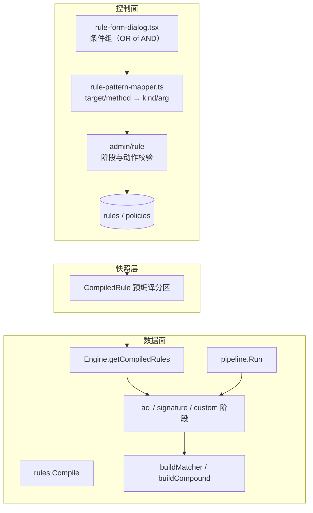
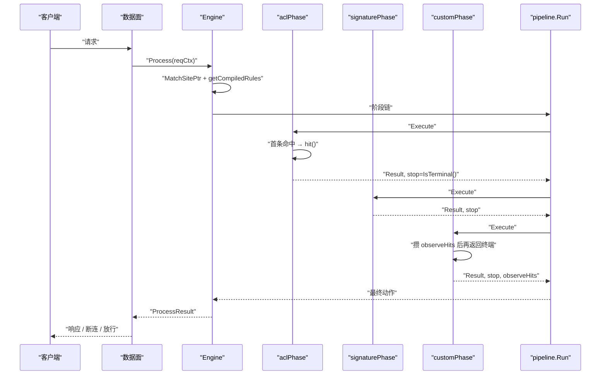
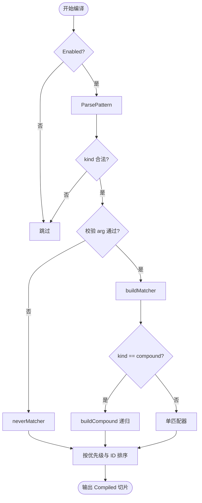
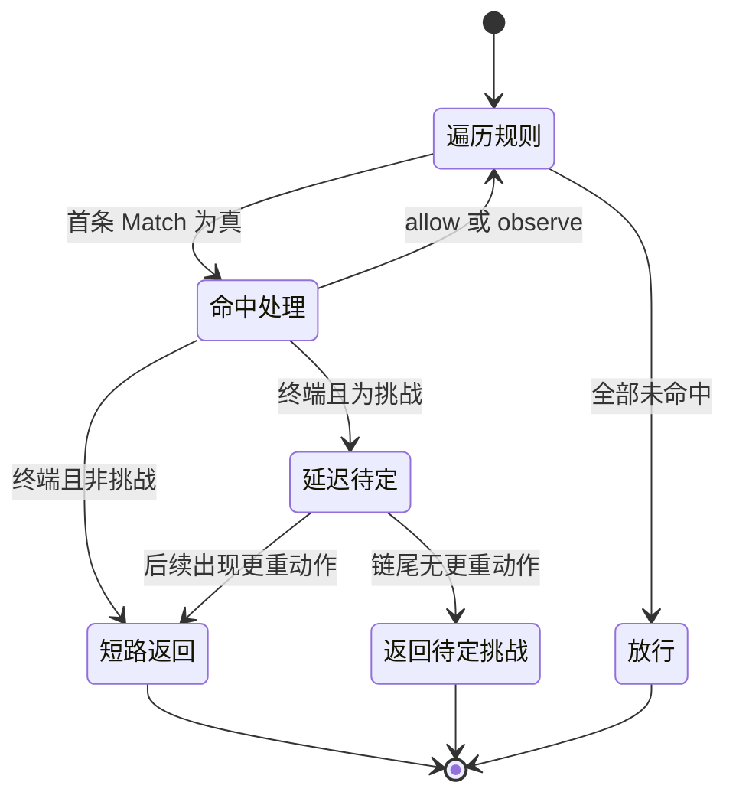
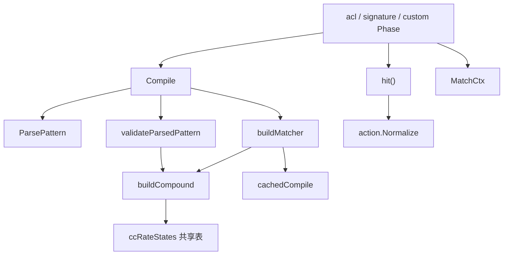

> [返回 安全防护功能](安全防护功能.md)

# ACL 规则引擎

<cite>
**本文档引用的文件**
- [internal/core/rules/compiler.go](file://internal/core/rules/compiler.go)
- [internal/core/rules/matcher.go](file://internal/core/rules/matcher.go)
- [internal/core/rules/validate.go](file://internal/core/rules/validate.go)
- [internal/core/rules/phases.go](file://internal/core/rules/phases.go)
- [internal/core/engine/engine.go](file://internal/core/engine/engine.go)
- [internal/core/pipeline/pipeline.go](file://internal/core/pipeline/pipeline.go)
- [internal/core/action/action.go](file://internal/core/action/action.go)
- [internal/store/policy.go](file://internal/store/policy.go)
- [internal/snapshot/build.go](file://internal/snapshot/build.go)
- [internal/snapshot/snapshot.go](file://internal/snapshot/snapshot.go)
- [internal/admin/rule/rule.go](file://internal/admin/rule/rule.go)
- [internal/admin/router.go](file://internal/admin/router.go)
- [frontend/app/(dashboard)/rules/page.tsx](file://frontend/app/(dashboard)/rules/page.tsx)
- [frontend/app/(dashboard)/rules/components/rule-form-dialog.tsx](file://frontend/app/(dashboard)/rules/components/rule-form-dialog.tsx)
- [frontend/app/(dashboard)/rules/components/rule-pattern-mapper.ts](file://frontend/app/(dashboard)/rules/components/rule-pattern-mapper.ts)
- [internal/core/rules/compiler_test.go](file://internal/core/rules/compiler_test.go)
- [internal/core/rules/matcher_test.go](file://internal/core/rules/matcher_test.go)
</cite>

## 目录

1. [简介](#简介)
2. [项目结构](#项目结构)
3. [核心组件](#核心组件)
4. [架构总览](#架构总览)
5. [详细组件分析](#详细组件分析)
6. [依赖关系分析](#依赖关系分析)
7. [性能考虑](#性能考虑)
8. [故障排查指南](#故障排查指南)
9. [结论](#结论)
10. [附录](#附录)

## 简介
ACL 规则引擎是「规则 DSL → 编译 → 匹配器 → 阶段执行」这条链路的统称。它同时服务三个用户可写阶段：`acl`、`signature`、`custom`，共用同一套编译器与匹配器工厂，只在入链位置与观察命中收集方式上有差别。

三条设计约束决定了整套实现：
- **编译期一次成型**：运行时只调 `Compiled.Match(MatchCtx)`，不再解析 DSL、不再编译正则
- **坏规则不生效也不致命**：非法 IP、非法正则一律降级为 `neverMatcher`，宁可漏拦不误伤
- **稳定顺序**：优先级升序、同优先级按 ID 升序，保证同一份规则在任何进程里判定结果一致

本域只覆盖用户自建规则；内置检测（OWASP / CVE）由各自的检测器提供，不在此引擎之内。

**章节来源**
- [internal/core/rules/compiler.go:12-78](file://internal/core/rules/compiler.go#L12-L78)
- [internal/core/rules/matcher.go:20-23](file://internal/core/rules/matcher.go#L20-L23)

## 项目结构
引擎横跨四个包：`rules`（编译与匹配）、`engine`（预编译与阶段装配）、`pipeline`（执行模型）、`store`（规则模型）。

| 模块 | 文件 | 关键符号 | 职责 |
|---|---|---|---|
| 编译器 | [compiler.go](file://internal/core/rules/compiler.go) | `Compiled`、`Compile`、`ParsePattern`、`knownPrefixes` | DSL 解析、匹配器构建、稳定排序 |
| 匹配器 | [matcher.go](file://internal/core/rules/matcher.go) | `Matcher`、`MatchCtx` 消费、`buildMatcher`、`buildCompound` | 字段级判定与正则缓存 |
| 校验器 | [validate.go](file://internal/core/rules/validate.go) | `ValidatePattern`、`validateCompoundNode` | 入库前的语法与语义校验 |
| 阶段 | [phases.go](file://internal/core/rules/phases.go) | `aclPhase`、`signaturePhase`、`customPhase`、`hit` | 规则集执行与动作构造 |
| 装配 | [engine.go](file://internal/core/engine/engine.go) | `getCompiledRules`、`getOrBuildPhases` | 按站点+策略预编译与缓存 |
| 执行 | [pipeline.go](file://internal/core/pipeline/pipeline.go) | `Run`、`RequestCtx` | 顺序执行、短路、观察收集 |
| 模型 | [policy.go](file://internal/store/policy.go) | `Policy`、`Rule`、`RulePhase`、`RuleAction` | 持久化结构与取值集合 |
| 管理 | [rule.go](file://internal/admin/rule/rule.go) | `CreateRule`、`validatePersistedRulePhase` | CRUD、动作与阶段校验、冲突检测 |
| 前端 | [rule-form-dialog.tsx](file://frontend/app/(dashboard)/rules/components/rule-form-dialog.tsx) | `serializeGroupsToPattern` | 条件组 UI 与 DSL 映射 |

**图表来源**
- [frontend/app/(dashboard)/rules/components/rule-pattern-mapper.ts:46-67](file://frontend/app/(dashboard)/rules/components/rule-pattern-mapper.ts#L46-L67)
- [internal/admin/rule/rule.go:267-321](file://internal/admin/rule/rule.go#L267-L321)
- [internal/snapshot/build.go:920-969](file://internal/snapshot/build.go#L920-L969)
- [internal/core/engine/engine.go:386-431](file://internal/core/engine/engine.go#L386-L431)
- [internal/core/rules/compiler.go:40-78](file://internal/core/rules/compiler.go#L40-L78)

**章节来源**
- [internal/core/engine/engine.go:623-643](file://internal/core/engine/engine.go#L623-L643)
- [frontend/app/(dashboard)/rules/components/rule-form-dialog.tsx:49-105](file://frontend/app/(dashboard)/rules/components/rule-form-dialog.tsx#L49-L105)

## 核心组件
- `Compiled`：运行时规则，含 ID、阶段、动作、优先级、kind/arg、状态码、跳转、验证码字段与预构建匹配器（compiler.go:13-29）
- `Matcher`：唯一方法 `Match(ctx MatchCtx) bool`，**不是多参数签名**（matcher.go:20-23）
- `MatchCtx`：匹配所需请求子集，含 IP、方法、路径、查询、头部映射、Host、站点、绑定、头序、TLS 结构体与 Body（phases.go:32-52）
- `compoundCondition`：复合条件的 JSON 形态，支持 `and`/`or`/`not`/`if`/`if_else`/`cc_rate`（validate.go:11-24）
- `ccRateMatcher`：规则级频次条件，自带共享状态表与 60 秒扫描（matcher.go:25-91）

| 符号 | 位置 | 签名 | 职责 |
|---|---|---|---|
| `Compile` | [compiler.go:40](file://internal/core/rules/compiler.go#L40) | `(rs []store.Rule) []Compiled` | 跳过禁用与非法规则并排序 |
| `ParsePattern` | [compiler.go:146](file://internal/core/rules/compiler.go#L146) | `(p string) (kind, arg string)` | DSL 与 JSON 双形态解析 |
| `buildMatcher` | [matcher.go:1473](file://internal/core/rules/matcher.go#L1473) | `(kind, arg string) Matcher` | 按 kind 造匹配器 |
| `buildCompound` | [matcher.go:1878](file://internal/core/rules/matcher.go#L1878) | `(cond compoundCondition) Matcher` | 复合树递归构建 |
| `ValidatePattern` | [validate.go:28](file://internal/core/rules/validate.go#L28) | `(pattern string) (kind, arg, errs)` | 入库校验 |
| `hit` | [phases.go:1312](file://internal/core/rules/phases.go#L1312) | `(c Compiled) action.Result` | 命中结果构造 |
| `executeCompiledPhase` | [phases.go:112](file://internal/core/rules/phases.go#L112) | `(ctx, rules, …) (Result, bool)` | 首条命中即返回 |
| `pipeline.Run` | [pipeline.go:517](file://internal/core/pipeline/pipeline.go#L517) | `(phases, ctx) RunResult` | 阶段链执行与短路 |

**章节来源**
- [internal/core/rules/compiler.go:12-170](file://internal/core/rules/compiler.go#L12-L170)
- [internal/core/rules/matcher.go:20-109](file://internal/core/rules/matcher.go#L20-L109)
- [internal/core/rules/phases.go:112-129](file://internal/core/rules/phases.go#L112-L129)

## 架构总览
规则按阶段分区在引擎里预编译并缓存，键为 `{siteID, policyID}`；阶段链键再叠加防护配置与 Lua 版本（engine.go:386-431、455-548）。

| 阶段 | 入链条件 | 执行函数 | 观察命中 |
|---|---|---|---|
| `acl` | 该策略下存在 acl 规则 | `executeCompiledPhase` | 不单独收集 |
| `signature` | 存在 signature 规则 | `executeCompiledPhase` | 不单独收集 |
| `custom` | 存在 custom 规则 | `executeCustomPhase` | 先攒观察命中再返回终端动作 |

三个阶段在整条 11 阶段链里的位置是第 3、第 10、第 11 位，完整顺序与入链条件见 [处理阶段详解](../WAF 引擎系统/处理阶段详解/处理阶段详解.md)，本文不复制该表。

**图表来源**
- [internal/core/rules/phases.go:112-225](file://internal/core/rules/phases.go#L112-L225)
- [internal/core/engine/engine.go:386-431](file://internal/core/engine/engine.go#L386-L431)
- [internal/core/pipeline/pipeline.go:517-560](file://internal/core/pipeline/pipeline.go#L517-L560)

**章节来源**
- [internal/core/engine/engine.go:479-529](file://internal/core/engine/engine.go#L479-L529)

## 详细组件分析

### 规则编译器
`Compile` 对每条持久化规则做四步：跳过禁用项 → `ParsePattern` 取 kind/arg → 校验失败即装 `neverMatcher` → 追加元数据字段。最后统一排序。

| 步 | 动作 | 失败后果 | 证据 |
|:--:|---|---|---|
| 1 | `Enabled` 检查 | 规则整体跳过 | compiler.go:43-45 |
| 2 | `ParsePattern` | kind 为空则跳过 | compiler.go:46-49 |
| 3 | `validateParsedPattern` | 装 `neverMatcher`，规则永不命中 | compiler.go:50-53 |
| 4 | 元数据装配 | `ruleIDStr = "rule:{phase}:{kind}"` | compiler.go:54-69 |
| 5 | 排序 | 优先级升序，同优先级 ID 升序 | compiler.go:71-77 |

`ParsePattern` 的两条分支值得注意：以 `{` 开头即整串视为复合 JSON，kind 固定 `compound`；否则取第一个冒号前的前缀，只有落在 `knownPrefixes` 里才算合法。`*_wildcard` 系列保留冒号后的原始空白，其它 kind 会 `TrimSpace`（compiler.go:144-170）。

**图表来源**
- [internal/core/rules/compiler.go:40-78](file://internal/core/rules/compiler.go#L40-L78)
- [internal/core/rules/compiler.go:144-170](file://internal/core/rules/compiler.go#L144-L170)
- [internal/core/rules/matcher.go:1473-1775](file://internal/core/rules/matcher.go#L1473-L1775)
- [internal/core/rules/matcher.go:1878-1928](file://internal/core/rules/matcher.go#L1878-L1928)

**章节来源**
- [internal/core/rules/compiler.go:40-170](file://internal/core/rules/compiler.go#L40-L170)
- [internal/core/rules/validate.go:26-52](file://internal/core/rules/validate.go#L26-L52)

### 匹配器与请求上下文
`Matcher` 只有一个方法：`Match(ctx MatchCtx) bool`（matcher.go:20-23）。上下文由 `fillMatchCtxFromPipeline` 从 `RequestCtx` 派生，只有当规则集里出现 `tls_alpn`、`tls_cipher_suite(s)`、`header_order_contains`、`header_order_regex` 这类需要派生头的 kind 时，才惰性计算头序与 ALPN 字符串（phases.go:72-104、227-249）。

| 字段类别 | 匹配器示例 | 取值来源 |
|---|---|---|
| 网络 | `ipCIDRMatcher`、`geoBlockMatcher` | `ClientIP` / 请求头 |
| 路径 | `pathPrefixMatcher`、`exactPathMatcher`、`pathRegexMatcher`、`pathWildcardMatcher` | `Path` |
| 完整 URL | `fullURL*` | `Path` + `Query` 拼接 |
| 主机 | `hostMatcher`、`hostRegexMatcher` | `Host` |
| 查询 | `queryContainsMatcher`、`queryParamMatcher` | `Query` |
| 头部 | `headerContainsMatcher`、`headerExactMatcher`、`headerPrefixMatcher`、`headerRegexMatcher` | `Headers` |
| 方法 / 类型 | `methodMatcher`、`contentTypeMatcher` | `Method` / `Content-Type` |
| 正文 | `bodyContainsMatcher`、`bodyRegexMatcher`、`bodyJSONPathMatcher`、`multipartMatcher` | `Body` |
| TLS | `tlsFingerprintMatcher`、`tlsCipherSuitesMatcher` | 头透传或 `MatchCtx.TLS` |
| 组合 | `andMatcher`、`orMatcher`、`notMatcher`、`ifElseMatcher`、`ccRateMatcher` | 子树 |

非法输入一律降级为 `neverMatcher` 而不是返回错误，例如 `allow_ip` / `block_ip` 的 arg 既不是 CIDR 也不是合法 IP 时（matcher.go:1475-1491）。TLS 类匹配器的取值顺序是「先结构化指纹、后透传请求头」：`ctx.TLS` 对应字段非空即用，否则回退 `x-owaf-tls-*` 头，`tls_alpn` 与 `tls_cipher_suites` 还额外回退到派生字段（matcher.go:150-200）。因此直连场景靠数据面窃读，反代场景靠上游透传，两者都缺时该组规则整体不命中。

**章节来源**
- [internal/core/rules/matcher.go:20-109](file://internal/core/rules/matcher.go#L20-L109)
- [internal/core/rules/matcher.go:1473-1775](file://internal/core/rules/matcher.go#L1473-L1775)
- [internal/core/rules/phases.go:32-104](file://internal/core/rules/phases.go#L32-L104)
- [internal/core/rules/phases.go:227-249](file://internal/core/rules/phases.go#L227-L249)

### 规则语法与取值集合
DSL 形态为 `kind:arg`，复合形态为 JSON。下表是本域常用的 kind 分组（完整清单见 `knownPrefixes`，compiler.go:119-142）。

| 类别 | kind | arg 形态 | 备注 |
|---|---|---|---|
| IP | `block_ip`、`allow_ip` | IP 或 CIDR | 动作由规则决定，两者匹配器相同 |
| 地理 | `geo_block` | CSV 国家码 | 读 `x-geo-country` / `cf-ipcountry` 头 |
| 路径 | `block_path`、`block_path_exact`、`block_path_regex`、`path_contains`、`path_not_contains`、`path_not_exact`、`path_wildcard` | 前缀 / 精确 / 正则 / 通配 | 无 `allow_path` 这一 kind |
| 查询 | `block_query_contains`、`block_query_regex`、`query_param`、`query_param_regex`、`query_param_not_exact` | `param:value` 或正则 | |
| 头部 | `block_header`、`block_header_exact`、`block_header_prefix`、`block_header_regex`、`block_header_not_exact`、`header_regex` | `name:value` | 名称大小写不敏感 |
| UA | `block_user_agent`、`block_user_agent_regex` | 子串 / 正则 | 等价于头部匹配的便捷形态 |
| 方法 / 类型 | `block_method`、`block_content_type` | `GET` / MIME | 方法转大写、类型转小写 |
| 正文 | `block_body_contains`、`block_body_regex`、`body_contains`、`body_regex`、`block_body_json_path`、`block_multipart` | 子串 / 正则 / JSONPath / 正则 | multipart 缺省用危险扩展名正则 |
| 主机 / URL | `host`、`host_full`、`host_regex`、`host_contains`、`host_not_contains`、`host_not_exact`、`host_wildcard`、`full_url_contains`、`full_url_regex`、`full_url_not_exact`、`full_url_wildcard` | 模式串 | |
| TLS | `tls_ja3`、`tls_ja3_hash`、`tls_ja4`、`tls_version`、`tls_sni`、`tls_alpn`、`tls_cipher_suite`、`tls_cipher_suites` | 值 / 逗号列表 | 版本 arg 会被归一化 |
| 头序 | `header_order_contains`、`header_order_regex` | 子串 / 正则 | 需派生头序 |
| 其它 | `cookie_contains`、`referer_contains` | 子串 | |

复合操作符集合：

| op | 子节点要求 | 非法后果 | 证据 |
|---|---|---|---|
| `and` / `or` | ≥1 个子节点 | 空 children → `neverMatcher` | matcher.go:1881-1892、validate.go:56-61 |
| `not` | 恰好 1 个 | 数量不符 → 校验报错 | matcher.go:1893-1897、validate.go:62-66 |
| `if` / `if_else` / `ifelse` | 必须有 `if` 与 `then`，`else` 可选 | 缺失 → `neverMatcher` | matcher.go:1898-1906、validate.go:67-75 |
| `cc_rate` | 1 个子节点 + `window>0` + `threshold>0` + 单位合法 | 任一不满足 → `neverMatcher` | matcher.go:1907-1919、validate.go:76-92 |
| 叶子 | `kind` + `arg` | 未知 kind → 校验报错 | validate.go:93-101、123-126 |

动作取值集合（`store.RuleAction`）：`allow`、`intercept`、`observe`、`drop`、`challenge`、`captcha_challenge`、`shield_challenge`、`chain_challenge`、`redirect`、`rate_limit`、`tag`；`block` 与 `log_only` 是兼容旧数据的别名，入库前被归一化为 `intercept` 与 `observe`（policy.go:37-66、action.go:26-44）。管理端另有两条硬约束：`allow` 只允许出现在 `acl` 阶段，`tag` 不允许作为持久化规则动作（rule/rule.go:267-284）。

**章节来源**
- [internal/core/rules/compiler.go:119-142](file://internal/core/rules/compiler.go#L119-L142)
- [internal/core/rules/matcher.go:1473-1775](file://internal/core/rules/matcher.go#L1473-L1775)
- [internal/core/rules/validate.go:54-180](file://internal/core/rules/validate.go#L54-L180)
- [internal/store/policy.go:27-66](file://internal/store/policy.go#L27-L66)
- [internal/core/action/action.go:8-44](file://internal/core/action/action.go#L8-L44)
- [internal/admin/rule/rule.go:267-294](file://internal/admin/rule/rule.go#L267-L294)

### 执行顺序与短路语义
阶段内「首条命中即返回」，是否结束整条链由动作的终端性决定，而不是由阶段类型决定（phases.go:112-129、148-150）。

| 动作 | 终端 | ACL 命中后的实际行为 | 默认状态码 |
|---|:--:|---|:--:|
| `allow` | 否 | 返回 Allow 但 **不短路**，后续阶段照常执行 | — |
| `intercept` | 是 | 短路并渲染拦截页 | 403 |
| `drop` | 是 | 短路并关闭 TCP 连接 | 无响应 |
| `rate_limit` | 是 | 短路 | 429 |
| 四类挑战 | 是 | 短路但延迟处理，可被后续更重动作覆盖 | 403 |
| `redirect` | 是 | 短路 | 302 |
| `observe` | 否 | 记录观察命中，请求继续 | — |

`custom` 阶段与另两段唯一的实现差别是观察命中的收集：先攒下所有非终端命中，遇到终端动作时把它们挂到 `ctx.AppendPhaseObserveHits` 再返回；若整段只有观察命中，则返回第一条并把其余附挂（phases.go:194-225）。

**图表来源**
- [internal/core/rules/phases.go:112-225](file://internal/core/rules/phases.go#L112-L225)
- [internal/core/action/action.go:88-115](file://internal/core/action/action.go#L88-L115)
- [internal/core/pipeline/pipeline.go:517-560](file://internal/core/pipeline/pipeline.go#L517-L560)

**章节来源**
- [internal/core/rules/phases.go:112-225](file://internal/core/rules/phases.go#L112-L225)
- [internal/core/action/action.go:88-190](file://internal/core/action/action.go#L88-L190)

### 优先级与冲突控制
排序键是 `(Priority, ID)` 二元组，编译期一次确定，运行期不再变动（compiler.go:71-77）。管理端在写入前会做同策略同阶段的优先级冲突检测，冲突时返回明确错误而不是静默并列（rule/rule.go:341-385）。

规则模型中还有三个会影响执行但常被忽略的字段：`StatusCode` 为 0 时用动作默认码；`RedirectTo` 在动作是 `redirect` 时为必填；`CaptchaType` 与 `CaptchaMinutes` 只对 `captcha_challenge` 生效，为 0 或空即继承全局配置（policy.go:80-96、phases.go:1325-1338）。

**章节来源**
- [internal/core/rules/compiler.go:71-77](file://internal/core/rules/compiler.go#L71-L77)
- [internal/admin/rule/rule.go:341-385](file://internal/admin/rule/rule.go#L341-L385)
- [internal/store/policy.go:70-97](file://internal/store/policy.go#L70-L97)

### 管理接口与前端构建器
端点全部是 GET 读 + POST 写，没有 PUT / DELETE（router.go:144-147、280-285）。

| 端点 | 方法 | 处理器 | 用途 |
|---|---|---|---|
| `/rules` | GET | `ListRules` | 分页列表 |
| `/rules/{id}` | GET | `GetRule` | 单条详情 |
| `/rules/templates` | GET | `GetRuleTemplates` | 模板清单 |
| `/rules/export` | GET | `ExportRules` | 导出 |
| `/rules` | POST | `CreateRule` | 新建并 reload |
| `/rules/{id}/update` | POST | `UpdateRule` | 更新 |
| `/rules/{id}/delete` | POST | `DeleteRule` | 删除 |
| `/rules/test` | POST | `TestRule` | 试匹配 |
| `/rules/validate` | POST | `ValidateRule` | 语法校验 |
| `/rules/import` | POST | `ImportRules` | 批量导入 |
| `/sites/{id}/rules` | GET | `ListSiteRules` | 站点维度列表 |

前端条件构建器采用「条件组」模型：外层数组是 OR、内层数组是 AND，序列化时再翻译成后端的 `{kind, arg}` 叶子或 `{op:"not", children:[…]}` 包装（rule-form-dialog.tsx:39-42、rule-pattern-mapper.ts:54-56）。并非所有 UI 组合都有后端对应：`src_ip` 的 `contains`、`in_ip_group`、`not_in_ip_group` 与 `ne` 会被显式拒绝并给出改用建议，`not_in_cidr` 与 `not_in_geo` 则通过 `wrapNot` 包装实现（rule-pattern-mapper.ts:145-192）。

**章节来源**
- [internal/admin/router.go:144-147](file://internal/admin/router.go#L144-L147)
- [internal/admin/router.go:280-285](file://internal/admin/router.go#L280-L285)
- [internal/admin/rule/rule.go:267-321](file://internal/admin/rule/rule.go#L267-L321)
- [frontend/app/(dashboard)/rules/components/rule-form-dialog.tsx:39-105](file://frontend/app/(dashboard)/rules/components/rule-form-dialog.tsx#L39-L105)
- [frontend/app/(dashboard)/rules/components/rule-pattern-mapper.ts:54-192](file://frontend/app/(dashboard)/rules/components/rule-pattern-mapper.ts#L54-L192)

## 依赖关系分析
- 编译器依赖匹配器与 `store.Rule` 模型，不依赖快照
- 阶段依赖编译结果与 `action` 语义，不反向依赖编译器之外的规则来源
- 引擎依赖快照的 `CompiledRule` 分区，避免每请求重复解析 DSL
- `cc_rate` 匹配器持有进程内共享状态表，多实例部署时计数不互通

**图表来源**
- [internal/core/rules/compiler.go:40-78](file://internal/core/rules/compiler.go#L40-L78)
- [internal/core/rules/matcher.go:1785-1800](file://internal/core/rules/matcher.go#L1785-L1800)
- [internal/core/rules/phases.go:1300-1339](file://internal/core/rules/phases.go#L1300-L1339)
- [internal/core/rules/matcher.go:25-109](file://internal/core/rules/matcher.go#L25-L109)

**章节来源**
- [internal/core/rules/compiler.go:1-170](file://internal/core/rules/compiler.go#L1-L170)
- [internal/core/engine/engine.go:386-431](file://internal/core/engine/engine.go#L386-L431)

## 性能考虑
- 正则以模式串为键全局缓存，命中时复用同一实例，编译只发生一次（matcher.go:1785-1800）
- 派生头字符串按请求惰性计算并缓存，避免多阶段重复拼接（phases.go:85-103）
- 规则按 `{siteID, policyID}` 预编译并缓存，快照 revision 变化才重建（engine.go:386-431）
- `ensureCompiledMetadata` 只在确实缺元数据时才复制切片，热路径零拷贝（compiler.go:87-115）
- 阶段内首条命中即停止遍历，配合优先级把高概率规则放前部收益最大
- 坏规则降级为 `neverMatcher`，不会在每请求路径上重复尝试解析

**章节来源**
- [internal/core/rules/matcher.go:1785-1800](file://internal/core/rules/matcher.go#L1785-L1800)
- [internal/core/rules/phases.go:72-129](file://internal/core/rules/phases.go#L72-L129)
- [internal/core/engine/engine.go:386-431](file://internal/core/engine/engine.go#L386-L431)

## 故障排查指南
| 症状 | 原因 | 验证 |
|---|---|---|
| 规则完全不生效 | `Enabled` 为假，或阶段不是三段之一 | 管理端只接受 `acl`/`signature`/`custom`（rule/rule.go:286-294） |
| 匹配器永不命中 | arg 非法被降级为 `neverMatcher` | 用 `POST /rules/validate` 检查 |
| 正则规则不生效 | 正则非法 | 同上；非法正则不会报错，只降级 |
| `allow` 后仍被拦 | Allow 不短路 | 后续阶段照常判定，属设计 |
| 观察规则没有日志 | 只有 `custom` 阶段收集多个观察命中 | 对比 phases.go:112-129 与 194-225 |
| 地理规则不命中 | 缺少 CDN 注入的国家码头 | 见 [地理位置阻断](地理位置阻断.md) |
| TLS 规则不命中 | 既无结构化指纹也未透传 `x-owaf-tls-*` 头 | matcher.go:150-200 |
| 频次规则忽松忽紧 | `cc_rate` 状态表是进程内的 | 重启即清零 |
| 优先级调整没效果 | 同优先级按 ID 升序 | 检查是否需要用冲突接口重排 |

调试路径建议：先用 `POST /rules/validate` 过语法，再用 `POST /rules/test` 带样例请求过匹配，最后用 `X-Request-ID` 在安全事件里核对 `rule_id_str`。

**章节来源**
- [internal/core/rules/compiler.go:43-53](file://internal/core/rules/compiler.go#L43-L53)
- [internal/core/rules/phases.go:112-225](file://internal/core/rules/phases.go#L112-L225)
- [internal/core/rules/matcher.go:150-200](file://internal/core/rules/matcher.go#L150-L200)
- [internal/admin/rule/rule.go:267-321](file://internal/admin/rule/rule.go#L267-L321)
- [internal/core/rules/compiler_test.go:11-87](file://internal/core/rules/compiler_test.go#L11-L87)
- [internal/core/rules/matcher_test.go:30-110](file://internal/core/rules/matcher_test.go#L30-L110)

## 结论
ACL 规则引擎把「表达能力」与「执行成本」解耦：DSL 可以任意组合，但执行只剩一次遍历加若干布尔判断。本轮订正的关键事实包括：`Matcher` 接口签名是 `Match(MatchCtx)`；`allow` 在 ACL 阶段不短路；不存在 `allow_path` / `allow_header` 这类 kind；复合条件除 and/or/not 外还支持 if/if_else 与 `cc_rate`；写操作全部是 POST 路径变体。

可改进项：`cc_rate` 的进程内状态在多实例下不一致，建议接入与限流相同的共享后端；`knownPrefixes` 与前端映射表是两份清单，建议增加一致性校验脚本防漂移。

**章节来源**
- [本节为总结，无需特定文件来源]

## 附录

### DSL 示例

| 场景 | 表达式 |
|---|---|
| 封网段 | `block_ip:192.168.1.0/24` |
| 路径前缀 | `block_path:/admin` |
| 精确路径 | `block_path_exact:/api/health` |
| 查询包含 | `block_query_contains:debug=1` |
| 头部正则 | `block_header_regex:User-Agent:(?i)scanner` |
| UA 子串 | `block_user_agent:python-requests` |
| 方法 | `block_method:DELETE` |
| 国家码 | `geo_block:CN,RU` |
| 排除国家 | `{"op":"not","children":[{"kind":"geo_block","arg":"CN"}]}` |
| AND 组合 | `{"op":"and","children":[{"kind":"block_path","arg":"/admin"},{"kind":"block_method","arg":"POST"}]}` |
| 频次限制 | `{"op":"cc_rate","window":60,"threshold":5,"children":[{"kind":"block_path","arg":"/login"}]}` |
| 上传文件名 | `block_multipart:`（arg 留空即用内置危险扩展名正则） |

**章节来源**
- [internal/core/rules/compiler.go:119-170](file://internal/core/rules/compiler.go#L119-L170)
- [internal/core/rules/matcher.go:1746-1775](file://internal/core/rules/matcher.go#L1746-L1775)
- [frontend/app/(dashboard)/rules/components/rule-pattern-mapper.ts:174-248](file://frontend/app/(dashboard)/rules/components/rule-pattern-mapper.ts#L174-L248)

**章节来源**
- [internal/core/rules/compiler.go:119-142](file://internal/core/rules/compiler.go#L119-L142)

### 相关文档
- 阶段顺序与入链条件：[处理阶段详解](../WAF 引擎系统/处理阶段详解/处理阶段详解.md)
- 匹配器实现细节：[规则匹配器](../WAF 引擎系统/规则匹配器/规则匹配器.md)
- 规则 CRUD 契约：[规则管理 API](../管理 API 系统/规则管理 API/规则管理 API.md)
- 地理维度阻断：[地理位置阻断](地理位置阻断.md)
- 名单型准入：[IP 信誉系统](IP 信誉系统.md)

**章节来源**
- [internal/store/policy.go:27-97](file://internal/store/policy.go#L27-L97)
- [internal/snapshot/build.go:920-969](file://internal/snapshot/build.go#L920-L969)
