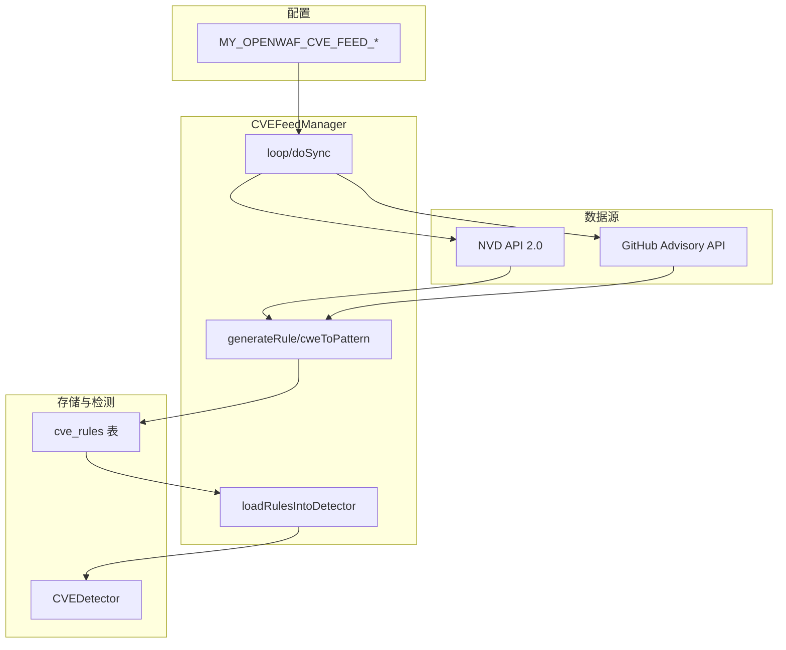
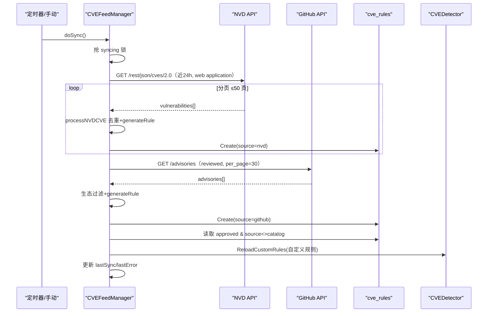
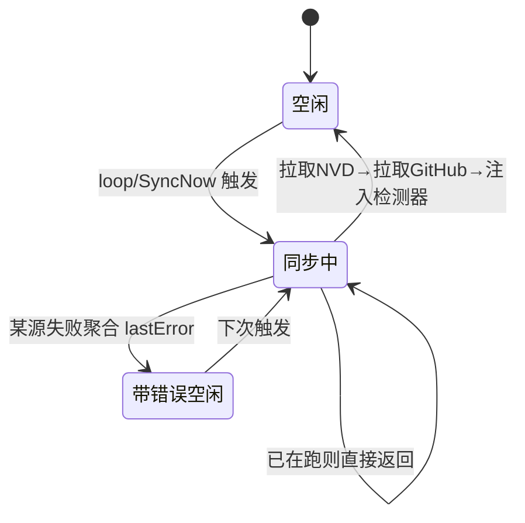

> [返回 安全防护功能](../安全防护功能.md)

# CVE 数据源同步

<cite>
**本文档引用的文件**
- [feed.go](file://internal/waf/cve/feed.go)
- [detector.go](file://internal/waf/cve/detector.go)
- [catalog.go](file://internal/waf/cve/catalog.go)
- [cve.go](file://internal/store/cve/cve.go)
- [cve_rule.go](file://internal/store/repository/cve/cve_rule.go)
- [cve.go](file://internal/admin/detect/cverules/cve.go)
- [config.go](file://internal/core/config.go)
- [server.go](file://internal/app/server.go)
- [registry.go](file://internal/core/configoverride/registry.go)
</cite>

## 目录

1. [简介](#简介)
2. [项目结构](#项目结构)
3. [核心组件](#核心组件)
4. [架构总览](#架构总览)
5. [详细组件分析](#详细组件分析)
6. [依赖关系分析](#依赖关系分析)
7. [性能考虑](#性能考虑)
8. [故障排查指南](#故障排查指南)
9. [结论](#结论)
10. [附录](#附录)

## 简介

CVE 数据源同步由 `CVEFeedManager` 承担：后台定时从 NVD API 2.0 与 GitHub Advisory API 拉取最近漏洞，按 CWE 类型或描述关键词映射为「正则 `pattern` + 目标域」规则写入 `cve_rules` 表，再把已批准规则热加载进 `CVEDetector`。本文给出可实测的数据源参数、CWE→正则映射、severity 阈值与同步状态机，并说明增量窗口、去重、限流与错误处理。

一个关键澄清：本实现把 CVE 归约为**内容正则**，不携带受影响版本区间（version range）；`CVSSScore` 只用于推导 `severity`，与版本判定无关。

## 项目结构

同步逻辑集中在 `feed.go`，模型在 `store/cve`，仓库在 `store/repository/cve`，管理入口在 `admin/detect/cverules`，配置与装配在 `core/config.go` 与 `app/server.go`。

| 模块 | 文件 | 角色 |
|---|---|---|
| 同步管理器 | feed.go | 循环、拉取、解析、入库、注入 |
| 目录对账 | catalog.go | 内置规则以 `source=catalog` 落表 |
| 数据模型 | store/cve/cve.go | `CVERuleModel`、`CVESyncLog` |
| 规则仓库 | repository/cve/cve_rule.go | CRUD + 审批计数 + 规范快照 |
| 管理 API | admin/detect/cverules/cve.go | `SyncCVERules`、`GetCVEFeedStatus` |
| 配置装配 | config.go:396-405 / server.go:448-454 | 环境变量与启动 |

**图表来源**
- [feed.go:140-199](file://internal/waf/cve/feed.go#L140-L199)
- [feed.go:608-666](file://internal/waf/cve/feed.go#L608-L666)
- [feed.go:201-228](file://internal/waf/cve/feed.go#L201-L228)

**章节来源**
- [feed.go:16-87](file://internal/waf/cve/feed.go#L16-L87)
- [config.go:396-405](file://internal/core/config.go#L396-L405)

## 核心组件

| 组件/方法 | 职责 | 行号 |
|---|---|---|
| `NewCVEFeedManagerWithFeed` | 按 `feedEnabled` 构造管理器 | feed.go:73-87 |
| `Start` | 迁移表 + 载入规则 + 启循环 | feed.go:90-106 |
| `loop`/`doSync` | 定时与并发保护同步 | feed.go:140-199 |
| `fetchFromNVD`/`fetchNVDPage` | NVD 分页拉取 | feed.go:295-412 |
| `fetchFromGitHubAdvisory` | GitHub 单次拉取 | feed.go:527-605 |
| `processNVDCVE` | NVD 条目去重与入库 | feed.go:414-469 |
| `generateRule`/`cweToPattern` | CWE→正则映射与 severity | feed.go:608-666 |
| `loadRulesIntoDetector` | 注入已批准规则 | feed.go:201-228 |

**章节来源**
- [feed.go:73-228](file://internal/waf/cve/feed.go#L73-L228)

## 架构总览

启动时 `Start` 先 `AutoMigrate` 建表、载入既有规则；若 `feedEnabled` 为真，`loop` 立即执行一次 `doSync` 再按 `syncInterval` 触发。`doSync` 用互斥量保证同一时刻只有一个同步在跑，依次拉 NVD、拉 GitHub，最后 `loadRulesIntoDetector`，并更新内存态 `lastSync`/`lastError`。

**图表来源**
- [feed.go:156-199](file://internal/waf/cve/feed.go#L156-L199)
- [feed.go:295-336](file://internal/waf/cve/feed.go#L295-L336)
- [feed.go:527-605](file://internal/waf/cve/feed.go#L527-L605)

**章节来源**
- [feed.go:90-199](file://internal/waf/cve/feed.go#L90-L199)

## 详细组件分析

### 数据源参数

两个数据源的请求参数均可在 `feed.go` 中实测：

| 参数 | NVD | GitHub |
|---|---|---|
| 基础 URL | `https://services.nvd.nist.gov/rest/json/cves/2.0`（feed.go:278） | `https://api.github.com/advisories`（feed.go:530） |
| 查询 | pubStartDate/pubEndDate、keywordSearch=web+application、resultsPerPage、startIndex | type=reviewed、per_page=30、sort=updated、direction=desc |
| 时间窗口 | 最近 24 小时（feed.go:298-299） | 按 updated 倒序（无显式窗口） |
| 每页条数 | 50（feed.go:281） | 30（feed.go:530） |
| 单次最大页 | 50 页（feed.go:292，约 2500 条上限） | 单页（不翻页） |
| 鉴权头 | `apiKey`（配置 Key 时，feed.go:366） | `Accept`、`X-GitHub-Api-Version: 2022-11-28`（feed.go:536-537） |
| 页间延时 | 无 Key 6s / 有 Key 1.2s（feed.go:285、289） | 不适用 |
| HTTP 超时 | 30s（feed.go:296） | 30s（feed.go:528） |
| 响应体上限 | 5 MiB（feed.go:380） | 5 MiB（feed.go:550） |

> GitHub Advisory 当前不发送认证头，可能受匿名速率限制影响（feed.go:532-537 未设置 `Authorization`）。

**章节来源**
- [feed.go:276-336](file://internal/waf/cve/feed.go#L276-L336)
- [feed.go:527-560](file://internal/waf/cve/feed.go#L527-L560)

### NVD 拉取与去重

`fetchFromNVD` 以 `startIndex` 递增翻页，停页条件为：本页空、`startIndex+50 ≥ totalResults`、或旧式响应缺 `totalResults` 且本页不足 50（feed.go:402-411）。`processNVDCVE` 先按 `cve_id + source='nvd'` 查重（feed.go:417），再取英文描述、优先 CVSS v3.1、首个 `CWE-` 类型，生成规则后把 `Source` 显式改回 `nvd`（feed.go:456）——否则与查重条件不一致会导致每页重复插入。参考链接经 `formatNVDReferences` 截断为最多 10 条、单条 512 字节，发布时间并入描述尾部并截断 500 字节（feed.go:459-461、471-497）。

**章节来源**
- [feed.go:360-412](file://internal/waf/cve/feed.go#L360-L412)
- [feed.go:414-497](file://internal/waf/cve/feed.go#L414-L497)

### GitHub Advisory 过滤

`fetchFromGitHubAdvisory` 拉取 reviewed 公告后，仅保留存在 `cve_id`、且漏洞包生态属于 `npm/composer/maven/pip/go` 的条目（feed.go:562-576），按 `cve_id + source='github'` 去重后入库（feed.go:580、593-599）。CWE 取首个 `cwes[].cwe_id`。

**章节来源**
- [feed.go:499-605](file://internal/waf/cve/feed.go#L499-L605)

### CWE 到正则映射与 severity 阈值

`generateRule` 调 `cweToPattern` 把 CWE 映射为通用检测正则；映射不到时退回 `descriptionToPattern` 关键词提取，仍无法生成则丢弃该 CVE（feed.go:608-612、669-687）。

| CWE | 目标 | 类别 | 正则意图 |
|---|---|---|---|
| CWE-89 | all | general | SQL 注入关键词组合 |
| CWE-79 | all | general | `<script>`/`javascript:`/事件属性 |
| CWE-78、CWE-77 | all | general | 分号/管道后命令词 |
| CWE-22 | url | general | 两段以上路径遍历编码 |
| CWE-611 | body | general | DOCTYPE/ENTITY 外部实体 |
| CWE-918 | all | general | 内网/回环/元数据 SSRF |
| CWE-502 | all | general | 反序列化 gadget 指示 |
| CWE-94、CWE-95 | all | general | eval/exec/system/child_process |
| CWE-113 | all | general | `%0d%0a` CRLF |
| CWE-352 | — | — | 返回空，跳过（对 WAF 价值有限） |

CVSS 到 severity 的阈值映射（feed.go:614-623）：

| CVSS | severity |
|---|---|
| ≥ 9.0 | critical |
| ≥ 7.0 | high |
| ≥ 4.0 | medium |
| > 0 | low |
| = 0 | medium（缺省） |

**章节来源**
- [feed.go:608-687](file://internal/waf/cve/feed.go#L608-L687)

### 同步状态机

`doSync` 用 `syncing` 标志实现单飞：已同步则直接返回，成功清 `lastError`，聚合失败写入 `lastError`。`SyncNow` 供管理面手动触发，同样经由 `doSync`（feed.go:121-123、156-199）。

**图表来源**
- [feed.go:156-199](file://internal/waf/cve/feed.go#L156-L199)
- [feed.go:140-154](file://internal/waf/cve/feed.go#L140-L154)

**章节来源**
- [feed.go:121-199](file://internal/waf/cve/feed.go#L121-L199)

### 同步状态与 CVESyncLog

管理面 `GetCVEFeedStatus` 返回 `last_sync`、`last_error`、`syncing` 与 `pending_review`（待审批数），数据来自内存 `SyncStatus` 与 `PendingApprovalCount`（cve.go(admin):387-409、feed.go:126-134）。

| 字段 | 来源 |
|---|---|
| last_sync | `m.lastSync`（feed.go:187） |
| last_error | `m.lastError`（feed.go:189） |
| syncing | `m.syncing`（feed.go:162） |
| pending_review | `approved=false` 计数（cve_rule.go:289-293） |

> `CVESyncLog` 模型与 `CVESyncLogRepo`（store/cve/cve.go:38-46、cve_rule.go:297-311）已定义，但当前 `CVEFeedManager` 同步循环**未写入该表**，同步状态仅存在于内存 `SyncStatus`。这是可核实的实现现状，非文档臆测。

**章节来源**
- [feed.go:126-199](file://internal/waf/cve/feed.go#L126-L199)
- [cve.go](file://internal/admin/detect/cverules/cve.go)
- [cve.go](file://internal/store/cve/cve.go)
- [cve_rule.go](file://internal/store/repository/cve/cve_rule.go)

### 与目录对账的边界

`ReconcileBuiltinCatalog` 把内置可执行规则以 `source='catalog'` 落入 `cve_rules` 供管理面展示，但 `loadRulesIntoDetector` 的过滤条件 `source <> 'catalog'` 明确排除它们（feed.go:203、catalog.go:11-113）。因此自动同步规则、手工/自定义规则参与运行时注入，目录规则只做展示与元信息对账，两者互不覆盖。

**章节来源**
- [catalog.go:17-113](file://internal/waf/cve/catalog.go#L17-L113)
- [feed.go:201-228](file://internal/waf/cve/feed.go#L201-L228)

## 依赖关系分析

| 依赖方 | 被依赖 | 用途 |
|---|---|---|
| `CVEFeedManager` | `gorm.DB` | 读写 `cve_rules` |
| `CVEFeedManager` | `CVEDetector` | `ReloadCustomRules` 注入 |
| `CVEFeedManager` | NVD/GitHub HTTP | 拉取 |
| `server.go` | `config.CVEConfig` | 装配 interval/key/autoApprove/feedEnabled |
| 管理 API | `CVEFeedManager` | `SyncNow`/`GetSyncStatus` |

配置项注册于 `configoverride/registry.go`（`cve_feed_enabled`、`cve_feed_interval`），环境变量前缀 `MY_OPENWAF_CVE_FEED_`。

**章节来源**
- [feed.go:17-33](file://internal/waf/cve/feed.go#L17-L33)
- [server.go:448-454](file://internal/app/server.go#L448-L454)
- [registry.go](file://internal/core/configoverride/registry.go)

## 性能考虑

- **礼貌限流**：无 Key 时 NVD 每页间隔 6s（滚动 30 秒 5 次配额），有 Key 降到 1.2s（feed.go:282-289）。
- **单次上限**：NVD 最多 50 页，防止无 Key 场景同步被无限拉长（feed.go:290-292）。
- **响应体封顶**：两源均 `LimitReader` 5 MiB，非 200 只读 512 字节错误摘要（feed.go:376、380）。
- **查重前置**：入库前按 `cve_id+source` 查重，避免每次同步重复写同一 CVE（feed.go:417、580）。
- **注入过滤**：只载入 `approved & source<>catalog`，缩小热重载正则集（feed.go:203）。

**章节来源**
- [feed.go:276-293](file://internal/waf/cve/feed.go#L276-L293)
- [feed.go:375-412](file://internal/waf/cve/feed.go#L375-L412)

## 故障排查指南

| 症状 | 原因 | 处理 |
|---|---|---|
| 同步无新规则 | 24h 窗口内无匹配 Web 的 CVE | 正常；或临时扩窗（需改代码） |
| NVD 429/慢 | 未配 `MY_OPENWAF_NVD_API_KEY` | 配 Key 切 1.2s 延时 |
| GitHub 403 | 匿名速率限制 | 降低频率或引入认证（当前无） |
| 规则入库但不生效 | `approved=false` | 审批或开 `MY_OPENWAF_CVE_AUTO_APPROVE` |
| status 无 last_sync | `feedEnabled=false` 且未手动同步 | 调 `POST /cve-rules/sync` |

**章节来源**
- [feed.go:295-336](file://internal/waf/cve/feed.go#L295-L336)
- [feed.go:527-560](file://internal/waf/cve/feed.go#L527-L560)
- [config.go:396-405](file://internal/core/config.go#L396-L405)

## 结论

CVE 数据源同步以最小可实现方式把外部漏洞情报转成可执行的内容正则规则：NVD 分页礼貌拉取近 24 小时 Web 相关 CVE，GitHub 过滤 Web 生态公告，二者统一经 CWE/描述映射与 CVSS 阈值生成规则，去重入库后按审批状态注入检测器。同步状态来自内存 `SyncStatus`，`CVESyncLog` 表当前未接入循环。建议生产开启 NVD Key 与合理 `auto_approve` 策略，并关注匿名 GitHub 限流。

## 附录

### 同步触发与配置速查

| 项 | 值/来源 |
|---|---|
| 触发 | 启动立即一次、ticker 周期、`POST /cve-rules/sync` |
| 默认间隔 | 6h（config.go:404、server.go:450） |
| feed 开关 | `MY_OPENWAF_CVE_FEED_ENABLED`（默认关） |
| 间隔覆盖 | `MY_OPENWAF_CVE_FEED_INTERVAL` |
| NVD Key | `MY_OPENWAF_NVD_API_KEY` |
| 自动审批 | `MY_OPENWAF_CVE_AUTO_APPROVE` |
| 手动同步 | `SyncCVERules`（feed.go:121 `SyncNow`） |

**章节来源**
- [feed.go:90-154](file://internal/waf/cve/feed.go#L90-L154)
- [config.go:396-405](file://internal/core/config.go#L396-L405)
- [server.go:448-454](file://internal/app/server.go#L448-L454)
