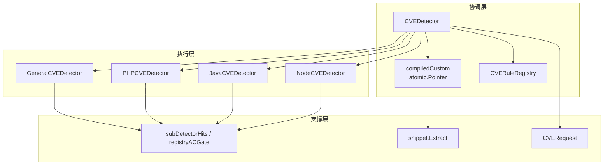
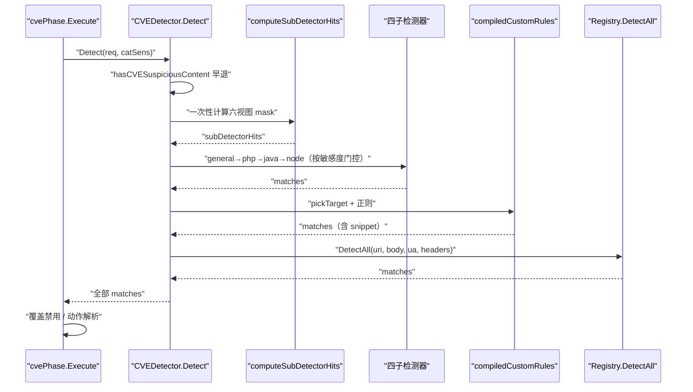
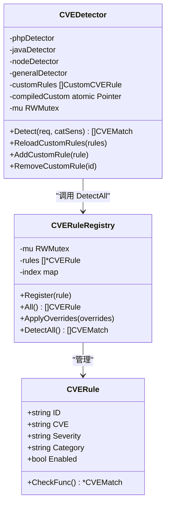
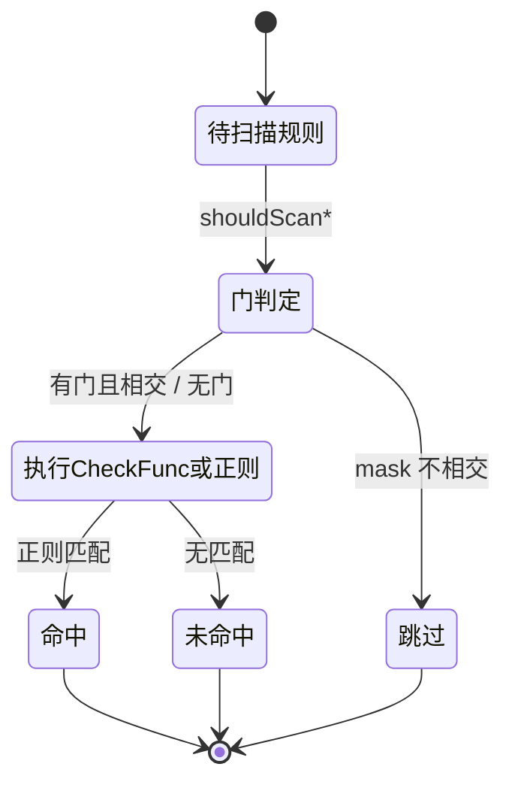
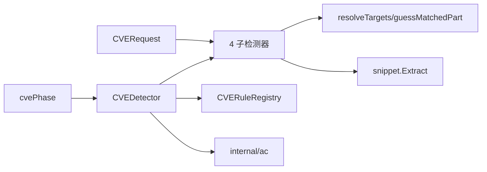

> [返回 安全防护功能](../安全防护功能.md)

# CVE 检测器架构

<cite>
**本文档引用的文件**
- [detector.go](file://internal/waf/cve/detector.go)
- [general.go](file://internal/waf/cve/general.go)
- [java.go](file://internal/waf/cve/java.go)
- [node.go](file://internal/waf/cve/node.go)
- [php.go](file://internal/waf/cve/php.go)
- [feed.go](file://internal/waf/cve/feed.go)
- [ac.go](file://internal/ac/ac.go)
- [ac_registry.go](file://internal/waf/cve/ac_registry.go)
- [ac_subdetector.go](file://internal/waf/cve/ac_subdetector.go)
- [snippet.go](file://internal/pkg/snippet/snippet.go)
- [phases.go](file://internal/core/rules/phases.go)
</cite>

## 目录

1. [简介](#简介)
2. [项目结构](#项目结构)
3. [核心组件](#核心组件)
4. [架构总览](#架构总览)
5. [详细组件分析](#详细组件分析)
6. [依赖关系分析](#依赖关系分析)
7. [性能考虑](#性能考虑)
8. [故障排查指南](#故障排查指南)
9. [结论](#结论)
10. [附录](#附录)

## 简介

本文聚焦 CVE 检测的**架构与并发模型**：`CVEDetector` 如何编排四类子检测器、`CVERuleRegistry` 的读写锁与原子指针分工、`CVERequest`/`CVEMatch` 的字段语义、`Detect` 的执行顺序与按类别敏感度跳过、以及 Aho-Corasick 必要字面门在热路径上的裁剪作用。规则条数、动作映射与数据源同步的完整口径分别在《CVE 漏洞检测》《CVE 数据源同步》给出，本文不重复。

## 项目结构

CVE 检测引擎位于 `internal/waf/cve`，与 `internal/ac`（匹配件）、`internal/pkg/snippet`（片段抽取）协作，运行期入口在 `internal/core/rules/phases.go` 的 `cvePhase`。

| 结构 | 定位 | 关键行号 |
|---|---|---|
| `CVEDetector` | 协调器，持有四子检测器 + 自定义规则 | detector.go:22-30 |
| `CVERuleRegistry` | 全局注册表，`CheckFunc` 型规则 | detector.go:113-117 |
| 四子检测器 | `general`/`php`/`java`/`node` | New*CVEDetector |
| `CVERequest` | 归一化请求与多目标视图 | detector.go:768-787 |
| `CVEMatch` | 命中结果 | detector.go:45-62 |
| AC 门 | 注册表门 + 子检测器门 | ac_registry.go / ac_subdetector.go |

**图表来源**
- [detector.go:22-30](file://internal/waf/cve/detector.go#L22-L30)
- [detector.go:113-117](file://internal/waf/cve/detector.go#L113-L117)
- [detector.go:768-787](file://internal/waf/cve/detector.go#L768-L787)

**章节来源**
- [detector.go:22-30](file://internal/waf/cve/detector.go#L22-L30)
- [detector.go:790-797](file://internal/waf/cve/detector.go#L790-L797)

## 核心组件

| 组件 | 职责 | 并发原语 |
|---|---|---|
| `CVEDetector` | 编排检测、维护自定义规则 | `sync.RWMutex` + `atomic.Pointer[[]compiledCustomRule]` |
| `CVERuleRegistry` | 注册/覆盖/执行 `CheckFunc` 规则 | `sync.RWMutex` |
| `*CVEDetector` 四类 | 各生态正则规则集 | 只读 `rules` 切片（构造后不变） |
| `subDetectorHits` | 一次计算六视图 AC mask | 值类型，单次请求内共享 |
| `cvePhase` | 命中→动作 | 编译期缓存 overrides |

`NewCVEDetector` 仅创建四个子检测器（detector.go:790-797）；自定义规则读写分离：读侧 `compiledCustomRules()` 原子 Load 一次即返回共享只读切片（detector.go:38-43），写侧在持有 `mu` 时构建新切片并 `Store`（detector.go:2251-2265），热路径不参与读写锁竞争。

**章节来源**
- [detector.go:38-43](file://internal/waf/cve/detector.go#L38-L43)
- [detector.go:2251-2265](file://internal/waf/cve/detector.go#L2251-L2265)

## 架构总览

`cvePhase.Execute` 是运行期入口：先用 `HasRawCVESuspiciousContent` 对原始字节早退（phases.go:754），再 `BuildCVERequestInto` 归一化，然后 `Detect` 汇总所有匹配，最后逐条按覆盖判定禁用并选定首个命中。`Detect` 内部先 `hasCVESuspiciousContent` 二次早退，再一次性计算 `computeSubDetectorHits`，串行执行四类子检测器、自定义规则、注册表规则。

**图表来源**
- [detector.go:1793-1863](file://internal/waf/cve/detector.go#L1793-L1863)
- [ac_subdetector.go:120-135](file://internal/waf/cve/ac_subdetector.go#L120-L135)
- [phases.go:744-871](file://internal/core/rules/phases.go#L744-L871)

**章节来源**
- [detector.go:1793-1863](file://internal/waf/cve/detector.go#L1793-L1863)

## 详细组件分析

### CVEDetector 与执行顺序

`Detect` 的子检测器执行顺序固定为通用、PHP、Java、Node，通用覆盖面最广故排在首位（detector.go:1809-1838），随后遍历 `compiledCustomRules()`（1841-1851），最后调用 `globalCVERuleRegistry.DetectAll`（1854-1860）。类别敏感度映射 `categorySensitivity` 由 `isDetectorEnabled` 消费：当键 `cve_general`/`cve_php`/`cve_java`/`cve_node` 对应值为 `none` 或 `off` 时跳过该子检测器（detector.go:1811-1817）。

| 执行步 | 载体 | 目标选取 | 片段抽取 |
|:--:|---|---|---|
| 1 | 子检测器（4 类） | `resolveTargets(req, target)` | `snippet.Extract`（detector/java/node/php 各自 Detect） |
| 2 | 自定义规则 | `pickTarget(req, target)` | `snippet.Extract`（detector.go:1947） |
| 3 | 注册表规则 | `CheckFunc(uri, body, ua, headers)` | 无（`registryRuleMatch` 不抽取片段） |

**章节来源**
- [detector.go:1809-1860](file://internal/waf/cve/detector.go#L1809-L1860)
- [detector.go:1933-1949](file://internal/waf/cve/detector.go#L1933-L1949)
- [php.go:279-326](file://internal/waf/cve/php.go#L279-L326)

### CVERuleRegistry 与颗粒化规则

`CVERule` 把检测逻辑封闭在 `CheckFunc(uri, body, ua, headers) *CVEMatch`（detector.go:90-100）。注册表以插入顺序切片 + `ID→规则` 索引存储（113-117），`Register` 去重（124-132），`ApplyOverrides` 支持 JSON 覆盖启用与敏感度（149-162）。`DetectAll`/`DetectFirst` 在遍历前先算一次 `registryCombinedLower` 与 AC mask，仅对通过 `shouldScanRegisteredCVERuleAC` 的规则执行 `CheckFunc`（176-214、726-760）。`registryRuleMatch` 为命中补齐 `Source=builtin` 与类别/严重度/描述缺省（222-236）。

**图表来源**
- [detector.go:113-146](file://internal/waf/cve/detector.go#L113-L146)
- [detector.go:176-214](file://internal/waf/cve/detector.go#L176-L214)
- [detector.go:222-236](file://internal/waf/cve/detector.go#L222-L236)

**章节来源**
- [detector.go:90-146](file://internal/waf/cve/detector.go#L90-L146)
- [detector.go:726-760](file://internal/waf/cve/detector.go#L726-L760)

### CVERequest 归一化与目标视图

`BuildCVERequestInto`（detector.go:807 起）用 `multiDecode` 对 path/query/body 做「URL 解码→Base64 解码」多级解码（detector.go:2371 起），并区分原始与解码变体，构建 `URLTargets`/`BodyTargets`/`HeaderTargets`/`AllTargets` 及小写镜像。子检测器与自定义规则据此选择扫描范围。

| 字段 | 含义 | 用途 |
|---|---|---|
| Path/RawQuery | 原始路径/查询 | url 视图 |
| DecodedPath/Query/Body | 多级解码变体 | 编码绕过识别 |
| URLTargets/BodyTargets/HeaderTargets | 分组目标集合 | 子检测器 `resolveTargets` |
| URL/Body/HeaderTargetsLower | 小写镜像 | AC mask 计算 |
| AllTargets/AllTargetsLower | 聚合全部目标 | `all` 视图与预过滤 |

**章节来源**
- [detector.go:768-787](file://internal/waf/cve/detector.go#L768-L787)
- [detector.go:807-885](file://internal/waf/cve/detector.go#L807-L885)
- [detector.go:2371-2392](file://internal/waf/cve/detector.go#L2371-L2392)

### CVEMatch 结构体与字段语义

`CVEMatch` 是统一命中载体，其字段一部分来自内置规则、一部分仅数据库规则行才有值。

| 字段 | 来源 | 说明 |
|---|---|---|
| CVEID | 内置/DB | 命中归属的 CVE 编号 |
| Category | 内置/DB | 语言子检测器输出短名（java/php/node），通用/注册表输出 `cve_*` |
| Severity | 内置/DB | critical/high/medium/low |
| MatchedPart | 内置 | url/body/header/cookie/all 或 `guessMatchedPart` 推断 |
| Pattern | 内置/DB | 命中用正则字面或规则 ID |
| Action | 内置/DB | drop/block/log 等，空则继承配置 |
| CaptchaType | DB | 规则级验证码类型，空则继承全局 |
| Source/CVSSScore/CWEType/References | DB 行 | 内置规则 `Source=builtin`，其余为空 |
| Snippet | `snippet.Extract` | 命中片段（截断，见性能考虑） |

**章节来源**
- [detector.go:45-62](file://internal/waf/cve/detector.go#L45-L62)
- [detector.go:1933-1949](file://internal/waf/cve/detector.go#L1933-L1949)

### Aho-Corasick 必要字面门

两套门都在构造期把 needle 编译为位图，运行期只做一次 mask 交集判断。子检测器门 `subDetectorNeedleEntries` 按六个视图分组，`computeSubDetectorHits` 对 `CVERequest` 一次算全部视图 mask，再传给四子检测器复用（ac_subdetector.go:120-135）；`subDetectorACGate` 对无门规则返回 `true` 不拦截（139-159）。注册表门 `registryNeedleGroups` 覆盖 23 组 CVE，其 needle 取对应正则的必要字面，命中正则必然包含该字面，故门只省调用不改判定（ac_registry.go:18-88）。匹配器 `Matcher` 用扁平转移表 + 终态位内联优化缓存访问（ac.go:27-32、133-184）。

**图表来源**
- [ac_subdetector.go:101-159](file://internal/waf/cve/ac_subdetector.go#L101-L159)
- [ac_registry.go:82-88](file://internal/waf/cve/ac_registry.go#L82-L88)

**章节来源**
- [ac.go:27-32](file://internal/ac/ac.go#L27-L32)
- [ac.go:133-184](file://internal/ac/ac.go#L133-L184)

### 自定义规则热重载

`ReloadCustomRules` 逐条 `regexp.Compile("(?i)" + pattern)`，编译失败者跳过，成功后构建新切片并原子 Store（detector.go:2251-2265）。`AddCustomRule`/`RemoveCustomRule` 以写时复制维护同一 `compiledCustom` 指针（2268-2298）。`CVEFeedManager.loadRulesIntoDetector` 只注入 `approved=true AND source<>'catalog'` 的规则，故热重载与目录规则互不干扰（feed.go:201-228）。

**章节来源**
- [detector.go:2251-2298](file://internal/waf/cve/detector.go#L2251-L2298)
- [feed.go:201-228](file://internal/waf/cve/feed.go#L201-L228)

## 依赖关系分析

- 协调层依赖执行层与支撑层；执行层子检测器互不依赖，仅共享 `resolveTargets`/`guessMatchedPart`（php.go:279-326）与 AC 门。
- 支撑层 `internal/ac`、`pkg/snippet` 为无状态库，被检测层单向依赖。
- 运行期入口 `cvePhase` 依赖 `CVEDetector` 与 `store.ProtectionConfig`，不反向依赖 waf 层内部结构。

**图表来源**
- [detector.go:238-253](file://internal/waf/cve/detector.go#L238-L253)
- [php.go:279-326](file://internal/waf/cve/php.go#L279-L326)

**章节来源**
- [detector.go:238-253](file://internal/waf/cve/detector.go#L238-L253)

## 性能考虑

- **无锁读 + 写时复制**：自定义规则读侧仅一次 `atomic.Load`，避免读写锁竞争（detector.go:38-43、2260-2264）。
- **两级早退**：`HasRawCVESuspiciousContent`（detector.go:1108 起）与 `hasCVESuspiciousContent`（1983 起）分层拦截干净流量。
- **AC 门一次算多复用**：`computeSubDetectorHits` 对每请求仅计算一次六视图 mask，供四子检测器共享（ac_subdetector.go:120-135）。
- **单规则命中短路**：子检测器命中即 `goto nextRule`，每规则最多产出一条匹配（java.go:235、php.go:239、node.go:375）。
- **片段有界**：`snippet.Extract` 对超长目标（>2*16384+1）直接返回空，命中区间两侧仅保留 48 字节、总长截断至 256（snippet.go:11-22、61-76）。

**章节来源**
- [detector.go:1108-1120](file://internal/waf/cve/detector.go#L1108-L1120)
- [detector.go:1983-1990](file://internal/waf/cve/detector.go#L1983-L1990)
- [snippet.go:8-76](file://internal/pkg/snippet/snippet.go#L8-L76)

## 故障排查指南

| 症状 | 定位方向 | 参考 |
|---|---|---|
| 某类漏洞整体检不到 | 对应 `cve_*` 敏感度被设 `none/off` | detector.go:1811-1817 |
| 自定义规则不生效 | 正则编译失败被静默跳过 | detector.go:2254-2257 |
| 命中无 Snippet | 内置注册表规则不抽取片段 | detector.go:222-236 |
| AC 门误拦 | 门为必要字面，若误拦说明 needle 覆盖不足 | ac_registry.go:36-60 |
| 目标未覆盖编码变体 | `multiDecode` 未产生预期解码串 | detector.go:2371-2392 |

**章节来源**
- [detector.go:2251-2265](file://internal/waf/cve/detector.go#L2251-L2265)
- [ac_registry.go:36-60](file://internal/waf/cve/ac_registry.go#L36-L60)

## 结论

`CVEDetector` 以「协调器 + 四类子检测器 + 全局注册表 + 原子指针自定义规则」实现关注点分离：读多写少的自定义规则用原子指针规避锁竞争，颗粒化 `CheckFunc` 规则集中在注册表并用 AC 必要字面门裁剪热路径，`CVERequest` 的多级解码与多目标视图为编码绕过提供统一扫描面，`CVEMatch` 则把内置与数据库规则收敛为同一输出契约。整体在覆盖率与性能之间取得平衡。

## 附录

### 关键接口速查

| 接口 | 位置 | 作用 |
|---|---|---|
| `CVEDetector.Detect` | detector.go:1793 | 全量匹配入口 |
| `CVEDetector.DetectFirst` | detector.go:1866 | 首个命中短路 |
| `CVERuleRegistry.DetectAll` | detector.go:176 | 注册表批量执行 |
| `computeSubDetectorHits` | ac_subdetector.go:120 | 六视图 AC mask |
| `ReloadCustomRules` | detector.go:2251 | 自定义规则热重载 |

### 术语

| 术语 | 含义 |
|---|---|
| 子检测器规则 | `New*CVEDetector.rules` 中的多正则条目 |
| 注册表规则 | `CVERuleRegistry` 中带 `CheckFunc` 的颗粒规则 |
| 必要字面门 | AC needle 取正则的必要子串，只裁剪不改判定 |

**章节来源**
- [detector.go:1793-1866](file://internal/waf/cve/detector.go#L1793-L1866)
- [ac_subdetector.go:120-135](file://internal/waf/cve/ac_subdetector.go#L120-L135)
