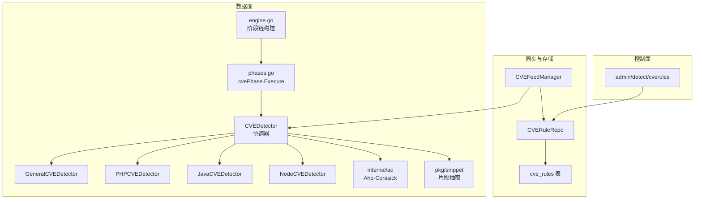
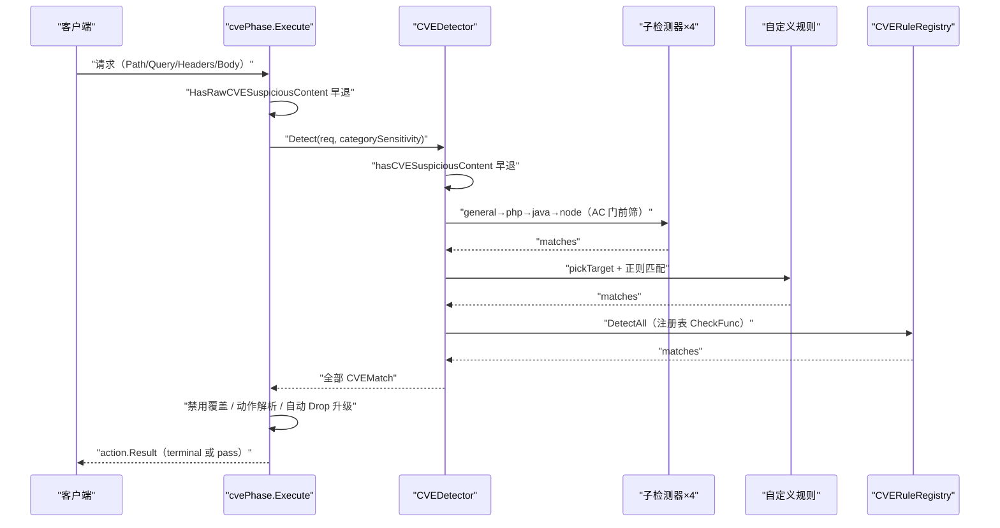
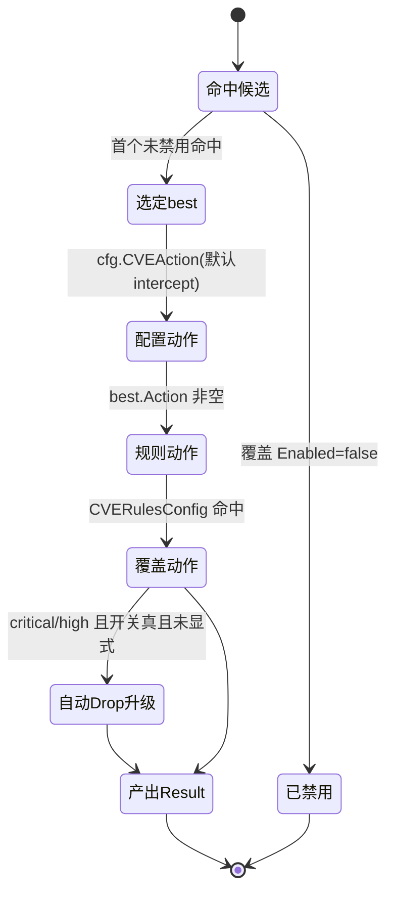
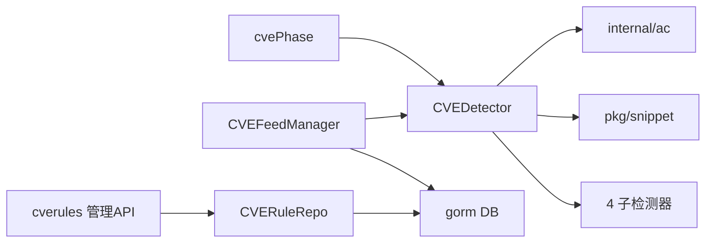

> [返回 安全防护功能](../安全防护功能.md)

# CVE 漏洞检测

<cite>
**本文档引用的文件**
- [detector.go](file://internal/waf/cve/detector.go)
- [general.go](file://internal/waf/cve/general.go)
- [java.go](file://internal/waf/cve/java.go)
- [node.go](file://internal/waf/cve/node.go)
- [php.go](file://internal/waf/cve/php.go)
- [feed.go](file://internal/waf/cve/feed.go)
- [catalog.go](file://internal/waf/cve/catalog.go)
- [ac_registry.go](file://internal/waf/cve/ac_registry.go)
- [ac_subdetector.go](file://internal/waf/cve/ac_subdetector.go)
- [ac.go](file://internal/ac/ac.go)
- [cve.go](file://internal/store/cve/cve.go)
- [cve_scope.go](file://internal/store/cve/cve_scope.go)
- [cve_rule.go](file://internal/store/repository/cve/cve_rule.go)
- [engine.go](file://internal/core/engine/engine.go)
- [phases.go](file://internal/core/rules/phases.go)
- [protection.go](file://internal/store/protection.go)
- [site.go](file://internal/store/site.go)
- [config.go](file://internal/core/config.go)
- [server.go](file://internal/app/server.go)
- [snippet.go](file://internal/pkg/snippet/snippet.go)
</cite>

## 目录

1. [简介](#简介)
2. [项目结构](#项目结构)
3. [核心组件](#核心组件)
4. [架构总览](#架构总览)
5. [详细组件分析](#详细组件分析)
6. [依赖关系分析](#依赖关系分析)
7. [性能考虑](#性能考虑)
8. [故障排查指南](#故障排查指南)
9. [结论](#结论)
10. [附录](#附录)

## 简介

CVE 漏洞检测是 My-OpenWaf 数据面规则管道中的一个独立阶段（阶段名 `cve_detection`），面向已知漏洞的利用特征做请求内容匹配。它由 `CVEDetector` 协调器统一编排四类子检测器（通用、PHP、Java、Node.js）、用户自定义规则与全局注册表规则，配合 Aho-Corasick 前置门降低正则调用量，并在 `cvePhase.Execute` 中把命中的 `CVEMatch` 转换为管道动作。

需要特别说明的是，本实现**不采用受影响版本区间（CPE / version range）模型**。内置规则与自动同步规则都以「正则 `pattern` + 目标域 `target`」对请求的路径、查询、请求头、请求体做内容匹配；`feed` 侧从 NVD/GitHub 采集的 CVSS 分数仅用于推导 `severity` 档位，不参与版本判定。凡涉及「规则条数」的表述，均以 `internal/waf/cve/` 实际代码为准（见「检测器与规则规模」小节）。

## 项目结构

CVE 检测代码集中在 `internal/waf/cve`，管理面在 `internal/admin/detect/cverules`，存储面在 `internal/store/cve` 与 `internal/store/repository/cve`，Aho-Corasick 匹配件复用 `internal/ac`。

| 目录 / 文件 | 职责 | 代表符号 |
|---|---|---|
| `internal/waf/cve/detector.go` | 协调器、模型、注册表、预过滤 | `CVEDetector`、`CVERuleRegistry`、`CVEMatch` |
| `internal/waf/cve/{general,java,php,node}.go` | 四类子检测器与内置规则 | `GeneralCVEDetector`、`JavaCVEDetector` 等 |
| `internal/waf/cve/feed.go` | 外部数据源后台同步与规则生成 | `CVEFeedManager`、`CVERuleModel` |
| `internal/waf/cve/catalog.go` | 内置可执行规则向 `cve_rules` 表对账 | `ReconcileBuiltinCatalog` |
| `internal/waf/cve/ac_registry.go`、`ac_subdetector.go` | AC 前置门（注册表 / 子检测器两套） | `registryNeedleGroups`、`subDetectorNeedleEntries` |
| `internal/store/cve` | 数据模型：规则记录、作用域覆盖、同步日志 | `CVERuleRecord`、`CVERuleScopeOverride`、`CVESyncLog` |
| `internal/store/repository/cve` | 规范快照与 CRUD | `CVERuleRepo` |
| `internal/admin/detect/cverules` | 管理 API：CRUD、批量、作用域、同步 | `ListCVERules`、`BatchUpdateCVERules` |
| `internal/core/rules/phases.go` | CVE 管道阶段 | `cvePhase.Execute` |

**图表来源**
- [detector.go:22-30](file://internal/waf/cve/detector.go#L22-L30)
- [engine.go:499-501](file://internal/core/engine/engine.go#L499-L501)
- [phases.go:720-871](file://internal/core/rules/phases.go#L720-L871)
- [feed.go:17-33](file://internal/waf/cve/feed.go#L17-L33)
- [ac_subdetector.go:120-135](file://internal/waf/cve/ac_subdetector.go#L120-L135)

**章节来源**
- [detector.go:1-30](file://internal/waf/cve/detector.go#L1-L30)
- [feed.go:1-87](file://internal/waf/cve/feed.go#L1-L87)

## 核心组件

| 组件 | 类型 | 核心职责 | 关键定义 |
|---|---|---|---|
| `CVEDetector` | struct | 编排四子检测器 + 自定义 + 注册表，串行执行 | detector.go:22-30 |
| `CVERequest` | struct | 归一化请求为多目标视图（含解码变体） | detector.go:768-787 |
| `CVEMatch` | struct | 命中结果载体（CVE/严重度/动作/片段等） | detector.go:45-62 |
| `CVERuleRegistry` | struct | 全局注册表，`CheckFunc` 型颗粒规则容器 | detector.go:113-146 |
| 四类子检测器 | struct | 各生态正则规则集，含 AC 前置门 | 各语言文件 `New*CVEDetector` |
| `CVEFeedManager` | struct | 后台同步 NVD/GitHub，生成规则入库 | feed.go:17-33 |
| `CVERuleRepo` | struct | 规范快照缓存 + CRUD + 审批计数 | cve_rule.go:31-105 |
| `cvePhase` | struct | 管道阶段，把命中映射为动作 | phases.go:720-735 |

`NewCVEDetector` 只创建 `general`/`php`/`java`/`node` 四个子检测器实例（detector.go:790-797），自定义规则与注册表规则分别由 `ReloadCustomRules` 与 `globalCVERuleRegistry` 提供，检测时统一在 `Detect` 内串行汇总。

**章节来源**
- [detector.go:790-797](file://internal/waf/cve/detector.go#L790-L797)
- [detector.go:113-146](file://internal/waf/cve/detector.go#L113-L146)

## 架构总览

一次请求进入 CVE 阶段时，`cvePhase.Execute` 先用 `HasRawCVESuspiciousContent` 做原始字节级预过滤，命中可疑才 `BuildCVERequestInto` 构建多目标视图，再调用 `CVEDetector.Detect`；`Detect` 以 `hasCVESuspiciousContent` 二次早退后，按「通用 → PHP → Java → Node → 自定义 → 注册表」顺序串行执行，最终把首个有效命中转换为 `action.Result`。

| 阶段序 | 阶段名 | 与 CVE 关系 |
|:--:|---|---|
| 1 | ip_reputation | 前置 |
| 2 | anti_replay | 前置 |
| 3 | acl | 前置 |
| 4 | lua_pre | 前置 |
| 5 | owasp_default | CVE 之前 |
| 6 | cve | 本文档主题 |
| 7 | bot | CVE 之后 |
| 8 | browser_sign | 之后 |
| 9 | rate_limit | 之后 |
| 10 | signature | 之后 |
| 11 | custom | 之后 |

引擎在 `engine.go:465-548` 构建阶段链，容量预分配为 11（engine.go:467）。CVE 阶段仅在 `prot.CVEEnabled && e.cveDetector != nil` 时入链（engine.go:499-501），位于 OWASP（496-498）之后、Bot（503）之前。

**图表来源**
- [phases.go:744-871](file://internal/core/rules/phases.go#L744-L871)
- [detector.go:1793-1863](file://internal/waf/cve/detector.go#L1793-L1863)

**章节来源**
- [engine.go:465-548](file://internal/core/engine/engine.go#L465-L548)
- [phases.go:744-871](file://internal/core/rules/phases.go#L744-L871)

## 详细组件分析

### 检测器与规则规模

内置规则存在两种载体：一是 `globalCVERuleRegistry` 中以 `CVERule.CheckFunc` 闭包封装的「注册表规则」（各语言文件 `init()` 中 `Register`）；二是各 `*CVEDetector.rules` 中以「多正则 + target + AC 门」组织的「子检测器规则」。两者都在 `Detect` 中被执行。

| 检测器 | 子检测器规则（rules 数组） | 注册表规则（init Register） | 敏感度跳过键 |
|---|:--:|:--:|---|
| 通用 GeneralCVEDetector | 34 | 31 | `cve_general` |
| PHP PHPCVEDetector | 10 | 2 | `cve_php` |
| Java JavaCVEDetector | 10 | 2 | `cve_java` |
| Node NodeCVEDetector | 11 | 2 | `cve_node` |
| 合计 | 65 | 37 | — |

> 数字口径：子检测器规则按各文件 `New*CVEDetector` 中 `cveID:` 条目计数；注册表规则按 `globalCVERuleRegistry.Register(&CVERule{` 计数。同一 CVE 编号可能在两种载体中重复（如 `CVE-2021-44228`、`CVE-2025-55182`），故合计为「检测入口数」而非去重后的唯一 CVE 数。

**章节来源**
- [detector.go:1793-1863](file://internal/waf/cve/detector.go#L1793-L1863)
- [general.go:817-851](file://internal/waf/cve/general.go#L817-L851)
- [java.go:133-198](file://internal/waf/cve/java.go#L133-L198)
- [php.go:128-193](file://internal/waf/cve/php.go#L128-L193)
- [node.go:212-297](file://internal/waf/cve/node.go#L212-L297)

### CVEMatch 与命中动作映射

`CVEMatch`（detector.go:45-62）承载命中：`CVEID`/`Category`/`Severity`/`Description`/`MatchedPart`/`Pattern`/`Action`/`CaptchaType`，以及来自数据库规则行的 `Source`/`CVSSScore`/`CWEType`/`References` 和由 `snippet.Extract` 生成的 `Snippet`。内置注册表规则的 `Source` 缺省补为 `builtin`（detector.go:222-236）。

`cvePhase.Execute` 的动作决策按以下优先级：

| 序 | 依据 | 行为 | 行号 |
|:--:|---|---|---|
| 1 | 全局 `cfg.CVEAction` | 缺省 `intercept` | phases.go:790-794 |
| 2 | 命中规则自带 `best.Action` | 覆盖并置 `explicitAction` | phases.go:799-802 |
| 3 | `CVERulesConfig` 作用域覆盖 | 覆盖 action/status/redirect/captcha | phases.go:806-825 |
| 4 | critical/high 自动 Drop | 仅未显式动作且开关为真时升级 | phases.go:827-839 |
| 5 | 非 CAPTCHA 动作 | 清空 `CaptchaType` | phases.go:840-842 |

命中在事件中的规则标识为 `cve:` + `CVEID`，分类透传子检测器已产出的 `cve_*` 前缀值，缺省回落 `cve_general`（phases.go:846-869）。

**图表来源**
- [phases.go:769-870](file://internal/core/rules/phases.go#L769-L870)

**章节来源**
- [detector.go:45-62](file://internal/waf/cve/detector.go#L45-L62)
- [detector.go:222-236](file://internal/waf/cve/detector.go#L222-L236)
- [phases.go:790-869](file://internal/core/rules/phases.go#L790-L869)

### Aho-Corasick 前置门

为在数百条正则前低成本裁剪候选，CVE 使用两套 AC 自动机：注册表门 `registryNeedleGroups`（23 组 needle，ac_registry.go:18-61）与子检测器门 `subDetectorNeedleEntries`（64 条，按 `all/url/body/header/cookie/url_body` 六视图分组，ac_subdetector.go:53-96）。门取的是各规则正则的**必要字面**——正则命中必然包含该字面，因此门只减少 `CheckFunc`/正则调用次数，不改变任何判定（`registryACGate`/`subDetectorACGate` 对无门规则一律放行）。AC 匹配器本身容量 `MaxPatterns=512`、位图 `MaskWordCount=8`（ac.go:4-5）。

**章节来源**
- [ac_registry.go:18-88](file://internal/waf/cve/ac_registry.go#L18-L88)
- [ac_subdetector.go:101-159](file://internal/waf/cve/ac_subdetector.go#L101-L159)
- [ac.go:4-5](file://internal/ac/ac.go#L4-L5)

### 数据源同步与目录对账

`CVEFeedManager` 由 `server.go:452` 以 `NewCVEFeedManagerWithFeed` 构造并 `Start()`，同步间隔来自 `MY_OPENWAF_CVE_FEED_INTERVAL`（缺省 6h，config.go:404、server.go:448-450）。它从 NVD API 2.0 与 GitHub Advisory API 拉取增量并生成规则；`loadRulesIntoDetector` 只把 `approved = true AND source <> 'catalog'` 的规则注入检测器（feed.go:203）。内置可执行规则则经 `ReconcileBuiltinCatalog` 以 `source='catalog'` 落入同一张 `cve_rules` 表供管理面展示，但不参与运行时注入（catalog.go:11-113）。详细同步参数见《CVE 数据源同步》。

**章节来源**
- [feed.go:90-228](file://internal/waf/cve/feed.go#L90-L228)
- [catalog.go:17-113](file://internal/waf/cve/catalog.go#L17-L113)
- [server.go:448-454](file://internal/app/server.go#L448-L454)

### 配置开关与三态继承

| 配置项 | 载体 | 类型 | 默认值 | 说明 |
|---|---|---|---|---|
| `cve_enabled` | 全局 ProtectionConfig | bool | false（env 驱动） | 数据面是否入链 |
| `cve_enabled` | 站点级 AttackProtectionConfig | *bool | nil=继承 | 非 nil 时覆盖全局 |
| `cve_action` | 全局 / 站点 | string | observe / intercept 按模式 | 命中动作基线 |
| `cve_auto_drop_critical` | ProtectionConfig | bool | true | critical 未显式动作时自动 Drop |
| `cve_auto_drop_high` | ProtectionConfig | bool | true | high 未显式动作时自动 Drop |
| `cve_rules_config` | ProtectionConfig | string(JSON) | — | 规则级禁用/动作覆盖 |
| `MY_OPENWAF_CVE_FEED_*` | 环境变量 | — | 关/6h | 同步开关、间隔、Key、自动审批 |

站点级 `CVEEnabled` 为 `*bool`，`nil` 表示继承全局，仅在非 nil 时读取覆盖（site.go:79）；站点保护模式初始化会显式置 `&enabled` 并设定 `cve_action`（site.go:161-174）。

**章节来源**
- [protection.go:48-52](file://internal/store/protection.go#L48-L52)
- [protection.go:180-181](file://internal/store/protection.go#L180-L181)
- [site.go:79-80](file://internal/store/site.go#L79-L80)
- [site.go:161-174](file://internal/store/site.go#L161-L174)
- [config.go:396-405](file://internal/core/config.go#L396-L405)

## 依赖关系分析

| 依赖方 | 被依赖 | 性质 |
|---|---|---|
| `cvePhase` | `CVEDetector`、`store.ProtectionConfig` | 阶段执行 |
| `CVEDetector` | 四子检测器、`internal/ac`、`pkg/snippet` | 组合 |
| 各子检测器 | `regexp`、`snippet`、`internal/ac` | 匹配 |
| `CVEFeedManager` | `gorm.DB`、`CVEDetector`、NVD/GitHub HTTP | 同步 |
| `CVERuleRepo` | `cve.CVERuleModel`、`store/cve` 覆盖模型 | 持久化 |
| 管理 API | `CVERuleRepo`、`CVEFeedManager` | 控制面 |

自定义规则以 `atomic.Pointer` 无锁读、写时复制替换（detector.go:28、2251-2298）；注册表读用 `RWMutex`（detector.go:114、176-194）。`CVEFeedManager` 依赖数据库与检测器，管理 API 依赖仓库与 `CVEFeedManager`，无循环依赖。

**图表来源**
- [detector.go:16-18](file://internal/waf/cve/detector.go#L16-L18)
- [detector.go:2251-2298](file://internal/waf/cve/detector.go#L2251-L2298)
- [feed.go:17-33](file://internal/waf/cve/feed.go#L17-L33)

**章节来源**
- [detector.go:16-30](file://internal/waf/cve/detector.go#L16-L30)
- [cve_rule.go:31-105](file://internal/store/repository/cve/cve_rule.go#L31-L105)

## 性能考虑

- **两级早退**：`HasRawCVESuspiciousContent` 在阶段入口对原始字节判定，`hasCVESuspiciousContent` 在 `Detect` 内对归一化目标判定，明显干净请求两次快速返回。
- **AC 前置门**：64 条子检测器门 + 23 组注册表门在正则执行前裁剪候选，且门为必要字面，不影响判定。
- **串行执行**：绝大多数请求不命中任何规则，`Detect` 顺序执行四类子检测器以省去 goroutine 派生与同步开销（detector.go:1809-1838）。
- **片段有界**：命中片段由 `snippet` 截断到 `MaxLen=256`、上下文 `ContextLen=48`，且对超长目标串（`MaxTargetLen=2*16384+1`）直接跳过，避免在异常输入上重复跑正则（snippet.go:11-22）。
- **规范快照缓存**：`CVERuleRepo.CanonicalSnapshot` 以 10 秒 TTL + singleflight 合并冷读，控制管理面聚合查询的数据库压力（cve_rule.go:15-105）。

**章节来源**
- [detector.go:1793-1863](file://internal/waf/cve/detector.go#L1793-L1863)
- [snippet.go:8-22](file://internal/pkg/snippet/snippet.go#L8-L22)
- [cve_rule.go:15-105](file://internal/store/repository/cve/cve_rule.go#L15-L105)

## 故障排查指南

| 症状 | 可能原因 | 排查 |
|---|---|---|
| CVE 阶段完全不触发 | 全局 `cve_enabled=false` 或站点继承关闭 | 检查 ProtectionConfig 与站点 `CVEEnabled`；确认 `e.cveDetector != nil`（engine.go:499-501） |
| 命中但不阻断 | `cve_action` 为 observe，且未触发自动 Drop | 核对 `cve_auto_drop_critical/high`（phases.go:827-839） |
| 规则未生效 | 未审批（`approved=false`）或来源为 catalog | 确认 `source <> 'catalog'` 且 `approved=true`（feed.go:203） |
| 验证码类型未显示 | 动作不是 `captcha_challenge` | CAPTCHA 类型仅在对应动作下保留（phases.go:840-842） |
| 外部同步失败 | API 非 200 / 超时 / 解析失败 | 查看 `cve-feed/status` 的 `last_error`；确认 `MY_OPENWAF_NVD_API_KEY` 与网络 |

**章节来源**
- [engine.go:499-501](file://internal/core/engine/engine.go#L499-L501)
- [feed.go:201-228](file://internal/waf/cve/feed.go#L201-L228)
- [phases.go:827-842](file://internal/core/rules/phases.go#L827-L842)

## 结论

CVE 漏洞检测以 `CVEDetector` 为协调中枢，用「四类子检测器 + 全局注册表 + 自定义规则」三种载体覆盖跨语言与生态特定的利用特征，并借两级早退与 Aho-Corasick 必要字面门把昂贵正则控制在真正可疑的流量上。命中经 `cvePhase.Execute` 按「配置动作 → 规则动作 → 作用域覆盖 → 自动 Drop 升级」优先级映射为管道动作。控制面提供完整 CRUD、作用域三态覆盖与外部数据源同步。本实现基于内容正则而非版本区间，规则条数以代码为准。

## 附录

### 相关子文档索引

| 文档 | 范围 |
|---|---|
| CVE 检测器架构 | 协调器/注册表/CVERequest/CVEMatch 的并发与执行细节 |
| CVE 数据源同步 | NVD/GitHub 拉取、CWE 映射、状态机 |
| CVE 规则管理 | 数据模型、作用域三态、验证、管理 API |
| 多语言检测器 | Java/PHP/Node.js 三类语言检测器能力矩阵 |

### 关键常量速查

| 常量 | 值 | 出处 |
|---|---|---|
| 默认同步间隔 | 6h | config.go:404 |
| NVD 每页条数 | 50 | feed.go:281 |
| NVD 单次最大页数 | 50 | feed.go:292 |
| AC MaxPatterns / MaskWord | 512 / 8 | ac.go:4-5 |
| snippet MaxLen / ContextLen | 256 / 48 | snippet.go:11-14 |
| CVE 阶段链容量 | 11 | engine.go:467 |

**章节来源**
- [feed.go:276-293](file://internal/waf/cve/feed.go#L276-L293)
- [config.go:403-405](file://internal/core/config.go#L403-L405)
- [ac.go:4-5](file://internal/ac/ac.go#L4-L5)
