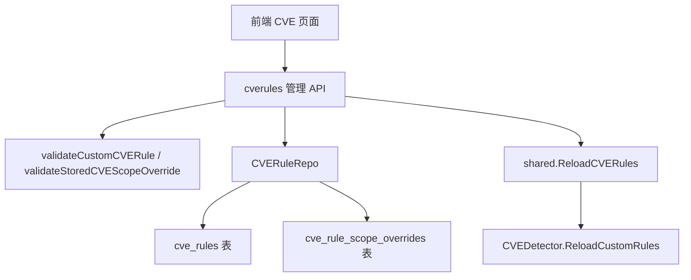
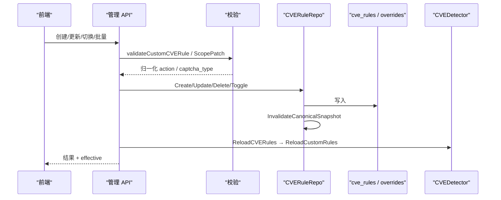
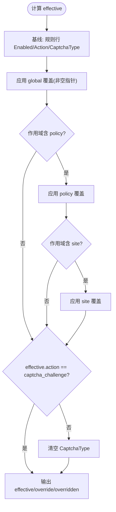
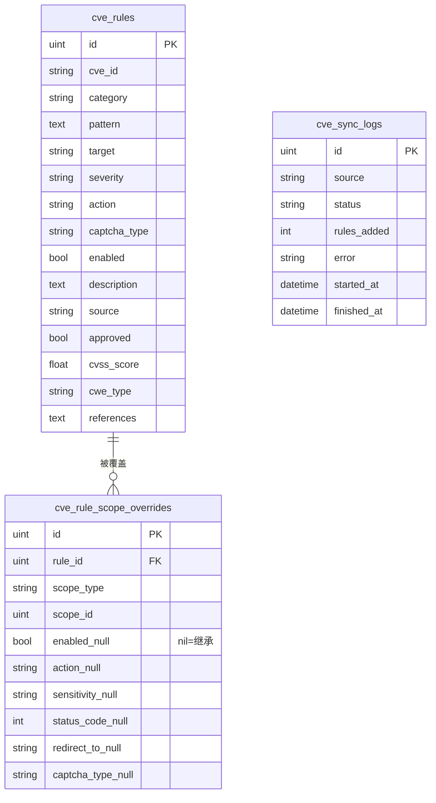

> [返回 安全防护功能](../安全防护功能.md)

# CVE 规则管理

<cite>
**本文档引用的文件**
- [cve.go](file://internal/admin/detect/cverules/cve.go)
- [cve_scope.go](file://internal/admin/detect/cverules/cve_scope.go)
- [cve_rules.go](file://internal/admin/detect/cverules/cve_rules.go)
- [cve_rule.go](file://internal/store/repository/cve/cve_rule.go)
- [cve.go](file://internal/store/cve/cve.go)
- [cve_scope.go](file://internal/store/cve/cve_scope.go)
- [feed.go](file://internal/waf/cve/feed.go)
- [detector.go](file://internal/waf/cve/detector.go)
- [helpers.go](file://internal/admin/shared/helpers.go)
- [router.go](file://internal/admin/router.go)
- [types.ts](file://frontend/lib/types.ts)
- [api.ts](file://frontend/lib/api.ts)
</cite>

## 目录

1. [简介](#简介)
2. [项目结构](#项目结构)
3. [核心组件](#核心组件)
4. [架构总览](#架构总览)
5. [详细组件分析](#详细组件分析)
6. [依赖关系分析](#依赖关系分析)
7. [性能考虑](#性能考虑)
8. [故障排查指南](#故障排查指南)
9. [结论](#结论)
10. [附录](#附录)

## 简介

CVE 规则管理覆盖规则的**数据模型、作用域三态继承、验证约束、持久化与热重载、管理 API**。所有规则（自定义、自动同步、目录）统一存于 `cve_rules` 表；作用域覆盖（global / policy / site）单独存于 `cve_rule_scope_overrides` 表，以可空字段实现「继承 / 覆盖启用 / 覆盖关闭」三态语义。管理 API 变更后通过 `shared.ReloadCVERules` 触发热重载，并经快照失效使控制面视图与数据面一致。

## 项目结构

| 层 | 文件 | 职责 |
|---|---|---|
| 管理 API | admin/detect/cverules/{cve,cve_scope,cve_rules}.go | CRUD、批量、作用域、状态 |
| 路由 | admin/router.go | 端点注册（见附录） |
| 数据模型 | store/cve/cve.go、cve_scope.go | `CVERuleRecord`、`CVERuleScopeOverride` |
| 运行时模型 | waf/cve/feed.go | `CVERuleModel`（映射同一 `cve_rules` 表） |
| 仓库 | store/repository/cve/cve_rule.go | 规范快照 + CRUD + 审批计数 |
| 热重载 | admin/shared/helpers.go | `ReloadCVERules` |

> `store/cve.CVERuleRecord`（负责 AutoMigrate 建表/加列）与 `waf/cve.CVERuleModel`（负责运行时读写）映射同一张 `cve_rules` 表，字段集必须保持一致，否则会出现列不存在（见 store/cve/cve.go:28-32 注释）。

**图表来源**
- [cve.go](file://internal/admin/detect/cverules/cve.go)
- [cve_scope.go](file://internal/admin/detect/cverules/cve_scope.go)
- [cve_rule.go](file://internal/store/repository/cve/cve_rule.go)
- [helpers.go](file://internal/admin/shared/helpers.go)

**章节来源**
- [cve.go](file://internal/admin/detect/cverules/cve.go)
- [cve.go](file://internal/store/cve/cve.go)

## 核心组件

| 组件 | 职责 | 关键行号 |
|---|---|---|
| `CVERuleModel` | 规则行模型（`cve_rules`） | feed.go:36-59 |
| `CVERuleScopeOverride` | 作用域可空覆盖 | store/cve/cve_scope.go:12-25 |
| `ListCVERules` | 作用域有效视图 + 过滤分页 | admin/cve.go:112-158 |
| `CreateCVERule`/`UpdateCVERule`/`DeleteCVERule` | 仅自定义规则可增删改 | admin/cve.go:160-315 |
| `ToggleCVERule` | 启用切换 | admin/cve.go:317-367 |
| `UpdateSingleCVERule`/`BatchUpdateCVERules` | 作用域覆盖写入 | admin/cve_rules.go:67-179 |
| `effectiveCVERule` | 三层合并计算有效配置 | admin/cve_scope.go:110-159 |
| `CanonicalSnapshot` | 10s TTL 深拷贝快照 | cve_rule.go:73-105 |

**章节来源**
- [cve.go](file://internal/admin/detect/cverules/cve.go)
- [cve_scope.go](file://internal/admin/detect/cverules/cve_scope.go)
- [cve_rule.go](file://internal/store/repository/cve/cve_rule.go)

## 架构总览

管理写路径遵循「校验 → 持久化 → 失效快照 → 热重载」。读路径基于 `CanonicalSnapshot` 取规则与覆盖，按作用域逐层合并出 `effective` 视图。任何写操作后都调用 `InvalidateCanonicalSnapshot`（cve_rule.go:109-114）与 `ReloadCVERules`（helpers.go），使数据面 `CVEDetector.ReloadCustomRules` 与展示视图同步。

**图表来源**
- [cve.go](file://internal/admin/detect/cverules/cve.go)
- [cve_rule.go](file://internal/store/repository/cve/cve_rule.go)
- [detector.go:2251-2265](file://internal/waf/cve/detector.go#L2251-L2265)

**章节来源**
- [cve.go](file://internal/admin/detect/cverules/cve.go)
- [helpers.go](file://internal/admin/shared/helpers.go)

## 详细组件分析

### 规则字段明细（CVERuleModel / CVERuleRecord）

| 字段 | 列 | 类型/默认 | 说明 |
|---|---|---|---|
| ID | id | uint PK | 作用域覆盖按数字 ID 引用 |
| CVEID | cve_id | size:32, index | CVE 编号 |
| Category | category | size:32 | `cve_general`/`cve_java`/... 或 feed 生成的 `general` |
| Pattern | pattern | text | 检测正则（`(?i)` 前缀在热重载时补齐） |
| Target | target | size:32 | all/url/url_body/body/header/cookie |
| Severity | severity | size:16 | critical/high/medium/low |
| Action | action | size:32, default `drop` | 命中动作 |
| CaptchaType | captcha_type | size:16 | 仅 `captcha_challenge` 动作下有义 |
| Enabled | enabled | default `false` | 是否启用 |
| Source | source | size:32 | `custom`/`nvd`/`github`/`auto_generated`/`catalog` |
| Approved | approved | default `false` | 审批门；未批准不注入检测器 |
| CVSSScore | cvss_score | float | 仅用于推导 severity |
| CWEType | cwe_type | size:32 | CWE 分类 |
| References | references | text | NVD 参考链接，换行分隔 |

**章节来源**
- [cve.go](file://internal/store/cve/cve.go)
- [feed.go:36-59](file://internal/waf/cve/feed.go#L36-L59)
- [detector.go:2251-2258](file://internal/waf/cve/detector.go#L2251-L2258)

### 作用域三态覆盖（CVERuleScopeOverride）

覆盖表以 `(rule_id, scope_type, scope_id)` 唯一索引存行，每个字段都是指针类型：`nil` 表示继承上层，非 `nil` 表示在当前作用域覆盖。

| 字段 | 类型 | 三态语义 |
|---|---|---|
| ScopeType | string | `global` / `policy` / `site`（store/cve/cve_scope.go:5-9） |
| Enabled | `*bool` | nil=继承，false=覆盖关闭，true=覆盖启用 |
| Action | `*string` | nil=继承；非空=覆盖动作 |
| Sensitivity | `*string` | nil=继承；档位 low/mid/medium/high/very_high/strict/off |
| StatusCode | `*int` | nil=继承；100–599 |
| RedirectTo | `*string` | `redirect` 动作必填 |
| CaptchaType | `*string` | 仅 `captcha_challenge` 有效 |

合并顺序为 global(0) → policy → site，逐层用非空指针覆盖 `effective`，并记录 `inherited_from`（admin/cve_scope.go:110-159）。非 CAPTCHA 动作时会清空 `CaptchaType`，避免前端展示运行时不会渲染的挑战类型（152-157）。

**图表来源**
- [cve_scope.go](file://internal/admin/detect/cverules/cve_scope.go)
- [cve_scope.go](file://internal/store/cve/cve_scope.go)

**章节来源**
- [cve_scope.go](file://internal/admin/detect/cverules/cve_scope.go)

### 验证约束

自定义规则（`validateCustomCVERule`）与作用域覆盖（`validateStoredCVEScopeOverride`）分别校验：

| 约束 | 规则 CRUD | 作用域覆盖 |
|---|---|---|
| Target 枚举 | all/url/url_body/body/header/cookie | — |
| 长度上限 | cve_id 32、category 32、target 32、severity 16、captcha_type 16、pattern 64KiB、description 64KiB | — |
| 正则合法性 | 必须能编译 | — |
| 动作 | `ValidateActionWithoutRedirectTarget` | `ValidateActionWithRedirectTarget`（带 redirect_to） |
| 状态码 | — | 非 0 时 100–599 |
| 敏感度 | — | low/mid/medium/high/very_high/strict/off |
| captcha_type | 须 `captcha_challenge` 动作 | 须同请求选 `captcha_challenge` |
| redirect_to | — | `redirect` 动作必填 |

部分更新用指针区分「未提交」与「显式 false/空」，避免把省略字段误写成 false（admin/cve.go:210-260、cve_scope.go:286-323）。

**章节来源**
- [cve.go](file://internal/admin/detect/cverules/cve.go)
- [cve_scope.go](file://internal/admin/detect/cverules/cve_scope.go)

### 权限边界：仅自定义规则可改删

`UpdateCVERule`/`DeleteCVERule`/`ToggleCVERule` 均先检查 `existing.Source == "custom"`，否则返回 403（admin/cve.go:205-208、297-300、330-333）。`CreateCVERule` 固定写入 `source="custom"`、`approved=true`（173-174）。目录规则与同步规则不得经此路径编辑，只能通过作用域覆盖调整生效状态。删除自定义规则时在同一事务内清理其作用域覆盖，避免重建规则继承旧配置（cve_rule.go:264-278）。

**章节来源**
- [cve.go](file://internal/admin/detect/cverules/cve.go)
- [cve_rule.go](file://internal/store/repository/cve/cve_rule.go)

### 持久化与热重载

`CVERuleRepo` 提供 `List/Get/Create/Update/Delete/Toggle/PendingApprovalCount`，写方法都会 `InvalidateCanonicalSnapshot`（cve_rule.go:248-293）。`CanonicalSnapshot` 以 10 秒 TTL 缓存规则与覆盖的深拷贝，冷读用 singleflight 合并（15-16、73-105）；`loadCanonicalSnapshot` 上限 10000 条规则（cve_rule.go:136）。数据面重载经 `shared.ReloadCVERules → CVEFeedManager.ReloadRules → loadRulesIntoDetector`，仅注入 `approved & source<>catalog` 的规则并重新编译（feed.go:201-228、detector.go:2251-2265）。

**图表来源**
- [cve.go](file://internal/store/cve/cve.go)
- [cve_scope.go](file://internal/store/cve/cve_scope.go)
- [cve_rule.go](file://internal/store/repository/cve/cve_rule.go)

> `cve_sync_logs` 表结构（`CVESyncLog`）已在 `store/cve/cve.go:38-46` 定义，但当前 CVE feed 循环不落该表，同步状态走内存 `SyncStatus`（见《CVE 数据源同步》）。

**章节来源**
- [cve_rule.go](file://internal/store/repository/cve/cve_rule.go)
- [feed.go:201-228](file://internal/waf/cve/feed.go#L201-L228)

### 统计与列表视图

`ListCVERules` 支持 `page/page_size`（默认 1/20）与 `category/severity/enabled/source/q` 过滤，`q` 超 256 字节返回 400（admin/cve.go:112-158）。`GetCVERuleStats` 汇总 `total/enabled_count/disabled_count/by_category/by_severity` 及作用域（cve_rules.go:18-64）。列表基于作用域有效视图，故同一规则在不同 `scope` 下 `effective` 可能不同。

**章节来源**
- [cve.go](file://internal/admin/detect/cverules/cve.go)
- [cve_rules.go](file://internal/admin/detect/cverules/cve_rules.go)

## 依赖关系分析

| 依赖方 | 被依赖 |
|---|---|
| 管理 API | `CVERuleRepo`、`CVEFeedManager`、`shared.ReloadCVERules` |
| 作用域计算 | `store/cve` 模型、`action.Normalize` |
| 前端类型 | `CVEEffectiveConfig`/`CVERuleItem`/`CVERuleWriteInput`（types.ts:327-394） |
| 前端调用 | `cveApi.*`（api.ts:1001-1033） |

前端 `CVERuleItem.effective/inherited_from/overridden` 字段与后端 `cveScopedRuleView` 对齐，避免把内置规则作用域覆盖与全局自定义规则写入混用（types.ts:338-358、360-376）。

**章节来源**
- [cve.go](file://internal/admin/detect/cverules/cve.go)
- [types.ts](file://frontend/lib/types.ts)
- [api.ts](file://frontend/lib/api.ts)

## 性能考虑

- **快照缓存**：列表/统计共用 10s TTL 的 `CanonicalSnapshot`，减少聚合查询数据库往返（cve_rule.go:15-105）。
- **按需失效**：写后仅 `InvalidateCanonicalSnapshot` 递增代次，不做全量预热，下次读再重建（109-114）。
- **过滤下推**：`List` 的 DB 层过滤用 category/severity/enabled/source/LOWER LIKE（cve_rule.go:212-241）；作用域视图在内存过滤后再分页。
- **正则预编译**：热重载一次性编译，非法模式跳过，避免运行期成本（detector.go:2251-2265）。

**章节来源**
- [cve_rule.go](file://internal/store/repository/cve/cve_rule.go)
- [detector.go:2251-2265](file://internal/waf/cve/detector.go#L2251-L2265)

## 故障排查指南

| 症状 | 原因 | 处理 |
|---|---|---|
| 更新报 403 | 规则 `source!=custom` | 改用作用域覆盖调整 |
| 布尔字段被误清空 | 部分更新未用指针 | 确认前端提交 `enabled` 显式值 |
| 保存 captcha_type 报错 | 动作非 captcha_challenge | 同时提交动作（admin/cve.go:98-100、cve_scope.go:226-236） |
| redirect 保存失败 | 缺 redirect_to | 补齐目标（cve_scope.go:279-282） |
| 覆盖后不生效 | 未触发热重载 | 检查 `ReloadCVERules` 与快照失效 |

**章节来源**
- [cve.go](file://internal/admin/detect/cverules/cve.go)
- [cve_scope.go](file://internal/admin/detect/cverules/cve_scope.go)

## 结论

CVE 规则管理以单一 `cve_rules` 表承载全部规则来源，以 `cve_rule_scope_overrides` 的可空字段实现 global/policy/site 三态继承，验证层严格约束枚举、长度、正则与动作-验证码一致性，写路径统一走「持久化 → 失效快照 → 热重载」，读路径基于带 TTL 的规范快照计算有效视图。权限边界明确限定自定义规则方可增删改，目录与同步规则只经作用域覆盖调整。

## 附录

### 管理 API 端点

| 方法 | 路径 | 处理器 | 路由 |
|---|---|---|---|
| GET | `/api/v1/cve-rules` | `ListCVERules` | router.go:220 |
| GET | `/api/v1/cve-rules/stats` | `GetCVERuleStats` | router.go:221 |
| GET | `/api/v1/cve-feed/status` | `GetCVEFeedStatus` | router.go:222 |
| POST | `/api/v1/cve-rules/:id/toggle` | `ToggleCVERule` | router.go:317 |
| POST | `/api/v1/cve-rules/:id/patch` | `UpdateSingleCVERule` | router.go:318 |
| POST | `/api/v1/cve-rules/:id/reset` | `ResetCVERuleOverride` | router.go:319 |
| POST | `/api/v1/cve-rules/batch` | `BatchUpdateCVERules` | router.go:320 |
| POST | `/api/v1/cve-rules/sync` | `SyncCVERules` | router.go:321 |
| POST | `/api/v1/cve-rules` | `CreateCVERule` | router.go:410 |
| POST | `/api/v1/cve-rules/:id/update` | `UpdateCVERule` | router.go:411 |
| POST | `/api/v1/cve-rules/:id/delete` | `DeleteCVERule` | router.go:412 |

### 动作取值

规则动作字段经 `ValidateAction*` 归一，可取 `intercept`、`observe`、`drop`、`challenge`、`captcha_challenge`、`shield_challenge`、`chain_challenge`、`redirect` 等；`block` 为 legacy 兼容值。`CVEMatch.Action` 注释标注内置取值 drop/block/log（detector.go:52）。

**章节来源**
- [router.go](file://internal/admin/router.go)
- [detector.go:52](file://internal/waf/cve/detector.go#L52)
