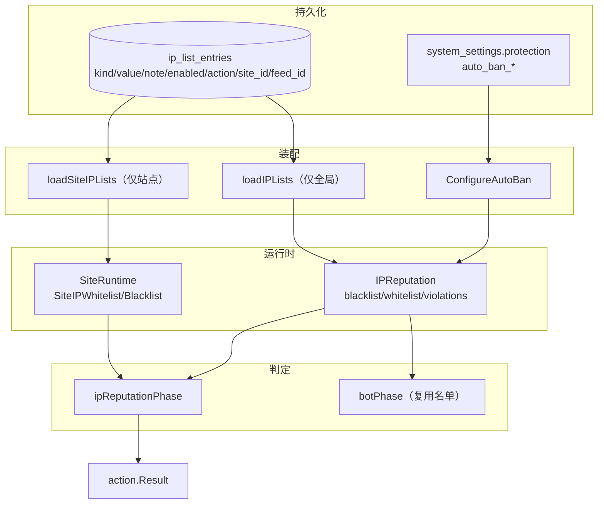
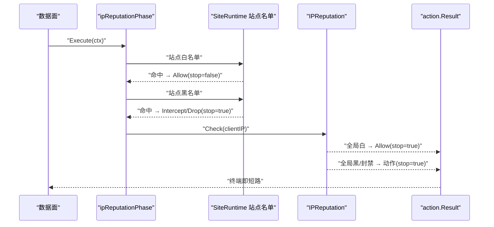
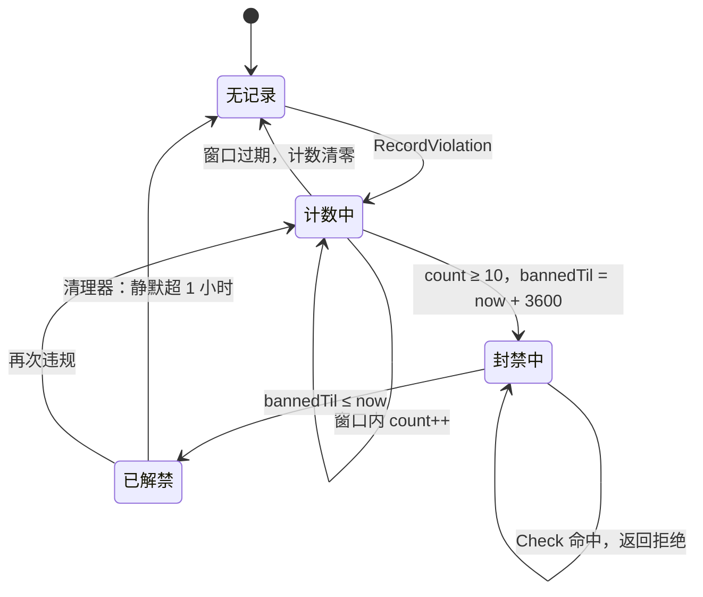
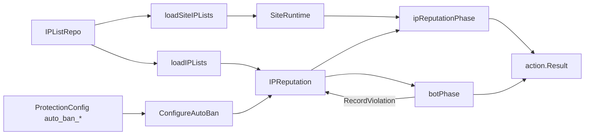

> [返回 安全防护功能](安全防护功能.md)

# IP 信誉系统

<cite>
**本文档引用的文件**
- [internal/waf/iprep/iprep.go](file://internal/waf/iprep/iprep.go)
- [internal/waf/iprep/iprep_test.go](file://internal/waf/iprep/iprep_test.go)
- [internal/waf/bot/bot.go](file://internal/waf/bot/bot.go)
- [internal/core/rules/phases.go](file://internal/core/rules/phases.go)
- [internal/core/engine/engine.go](file://internal/core/engine/engine.go)
- [internal/core/action/action.go](file://internal/core/action/action.go)
- [internal/core/pipeline/pipeline.go](file://internal/core/pipeline/pipeline.go)
- [internal/security/clientip.go](file://internal/security/clientip.go)
- [internal/store/iplist/ip_list.go](file://internal/store/iplist/ip_list.go)
- [internal/store/repository/iplist/ip_list.go](file://internal/store/repository/iplist/ip_list.go)
- [internal/store/protection.go](file://internal/store/protection.go)
- [internal/store/site.go](file://internal/store/site.go)
- [internal/snapshot/build.go](file://internal/snapshot/build.go)
- [internal/admin/system/iplist/iplist.go](file://internal/admin/system/iplist/iplist.go)
- [internal/admin/system/presetbots/preset_bots.go](file://internal/admin/system/presetbots/preset_bots.go)
- [internal/admin/system/sitescope/site_scope.go](file://internal/admin/system/sitescope/site_scope.go)
- [internal/admin/router.go](file://internal/admin/router.go)
- [internal/app/server.go](file://internal/app/server.go)
- [internal/dataplane/handler.go](file://internal/dataplane/handler.go)
- [internal/visitorfusion/classifier.go](file://internal/visitorfusion/classifier.go)
- [frontend/lib/api.ts](file://frontend/lib/api.ts)
- [frontend/lib/types.ts](file://frontend/lib/types.ts)
- [internal/dataplane/handler.go](file://internal/dataplane/handler.go)
- [internal/dataplane/challenge.go](file://internal/dataplane/challenge.go)
- [frontend/app/(dashboard)/ip-lists/page.tsx](file://frontend/app/(dashboard)/ip-lists/page.tsx)
</cite>

## 目录

1. [简介](#简介)
2. [项目结构](#项目结构)
3. [核心组件](#核心组件)
4. [架构总览](#架构总览)
5. [详细组件分析](#详细组件分析)
6. [依赖关系分析](#依赖关系分析)
7. [性能考虑](#性能考虑)
8. [故障排查指南](#故障排查指南)
9. [结论](#结论)
10. [附录](#附录)

## 简介
IP 信誉系统负责三件事：维护黑白名单、按违规计数做自动封禁、把判定结果交给处理阶段。它是阶段链的第一环（`ip_reputation`），因此也是最便宜的止损点。

系统的关键设计是**双层名单 + 内存封禁**：
- 全局名单驻留在 `IPReputation` 单例，命中即短路整条阶段链
- 站点名单驻留在快照的 `SiteRuntime`，白名单命中**不短路**，只豁免本层判定
- 自动封禁状态只在内存（`sync.Map`），进程重启即清空，持久化名单必须走 `ip_list_entries`

本轮订正两处常被写错的事实：带过期语义的字段只存在于 `iprep` 包之内——条目侧是 `iprep.IPListEntry.ExpireAt`，封禁侧是 `iprep.BanEntry.BannedTil`——而**存储模型 `store/iplist.IPListEntry` 没有任何过期列**；白名单条目的动作在创建与更新时被强制回写为 `intercept`，不参与 Drop 决策。

**章节来源**
- [internal/waf/iprep/iprep.go:10-51](file://internal/waf/iprep/iprep.go#L10-L51)
- [internal/core/rules/phases.go:368-433](file://internal/core/rules/phases.go#L368-L433)
- [internal/store/iplist/ip_list.go:17-30](file://internal/store/iplist/ip_list.go#L17-L30)

## 项目结构
四层各司其职：算法包、阶段适配、存储模型、管理接口。

| 层 | 文件 | 行数 | 职责 | 关键符号 |
|---|---|:--:|---|---|
| 算法 | [iprep.go](file://internal/waf/iprep/iprep.go) | 281 | 名单匹配、封禁、清理 | `IPReputation`、`IPListEntry`、`IPDecision` |
| 阶段 | [phases.go](file://internal/core/rules/phases.go) | 342-433 | 站点名单 + 全局信誉融合 | `ipReputationPhase` |
| 存储模型 | [ip_list.go](file://internal/store/iplist/ip_list.go) | 30 | 持久化条目与作用域 | `iplist.IPListEntry`、`IPListKind` |
| 仓储 | [repository/iplist](file://internal/store/repository/iplist/ip_list.go) | 62 | 分页/作用域查询 | `IPListRepo` |
| 管理 | [system/iplist](file://internal/admin/system/iplist/iplist.go) | 212 | CRUD 与动作归一化 | `CreateIPEntry`、`NormalizeIPListAction` |
| 装配 | [server.go](file://internal/app/server.go) | 392-393、640-641、1331-1352 | 名单加载与热更新 | `loadIPLists` |
| 预置 | [preset_bots](file://internal/admin/system/presetbots/preset_bots.go) | 118 | 一条命令注入爬虫白名单 | `SeedBotWhitelist` |



**图表来源**
- [internal/app/server.go:1331-1352](file://internal/app/server.go#L1331-L1352)
- [internal/snapshot/build.go:1596-1644](file://internal/snapshot/build.go#L1596-L1644)
- [internal/core/rules/phases.go:342-433](file://internal/core/rules/phases.go#L342-L433)
- [internal/store/iplist/ip_list.go:17-30](file://internal/store/iplist/ip_list.go#L17-L30)

**章节来源**
- [internal/store/repository/iplist/ip_list.go:14-62](file://internal/store/repository/iplist/ip_list.go#L14-L62)
- [internal/admin/system/iplist/iplist.go:20-212](file://internal/admin/system/iplist/iplist.go#L20-L212)

## 核心组件
- `IPListEntry`（运行时）：`CIDR *net.IPNet`、`Single net.IP`、`Note`、`ExpireAt int64`、`Action string` 五个字段，二者互斥（iprep.go:11-17）
- `IPReputation`：读写锁护两张名单表、`sync.Map` 存违规计数、五个 `atomic` 配置项、清理协程与 `closeOnce`（iprep.go:20-33）
- `violationCounter`：内部 `sync.Mutex` + `count` / `firstSeen` / `bannedTil`（iprep.go:35-40）
- `IPDecision`：`Allowed`、`Matched`、`Reason`、`Category`、`Action`（iprep.go:97-103）
- `BanEntry`：`IP`、`Count`、`BannedTil`，是 `ActiveBans()` 的对外视图（iprep.go:169-173）

| 方法 | 位置 | 语义 | 并发原语 |
|---|---|---|---|
| `SetLists(black, white)` | [iprep.go:65](file://internal/waf/iprep/iprep.go#L65) | 整体替换两张名单 | 写锁 |
| `ConfigureAutoBan` | [iprep.go:72](file://internal/waf/iprep/iprep.go#L72) | 非正数参数被忽略，不会把阈值清零 | 原子存储 |
| `ConfigureAutoBanAction` | [iprep.go:85](file://internal/waf/iprep/iprep.go#L85) | `drop`/`block`→`drop`，其余一律回落 `intercept` | 原子存储 |
| `Check(ip)` | [iprep.go:105](file://internal/waf/iprep/iprep.go#L105) | 白 → 黑 → 自动封禁 → 允许 | 读锁 + 原子 |
| `RecordViolation(ip)` | [iprep.go:144](file://internal/waf/iprep/iprep.go#L144) | 白名单 IP 直接不计数 | `LoadOrStore` + 互斥 |
| `IPHistoryString(ip)` | [iprep.go:180](file://internal/waf/iprep/iprep.go#L180) | 纯只读，不改任何状态 | 只读 |
| `ActiveBans()` | [iprep.go:194](file://internal/waf/iprep/iprep.go#L194) | 返回仍在封禁期内的记录 | `Range` |
| `Close()` | [iprep.go:53](file://internal/waf/iprep/iprep.go#L53) | 幂等停清理协程 | `closeOnce` + WaitGroup |

**章节来源**
- [internal/waf/iprep/iprep.go:10-247](file://internal/waf/iprep/iprep.go#L10-L247)

## 架构总览
阶段执行顺序固定为「站点白 → 站点黑 → 全局判定」，短路语义逐条不同，这是本模块最容易踩坑的地方。

| 序 | 判定 | 结果 | stop | RuleID | 证据 |
|:--:|---|---|:--:|---|---|
| 1 | 无客户端 IP | `Pass()` | false | — | phases.go:369-371 |
| 2 | 站点白名单命中 | `Allow` | **false** | `ip:site_whitelist` | phases.go:374-385 |
| 3 | 站点黑名单命中 | `Intercept` / `Drop` | true | `ip:site_blacklist` | phases.go:386-402 |
| 4 | 全局白名单命中 | `Allow` | **true** | — | phases.go:411-419 |
| 5 | 全局黑名单命中 | `Intercept` / `Drop` | true | `iprep:blacklist` | phases.go:421-432 |
| 6 | 自动封禁命中 | 按 `auto_ban_action` | true | `iprep:auto_ban` | phases.go:124-135、421-432 |
| 7 | 均未命中 | `Pass()` | false | — | phases.go:408-409 |

`Action` 到动作的映射只认两个字面值：`drop` 与遗留别名 `block` 升级为 Drop，其余一律 Intercept（phases.go:390-393、421-424）。



**图表来源**
- [internal/core/rules/phases.go:368-433](file://internal/core/rules/phases.go#L368-L433)
- [internal/waf/iprep/iprep.go:105-137](file://internal/waf/iprep/iprep.go#L105-L137)

**章节来源**
- [internal/core/rules/phases.go:342-433](file://internal/core/rules/phases.go#L342-L433)
- [internal/core/engine/engine.go:479-481](file://internal/core/engine/engine.go#L479-L481)

## 详细组件分析

### 名单条目解析与匹配
`ParseIPListEntry(s, note, action...)` 先试 CIDR 再试单 IP，两者都失败即拒绝入库（iprep.go:226-247）。动作参数是可变参：缺省即 `intercept`，`drop`/`block` 归一为 `drop`，其它未知值保持 `intercept`。

| 输入形态 | 结果 | 说明 |
|---|---|---|
| `192.168.1.0/24` | `CIDR` 条目 | 网段整体匹配 |
| `192.168.1.1` | `Single` 条目 | 逐地址相等匹配 |
| `::1` / `2001:db8::/32` | IPv6 同样支持 | 走同一套 `net` 解析 |
| 空串 / 非法值 | `ok=false` | 快照构建期记诊断并跳过该条 |

匹配函数 `entryMatchesAt` 把过期检查放在最前：`ExpireAt > 0 且 now > ExpireAt` 直接判不匹配，`ExpireAt == 0` 表示永不过期（iprep.go:213-224）。站点侧用的是同一套语义的副本 `siteIPEntryMatches`（phases.go:358-366）。

诊断口径：非法条目会以 `SnapshotConfigDiagnostic` 记录 `invalid_ip_or_cidr` 或 `empty_value`，并按 `site_id` 是否为空标记作用域，随后跳过该条而不中断整次快照构建（build.go:1607-1630）。

**章节来源**
- [internal/waf/iprep/iprep.go:209-247](file://internal/waf/iprep/iprep.go#L209-L247)
- [internal/core/rules/phases.go:358-366](file://internal/core/rules/phases.go#L358-L366)
- [internal/snapshot/build.go:1607-1644](file://internal/snapshot/build.go#L1607-L1644)
- [internal/waf/iprep/iprep_test.go:8-20](file://internal/waf/iprep/iprep_test.go#L8-L20)

### 自动封禁引擎
封禁是「窗口内计数达阈值 → 定时封禁」的两段式，实现刻意不用滑动窗口（iprep.go:144-167）：

```go
// internal/waf/iprep/iprep.go:157-165
if now-vc.firstSeen > window {
	vc.count = 0
	vc.firstSeen = now
}
vc.count++
if vc.count >= threshold && vc.bannedTil < now {
	vc.bannedTil = now + duration
	return true
}
```

| 参数 | 默认值 | 单位 | 证据 |
|---|:--:|---|---|
| `autoBanThreshold` | 10 | 次 | iprep.go:44、protection.go:174 |
| `autoBanWindow` | 60 | 秒 | iprep.go:45、protection.go:175 |
| `autoBanDuration` | 3600 | 秒 | iprep.go:46、protection.go:176 |
| `autoBanAction` | `intercept` | 枚举 | iprep.go:47、protection.go:54 |
| `autoBanEnabled` | `false` | bool | protection.go:173 |

三个入口条件决定一条违规是否被记录：`ip` 非空、自动封禁已启用、且该 IP **不在全局白名单**（白名单 IP 永不进封禁，iprep.go:145）。调用方有三处，各自都先做了豁免：Bot 阶段只在档位不低于拦截档时计数（phases.go:562-564）；挑战提交失败时计数，但命中站点白名单则跳过（handler.go:264-271）；三个 challenge 校验端点的失败统一走 `recordChallengeFailure`，同样先查站点白名单，并且只在「确实是挑战提交格式但未通过」时计入，避免把普通业务 POST 算成失败（challenge.go:607-655）。

**章节来源**
- [internal/waf/iprep/iprep.go:42-51](file://internal/waf/iprep/iprep.go#L42-L51)
- [internal/waf/iprep/iprep.go:144-167](file://internal/waf/iprep/iprep.go#L144-L167)
- [internal/core/rules/phases.go:561-564](file://internal/core/rules/phases.go#L561-L564)
- [internal/dataplane/handler.go:264-271](file://internal/dataplane/handler.go#L264-L271)
- [internal/dataplane/challenge.go:607-655](file://internal/dataplane/challenge.go#L607-L655)
- [internal/store/protection.go:159-203](file://internal/store/protection.go#L159-L203)

### 内存清理与生命周期
清理协程每 5 分钟扫描一次，删除条件是「封禁已结束」**且**「距首次发现超过 3600 秒」，两个条件同时成立才回收（iprep.go:249-271）。

| 阶段 | 触发 | 状态变化 |
|---|---|---|
| 首次违规 | `LoadOrStore` 创建计数器 | `count=1`，记 `firstSeen` |
| 窗口内累加 | 未达阈值 | 仅 `count++` |
| 窗口过期 | `now-firstSeen > window` | 计数归零并重置 `firstSeen` |
| 达阈值 | `count ≥ threshold` 且未在封禁期 | `bannedTil = now + duration`，返回 true |
| 封禁期 | `Check` 命中 | 返回拒绝决策 |
| 回收 | 封禁结束且静默超 1 小时 | `violations.Delete` |



**图表来源**
- [internal/waf/iprep/iprep.go:144-167](file://internal/waf/iprep/iprep.go#L144-L167)
- [internal/waf/iprep/iprep.go:249-271](file://internal/waf/iprep/iprep.go#L249-L271)

**章节来源**
- [internal/waf/iprep/iprep.go:144-271](file://internal/waf/iprep/iprep.go#L144-L271)

### 存储模型与作用域
持久化条目只有一个表，作用域由可空的 `site_id` 表达。

| 列 | 类型 | 默认 | 说明 |
|---|---|---|---|
| `kind` | `IPListKind` | 必填 | `blacklist` / `whitelist`，其它值被拒 |
| `value` | string(64) | 必填 | 单 IP 或 CIDR |
| `note` | string(255) | 空 | 命中时作为 `Reason` 回显 |
| `enabled` | bool | `true` | 关闭即不参与快照 |
| `action` | string | `intercept` | 白名单条目会被强制回写为 `intercept` |
| `site_id` | `*uint` | NULL | NULL 表示全局 |
| `feed_id` | `*uint` | NULL | 非空表示来自威胁情报订阅 |

注意**存储模型没有过期列**：`ExpireAt` 只存在于运行时结构体 `iprep.IPListEntry`（iprep.go:11-17），封禁到期另由 `iprep.BanEntry.BannedTil` 表达（iprep.go:169-173）。更关键的是装配链路 `ParseIPListEntry` 从不填 `ExpireAt`（iprep.go:226-247），因此无论来自管理面还是威胁情报订阅，入库条目的 `ExpireAt` 恒为 0，即**永不过期**；想让一条名单临时失效，只能停用 `enabled` 或删除条目。把「设了 TTL」当成默认能力是这类系统最常见的误判来源。

查询侧区分三种作用域：`List` 按 `siteID` 是否为 nil 决定查站点还是查全局，`AllEnabledForSite` 同时返回该站点与全局条目，`AllEnabledGlobal` 只返回全局（repository/iplist/ip_list.go:14-50）。装配侧因此是两条独立管道：全局条目进 `IPReputation`，站点条目进 `SiteRuntime`（server.go:1331-1352、build.go:1596-1644）。

**章节来源**
- [internal/store/iplist/ip_list.go:9-30](file://internal/store/iplist/ip_list.go#L9-L30)
- [internal/store/repository/iplist/ip_list.go:14-62](file://internal/store/repository/iplist/ip_list.go#L14-L62)
- [internal/admin/system/iplist/iplist.go:60-193](file://internal/admin/system/iplist/iplist.go#L60-L193)
- [internal/snapshot/build.go:1596-1644](file://internal/snapshot/build.go#L1596-L1644)

### 管理接口与前端
写操作一律 POST，路由中没有 PUT / DELETE。

| 端点 | 方法 | 分组 | 说明 |
|---|---|---|---|
| `/ip-lists` | GET | readGroup | 分页 + `kind` + `site_id` 过滤 |
| `/ip-lists/{id}` | GET | readGroup | 单条查询 |
| `/ip-lists` | POST | opsGroup | 新建并 reload |
| `/ip-lists/{id}/update` | POST | opsGroup | 局部字段更新 |
| `/ip-lists/{id}/delete` | POST | opsGroup | 删除并 reload |
| `/preset-bot-whitelist` | GET | readGroup | 预置清单预览 |
| `/preset-bot-whitelist/seed` | POST | opsGroup | 注入主流爬虫网段 |
| `/threat-intel-feeds/{id}/sync` | POST | opsGroup | 订阅源写回黑名单 |

创建流程有三个值得注意的细节：先用 `ApplyModelDefaults` 填模型默认值再让请求体覆盖，因此「未提供」与「显式传 false/0」能被区分；`kind` 与 `value` 与 `action` 各自独立校验；白名单条目的 `action` 无论传什么都被改回 `intercept`（iplist.go:60-97）。更新走「先读库、再逐字段覆盖、最后整体 Save」，`site_id` 用 `json.RawMessage` 承载以区分「未提供」与「显式清空」（iplist.go:99-170）。

前端入口是 `ip-lists/` 页（作用域下拉在全局与各站点之间切换、动作只在黑名单显示、并支持一键注入预置爬虫白名单）。**不存在 `protection/` 页面**。

**章节来源**
- [internal/admin/router.go:154-155](file://internal/admin/router.go#L154-L155)
- [internal/admin/router.go:289-291](file://internal/admin/router.go#L289-L291)
- [internal/admin/router.go:293-296](file://internal/admin/router.go#L293-L296)
- [internal/admin/router.go:369](file://internal/admin/router.go#L369)
- [internal/admin/system/iplist/iplist.go:60-212](file://internal/admin/system/iplist/iplist.go#L60-L212)
- [internal/admin/system/presetbots/preset_bots.go:23-106](file://internal/admin/system/presetbots/preset_bots.go#L23-L106)
- [frontend/app/(dashboard)/ip-lists/page.tsx:46-107](file://frontend/app/(dashboard)/ip-lists/page.tsx#L46-L107)

### 与其他能力的协同
- Bot 阶段读同一份名单：`deepScore` 按 `blacklist` 60 分、`auto_ban` 50 分、其它拒绝 30 分给 IP 声誉模块，并且**名单命中即置危险标记**，保证即使站点没开 `ip_reputation` 也能终止（bot.go:750-767）
- 数据面在白名单命中时会跳过挑战与防重放的若干分支，白名单是「豁免」而不是「免检」以外的第二套判定（handler.go:225、challenge.go:643）
- `visitorfusion` 把 `IPRepScore` 与 `GeoIPScore` 合并进融合分的 IP 维度，上限 30 分（classifier.go:224-242）
- 站点级覆盖不提供自动封禁参数的独立取值，封禁阈值只有全局一处真值（build.go:707-768）

**章节来源**
- [internal/waf/bot/bot.go:750-767](file://internal/waf/bot/bot.go#L750-L767)
- [internal/dataplane/handler.go:225](file://internal/dataplane/handler.go#L225)
- [internal/visitorfusion/classifier.go:224-242](file://internal/visitorfusion/classifier.go#L224-L242)
- [internal/snapshot/build.go:707-768](file://internal/snapshot/build.go#L707-L768)

## 依赖关系分析
- `ipReputationPhase` 同时依赖快照的站点名单与 `IPReputation`，前者为空时阶段仍可工作
- `IPReputation` 不依赖快照、不依赖数据库，纯内存对象，便于单测与替换
- `bot` 依赖 `iprep` 是单向的，`iprep` 不引用 `bot`
- 数据面只消费 `action.Result`，不直接调用 `Check`

| 依赖方 | 被依赖方 | 注入方式 | 缺失时行为 |
|---|---|---|---|
| `Engine` | `*iprep.IPReputation` | 构造参数 | nil 则整阶段不入链 |
| `ipReputationPhase` | 站点名单切片 | 快照 | 空切片即跳过站点判定 |
| `botPhase` | `*iprep.IPReputation` | 构造参数 | nil 则声誉模块恒 0 分 |
| `RecordViolation` | 白名单状态 | 内部 | 白名单 IP 不计数 |
| 管理接口 | `reload` 回调 | 参数 | nil 时仍需重启才生效 |

外部依赖：GORM（名单持久化）、Redis（可选，威胁情报与会话侧），均不进入判定热路径。



**图表来源**
- [internal/app/server.go:392-393](file://internal/app/server.go#L392-L393)
- [internal/app/server.go:1331-1352](file://internal/app/server.go#L1331-L1352)
- [internal/snapshot/build.go:463-464](file://internal/snapshot/build.go#L463-L464)
- [internal/core/rules/phases.go:561-564](file://internal/core/rules/phases.go#L561-L564)

**章节来源**
- [internal/core/engine/engine.go:479-481](file://internal/core/engine/engine.go#L479-L481)
- [internal/core/engine/engine.go:503-510](file://internal/core/engine/engine.go#L503-L510)

## 性能考虑
- 名单匹配是线性扫描，单条 O(1) 但总体 O(n)；高频命中项放前部比加长机器更有效（iprep.go:105-137）
- 读路径只取一次读锁，命中即释放，未命中才继续查封禁表，避免锁升级（iprep.go:110-123）
- 违规计数用 `sync.Map` + 每 IP 独立互斥锁，热点 IP 之间不互相阻塞（iprep.go:24、35-40、153-156）
- 配置项全部走原子量，`ConfigureAutoBan` 可在不停协程的情况下热调（iprep.go:72-83）
- 清理周期固定 5 分钟，回收条件带 1 小时静默门槛，避免抖动型封禁记录反复创建删除（iprep.go:249-271）
- 名单变更会触发一次快照重建，属于控制面开销，不应放进高频脚本

**章节来源**
- [internal/waf/iprep/iprep.go:105-137](file://internal/waf/iprep/iprep.go#L105-L137)
- [internal/waf/iprep/iprep.go:144-167](file://internal/waf/iprep/iprep.go#L144-L167)
- [internal/waf/iprep/iprep.go:249-271](file://internal/waf/iprep/iprep.go#L249-L271)

## 故障排查指南
| 症状 | 可能原因 | 验证方式 |
|---|---|---|
| 名单加了不生效 | 条目作用域写错（站点 vs 全局） | 查 `site_id` 是否为 NULL；两条装配管道互不相通 |
| 条目被静默丢弃 | `value` 非法 | 看快照诊断 `invalid_ip_or_cidr` / `empty_value` |
| 白名单 IP 仍被拦 | 站点白名单不短路，后续阶段仍可拦 | 查 `SecurityEvent.phase` 是否为其它阶段 |
| 自动封禁不触发 | `auto_ban_enabled` 默认是 `false` | 全局保护配置里显式开启 |
| 封禁不生效 | 违规从未被记录 | 三处调用方都有豁免条件，先确认动作档位与挑战失败计数是否真的发生 |
| 阈值改了没反应 | 传入非正数被忽略 | `ConfigureAutoBan` 只接受正数 |
| 内存持续增长 | 清理未运行或条目一直活跃 | 查 `ActiveBans()` 与重启后是否清空 |
| 想要临时封禁 | 存储层没有过期列 | 用 `enabled` 开关或定时任务删除条目 |
| Drop 名单不生效 | `action` 被归一化 | 只有 `drop` / `block` 会升级为 Drop |

**章节来源**
- [internal/waf/iprep/iprep.go:72-95](file://internal/waf/iprep/iprep.go#L72-L95)
- [internal/waf/iprep/iprep.go:144-167](file://internal/waf/iprep/iprep.go#L144-L167)
- [internal/waf/iprep/iprep.go:194-271](file://internal/waf/iprep/iprep.go#L194-L271)
- [internal/core/rules/phases.go:374-432](file://internal/core/rules/phases.go#L374-L432)
- [internal/snapshot/build.go:1607-1630](file://internal/snapshot/build.go#L1607-L1630)
- [internal/store/protection.go:172-176](file://internal/store/protection.go#L172-L176)
- [internal/admin/system/iplist/iplist.go:172-193](file://internal/admin/system/iplist/iplist.go#L172-L193)

## 结论
IP 信誉系统把「确定性阻断」和「概率性止损」分得很开：名单是确定性的，封禁是统计性的，二者共用同一套条目匹配语义但生命周期完全不同。双层作用域（全局短路 / 站点不短路）是设计选择而非实现巧合，理解这一点才能解释「加了白名单还是被拦」。

待改进项：自动封禁状态不持久，多实例部署时各节点独立计数；封禁计数与威胁情报写入之间没有速率护栏，恶意源可通过高频违规放大内存占用。建议后续把封禁状态快照进 Redis，并在 `RecordViolation` 上加站点级总量上限。

**章节来源**
- [本节为总结，无需特定文件来源]

## 附录

### 配置项速查

| 字段 | 默认 | 载体 | 热更新 |
|---|:--:|---|:--:|
| `auto_ban_enabled` | `false` | `protection` | 是 |
| `auto_ban_threshold` | 10 | `protection` | 是 |
| `auto_ban_window` | 60 秒 | `protection` | 是 |
| `auto_ban_duration` | 3600 秒 | `protection` | 是 |
| `auto_ban_action` | `intercept` | `protection` | 是 |
| 全局名单 | — | `ip_list_entries` | 是（reload） |
| 站点名单 | — | `ip_list_entries.site_id` | 是（快照重建） |

证据：protection.go:37-40、protection.go:54、protection.go:172-176、server.go:392-393、server.go:640-641。

**章节来源**
- [internal/store/protection.go:37-54](file://internal/store/protection.go#L37-L54)
- [internal/app/server.go:392-393](file://internal/app/server.go#L392-L393)
- [internal/app/server.go:640-641](file://internal/app/server.go#L640-L641)
- [frontend/lib/types.ts:853-875](file://frontend/lib/types.ts#L853-L875)

### 术语
- **作用域**：条目归属全局还是站点，由 `site_id` 是否为 NULL 决定
- **短路（stop）**：为 true 时阶段链立即结束；站点白名单是唯一「放行但不短路」的结果
- **封禁到期**：`BanEntry.BannedTil`，unix 秒；条目级过期 `ExpireAt` 只在运行时结构体存在
- **违规记录**：`violationCounter`，一个 IP 一条，窗口内累加

**章节来源**
- [internal/waf/iprep/iprep.go:11-17](file://internal/waf/iprep/iprep.go#L11-L17)
- [internal/waf/iprep/iprep.go:169-173](file://internal/waf/iprep/iprep.go#L169-L173)

### 相关文档
- 名单如何影响评分：[机器人检测](机器人检测.md)
- 按国家维度的准入：[地理位置阻断](地理位置阻断.md)
- 规则型 IP 阻断：[ACL 规则引擎](ACL 规则引擎.md)
- 断连执行细节：[阻断机制](阻断机制.md)
- REST 契约：[IP 黑白名单管理 API](../管理 API 系统/IP 黑白名单管理 API.md)

**章节来源**
- [本节为总结，无需特定文件来源]
