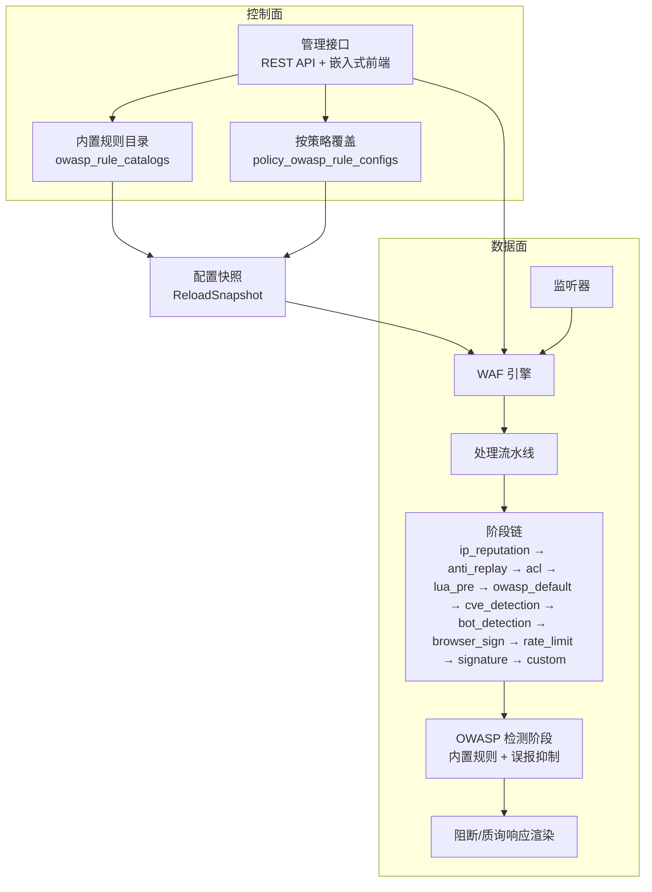
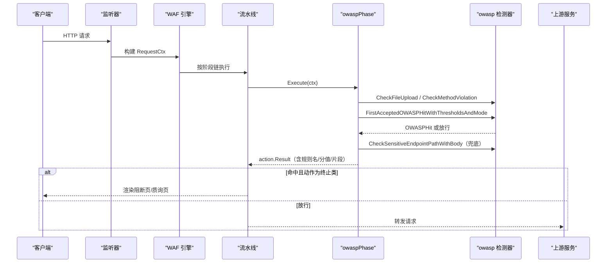
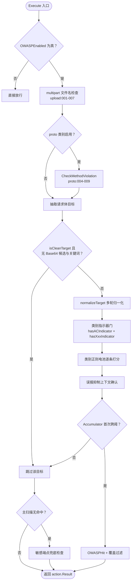
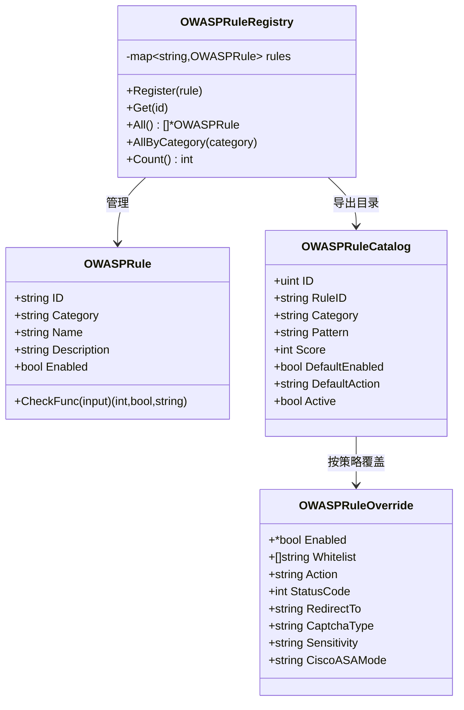
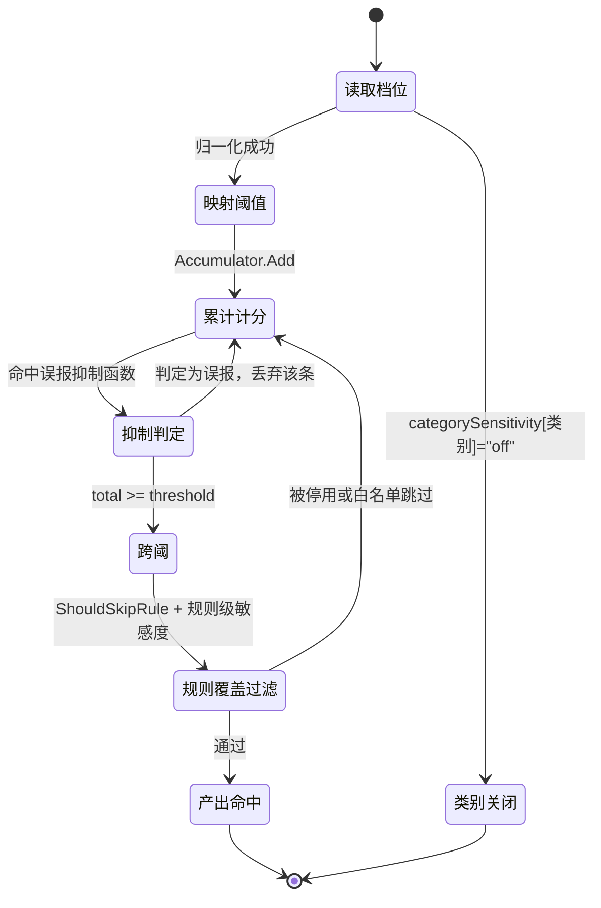
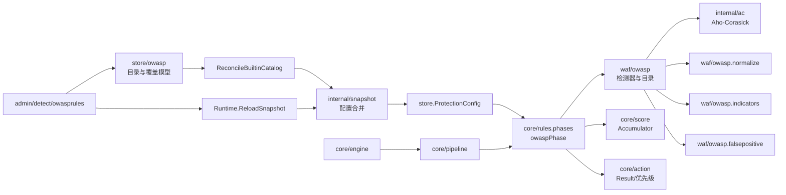

> [返回 安全防护功能](../安全防护功能.md)

# OWASP 检测

<cite>
**本文档引用的文件**
- [internal/waf/owasp/owasp.go](file://internal/waf/owasp/owasp.go)
- [internal/waf/owasp/owasp_registry.go](file://internal/waf/owasp/owasp_registry.go)
- [internal/waf/owasp/patterns.go](file://internal/waf/owasp/patterns.go)
- [internal/waf/owasp/normalize.go](file://internal/waf/owasp/normalize.go)
- [internal/waf/owasp/indicators.go](file://internal/waf/owasp/indicators.go)
- [internal/waf/owasp/falsepositive.go](file://internal/waf/owasp/falsepositive.go)
- [internal/waf/owasp/detectors_encoding.go](file://internal/waf/owasp/detectors_encoding.go)
- [internal/waf/owasp/cisco_asa.go](file://internal/waf/owasp/cisco_asa.go)
- [internal/store/owasp/owasp.go](file://internal/store/owasp/owasp.go)
- [internal/store/protection.go](file://internal/store/protection.go)
- [internal/store/site.go](file://internal/store/site.go)
- [internal/admin/detect/owasprules/owasp_rules.go](file://internal/admin/detect/owasprules/owasp_rules.go)
- [internal/admin/detect/owasprules/owasp_read_query.go](file://internal/admin/detect/owasprules/owasp_read_query.go)
- [internal/admin/router.go](file://internal/admin/router.go)
- [internal/admin/site/site.go](file://internal/admin/site/site.go)
- [internal/app/server.go](file://internal/app/server.go)
- [internal/core/rules/phases.go](file://internal/core/rules/phases.go)
- [internal/core/engine/engine.go](file://internal/core/engine/engine.go)
- [internal/core/pipeline/pipeline.go](file://internal/core/pipeline/pipeline.go)
- [internal/core/action/action.go](file://internal/core/action/action.go)
- [internal/core/score/score.go](file://internal/core/score/score.go)
- [internal/core/runtime.go](file://internal/core/runtime.go)
- [internal/ac/ac.go](file://internal/ac/ac.go)
- [internal/pkg/snippet/snippet.go](file://internal/pkg/snippet/snippet.go)
- [internal/store/migrate.go](file://internal/store/migrate.go)
- [internal/waf/bot/bot.go](file://internal/waf/bot/bot.go)
- [internal/snapshot/build.go](file://internal/snapshot/build.go)
- [internal/waf/owasp/owasp_test.go](file://internal/waf/owasp/owasp_test.go)
- [internal/waf/owasp/owasp_extended_test.go](file://internal/waf/owasp/owasp_extended_test.go)
</cite>

## 目录

1. [简介](#简介)
2. [项目结构](#项目结构)
3. [核心组件](#核心组件)
4. [架构总览](#架构总览)
5. [详细组件分析](#详细组件分析)
6. [依赖关系分析](#依赖关系分析)
7. [性能考虑](#性能考虑)
8. [故障排查指南](#故障排查指南)
9. [结论](#结论)
10. [附录](#附录)

## 简介
本文件系统化梳理 My-OpenWaf 的 OWASP 检测体系，覆盖内置目录中 18 个检测类别与 553 条内置规则定义（`internal/waf/owasp/owasp_registry.go:1035` 的 `BuiltinRuleDefinitions`），包括 SQL 注入、XSS、命令注入、路径穿越、SSRF、XXE、LDAP 注入、NoSQL 注入、模板注入、JNDI/Log4Shell、CRLF、表达式语言注入、反序列化、GraphQL 注入、WebShell、反弹 Shell、文件上传与协议违规。文档重点阐述：
- 规则分类与优先级（内置目录、规则级覆盖、按类别敏感度）
- 检测精度优化策略（误报抑制、阈值控制、输入归一化）
- 规则更新与维护机制（目录对账、规则启停、阈值调整）
- 配置示例与调试方法（敏感度、阈值、动作）
- 与其他安全机制的协同（ACL、Bot、CVE、速率限制）

## 项目结构
My-OpenWaf 采用「控制面 + 数据面」的双服务器架构，OWASP 检测位于数据面处理管线的 `owasp_default` 阶段，由 `internal/waf/owasp` 提供检测器、由 `internal/core/rules` 提供阶段实现、由 `internal/admin/detect/owasprules` 提供规则目录管理接口。

| 路径 | 职责 | 主要语言 | 代表文件 | 对外暴露 |
|------|------|----------|----------|----------|
| `internal/waf/owasp/` | OWASP 检测器、归一化、指示器、误报抑制、内置规则目录 | Go | `internal/waf/owasp/owasp.go` | `CheckOWASP`、`DefaultOWASPRegistry`、`ReconcileBuiltinCatalog` |
| `internal/store/owasp/` | 内置规则目录表与按策略覆盖表的模型 | Go | `internal/store/owasp/owasp.go` | `OWASPRuleCatalog`、`PolicyOWASPRuleConfig` |
| `internal/core/rules/` | 流水线阶段实现与请求体目标抽取 | Go | `internal/core/rules/phases.go` | `NewOWASPPhase`、`owaspHitResult` |
| `internal/core/score/` | 分值累加与阈值判定、命中归因 | Go | `internal/core/score/score.go` | `Accumulator`、`Hit`、`Count` |
| `internal/ac/` | Aho-Corasick 多模式匹配，指示器门的加速结构 | Go | `internal/ac/ac.go` | `Matcher.MatchAny`、`Matcher.MatchMask` |
| `internal/admin/detect/owasprules/` | 规则目录查询、规则级覆盖读写与统计 | Go | `internal/admin/detect/owasprules/owasp_rules.go` | REST 端点 `owasp-rules` |
| `internal/snapshot/` | 全局+站点配置合并与规则覆盖序列化 | Go | `internal/snapshot/build.go` | `Snapshot`、`ProtectionConfig` 合并 |

**章节来源**
- [internal/waf/owasp/owasp.go:10-36](file://internal/waf/owasp/owasp.go#L10-L36)
- [internal/waf/owasp/owasp_registry.go:1035-1136](file://internal/waf/owasp/owasp_registry.go#L1035-L1136)
- [internal/store/owasp/owasp.go:5-38](file://internal/store/owasp/owasp.go#L5-L38)
- [internal/core/rules/phases.go:593-718](file://internal/core/rules/phases.go#L593-L718)
- [internal/core/score/score.go:1-47](file://internal/core/score/score.go#L1-L47)
- [internal/ac/ac.go:1-34](file://internal/ac/ac.go#L1-L34)
- [internal/admin/detect/owasprules/owasp_rules.go:100-129](file://internal/admin/detect/owasprules/owasp_rules.go#L100-L129)
- [internal/snapshot/build.go:715-734](file://internal/snapshot/build.go#L715-L734)

**图表来源**
- [internal/core/engine/engine.go:465-548](file://internal/core/engine/engine.go#L465-L548)
- [internal/admin/router.go:224-227](file://internal/admin/router.go#L224-L227)
- [internal/admin/router.go:323-328](file://internal/admin/router.go#L323-L328)
- [internal/store/migrate.go:69-70](file://internal/store/migrate.go#L69-L70)
- [internal/core/runtime.go:201-211](file://internal/core/runtime.go#L201-L211)

## 核心组件
OWASP 检测由「目录—覆盖—编译—执行—归因」五段构成，各段落在不同包中，职责单一：

| 组件 | 类型/符号 | 所在文件 | 核心职责 |
|------|-----------|----------|----------|
| 类别枚举 | `OWASPCategory`（18 个常量） | `internal/waf/owasp/owasp.go:12-31` | 定义检测类别与稳定字符串值 |
| 命中结果 | `OWASPHit` | `internal/waf/owasp/owasp.go:61-67` | 承载类别、规则 ID、累计分、片段与说明 |
| 阈值编译 | `CompileThresholds` / `CategoryThreshold` | `internal/waf/owasp/owasp.go:95-104`、`:859-892` | 把敏感度档位映射为类别阈值，`off` 关闭类别 |
| 规则注册表 | `OWASPRuleRegistry` / `DefaultOWASPRegistry` | `internal/waf/owasp/owasp_registry.go:41-95` | 并发安全的规则元信息单例 |
| 规则覆盖 | `OWASPRuleOverride` | `internal/waf/owasp/owasp_registry.go:29-38` | 承载启停、动作、状态码、白名单、规则级敏感度 |
| 目录对账 | `ReconcileBuiltinCatalog` | `internal/waf/owasp/owasp_registry.go:1119-1136` | 启动时更新目录元信息并停用本版本不再发出的规则 |
| 归一化 | `normalizeTarget` / `normalizeWithDecode` | `internal/waf/owasp/normalize.go:62-192`、`:570-574` | 多轮解码、去混淆、小写化、注释剥离、空白折叠 |
| 指示器门 | `hasACIndicator` + `hasSQLiIndicator` 等 | `internal/waf/owasp/indicators.go:1356`、`:307`、`:538` | 进入正则电池前的快速必要条件判定 |
| 误报抑制 | `isSQLiFalsePositive` 等 13 个函数 | `internal/waf/owasp/falsepositive.go:10-1502` | 按类别做上下文确认，抑制结构化误报 |
| 分值累加 | `score.Accumulator` | `internal/core/score/score.go:18-209` | 同 ID 去重计分、首次跨阈归因、危险标记 |
| 阶段实现 | `owaspPhase` / `NewOWASPPhase` | `internal/core/rules/phases.go:593-685` | 组装请求目标、调用检测器、产出 `action.Result` |

**章节来源**
- [internal/waf/owasp/owasp.go:10-104](file://internal/waf/owasp/owasp.go#L10-L104)
- [internal/waf/owasp/owasp_registry.go:17-95](file://internal/waf/owasp/owasp_registry.go#L17-L95)
- [internal/waf/owasp/owasp_registry.go:1119-1136](file://internal/waf/owasp/owasp_registry.go#L1119-L1136)
- [internal/waf/owasp/normalize.go:62-192](file://internal/waf/owasp/normalize.go#L62-L192)
- [internal/waf/owasp/indicators.go:1310-1376](file://internal/waf/owasp/indicators.go#L1310-L1376)
- [internal/waf/owasp/falsepositive.go:10-1502](file://internal/waf/owasp/falsepositive.go#L10-L1502)
- [internal/core/score/score.go:18-209](file://internal/core/score/score.go#L18-L209)
- [internal/core/rules/phases.go:593-718](file://internal/core/rules/phases.go#L593-L718)

## 架构总览
OWASP 检测在数据面以 `owasp_default` 阶段为核心，先做上传文件名与方法违规的前置判定，再执行主扫描；主扫描放行后追加敏感端点探测作为兜底。整体流程如下：

**图表来源**
- [internal/core/rules/phases.go:618-685](file://internal/core/rules/phases.go#L618-L685)
- [internal/waf/owasp/owasp.go:171-194](file://internal/waf/owasp/owasp.go#L171-L194)
- [internal/core/pipeline/pipeline.go:517-557](file://internal/core/pipeline/pipeline.go#L517-L557)

阶段链顺序与短路语义由引擎装配、由流水线消费，动作严重度取自 `action.TerminalPriority`：

| 阶段顺序 | 阶段名 | 装配条件 | 命中后是否终止 |
|:--:|--------|----------|----------------|
| 1 | `ip_reputation` | `e.ipRep != nil` | 取决于动作严重度 |
| 2 | `anti_replay` | `deps.antiReplay != nil && rt.AntiReplayEnabled` | 是（质询类） |
| 3 | `acl` | `len(cr.ACL) > 0` | 终止动作即时短路 |
| 4 | Lua 前置策略 | 存在 `StagePre` 脚本 | 取决于动作 |
| 5 | `owasp_default` | `prot.OWASPEnabled` | 是（默认 `intercept`） |
| 6 | `cve_detection` | `prot.CVEEnabled && e.cveDetector != nil` | 是 |
| 7 | `bot_detection` | `prot.BotDetectionEnabled` | 是 |
| 8 | `browser_sign` | `prot.BrowserSignEnabled` | 取决于动作 |
| 9 | `rate_limit` | `prot.RequestRateLimitEnabled && deps.reqRateLimiter != nil` | 是 |
| 10 | `signature` | `len(cr.Signature) > 0` | 是（终止动作） |
| 11 | `custom` | `len(cr.Custom) > 0` | 是（终止动作） |

**章节来源**
- [internal/core/engine/engine.go:465-548](file://internal/core/engine/engine.go#L465-L548)
- [internal/core/pipeline/pipeline.go:517-557](file://internal/core/pipeline/pipeline.go#L517-L557)
- [internal/core/action/action.go:84-113](file://internal/core/action/action.go#L84-L113)
- [internal/core/rules/phases.go:112-129](file://internal/core/rules/phases.go#L112-L129)

## 详细组件分析

### OWASP 默认阶段（内置规则）
`owaspPhase` 在 `NewOWASPPhase` 中一次性完成配置预处理：按类别敏感度编译阈值、解析规则级覆盖 JSON、归一化 Cisco ASA 档位；`Execute` 只做扫描与判定，不在热路径重复解析配置。

| 步骤 | 实现 | 判定依据 |
|:--:|--------|----------|
| 开关短路 | `if !p.cfg.OWASPEnabled { return action.Pass() }` | `phases.go:619-621` |
| 上传检查 | `CheckFileUpload` / `CheckRawMultipartFilenames` | `phases.go:628-651` |
| 方法违规 | `CheckMethodViolation`（`proto` 类别启用时） | `phases.go:660-667` |
| 请求体目标抽取 | `extractBodyTargets`，结果缓存在 `RequestCtx.BodyTargets` | `phases.go:653-657` |
| 主扫描 | `FirstAcceptedOWASPHitWithThresholdsAndMode` | `phases.go:669` |
| 端点兜底 | `CheckSensitiveEndpointPathWithBody`（仅在主扫描放行后） | `phases.go:675-680` |
| 结果装配 | `owaspHitResult` 回填规则名/说明/分值/片段与覆盖动作 | `phases.go:687-718` |

目标收集由 `collectTargets` 完成：路径、查询串、补齐斜杠的路径、解码后的查询值、全部请求头值；`cookie` 只取值、`referer` 只取查询串与片段，其余头部经 `shouldSkipHeaderTarget` 过滤。归一化由 `normalizeTarget` 逐目标执行，超长目标以 `truncateTarget` 保留首尾各 16384 字节。

**图表来源**
- [internal/core/rules/phases.go:618-685](file://internal/core/rules/phases.go#L618-L685)
- [internal/waf/owasp/owasp.go:894-926](file://internal/waf/owasp/owasp.go#L894-L926)
- [internal/waf/owasp/owasp.go:294-320](file://internal/waf/owasp/owasp.go#L294-L320)
- [internal/waf/owasp/detectors_encoding.go:157-180](file://internal/waf/owasp/detectors_encoding.go#L157-L180)
- [internal/core/score/score.go:62-77](file://internal/core/score/score.go#L62-L77)

**章节来源**
- [internal/core/rules/phases.go:593-718](file://internal/core/rules/phases.go#L593-L718)
- [internal/waf/owasp/owasp.go:894-926](file://internal/waf/owasp/owasp.go#L894-L926)
- [internal/waf/owasp/patterns.go:40-87](file://internal/waf/owasp/patterns.go#L40-L87)

### 内置规则目录（按类别）
`BuiltinRuleDefinitions` 把两类规则合并为同一份目录写入 `owasp_rule_catalogs`：一类是 `*Patterns` 切片成员（进入 `DefaultOWASPRegistry`，361 条），另一类是硬编码发射点（`owasp:path:*`、`owasp:upload:*`、`owasp:proto:*`、`owasp:endpoint:*` 等，只登记在目录中）。

| 类别（代码值） | 目录条数 | 注册表条数 | 分值区间 | 中文标签 |
|----------------|:--:|:--:|:--:|----------|
| `xss` | 71 | 71 | 2–5 | XSS 跨站脚本 |
| `cmd_injection` | 131 | 36 | 0–5 | 命令注入（含 path 端点归属） |
| `sqli` | 54 | 54 | 2–7 | SQL 注入 |
| `ssrf` | 58 | 24 | 0–6 | 服务端请求伪造（含端点探测） |
| `webshell` | 44 | 27 | 0–5 | WebShell 上传/通信 |
| `path_traversal` | 39 | 19 | 0–5 | 路径穿越 |
| `nosql_injection` | 24 | 24 | 3–5 | NoSQL 注入 |
| `deserialization` | 22 | 17 | 0–6 | 反序列化攻击 |
| `template_injection` | 20 | 20 | 2–6 | 模板注入 |
| `expression_language` | 15 | 14 | 0–6 | 表达式语言注入 |
| `revshell` | 12 | 12 | 4–6 | 反弹 Shell 通信 |
| `xxe` | 12 | 11 | 0–6 | XML 外部实体注入 |
| `crlf_injection` | 10 | 8 | 0–6 | CRLF 注入 |
| `protocol_violation` | 10 | 0 | 0–0 | 协议违规（全为硬编码发射点） |
| `ldap_injection` | 9 | 9 | 4–5 | LDAP 注入 |
| `graphql_injection` | 8 | 8 | 3–6 | GraphQL 注入 |
| `jndi_injection` | 7 | 7 | 3–6 | JNDI 注入 |
| `file_upload` | 7 | 0 | 0–0 | 上传检查（全为硬编码发射点） |
| 合计 | 553 | 361 | — | — |

目录条数与注册表条数的差额即硬编码发射点：`owasp:endpoint:*` 共 156 条、`owasp:path:*` 共 17 条（编号 001–018，缺 003）、`owasp:proto:*` 10 条、`owasp:upload:*` 7 条。`protocol_violation` 与 `file_upload` 两个类别不进入注册表，因此目录中的 `score` 为 0：它们的分值由发射点自身固定（如 `upload:001` 风险分值 6），不在 `*Patterns` 切片里。

**图表来源**
- [internal/waf/owasp/owasp_registry.go:19-95](file://internal/waf/owasp/owasp_registry.go#L19-L95)
- [internal/store/owasp/owasp.go:5-38](file://internal/store/owasp/owasp.go#L5-L38)
- [internal/waf/owasp/owasp_registry.go:1035-1116](file://internal/waf/owasp/owasp_registry.go#L1035-L1116)

**章节来源**
- [internal/waf/owasp/owasp_registry.go:434-543](file://internal/waf/owasp/owasp_registry.go#L434-L543)
- [internal/waf/owasp/owasp_registry.go:1035-1136](file://internal/waf/owasp/owasp_registry.go#L1035-L1136)
- [internal/waf/owasp/owasp.go:12-33](file://internal/waf/owasp/owasp.go#L12-L33)
- [internal/waf/owasp/cisco_asa.go:8-39](file://internal/waf/owasp/cisco_asa.go#L8-L39)

### 敏感度档位与阈值
敏感度不是三档，而是六档归一化取值；`off` 关闭整个类别，其余五档映射为闭区间阈值（`total >= threshold` 即过阈）。默认档位 `mid`，默认动作 `intercept`。

| 敏感度档位 | 归一化输入 | 阈值 | 语义 |
|------------|------------|:--:|------|
| `off` | `off`、`none` | — | 类别不启用，`CategoryThreshold` 返回 `enabled=false` |
| `low` | `low` | 7 | 最宽松，需多条规则累计 |
| `mid` | `mid`、`medium`（默认） | 4 | 默认推荐档位 |
| `high` | `high` | 3 | 由 2 上调至 3 以降低误报 |
| `very_high` | `very_high`、`very-high`、`veryhigh` | 2 | 高威胁场景 |
| `strict` | `strict` | 1 | 单条规则即可命中 |
| 未识别值 | 任意 | 4 | 回落到 `mid` 阈值 |

档位可三层叠加：全局 `ProtectionConfig.OWASPSensitivity`、按类别覆盖 `CategorySensitivity`/`OWASPModules`、按规则覆盖 `PolicyOWASPRuleConfig.Sensitivity`。后两层分别经 `EffectiveCategorySensitivity` 与 `HitPassesOverrideSensitivity` 生效。

**图表来源**
- [internal/waf/owasp/owasp.go:840-892](file://internal/waf/owasp/owasp.go#L840-L892)
- [internal/core/score/score.go:42-77](file://internal/core/score/score.go#L42-L77)
- [internal/waf/owasp/owasp_registry.go:333-402](file://internal/waf/owasp/owasp_registry.go#L333-L402)

**章节来源**
- [internal/waf/owasp/owasp.go:840-892](file://internal/waf/owasp/owasp.go#L840-L892)
- [internal/store/protection.go:159-176](file://internal/store/protection.go#L159-L176)
- [internal/store/protection.go:225-280](file://internal/store/protection.go#L225-L280)
- [internal/core/score/score.go:18-77](file://internal/core/score/score.go#L18-L77)

### 检测精度优化策略
- 误报抑制：`falsepositive.go` 提供 13 个类别级抑制函数（`isSQLiFalsePositive`、`isXSSFalsePositive`、`isCmdInjectionFalsePositive`、`isPathTravFalsePositive`、`isSSRFFalsePositive`、`isDeserFalsePositive`、`isNoSQLiFalsePositive`、`isELFalsePositive`、`isWebshellFalsePositive`、`isCRLFFalsePositive`）与 3 个遥测路径级抑制函数（`isKnownTelemetryXSSFalsePositive`、`isKnownTelemetryCmdFalsePositive`、`isKnownTelemetryPathTravFalsePositive`）。
- XSS 抑制区分被动结构（`iframe`/`object`/`embed`）与主动脚本执行；CDN 回调函数引用（无括号）不视为 XSS。
- 命令注入对 backtick、null byte/newline 形态要求高置信度上下文；浏览器 UA 分隔符不进正则电池（`TestHasCmdIndicatorSkipsBrowserUASeparators`）。
- 路径感知的请求体扫描抑制：`/restapi/soa2/`、`/web/common` 跳过请求体命令注入，`/cdn-cgi/` 跳过请求体 SSRF，`/g/collect` 跳过请求体 SQLi。
- 目标截断与预过滤：`isCleanTarget` 只允许字母数字与 `- _ . , @` 且长度 ≤256；`isCleanPathTarget` 上限 256，`isCleanPlainQueryTarget` 上限 512。
- 片段脱敏与截断：`snippet.MaxLen` 为 256 字节，命中位置两侧各保留 48 字节上下文。

**章节来源**
- [internal/waf/owasp/falsepositive.go:10-1502](file://internal/waf/owasp/falsepositive.go#L10-L1502)
- [internal/waf/owasp/owasp.go:236-251](file://internal/waf/owasp/owasp.go#L236-L251)
- [internal/waf/owasp/indicators.go:76-110](file://internal/waf/owasp/indicators.go#L76-L110)
- [internal/pkg/snippet/snippet.go:8-22](file://internal/pkg/snippet/snippet.go#L8-L22)
- [internal/waf/owasp/owasp_extended_test.go:36-79](file://internal/waf/owasp/owasp_extended_test.go#L36-L79)

### 规则更新与维护机制
- 新增检测规则：向对应 `*Patterns` 切片追加 `owaspPattern{re, score, id, hint}`，并在 `xxxRuleMeta` 登记中文名与说明；`TestBuiltinRuleMetaCoversAllPatterns` 双向拦截缺失与失效条目。
- 硬编码发射点：`owasp:path:*`、`owasp:upload:*`、`owasp:proto:*`、`owasp:endpoint:*` 不属于切片成员，元信息只能在 `BuiltinRuleDefinitions` 内登记。
- 目录对账：启动链路 `owasp.ReconcileBuiltinCatalog` 先把 `active=true` 全部置 false，再按 `rule_id` upsert 本版本定义，因此本版本不再发出的规则会被自动停用而不会残留生效。
- 阈值调整：通过 `category_sensitivity` / `owasp_modules` 做类别级档位覆盖，通过规则级 `Sensitivity` 做单条覆盖。
- 规则验证：`internal/waf/owasp` 下 30+ 个 `_test.go` 覆盖误报与漏报场景。

**章节来源**
- [internal/waf/owasp/patterns.go:90-94](file://internal/waf/owasp/patterns.go#L90-L94)
- [internal/waf/owasp/owasp_registry.go:517-586](file://internal/waf/owasp/owasp_registry.go#L517-L586)
- [internal/waf/owasp/owasp_registry.go:1119-1136](file://internal/waf/owasp/owasp_registry.go#L1119-L1136)
- [internal/store/protection.go:56-66](file://internal/store/protection.go#L56-L66)
- [internal/app/server.go:253](file://internal/app/server.go#L253)

### 配置项与站点三态覆盖
全局保护配置字段与站点级覆盖字段同名但语义不同：站点级 `owasp_enabled` 是 `*bool`，nil 表示继承全局；`owasp_sensitivity` 与 `owasp_action` 是空串表示继承。

| 字段 | 层级 | 类型 | 默认值 | 继承语义 |
|------|------|------|--------|----------|
| `builtin_owasp_enabled` | 全局 | `bool` | `false` | — |
| `builtin_owasp_sensitivity` | 全局 | `string` | `mid` | — |
| `builtin_owasp_on_hit` | 全局 | `string` | `intercept` | — |
| `owasp_enabled` | 站点 | `*bool` | nil | nil=继承全局；true=覆盖启用；false=覆盖关闭 |
| `owasp_sensitivity` | 站点 | `string` | 空串 | 仅当 `owasp_enabled` 非 nil 且本身非空才生效 |
| `owasp_action` | 站点 | `string` | 空串 | 同上 |
| `category_sensitivity` | 全局 | JSON `map[string]string` | 空串/`{}` 等价 | 空表示无类别覆盖 |
| `owasp_rules_config` | 全局/策略 | JSON `map[string]OWASPRuleOverride` | 空串/`{}` 等价 | 空表示无规则级覆盖 |

站点级 `OWASPEnabled == nil` 时后端会连带清空从属字段（`clearInheritedProtectionOverrides`），避免把继承态误存为空配置；快照合并只在 `OWASPEnabled != nil` 时才读取站点档位与动作。

**章节来源**
- [internal/store/protection.go:27-66](file://internal/store/protection.go#L27-L66)
- [internal/store/protection.go:159-176](file://internal/store/protection.go#L159-L176)
- [internal/store/site.go:76-90](file://internal/store/site.go#L76-L90)
- [internal/admin/site/site.go:490-508](file://internal/admin/site/site.go#L490-L508)
- [internal/snapshot/build.go:725-734](file://internal/snapshot/build.go#L725-L734)
- [internal/waf/owasp/owasp_registry.go:307-329](file://internal/waf/owasp/owasp_registry.go#L307-L329)

### 与其他安全机制的配合使用与最佳实践
| 机制 | 与 OWASP 的先后关系 | 协同要点 |
|------|--------------------|----------|
| ACL（`acl`） | OWASP 之前 | 命中即返回；终止动作使后续阶段被短路，`allow` 因此可跳过 OWASP |
| 反重放（`anti_replay`） | OWASP 之前 | 质询未通过时不进入 OWASP |
| Lua 前置策略 | ACL 之后、OWASP 之前 | 可在昂贵检测前提早判定 |
| CVE（`cve_detection`） | OWASP 之后 | 复用 `RequestCtx.BodyTargets` 缓存，避免重复解析请求体 |
| Bot（`bot_detection`） | CVE 之后 | 两阶段评分 `PreScreen` → `DeepScore`，恶意档位可升级为 `drop` |
| 速率限制（`rate_limit`） | Bot 之后 | 与 OWASP 命中互不影响，按严重度竞争 |
| 自定义规则（`custom`） | 链尾 | 不参与按路径跳过装饰 |

**章节来源**
- [internal/core/engine/engine.go:465-548](file://internal/core/engine/engine.go#L465-L548)
- [internal/core/rules/phases.go:112-129](file://internal/core/rules/phases.go#L112-L129)
- [internal/core/pipeline/pipeline.go:517-557](file://internal/core/pipeline/pipeline.go#L517-L557)
- [internal/waf/bot/bot.go:359](file://internal/waf/bot/bot.go#L359)
- [internal/waf/bot/bot.go:693-698](file://internal/waf/bot/bot.go#L693-L698)

## 依赖关系分析
OWASP 检测遵循「配置快照 → 阶段装配 → 检测执行 → 命中动作」的单向依赖，检测器包不依赖引擎与流水线。

**图表来源**
- [internal/core/rules/phases.go:593-718](file://internal/core/rules/phases.go#L593-L718)
- [internal/waf/owasp/indicators.go:1-20](file://internal/waf/owasp/indicators.go#L1-L20)
- [internal/waf/owasp/owasp_registry.go:1119-1136](file://internal/waf/owasp/owasp_registry.go#L1119-L1136)
- [internal/admin/detect/owasprules/owasp_rules.go:320-368](file://internal/admin/detect/owasprules/owasp_rules.go#L320-L368)
- [internal/core/runtime.go:201-211](file://internal/core/runtime.go#L201-L211)

| 依赖方 | 被依赖方 | 依赖内容 | 方向 |
|--------|----------|----------|------|
| `core/rules/phases.go` | `waf/owasp` | `CompileThresholds`、`CheckFileUpload`、`FirstAcceptedOWASPHitWithThresholdsAndMode` | 单向 |
| `core/rules/phases.go` | `store` | `ProtectionConfig.OWASPAction`、`OWASPRulesConfig` | 单向 |
| `core/rules/phases.go` | `core/action` | `Result`、`Normalize`、`TerminalPriority` | 单向 |
| `waf/owasp/indicators.go` | `internal/ac` | `Matcher.MatchAny` 指示器门 | 单向 |
| `waf/owasp/owasp_registry.go` | `store/owasp` | `OWASPRuleCatalog` 模型 | 单向 |
| `waf/owasp/owasp.go` | `core/score` | `Accumulator` 累计与归因 | 单向 |
| `waf/owasp/patterns.go` | `pkg/snippet` | `Extract` 片段截断与脱敏 | 单向 |
| `admin/detect/owasprules` | `store/owasp`、`core/action` | 覆盖读写与动作校验 | 单向 |
| `snapshot/build.go` | `store/owasp` | 按策略覆盖序列化为 `OWASPRulesConfig` | 单向 |
| `waf/owasp` | `core/*` | 无（不被检测层反向依赖） | 无环 |

**章节来源**
- [internal/core/rules/phases.go:593-718](file://internal/core/rules/phases.go#L593-L718)
- [internal/waf/owasp/indicators.go:1-20](file://internal/waf/owasp/indicators.go#L1-L20)
- [internal/waf/owasp/owasp.go:3-8](file://internal/waf/owasp/owasp.go#L3-L8)
- [internal/waf/owasp/owasp_registry.go:1-15](file://internal/waf/owasp/owasp_registry.go#L1-L15)
- [internal/admin/detect/owasprules/owasp_rules.go:1-21](file://internal/admin/detect/owasprules/owasp_rules.go#L1-L21)
- [internal/snapshot/build.go:560-616](file://internal/snapshot/build.go#L560-L616)

## 性能考虑
- 指示器门前置：11 个 AC 族（SSRF、路径穿越、XXE、LDAP、NoSQL、模板、JNDI、CRLF、反序列化、EL、GraphQL）先经总表 `MatchAny` 负短路，未命中不进对应正则电池。
- 两级门：族级 `hasACIndicator` 之后仍有单条规则的 `owaspPatternGate`（`hint` + `musts`），例如 `owasp:xxe:004` 要求同时出现 `%` 与 `;`。
- 自动机扁平化：转移表物化为 `[]uint32`，终态位内联到转移值的高位，使匹配内层循环每次转移只需一次内存读。
- 累加器池化：`acquireOWASPAcc` / `releaseOWASPAcc` 复用 `score.Accumulator`，`initialHitsCap` 为 8，常见路径零分配。
- 请求体目标缓存：`RequestCtx.BodyTargets` + `BodyTargetsDone` 保证 OWASP 与 CVE 共用同一批抽取结果。
- 目标截断：`maxTargetLen` 为 16384，超长目标保留首尾各一份并以空格连接；片段落库前截断到 256 字节。
- 阶段短路：首个终止动作即返回，质询类按 `TerminalPriority` 竞争，不做无谓后续扫描。

**章节来源**
- [internal/waf/owasp/indicators.go:1133-1160](file://internal/waf/owasp/indicators.go#L1133-L1160)
- [internal/waf/owasp/indicators.go:1168-1208](file://internal/waf/owasp/indicators.go#L1168-L1208)
- [internal/waf/owasp/indicators.go:1310-1376](file://internal/waf/owasp/indicators.go#L1310-L1376)
- [internal/ac/ac.go:8-32](file://internal/ac/ac.go#L8-L32)
- [internal/core/score/score.go:36-47](file://internal/core/score/score.go#L36-L47)
- [internal/core/rules/phases.go:653-657](file://internal/core/rules/phases.go#L653-L657)
- [internal/waf/owasp/normalize.go:1486-1500](file://internal/waf/owasp/normalize.go#L1486-L1500)
- [internal/core/pipeline/pipeline.go:517-557](file://internal/core/pipeline/pipeline.go#L517-L557)

## 故障排查指南
| 症状 | 常见原因 | 排查入口 | 处置 |
|------|----------|----------|------|
| OWASP 完全不生效 | 全局 `builtin_owasp_enabled=false`，或站点 `owasp_enabled=false` 覆盖关闭 | `internal/store/protection.go:27`、`internal/snapshot/build.go:726` | 打开全局开关或把站点覆盖改回「继承」 |
| 单条规则不生效 | 规则级 `enabled=false` 或路径命中白名单 | `ShouldSkipRule`（`owasp_registry.go:333-341`） | `POST /api/v1/owasp-rules/{id}/reset` 清除覆盖 |
| 类别整体不生效 | `category_sensitivity` 把该类别设为 `off` | `CategoryThreshold`（`owasp.go:859-873`） | 改回 `mid` 或删除该项 |
| 误报被抑制 | 命中落入遥测路径或类别抑制函数 | `isKnownTelemetryXSSFalsePositive` 等 | 用测试用例复现后调整档位或规则 |
| 编码载荷漏检 | 目标超长被截断、指示器门未过 | `truncateTarget`、`hasACIndicator` | 提高敏感度、确认载荷字面量已在族 needle 中 |
| 规则目录缺项 | 本版本不再发出该 `rule_id` | `ReconcileBuiltinCatalog`（先置 `active=false` 再 upsert） | 检查 `BuiltinRuleDefinitions` 与 `*Patterns` 一致性 |
| 规则页列表与展示分值不符 | 目录 `score` 取该 ID 最后一个 pattern 的分值 | `CollectRulePatternsFrom`（`owasp_registry.go:1189-1201`） | 以正则文本逐行核对 |

**章节来源**
- [internal/store/protection.go:27-29](file://internal/store/protection.go#L27-L29)
- [internal/snapshot/build.go:725-734](file://internal/snapshot/build.go#L725-L734)
- [internal/waf/owasp/owasp_registry.go:333-341](file://internal/waf/owasp/owasp_registry.go#L333-L341)
- [internal/waf/owasp/owasp_registry.go:1119-1136](file://internal/waf/owasp/owasp_registry.go#L1119-L1136)
- [internal/waf/owasp/owasp_registry.go:1189-1201](file://internal/waf/owasp/owasp_registry.go#L1189-L1201)
- [internal/waf/owasp/owasp.go:859-873](file://internal/waf/owasp/owasp.go#L859-L873)
- [internal/waf/owasp/falsepositive.go:273-554](file://internal/waf/owasp/falsepositive.go#L273-L554)

## 结论
My-OpenWaf 的 OWASP 检测体系由「18 类别 553 条内置目录 + 六档敏感度阈值 + 两级指示器门 + 类别级误报抑制 + 首次跨阈归因」构成，控制面通过目录对账与按策略覆盖提供颗粒化运维能力，数据面以 `owasp_default` 阶段串联上传检查、方法违规、主扫描与端点兜底。检测层不反向依赖引擎与流水线，动作严重度由 `core/action` 统一裁决，因此规则演进与阶段编排可独立推进。

## 附录

### 关联文档索引
| 主题 | 文档 | 覆盖内容 |
|------|------|----------|
| 基本规则明细 | [基本 OWASP 规则](基本%20OWASP%20规则.md) | 各类别代表规则、分值与误报抑制 |
| 检测算法与实现 | [检测算法与技术](检测算法与技术.md) | 归一化链路、指示器门、AC 自动机、累加器判定链 |
| 配置与运维 | [配置与管理](配置与管理.md) | 配置项、规则覆盖 API、端点、日志脱敏与故障排查 |

**章节来源**
- [docs/安全防护功能/OWASP 检测/基本 OWASP 规则.md](file://docs/安全防护功能/OWASP 检测/基本 OWASP 规则.md)
- [docs/安全防护功能/OWASP 检测/检测算法与技术.md](file://docs/安全防护功能/OWASP 检测/检测算法与技术.md)
- [docs/安全防护功能/OWASP 检测/配置与管理.md](file://docs/安全防护功能/OWASP 检测/配置与管理.md)

### 规则目录管理接口
| 方法 | 路径 | 处理函数 | 角色 |
|------|------|----------|------|
| GET | `/api/v1/owasp-rules` | `ListOWASPRulesFromRegistry` | admin/operator/readonly |
| GET | `/api/v1/owasp-rules/stats` | `GetOWASPRuleStats` | admin/operator/readonly |
| GET | `/api/v1/policies/:policyId/owasp-rules` | `ListOWASPRulesFromRegistry` | admin/operator/readonly |
| GET | `/api/v1/policies/:policyId/owasp-rules/stats` | `GetOWASPRuleStats` | admin/operator/readonly |
| POST | `/api/v1/owasp-rules/:id/update` | `UpdateSingleOWASPRule` | admin/operator |
| POST | `/api/v1/owasp-rules/:id/reset` | `ResetOWASPRuleOverride` | admin/operator |
| POST | `/api/v1/owasp-rules/batch` | `BatchUpdateOWASPRules` | admin/operator |
| POST | `/api/v1/policies/:policyId/owasp-rules/:id` | `UpdateSingleOWASPRule` | admin/operator |
| POST | `/api/v1/policies/:policyId/owasp-rules/:id/reset` | `ResetOWASPRuleOverride` | admin/operator |
| POST | `/api/v1/policies/:policyId/owasp-rules/batch` | `BatchUpdateOWASPRules` | admin/operator |

规则级覆盖的输入约束由 `validateOWASPPatch` 把关：`action` 归一化后不得为 `allow`/`tag`；`sensitivity` 只接受 `low`/`mid`/`medium`/`high`/`very_high`/`strict`/`off`；`status_code` 非零时必须落在 100–599；`whitelist` 最多 64 条、单条 ≤512 字节、必须为 `*` 或以 `/` 开头且通配符只能出现在末位；`note` ≤4096 字节；`redirect` 动作必须提供 `redirect_to`；非空 `captcha_type` 必须与 `captcha_challenge` 动作配对。列表接口支持 `category`、`q`（≤256 字节）过滤与 `page`/`page_size` 分页，`page_size` 上限 500、默认 500（缺省与越界都取上限）。

**章节来源**
- [internal/admin/router.go:224-227](file://internal/admin/router.go#L224-L227)
- [internal/admin/router.go:323-328](file://internal/admin/router.go#L323-L328)
- [internal/admin/router.go:109-125](file://internal/admin/router.go#L109-L125)
- [internal/admin/router.go:255-256](file://internal/admin/router.go#L255-L256)
- [internal/admin/detect/owasprules/owasp_rules.go:100-523](file://internal/admin/detect/owasprules/owasp_rules.go#L100-L523)
- [internal/admin/detect/owasprules/owasp_rules.go:60-65](file://internal/admin/detect/owasprules/owasp_rules.go#L60-L65)
- [internal/admin/detect/owasprules/owasp_rules.go:139-217](file://internal/admin/detect/owasprules/owasp_rules.go#L139-L217)
- [internal/admin/detect/owasprules/owasp_read_query.go:15-102](file://internal/admin/detect/owasprules/owasp_read_query.go#L15-L102)
- [internal/admin/detect/owasprules/owasp_read_query.go:153-167](file://internal/admin/detect/owasprules/owasp_read_query.go#L153-L167)

### 动作取值与默认值
| 动作 | 是否终止 | 严重度 | 说明 |
|------|:--:|:--:|------|
| `drop` | 是 | 90 | 立即关闭 TCP，不发送响应 |
| `intercept` | 是 | 80 | 渲染阻断页，OWASP 默认动作 |
| `rate_limit` | 是 | 70 | 规则级速率限制 |
| `challenge` | 是 | 60 | JS 挑战或通用验证 |
| `captcha_challenge` | 是 | 60 | 图形验证码，需配套 `captcha_type` |
| `shield_challenge` | 是 | 60 | 5 秒盾 |
| `chain_challenge` | 是 | 60 | 多步链式挑战 |
| `redirect` | 是 | 50 | 重定向，必须提供 `redirect_to` |
| `observe` | 否 | 10 | 仅记录命中 |
| `block` | — | — | 遗留别名，`Normalize` 归一为 `intercept` |
| `log_only` | — | — | 遗留别名，归一为 `observe` |

规则级覆盖不接受 `allow` 与 `tag`：`validateOWASPPatch` 显式拒绝这两个归一化结果。

**章节来源**
- [internal/core/action/action.go:8-46](file://internal/core/action/action.go#L8-L46)
- [internal/core/action/action.go:84-113](file://internal/core/action/action.go#L84-L113)
- [internal/admin/detect/owasprules/owasp_rules.go:139-217](file://internal/admin/detect/owasprules/owasp_rules.go#L139-L217)
- [internal/store/protection.go:170](file://internal/store/protection.go#L170)

### 实测样本与检测效果
| 类别 | 样本输入 | 断言入口 | 结果 |
|------|----------|----------|:--:|
| SSRF | `url=http://169.254.169.254/latest/meta-data/` | `TestCheckOWASP_SSRF_Metadata`（`owasp_extended_test.go:8-13`） | 命中 `ssrf` |
| SSRF | `u=file:///etc/passwd` | `TestCheckOWASP_SSRF_FileScheme`（`:15-20`） | 命中 `ssrf` 或 `path_traversal` |
| 命令注入 | `host=8.8.8.8;cat /etc/passwd` | `TestCheckOWASP_CmdInjection`（`:22-27`） | 命中 `cmd_injection` 或 `path_traversal` |
| 命令注入 | 反引号 `` q=`whoami` ``（`high` 档） | `TestCheckOWASP_CmdInjection_Backtick`（`:29-34`） | 命中 `cmd_injection` |
| 命令注入 | UA 分隔符串 | `TestHasCmdIndicatorSkipsBrowserUASeparators`（`:36-41`） | 不进正则电池 |
| LDAP | `user=*)(objectclass=*` | `TestCheckOWASP_LDAP`（`:136-141`） | 命中 `ldap_injection` |
| NoSQL | `filter={"$where": "this.password == 'a'"}` | `TestCheckOWASP_NoSQLi`（`:143-148`） | 命中 `nosql_injection` |
| 模板注入 | `name={{7*7}}` | `TestCheckOWASP_TemplateInjection`（`:150-155`） | 命中 `template_injection` |
| XSS | `q=` | `TestCheckOWASP_XSS`（`owasp_test.go:831-836`） | 产生命中 |
| 文件上传 | 文件名 `malware.php.jpg` | `TestCheckFileUpload_DoubleExt`（`owasp_extended_test.go:214-219`） | 命中 `file_upload` |
| 文件上传 | 文件名 `shell.php;.jpg` | `TestCheckFileUpload_SemicolonDoubleExtension`（`:235-240`） | 命中 `owasp:upload:002` |
| 文件上传 | 文件名 `file.jpg%00.php` | `TestCheckFileUpload_NullByte`（`:228-233`） | 命中 `file_upload` |
| 文件上传 | `photo.jpg` + `image/jpeg` | `TestCheckFileUpload_Clean`（`:221-226`） | 不命中 |

**章节来源**
- [internal/waf/owasp/owasp_extended_test.go:8-41](file://internal/waf/owasp/owasp_extended_test.go#L8-L41)
- [internal/waf/owasp/owasp_extended_test.go:136-161](file://internal/waf/owasp/owasp_extended_test.go#L136-L161)
- [internal/waf/owasp/owasp_extended_test.go:207-264](file://internal/waf/owasp/owasp_extended_test.go#L207-L264)
- [internal/waf/owasp/owasp_test.go:831-836](file://internal/waf/owasp/owasp_test.go#L831-L836)

