> [返回 安全防护功能](../安全防护功能.md)

# 基本 OWASP 规则

<cite>
**本文档引用的文件**
- [internal/waf/owasp/owasp.go](file://internal/waf/owasp/owasp.go)
- [internal/waf/owasp/patterns.go](file://internal/waf/owasp/patterns.go)
- [internal/waf/owasp/detectors_injection.go](file://internal/waf/owasp/detectors_injection.go)
- [internal/waf/owasp/detectors_encoding.go](file://internal/waf/owasp/detectors_encoding.go)
- [internal/waf/owasp/normalize.go](file://internal/waf/owasp/normalize.go)
- [internal/waf/owasp/indicators.go](file://internal/waf/owasp/indicators.go)
- [internal/waf/owasp/falsepositive.go](file://internal/waf/owasp/falsepositive.go)
- [internal/waf/owasp/owasp_registry.go](file://internal/waf/owasp/owasp_registry.go)
- [internal/waf/owasp/cisco_asa.go](file://internal/waf/owasp/cisco_asa.go)
- [internal/store/owasp/owasp.go](file://internal/store/owasp/owasp.go)
- [internal/store/protection.go](file://internal/store/protection.go)
- [internal/store/site.go](file://internal/store/site.go)
- [internal/admin/detect/owasprules/owasp_rules.go](file://internal/admin/detect/owasprules/owasp_rules.go)
- [internal/admin/detect/owasprules/owasp_read_query.go](file://internal/admin/detect/owasprules/owasp_read_query.go)
- [internal/admin/router.go](file://internal/admin/router.go)
- [internal/admin/site/site.go](file://internal/admin/site/site.go)
- [internal/core/rules/phases.go](file://internal/core/rules/phases.go)
- [internal/core/rules/matcher.go](file://internal/core/rules/matcher.go)
- [internal/core/engine/engine.go](file://internal/core/engine/engine.go)
- [internal/core/pipeline/pipeline.go](file://internal/core/pipeline/pipeline.go)
- [internal/core/score/score.go](file://internal/core/score/score.go)
- [internal/core/config.go](file://internal/core/config.go)
- [internal/snapshot/build.go](file://internal/snapshot/build.go)
- [internal/waf/bot/bot.go](file://internal/waf/bot/bot.go)
- [internal/waf/owasp/owasp_test.go](file://internal/waf/owasp/owasp_test.go)
- [internal/waf/owasp/owasp_extended_test.go](file://internal/waf/owasp/owasp_extended_test.go)
</cite>

## 目录

1. [简介](#简介)
2. [项目结构](#项目结构)
3. [核心组件](#核心组件)
4. [架构总览](#架构总览)
5. [详细组件分析](#详细组件分析)
6. [依赖关系分析](#依赖关系分析)
7. [性能考虑](#性能考虑)
8. [故障排查指南](#故障排查指南)
9. [结论](#结论)
10. [附录](#附录)

## 简介
本文件系统化梳理 My-OpenWaf 的基本 OWASP 规则检测实现，覆盖 OWASP Top 10 常见攻击类型的检测算法与配置管理，包括 SQL 注入、XSS、命令注入、路径穿越、服务器端请求伪造（SSRF）等核心攻击手法的识别机制。文档重点阐述：
- 规则分类与优先级（基础规则与扩展规则）
- 检测精度优化策略（误报抑制、阈值控制、输入归一化）
- 规则更新与维护机制（新增规则、阈值调整、规则组合）
- 配置示例与调试方法（敏感度、阈值、动作）
- 与其他安全机制的协同（ACL、Bot、CVE、速率限制）

## 项目结构
My-OpenWaf 采用"控制面 + 数据面"的双服务器架构，OWASP 检测位于数据面处理管线中，通过规则编译器与流水线阶段共同完成请求拦截与放行决策。

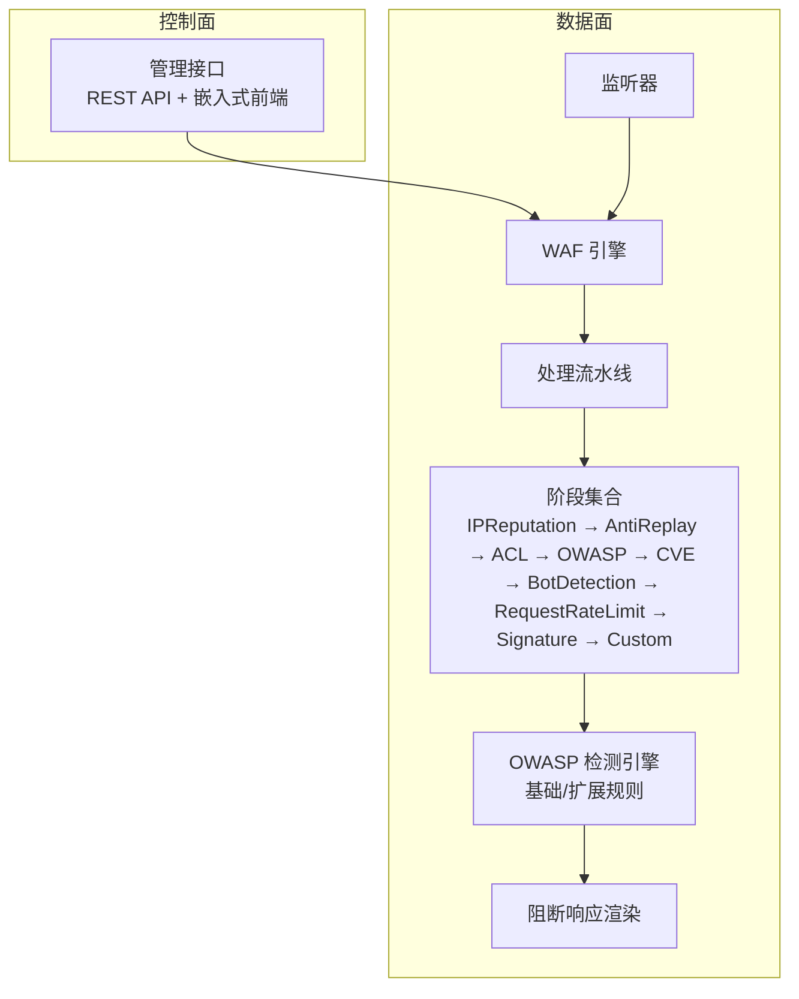

**图表来源**
- [internal/core/engine/engine.go:441-548](file://internal/core/engine/engine.go#L441-L548)
- [internal/core/rules/phases.go:593-685](file://internal/core/rules/phases.go#L593-L685)

**章节来源**
- [internal/core/engine/engine.go:551-575](file://internal/core/engine/engine.go#L551-L575)
- [internal/core/pipeline/pipeline.go:517-557](file://internal/core/pipeline/pipeline.go#L517-L557)

## 核心组件
- 内置检测阶段：负责扫描路径、查询串、头部、表单/JSON/Multipart 字段等，支持上传文件名与内容类型校验。
- 18 个检测类别：SQLi、XSS、命令注入、路径穿越、SSRF、XXE、LDAP、NoSQL、模板注入、JNDI、CRLF、表达式语言、反序列化、GraphQL、WebShell、反弹 Shell、文件上传、协议违规。
- 规则编译与匹配：自定义规则基于 DSL（`kind:arg` 或复合 JSON）解析与缓存，支持 `and`/`or`/`not` 组合。
- 流水线与引擎：按固定顺序执行各阶段，首个终止结果短路后续阶段；ACL 的 `allow` 可直接放行；阻断与质询页面按站点运行时配置或全局默认模板渲染。

**章节来源**
- [internal/core/rules/phases.go:593-685](file://internal/core/rules/phases.go#L593-L685)
- [internal/waf/owasp/owasp.go](file://internal/waf/owasp/owasp.go)
- [internal/waf/owasp/detectors_injection.go](file://internal/waf/owasp/detectors_injection.go)

## 架构总览
OWASP 检测在数据面以 `owasp_default` 阶段为核心，按「前置检查 → 主扫描 → 端点兜底」三段完成过滤与评分。整体流程如下：

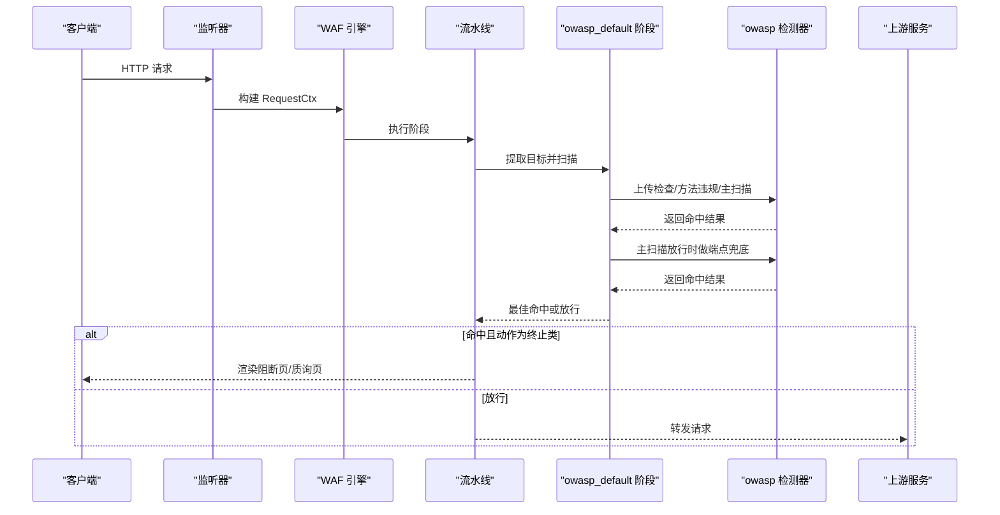

**图表来源**
- [internal/core/engine/engine.go:441-548](file://internal/core/engine/engine.go#L441-L548)
- [internal/core/rules/phases.go:618-685](file://internal/core/rules/phases.go#L618-L685)
- [internal/waf/owasp/owasp.go](file://internal/waf/owasp/owasp.go)
- [internal/waf/owasp/detectors_injection.go](file://internal/waf/owasp/detectors_injection.go)

## 详细组件分析

### OWASP 默认阶段（内置规则）
- 目标收集：路径、查询串、头部（过滤标准头）、Cookie 值（只取键值中的值）、Referer 查询串与片段。
- 输入归一化：多轮 URL 解码、HTML 实体解码、JS 转义解码、UTF-7 解码、SQL 注释剥离、空白折叠、大小写统一。
- 快速通道：`isCleanTarget` 只允许字母数字与 `- _ . , @` 且长度 ≤256；超长目标以 `truncateTarget` 保留首尾各 16384 字节；重编码目标进入深度解码二次扫描。
- 敏感度阈值：`low`/`mid`/`high`/`very_high`/`strict` 五档阈值分别为 7/4/3/2/1，`off` 关闭类别，未识别值回落 4。
- 命中后动作：默认 `intercept`，可由全局 `builtin_owasp_on_hit`、规则级 `action` 覆盖为 `drop`、`observe`、质询或 `redirect`。
- 执行顺序：上传文件名检查 → 方法违规检查 → 主扫描 → 敏感端点兜底探测，四步串在同一个 `Execute` 中，任一步产出终止结果即返回。

**章节来源**
- [internal/waf/owasp/owasp.go:894-926](file://internal/waf/owasp/owasp.go#L894-L926)
- [internal/waf/owasp/normalize.go:62-192](file://internal/waf/owasp/normalize.go#L62-L192)
- [internal/waf/owasp/normalize.go:1486-1500](file://internal/waf/owasp/normalize.go#L1486-L1500)
- [internal/waf/owasp/indicators.go:76-110](file://internal/waf/owasp/indicators.go#L76-L110)
- [internal/waf/owasp/owasp.go:840-892](file://internal/waf/owasp/owasp.go#L840-L892)
- [internal/core/rules/phases.go:618-685](file://internal/core/rules/phases.go#L618-L685)
- [internal/store/protection.go:159-176](file://internal/store/protection.go#L159-L176)

### 内置规则覆盖范围（专项向量）
| 类别 | 代表向量 | 目录条数 | 依据 |
|------|----------|:--:|------|
| SSRF | 云元数据 `169.254.169.254`/`metadata.google.internal`/`100.100.100.200`、私网三段、回环与 `::1`、`file\|gopher\|dict\|ldap\|sftp\|tftp\|php\|expect\|phar://`、十六进制与十进制 IP、`::ffff:` 映射、`unix:` 套接字 | 58 | `detectors_injection.go:13-61` |
| 命令注入 | 分隔符衔接命令、反引号、`$()`、重定向、远程下载、空字节与换行、`IFS` 绕过、`&&`/`\|\|`、brace 展开 | 131 | `patterns.go` cmd 段、`detectors_injection.go:163-173` |
| XXE | `DOCTYPE`、`SYSTEM`、实体展开、参数实体外带、XInclude | 12 | `owasp_registry.go:469-471` |
| LDAP 注入 | 闭合括号、`objectClass`、通配符 | 9 | `owasp_registry.go:473-475` |
| NoSQL 注入 | `$where`/`$regex`/`$or`/`$exists`/`$lookup` | 24 | `owasp_registry.go:477-479` |
| 模板注入 | Jinja/Django/Twig、Freemarker/Velocity/JSP EL、ERB、Smarty、Python dunder、ThinkPHP | 20 | `owasp_registry.go:481-483` |
| JNDI | `jndi:`、`${env\|sys\|java}`、Unicode 与 URL 编码、嵌套表达式 | 7 | `detectors_encoding.go:150-180` |
| CRLF | 响应头拆分、编码换行、RFC-2047 编码字内嵌换行 | 10 | `detectors_encoding.go:182-194` |
| 表达式语言 | SpEL/OGNL、反射链、静态方法调用、`!!python` | 15 | `detectors_encoding.go:390-398` |
| 反序列化 | Java 序列化魔数（含 URL 编码形态）、PHP/Python/.NET/Ruby Marshal | 22 | `detectors_encoding.go:461-469` |
| 协议违规 | CL+TE 冲突、重复 Content-Length、超长头部、危险方法 | 10 | `owasp_registry.go:1063-1072` |
| 文件上传 | 空字节、双扩展名、危险扩展、`.htaccess`、Content-Type 不匹配 | 7 | `owasp_registry.go:1055-1061` |
| GraphQL 注入 | `__schema`/`__type`/`__typename` 内省滥用 | 8 | `owasp_registry.go:501-503` |

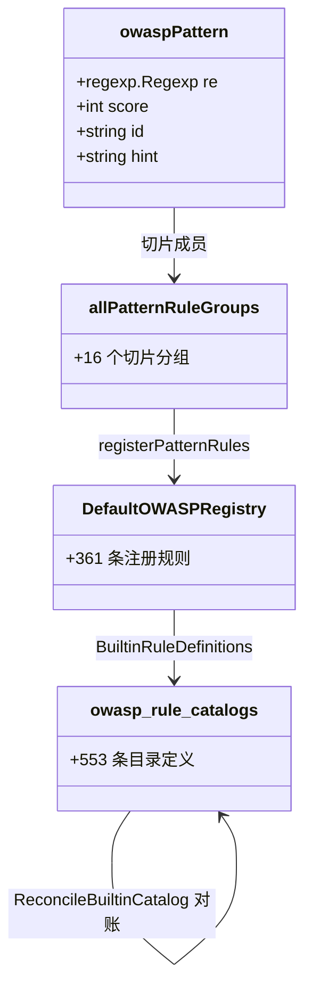

**图表来源**
- [internal/waf/owasp/patterns.go:51-59](file://internal/waf/owasp/patterns.go#L51-L59)
- [internal/waf/owasp/owasp_registry.go:1138-1162](file://internal/waf/owasp/owasp_registry.go#L1138-L1162)
- [internal/waf/owasp/detectors_injection.go:13-61](file://internal/waf/owasp/detectors_injection.go#L13-L61)
- [internal/waf/owasp/detectors_encoding.go:150-194](file://internal/waf/owasp/detectors_encoding.go#L150-L194)

**章节来源**
- [internal/waf/owasp/owasp_registry.go:453-543](file://internal/waf/owasp/owasp_registry.go#L453-L543)
- [internal/waf/owasp/owasp_registry.go:1055-1110](file://internal/waf/owasp/owasp_registry.go#L1055-L1110)
- [internal/waf/owasp/owasp_registry.go:1138-1162](file://internal/waf/owasp/owasp_registry.go#L1138-L1162)
- [internal/waf/owasp/detectors_injection.go:13-173](file://internal/waf/owasp/detectors_injection.go#L13-L173)
- [internal/waf/owasp/detectors_encoding.go:150-469](file://internal/waf/owasp/detectors_encoding.go#L150-L469)
- [internal/waf/owasp/patterns.go:90-94](file://internal/waf/owasp/patterns.go#L90-L94)
- [internal/waf/owasp/patterns.go:294-310](file://internal/waf/owasp/patterns.go#L294-L310)
- [internal/waf/owasp/patterns.go:1127-1139](file://internal/waf/owasp/patterns.go#L1127-L1139)

### 规则分类、维护与调试
- 目录分层：`*Patterns` 切片成员进入 `DefaultOWASPRegistry`（361 条）；`owasp:path:*`、`owasp:upload:*`、`owasp:proto:*`、`owasp:endpoint:*` 属硬编码发射点，只在 `BuiltinRuleDefinitions` 中登记，目录合计 553 条。
- 自定义规则：按 `priority` 升序、ID 升序编译执行，与内置规则分属不同阶段；`acl` 的 `allow` 命中即终止编译阶段。
- 新增规则：向对应 `*Patterns` 切片追加 `owaspPattern{re, score, id, hint}`，`hint` 非空时先做 `strings.Contains` 快速判定；向 `xxxRuleMeta` 补中文名与说明，否则退化为「类别描述 + 编号 + 分值」拼接。
- 阈值调整：全局档位、类别档位（`category_sensitivity`/`owasp_modules`）与规则级档位（`PolicyOWASPRuleConfig.Sensitivity`）三层覆盖。
- 调试入口：用 `CheckOWASP(sensitivity, path, query, headers, bodyTargets)` 直接复现；对比归一化前后差异；检查指示器门是否提前返回 false。
- 环境变量：`MY_OPENWAF_BOT_THRESHOLD` 调整 Bot 深度评分阈值，`MY_OPENWAF_DROP_BOT_THRESHOLD` 调整 Drop 恶意阈值；全局 OWASP 默认值不来自环境变量，而来自 `DefaultProtectionConfig`。

**章节来源**
- [internal/waf/owasp/owasp_registry.go:1035-1116](file://internal/waf/owasp/owasp_registry.go#L1035-L1116)
- [internal/waf/owasp/patterns.go:51-59](file://internal/waf/owasp/patterns.go#L51-L59)
- [internal/waf/owasp/owasp_registry.go:517-586](file://internal/waf/owasp/owasp_registry.go#L517-L586)
- [internal/core/rules/phases.go:112-129](file://internal/core/rules/phases.go#L112-L129)
- [internal/store/owasp/owasp.go:22-38](file://internal/store/owasp/owasp.go#L22-L38)
- [internal/core/config.go:386-394](file://internal/core/config.go#L386-L394)
- [internal/waf/owasp/owasp.go:129-137](file://internal/waf/owasp/owasp.go#L129-L137)

### 配置项与站点覆盖
- 敏感度与动作：全局 `builtin_owasp_sensitivity` 默认 `mid`，`builtin_owasp_on_hit` 默认 `intercept`，`builtin_owasp_enabled` 默认为假。
- 站点级三态：`owasp_enabled` 为 `*bool`，nil=继承全局、true=覆盖启用、false=覆盖关闭；`owasp_sensitivity`/`owasp_action` 空串表示继承，且仅在 `owasp_enabled` 非 nil 时才被读取。
- 继承清理：`clearInheritedProtectionOverrides` 在 `owasp_enabled == nil` 时连带清空从属字段，避免把继承态误存为空配置。

**章节来源**
- [internal/store/protection.go:27-29](file://internal/store/protection.go#L27-L29)
- [internal/store/protection.go:159-176](file://internal/store/protection.go#L159-L176)
- [internal/store/site.go:76-78](file://internal/store/site.go#L76-L78)
- [internal/admin/site/site.go:490-508](file://internal/admin/site/site.go#L490-L508)
- [internal/snapshot/build.go:725-734](file://internal/snapshot/build.go#L725-L734)

### 与其他安全机制的配合使用与最佳实践
- ACL 的 `allow` 命中即终止编译阶段，可跳过 OWASP；Lua 前置策略位于 ACL 之后、OWASP 之前。
- CVE 阶段在 OWASP 之后执行并复用同一批请求体目标；Bot 阶段使用 `PreScreen` → `DeepScore` 两阶段评分，恶意档位可升级为 `drop`。
- 规则级 `captcha_type` 只在 `captcha_challenge` 动作下生效，质询页与阻断页由动作类型决定渲染分支。

**章节来源**
- [internal/core/engine/engine.go:465-548](file://internal/core/engine/engine.go#L465-L548)
- [internal/core/rules/phases.go:112-129](file://internal/core/rules/phases.go#L112-L129)
- [internal/waf/bot/bot.go:359](file://internal/waf/bot/bot.go#L359)
- [internal/waf/bot/bot.go:693-698](file://internal/waf/bot/bot.go#L693-L698)

## 依赖关系分析
OWASP 检测模块与规则系统、引擎、流水线之间存在清晰的依赖关系，遵循"规则编译 → 流水线执行 → 阶段扫描 → 命中动作"的链路。

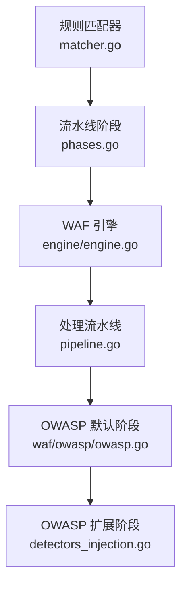

**图表来源**
- [internal/core/rules/matcher.go:1473-1783](file://internal/core/rules/matcher.go#L1473-L1783)
- [internal/core/rules/phases.go:593-685](file://internal/core/rules/phases.go#L593-L685)
- [internal/core/engine/engine.go:441-548](file://internal/core/engine/engine.go#L441-L548)
- [internal/core/pipeline/pipeline.go:517-557](file://internal/core/pipeline/pipeline.go#L517-L557)
- [internal/waf/owasp/owasp.go](file://internal/waf/owasp/owasp.go)
- [internal/waf/owasp/detectors_injection.go](file://internal/waf/owasp/detectors_injection.go)

**章节来源**
- [internal/core/rules/matcher.go:1-1928](file://internal/core/rules/matcher.go#L1-L1928)
- [internal/core/rules/phases.go:1-1391](file://internal/core/rules/phases.go#L1-L1391)
- [internal/core/engine/engine.go:1-646](file://internal/core/engine/engine.go#L1-L646)
- [internal/core/pipeline/pipeline.go:1-71](file://internal/core/pipeline/pipeline.go#L1-L71)

## 性能考虑
- 快速预过滤：纯字母数字字符串直接跳过正则；关键字预过滤减少正则匹配次数。
- 归一化成本控制：多轮解码与正则扫描限制在合理范围内，超长目标截断。
- 正则缓存：规则编译时缓存正则表达式，避免重复编译。
- 流水线短路：首个拦截结果立即终止后续阶段，降低整体延迟。
- 体数据解析：按内容类型解析表单/JSON/Multipart，限制采样大小与递归深度，避免内存与 CPU 泄漏。

**章节来源**
- [internal/waf/owasp/owasp.go](file://internal/waf/owasp/owasp.go)
- [internal/core/rules/phases.go:950-1031](file://internal/core/rules/phases.go#L950-L1031)
- [internal/core/rules/matcher.go:1785-1810](file://internal/core/rules/matcher.go#L1785-L1810)

## 故障排查指南
- 误报定位：通过测试用例验证误报场景，逐步缩小到具体规则与误报抑制逻辑。
- 归一化问题：对比原始输入与归一化后的字符串，确认是否被过度解码或注释剥离导致误判。
- 敏感度与阈值：根据业务风险调整敏感度档位与阈值，观察命中率与误报率变化。
- 体数据扫描：检查表单/JSON/Multipart 解析逻辑，确认采样大小与字段提取是否符合预期。
- Cookie/Referer：确认会话标识被正确剔除，避免误报；仅扫描查询串与片段。

**章节来源**
- [internal/waf/owasp/owasp_test.go:1-1830](file://internal/waf/owasp/owasp_test.go#L1-L1830)
- [internal/waf/owasp/detectors_injection.go](file://internal/waf/owasp/detectors_injection.go)
- [internal/waf/owasp/owasp.go](file://internal/waf/owasp/owasp.go)
- [internal/core/rules/phases.go:950-1031](file://internal/core/rules/phases.go#L950-L1031)

## 结论
My-OpenWaf 的 OWASP 检测体系通过"基础规则 + 扩展规则"的双层设计，结合严格的误报抑制、输入归一化与阈值控制，在性能与准确性之间取得平衡。规则 DSL 与流水线机制使得规则更新与维护便捷可控，配合 ACL、Bot、CVE、速率限制等安全机制，形成完整的防护闭环。

## 附录

### SQL 注入（SQLi）检测

#### 检测特征识别

系统通过以下特征识别 SQL 注入攻击：

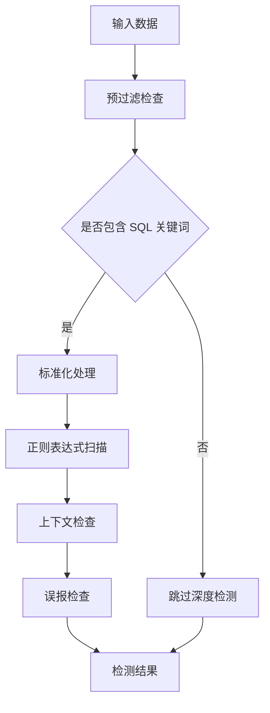

**图表来源**
- [internal/waf/owasp/normalize.go](file://internal/waf/owasp/normalize.go)
- [internal/waf/owasp/falsepositive.go](file://internal/waf/owasp/falsepositive.go)

#### 正则表达式匹配模式
系统为 SQL 注入检测定义 54 条规则（`sqliPatterns` 聚合后的稳定规则 ID 数），每条规则带独立分值，SQLi 类别分值区间为 2–7：

| 规则 ID | 检测模式 | 分数 | 描述 |
|---------|----------|:--:|------|
| `owasp:sqli:001` | `union\s*(all\s*)?select\|unionselect` | 5 | SQL UNION 联合查询注入 |
| `owasp:sqli:002` | `'\s*(or\|and)\s+['"]?\d` | 5 | SQL 引号布尔注入 |
| `owasp:sqli:003` | `(sleep\|benchmark\|waitfor\s+delay\|pg_sleep)\s*\(` | 5 | SQL 时间型盲注 |
| `owasp:sqli:004` | `;\s*(select\|drop\|alter\|create\|truncate\|delete\|update\|insert)\s` | 5 | SQL 多语句堆叠注入 |
| `owasp:sqli:005` | `['"\d]\s*(--(?:[\s/]\|$)\|/\*)` | 3 | SQL 注释截断 |
| `owasp:sqli:007` | `(chr\|unhex\|conv)\s*\(` | 3 | SQL 字符编码函数 |
| `owasp:sqli:008` | `[,=(]\s*0x[0-9a-f]{4,}` | 2 | SQL 十六进制字面量载荷 |
| `owasp:sqli:035` | SQL Server `WAITFOR DELAY` 形态 | 7 | SQL Server WAITFOR DELAY 注入 |
| `owasp:sqli:051` | MySQL 条件注释形态 | 6 | MySQL 条件注释注入 |

类别分值区间为 2–7：最高为 `owasp:sqli:035`（7），其次 `owasp:sqli:024` 与 `owasp:sqli:051`（6），其余多为 5 或更低。

**章节来源**
- [internal/waf/owasp/patterns.go:90-94](file://internal/waf/owasp/patterns.go#L90-L94)
- [internal/waf/owasp/owasp_registry.go:609-666](file://internal/waf/owasp/owasp_registry.go#L609-L666)

#### 检测阈值设置
SQL 注入检测采用累积评分机制：`score.Accumulator` 按规则 ID 去重累加，`total >= threshold` 即判过阈，阈值由敏感度档位决定（`low` 7、`mid` 4、`high` 3、`very_high` 2、`strict` 1、`off` 关闭类别），完整档位语义见「OWASP 检测」总览的敏感度章节。

**章节来源**
- [internal/waf/owasp/owasp.go:840-892](file://internal/waf/owasp/owasp.go#L840-L892)
- [internal/core/score/score.go:40-77](file://internal/core/score/score.go#L40-L77)
- [internal/store/protection.go:169](file://internal/store/protection.go#L169)

#### 上下文感知检测
系统通过复杂的上下文检查减少误报：

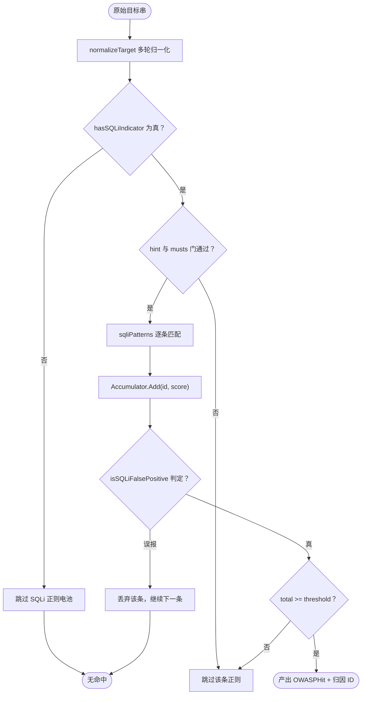

**图表来源**
- [internal/waf/owasp/falsepositive.go:10-104](file://internal/waf/owasp/falsepositive.go#L10-L104)
- [internal/waf/owasp/indicators.go:307](file://internal/waf/owasp/indicators.go#L307)
- [internal/waf/owasp/indicators.go:1157-1160](file://internal/waf/owasp/indicators.go#L1157-L1160)
- [internal/core/score/score.go:62-77](file://internal/core/score/score.go#L62-L77)

SQLi 抑制分支按规则 ID 定点生效，不使用泛化上下文对象：

| 规则 ID | 抑制判据 | 使用符号 |
|---------|----------|----------|
| `owasp:sqli:002` | `'or` 后紧跟序数词（`1st`/`2nd`）判定为自然文本 | `reOrdinalAfterOr` |
| `owasp:sqli:003` | 无 `waitfor`、无 SQL 结构上下文与终止符的 `sleep()`/`benchmark()` 判为 JS 误报 | `reBoolSQLContext`、`reSQLTerminatorCtx`、`reANDORSleep` |
| `owasp:sqli:004` | 缺 `FROM`/`TABLE`/`INTO`/`VALUES` 等结构上下文时抑制；`;insert` 无 `into` 抑制 | `reSQLDMLContext` |
| `owasp:sqli:005` | 长度 <10 且无 SQL 上下文抑制；`arn:aws:s3` 通配符抑制 | `reBoolSQLContext` |
| `owasp:sqli:006` | 二进制目标、代码块花括号、`import`/`export`/`from '` 前端语句抑制 | `isBinaryScanTarget`、`hasCodeBlockBraceAfterStackedSemicolon` |
| `owasp:sqli:010` | 恒等式未紧邻语句/操作数边界时判为散文 | `hasSQLTautologyInjectionContext` |
| `owasp:sqli:011` | 恒不抑制（`or 'x'='x'` 始终恶意） | — |

**章节来源**
- [internal/waf/owasp/falsepositive.go:10-104](file://internal/waf/owasp/falsepositive.go#L10-L104)
- [internal/waf/owasp/indicators.go:307](file://internal/waf/owasp/indicators.go#L307)
- [internal/waf/owasp/indicators.go:1157-1160](file://internal/waf/owasp/indicators.go#L1157-L1160)
- [internal/core/score/score.go:62-77](file://internal/core/score/score.go#L62-L77)

### 跨站脚本（XSS）检测

#### 检测特征识别
XSS 检测系统针对现代 Web 应用的各种 XSS 攻击变种进行了专门优化，`xssPatterns` 聚合后共 71 条规则，分值区间 2–5：

| 规则 ID | 检测模式 | 分数 | 描述 |
|---------|----------|:--:|------|
| `owasp:xss:001` | `<script[;\s>/]` | 5 | script 标签注入 |
| `owasp:xss:002` | `\bon(error\|load\|click\|...)\s*=` | 5 | 内联事件处理器 |
| `owasp:xss:003` | `javascript\s*:` | 5 | javascript 伪协议 |
| `owasp:xss:004` | `]*(src\s*=[^>]*\s+)?onerror\s*=` | 5 | img src 空值触发 onerror |
| `owasp:xss:006` | `document\.(cookie\|location\|write\|domain)` | 4 | document 敏感属性 |
| `owasp:xss:007` | `<svg[\s>]` | 2 | SVG 元素注入 |
| `owasp:xss:009` | `data:text/html` | 5 | data 文本 HTML 载荷 |
| `owasp:xss:021` | `\bexpression\s*\(\s*(document\|window\|eval\|this\|alert)` | 3 | IE expression 样式注入 |

#### 上下文感知检测策略
XSS 检测采用了精细的上下文感知策略：

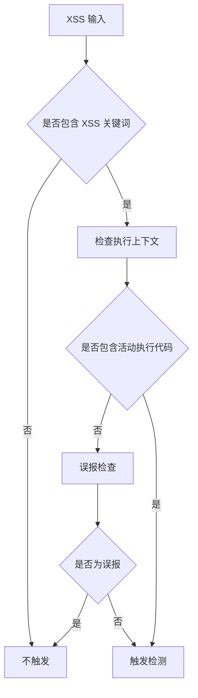

**图表来源**
- [internal/waf/owasp/falsepositive.go:554-747](file://internal/waf/owasp/falsepositive.go#L554-L747)
- [internal/waf/owasp/indicators.go:538](file://internal/waf/owasp/indicators.go#L538)

#### 误报抑制机制
XSS 抑制入口为 `isXSSFalsePositive(normalized, firstRuleID)`，另有遥测路径专用抑制 `isKnownTelemetryXSSFalsePositive(path, normalized, ruleID, isBodyTarget)`：
1. **被动结构与主动执行区分**：`owasp:xss:005`/`007`/`008` 这类仅出现标签的被动结构需配合活动执行代码才成立；`owasp:xss:006`/`010` 单独出现时按上下文判定。
2. **CDN 回调抑制**：`onload` 回调参数为无括号的函数引用时不视为 XSS。
3. **遥测路径抑制**：已知遥测/统计端点上的请求体命中优先抑制。
4. **富文本抑制**：CMS 富文本中的 `svg`/`iframe` 结构不单独触发。

**章节来源**
- [internal/waf/owasp/falsepositive.go:273-286](file://internal/waf/owasp/falsepositive.go#L273-L286)
- [internal/waf/owasp/falsepositive.go:554-747](file://internal/waf/owasp/falsepositive.go#L554-L747)
- [internal/waf/owasp/patterns.go:294-310](file://internal/waf/owasp/patterns.go#L294-L310)
- [internal/waf/owasp/owasp_registry.go:667-741](file://internal/waf/owasp/owasp_registry.go#L667-L741)

### 命令注入（CmdInject）检测

#### 检测特征识别
命令注入检测系统专门针对操作系统命令注入攻击，`cmdInjectPatterns` 聚合出 36 条注册规则，另有 95 条归属同一类别的端点/路径规则，目录合计 131 条：

| 规则 ID | 检测模式 | 分数 | 描述 |
|---------|----------|:--:|------|
| `owasp:cmd:001` | `[;\|&]\s*(ls\|cat\|id\|whoami\|...)\s…` | 5 | 分隔符衔接命令 |
| `owasp:cmd:002` | 反引号包裹常见命令 | 3 | 反引号命令替换 |
| `owasp:cmd:003` | `\$\([^)]*\b(cat\|ls\|id\|...)\b` | 4 | `$()` 命令替换 |
| `owasp:cmd:004` | `(>\|>>)\s*/(etc\|tmp\|var\|root\|home)/` | 4 | 输出重定向到系统路径 |
| `owasp:cmd:005` | `(^[\s;\|&])(wget\|curl)\s+https?://` | 3 | 远程下载 |
| `owasp:cmd:006` | `%00\|\x00\|%0[aAdD]\|\x0a\|\x0d` | 3 | 空字节与换行截断 |
| `owasp:cmd:007` | `\b(id\|uname\|whoami\|hostname\|...)\s*;` | 3 | 命令后紧跟分号 |
| `owasp:cmd:009` | `\$\{?\s*ifs\s*\}?` | 4 | IFS 空白绕过 |
| `owasp:cmd:010` | `\b\w+=\S+\s+(cat\|id\|whoami\|...)\b` | 3 | 环境变量前缀执行 |

命令词表在多条规则间共享，`owasp:cmd:001` 与 `owasp:cmd:008` 的差别只在分隔符：前者为 `[;|&]`，后者为一个或多个 `\|`。

**章节来源**
- [internal/waf/owasp/detectors_injection.go:163-173](file://internal/waf/owasp/detectors_injection.go#L163-L173)
- [internal/waf/owasp/owasp_registry.go:789-828](file://internal/waf/owasp/owasp_registry.go#L789-L828)
- [internal/waf/owasp/owasp_registry.go:1074-1093](file://internal/waf/owasp/owasp_registry.go#L1074-L1093)

#### 高置信度检测
命令注入不是「发现弱模式即升级置信度」的分级模型，而是同一阈值下的累加判定：每条规则按 ID 去重计分，累计分达到类别阈值才产出命中，且归因固定指向首次把总分推过阈值的那条规则。

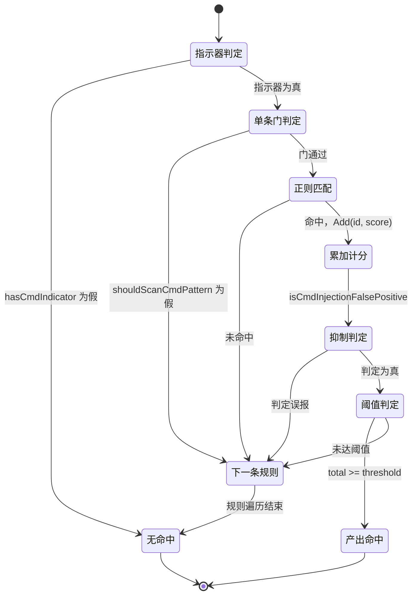

**图表来源**
- [internal/waf/owasp/indicators.go:600](file://internal/waf/owasp/indicators.go#L600)
- [internal/waf/owasp/detectors_injection.go:255-270](file://internal/waf/owasp/detectors_injection.go#L255-L270)
- [internal/waf/owasp/falsepositive.go:747-811](file://internal/waf/owasp/falsepositive.go#L747-L811)
- [internal/core/score/score.go:62-77](file://internal/core/score/score.go#L62-L77)

#### 误报抑制策略
命令注入抑制入口为 `isCmdInjectionFalsePositive(normalized, ruleID)`，按规则 ID 分支，另有 `isKnownTelemetryCmdFalsePositive` 处理遥测路径：
1. **二进制数据抑制**：`isBinaryScanTarget` 为真的请求体不产出空字节类命中。
2. **协议数据抑制**：Telemetry/Analytics 载荷中的分隔符不触发（`/run` 路径上的 `owasp:cmd:001` 直接抑制）。
3. **UA 分隔符抑制**：浏览器 UA 中的 `;` 与 `,` 不带命令词时不进正则电池。
4. **高频规则预过滤**：`shouldScanCmdPattern` 对 `owasp:cmd:007`/`010`/`015` 做词形与上下文校验，`font-family: Arial; color: red`、`a|b|c` 均不进入匹配。

**章节来源**
- [internal/waf/owasp/falsepositive.go:519-530](file://internal/waf/owasp/falsepositive.go#L519-L530)
- [internal/waf/owasp/falsepositive.go:747-811](file://internal/waf/owasp/falsepositive.go#L747-L811)
- [internal/waf/owasp/detectors_injection.go:255-270](file://internal/waf/owasp/detectors_injection.go#L255-L270)
- [internal/waf/owasp/owasp_extended_test.go:36-104](file://internal/waf/owasp/owasp_extended_test.go#L36-L104)

### 路径遍历（PathTrav）检测

#### 检测特征识别
路径穿越检测目录共 39 条（`pathTravPatterns` 注册 19 条，其余为端点与路径规则）：

| 规则 ID | 检测模式 | 分数 | 描述 |
|---------|----------|:--:|------|
| `owasp:path_traversal:001` | `(\.\./){2,}` | 4 | 连续上级目录 |
| `owasp:path_traversal:002` | `(etc/passwd\|etc/shadow\|win\.ini\|boot\.ini)` | 5 | 系统敏感文件 |
| `owasp:path_traversal:003` | `%2e%2e[/\\]` | 4 | 部分编码上级目录 |
| `owasp:path_traversal:004` | `\.\.[/\\]\.\.[/\\]` | 4 | 双上级目录段 |
| `owasp:path_traversal:006` | `/proc/self/(environ\|cmdline\|fd\|maps\|...)` | 5 | 进程信息读取 |
| `owasp:path_traversal:008` | `\.\.[/\\].*(windows[/\\]system32\|cmd\.exe\|system\.ini)` | 5 | Windows 系统文件穿越 |
| `owasp:path_traversal:009` | `\.{3,}[/\\]` | 4 | 三点以上目录段 |
| `owasp:path_traversal:011` | `(%252e\|%252f\|%255c){2,}` | 4 | 双重编码穿越 |
| `owasp:path_traversal:013` | `\.\.[/\\].*(web-inf\|meta-inf\|web\.xml\|struts\.xml)` | 5 | Web 应用配置穿越 |
| `owasp:path_traversal:015` | `\.\.[/\\]*(\.git[/\\]\|\.env\|\.htpasswd\|\.aws[/\\]\|\.ssh[/\\])` | 4 | 源码与配置外带 |
| `owasp:path_traversal:019` | `\\\\[\w.:-]+\\(?:[a-zA-Z]\|admin\|ipc)\$` | 4 | UNC 管理共享 |

`.git` 与 `.svn` 的独立探测另由 `owasp:path:011`（`.git 目录访问`，分值 5）承担；`owasp:path:006` 覆盖 Cisco ASA 的 `+CSCOE+`/`+CSCOT+` 穿越，并受 `cisco_asa_mode` 三档（`legacy`/`strict`/`scoped`，未配置时数据面默认 `scoped`）控制。

**章节来源**
- [internal/waf/owasp/patterns.go:1127-1148](file://internal/waf/owasp/patterns.go#L1127-L1148)
- [internal/waf/owasp/owasp_registry.go:1011-1032](file://internal/waf/owasp/owasp_registry.go#L1011-L1032)
- [internal/waf/owasp/owasp_registry.go:1081](file://internal/waf/owasp/owasp_registry.go#L1081)
- [internal/waf/owasp/owasp.go:274-279](file://internal/waf/owasp/owasp.go#L274-L279)
- [internal/waf/owasp/cisco_asa.go:8-39](file://internal/waf/owasp/cisco_asa.go#L8-L39)

#### 敏感路径抑制
低置信度形态必须命中敏感路径词表才保留，词表由 `rePathTravSensitive` 单点定义：

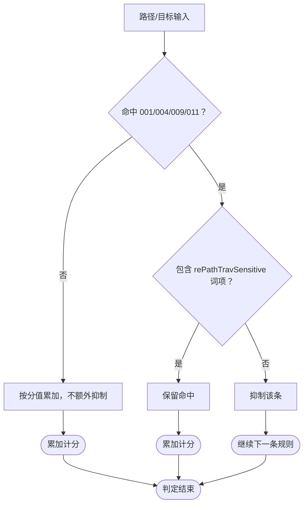

**图表来源**
- [internal/waf/owasp/falsepositive.go:1147-1148](file://internal/waf/owasp/falsepositive.go#L1147-L1148)
- [internal/waf/owasp/falsepositive.go:1321-1343](file://internal/waf/owasp/falsepositive.go#L1321-L1343)

词表覆盖 `etc/passwd`、`/proc/`、`windows/system32`、`/root/`、`.env`、`web.xml`、`nginx.conf`、`web-inf`、`.git/`、`.htpasswd`、`.aws/`、`.ssh/`、`/bin/sh`、`/var/log`、`/tmp/`、`/dev/` 等条目。`owasp:path_traversal:009` 另有独立抑制：`...</`、`...\n`、`...\t` 等正文省略号与 JSON 转义形态直接放行。

**章节来源**
- [internal/waf/owasp/falsepositive.go:1147-1148](file://internal/waf/owasp/falsepositive.go#L1147-L1148)
- [internal/waf/owasp/falsepositive.go:1321-1343](file://internal/waf/owasp/falsepositive.go#L1321-L1343)

### 服务器端请求伪造（SSRF）检测

#### 检测特征识别
SSRF 检测目录共 58 条，其中 `ssrfPatterns` 注册 24 条，其余为端点探测规则：

| 规则 ID | 检测模式 | 分数 | 描述 |
|---------|----------|:--:|------|
| `owasp:ssrf:001` | `169\.254\.169\.254` | 6 | 云元数据地址段 |
| `owasp:ssrf:002` | `metadata\.google\.internal` | 6 | GCP 元数据域名 |
| `owasp:ssrf:003` | `100\.100\.100\.200` | 6 | 阿里云元数据地址 |
| `owasp:ssrf:004` | `(https?://\|ftps?://\|[/@])10\.\d{1,3}\.\d{1,3}\.\d{1,3}` | 5 | 10 段私网地址 |
| `owasp:ssrf:006` | `(https?://\|ftps?://\|[/@])192\.168\.\d{1,3}\.\d{1,3}` | 5 | 192.168 段私网地址 |
| `owasp:ssrf:007` | `(https?://\|[/@])(127\.\d{1,3}\.\d{1,3}\.\d{1,3}\|localhost\|...)` | 5 | 回环与 localhost |
| `owasp:ssrf:008` | `(https?://\|[/@])(\[::1\]\|\[::\]\|0\.0\.0\.0)` | 5 | IPv6 回环与未指定地址 |
| `owasp:ssrf:009` | `https?://\s*0x[0-9a-f]{8}\b` | 5 | 十六进制编码 IP |
| `owasp:ssrf:010` | `(file\|gopher\|dict\|ldap\|sftp\|tftp\|php\|expect\|phar)://` | 5 | 危险协议前缀 |
| `owasp:ssrf:012` | `::ffff:(127\.\|10\.\|192\.168\.\|172\.(1[6-9]\|2\d\|3[01])\.)` | 5 | IPv6 映射私网地址 |
| `owasp:ssrf:014` | `\bunix:[^\s]{10,}` | 4 | Unix 套接字 |

#### 上下文感知检测
SSRF 抑制入口为 `isSSRFFalsePositive(normalized, ruleID)`，按规则 ID 定点生效，不存在独立的上下文对象：

| 规则 ID | 保留条件 | 抑制条件 |
|---------|----------|----------|
| `owasp:ssrf:007` | 载荷含 `gopher://`/`file://`/`dict://` | 含 `upstreams`/`upstream`/`proxy_pass`/`backend`/`server_names` 配置词；长文本 `localhost`（>100 且无 `@`、无元数据特征）；`accessurl=` 等回调参数 |
| `owasp:ssrf:010` | 非遥测上下文 | 目标串含 `cdn-cgi`、`/rum` 或 `cloudflare` |

此外，Referer 头部只扫描查询串与片段，避免 `http://10.0.0.1` 这类 scheme+host 直接触发 SSRF；请求体侧 `/cdn-cgi/` 路径整体跳过 SSRF 类别。

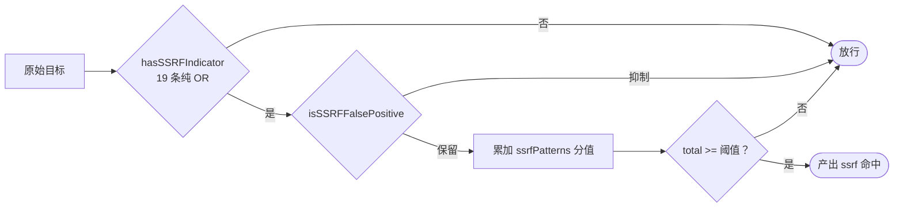

**图表来源**
- [internal/waf/owasp/detectors_injection.go:13-61](file://internal/waf/owasp/detectors_injection.go#L13-L61)
- [internal/waf/owasp/falsepositive.go:1345-1395](file://internal/waf/owasp/falsepositive.go#L1345-L1395)
- [internal/waf/owasp/owasp.go:246-248](file://internal/waf/owasp/owasp.go#L246-L248)
- [internal/waf/owasp/indicators.go:1186-1197](file://internal/waf/owasp/indicators.go#L1186-L1197)

**章节来源**
- [internal/waf/owasp/detectors_injection.go:13-101](file://internal/waf/owasp/detectors_injection.go#L13-L101)
- [internal/waf/owasp/falsepositive.go:1345-1395](file://internal/waf/owasp/falsepositive.go#L1345-L1395)
- [internal/waf/owasp/owasp.go:242-251](file://internal/waf/owasp/owasp.go#L242-L251)
- [internal/waf/owasp/owasp.go:914-919](file://internal/waf/owasp/owasp.go#L914-L919)
- [internal/waf/owasp/owasp_registry.go:829-856](file://internal/waf/owasp/owasp_registry.go#L829-L856)

### 规则注册与目录管理

#### 规则注册机制
系统通过注册表机制管理所有内置规则，并在启动时把注册表与硬编码发射点合并为数据库目录：

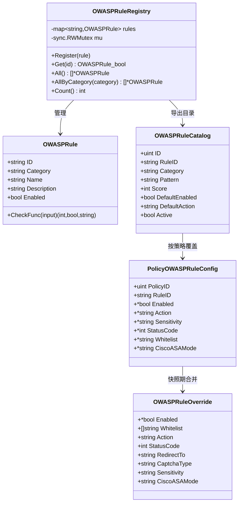

**图表来源**
- [internal/waf/owasp/owasp_registry.go:19-95](file://internal/waf/owasp/owasp_registry.go#L19-L95)
- [internal/store/owasp/owasp.go:5-38](file://internal/store/owasp/owasp.go#L5-L38)
- [internal/snapshot/build.go:560-614](file://internal/snapshot/build.go#L560-L614)

#### 规则覆盖与生效路径
`PolicyOWASPRuleConfig` 全部业务字段都是指针，nil 表示「未覆盖、继承」；快照构建时逐字段判空后才写入 `OWASPRuleOverride`，`Whitelist` 反序列化失败会记录诊断项并跳过该字段而不中断快照。

| 覆盖字段 | 存储类型 | 继承语义 | 运行时消费点 |
|----------|----------|----------|--------------|
| `enabled` | `*bool` | nil → 取注册表默认 `true` | `IsRuleEnabled` |
| `whitelist_json` | `*string`（JSON 数组） | nil/空 → 无白名单 | `IsPathWhitelisted` |
| `action` | `*string` | 空 → 继承 `builtin_owasp_on_hit` | `owaspHitResult` |
| `sensitivity` | `*string` | 空 → 不额外抬高阈值 | `HitPassesOverrideSensitivity` |
| `status_code` | `*int` | nil → 站点/全局默认状态码 | `action.Result.StatusCode` |
| `redirect_to` | `*string` | `redirect` 动作下必填 | `action.Result.RedirectTo` |
| `captcha_type` | `*string` | 仅 `captcha_challenge` 动作下有效 | `action.Result.CaptchaType` |
| `cisco_asa_mode` | `*string` | nil → 数据面默认 `scoped`；未知显式值 → `legacy` | `NormalizeCiscoASAMode` |

**章节来源**
- [internal/store/owasp/owasp.go:22-38](file://internal/store/owasp/owasp.go#L22-L38)
- [internal/snapshot/build.go:560-614](file://internal/snapshot/build.go#L560-L614)
- [internal/waf/owasp/owasp_registry.go:97-108](file://internal/waf/owasp/owasp_registry.go#L97-L108)
- [internal/waf/owasp/owasp_registry.go:234-305](file://internal/waf/owasp/owasp_registry.go#L234-L305)
- [internal/waf/owasp/owasp_registry.go:333-402](file://internal/waf/owasp/owasp_registry.go#L333-L402)
- [internal/waf/owasp/cisco_asa.go:24-39](file://internal/waf/owasp/cisco_asa.go#L24-L39)
- [internal/core/rules/phases.go:687-718](file://internal/core/rules/phases.go#L687-L718)

#### 规则管理 API
管理接口以数据库目录为准，而非内存注册表：列表与统计读取 `owasp_rule_catalogs` 左连 `policy_owasp_rule_configs` 生成的视图，更新按 `(policy_id, rule_id)` upsert 覆盖行，重置直接删除覆盖行回到继承态。

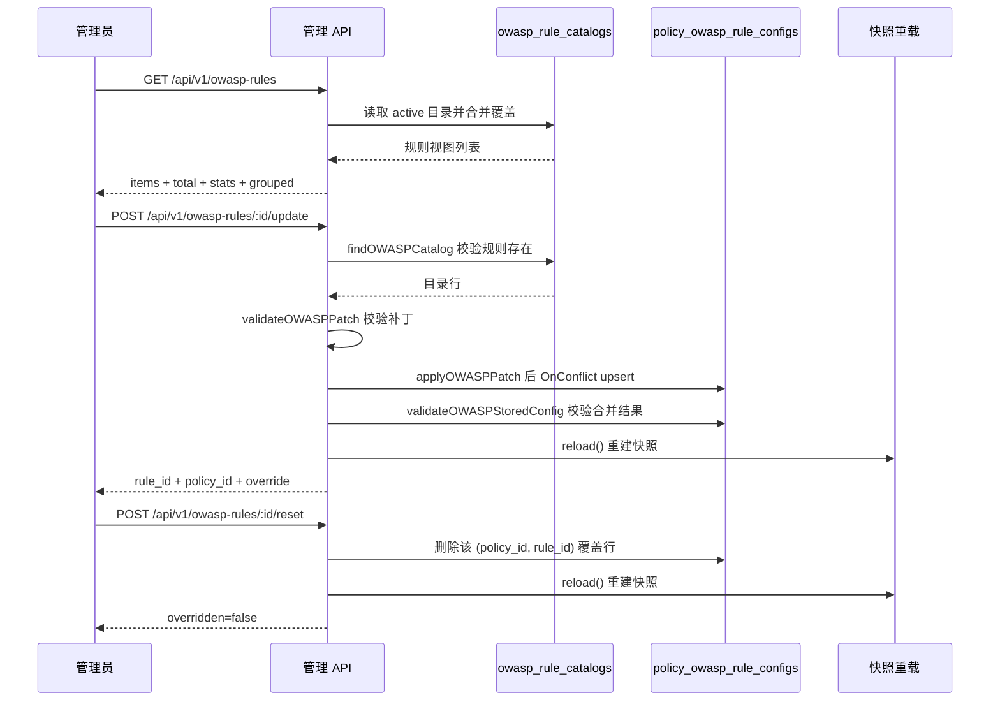

**图表来源**
- [internal/admin/router.go:224-227](file://internal/admin/router.go#L224-L227)
- [internal/admin/router.go:323-325](file://internal/admin/router.go#L323-L325)
- [internal/admin/detect/owasprules/owasp_rules.go:100-137](file://internal/admin/detect/owasprules/owasp_rules.go#L100-L137)
- [internal/admin/detect/owasprules/owasp_rules.go:320-404](file://internal/admin/detect/owasprules/owasp_rules.go#L320-L404)
- [internal/admin/detect/owasprules/owasp_read_query.go:15-102](file://internal/admin/detect/owasprules/owasp_read_query.go#L15-L102)

**章节来源**
- [internal/admin/detect/owasprules/owasp_rules.go:100-137](file://internal/admin/detect/owasprules/owasp_rules.go#L100-L137)
- [internal/admin/detect/owasprules/owasp_rules.go:139-244](file://internal/admin/detect/owasprules/owasp_rules.go#L139-L244)
- [internal/admin/detect/owasprules/owasp_rules.go:320-505](file://internal/admin/detect/owasprules/owasp_rules.go#L320-L505)
- [internal/admin/router.go:224-227](file://internal/admin/router.go#L224-L227)
- [internal/admin/router.go:323-328](file://internal/admin/router.go#L323-L328)
