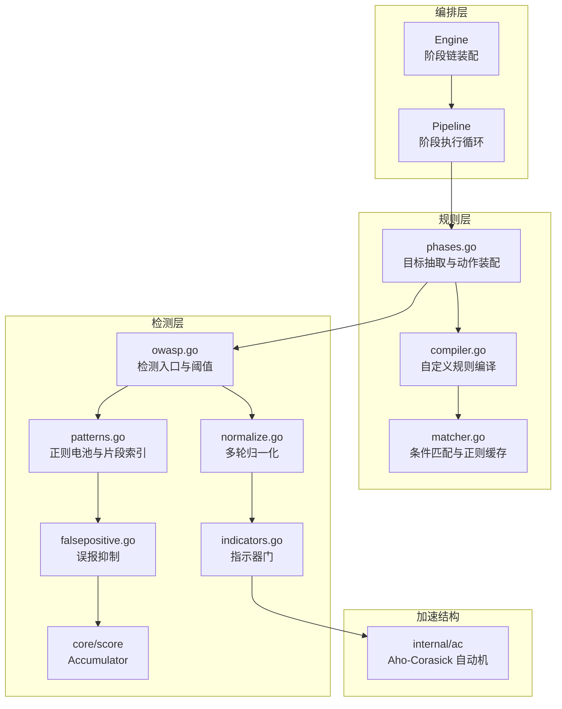
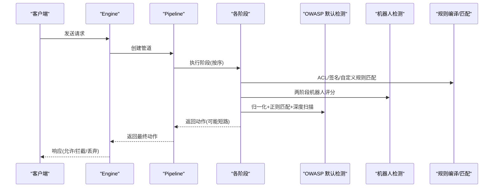
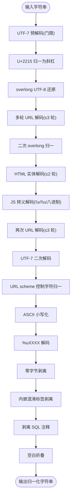
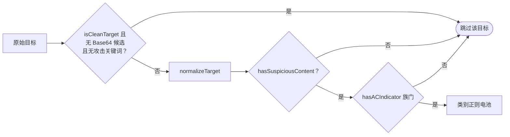
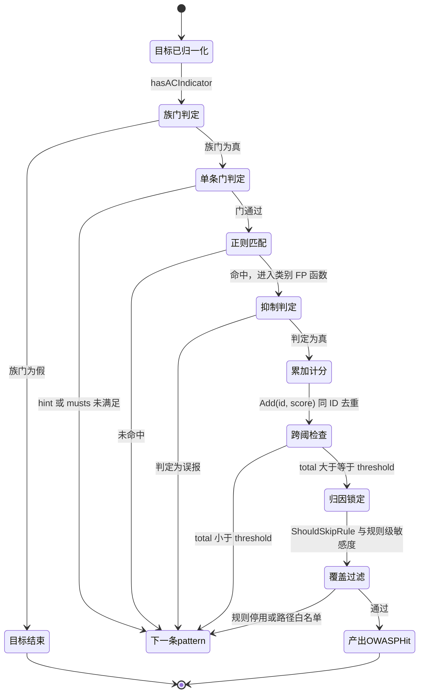
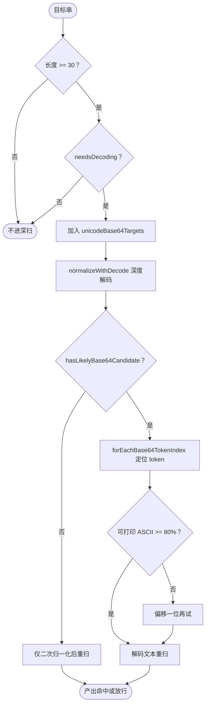
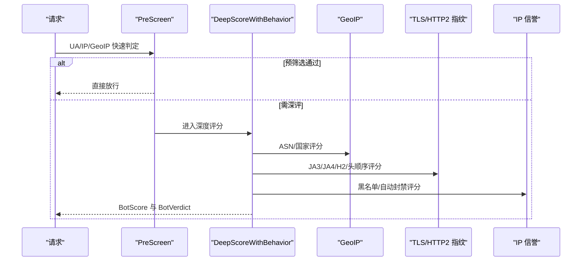
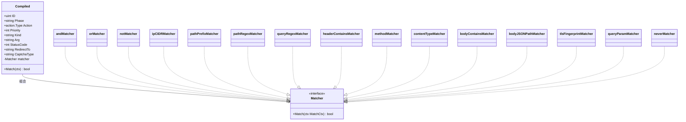
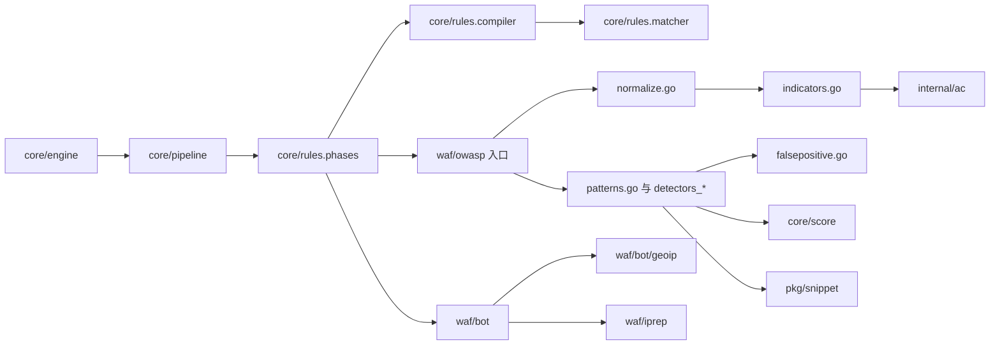

> [返回 安全防护功能](../安全防护功能.md)

# 检测算法与技术

<cite>
**本文档引用的文件**
- [internal/waf/owasp/owasp.go](file://internal/waf/owasp/owasp.go)
- [internal/waf/owasp/normalize.go](file://internal/waf/owasp/normalize.go)
- [internal/waf/owasp/indicators.go](file://internal/waf/owasp/indicators.go)
- [internal/waf/owasp/falsepositive.go](file://internal/waf/owasp/falsepositive.go)
- [internal/waf/owasp/patterns.go](file://internal/waf/owasp/patterns.go)
- [internal/waf/owasp/detectors_injection.go](file://internal/waf/owasp/detectors_injection.go)
- [internal/waf/owasp/detectors_encoding.go](file://internal/waf/owasp/detectors_encoding.go)
- [internal/waf/owasp/owasp_registry.go](file://internal/waf/owasp/owasp_registry.go)
- [internal/ac/ac.go](file://internal/ac/ac.go)
- [internal/core/score/score.go](file://internal/core/score/score.go)
- [internal/core/rules/phases.go](file://internal/core/rules/phases.go)
- [internal/core/rules/matcher.go](file://internal/core/rules/matcher.go)
- [internal/core/rules/compiler.go](file://internal/core/rules/compiler.go)
- [internal/core/engine/engine.go](file://internal/core/engine/engine.go)
- [internal/core/pipeline/pipeline.go](file://internal/core/pipeline/pipeline.go)
- [internal/pkg/snippet/snippet.go](file://internal/pkg/snippet/snippet.go)
- [internal/snapshot/snapshot.go](file://internal/snapshot/snapshot.go)
- [internal/waf/bot/bot.go](file://internal/waf/bot/bot.go)
- [internal/waf/owasp/owasp_extended_test.go](file://internal/waf/owasp/owasp_extended_test.go)
</cite>

## 目录

1. [简介](#简介)
2. [项目结构](#项目结构)
3. [核心组件](#核心组件)
4. [架构总览](#架构总览)
5. [详细组件分析](#详细组件分析)
6. [依赖关系分析](#依赖关系分析)
7. [性能考虑](#性能考虑)
8. [故障排查指南](#故障排查指南)
9. [结论](#结论)
10. [附录](#附录)

## 简介
本文件系统性梳理 OWASP 检测算法与技术在代码库中的实现，重点覆盖：
- 字符串归一化处理（URL 解码、HTML 实体解码、JavaScript 转义序列解码、UTF-7 解码、SQL 注释剥离、空白折叠）
- 正则表达式匹配策略与恶意模式识别
- 多层检测架构（快速路径过滤、深度解码扫描、上下文感知分析）
- 检测精度优化（误报抑制、上下文分析、阈值控制）
- 性能优化（目标长度限制、内存管理、正则缓存）
- 检测结果评分与威胁等级评估

## 项目结构
检测算法分布在三层：引擎与流水线负责编排阶段，`internal/core/rules` 负责目标抽取与动作装配，`internal/waf/owasp` 负责归一化、指示器门、正则电池与误报抑制；`internal/ac` 提供指示器门的多模式匹配加速结构。

| 路径 | 职责 | 主要语言 | 代表文件 | 对外暴露 |
|------|------|----------|----------|----------|
| `internal/waf/owasp/` | 归一化、指示器、正则电池、误报抑制、片段提取 | Go | `internal/waf/owasp/owasp.go` | `CheckOWASP`、`FirstAcceptedOWASPHitWithThresholdsAndMode` |
| `internal/ac/` | Aho-Corasick 扁平自动机 | Go | `internal/ac/ac.go` | `NewBuilder`、`Matcher.MatchAny`、`Matcher.MatchMask` |
| `internal/core/score/` | 分值累加、阈值判定、首次跨阈归因 | Go | `internal/core/score/score.go` | `Accumulator`、`Hit`、`Count` |
| `internal/core/rules/` | 阶段实现、请求体目标抽取、自定义规则编译与匹配 | Go | `internal/core/rules/phases.go` | `NewOWASPPhase`、`Compile`、`buildMatcher` |
| `internal/core/pipeline/` | 请求上下文与阶段执行循环 | Go | `internal/core/pipeline/pipeline.go` | `RequestCtx`、`Run` |
| `internal/core/engine/` | 阶段链装配与快照缓存 | Go | `internal/core/engine/engine.go` | `Engine.Process` |
| `internal/pkg/snippet/` | 命中片段定位与截断 | Go | `internal/pkg/snippet/snippet.go` | `Extract`、`Around` |

**图表来源**
- [internal/core/engine/engine.go:441-548](file://internal/core/engine/engine.go#L441-L548)
- [internal/core/pipeline/pipeline.go:517-557](file://internal/core/pipeline/pipeline.go#L517-L557)
- [internal/core/rules/phases.go:593-685](file://internal/core/rules/phases.go#L593-L685)
- [internal/waf/owasp/owasp.go:171-200](file://internal/waf/owasp/owasp.go#L171-L200)
- [internal/waf/owasp/normalize.go:62-192](file://internal/waf/owasp/normalize.go#L62-L192)
- [internal/waf/owasp/indicators.go:1310-1376](file://internal/waf/owasp/indicators.go#L1310-L1376)
- [internal/core/score/score.go:42-77](file://internal/core/score/score.go#L42-L77)

**章节来源**
- [internal/core/engine/engine.go:441-548](file://internal/core/engine/engine.go#L441-L548)
- [internal/core/pipeline/pipeline.go:517-557](file://internal/core/pipeline/pipeline.go#L517-L557)
- [internal/core/rules/phases.go:593-685](file://internal/core/rules/phases.go#L593-L685)
- [internal/waf/owasp/owasp.go:171-200](file://internal/waf/owasp/owasp.go#L171-L200)

## 核心组件
- OWASP 检测入口：`CheckOWASP` / `CheckOWASPWithThresholdsAndMode` / `FirstAcceptedOWASPHitWithThresholdsAndMode`，包含归一化、快速路径过滤、深度解码扫描、协议级检查与路径危险模式识别。
- 指示器与门：`hasACIndicator` 做族级负短路，`owaspPatternGatePass` 做单条规则的 `hint` + `musts` 判定。
- 误报抑制：`falsepositive.go` 的类别级与遥测路径级抑制函数。
- 分值累加：`score.Accumulator` 提供同 ID 去重、`total >= threshold` 闭区间判定与首次跨阈归因。
- 目标抽取：`extractBodyTargets` 按 Content-Type 解析查询参数、表单字段、JSON 值与 multipart 文本。

| 组件 | 符号 | 文件:行号 | 职责 |
|------|------|-----------|------|
| 检测入口 | `CheckOWASP` | `internal/waf/owasp/owasp.go:129` | 按敏感度扫描全部目标并收集命中 |
| 阈值编译 | `CompileThresholds` | `internal/waf/owasp/owasp.go:95` | 一次编译 18 类别的阈值与开关 |
| 归一化 | `normalizeTarget` | `internal/waf/owasp/normalize.go:62` | 多轮解码、去混淆与空白折叠 |
| 深度解码 | `normalizeWithDecode` | `internal/waf/owasp/normalize.go:570` | 解码后再归一化，产出深扫目标 |
| Base64 提取 | `forEachBase64TokenIndex` | `internal/waf/owasp/normalize.go:970` | 定位候选 Base64 token |
| 族指示器门 | `hasACIndicator` | `internal/waf/owasp/indicators.go:1356` | AC 总表负短路 + 族级判定 |
| 单条门 | `owaspPatternGatePass` | `internal/waf/owasp/indicators.go:1157` | `hint` 与 `musts` 前置判定 |
| 误报抑制 | `isSQLiFalsePositive` | `internal/waf/owasp/falsepositive.go:10` | SQLi 分支抑制 |
| 片段提取 | `ExtractMatchSnippet` | `internal/waf/owasp/patterns.go:67` | 按规则正则定位命中片段并截断 |
| 累加器 | `Accumulator.Add` | `internal/core/score/score.go:54` | 去重计分与跨阈锁定 |
| 阶段 | `owaspPhase.Execute` | `internal/core/rules/phases.go:618` | 目标抽取、调用检测器、装配动作 |

**章节来源**
- [internal/waf/owasp/owasp.go:95-200](file://internal/waf/owasp/owasp.go#L95-L200)
- [internal/waf/owasp/normalize.go:62-192](file://internal/waf/owasp/normalize.go#L62-L192)
- [internal/waf/owasp/normalize.go:570-574](file://internal/waf/owasp/normalize.go#L570-L574)
- [internal/waf/owasp/normalize.go:970](file://internal/waf/owasp/normalize.go#L970)
- [internal/waf/owasp/indicators.go:1157-1160](file://internal/waf/owasp/indicators.go#L1157-L1160)
- [internal/waf/owasp/indicators.go:1356](file://internal/waf/owasp/indicators.go#L1356)
- [internal/waf/owasp/falsepositive.go:10](file://internal/waf/owasp/falsepositive.go#L10)
- [internal/waf/owasp/patterns.go:56-87](file://internal/waf/owasp/patterns.go#L56-L87)
- [internal/core/score/score.go:42-77](file://internal/core/score/score.go#L42-L77)
- [internal/core/rules/phases.go:618-685](file://internal/core/rules/phases.go#L618-L685)

## 架构总览
WAF 引擎按阶段顺序装配：`ip_reputation` → `anti_replay` → `acl` → Lua 前置策略 → `owasp_default` → `cve_detection` → `bot_detection` → `browser_sign` → `rate_limit` → `signature` → `custom`。缺少对应管理器或关闭配置时跳过相关阶段。每个阶段返回动作结果，`drop` 严重度最高（90）优先短路，终止动作终止链，`observe`（10）只收集日志；质询类动作（60）在链尾按严重度竞争。

**图表来源**
- [internal/core/engine/engine.go:441-548](file://internal/core/engine/engine.go#L441-L548)
- [internal/core/pipeline/pipeline.go:517-557](file://internal/core/pipeline/pipeline.go#L517-L557)
- [internal/core/rules/phases.go:618-685](file://internal/core/rules/phases.go#L618-L685)

## 详细组件分析

### 字符串归一化与预处理
`normalizeTarget(s, queryPlusAsSpace)` 按固定顺序执行 17 个可跳过的前置判定，顺序本身就是正确性的一部分：UTF-7 必须在 URL 解码之前解一次，否则 `+ADw-` 里的 `+` 会先被当成空格破坏掉。

| 序 | 阶段 | 条件门 | 关键符号 |
|:--:|------|--------|----------|
| 1 | UTF-7 预解码 | 含 `+A` 且解码产物含 `<>"&;!/[]` 之一 | `decodeUTF7Sequences` |
| 2 | U+2215 归一 | 含 `∕` | 直接替换为 `/` |
| 3 | overlong UTF-8 还原 | 含 `%` 且 `containsOverlongUTF8Escape` | `reOverlongLT`/`reOverlongGT` 等 |
| 4 | 多轮 URL 解码 | 最多 3 轮，首轮 `unescapeURLComponent`，后续 `url.PathUnescape` | `unescapeURLComponent` |
| 5 | 解码产物二次 overlong | 同第 3 步条件 | `reOverlongDotCompact` 等 |
| 6 | HTML 实体解码 | `shouldDecodeHTMLEntities` 为真，最多 2 轮 | `html.UnescapeString` |
| 7 | JS 转义解码 | 含 `\` | `decodeJSEscapesPooled` |
| 8 | JS 转义后再 URL 解码 | 含 `%`，最多 3 轮 | `url.PathUnescape` |
| 9 | UTF-7 二次解码 | 含 `+A` | `decodeUTF7Sequences` |
| 10 | URL scheme 控制字符归一 | 无条件 | `normalizeURLSchemeControls` |
| 11 | ASCII 小写化 | 无条件 | `toLowerASCII` |
| 12 | `%uXXXX` 解码 | 含 `%u` | `decodePercentU` |
| 13 | 零字节剥离 | 无条件（剥离而非替换，还原 `<scr\x00ipt>`） | `strings.ReplaceAll` |
| 14 | 内嵌混淆标签剥离 | 成对短标签 `<x>`/`</x>` | `stripInlineConfusionTags` |
| 15 | SQL/C 风格注释剥离 | 无条件，空串替换使 `sel/**/ect` → `select` | `stripSQLCommentsPooled` |
| 16 | 空白折叠 | 无条件 | `collapseWhitespacePooled` |
| 17 | 长度截断（调用侧） | `len > maxTargetLen(16384)` 时保留首尾各一份 | `truncateTarget` |

**图表来源**
- [internal/waf/owasp/normalize.go:62-192](file://internal/waf/owasp/normalize.go#L62-L192)
- [internal/waf/owasp/normalize.go:1486-1500](file://internal/waf/owasp/normalize.go#L1486-L1500)
- [internal/waf/owasp/owasp.go:318-321](file://internal/waf/owasp/owasp.go#L318-L321)

**章节来源**
- [internal/waf/owasp/normalize.go:15-60](file://internal/waf/owasp/normalize.go#L15-L60)
- [internal/waf/owasp/normalize.go:62-192](file://internal/waf/owasp/normalize.go#L62-L192)
- [internal/waf/owasp/normalize.go:209-246](file://internal/waf/owasp/normalize.go#L209-L246)
- [internal/waf/owasp/normalize.go:366-420](file://internal/waf/owasp/normalize.go#L366-L420)
- [internal/waf/owasp/normalize.go:522-555](file://internal/waf/owasp/normalize.go#L522-L555)
- [internal/waf/owasp/normalize.go:827-854](file://internal/waf/owasp/normalize.go#L827-L854)
- [internal/waf/owasp/normalize.go:1025-1067](file://internal/waf/owasp/normalize.go#L1025-L1067)
- [internal/waf/owasp/normalize.go:1290-1340](file://internal/waf/owasp/normalize.go#L1290-L1340)
- [internal/waf/owasp/normalize.go:1486-1500](file://internal/waf/owasp/normalize.go#L1486-L1500)
- [internal/waf/owasp/owasp.go:35-36](file://internal/waf/owasp/owasp.go#L35-L36)

### 快速路径过滤与指示器门
干净目标与可疑内容判定先于归一化，脏目标才进入归一化与正则电池：

| 判定 | 允许字符集 | 长度上限 | 额外排除 |
|------|------------|:--:|----------|
| `isCleanTarget` | 字母、数字、`-`、`_`、`.`、空格、`,`、`@` | 256 | 命中 Base64 候选或攻击关键词时不走干净短路 |
| `isCleanPathTarget` | 字母、数字、`/`、`-`、`_`、`.` | 256 | 含可疑 Base64 路径段或明文攻击关键词 |
| `isCleanPlainQueryTarget` | 字母数字与查询安全字符 | 512 | 必须含 `=` |
| `hasSuspiciousContent` | O(n) 扫描可疑字符集 | — | 未命中即跳过正则电池 |

**图表来源**
- [internal/waf/owasp/indicators.go:76-110](file://internal/waf/owasp/indicators.go#L76-L110)
- [internal/waf/owasp/indicators.go:252](file://internal/waf/owasp/indicators.go#L252)
- [internal/waf/owasp/indicators.go:1356-1376](file://internal/waf/owasp/indicators.go#L1356-L1376)
- [internal/waf/owasp/owasp.go:309-314](file://internal/waf/owasp/owasp.go#L309-L314)

族级门由 Aho-Corasick 自动机实现，共 11 个族。总表 `acGlobalM` 收录全部字面量（OR 臂 + AND 两臂 + `gateOnly`），任一字符都不出现时整族直接放行，避免逐族判定；族表只负责本族 OR 命中。

| 族 | 类别名 | OR 字面量数 | AND 左臂 | AND 右臂 | gateOnly |
|----|--------|:--:|:--:|:--:|----------|
| `famSSRF` | ssrf | 19 | — | — | — |
| `famPathTrav` | path_trav | 14 | — | — | — |
| `famXXE` | xxe | 13 | — | — | `%` |
| `famLDAP` | ldap | 5 | — | — | — |
| `famNoSQLi` | nosqli | 24 | — | — | — |
| `famTemplate` | template | 15 | `constructor` | `{{`、`${`、`<%` | — |
| `famJNDI` | jndi | 8 | — | — | — |
| `famCRLF` | crlf | 10 | — | — | — |
| `famDeser` | deser | 18 | — | — | `o:`、`s:` |
| `famEL` | el | 14 | — | — | — |
| `famGraphQL` | graphql | 4 | — | — | — |

自动机的实现细节决定了它的成本模型：`Builder.AddPattern` 逐字节建树，`Build` 用 BFS 回填 fail 链输出并把 256 项转移表摊平成一维 `[]uint32`，终态判断内联为转移值最高位 `acTerminalBit`，因此 `MatchAny` 内层循环每次转移只需一次内存读；`MaxPatterns` 为 512，`Mask` 用 8 个 `uint64` 位图承载命中集合。空 needle 在 `acInit` 中被显式跳过——根状态若带输出会恒命中。

**章节来源**
- [internal/waf/owasp/indicators.go:60-110](file://internal/waf/owasp/indicators.go#L60-L110)
- [internal/waf/owasp/indicators.go:252](file://internal/waf/owasp/indicators.go#L252)
- [internal/waf/owasp/indicators.go:307](file://internal/waf/owasp/indicators.go#L307)
- [internal/waf/owasp/indicators.go:538](file://internal/waf/owasp/indicators.go#L538)
- [internal/waf/owasp/indicators.go:600](file://internal/waf/owasp/indicators.go#L600)
- [internal/waf/owasp/indicators.go:1117](file://internal/waf/owasp/indicators.go#L1117)
- [internal/waf/owasp/indicators.go:1168-1308](file://internal/waf/owasp/indicators.go#L1168-L1308)
- [internal/waf/owasp/indicators.go:1310-1376](file://internal/waf/owasp/indicators.go#L1310-L1376)
- [internal/ac/ac.go:3-34](file://internal/ac/ac.go#L3-L34)
- [internal/ac/ac.go:66-131](file://internal/ac/ac.go#L66-L131)
- [internal/ac/ac.go:133-146](file://internal/ac/ac.go#L133-L146)

### 正则表达式匹配策略与恶意模式识别
- 检测入口：`CheckOWASP` 对路径、查询、头部、请求体目标归一化后扫描，按类别依次调用检查函数，命中即返回或继续收集多击。
- 每条 pattern 是 `owaspPattern{re, score, id, hint}`；`hint` 非空时先 `strings.Contains`，不存在则跳过该正则。
- 部分规则另有 `owaspPatternGates` 的 `musts` 多条件门，要求若干字面量同时出现。
- 16 个切片构成 `allPatternRuleGroups`，展开后共 361 条注册规则。

| 正则电池 | 规则数 | 分值区间 | 代表 ID |
|----------|:--:|:--:|---------|
| `sqliPatterns` | 54 | 2–7 | `owasp:sqli:001` |
| `xssPatterns` | 71 | 2–5 | `owasp:xss:001` |
| `cmdInjectPatterns` | 36 | 0–5 | `owasp:cmd:001` |
| `ssrfPatterns` | 24 | 0–6 | `owasp:ssrf:001` |
| `nosqliPatterns` | 24 | 3–5 | `owasp:nosql:001` |
| `tmplInjectPatterns` | 20 | 2–6 | `owasp:ssti:001` |
| `pathTravPatterns` | 19 | 0–5 | `owasp:path_traversal:001` |
| `deserialPatterns` | 17 | 0–6 | `owasp:deser:001` |
| `exprLangPatterns` | 14 | 0–6 | `owasp:el:001` |
| `revshellPatterns` | 12 | 4–6 | `owasp:revshell:001` |
| `xxePatterns` | 11 | 0–6 | `owasp:xxe:001` |
| `ldapiPatterns` | 9 | 4–5 | `owasp:ldap:001` |
| `graphqlPatterns` | 8 | 3–6 | `owasp:graphql:001` |
| `jndiPatterns` | 7 | 3–6 | `owasp:jndi:001` |
| `crlfPatterns` | 8 | 0–6 | `owasp:crlf:001` |
| `webshellPatterns` | 27 | 0–5 | `owasp:webshell:001` |

单条规则级门（`owaspPatternGates`）示例：`owasp:xxe:004` 要求 `%` 与 `;` 同现，`owasp:ldap:004` 要求 `(|`、`*`、`=` 同现，`owasp:nosql:014` 要求 `$` 与 `{`，`owasp:jndi:003` 要求 `${` 与 `}`，`owasp:graphql:007` 要求 `@`、`(`、`if`、`:`、`$` 全部出现。

**章节来源**
- [internal/waf/owasp/patterns.go:51-59](file://internal/waf/owasp/patterns.go#L51-L59)
- [internal/waf/owasp/patterns.go:90-94](file://internal/waf/owasp/patterns.go#L90-L94)
- [internal/waf/owasp/indicators.go:1133-1160](file://internal/waf/owasp/indicators.go#L1133-L1160)
- [internal/waf/owasp/owasp.go:129-200](file://internal/waf/owasp/owasp.go#L129-L200)
- [internal/waf/owasp/owasp_registry.go:1138-1162](file://internal/waf/owasp/owasp_registry.go#L1138-L1162)
- [internal/waf/owasp/owasp_registry.go:1181-1201](file://internal/waf/owasp/owasp_registry.go#L1181-L1201)
- [internal/waf/owasp/detectors_injection.go:163-173](file://internal/waf/owasp/detectors_injection.go#L163-L173)
- [internal/waf/owasp/detectors_encoding.go:150-194](file://internal/waf/owasp/detectors_encoding.go#L150-L194)
- [internal/waf/owasp/detectors_injection.go:13-173](file://internal/waf/owasp/detectors_injection.go#L13-L173)
- [internal/waf/owasp/detectors_encoding.go:150-469](file://internal/waf/owasp/detectors_encoding.go#L150-L469)

### 上下文感知分析与误报抑制
误报抑制按类别定点生效，不存在统一的「置信度分级」对象；敏感度阈值影响的是被动结构是否被抑制，而非抑制函数是否被调用。

| 类别 | 抑制入口 | 抑制口径 |
|------|----------|----------|
| SQL 注入 | `isSQLiFalsePositive` | 按规则 ID 分支：序数词、无 SQL 上下文的 `sleep()`、JS `import/export/from`、S3 ARN 通配符、散文恒等式 |
| XSS | `isXSSFalsePositive` | 区分被动结构（`iframe`/`svg`/`math`）与主动执行代码；CDN 回调函数引用（无括号）不算 XSS |
| 命令注入 | `isCmdInjectionFalsePositive` | backtick、null byte/newline 需高置信度上下文；UA 分隔符与 CSS 声明不进电池 |
| 路径穿越 | `isPathTravFalsePositive` | 低置信形态必须命中 `rePathTravSensitive` 敏感词表；`...</`、`...\n` 直接放行 |
| SSRF | `isSSRFFalsePositive` | 回环与元数据仅在特定上下文判定；反代配置词与遥测路径抑制 |
| 反序列化 | `isDeserFalsePositive` | Ruby Marshal 短载荷等抑制 |
| NoSQL 注入 | `isNoSQLiFalsePositive` | 需存在操作符或上下文才判定 |
| 表达式语言 | `isELFalsePositive` | 需存在 EL 关键字才判定 |
| WebShell | `isWebshellFalsePositive` | 需 PHP/Shell 特征才判定 |
| CRLF | `isCRLFFalsePositive` | 编码换行必须紧邻响应头名 |
| 遥测路径 | `isKnownTelemetryXSSFalsePositive` 等 3 个 | 按 `path` + `isBodyTarget` 判定，只抑制请求体命中 |

**章节来源**
- [internal/waf/owasp/falsepositive.go:10-273](file://internal/waf/owasp/falsepositive.go#L10-L273)
- [internal/waf/owasp/falsepositive.go:273-554](file://internal/waf/owasp/falsepositive.go#L273-L554)
- [internal/waf/owasp/falsepositive.go:554-747](file://internal/waf/owasp/falsepositive.go#L554-L747)
- [internal/waf/owasp/falsepositive.go:747-1321](file://internal/waf/owasp/falsepositive.go#L747-L1321)
- [internal/waf/owasp/falsepositive.go:1321-1510](file://internal/waf/owasp/falsepositive.go#L1321-L1510)
- [internal/waf/owasp/falsepositive.go:1147-1152](file://internal/waf/owasp/falsepositive.go#L1147-L1152)
- [internal/waf/owasp/owasp.go:236-251](file://internal/waf/owasp/owasp.go#L236-L251)
- [internal/waf/owasp/indicators.go:1133-1160](file://internal/waf/owasp/indicators.go#L1133-L1160)

### 判定链与归因
检测不是「首个命中即结论」，而是累加判定：同一条规则在同一通道上只计一次分，归因锁定在把总分首次推过阈值的那条规则上。

**图表来源**
- [internal/waf/owasp/detectors_encoding.go:157-180](file://internal/waf/owasp/detectors_encoding.go#L157-L180)
- [internal/waf/owasp/indicators.go:1157-1160](file://internal/waf/owasp/indicators.go#L1157-L1160)
- [internal/core/score/score.go:49-77](file://internal/core/score/score.go#L49-L77)
- [internal/core/score/score.go:197-209](file://internal/core/score/score.go#L197-L209)
- [internal/waf/owasp/owasp_registry.go:333-402](file://internal/waf/owasp/owasp_registry.go#L333-L402)

累加器的三条口径决定了归因结果：`weight <= 0` 的命中被直接忽略（零分规则既会误导排查，也会把总分打负后吞掉后续真命中）；分数通道与危险通道各自去重、互不吞并；`SetThreshold` 在阈值抬高使既有跨阈点不再成立时清除锁定，等待后续规则重新跨阈。

**章节来源**
- [internal/core/score/score.go:10-47](file://internal/core/score/score.go#L10-L47)
- [internal/core/score/score.go:49-94](file://internal/core/score/score.go#L49-L94)
- [internal/core/score/score.go:154-209](file://internal/core/score/score.go#L154-L209)
- [internal/waf/owasp/detectors_encoding.go:157-180](file://internal/waf/owasp/detectors_encoding.go#L157-L180)
- [internal/waf/owasp/owasp_registry.go:333-402](file://internal/waf/owasp/owasp_registry.go#L333-L402)

### 深度解码扫描与 Base64 提取
- 触发条件：目标长度 ≥30 且需要解码（`needsDecoding`），才进入 Unicode/Base64 深扫队列；深扫目标在常规扫描之后统一处理，避免每请求重复解码。
- `normalizeWithDecode` 在 `normalizeTarget` 之上叠加 URL/JS/Base64 解码，产出二次归一化文本。
- `hasBase64Candidate` 与 `hasLikelyBase64Candidate` 用字节扫描快速判断是否存在连续 Base64 串，避免昂贵正则。
- `decodeBase64IfSuspicious` 仅当解码后可打印 ASCII 比例 ≥80% 才认定可疑，否则偏移一位再试，抑制二进制噪声。
- `forEachBase64TokenIndex` 逐个定位候选 token 的起止下标。

**图表来源**
- [internal/waf/owasp/owasp.go:306-308](file://internal/waf/owasp/owasp.go#L306-L308)
- [internal/waf/owasp/normalize.go:570-574](file://internal/waf/owasp/normalize.go#L570-L574)
- [internal/waf/owasp/normalize.go:854-878](file://internal/waf/owasp/normalize.go#L854-L878)
- [internal/waf/owasp/normalize.go:970-1003](file://internal/waf/owasp/normalize.go#L970-L1003)
- [internal/waf/owasp/normalize.go:1109-1156](file://internal/waf/owasp/normalize.go#L1109-L1156)
- [internal/waf/owasp/normalize.go:1200](file://internal/waf/owasp/normalize.go#L1200)

**章节来源**
- [internal/waf/owasp/owasp.go:288-320](file://internal/waf/owasp/owasp.go#L288-L320)
- [internal/waf/owasp/normalize.go:570-574](file://internal/waf/owasp/normalize.go#L570-L574)
- [internal/waf/owasp/normalize.go:827-878](file://internal/waf/owasp/normalize.go#L827-L878)
- [internal/waf/owasp/normalize.go:960-1003](file://internal/waf/owasp/normalize.go#L960-L1003)
- [internal/waf/owasp/normalize.go:1109-1196](file://internal/waf/owasp/normalize.go#L1109-L1196)
- [internal/waf/owasp/owasp.go:555-565](file://internal/waf/owasp/owasp.go#L555-L565)

### 协议级与路径级检查
- 协议违规（`protocol_violation`，10 条硬编码规则）：CL + chunked TE 冲突（`owasp:proto:001`，6）、重复 Content-Length（`:002`，5）、超长请求头（`:003`，4）、TRACE/TRACK（`:004`）、CONNECT（`:005`）、DEBUG（`:006`）、WebDAV 七方法（`:007`）、PATCH（`:008`）、缺 Origin 的 OPTIONS（`:009`）、无 Content-Type 的不透明编码请求体（`:010`，5）。
- 路径危险模式（`owasp:path:001-018`，缺 003）：F5 BIG-IP、Liferay JSONWS、Apache OFBiz、Confluence OGNL、Cisco ASA、ThinkPHP `invokefunction`、Atlassian Gadgets、Nexus CoreUI、Coremail、`.git` 目录、Jenkins Script Security、OFS XXE、分号路径参数绕过、Joomla API、ExtDirect 等。
- 敏感端点探测：`owasp:endpoint:001-156` 共 156 条，只在主扫描放行后作为兜底执行，因此不会改变既有命中的归因方向。

**章节来源**
- [internal/waf/owasp/owasp_registry.go:1063-1072](file://internal/waf/owasp/owasp_registry.go#L1063-L1072)
- [internal/waf/owasp/owasp_registry.go:1074-1104](file://internal/waf/owasp/owasp_registry.go#L1074-L1104)
- [internal/waf/owasp/owasp.go:709-838](file://internal/waf/owasp/owasp.go#L709-L838)
- [internal/core/rules/phases.go:671-680](file://internal/core/rules/phases.go#L671-L680)
- [internal/waf/owasp/detectors_injection.go:914-960](file://internal/waf/owasp/detectors_injection.go#L914-L960)

### 机器人检测（两阶段）
- 阶段一 `PreScreen(r, ipRepSvc, geo)`：已知恶意工具 UA、IP 信誉黑名单/自动封禁、GeoIP 高风险 ASN/国家，返回布尔值决定是否进入深评。
- 阶段二 `DeepScore` / `DeepScoreWithBehavior`：UA/头启发式、TLS/HTTP2 指纹（JA3/JA4/H2/头顺序）、IP 信誉加权，行为分需要限流窗口计数，未启用限流时行为分恒 0。
- 阈值来自 `deps.botThreshold`，可由 `MY_OPENWAF_BOT_THRESHOLD` 覆盖；恶意档位由 `verdictToResult` 映射为终止动作。

**图表来源**
- [internal/waf/bot/bot.go:359](file://internal/waf/bot/bot.go#L359)
- [internal/waf/bot/bot.go:693-698](file://internal/waf/bot/bot.go#L693-L698)
- [internal/core/rules/phases.go:469-479](file://internal/core/rules/phases.go#L469-L479)
- [internal/core/rules/phases.go:501-512](file://internal/core/rules/phases.go#L501-L512)
- [internal/core/rules/phases.go:561-592](file://internal/core/rules/phases.go#L561-L592)

**章节来源**
- [internal/waf/bot/bot.go:359](file://internal/waf/bot/bot.go#L359)
- [internal/waf/bot/bot.go:693-698](file://internal/waf/bot/bot.go#L693-L698)
- [internal/core/rules/phases.go:435-592](file://internal/core/rules/phases.go#L435-L592)

### 规则编译与匹配
- 规则解析：`ParsePattern` 支持 `kind:arg` 简单模式与 `{...}` JSON 复合条件，已知 kind 前缀表由 `knownPrefixes` 单点维护。
- 编译：`Compile` 跳过未启用规则，非法 DSL 降级为 `neverMatcher`，最后按 `Priority` 升序、`ID` 升序稳定排序。
- 匹配器：IP/CIDR、路径前缀/正则/精确、查询包含/正则/参数、头包含/精确/前缀/正则、方法、内容类型、UA、Body、TLS 指纹、头顺序、Host、Cookie、Referer 等 40+ 实现。
- 正则缓存：`cachedCompile` 复用编译结果，`regexCache` 为带锁 map。

**图表来源**
- [internal/core/rules/compiler.go:12-78](file://internal/core/rules/compiler.go#L12-L78)
- [internal/core/rules/compiler.go:144-170](file://internal/core/rules/compiler.go#L144-L170)
- [internal/core/rules/matcher.go:21](file://internal/core/rules/matcher.go#L21)
- [internal/core/rules/matcher.go:281-320](file://internal/core/rules/matcher.go#L281-L320)
- [internal/core/rules/matcher.go:1473-1783](file://internal/core/rules/matcher.go#L1473-L1783)
- [internal/core/rules/matcher.go:1785-1810](file://internal/core/rules/matcher.go#L1785-L1810)

**章节来源**
- [internal/core/rules/compiler.go:12-78](file://internal/core/rules/compiler.go#L12-L78)
- [internal/core/rules/compiler.go:117-170](file://internal/core/rules/compiler.go#L117-L170)
- [internal/core/rules/matcher.go:21](file://internal/core/rules/matcher.go#L21)
- [internal/core/rules/matcher.go:1473-1783](file://internal/core/rules/matcher.go#L1473-L1783)
- [internal/core/rules/matcher.go:1785-1810](file://internal/core/rules/matcher.go#L1785-L1810)

### OWASP 阶段与体目标提取
OWASP 阶段先扫描 multipart 文件名与内容类型（文件上传检查），再按 Content-Type 抽取文本目标送检；抽取结果缓存在 `RequestCtx.BodyTargets`，供 CVE 阶段复用。

| Content-Type | 抽取函数 | 采样上限 | 说明 |
|--------------|----------|:--:|----------|
| `application/x-www-form-urlencoded` | `extractFormValues` | 全量体 | 解析键值并解码，键名与值都扫描 |
| `application/json` | `extractJSONValues` → `walkJSON` | 深度 ≤10、值 ≤100 | 超限按稳定排序保留靠前键，保证归因可复现 |
| `multipart/form-data` | `extractMultipartFieldValues` | 最多 20 段、每段 4096 字节 | 文件段扫内容开头，非文件段扫值 + 字段名 + 原始 `name=` |
| `text/*`、`application/xml`、`application/soap` | 直接取体 | 8192 字节 | 截断后单目标扫描 |
| 其他非空类型 | 可打印比例采样 | `WAFBodyScanLimit` = 48 KB | 首 512 字节可打印 ASCII 比例 ≥90% 且 `shouldScanOpaqueBodyTarget` 为真才扫描 |
| Content-Type 缺失 | 直接取体 | 48 KB | 无声明时按原文扫描 |

Content-Type 伪装防护独立于上述分支：声明类型不是 `application/json` 但 `looksLikeJSON` 为真时，额外执行一次 `extractJSONValues` 并并入目标集；声明类型解析不出任何值且未被判定为不可扫描时，回退再扫一遍原始请求体，使 Base64 包裹的载荷仍有机会被 `normalizeWithDecode` 剥层。

**章节来源**
- [internal/core/rules/phases.go:950-1031](file://internal/core/rules/phases.go#L950-L1031)
- [internal/core/rules/phases.go:1052-1146](file://internal/core/rules/phases.go#L1052-L1146)
- [internal/core/rules/phases.go:1177-1216](file://internal/core/rules/phases.go#L1177-L1216)
- [internal/core/rules/phases.go:874-905](file://internal/core/rules/phases.go#L874-L905)
- [internal/core/rules/phases.go:905-941](file://internal/core/rules/phases.go#L905-L941)
- [internal/snapshot/snapshot.go:493](file://internal/snapshot/snapshot.go#L493)
- [internal/core/rules/phases.go:653-657](file://internal/core/rules/phases.go#L653-L657)

### 语义视图与派生缓存
检测所需的解析视图都做成按请求惰性缓存，避免同一请求内多阶段重复解析：

| 缓存 | 载体字段 | 触发者 | 失效时机 |
|------|----------|--------|----------|
| 请求体目标 | `RequestCtx.BodyTargets` / `BodyTargetsDone` | `owaspPhase` 首次抽取 | `ResetMutationCaches` |
| JSON 对象 | `matcherJSONBody` / `matcherJSONBodyDone` | `bodyJSONPath` 类规则 | `ReleaseCtx` |
| 查询值 | `matcherQueryValues` | `queryParam` 类规则 | `ReleaseCtx` |
| 派生请求头 | `matcherHeaders` | 需要 Host/TLS/头顺序别名的匹配器 | `ReleaseCtx` |
| 派生指纹串 | `derivedALPN` / `derivedHeaderOrder` / `derivedCipherSuites` | Bot 与 TLS 匹配器 | `ReleaseCtx` |

归一化侧同样使用对象池：`getNormBuf` / `putNormBuf` 复用缓冲区，`maxNormBufCap` 为 64 KB，防止偶发超大目标把池中对象永久抬到数十万字节导致峰值后 RSS 不回落；`collapseWhitespacePooled`、`stripSQLCommentsPooled`、`decodeJSEscapesPooled` 均基于该池实现。

**章节来源**
- [internal/core/pipeline/pipeline.go:50-99](file://internal/core/pipeline/pipeline.go#L50-L99)
- [internal/core/rules/phases.go:653-657](file://internal/core/rules/phases.go#L653-L657)
- [internal/waf/owasp/normalize.go:1210-1246](file://internal/waf/owasp/normalize.go#L1210-L1246)
- [internal/waf/owasp/normalize.go:1290-1446](file://internal/waf/owasp/normalize.go#L1290-L1446)

## 依赖关系分析
- 编排层依赖规则层与检测层，形成「编排—抽取—检测」的单向边界；检测层不反向依赖引擎与流水线。
- 检测层内部按能力切分：`normalize.go` 只负责文本变换，`indicators.go` 只负责门判定，`patterns.go`/`detectors_*.go` 只负责正则电池，`falsepositive.go` 只负责抑制，彼此通过 `OWASPHit` 与目标串交互。
- 指示器门依赖 `internal/ac` 的自动机；累加判定依赖 `internal/core/score`。
- Bot 检测与 GeoIP、IP 信誉耦合，形成外部数据源依赖。

**图表来源**
- [internal/core/engine/engine.go:441-548](file://internal/core/engine/engine.go#L441-L548)
- [internal/core/pipeline/pipeline.go:517-557](file://internal/core/pipeline/pipeline.go#L517-L557)
- [internal/core/rules/phases.go:593-718](file://internal/core/rules/phases.go#L593-L718)
- [internal/waf/owasp/indicators.go:1-20](file://internal/waf/owasp/indicators.go#L1-L20)
- [internal/waf/owasp/patterns.go:1-20](file://internal/waf/owasp/patterns.go#L1-L20)
- [internal/waf/bot/bot.go:359](file://internal/waf/bot/bot.go#L359)

| 依赖方 | 被依赖方 | 依赖强度 | 可替换性 |
|--------|----------|:--:|----------|
| `phases.go` | `waf/owasp` | 强 | 检测入口签名稳定，可整体替换 |
| `waf/owasp` | `internal/ac` | 弱 | 仅用于门判定，可退化为逐串 Contains |
| `waf/owasp` | `core/score` | 中 | 阈值语义与归因语义绑定 |
| `core/rules` | `store` | 中 | 动作与敏感度取值依赖模型常量 |
| `waf/bot` | `geoip`/`iprep` | 弱 | 两者均可为 nil，行为分恒 0 |

**章节来源**
- [internal/core/engine/engine.go:441-548](file://internal/core/engine/engine.go#L441-L548)
- [internal/core/rules/phases.go:593-718](file://internal/core/rules/phases.go#L593-L718)
- [internal/waf/owasp/indicators.go:1-20](file://internal/waf/owasp/indicators.go#L1-L20)
- [internal/waf/owasp/owasp.go:3-8](file://internal/waf/owasp/owasp.go#L3-L8)
- [internal/waf/bot/bot.go:359](file://internal/waf/bot/bot.go#L359)
- [internal/core/rules/phases.go:469-479](file://internal/core/rules/phases.go#L469-L479)

## 性能考虑
- 目标长度限制：`maxTargetLen` = 16384，超长目标保留首尾各一份，避免正则爆炸；片段目标上限 `MaxTargetLen` = 2×16384+1 与检测层对齐。
- 快速路径：`isCleanTarget`、`hasSuspiciousContent`、`hasACIndicator`、`owaspPatternGatePass` 四级过滤在进入每条正则前生效。
- 自动机摊平：转移表一维化 + 终态位内联，使 `MatchAny` 内层循环每次转移一次内存读。
- 正则缓存：`regexCache` + `cachedCompile` 复用编译结果；内置正则在包初始化时一次性编译。
- 缓冲区池化：归一化缓冲区上限 64 KB，避免峰值后 RSS 不回落；累加器同样池化复用。
- 深度扫描门限：仅当长度 ≥30 且 `shouldScanUnicodeBase64Target` 为真时才排队深扫，绝大多数请求不进这条路径。
- 采样代替扫描：未声明或异常 Content-Type 的请求体只采样首 512 字节判断可打印比例。

**章节来源**
- [internal/waf/owasp/owasp.go:35-36](file://internal/waf/owasp/owasp.go#L35-L36)
- [internal/waf/owasp/normalize.go:1486-1500](file://internal/waf/owasp/normalize.go#L1486-L1500)
- [internal/pkg/snippet/snippet.go:8-22](file://internal/pkg/snippet/snippet.go#L8-L22)
- [internal/waf/owasp/indicators.go:76-110](file://internal/waf/owasp/indicators.go#L76-L110)
- [internal/waf/owasp/indicators.go:1157-1160](file://internal/waf/owasp/indicators.go#L1157-L1160)
- [internal/ac/ac.go:8-32](file://internal/ac/ac.go#L8-L32)
- [internal/ac/ac.go:133-146](file://internal/ac/ac.go#L133-L146)
- [internal/core/rules/matcher.go:1785-1810](file://internal/core/rules/matcher.go#L1785-L1810)
- [internal/waf/owasp/normalize.go:1210-1246](file://internal/waf/owasp/normalize.go#L1210-L1246)
- [internal/core/score/score.go:36-47](file://internal/core/score/score.go#L36-L47)
- [internal/waf/owasp/owasp.go:288-308](file://internal/waf/owasp/owasp.go#L288-L308)
- [internal/core/rules/phases.go:986-1001](file://internal/core/rules/phases.go#L986-L1001)

## 故障排查指南
| 症状 | 首查点 | 验证方式 |
|------|--------|----------|
| 命中规则但未拦截 | 类别 FP 函数是否判定为误报 | 用 `CheckOWASP("mid", path, query, nil, nil)` 复现并打印命中 |
| 编码载荷漏检 | `hasACIndicator` 族门是否提前返回 false | 确认载荷字面量是否已登记到对应族 `orNeedles` |
| 单条规则未触发 | `hint` 与 `owaspPatternGates` 是否过严 | 检查该 pattern 的 `hint` 是否出现在归一化串中 |
| 深扫未生效 | 长度是否 <30 或 `needsDecoding` 为假 | 打印 `len(raw)` 与解码判定 |
| 归因指向非预期规则 | 累加顺序与首个跨阈点 | 检查 `BodyTargets` 顺序与 `Attribution` 语义 |
| 正则耗时偏高 | 是否每条请求都进电池 | 检查干净目标短路命中率与 `regexCache` 命中 |
| Bot 误判 | 两阶段阈值与 UA/头启发式 | 调整 `MY_OPENWAF_BOT_THRESHOLD`，确认行为分来源 |
| 上传误报 | 危险扩展与双扩展判定 | 用 `CheckFileUpload(filename, contentType)` 单测验证 |

**章节来源**
- [internal/waf/owasp/falsepositive.go:10-1510](file://internal/waf/owasp/falsepositive.go#L10-L1510)
- [internal/waf/owasp/indicators.go:1356-1376](file://internal/waf/owasp/indicators.go#L1356-L1376)
- [internal/waf/owasp/indicators.go:1157-1160](file://internal/waf/owasp/indicators.go#L1157-L1160)
- [internal/waf/owasp/normalize.go:1200](file://internal/waf/owasp/normalize.go#L1200)
- [internal/core/score/score.go:197-209](file://internal/core/score/score.go#L197-L209)
- [internal/core/rules/phases.go:950-1031](file://internal/core/rules/phases.go#L950-L1031)
- [internal/waf/bot/bot.go:359](file://internal/waf/bot/bot.go#L359)
- [internal/waf/owasp/owasp.go:660-667](file://internal/waf/owasp/owasp.go#L660-L667)
- [internal/waf/owasp/owasp_extended_test.go:207-264](file://internal/waf/owasp/owasp_extended_test.go#L207-L264)

## 结论
该检测体系通过「干净目标短路 + 17 步归一化 + AC 族门 + 单条规则门 + 正则电池 + 类别抑制 + 累加跨阈归因 + 覆盖过滤」的组合，覆盖 18 个类别 553 条内置规则，同时把热路径成本压到「多数请求只做字符扫描」的水平。两阶段 Bot 检测与敏感端点兜底进一步补齐了无载荷探测这一盲区。

## 附录

### 检测常量速查
| 常量 | 取值 | 位置 | 作用 |
|------|:--:|------|------|
| `maxTargetLen` | 16384 | `internal/waf/owasp/owasp.go:36` | 单目标长度上限，超长首尾保留 |
| `BuiltinVersion` | `builtin_owasp_v2` | `internal/waf/owasp/owasp.go:33` | 内置目录版本标识 |
| `maxNormBufCap` | 64 KB | `internal/waf/owasp/normalize.go:1217` | 归一化缓冲区复用上限 |
| `MaxPatterns` | 512 | `internal/ac/ac.go:4` | 单自动机模式串上限 |
| `MaskWordCount` | 8 | `internal/ac/ac.go:5` | 命中位图字数 |
| `initialHitsCap` | 8 | `internal/core/score/score.go:38` | 累加器 hits 预置容量 |
| `WAFBodyScanLimit` | 48 KB | `internal/snapshot/snapshot.go:493` | 请求体采样上限 |
| `snippet.MaxLen` | 256 | `internal/pkg/snippet/snippet.go:11` | 片段总长上限 |
| `snippet.ContextLen` | 48 | `internal/pkg/snippet/snippet.go:13` | 命中两侧上下文字节数 |
| `maxWhitelistPathDecodeRounds` | 3 | `internal/waf/owasp/owasp_registry.go:115` | 白名单匹配前的百分号解码轮数 |
| JSON 递归深度 | 10 | `internal/core/rules/phases.go:1118` | 超出即剪枝 |
| JSON 值数量 | 100 | `internal/core/rules/phases.go:1118` | 超出即停止收集 |
| multipart 段数 | 20 | `internal/core/rules/phases.go:1188` | 最多解析 20 段 |
| multipart 段大小 | 4096 | `internal/core/rules/phases.go:1195` | 每段采样字节数 |

**章节来源**
- [internal/waf/owasp/owasp.go:33-36](file://internal/waf/owasp/owasp.go#L33-L36)
- [internal/waf/owasp/normalize.go:1210-1218](file://internal/waf/owasp/normalize.go#L1210-L1218)
- [internal/ac/ac.go:3-6](file://internal/ac/ac.go#L3-L6)
- [internal/core/score/score.go:36-39](file://internal/core/score/score.go#L36-L39)
- [internal/snapshot/snapshot.go:493](file://internal/snapshot/snapshot.go#L493)
- [internal/pkg/snippet/snippet.go:8-22](file://internal/pkg/snippet/snippet.go#L8-L22)
- [internal/waf/owasp/owasp_registry.go:110-116](file://internal/waf/owasp/owasp_registry.go#L110-L116)
- [internal/core/rules/phases.go:1110-1120](file://internal/core/rules/phases.go#L1110-L1120)
- [internal/core/rules/phases.go:1186-1204](file://internal/core/rules/phases.go#L1186-L1204)

### 检测结果结构
`OWASPHit` 由检测层产出、由阶段层消费：`Category` 决定归因类别，`RuleID` 是稳定内置 ID（形如 `owasp:sqli:001`），`Score` 是累计分而非单条分值，`Snippet` 在收口处按规则自身的正则定位并截断到 256 字节，`Desc` 为中文说明。硬编码发射点（`path`/`upload`/`proto`/`endpoint`）不在 `ruleRegexIndex` 中，因此不产生片段，`ExtractMatchSnippet` 对其返回空串。

**章节来源**
- [internal/waf/owasp/owasp.go:61-67](file://internal/waf/owasp/owasp.go#L61-L67)
- [internal/waf/owasp/patterns.go:40-87](file://internal/waf/owasp/patterns.go#L40-L87)
- [internal/waf/owasp/owasp.go:222-233](file://internal/waf/owasp/owasp.go#L222-L233)
- [internal/core/rules/phases.go:687-718](file://internal/core/rules/phases.go#L687-L718)
