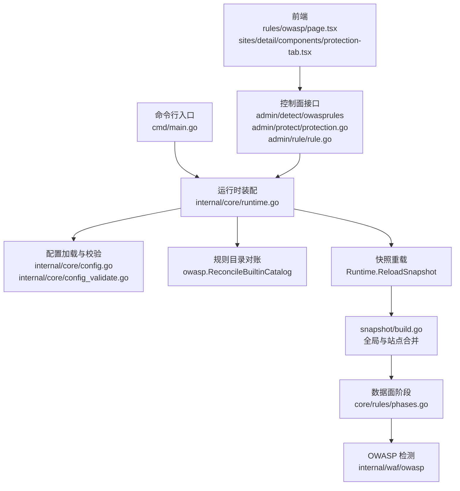
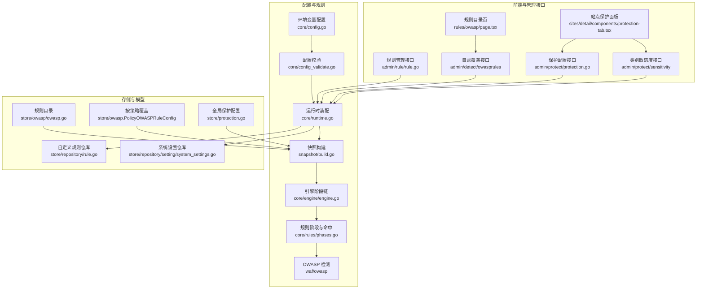
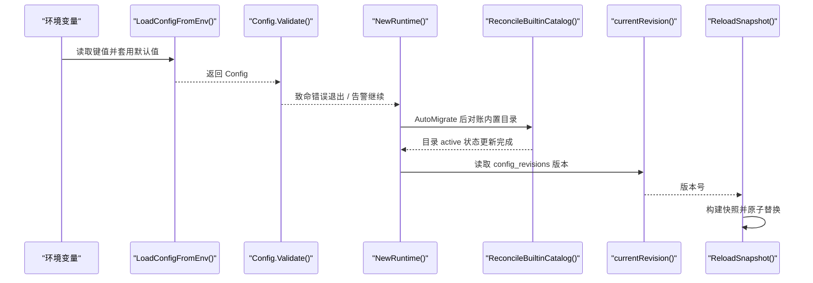
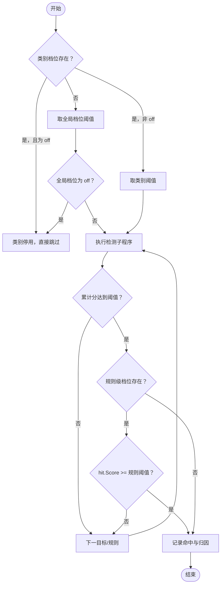
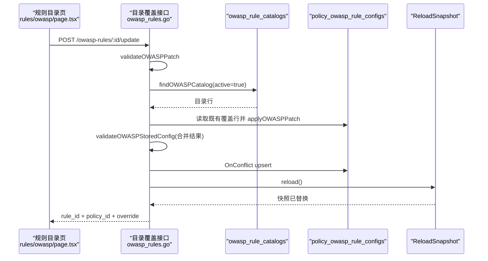
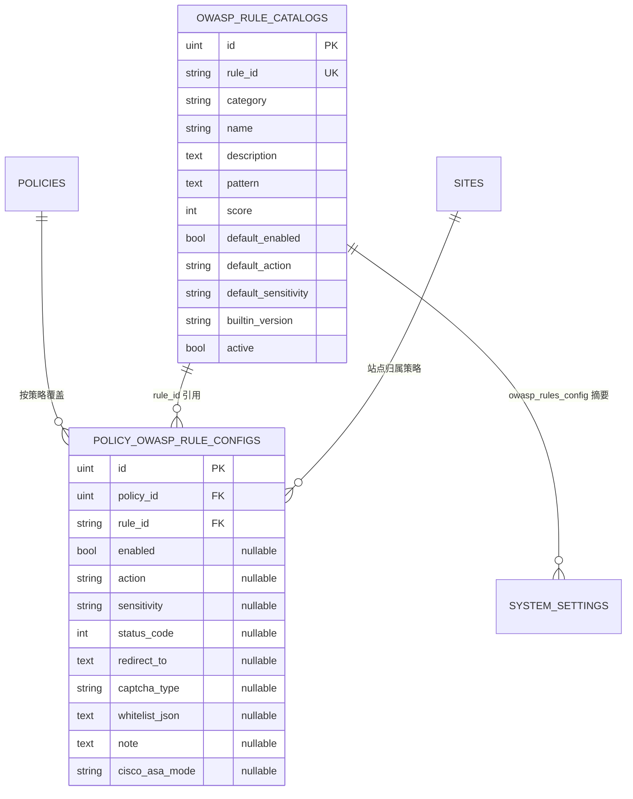
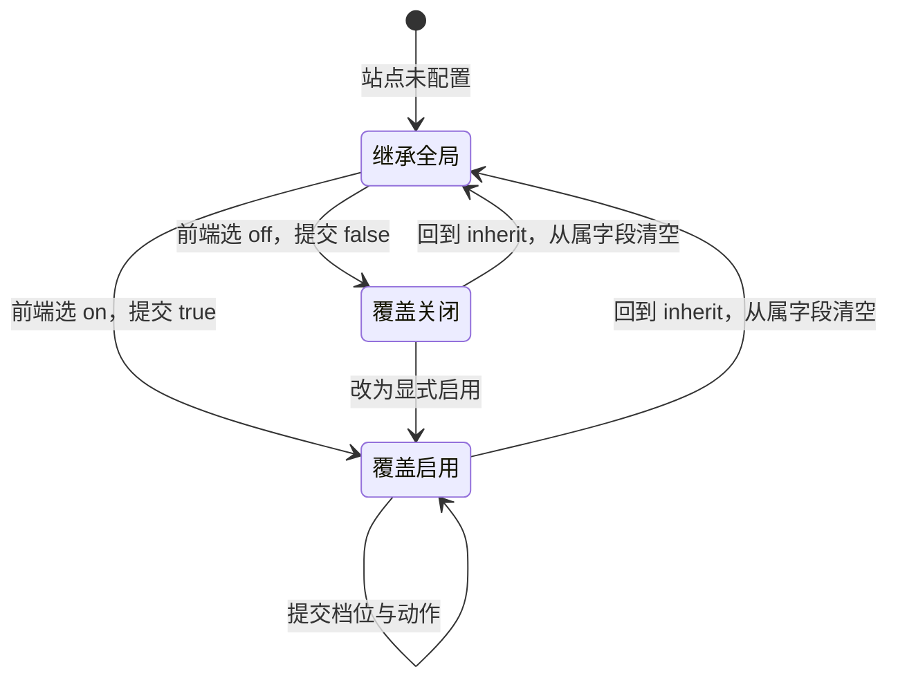
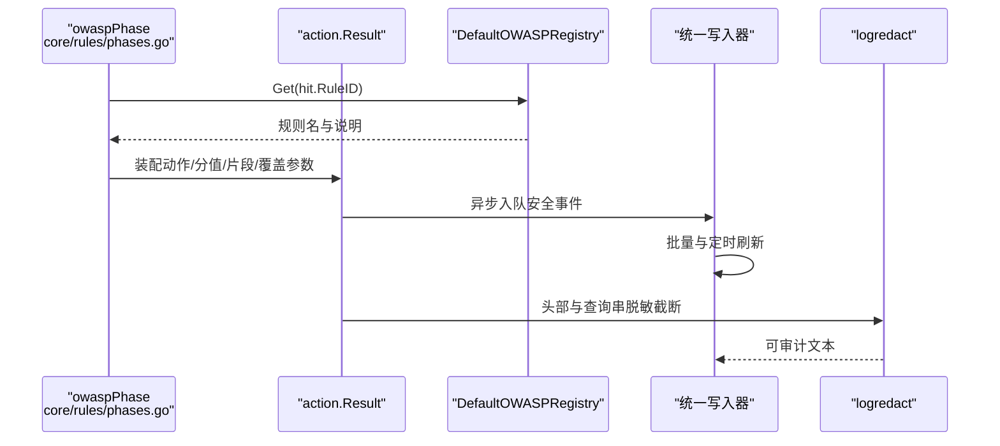
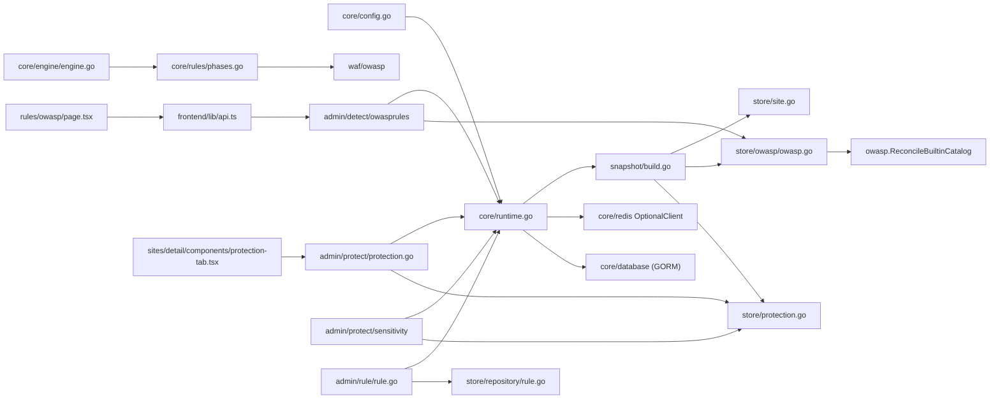

> [返回 安全防护功能](../安全防护功能.md)

# 配置与管理

<cite>
**本文档引用的文件**
- [cmd/main.go](file://cmd/main.go)
- [internal/app/server.go](file://internal/app/server.go)
- [internal/core/config.go](file://internal/core/config.go)
- [internal/core/config_validate.go](file://internal/core/config_validate.go)
- [internal/core/runtime.go](file://internal/core/runtime.go)
- [internal/core/rules/compiler.go](file://internal/core/rules/compiler.go)
- [internal/core/rules/phases.go](file://internal/core/rules/phases.go)
- [internal/core/database/gorm.go](file://internal/core/database/gorm.go)
- [internal/store/protection.go](file://internal/store/protection.go)
- [internal/store/site.go](file://internal/store/site.go)
- [internal/store/events.go](file://internal/store/events.go)
- [internal/store/owasp/owasp.go](file://internal/store/owasp/owasp.go)
- [internal/store/migrate.go](file://internal/store/migrate.go)
- [internal/store/repository/setting/system_settings.go](file://internal/store/repository/setting/system_settings.go)
- [internal/store/repository/rule.go](file://internal/store/repository/rule.go)
- [internal/waf/owasp/owasp_registry.go](file://internal/waf/owasp/owasp_registry.go)
- [internal/waf/owasp/owasp.go](file://internal/waf/owasp/owasp.go)
- [internal/waf/owasp/patterns.go](file://internal/waf/owasp/patterns.go)
- [internal/waf/owasp/cisco_asa.go](file://internal/waf/owasp/cisco_asa.go)
- [internal/pkg/snippet/snippet.go](file://internal/pkg/snippet/snippet.go)
- [internal/admin/router.go](file://internal/admin/router.go)
- [internal/admin/rule/rule.go](file://internal/admin/rule/rule.go)
- [internal/admin/protect/protection.go](file://internal/admin/protect/protection.go)
- [internal/admin/protect/sensitivity/sensitivity.go](file://internal/admin/protect/sensitivity/sensitivity.go)
- [internal/admin/shared/helpers.go](file://internal/admin/shared/helpers.go)
- [internal/admin/detect/owasprules/owasp_rules.go](file://internal/admin/detect/owasprules/owasp_rules.go)
- [internal/admin/detect/owasprules/owasp_read_query.go](file://internal/admin/detect/owasprules/owasp_read_query.go)
- [internal/admin/detect/owasprules/owasp_read_cache.go](file://internal/admin/detect/owasprules/owasp_read_cache.go)
- [internal/admin/site/site.go](file://internal/admin/site/site.go)
- [internal/snapshot/build.go](file://internal/snapshot/build.go)
- [internal/core/rules/phases.go](file://internal/core/rules/phases.go)
- [internal/core/engine/engine.go](file://internal/core/engine/engine.go)
- [internal/core/action/action.go](file://internal/core/action/action.go)
- [internal/dataplane/logredact/sanitize.go](file://internal/dataplane/logredact/sanitize.go)
- [frontend/lib/api.ts](file://frontend/lib/api.ts)
- [frontend/app/(dashboard)/rules/owasp/page.tsx](file://frontend/app/(dashboard)/rules/owasp/page.tsx)
- [frontend/app/(dashboard)/sites/detail/components/protection-tab.tsx](file://frontend/app/(dashboard)/sites/detail/components/protection-tab.tsx)
</cite>

## 目录

1. [简介](#简介)
2. [项目结构](#项目结构)
3. [核心组件](#核心组件)
4. [架构总览](#架构总览)
5. [详细组件分析](#详细组件分析)
6. [依赖关系分析](#依赖关系分析)
7. [性能考虑](#性能考虑)
8. [故障排查指南](#故障排查指南)
9. [结论](#结论)
10. [附录](#附录)

## 简介
本文件面向 OWASP 检测配置与管理，系统性梳理配置项、规则管理、动态重载、检测结果存储与日志、告警触发、监控指标与性能统计、最佳实践与常见问题。读者可据此完成从“敏感度与阈值”到“规则启停与自定义”的全链路配置与运维。

## 项目结构
OWASP 配置链路跨五个模块：环境变量配置、持久化模型、管理接口、快照合并与数据面消费。

| 层 | 路径 | 职责 | 代表文件 |
|----|------|------|----------|
| 入口 | `cmd/` | 进程启动 | `cmd/main.go` |
| 配置层 | `internal/core` | 环境变量加载与校验、运行时装配与快照重载 | `internal/core/config.go`、`internal/core/config_validate.go`、`internal/core/runtime.go` |
| 模型层 | `internal/store` | 全局保护配置、站点覆盖、规则目录与规则覆盖 | `internal/store/protection.go`、`internal/store/site.go`、`internal/store/owasp/owasp.go` |
| 控制面 | `internal/admin` | 规则目录 CRUD、保护配置读写、站点配置校验 | `internal/admin/detect/owasprules/owasp_rules.go`、`internal/admin/protect/protection.go` |
| 快照层 | `internal/snapshot` | 全局与站点合并、按策略规则覆盖序列化 | `internal/snapshot/build.go` |
| 数据面 | `internal/core/rules` | 阈值编译、规则覆盖解析、阶段执行 | `internal/core/rules/phases.go` |
| 前端 | `frontend/` | 规则目录页、站点保护面板、全局保护页 | `frontend/app/(dashboard)/rules/owasp/page.tsx` |

**图表来源**
- [cmd/main.go](file://cmd/main.go)
- [internal/core/runtime.go:36-111](file://internal/core/runtime.go#L36-L111)
- [internal/core/config.go:334-394](file://internal/core/config.go#L334-L394)
- [internal/core/config_validate.go:11-48](file://internal/core/config_validate.go#L11-L48)
- [internal/app/server.go:249-257](file://internal/app/server.go#L249-L257)
- [internal/core/runtime.go:201-211](file://internal/core/runtime.go#L201-L211)
- [internal/snapshot/build.go:715-734](file://internal/snapshot/build.go#L715-L734)
- [internal/core/rules/phases.go:593-615](file://internal/core/rules/phases.go#L593-L615)
- [internal/admin/detect/owasprules/owasp_rules.go:320-368](file://internal/admin/detect/owasprules/owasp_rules.go#L320-L368)
- [internal/admin/protect/protection.go:96-176](file://internal/admin/protect/protection.go#L96-L176)

**章节来源**
- [cmd/main.go](file://cmd/main.go)
- [internal/core/runtime.go:36-111](file://internal/core/runtime.go#L36-L111)
- [internal/core/config.go:334-394](file://internal/core/config.go#L334-L394)
- [internal/core/config_validate.go:11-48](file://internal/core/config_validate.go#L11-L48)
- [internal/app/server.go:249-257](file://internal/app/server.go#L249-L257)

## 核心组件

| 组件 | 符号 | 位置 | 配置职责 |
|------|------|------|----------|
| 环境变量配置 | `LoadConfigFromEnv` | `internal/core/config.go:334` | 数据库驱动/DSN/数据目录/Redis/管理绑定/GeoIP/Bot 阈值 |
| 配置校验 | `Config.Validate` | `internal/core/config_validate.go:11` | 驱动白名单、DSN 非空、host:port 合法性与误配告警 |
| 运行时重载 | `Runtime.ReloadSnapshot` | `internal/core/runtime.go:201` | 按 `config_revisions` 版本号重建并原子替换快照 |
| 全局保护配置 | `ProtectionConfig` | `internal/store/protection.go:13` | 以 JSON 存于 `SystemSettings`，含 OWASP 三字段与两个覆盖映射 |
| 默认值 | `DefaultProtectionConfig` | `internal/store/protection.go:159` | `mid` + `intercept` |
| 规则目录 | `OWASPRuleCatalog` | `internal/store/owasp/owasp.go:5` | 内置规则元信息与 `active` 开关 |
| 规则覆盖 | `PolicyOWASPRuleConfig` | `internal/store/owasp/owasp.go:23` | 按策略的可空覆盖行 |
| 目录对账 | `ReconcileBuiltinCatalog` | `internal/waf/owasp/owasp_registry.go:1119` | 启动时 upsert 本版本定义并停用失效项 |
| 覆盖解析 | `ParseOWASPRulesConfig` | `internal/waf/owasp/owasp_registry.go:308` | JSON → `map[string]OWASPRuleOverride` |
| 管理接口 | `UpdateSingleOWASPRule` | `internal/admin/detect/owasprules/owasp_rules.go:320` | 校验 + upsert + reload |
| 阶段消费 | `NewOWASPPhase` | `internal/core/rules/phases.go:603` | 把配置预处理为阈值与覆盖表 |

**章节来源**
- [internal/core/config.go:334-394](file://internal/core/config.go#L334-L394)
- [internal/core/config_validate.go:11-48](file://internal/core/config_validate.go#L11-L48)
- [internal/core/runtime.go:201-211](file://internal/core/runtime.go#L201-L211)
- [internal/store/protection.go:13-117](file://internal/store/protection.go#L13-L117)
- [internal/store/protection.go:159-200](file://internal/store/protection.go#L159-L200)
- [internal/store/owasp/owasp.go:5-38](file://internal/store/owasp/owasp.go#L5-L38)
- [internal/waf/owasp/owasp_registry.go:307-329](file://internal/waf/owasp/owasp_registry.go#L307-L329)
- [internal/waf/owasp/owasp_registry.go:1119-1136](file://internal/waf/owasp/owasp_registry.go#L1119-L1136)
- [internal/admin/detect/owasprules/owasp_rules.go:320-368](file://internal/admin/detect/owasprules/owasp_rules.go#L320-L368)
- [internal/core/rules/phases.go:593-615](file://internal/core/rules/phases.go#L593-L615)

## 架构总览
下图展示配置从写入到生效的完整链路：管理接口写库后立即调用 `reload()`，由 `Runtime.ReloadSnapshot` 依据 `config_revisions` 版本重建快照，数据面从快照读取合并后的 `ProtectionConfig`。

**图表来源**
- [internal/core/config.go:334-394](file://internal/core/config.go#L334-L394)
- [internal/core/config_validate.go:11-48](file://internal/core/config_validate.go#L11-L48)
- [internal/core/runtime.go:36-111](file://internal/core/runtime.go#L36-L111)
- [internal/snapshot/build.go:560-616](file://internal/snapshot/build.go#L560-L616)
- [internal/core/rules/phases.go:593-718](file://internal/core/rules/phases.go#L593-L718)
- [internal/core/engine/engine.go:441-548](file://internal/core/engine/engine.go#L441-L548)
- [internal/admin/rule/rule.go:96-136](file://internal/admin/rule/rule.go#L96-L136)
- [internal/admin/protect/protection.go:96-239](file://internal/admin/protect/protection.go#L96-L239)
- [internal/admin/detect/owasprules/owasp_rules.go:320-404](file://internal/admin/detect/owasprules/owasp_rules.go#L320-L404)
- [internal/admin/protect/sensitivity/sensitivity.go:37-90](file://internal/admin/protect/sensitivity/sensitivity.go#L37-L90)
- [frontend/lib/api.ts:1039-1050](file://frontend/lib/api.ts#L1039-L1050)

## 详细组件分析

### 配置系统与动态重载
配置来源全部为环境变量，未设置时取代码内默认值；`Validate` 返回「致命错误 + 非致命告警」两级结果，致命错误直接终止启动。

| 环境变量 | 字段 | 默认值 | 校验口径 |
|----------|------|--------|----------|
| `MY_OPENWAF_DB_DRIVER` | `DBDriver` | `sqlite` | 接受空值、`sqlite`、`mysql`、`postgres`、`postgresql` |
| `MY_OPENWAF_DSN` / `MY_OPENWAF_DB` | `DBDSN` | `{数据目录}/waf.db` | 非空，否则致命 |
| `MY_OPENWAF_DATA` | 数据目录 | `./data` | 用于推导两个默认 DSN |
| `MY_OPENWAF_LOG_DSN` / `MY_OPENWAF_LOG_DB` | 日志 DSN | `{数据目录}/waf_logs.db` | 日志库独立文件 |
| `MY_OPENWAF_ADMIN_BIND` | `AdminBind` | `:9443` | 必须可 `SplitHostPort`；取 `:80`/`:443` 时告警 |
| `MY_OPENWAF_REDIS_ADDR` | `RedisAddr` | 空（不启用） | 非空时必须为合法 `host:port` |
| `MY_OPENWAF_REDIS_DB` | `RedisDB` | 0 | 忽略解析错误 |
| `MY_OPENWAF_GEOIP_DB` | Bot GeoIP 路径 | 默认配置 | 非空才覆盖 |
| `MY_OPENWAF_BOT_THRESHOLD` | Bot 深评阈值 | 默认配置 | 仅接受正整数 |
| `MY_OPENWAF_DROP_BOT_THRESHOLD` | Drop 恶意阈值 | 默认配置 | 仅接受正整数 |
| `MY_OPENWAF_DROP_ENABLED` | Drop 开关 | 启用 | 显式 `false` 才关闭 |
| `MY_OPENWAF_CVE_ENABLED` | CVE 开关 | 关闭 | 仅接受 `true` |
| `MY_OPENWAF_ACCESSLOG_SAMPLING` | 访问日志采样 | 1（全量） | <1 或非法时保留默认并告警 |

重载链路由 `config_revisions` 表驱动：`currentRevision` 读取版本号，`ReloadSnapshotWithPrePublish` 在版本未变时复用缓存快照，版本变化时构建新快照并在发布前执行回调，最后原子替换。规则目录对账在 `AutoMigrate` 之后、快照首次加载之前完成，因此首轮快照就能读到最新目录。

**图表来源**
- [internal/core/config.go:334-394](file://internal/core/config.go#L334-L394)
- [internal/core/config_validate.go:11-48](file://internal/core/config_validate.go#L11-L48)
- [internal/core/runtime.go:36-111](file://internal/core/runtime.go#L36-L111)
- [internal/app/server.go:249-257](file://internal/app/server.go#L249-L257)
- [internal/core/runtime.go:201-290](file://internal/core/runtime.go#L201-L290)

**章节来源**
- [internal/core/config.go:334-394](file://internal/core/config.go#L334-L394)
- [internal/core/config_validate.go:11-48](file://internal/core/config_validate.go#L11-L48)
- [internal/core/runtime.go:36-111](file://internal/core/runtime.go#L36-L111)
- [internal/core/runtime.go:201-290](file://internal/core/runtime.go#L201-L290)
- [internal/app/server.go:249-257](file://internal/app/server.go#L249-L257)

### 敏感度档位、阈值与规则优先级
敏感度字符串先经 `normalizeSensitivityLevel` 归一化，再由 `sensitivityThresholdForNormalizedLevel` 映射为闭区间阈值；`off` 使类别整体停用。类别级与规则级档位在其之上叠加。

| 档位 | 归一化输入 | 阈值 | 说明 |
|------|------------|:--:|------|
| `off` | `off`、`none` | — | `CategoryThreshold` 返回 `enabled=false` |
| `low` | `low` | 7 | 最宽松 |
| `mid`（默认） | `mid`、`medium` | 4 | 未识别值也回落此档 |
| `high` | `high` | 3 | 由 2 上调至 3 以降低误报 |
| `very_high` | `very_high`、`very-high`、`veryhigh` | 2 | 高威胁 |
| `strict` | `strict` | 1 | 单条即命中 |

档位可三层叠加，优先级由低到高：

| 层级 | 载体 | 解析入口 | 生效点 |
|------|------|----------|--------|
| 全局默认 | `ProtectionConfig.OWASPSensitivity` | `DefaultProtectionConfig`（`mid`） | `CompileThresholds` |
| 按类别 | `category_sensitivity` / `owasp_modules` JSON | `EffectiveCategorySensitivity` | `CategoryThreshold` 的第一优先分支 |
| 按规则 | `policy_owasp_rule_configs.sensitivity` | `ParseOWASPRulesConfig` | `HitPassesOverrideSensitivity` |

自定义规则的动作与优先级来自 `store.Rule`，编译时按 `Priority` 升序、`ID` 升序稳定排序；OWASP 内置规则不参与该排序，其执行顺序由 `owaspPhase.Execute` 内固定（上传 → 方法 → 主扫描 → 端点兜底）。

**图表来源**
- [internal/waf/owasp/owasp.go:840-892](file://internal/waf/owasp/owasp.go#L840-L892)
- [internal/waf/owasp/owasp.go:95-127](file://internal/waf/owasp/owasp.go#L95-L127)
- [internal/waf/owasp/owasp_registry.go:344-354](file://internal/waf/owasp/owasp_registry.go#L344-L354)
- [internal/store/protection.go:225-291](file://internal/store/protection.go#L225-L291)
- [internal/core/rules/compiler.go:40-78](file://internal/core/rules/compiler.go#L40-L78)
- [internal/core/rules/phases.go:603-685](file://internal/core/rules/phases.go#L603-L685)

**章节来源**
- [internal/waf/owasp/owasp.go:840-892](file://internal/waf/owasp/owasp.go#L840-L892)
- [internal/waf/owasp/owasp.go:859-873](file://internal/waf/owasp/owasp.go#L859-L873)
- [internal/waf/owasp/owasp_registry.go:344-354](file://internal/waf/owasp/owasp_registry.go#L344-L354)
- [internal/store/protection.go:159-176](file://internal/store/protection.go#L159-L176)
- [internal/store/protection.go:225-291](file://internal/store/protection.go#L225-L291)
- [internal/core/rules/compiler.go:40-78](file://internal/core/rules/compiler.go#L40-L78)

### 规则启用/禁用与覆盖修改流程
内置规则的启停不改动规则本身，而是写入按策略的覆盖行；覆盖行删除即回到继承态。

| 操作 | 端点 | 落库动作 | reload |
|------|------|----------|:--:|
| 列表与分组 | `GET /api/v1/owasp-rules` | 读目录 + 覆盖视图 | 否 |
| 统计 | `GET /api/v1/owasp-rules/stats` | 读视图并聚合 `Total`/`EnabledCount`/`DisabledCount`/`ByCategory` | 否 |
| 单条更新 | `POST /api/v1/owasp-rules/:id/update` | `(policy_id, rule_id)` OnConflict upsert | 是 |
| 单条重置 | `POST /api/v1/owasp-rules/:id/reset` | 删除覆盖行 | 是 |
| 批量更新 | `POST /api/v1/owasp-rules/batch` | 事务内逐条 upsert，≤1000 条 | 是 |
| 批量重置 | 同上 + `reset_all: true` | 事务内删除该策略全部覆盖行 | 是 |
| 自定义规则 | `POST /api/v1/rules`、`/rules/:id/update`、`/rules/:id/delete` | `store.Rule` CRUD | 是 |
| 自定义规则测试 | `POST /api/v1/rules/test` | 只读评估，不落库 | 否 |
| 导入/导出 | `GET /api/v1/rules/export`、`POST /api/v1/rules/import` | 批量写入 | 是 |

`ids` 与 `rules` 两种批量载荷不能与 `reset_all` 混用；`findOWASPCatalog` 同时接受数字主键与字符串 `rule_id`，只匹配 `active = true` 的目录行，因此失效规则无法被覆盖。

**图表来源**
- [internal/admin/detect/owasprules/owasp_rules.go:131-244](file://internal/admin/detect/owasprules/owasp_rules.go#L131-L244)
- [internal/admin/detect/owasprules/owasp_rules.go:320-368](file://internal/admin/detect/owasprules/owasp_rules.go#L320-L368)
- [internal/admin/detect/owasprules/owasp_rules.go:406-505](file://internal/admin/detect/owasprules/owasp_rules.go#L406-L505)
- [internal/admin/router.go:224-227](file://internal/admin/router.go#L224-L227)
- [internal/admin/router.go:323-328](file://internal/admin/router.go#L323-L328)
- [frontend/lib/api.ts:1039-1050](file://frontend/lib/api.ts#L1039-L1050)

**章节来源**
- [internal/admin/detect/owasprules/owasp_rules.go:131-244](file://internal/admin/detect/owasprules/owasp_rules.go#L131-L244)
- [internal/admin/detect/owasprules/owasp_rules.go:320-368](file://internal/admin/detect/owasprules/owasp_rules.go#L320-L368)
- [internal/admin/detect/owasprules/owasp_rules.go:370-505](file://internal/admin/detect/owasprules/owasp_rules.go#L370-L505)
- [internal/admin/detect/owasprules/owasp_read_query.go:15-167](file://internal/admin/detect/owasprules/owasp_read_query.go#L15-L167)
- [internal/admin/router.go:144-152](file://internal/admin/router.go#L144-L152)
- [internal/admin/router.go:280-285](file://internal/admin/router.go#L280-L285)
- [frontend/lib/api.ts:1039-1050](file://frontend/lib/api.ts#L1039-L1050)
- [internal/store/repository/rule.go:12-30](file://internal/store/repository/rule.go#L12-L30)
- [internal/store/protection.go:13-117](file://internal/store/protection.go#L13-L117)

### 保护配置（含 OWASP 敏感度与动作）
`ProtectionConfig` 以单个 JSON 值存于 `SystemSettings`，读写分别经 `buildProtectionResponse` 展开与 `json.Unmarshal` 归并。OWASP 相关字段如下：

| JSON 键 | Go 字段 | 类型 | 默认值 | 校验 |
|---------|---------|------|:--:|------|
| `builtin_owasp_enabled` | `OWASPEnabled` | `bool` | `false` | 作为 `builtin_owasp_on_hit` 的启用前置字段 |
| `builtin_owasp_sensitivity` | `OWASPSensitivity` | `string` | `mid` | 空值由默认配置补齐 |
| `builtin_owasp_on_hit` | `OWASPAction` | `string` | `intercept` | `ValidateActionWithoutRedirectTarget`，拒绝 `redirect`/`allow`/`tag` |
| `category_sensitivity` | `CategorySensitivity` | TEXT（JSON map） | 空串等价 `{}` | 档位非法项被丢弃，不设 DB 默认值 |
| `owasp_modules` | `OWASPModules` | TEXT（JSON map） | 空串等价 `{}` | 与 `category_sensitivity` 合并，后者优先 |
| `owasp_rules_config` | `OWASPRulesConfig` | TEXT（JSON map） | 空串等价 `{}` | 由 `ParseOWASPRulesConfig` 解析 |
| `skip_path_by_phase` | `SkipPathByPhase` | TEXT（JSON map） | 空串等价 `{}` | `ValidateSkipPathByPhase` 校验键集合 |

三个 TEXT 字段刻意不设数据库默认值：MySQL 禁止 TEXT/BLOB 列带 `DEFAULT`（Error 1101），带上当会导致 `AutoMigrate` 直接失败；读取侧把空串与 `{}` 等价处理。写入时 `owasp_modules`、`category_sensitivity`、`owasp_rules_config` 走 `preserved` 通道，即前端未提交该键时保留库中原值，避免局部保存覆盖无关配置。

规则目录与覆盖、站点覆盖三者的关系如下：

**图表来源**
- [internal/store/owasp/owasp.go:5-38](file://internal/store/owasp/owasp.go#L5-L38)
- [internal/store/migrate.go:69-70](file://internal/store/migrate.go#L69-L70)
- [internal/store/site.go:76-90](file://internal/store/site.go#L76-L90)
- [internal/store/protection.go:56-66](file://internal/store/protection.go#L56-L66)
- [internal/snapshot/build.go:560-616](file://internal/snapshot/build.go#L560-L616)

**章节来源**
- [internal/store/protection.go:13-117](file://internal/store/protection.go#L13-L117)
- [internal/store/protection.go:56-66](file://internal/store/protection.go#L56-L66)
- [internal/store/protection.go:225-291](file://internal/store/protection.go#L225-L291)
- [internal/store/repository/setting/system_settings.go:12-62](file://internal/store/repository/setting/system_settings.go#L12-L62)
- [internal/admin/protect/protection.go:30-100](file://internal/admin/protect/protection.go#L30-L100)
- [internal/admin/protect/protection.go:140-239](file://internal/admin/protect/protection.go#L140-L239)
- [internal/admin/protect/sensitivity/sensitivity.go:37-90](file://internal/admin/protect/sensitivity/sensitivity.go#L37-L90)
- [internal/admin/shared/helpers.go:104-125](file://internal/admin/shared/helpers.go#L104-L125)
- [internal/store/owasp/owasp.go:5-38](file://internal/store/owasp/owasp.go#L5-L38)

### 站点级三态覆盖语义
站点级 OWASP 字段与全局字段同名但语义不同，「空值」在本项目中一律表示继承，绝不等于关闭。

| 字段 | 类型 | 继承态 | 覆盖启用 | 覆盖关闭 |
|------|------|:--:|:--:|:--:|
| `owasp_enabled` | `*bool` | `null` | `true` | `false` |
| `owasp_sensitivity` | `string` | 空串 | 显式档位 | 空串（仅当 `owasp_enabled` 为 `false` 时无意义） |
| `owasp_action` | `string` | 空串 | 显式动作 | 空串（同上） |
| `anti_replay_cookie_mode` | `*string` | `null` | 显式模式 | 显式模式 |
| `skip_path_by_phase` | `*string` | `null` | `"{}"` 表示覆盖为不跳过 | 非空 JSON 覆盖为该配置 |

三态在前端由 `TriState = "inherit" | "on" | "off"` 表达，提交时经 `fromTriState` 还原为 `null`/`true`/`false`。后端在 `clearInheritedProtectionOverrides` 中做从属清理：`owasp_enabled == nil` 时连带把 `owasp_sensitivity`、`owasp_action` 清空，防止把继承态存成「空档位 + 空动作」这种看似显式覆盖的配置。快照合并只在 `site.OWASPEnabled != nil` 时才读取站点档位与动作，因此「继承 + 空档位」不会覆盖全局默认值。

**图表来源**
- [internal/store/site.go:76-90](file://internal/store/site.go#L76-L90)
- [internal/admin/site/site.go:490-508](file://internal/admin/site/site.go#L490-L508)
- [internal/snapshot/build.go:725-734](file://internal/snapshot/build.go#L725-L734)
- [frontend/app/(dashboard)/sites/detail/components/protection-tab.tsx:210-220](file://frontend/app/(dashboard)/sites/detail/components/protection-tab.tsx#L210-L220)
- [frontend/app/(dashboard)/sites/detail/components/protection-tab.tsx:431-440](file://frontend/app/(dashboard)/sites/detail/components/protection-tab.tsx#L431-L440)

**章节来源**
- [internal/store/site.go:60-90](file://internal/store/site.go#L60-L90)
- [internal/admin/site/site.go:490-508](file://internal/admin/site/site.go#L490-L508)
- [internal/snapshot/build.go:715-746](file://internal/snapshot/build.go#L715-L746)
- [frontend/app/(dashboard)/sites/detail/components/protection-tab.tsx:142-220](file://frontend/app/(dashboard)/sites/detail/components/protection-tab.tsx#L142-L220)
- [frontend/app/(dashboard)/sites/detail/components/protection-tab.tsx:431-440](file://frontend/app/(dashboard)/sites/detail/components/protection-tab.tsx#L431-L440)

### 检测结果的存储与审计字段
`owaspPhase` 命中后由 `owaspHitResult` 装配 `action.Result`，其中的规则名、说明、累计分与片段一并落到安全事件记录。

| 事件字段 | 来源 | 长度约束 | 敏感处理 |
|----------|------|:--:|----------|
| `rule_id_str` | `OWASPHit.RuleID`（如 `owasp:sqli:001`） | 64 | 无 |
| `rule_name` / `rule_desc` | `DefaultOWASPRegistry.Get` 反查目录元信息 | 255 / 512 | 无 |
| `match_score` | `Accumulator` 累计分 | — | 无 |
| `match_snippet` | `AttachMatchSnippet` 定位命中片段 | 256，两侧各 48 字节上下文 | 落库前已截断；非 UTF-8 字节被替换 |
| `category` | `OWASPHit.Category` | — | 无 |
| `status_code` / `redirect_to` / `captcha_type` | 规则级覆盖 | — | `redirect_to` 写日志前脱敏 |

请求头、请求体与响应头类审计字段统一走 `internal/dataplane/logredact`：`sensitiveLogValuePattern` 覆盖 `authorization`、`proxy-authorization`、`cookie`、`set-cookie`、`password`、`passwd`、`pwd`、`token`、`secret`、`session`、`api_key`、`auth_token`、`csrf`、`code`、`ticket`、`env` 等键；`sensitiveLogHeaderLinePattern` 整行抹去 `Authorization`/`Cookie`/`Set-Cookie`/`Proxy-Authorization` 头部值（含折叠续行）；`SanitizeUpstreamURL` 与 `SanitizeQueryString` 处理 URL 与查询串；`TruncateLogValue` 配合 `logHeaderValueLimit`（2048）截断单值。

**图表来源**
- [internal/core/rules/phases.go:687-718](file://internal/core/rules/phases.go#L687-L718)
- [internal/waf/owasp/patterns.go:56-87](file://internal/waf/owasp/patterns.go#L56-L87)
- [internal/pkg/snippet/snippet.go:8-22](file://internal/pkg/snippet/snippet.go#L8-L22)
- [internal/store/events.go:15-47](file://internal/store/events.go#L15-L47)
- [internal/dataplane/logredact/sanitize.go:13-34](file://internal/dataplane/logredact/sanitize.go#L13-L34)
- [internal/dataplane/logredact/sanitize.go:190-318](file://internal/dataplane/logredact/sanitize.go#L190-L318)

**章节来源**
- [internal/core/rules/phases.go:687-718](file://internal/core/rules/phases.go#L687-L718)
- [internal/store/events.go:15-47](file://internal/store/events.go#L15-L47)
- [internal/core/action/action.go:116-145](file://internal/core/action/action.go#L116-L145)
- [internal/dataplane/logredact/sanitize.go:13-34](file://internal/dataplane/logredact/sanitize.go#L13-L34)
- [internal/dataplane/logredact/sanitize.go:190-318](file://internal/dataplane/logredact/sanitize.go#L190-L318)
- [internal/waf/owasp/owasp_registry.go:52-95](file://internal/waf/owasp/owasp_registry.go#L52-L95)

### 覆盖校验规则
`validateOWASPPatch` 与 `validateOWASPStoredConfig` 构成两道校验：前者校验本次提交的补丁，后者校验与库中既有值合并后的最终形态，防止部分更新留下不自洽的配置。

| 项 | 约束 | 违规响应 |
|----|------|----------|
| `action` | 必须 `IsValid`，且归一化后不得为 `allow`/`tag` | 400 `invalid action` |
| `sensitivity` | `low`/`mid`/`medium`/`high`/`very_high`/`strict`/`off` 之一或空 | 400 `invalid sensitivity` |
| `status_code` | 为 0 视为清空；否则必须落在 100–599 | 400 `status_code must be between 100 and 599` |
| `redirect_to` | `redirect` 动作且规则启用时必填 | 400 `redirect_to required` |
| `captcha_type` | 必须与 `captcha_challenge` 动作配对 | 400 `captcha_type requires captcha_challenge action` |
| `cisco_asa_mode` | `legacy`/`strict`/`scoped` 或空 | 400 `invalid cisco_asa_mode` |
| `whitelist` | ≤64 条、单条 ≤512 字节、必须 `*` 或以 `/` 开头、通配符仅末位 | 400 对应错误文案 |
| `note` | ≤4096 字节 | 400 `note exceeds 4096 bytes` |
| 批量条数 | `ids` + `rules` ≤1000 | 400 `batch exceeds 1000 rules` |
| 批量载荷 | `reset_all` 不得与 `ids`/`rules` 混用 | 400 `reset_all cannot be combined with rule updates` |

补丁的空值语义为「清除该项覆盖」：`action`/`sensitivity`/`captcha_type`/`cisco_asa_mode`/`redirect_to`/`note` 传空串、`status_code` 传 0 时，对应指针字段被置回 `nil`，而不是写入空字符串。

**章节来源**
- [internal/admin/detect/owasprules/owasp_rules.go:60-65](file://internal/admin/detect/owasprules/owasp_rules.go#L60-L65)
- [internal/admin/detect/owasprules/owasp_rules.go:139-217](file://internal/admin/detect/owasprules/owasp_rules.go#L139-L217)
- [internal/admin/detect/owasprules/owasp_rules.go:224-306](file://internal/admin/detect/owasprules/owasp_rules.go#L224-L306)
- [internal/admin/detect/owasprules/owasp_rules.go:406-505](file://internal/admin/detect/owasprules/owasp_rules.go#L406-L505)
- [internal/waf/owasp/cisco_asa.go:24-39](file://internal/waf/owasp/cisco_asa.go#L24-L39)

### 监控指标、性能统计与故障诊断
- 规则侧统计来自 `GetOWASPRuleStats`，返回 `policy_id`、`total`、`enabled_count`、`disabled_count` 与 `by_category` 分布，全部为后端真实聚合，不是当前页统计。
- 列表响应在 `include_grouped` 未显式置 `false` 时额外返回按类别分组结果，`total` 始终是过滤后的全集条数而非分页条数。
- 读取路径带快照缓存：同一 `policy_id` 的目录 + 覆盖视图在库版本未变时复用，减少重复查询。
- 引擎侧按 `config_revisions` 版本号缓存阶段链，同一版本内不同站点共享已构建的 `phases` 条目。
- 配置校验输出非致命告警；覆盖解析失败会生成快照诊断项并跳过该字段，不中断整次快照。

**章节来源**
- [internal/admin/detect/owasprules/owasp_rules.go:509-523](file://internal/admin/detect/owasprules/owasp_rules.go#L509-L523)
- [internal/admin/detect/owasprules/owasp_read_query.go:15-102](file://internal/admin/detect/owasprules/owasp_read_query.go#L15-L102)
- [internal/admin/detect/owasprules/owasp_read_query.go:153-167](file://internal/admin/detect/owasprules/owasp_read_query.go#L153-L167)
- [internal/admin/detect/owasprules/owasp_read_cache.go](file://internal/admin/detect/owasprules/owasp_read_cache.go)
- [internal/snapshot/build.go:590-616](file://internal/snapshot/build.go#L590-L616)
- [internal/core/engine/engine.go:441-548](file://internal/core/engine/engine.go#L441-L548)

## 依赖关系分析
- 组件耦合：管理接口依赖仓库与 `reload` 回调；运行时依赖数据库与可选 Redis；前端只经管理接口与后端交互。
- 外部依赖：GORM（SQLite/MySQL/PostgreSQL）、Hertz、slog、Redis 客户端（可选）。
- 循环依赖：未见循环依赖迹象——`waf/owasp` 不反向依赖 `admin` 与 `snapshot`。

**图表来源**
- [internal/core/config.go:334-394](file://internal/core/config.go#L334-L394)
- [internal/core/runtime.go:36-111](file://internal/core/runtime.go#L36-L111)
- [internal/snapshot/build.go:560-616](file://internal/snapshot/build.go#L560-L616)
- [internal/waf/owasp/owasp_registry.go:1119-1136](file://internal/waf/owasp/owasp_registry.go#L1119-L1136)
- [internal/core/rules/phases.go:593-718](file://internal/core/rules/phases.go#L593-L718)
- [internal/admin/detect/owasprules/owasp_rules.go:320-368](file://internal/admin/detect/owasprules/owasp_rules.go#L320-L368)
- [internal/admin/protect/protection.go:96-239](file://internal/admin/protect/protection.go#L96-L239)
- [internal/admin/protect/sensitivity/sensitivity.go:37-90](file://internal/admin/protect/sensitivity/sensitivity.go#L37-L90)
- [internal/admin/rule/rule.go:96-136](file://internal/admin/rule/rule.go#L96-L136)
- [frontend/lib/api.ts:1039-1050](file://frontend/lib/api.ts#L1039-L1050)

| 依赖方 | 被依赖方 | 说明 |
|--------|----------|------|
| `admin/detect/owasprules` | `store/owasp`、`core/action`、`admin/shared` | 覆盖读写与动作/验证码校验 |
| `admin/protect/protection.go` | `store`、`admin/shared`、`captcha`、`chain` | 保护配置读写与联动校验 |
| `admin/protect/sensitivity` | `store` | 类别敏感度读写，写入时清除 legacy 模块覆盖 |
| `snapshot/build.go` | `store`、`store/owasp`、`waf/owasp` | 合并全局与站点、序列化覆盖 |
| `core/rules/phases.go` | `store`、`waf/owasp`、`core/action` | 阈值编译与动作装配 |
| `waf/owasp` | `store/owasp` | 仅使用目录模型，不依赖控制面 |

**章节来源**
- [internal/core/config.go:334-394](file://internal/core/config.go#L334-L394)
- [internal/core/runtime.go:36-111](file://internal/core/runtime.go#L36-L111)
- [internal/snapshot/build.go:560-616](file://internal/snapshot/build.go#L560-L616)
- [internal/waf/owasp/owasp_registry.go:1119-1136](file://internal/waf/owasp/owasp_registry.go#L1119-L1136)
- [internal/core/rules/phases.go:593-718](file://internal/core/rules/phases.go#L593-L718)
- [internal/admin/detect/owasprules/owasp_rules.go:1-21](file://internal/admin/detect/owasprules/owasp_rules.go#L1-L21)
- [internal/admin/protect/protection.go:1-17](file://internal/admin/protect/protection.go#L1-L17)
- [internal/admin/protect/sensitivity/sensitivity.go:1-20](file://internal/admin/protect/sensitivity/sensitivity.go#L1-L20)
- [internal/admin/rule/rule.go:1-20](file://internal/admin/rule/rule.go#L1-L20)

## 性能考虑
- 阶段预处理：`NewOWASPPhase` 在快照构建期一次性完成阈值编译、覆盖解析与 ASA 档位归一化，`Execute` 热路径不再解析 JSON。
- 覆盖表容量：`ParseOWASPRulesConfig` 对空串与 `{}` 直接返回 `nil`，无覆盖时 `FilterFirstHit` 走零分配快路径。
- 目录读取缓存：同一 `policy_id` 的目录 + 覆盖视图带快照缓存，避免每次列表都重新联表。
- 列表分页：`page_size` 默认 500、上限 500（缺省与越界都取上限），`q` 过滤限制 256 字节，避免全表模糊扫描放大。
- 规则编译：按优先级与 ID 排序，仅启用规则参与编译。
- 配置重载：基于 `config_revisions` 版本号构建快照，版本未变时复用缓存，避免频繁重建。

**章节来源**
- [internal/core/rules/phases.go:603-615](file://internal/core/rules/phases.go#L603-L615)
- [internal/waf/owasp/owasp_registry.go:307-329](file://internal/waf/owasp/owasp_registry.go#L307-L329)
- [internal/waf/owasp/owasp_registry.go:378-402](file://internal/waf/owasp/owasp_registry.go#L378-L402)
- [internal/admin/detect/owasprules/owasp_read_cache.go](file://internal/admin/detect/owasprules/owasp_read_cache.go)
- [internal/admin/detect/owasprules/owasp_read_query.go:84-102](file://internal/admin/detect/owasprules/owasp_read_query.go#L84-L102)
- [internal/core/rules/compiler.go:40-78](file://internal/core/rules/compiler.go#L40-L78)
- [internal/core/runtime.go:201-290](file://internal/core/runtime.go#L201-L290)

## 故障排查指南

| 症状 | 可能原因 | 排查依据 | 处置 |
|------|----------|----------|------|
| 启动即失败 | 驱动不在 `sqlite/mysql/postgres/postgresql` 白名单 | `Config.Validate` | 修正 `MY_OPENWAF_DB_DRIVER` |
| 启动即失败 | DSN 为空 | `database DSN is empty` | 设置 `MY_OPENWAF_DSN` 或 `MY_OPENWAF_DATA` |
| 启动即失败 | 管理绑定地址非 `host:port` | `net.SplitHostPort` 报错 | 修正 `MY_OPENWAF_ADMIN_BIND` |
| 启动即失败 | Redis 地址非法 | `invalid redis address` | 修正 `MY_OPENWAF_REDIS_ADDR` 或留空 |
| 启动告警 | 驱动为 sqlite 但 DSN 像 MySQL/PG | `DSN looks like mysql/postgres but driver is sqlite` | 对齐驱动与 DSN |
| 启动告警 | 管理端绑定 `:80`/`:443` | well-known port 告警 | 改用非标准端口 |
| 覆盖保存 400 | 动作含 `redirect` 但无 `redirect_to` | `redirect_to required` | 补目标或改动作 |
| 覆盖保存 400 | `captcha_type` 未配 `captcha_challenge` 动作 | `captcha_type requires captcha_challenge action` | 一并提交动作 |
| 覆盖保存 400 | 白名单项不以 `/` 开头或通配符不在末位 | `whitelist entry must be * or start with /` | 修正路径写法 |
| 覆盖保存 400 | 批量条目超 1000 | `batch exceeds 1000 rules` | 分批提交 |
| 保存后不生效 | `reload()` 失败但配置已写库 | 响应 `config applied but reload failed` | 查快照构建诊断并重试重载 |
| 保存后不生效 | 站点覆盖为「继承」但误存为关闭 | `owasp_enabled` 为 `false` 而非 `null` | 改回继承态并保存 |
| 列表缺规则 | 目录行 `active = false` | `ReconcileBuiltinCatalog` 先置 false 再 upsert | 核对 `BuiltinRuleDefinitions` |
| 白名单被绕过 | 双重编码路径 | `maxWhitelistPathDecodeRounds` = 3 | 检查 `%252e` 形态是否覆盖 |
| 事件缺片段 | 命中来自硬编码发射点 | 该 ID 不在 `ruleRegexIndex` | 属预期行为 |

**章节来源**
- [internal/core/config_validate.go:11-48](file://internal/core/config_validate.go#L11-L48)
- [internal/admin/detect/owasprules/owasp_rules.go:139-217](file://internal/admin/detect/owasprules/owasp_rules.go#L139-L217)
- [internal/admin/detect/owasprules/owasp_rules.go:320-505](file://internal/admin/detect/owasprules/owasp_rules.go#L320-L505)
- [internal/waf/owasp/owasp_registry.go:110-116](file://internal/waf/owasp/owasp_registry.go#L110-L116)
- [internal/waf/owasp/owasp_registry.go:1119-1136](file://internal/waf/owasp/owasp_registry.go#L1119-L1136)
- [internal/snapshot/build.go:590-616](file://internal/snapshot/build.go#L590-L616)
- [internal/store/site.go:76-90](file://internal/store/site.go#L76-L90)
- [internal/waf/owasp/patterns.go:40-72](file://internal/waf/owasp/patterns.go#L40-L72)

## 结论
OWASP 配置管理由「环境变量配置 + 全局保护配置 + 按类别档位 + 按策略规则覆盖 + 站点三态覆盖」五层组成，任一层的空值都表示继承而非关闭。控制面写入后统一走 `reload()` 触发快照重建，数据面在快照构建期完成阈值与覆盖的预处理，因此配置变更可追溯、可回滚（`reset` 即删除覆盖行），且不会把解析成本带入请求热路径。

## 附录

### 配置项与最佳实践

| 主题 | 建议 | 依据 |
|------|------|------|
| 全局开关 | `builtin_owasp_enabled` 默认为假，生产环境需显式开启后再调档位 | `internal/store/protection.go:159-176` |
| 敏感度起步 | 从 `mid`（阈值 4）起步，误报可接受时升到 `high`（3）/`very_high`（2），`strict`（1）仅用于审计窗口 | `internal/waf/owasp/owasp.go:879-892` |
| 类别分档 | 对登录/上传等高风险路径用 `category_sensitivity` 单独提升，不改全局档位 | `internal/store/protection.go:242-291` |
| 单条规则 | 优先用规则级 `sensitivity` 与 `whitelist` 精修，而非整条停用 | `internal/waf/owasp/owasp_registry.go:344-354` |
| 白名单 | 用尾斜杠或 `*` 明确目录边界，避免前缀误吞 | `internal/waf/owasp/owasp_registry.go:234-305` |
| 动作选择 | 观察期用 `observe`（严重度 10，不终止），确认后再切 `intercept` | `internal/core/action/action.go:84-113` |
| 站点覆盖 | 优先保持「继承」，只在确需差异时覆盖，避免继承态被误存为关闭 | `internal/admin/site/site.go:490-508` |
| Cisco ASA | 未配置或清除覆盖时默认使用 `scoped`（放行带精确 `tgroup=` 且无穿越标记的 CSCOE 门户登录）；显式配置 `legacy`/`strict`/`scoped` 时按配置生效；非法显式值回落 `legacy` | `internal/core/rules/phases.go:649-653`、`internal/waf/owasp/cisco_asa.go:24-39` |
| 批量操作 | 大批量启停走 `batch`（≤1000），策略级复原用 `reset_all` | `internal/admin/detect/owasprules/owasp_rules.go:406-505` |
| 数据库 | SQLite 单实例场景连接上限 8，生产建议独立实例 | `internal/core/database/gorm.go:113` |

**章节来源**
- [internal/store/protection.go:159-291](file://internal/store/protection.go#L159-L291)
- [internal/waf/owasp/owasp.go:879-892](file://internal/waf/owasp/owasp.go#L879-L892)
- [internal/waf/owasp/owasp_registry.go:234-354](file://internal/waf/owasp/owasp_registry.go#L234-L354)
- [internal/waf/owasp/owasp_registry.go:406-505](file://internal/waf/owasp/owasp_registry.go#L406-L505)
- [internal/admin/detect/owasprules/owasp_rules.go:406-505](file://internal/admin/detect/owasprules/owasp_rules.go#L406-L505)
- [internal/admin/site/site.go:490-508](file://internal/admin/site/site.go#L490-L508)
- [internal/waf/owasp/cisco_asa.go:24-39](file://internal/waf/owasp/cisco_asa.go#L24-L39)
- [internal/core/action/action.go:84-113](file://internal/core/action/action.go#L84-L113)
- [internal/core/database/gorm.go:113](file://internal/core/database/gorm.go#L113)

### 管理端点速查

| 方法 | 路径 | 处理函数 | 角色 |
|------|------|----------|------|
| GET | `/api/v1/owasp-rules` | `ListOWASPRulesFromRegistry` | admin/operator/readonly |
| GET | `/api/v1/owasp-rules/stats` | `GetOWASPRuleStats` | admin/operator/readonly |
| GET | `/api/v1/policies/:policyId/owasp-rules` | `ListOWASPRulesFromRegistry` | admin/operator/readonly |
| GET | `/api/v1/policies/:policyId/owasp-rules/stats` | `GetOWASPRuleStats` | admin/operator/readonly |
| POST | `/api/v1/owasp-rules/:id/update` | `UpdateSingleOWASPRule` | admin/operator |
| POST | `/api/v1/owasp-rules/:id/reset` | `ResetOWASPRuleOverride` | admin/operator |
| POST | `/api/v1/owasp-rules/batch` | `BatchUpdateOWASPRules` | admin/operator |
| POST | `/api/v1/policies/:policyId/owasp-rules/:id` | `UpdateSingleOWASPRule` | admin/operator |
| POST | `/api/v1/policies/:policyId/owasp-rules/:id/reset` | `ResetOWASPRuleOverride` | admin/operator |
| POST | `/api/v1/policies/:policyId/owasp-rules/batch` | `BatchUpdateOWASPRules` | admin/operator |
| GET | `/api/v1/protection-settings` | `GetProtectionSettings` | admin/operator/readonly |
| POST | `/api/v1/protection-settings` | `PutProtectionSettings` | admin/operator |
| GET | `/api/v1/protection/:id/sensitivity` | `GetSensitivityConfig` | admin/operator/readonly |
| POST | `/api/v1/protection/:id/sensitivity` | `UpdateSensitivityConfig` | admin/operator |
| GET | `/api/v1/rules` | `ListRules` | admin/operator/readonly |
| GET | `/api/v1/rules/export` | `ExportRules` | admin/operator/readonly |
| POST | `/api/v1/rules` | `CreateRule` | admin/operator |
| POST | `/api/v1/rules/:id/update` | `UpdateRule` | admin/operator |
| POST | `/api/v1/rules/:id/delete` | `DeleteRule` | admin/operator |
| POST | `/api/v1/rules/test` | `TestRule` | admin/operator |
| POST | `/api/v1/rules/import` | `ImportRules` | admin/operator |

策略解析优先级为：路径 `:policyId` > 查询参数 `policy_id` > 请求体 `policy_id` > `default_slot = 1` 的默认策略；`policy_id` 为 0 或不存在时直接返回 400。

**章节来源**
- [internal/admin/router.go:109-125](file://internal/admin/router.go#L109-L125)
- [internal/admin/router.go:144-152](file://internal/admin/router.go#L144-L152)
- [internal/admin/router.go:224-227](file://internal/admin/router.go#L224-L227)
- [internal/admin/router.go:234](file://internal/admin/router.go#L234)
- [internal/admin/router.go:255-256](file://internal/admin/router.go#L255-L256)
- [internal/admin/router.go:280-285](file://internal/admin/router.go#L280-L285)
- [internal/admin/router.go:323-328](file://internal/admin/router.go#L323-L328)
- [internal/admin/router.go:340](file://internal/admin/router.go#L340)
- [internal/admin/detect/owasprules/owasp_rules.go:67-98](file://internal/admin/detect/owasprules/owasp_rules.go#L67-L98)
- [internal/admin/rule/rule.go:20-420](file://internal/admin/rule/rule.go#L20-L420)
- [frontend/lib/api.ts:1039-1050](file://frontend/lib/api.ts#L1039-L1050)
