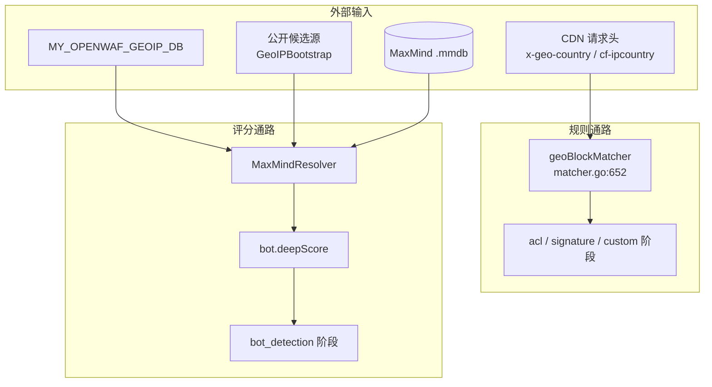
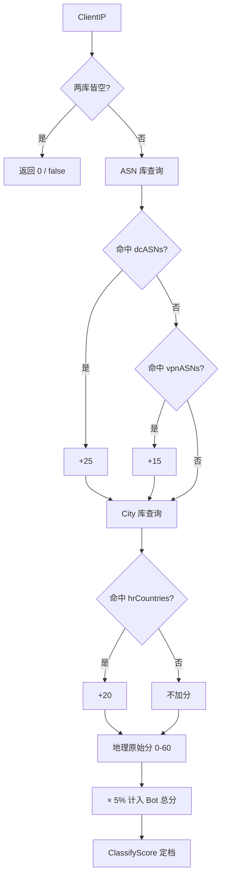
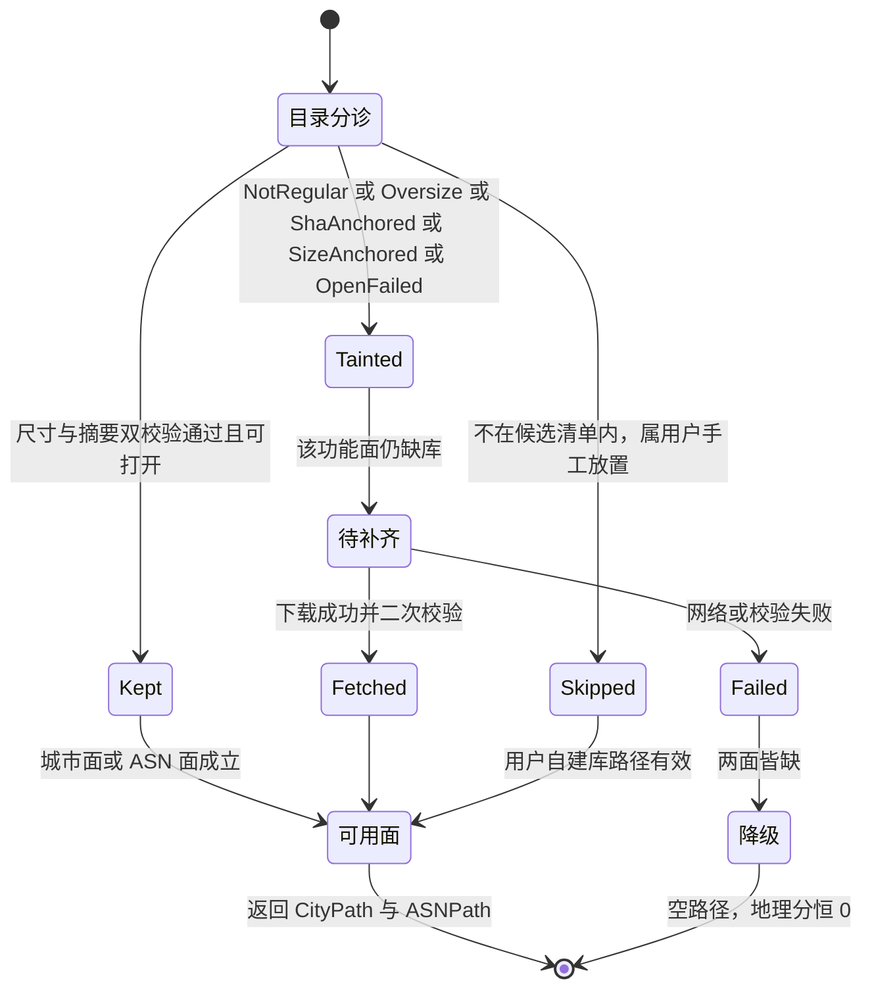
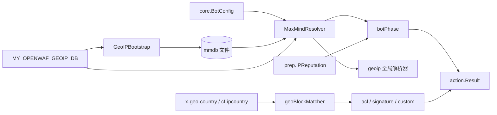

> [返回 安全防护功能](安全防护功能.md)

# 地理位置阻断

<cite>
**本文档引用的文件**
- [internal/waf/bot/geoip/geoip.go](file://internal/waf/bot/geoip/geoip.go)
- [internal/waf/bot/geoip/fetch.go](file://internal/waf/bot/geoip/fetch.go)
- [internal/waf/bot/tlsfp/fingerprint.go](file://internal/waf/bot/tlsfp/fingerprint.go)
- [internal/waf/bot/bot.go](file://internal/waf/bot/bot.go)
- [internal/waf/iprep/iprep.go](file://internal/waf/iprep/iprep.go)
- [internal/core/rules/matcher.go](file://internal/core/rules/matcher.go)
- [internal/core/rules/compiler.go](file://internal/core/rules/compiler.go)
- [internal/core/rules/validate.go](file://internal/core/rules/validate.go)
- [internal/core/rules/phases.go](file://internal/core/rules/phases.go)
- [internal/core/config.go](file://internal/core/config.go)
- [internal/core/configoverride/registry.go](file://internal/core/configoverride/registry.go)
- [internal/core/config_override.go](file://internal/core/config_override.go)
- [internal/core/engine/engine.go](file://internal/core/engine/engine.go)
- [internal/store/site.go](file://internal/store/site.go)
- [internal/store/iplist/ip_list.go](file://internal/store/iplist/ip_list.go)
- [internal/admin/protect/bot/bot.go](file://internal/admin/protect/bot/bot.go)
- [internal/admin/router.go](file://internal/admin/router.go)
- [internal/security/clientip.go](file://internal/security/clientip.go)
- [internal/app/server.go](file://internal/app/server.go)
- [internal/snapshot/build.go](file://internal/snapshot/build.go)
- [frontend/lib/api.ts](file://frontend/lib/api.ts)
- [frontend/app/(dashboard)/captcha/page.tsx](file://frontend/app/(dashboard)/captcha/page.tsx)
- [frontend/app/(dashboard)/rules/components/rule-pattern-mapper.ts](file://frontend/app/(dashboard)/rules/components/rule-pattern-mapper.ts)
- [README.md](file://README.md)
</cite>

## 目录

1. [简介](#简介)
2. [项目结构](#项目结构)
3. [核心组件](#核心组件)
4. [架构总览](#架构总览)
5. [详细组件分析](#详细组件分析)
6. [依赖关系分析](#依赖关系分析)
7. [性能考虑](#性能考虑)
8. [故障排查指南](#故障排查指南)
9. [结论](#结论)
10. [附录](#附录)

## 简介
My-OpenWaf 的地理位置阻断有**两条互不相干的通路**，这是本文最重要的划分：

| 通路 | 判定物 | 数据来源 | 产出 | 归属阶段 |
|---|---|---|---|---|
| 规则匹配通路 | 国家码 | **上游 CDN 注入的请求头** | 命中即返回规则动作 | `acl` / `signature` / `custom` |
| 评分加权通路 | ASN + 国家码 | **本地 MaxMind 库** | 地理模块原始分（权重 5%） | `bot_detection` |

前者由 `geoBlockMatcher` 实现，它只读 `x-geo-country` 与 `cf-ipcountry` 两个请求头，**完全不查本地库**（matcher.go:652-668）；后者由 `MaxMindResolver` 实现，只给 Bot 评分供能，本身不产生阻断动作。把两者混为一谈是旧文档的主要错误。

库文件本身的来源与拉取由 `bot/geoip` 子包负责（`GeoIPBootstrap`），环境变量为 `MY_OPENWAF_GEOIP_DB`。城市级查询能力存在但没有城市级阻断入口，阻断粒度止于国家。

**章节来源**
- [internal/core/rules/matcher.go:652-668](file://internal/core/rules/matcher.go#L652-L668)
- [internal/waf/bot/geoip/geoip.go:123-180](file://internal/waf/bot/geoip/geoip.go#L123-L180)
- [internal/waf/bot/bot.go:723-734](file://internal/waf/bot/bot.go#L723-L734)

## 项目结构
地理能力集中在 `internal/waf/bot/geoip/`（607 行：解析 211 + 自举 396），消费方分两处：规则匹配器与 Bot 阶段。

| 模块 | 文件 | 行数 | 职责 | 关键符号 |
|---|---|:--:|---|---|
| 解析器 | [geoip.go](file://internal/waf/bot/geoip/geoip.go) | 211 | City/ASN 查询、风险清单、打分 | `MaxMindResolver`、`GeoInfo` |
| 可插拔接口 | [geoip.go:182-197](file://internal/waf/bot/geoip/geoip.go#L182-L197) | — | 全局解析器指针与降级实现 | `GeoResolver`、`SetGeoResolver`、`LookupGeo` |
| 库自举 | [fetch.go](file://internal/waf/bot/geoip/fetch.go) | 396 | 候选清单、校验、分诊、下载 | `GeoIPBootstrap`、`ensureGeoIPAssets` |
| 规则匹配器 | [matcher.go](file://internal/core/rules/matcher.go) | 652-668 | 头驱动的国家码阻断 | `geoBlockMatcher` |
| Bot 加权 | [bot.go](file://internal/waf/bot/bot.go) | 723-734 | 地理模块原始分与明细 | `deepScore` |
| 阶段适配 | [phases.go](file://internal/core/rules/phases.go) | 451-474 | 注入 resolver 与阈值 | `NewBotPhaseWithGeoAndLimiter` |
| 配置装配 | [server.go](file://internal/app/server.go) | 461-472、665-673 | 启动建库与 reload 热换 | `loadBotGeoConfig` |

**图表来源**
- [internal/core/rules/matcher.go:1757-1767](file://internal/core/rules/matcher.go#L1757-L1767)
- [internal/waf/bot/geoip/geoip.go:44-48](file://internal/waf/bot/geoip/geoip.go#L44-L48)
- [internal/waf/bot/geoip/fetch.go:77-88](file://internal/waf/bot/geoip/fetch.go#L77-L88)
- [internal/waf/bot/bot.go:702-804](file://internal/waf/bot/bot.go#L702-L804)
- [internal/core/engine/engine.go:503-510](file://internal/core/engine/engine.go#L503-L510)

**章节来源**
- [internal/core/rules/compiler.go:120-136](file://internal/core/rules/compiler.go#L120-L136)
- [internal/app/server.go:461-472](file://internal/app/server.go#L461-L472)

## 核心组件
- `GeoInfo`：`Country`（ISO 3166-1 alpha-2）、`City`（英文名）、`ASN`、`ASNOrg` 四字段（geoip.go:14-19）
- `MaxMindResolver`：读写锁保护两库句柄与三张风险集合（数据中心 ASN、VPN/代理 ASN、高风险国家）（geoip.go:21-28）
- `GeoResolver` 接口 + `noopGeoResolver`：全局指针 `atomic.Pointer[GeoResolver]`，未设置时返回空信息（geoip.go:182-197）
- `geoBlockMatcher`：以国家码集合做成员判定，先看 `x-geo-country`，未命中再看 `cf-ipcountry`（matcher.go:652-668）
- `GeoIPMember`：一次自举的结论，分别给出城市面与 ASN 面路径（fetch.go:61-67）

| 组件 | 位置 | 关键方法 | 复杂度 | 降级行为 |
|---|---|---|---|---|
| `MaxMindResolver` | [geoip.go:21](file://internal/waf/bot/geoip/geoip.go#L21) | `Lookup`、`IsHighRisk`、`ScoreIP`、`Reload`、`UpdateConfig`、`Close` | 库查询 + O(1) 集合判定 | 库缺失时告警并返回 0 / false |
| `geoBlockMatcher` | [matcher.go:653](file://internal/core/rules/matcher.go#L653) | `Match(MatchCtx)` | O(1) map 查找 | 两个头都没有即不命中 |
| `GeoIPBootstrap` | [fetch.go:77](file://internal/waf/bot/geoip/fetch.go#L77) | 返回 `*GeoIPMember` | 启动期一次性 | 任何失败都不阻塞启动 |
| `LookupGeo` | [geoip.go:191](file://internal/waf/bot/geoip/geoip.go#L191) | 全局解析器查询 | O(1) | 未设置即空 `GeoInfo` |

**章节来源**
- [internal/waf/bot/geoip/geoip.go:14-197](file://internal/waf/bot/geoip/geoip.go#L14-L197)
- [internal/waf/bot/geoip/fetch.go:61-88](file://internal/waf/bot/geoip/fetch.go#L61-L88)
- [internal/core/rules/matcher.go:652-668](file://internal/core/rules/matcher.go#L652-L668)

## 架构总览
两条通路在请求生命周期里的位置不同：规则通路发生在阶段链中段，评分通路发生在 Bot 阶段内部。

| 流程步 | 通路 | 输入 | 输出 | 证据 |
|:--:|---|---|---|---|
| 1 | 公共 | 建立客户端 IP | `net.IP` | clientip.go:17-35 |
| 2 | 规则 | 阶段链执行到 `acl` | 读 `x-geo-country` | phases.go:148-150 |
| 3 | 规则 | 国家码在集合内 | 返回规则动作（终端即短路） | matcher.go:655-668 |
| 4 | 评分 | `bot_detection` 预筛 | `IsHighRisk` 决定是否进入评分 | bot.go:370-374 |
| 5 | 评分 | `ScoreIP` | 原始分 0–60 | geoip.go:153-180 |
| 6 | 评分 | 加权折算 | 地理权重仅 5% | bot.go:85、799 |
| 7 | 评分 | 档位判定 | 五档之一 | bot.go:120-136 |

**章节来源**
- [internal/core/rules/phases.go:148-150](file://internal/core/rules/phases.go#L148-L150)
- [internal/waf/bot/bot.go:359-376](file://internal/waf/bot/bot.go#L359-L376)
- [internal/security/clientip.go:17-35](file://internal/security/clientip.go#L17-L35)

## 详细组件分析

### 规则通路：国家码阻断匹配器
`geo_block` 是注册在 `knownPrefixes` 里的合法 kind（compiler.go:121），arg 为逗号分隔国家码，编译期归一为大写并去空（matcher.go:1757-1767）。校验侧要求 arg 非空（validate.go:133-139）。

| 判据 | 取值 | 说明 |
|---|---|---|
| 首选头 | `x-geo-country` | 命中且在国家集合内即返回 true，不再看第二头 |
| 兜底头 | `cf-ipcountry` | Cloudflare 注入，取值同样大写去空白后比对 |
| 反向语义 | 复合 `{"op":"not","children":[{"kind":"geo_block","arg":"CN"}]}` | 前端 `not_in_geo` 用 `wrapNot` 生成 |
| 动作 | 由规则自身决定 | `allow_ip` 语义不适用于地理，只有 `block` 类动作 |

两个关键限制必须写清：其一是**该通路的国家码来自请求头，不由本引擎推导**，因此只有当上游 CDN/代理确实注入该头时才有判定依据，直连场景永远不命中；其二是**头值不可信时必须由上游保证**，若客户端可自行伪造该头，规则会被绕过。前端条件构建器把 `src_ip` 目标的 `in_geo` / `not_in_geo` 映射到这一 kind，并要求值为 ISO 3166-1 alpha-2（rule-pattern-mapper.ts:174-186）。

**章节来源**
- [internal/core/rules/matcher.go:652-668](file://internal/core/rules/matcher.go#L652-L668)
- [internal/core/rules/matcher.go:1757-1767](file://internal/core/rules/matcher.go#L1757-L1767)
- [internal/core/rules/compiler.go:119-142](file://internal/core/rules/compiler.go#L119-L142)
- [internal/core/rules/validate.go:128-142](file://internal/core/rules/validate.go#L128-L142)
- [frontend/app/(dashboard)/rules/components/rule-pattern-mapper.ts:174-186](file://frontend/app/(dashboard)/rules/components/rule-pattern-mapper.ts#L174-L186)

### 评分通路：MaxMind 解析与打分
`ScoreIP` 的三项加分是固定值，互不遮蔽、可直接叠加（geoip.go:153-180）：

| 风险类型 | 加分 | 判定依据 | 证据 |
|---|:--:|---|---|
| 数据中心 ASN | +25 | ASN ∈ `dcASNs` | geoip.go:160-169 |
| VPN/代理 ASN | +15 | ASN ∈ `vpnASNs` | geoip.go:166-168 |
| 高风险国家 | +20 | ISO 码 ∈ `hrCountries` | geoip.go:171-178 |

`IsHighRisk` 是同一批集合的布尔版本，供预筛使用；两库都没有时直接返回 false，不做任何猜测（geoip.go:123-152）。`Lookup` 同时读 City 与 ASN 两个库，任一为空则该维度留零值（geoip.go:101-122）。

地理分进入 Bot 总分时被权重 5% 折算，即原始 60 分只贡献 3 分总分。设计意图写在权重注释里：机房与高风险国家只是环境概率，不能单独定性，`IsHighRisk` 判定则用「地理原始分 ≥ 40」这一绝对值口径（bot.go:60-85、802）。

**图表来源**
- [internal/waf/bot/geoip/geoip.go:123-180](file://internal/waf/bot/geoip/geoip.go#L123-L180)
- [internal/waf/bot/bot.go:85](file://internal/waf/bot/bot.go#L85)
- [internal/waf/bot/bot.go:120-136](file://internal/waf/bot/bot.go#L120-L136)

**章节来源**
- [internal/waf/bot/geoip/geoip.go:101-180](file://internal/waf/bot/geoip/geoip.go#L101-L180)
- [internal/waf/bot/bot.go:80-85](file://internal/waf/bot/bot.go#L80-L85)
- [internal/waf/bot/bot.go:723-734](file://internal/waf/bot/bot.go#L723-L734)

### 库文件来源与自举
`GeoIPBootstrap(explicitPath, dataDir)` 的规则只有一条：显式路径存在即完全接管，否则在 `dataDir/geoip` 下自举（fetch.go:69-88）。

| 候选文件 | 功能面 | 校验 | 说明 |
|---|---|---|---|
| `GeoLite2-City.mmdb` | city | 无锚定值 | 城市面 |
| `GeoLite2-Country.mmdb` | country | sha256 + 字节数 | 城市面兜底 |
| `dbip-asn-lite.mmdb` | asn | sha256 + 字节数 | ASN 面 |
| `dbip-country-lite.mmdb` | country | sha256 + 字节数 | ASN 面兜底 |

启动流程如下：

| 步 | 动作 | 结论值 | 证据 |
|:--:|---|---|---|
| 1 | 显式路径存在且是普通文件 | 直接以同一文件满足两面，不做任何下载 | fetch.go:78-84 |
| 2 | 目录分诊 | `Kept` / `Tainted`（NotRegular、Oversize、ShaAnchored、SizeAnchored、OpenFailed） | fetch.go:186-238 |
| 3 | 逐候选下载 | `Fetched` / `Failed` / `Skipped`，单文件上限 16 MiB | fetch.go:98、319-383 |
| 4 | 汇总上报 | 一条 `slog.Warn` 汇总各候选处置 | fetch.go:109-124 |

自举失败不致命：路径为空时 `botCfg.Enabled` 仍会建 resolver，只是查询返回零值，地理维度静默退化为不参与打分（server.go:461-472、geoip.go:50-79）。

单个候选文件在一次自举中的处置构成如下状态流：

**图表来源**
- [internal/waf/bot/geoip/fetch.go:100-107](file://internal/waf/bot/geoip/fetch.go#L100-L107)
- [internal/waf/bot/geoip/fetch.go:186-238](file://internal/waf/bot/geoip/fetch.go#L186-L238)
- [internal/waf/bot/geoip/fetch.go:256-309](file://internal/waf/bot/geoip/fetch.go#L256-L309)

**章节来源**
- [internal/waf/bot/geoip/fetch.go:20-124](file://internal/waf/bot/geoip/fetch.go#L20-L124)
- [internal/waf/bot/geoip/fetch.go:173-238](file://internal/waf/bot/geoip/fetch.go#L173-L238)
- [internal/waf/bot/geoip/fetch.go:319-383](file://internal/waf/bot/geoip/fetch.go#L319-L383)
- [internal/app/server.go:461-472](file://internal/app/server.go#L461-L472)

### 配置与热更新
配置有三个来源，收敛顺序固定。

| 配置 | 默认值 | 载体 | 证据 |
|---|---|---|---|
| `geoip_db_path` | 空 | 环境变量 `MY_OPENWAF_GEOIP_DB` / `bot_settings` / 覆盖表 | config.go:15、registry.go:372-376 |
| `high_risk_countries` | 空（必须由管理员配） | `bot_settings` | config.go:16、28-29 |
| `datacenter_asns` | 内置 13 项（AWS/GCP/Azure/DO/Vultr/Linode/OVH/Hetzner/Yandex/腾讯/阿里） | `bot_settings` 可覆盖 | config.go:30-43 |
| `vpn_proxy_asns` | 内置 8 项 | `bot_settings` 可覆盖 | config.go:44-54 |
| `score_threshold` | `core.BotConfig` 默认 80；`bot_settings` 投影缺省 60，被 `drop_policy.bot_score_threshold`（默认 80）覆盖 | `bot_settings` 与 `drop_policy` 双写同步 | config.go:27、admin/protect/bot/bot.go:44-74 |
| `bot_enabled` | `true`（决定是否创建解析器） | 逐键覆盖表，无环境变量载体 | config.go:25、config_override.go:41-44、registry.go:409-414 |

取值收敛顺序是：`DefaultBotConfig` → `MY_OPENWAF_GEOIP_DB` / `MY_OPENWAF_BOT_THRESHOLD` 环境变量 → 逐键覆盖表（`applyBotOverrides`）→ 管理界面的 `bot_settings`（`loadBotGeoConfig`），后者优先级最高（config.go:386-392、config_override.go:41-44、server.go:1354-1405）。

热更新在 reload 回调里完成，遵循两条节流原则：**路径不变就不重新开库**（避免无谓的 mmap 重开），**清单变化只更新集合**（`UpdateConfig` 取写锁替换三张表）（server.go:663-673、geoip.go:81-88）。`loadBotGeoConfig` 只覆盖请求里出现过的字段：nil 切片表示没配过、保留默认，空切片是用户主动清空、如实生效（server.go:1362-1404）。

前端入口是 `captcha/` 页的 Bot 设置块（GeoIP 库路径、高风险国家、机房 ASN、VPN ASN 四个输入项）与其下方的 detection 域覆盖卡（`geoip_db_path`、`bot_threshold`）。写接口为 `POST /bot-settings/update`，站点级开关为 `site.bot_protection_enabled`（三态，nil = 继承全局）（router.go:315、api.ts、site.go:60）。**仓库中不存在 `protection/` 页面**。

**章节来源**
- [internal/core/config.go:12-56](file://internal/core/config.go#L12-L56)
- [internal/core/config.go:386-392](file://internal/core/config.go#L386-L392)
- [internal/core/config_override.go:41-44](file://internal/core/config_override.go#L41-L44)
- [internal/core/configoverride/registry.go:372-376](file://internal/core/configoverride/registry.go#L372-L376)
- [internal/core/configoverride/registry.go:409-414](file://internal/core/configoverride/registry.go#L409-L414)
- [internal/app/server.go:663-673](file://internal/app/server.go#L663-L673)
- [internal/app/server.go:1354-1405](file://internal/app/server.go#L1354-L1405)
- [internal/admin/protect/bot/bot.go:17-74](file://internal/admin/protect/bot/bot.go#L17-L74)
- [internal/store/site.go:59-62](file://internal/store/site.go#L59-L62)
- [frontend/app/(dashboard)/captcha/page.tsx:80-87](file://frontend/app/(dashboard)/captcha/page.tsx#L80-L87)

## 依赖关系分析
- `geoip` 只依赖 `internal/core` 的配置类型与 `maxminddb-golang`，不依赖任何 WAF 判定包
- `bot` 依赖 `geoip` 的解析器类型，`phases` 再依赖两者，方向单一
- `geoBlockMatcher` 不依赖 `geoip`，两条通路在代码上零耦合
- `globalGeo` 原子指针由启动流程一次性设置，供任意位置 `LookupGeo` 读取（geoip.go:187-197、server.go:472）

外部依赖：MaxMind DB 文件读取库、可选的公开镜像源（自举下载）、CDN 头注入。

**图表来源**
- [internal/waf/bot/geoip/geoip.go:1-48](file://internal/waf/bot/geoip/geoip.go#L1-L48)
- [internal/waf/bot/geoip/fetch.go:69-88](file://internal/waf/bot/geoip/fetch.go#L69-L88)
- [internal/core/rules/matcher.go:652-668](file://internal/core/rules/matcher.go#L652-L668)
- [internal/core/rules/phases.go:451-474](file://internal/core/rules/phases.go#L451-L474)

**章节来源**
- [internal/waf/bot/geoip/geoip.go:1-211](file://internal/waf/bot/geoip/geoip.go#L1-L211)
- [internal/core/rules/matcher.go:652-668](file://internal/core/rules/matcher.go#L652-L668)

## 性能考虑
- 风险集合是 `map[uint]struct{}` 与 `map[string]struct{}`，命中判定 O(1)（geoip.go:198-211）
- 读路径全程只持读锁，热更新只发生在 reload，不在请求路径（geoip.go:101-180、82-88）
- `IsHighRisk` 在预筛阶段先跑，只有命中者才继续 `ScoreIP`，避免对干净流量做两次库查询（bot.go:370-374、723-734）
- 显式路径把城市面与 ASN 面指向同一文件，省一次打开开销，但也意味着单库必须具备两种记录类型（fetch.go:78-81）
- 自举下载有 16 MiB 上限，异常源不会把内存拖爆（fetch.go:97-98）
- 库文件由 `maxminddb` 以 mmap 方式读取，`Reload` 时才关闭旧句柄（geoip.go:50-79）

**章节来源**
- [internal/waf/bot/geoip/geoip.go:50-79](file://internal/waf/bot/geoip/geoip.go#L50-L79)
- [internal/waf/bot/geoip/geoip.go:101-211](file://internal/waf/bot/geoip/geoip.go#L101-L211)
- [internal/waf/bot/geoip/fetch.go:97-98](file://internal/waf/bot/geoip/fetch.go#L97-L98)
- [internal/waf/bot/bot.go:359-376](file://internal/waf/bot/bot.go#L359-L376)

## 故障排查指南
| 症状 | 判据 | 处置 |
|---|---|---|
| `geo_block` 规则永不命中 | 请求里是否有 `x-geo-country` 或 `cf-ipcountry` | 直连场景没有该头，需由 CDN 注入 |
| 国家码大小写不生效 | arg 与头值都会大写去空白 | 若上游发小写也能动，问题多半在集合内容 |
| 地理分恒 0 | 库路径是否存在、启动日志是否告警 | 打开失败只告警并降级（geoip.go:50-79） |
| 高风险国家配了没用 | `hrCountries` 是否为空 | 默认为空是刻意设计，需管理员显式配置（config.go:28-29） |
| 机房 IP 没被加分 | ASN 是否在内置清单 | 内置 13 项之外需自行补录（config.go:30-43） |
| 界面保存后不生效 | reload 是否触发 `UpdateConfig` | 路径不变只更新集合（server.go:663-673） |
| Bot 阶段完全跳过地理 | `bot_settings.enabled` 与 resolver 是否为 nil | resolver 仅在 Bot 开启时创建（server.go:466） |
| 想按 IP 直接封国家 | 用站点级 IP 名单，不用 `geo_block` | 名单是库无关的确定性阻断（build.go:1596-1644） |

**章节来源**
- [internal/waf/bot/geoip/geoip.go:50-79](file://internal/waf/bot/geoip/geoip.go#L50-L79)
- [internal/core/config.go:22-56](file://internal/core/config.go#L22-L56)
- [internal/app/server.go:461-472](file://internal/app/server.go#L461-L472)
- [internal/snapshot/build.go:1596-1644](file://internal/snapshot/build.go#L1596-L1644)
- [internal/core/rules/matcher.go:652-668](file://internal/core/rules/matcher.go#L652-L668)

## 结论
地理位置阻断的正确答案取决于问的是哪条通路：要「按国家立刻拒绝」，就在规则里用 `geo_block` 并依赖 CDN 头；要「按网络环境抬升可疑度」，就配好 MaxMind 库让 Bot 阶段做地理加权。前者的强度是布尔的、后者的强度只有 5% 权重，两者不能互相替代，也不能互相印证。

本轮已订正：地理加权与 TLS 指纹分别住在 `bot/geoip` 与 `bot/tlsfp` 子包；`ScoreIP` 的分值是 25/15/20 而非旧文档写的「+0-25 区间」；不存在城市级阻断入口与 `protection/` 页面。下一步可评估的是把 `geo_block` 的头驱动模式扩展为可选的服务端解析模式，让直连部署也能用同一份规则语义。

**章节来源**
- [本节为总结，无需特定文件来源]

## 附录

### 环境变量与默认值

| 变量 | 默认 | 作用 |
|---|:--:|---|
| `MY_OPENWAF_GEOIP_DB` | 空 | MaxMind 库路径，空则自举或不做地理加权 |
| `MY_OPENWAF_BOT_THRESHOLD` | `80` | Bot 处置阈值（`drop_policy` 存在时以后者为准） |
| `MY_OPENWAF_DROP_ENABLED` | `true` | 地理加权本身不触发断连，由档位决定是否 Drop |

证据：README.md:334-337、registry.go:372-395。地理解析器只在 `botCfg.Enabled` 为真时创建，因此 `MY_OPENWAF_GEOIP_DB` 单独设置而 Bot 未开启时，库会被打开但不参与任何判定（server.go:466-473、config.go:24-27）。

**章节来源**
- [README.md:334-337](file://README.md#L334-L337)
- [internal/core/configoverride/registry.go:372-395](file://internal/core/configoverride/registry.go#L372-L395)
- [internal/core/config.go:387-392](file://internal/core/config.go#L387-L392)
- [internal/core/config.go:419-427](file://internal/core/config.go#L419-L427)

### 风险集合速查

| 集合 | 条目数 | 内容摘要 |
|---|:--:|---|
| `datacenter_asns` | 13 | AWS 16509/14618、GCP 15169/396982、Azure 8075、DO 14061、Vultr 20473、Linode 63949、OVH 16276、Hetzner 24940、Yandex 13238、腾讯 45090、阿里 37963 |
| `vpn_proxy_asns` | 8 | M247 9009、Choopa 20473、Datacamp 60068/212238、Amarutu 206264、Clouvider 62240、Maxihost 396356、Cogent 174 |
| `high_risk_countries` | 0（默认） | 由管理员按 ISO 3166-1 alpha-2 配置 |

证据：config.go:30-54。

**章节来源**
- [internal/core/config.go:22-56](file://internal/core/config.go#L22-L56)
- [internal/waf/bot/geoip/fetch.go:28-57](file://internal/waf/bot/geoip/fetch.go#L28-L57)

### 相关文档

**章节来源**
- [本节为总结，无需特定文件来源]
- 地理分如何进入总分：[机器人检测](机器人检测.md)
- 与地理无关的 IP 阻断：[IP 信誉系统](IP 信誉系统.md)
- `geo_block` 匹配器实现：[规则匹配器](../WAF 引擎系统/规则匹配器/规则匹配器.md)
- 规则 DSL 与复合条件：[ACL 规则引擎](ACL 规则引擎.md)

**章节来源**
- [internal/core/config.go:22-56](file://internal/core/config.go#L22-L56)
- [README.md:334-336](file://README.md#L334-L336)
- [internal/core/configoverride/registry.go:372-395](file://internal/core/configoverride/registry.go#L372-L395)
- [internal/waf/bot/geoip/fetch.go:28-57](file://internal/waf/bot/geoip/fetch.go#L28-L57)
