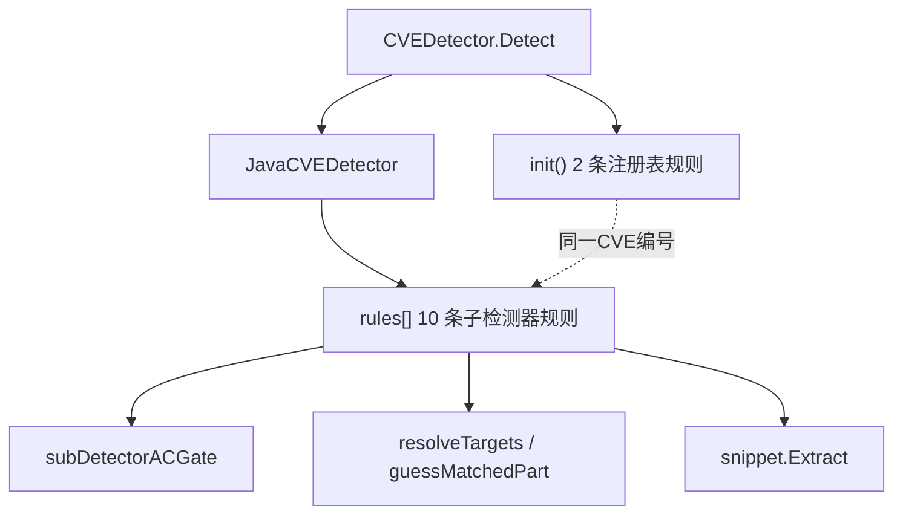
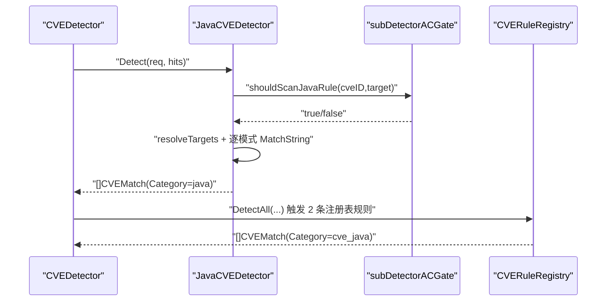
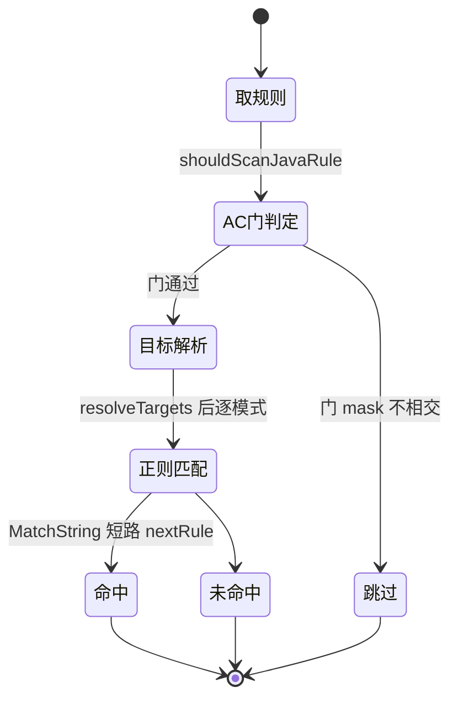
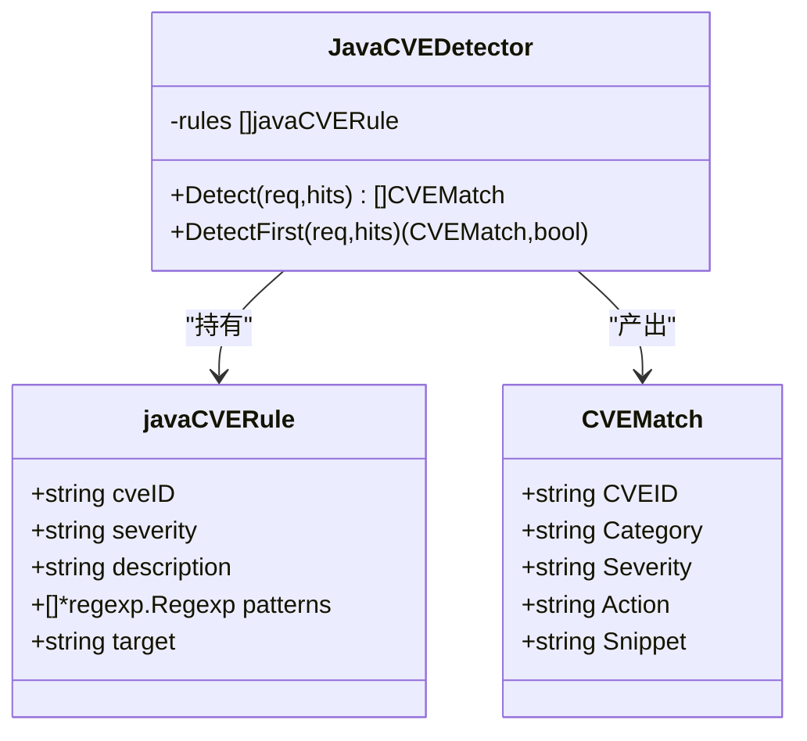

> [返回 安全防护功能](../%E5%AE%89%E5%85%A8%E9%98%B2%E6%8A%A4%E5%8A%9F%E8%83%BD.md)

# Java 检测器

<cite>
**本文档引用的文件**
- [java.go](file://internal/waf/cve/java.go)
- [detector.go](file://internal/waf/cve/detector.go)
- [php.go](file://internal/waf/cve/php.go)
- [general.go](file://internal/waf/cve/general.go)
- [ac_subdetector.go](file://internal/waf/cve/ac_subdetector.go)
- [ac_subdetector_data.go](file://internal/waf/cve/ac_subdetector_data.go)
- [ac_registry.go](file://internal/waf/cve/ac_registry.go)
- [snippet.go](file://internal/pkg/snippet/snippet.go)
</cite>

## 目录

1. [简介](#简介)
2. [项目结构](#项目结构)
3. [核心组件](#核心组件)
4. [架构总览](#架构总览)
5. [详细组件分析](#详细组件分析)
6. [依赖关系分析](#依赖关系分析)
7. [性能考虑](#性能考虑)
8. [故障排查指南](#故障排查指南)
9. [结论](#结论)
10. [附录](#附录)

## 简介

Java 检测器（`JavaCVEDetector`）针对 Java 生态的高危利用特征做内容匹配，覆盖 Log4Shell、Spring4Shell、Spring Cloud Function、Fastjson、Struts2、Shiro、Jackson、OFBiz、ActiveMQ、Confluence 等。与所有语言检测器一致，它使用**正则 pattern + 目标域**而非受影响版本区间（CPE/version range）表达规则——本实现不携带 Java 组件版本号，判定完全基于请求内容是否命中利用字面。

规则分两种载体：`JavaCVEDetector.rules` 内的 10 条子检测器规则（多正则 + target + AC 门），以及 `java.go` 的 `init()` 注册进全局注册表的 2 条颗粒化 `CVERule`（Log4j 混淆变体、Tomcat Session 反序列化）。

## 项目结构

`java.go` 结构清晰分为三段：`init()` 注册表规则（java.go:9-72）、类型与正则定义（75-131）、`NewJavaCVEDetector` 规则装配与检测实现（133-272）。

| 组成 | 位置 | 内容 |
|---|---|---|
| 注册表规则 | java.go:9-72 | `cve-log4j-obfuscated`、`cve-tomcat-session-deser` |
| 子检测器结构 | java.go:75-85 | `JavaCVEDetector`、`javaCVERule` |
| 编译期正则 | java.go:88-131 | `reLog4j1..7`、`reSpring4Shell1..4`、`reFastjson1..7` 等 |
| 规则装配 | java.go:133-198 | 10 条子检测器规则 |
| 门控/检测 | java.go:200-272 | `shouldScanJavaRule`、`Detect`、`DetectFirst` |

**图表来源**
- [java.go:75-85](file://internal/waf/cve/java.go#L75-L85)
- [java.go:133-272](file://internal/waf/cve/java.go#L133-L272)
- [detector.go:1829-1833](file://internal/waf/cve/detector.go#L1829-L1833)

**章节来源**
- [java.go:9-72](file://internal/waf/cve/java.go#L9-L72)
- [java.go:133-198](file://internal/waf/cve/java.go#L133-L198)

## 核心组件

| 组件 | 职责 | 行号 |
|---|---|---|
| `JavaCVEDetector` | 持有 `rules`，执行 Java 匹配 | java.go:75-77 |
| `javaCVERule` | cveID/severity/description/patterns/target | java.go:79-85 |
| `shouldScanJavaRule` | AC 门前置门控 | java.go:200-209 |
| `Detect`/`DetectFirst` | 遍历目标×模式，命中短路 | java.go:211-272 |
| `init()` 注册规则 | Log4j 混淆、Tomcat session | java.go:9-72 |

`Detect` 对每条规则先过 AC 门，再 `resolveTargets(req, rule.target)` 取目标串，逐模式 `MatchString`；`target=="all"` 时用 `guessMatchedPart` 推断部位，命中即 `goto nextRule`（java.go:211-242）。

**章节来源**
- [java.go:200-242](file://internal/waf/cve/java.go#L200-L242)
- [php.go:279-326](file://internal/waf/cve/php.go#L279-L326)

## 架构总览

Java 检测器在 `CVEDetector.Detect` 中作为 `cve_java` 类别被调用（detector.go:1829-1833），当 `categorySensitivity["cve_java"]` 为 `none/off` 时整体跳过。子检测器与注册表规则同属 `cve_java`，但执行点不同：前者在 `Detect` 内顺序跑，后者在末尾 `globalCVERuleRegistry.DetectAll` 统一跑（detector.go:1854-1860）。

**图表来源**
- [java.go:211-242](file://internal/waf/cve/java.go#L211-L242)
- [detector.go:1829-1860](file://internal/waf/cve/detector.go#L1829-L1860)

**章节来源**
- [detector.go:1811-1838](file://internal/waf/cve/detector.go#L1811-L1838)

## 详细组件分析

### 子检测器规则清单

10 条子检测器规则（java.go:133-197）：

| CVE | 严重度 | target | 正则组数 | 攻击面 |
|---|---|---|:--:|---|
| CVE-2021-44228 | critical | all | 7 | Log4Shell JNDI（含混淆变体） |
| CVE-2022-22965 | critical | all | 4 | Spring4Shell 类加载器操纵 |
| CVE-2022-22963 | critical | all | 2 | Spring Cloud Function SpEL |
| CVE-2017-18349 | critical | body | 7 | Fastjson `@type` gadget 链 |
| CVE-2017-5638 | critical | all | 5 | Struts2 OGNL 注入 |
| CVE-2016-4437 | high | cookie | 1 | Shiro rememberMe 反序列化 |
| CVE-2017-7525 | high | body | 2 | Jackson 多态类型反序列化 |
| CVE-2023-49070 | critical | url | 2 | Apache OFBiz 认证绕过/RCE |
| CVE-2023-46604 | critical | body | 1 | ActiveMQ ClassPathXml 反序列化 |
| CVE-2022-26134 | critical | all | 2 | Confluence OGNL 注入 |

**章节来源**
- [java.go:133-197](file://internal/waf/cve/java.go#L133-L197)

### 关键正则模式明细

编译期正则（java.go:88-131）节选，均在 `var` 块一次性编译：

| 正则 | 匹配意图 |
|---|---|
| `reLog4j1` | `${jndi:(ldap|rmi|dns|iiop|corba|nds|http)://` |
| `reLog4j5` | URL 编码 `%24%7Bjndi:` |
| `reLog4j2..4/6/7` | `${${...}}`、`${j${...}}`、`${lower/upper/env/sys/java}` 等混淆 |
| `reSpring4Shell1` | `class.module.classLoader` |
| `reSpringCloud1/2` | `spring.cloud.function.routing-expression`、`T(java.lang.Runtime)` |
| `reFastjson1` | `"@type":"com.sun./java./javax./org.apache.` |
| `reStruts2/3/4` | `#_memberAccess`、`#rt=@java.lang.Runtime`、`ognl.OgnlContext` |
| `reShiro1` | `rememberMe=<100+ Base64>` |
| `reActiveMQ` | `ExceptionResponse.*ClassPathXmlApplicationContext` |
| `reConfluence2` | `#a=@java.lang.Runtime@getRuntime` |

**章节来源**
- [java.go:88-131](file://internal/waf/cve/java.go#L88-L131)

### 注册表规则（init）

| 规则 ID | CVE | Category | 关键逻辑 |
|---|---|---|---|
| cve-log4j-obfuscated | CVE-2021-44228 | cve_java | 遍历 uri/body/ua 与请求头值，命中 reLog4j1..7 |
| cve-tomcat-session-deser | CVE-2025-24813 | cve_java | `reTomcat1` 匹配 uri 上的 `.session.<n>.ser` |

`registryRuleMatch` 会把注册表命中的 `Source` 补为 `builtin`、`Category` 取 `cve_java`（detector.go:222-236），其 AC 门来自 `registryNeedleGroups` 的 `${`/`%24%7bjndi:` 与 `.session.`（ac_registry.go:43-53）。

**章节来源**
- [java.go:9-72](file://internal/waf/cve/java.go#L9-L72)
- [detector.go:222-236](file://internal/waf/cve/detector.go#L222-L236)
- [ac_registry.go:43-53](file://internal/waf/cve/ac_registry.go#L43-L53)

### 目标域与 AC 门

| target | resolveTargets 返回 | 用于哪些规则 |
|---|---|---|
| all | `req.AllTargets` | Log4Shell、Spring4Shell、Struts、Confluence |
| body | Body + 解码 Body | Fastjson、Jackson、ActiveMQ |
| cookie | Cookie 头 | Shiro |
| url | Path/Query 原始+解码 | OFBiz |

`shouldScanJavaRule` 把 10 条规则的 cveID 全列入 AC 门分支，未列者默认放行（java.go:200-209）。六视图 AC 门 needle 定义于 `ac_subdetector_data.go`（java 相关条目如 `jndi:`、`${`、`@type`、`rememberme`），命中正则的必要字面必在其中，门只裁剪不改判定（ac_subdetector.go:101-159）。

**图表来源**
- [java.go:200-242](file://internal/waf/cve/java.go#L200-L242)
- [ac_subdetector.go:139-159](file://internal/waf/cve/ac_subdetector.go#L139-L159)

**章节来源**
- [java.go:200-242](file://internal/waf/cve/java.go#L200-L242)
- [ac_subdetector_data.go](file://internal/waf/cve/ac_subdetector_data.go)

**图表来源**
- [java.go:75-85](file://internal/waf/cve/java.go#L75-L85)
- [detector.go:45-62](file://internal/waf/cve/detector.go#L45-L62)

**章节来源**
- [java.go:75-85](file://internal/waf/cve/java.go#L75-L85)

## 依赖关系分析

- `JavaCVEDetector` 依赖 `CVERequest`（多目标视图）、`resolveTargets`/`guessMatchedPart`（定义在 php.go:279-326，被各语言共享）、`subDetectorACGate`、`snippet.Extract`。
- 通用检测器（general.go）对 Java 代码注入/OGNL/SpEL、远程调用协议（JNDI/LDAP/RMI/JDBC）提供兜底规则，与 Java 检测器存在覆盖重叠，属有意的多来源冗余。
- 注册表规则依赖 `globalCVERuleRegistry` 与 `registryACGate`。

**章节来源**
- [java.go:16-19](file://internal/waf/cve/java.go#L16-L19)
- [general.go:700-760](file://internal/waf/cve/general.go#L700-L760)
- [ac_subdetector.go:120-159](file://internal/waf/cve/ac_subdetector.go#L120-L159)

## 性能考虑

- **AC 门前筛**：10 条规则全部经 `subDetectorACGate`，无必要字面即跳过整条规则的正则集（java.go:200-209）。
- **单规则短路**：命中即 `goto nextRule`，每条规则至多一条匹配（java.go:235）。
- **目标域最小化**：Fastjson/Jackson 限 `body`、Shiro 限 `cookie`、OFBiz 限 `url`，缩小搜索空间（java.go:157、170、182）。
- **片段有界**：命中片段由 `snippet` 截断至 256 字节，超长目标不抽取（snippet.go:11-52、java.go:233）。

**章节来源**
- [java.go:211-242](file://internal/waf/cve/java.go#L211-L242)
- [snippet.go:8-52](file://internal/pkg/snippet/snippet.go#L8-L52)

## 故障排查指南

| 症状 | 方向 |
|---|---|
| Log4Shell 绕过未命中 | 核对 `reLog4j2..7` 混淆变体覆盖；注册表规则亦检查头值 |
| Shiro 漏检 | 确认请求含 Cookie 头且 rememberMe 值长度 ≥100（java.go:114） |
| Java 规则整体静默 | `categorySensitivity["cve_java"]` 被设 `none/off` |
| 误报（合法 @type） | 该规则 target=body，可经作用域覆盖降级动作 |
| 命中但无片段 | 属注册表规则（不抽取片段）；子检测器规则才带 Snippet |

**章节来源**
- [java.go:114-170](file://internal/waf/cve/java.go#L114-L170)
- [detector.go:222-236](file://internal/waf/cve/detector.go#L222-L236)

## 结论

Java 检测器以 10 条子检测器规则 + 2 条注册表规则覆盖 Java 生态主流利用特征，全部基于请求内容的正则匹配而非组件版本区间。编译期正则、六视图 AC 必要字面门、按生态选择的最小目标域与单规则短路，共同保证在高覆盖下的低开销；与通用检测器的兜底规则形成有意冗余，提高检出率。误报与漏报可通过作用域覆盖调整动作或敏感度处理。

## 附录

### 严重度分布

| 严重度 | 子检测器规则数 |
|---|:--:|
| critical | 8 |
| high | 2 |

（critical：Log4Shell、Spring4Shell、SpringCloud、Fastjson、Struts、OFBiz、ActiveMQ、Confluence；high：Shiro、Jackson）

### 目标域分布

| target | 规则数 |
|---|:--:|
| all | 5 |
| body | 3 |
| cookie | 1 |
| url | 1 |

**章节来源**
- [java.go:133-197](file://internal/waf/cve/java.go#L133-L197)
