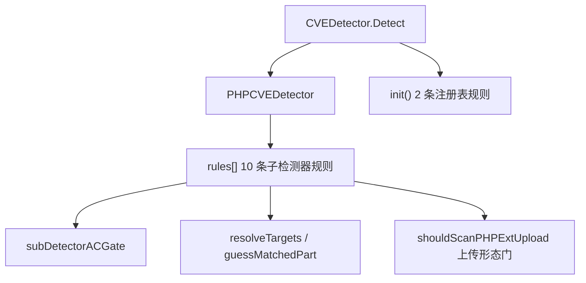
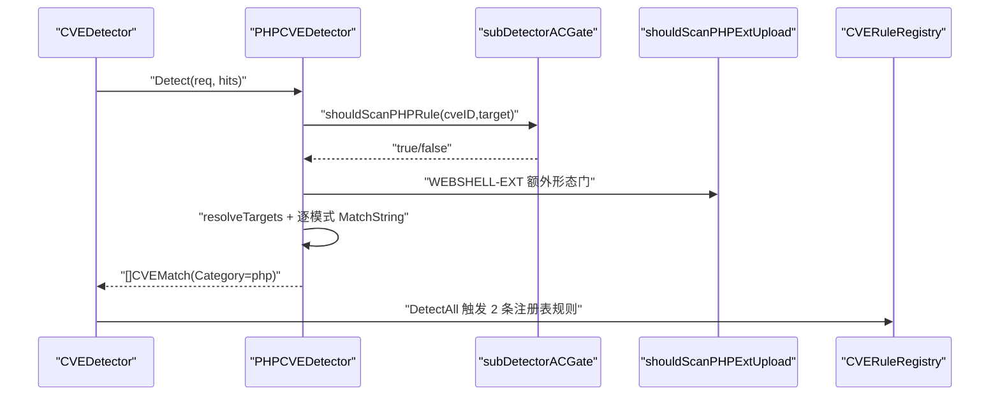
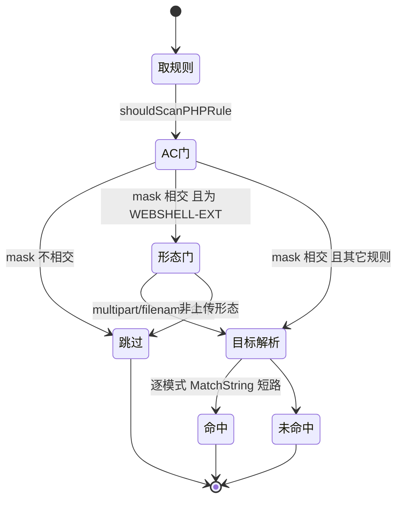
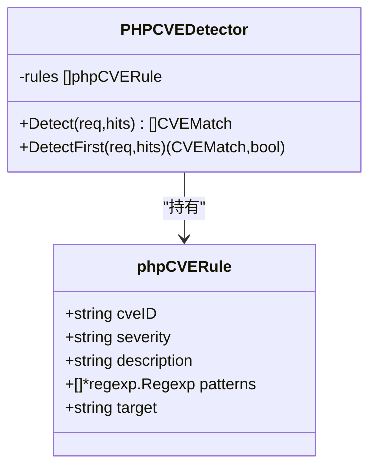

> [返回 安全防护功能](../%E5%AE%89%E5%85%A8%E9%98%B2%E6%8A%A4%E5%8A%9F%E8%83%BD.md)

# PHP 检测器

<cite>
**本文档引用的文件**
- [php.go](file://internal/waf/cve/php.go)
- [detector.go](file://internal/waf/cve/detector.go)
- [java.go](file://internal/waf/cve/java.go)
- [general.go](file://internal/waf/cve/general.go)
- [ac_subdetector.go](file://internal/waf/cve/ac_subdetector.go)
- [ac_subdetector_data.go](file://internal/waf/cve/ac_subdetector_data.go)
- [ac_registry.go](file://internal/waf/cve/ac_registry.go)
- [snippet.go](file://internal/pkg/snippet/snippet.go)
</cite>

## 目录

1. [简介](#简介)
2. [项目结构](#项目结构)
3. [核心组件](#核心组件)
4. [架构总览](#架构总览)
5. [详细组件分析](#详细组件分析)
6. [依赖关系分析](#依赖关系分析)
7. [性能考虑](#性能考虑)
8. [故障排查指南](#故障排查指南)
9. [结论](#结论)
10. [附录](#附录)

## 简介

PHP 检测器（`PHPCVEDetector`）针对 PHP 生态的典型利用特征做内容匹配，覆盖对象反序列化、流包装器文件包含、ThinkPHP/Laravel/Drupal/Craft CMS 框架 RCE、WebShell 上传、PHPUnit eval-stdin、PHP-CGI 软连字符参数注入等。规则以**正则 + 目标域**表达，不携带 PHP 版本区间；`CVE-2024-4577` 一类判定靠请求内容而非版本号。

规则同样分两种载体：`php.go` 中 `NewPHPCVEDetector` 装配的 10 条子检测器规则，与 `init()` 注册的 2 条注册表规则（PHP-CGI 软连字符、WordPress 文件读取）。PHP 还有一处语言特有门控：可疑上传扩展名规则仅在请求呈上传形态（multipart 或含 `filename=`/`content-disposition`）时才纳入扫描（php.go:208-213）。

## 项目结构

| 组成 | 位置 | 内容 |
|---|---|---|
| 注册表规则 | php.go:10-57 | `cve-php-cgi-softyhphen`、`cve-wordpress-file-read` |
| 子检测器结构 | php.go:60-70 | `PHPCVEDetector`、`phpCVERule` |
| 编译期正则 | php.go:73-125 | `rePHPSerObj`、`reThinkPHP1..5`、`reLaravel1..4` 等 |
| 规则装配 | php.go:128-193 | 10 条子检测器规则 |
| 门控/检测 | php.go:195-276 | `shouldScanPHPRule`、`shouldScanPHPExtUpload`、`Detect` |
| 共享工具 | php.go:279-326 | `resolveTargets`、`guessMatchedPart` |

**图表来源**
- [php.go:60-70](file://internal/waf/cve/php.go#L60-L70)
- [php.go:128-213](file://internal/waf/cve/php.go#L128-L213)
- [detector.go:1824-1828](file://internal/waf/cve/detector.go#L1824-L1828)

**章节来源**
- [php.go:10-70](file://internal/waf/cve/php.go#L10-L70)

## 核心组件

| 组件 | 职责 | 行号 |
|---|---|---|
| `PHPCVEDetector` | 持有 `rules` | php.go:60-62 |
| `phpCVERule` | cveID/severity/description/patterns/target | php.go:64-70 |
| `shouldScanPHPRule` | AC 门 + 扩展名形态门 | php.go:195-206 |
| `shouldScanPHPExtUpload` | multipart/filename 判定 | php.go:208-213 |
| `Detect`/`DetectFirst` | 目标×模式匹配，命中短路 | php.go:215-276 |
| `resolveTargets` | target → 目标集合 | php.go:279-309 |
| `guessMatchedPart` | all 命中部位推断 | php.go:312-326 |

`resolveTargets` 与 `guessMatchedPart` 虽定义在 `php.go`，但被四类子检测器共享（java.go:217、node.go:357 均调用）。

**章节来源**
- [php.go:195-326](file://internal/waf/cve/php.go#L195-L326)

## 架构总览

PHP 检测器在 `CVEDetector.Detect` 中作为 `cve_php` 类别执行（detector.go:1824-1828），与 OWASP、Bot 等阶段完全串行，不存在「OWASP 与 CVE 并行」的机制。命中产出 `CVEMatch{Category:"php", Action:"drop"}`，最终动作由 `cvePhase` 依配置解析。

**图表来源**
- [php.go:195-246](file://internal/waf/cve/php.go#L195-L246)
- [detector.go:1824-1860](file://internal/waf/cve/detector.go#L1824-L1860)

**章节来源**
- [detector.go:1824-1838](file://internal/waf/cve/detector.go#L1824-L1838)

## 详细组件分析

### 子检测器规则清单

10 条子检测器规则（php.go:128-193）：

| CVE | 严重度 | target | 正则组数 | 攻击面 |
|---|---|---|:--:|---|
| CVE-2015-6835 | high | all | 3 | PHP 对象反序列化 `O:`/`a:`/`unserialize(` |
| CVE-2018-14884 | high | all | 5 | 流包装器 `php://`、`data://`、`expect://`、`phar://` |
| CVE-2018-20062 | critical | all | 5 | ThinkPHP `invokefunction`/`_method=__construct` |
| CVE-2021-3129 | critical | all | 4 | Laravel Ignition `_ignition/execute-solution` |
| CVE-2016-WEBSHELL | critical | body | 6 | WebShell 上传 `<?php`+eval/system/exec |
| CVE-2016-WEBSHELL-EXT | high | all | 1 | 可疑 PHP 扩展名（含上传形态门） |
| CVE-2018-7600 | critical | all | 2 | Drupal Drupalgeddon2 `#post_render`/`#lazy_builder` |
| CVE-2017-9841 | high | url | 1 | PHPUnit `eval-stdin.php` |
| CVE-2024-4577 | critical | all | 3 | PHP-CGI 软连字符 + `auto_prepend_file`/`allow_url_include` |
| CVE-2023-41892 | critical | url | 1 | Craft CMS `conditions/render` |

**章节来源**
- [php.go:128-193](file://internal/waf/cve/php.go#L128-L193)

### 关键正则模式明细

编译期正则（php.go:73-125）节选：

| 正则 | 匹配意图 |
|---|---|
| `rePHPSerObj` / `rePHPSerArray` | `O:\d+:"` / `a:\d+:{` |
| `rePHPFilterStream` / `rePHPInputStream` | `php://filter/` / `php://input` |
| `reThinkPHP2` / `reThinkPHP5` | `_method=__construct.*filter[]=system` / `filter[]=system\|exec` |
| `reLaravel1` | `_ignition/execute-solution` |
| `rePHPTag` / `rePHPEval` | `<?php` / `eval(` |
| `rePHPExtUpload` | `\.(php[345s7]?|phtml|pht|phps|phar)` |
| `reDrupal1` / `reDrupal2` | `#post_render.*#type=markup` / `#lazy_builder` |
| `rePHPCGI_SoftHyphenArg` | `%[aA][dD].*-[drnfem]`（软连字符） |

**章节来源**
- [php.go:73-125](file://internal/waf/cve/php.go#L73-L125)

### 注册表规则（init）

| 规则 ID | CVE | Category | 关键逻辑 |
|---|---|---|---|
| cve-php-cgi-softyhphen | CVE-2024-4577 | cve_php | `rePHPCGI_SoftHyphenArg` ∧（AutoPrepend ∨ AllowInclude） |
| cve-wordpress-file-read | CVE-2024-2961 | cve_php | `reWPFileRead` 匹配 uri 上 `admin-ajax.php...action...file` |

`shouldScanRegisteredCVERuleAC` 对 `CVE-2024-4577` 用 `auto_prepend_file`/`allow_url_include` 作必要字面门，`CVE-2024-2961` 用 `/wp-admin/admin-ajax.php`（ac_registry.go:46-51）。

**章节来源**
- [php.go:10-57](file://internal/waf/cve/php.go#L10-L57)
- [ac_registry.go:46-51](file://internal/waf/cve/ac_registry.go#L46-L51)

### 目标域与双重门控

| 视图/门 | 说明 |
|---|---|
| AC 六视图门 | `subDetectorACGate(cveID,target,hits)`，needle 见 `ac_subdetector_data.go`（如 `o:`、`php://`、`invokefunction`、`_ignition`、`drupal`） |
| 上传形态门 | `CVE-2016-WEBSHELL-EXT` 需 `shouldScanPHPExtUpload` 为真（Content-Type 含 multipart，或目标含 `filename=`/`content-disposition`） |
| target | all/body/url/cookie，`resolveTargets` 决定扫描集合 |

**图表来源**
- [php.go:195-246](file://internal/waf/cve/php.go#L195-L246)
- [ac_subdetector.go:139-159](file://internal/waf/cve/ac_subdetector.go#L139-L159)

**章节来源**
- [php.go:195-213](file://internal/waf/cve/php.go#L195-L213)
- [ac_subdetector_data.go](file://internal/waf/cve/ac_subdetector_data.go)

**图表来源**
- [php.go:60-70](file://internal/waf/cve/php.go#L60-L70)

**章节来源**
- [php.go:60-70](file://internal/waf/cve/php.go#L60-L70)

### WebShell 与流包装器检测要点

`CVE-2016-WEBSHELL` 与 `CVE-2016-WEBSHELL-EXT` 是误报最敏感的两条规则，其门控与目标域做了针对性约束：

| 规则 | target | 前置门 | 命中字面 |
|---|---|---|---|
| CVE-2016-WEBSHELL | body | AC 门 | `<?php` 且 eval/system/exec/passthru/shell_exec |
| CVE-2016-WEBSHELL-EXT | all | AC 门 + `shouldScanPHPExtUpload` | `.php/.phtml/.phar` 等扩展名 |
| CVE-2018-14884 | all | AC 门 | `php://filter`、`php://input`、`data://`、`expect://`、`phar://` |

`shouldScanPHPExtUpload` 要求请求呈上传形态：Content-Type 含 `multipart/form-data`，或任一目标串含 `filename=`/`content-disposition`（php.go:208-213）。这把扩展名规则限定到真正的文件上传请求，避免对普通 URL 中出现的 `.php` 结尾路径误报。WebShell 内容规则限 `body` 域，配合 `snippet` 截断（snippet.go:11-22）保留可审计的命中片段。

**章节来源**
- [php.go:99-107](file://internal/waf/cve/php.go#L99-L107)
- [php.go:155-166](file://internal/waf/cve/php.go#L155-L166)
- [php.go:208-213](file://internal/waf/cve/php.go#L208-L213)

## 依赖关系分析

- `PHPCVEDetector` 依赖 `CVERequest`、`resolveTargets`/`guessMatchedPart`、`subDetectorACGate`、`snippet.Extract`（命中片段 php.go:237）。
- 通用检测器对反序列化、代码注入、SSRF 提供兜底正则（general.go），与 PHP 规则存在覆盖重叠，属有意冗余。
- `shouldScanRegisteredCVERuleAC` 把两条注册表 PHP 规则纳入 AC 门（detector.go:726-760）。

**章节来源**
- [php.go:16-19](file://internal/waf/cve/php.go#L16-L19)
- [detector.go:726-760](file://internal/waf/cve/detector.go#L726-L760)
- [general.go:640-687](file://internal/waf/cve/general.go#L640-L687)

## 性能考虑

- **双重门前置**：AC 必要字面 + 上传形态门在正则执行前裁剪，尤其把高误报的扩展名规则限定到真正的上传流量（php.go:195-213）。
- **单规则短路**：`goto nextRule`，每规则至多一条命中（php.go:239）。
- **目标域最小化**：WebShell 内容限 `body`，PHPUnit/Craft 限 `url`。
- **片段有界**：命中片段截断至 256 字节（snippet.go:11-52）。

**章节来源**
- [php.go:195-246](file://internal/waf/cve/php.go#L195-L246)
- [snippet.go:8-52](file://internal/pkg/snippet/snippet.go#L8-L52)

## 故障排查指南

| 症状 | 方向 |
|---|---|
| 反序列化漏检 | 确认目标含序列化字面；AC 门依赖 `o:`/`a:` needle |
| WEBSHELL-EXT 误报 | 若非常规上传误命中，检查 `shouldScanPHPExtUpload` 判定条件 |
| PHP-CGI 未命中 | 需同时具备软连字符参数与 auto_prepend/allow_url_include（合取） |
| 规则整体静默 | `categorySensitivity["cve_php"]` 被设 `none/off` |
| 命中无片段 | 属注册表规则；子检测器规则才带 Snippet |

**章节来源**
- [php.go:108-183](file://internal/waf/cve/php.go#L108-L183)
- [detector.go:1824-1828](file://internal/waf/cve/detector.go#L1824-L1828)

## 结论

PHP 检测器以 10 条子检测器规则 + 2 条注册表规则覆盖 PHP 生态主流利用特征，判定基于请求内容的正则而非版本区间。相较其它语言，PHP 增设了上传形态门以降低扩展名规则误报；AC 六视图门与单规则短路保证低开销；`resolveTargets`/`guessMatchedPart` 由四类检测器共享。与通用检测器的兜底重叠形成多来源冗余。

## 附录

### 严重度与目标分布

| 严重度 | 子规则数 | | target | 子规则数 |
|---|:--:|---|---|:--:|
| critical | 6 | | all | 7 |
| high | 4 | | body | 1 |
| — | — | | url | 2 |
| — | — | | cookie | 0 |

critical：ThinkPHP、Laravel、WebShell、Drupal、PHP-CGI、Craft CMS；high：反序列化、流包装器、扩展名、PHPUnit。

**章节来源**
- [php.go:128-193](file://internal/waf/cve/php.go#L128-L193)
