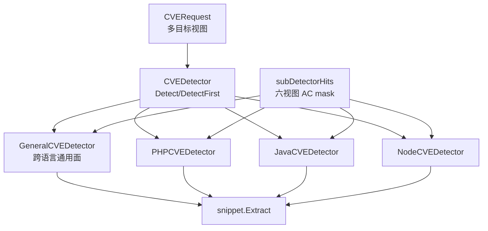
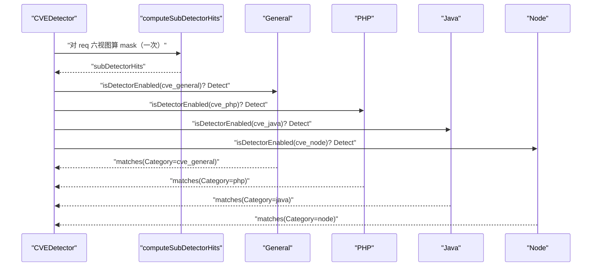
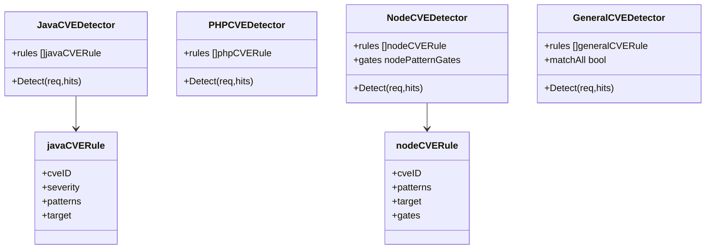
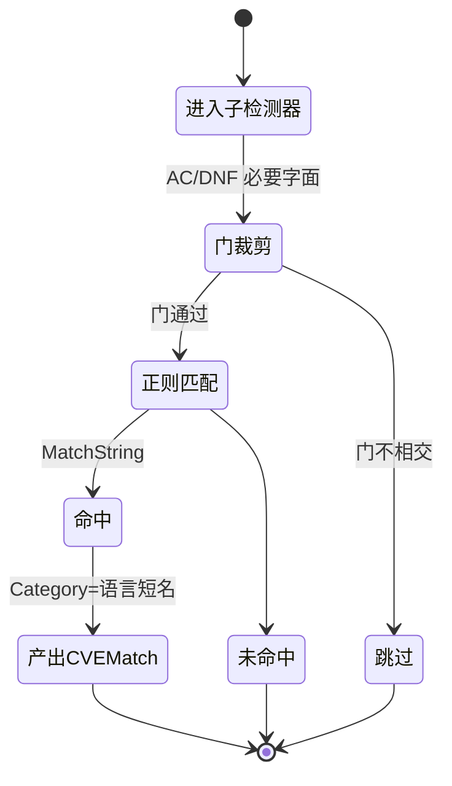

> [返回 安全防护功能](../%E5%AE%89%E5%85%A8%E9%98%B2%E6%8A%A4%E5%8A%9F%E8%83%BD.md)

# 多语言检测器

<cite>
**本文档引用的文件**
- [detector.go](file://internal/waf/cve/detector.go)
- [java.go](file://internal/waf/cve/java.go)
- [php.go](file://internal/waf/cve/php.go)
- [node.go](file://internal/waf/cve/node.go)
- [general.go](file://internal/waf/cve/general.go)
- [ac_subdetector.go](file://internal/waf/cve/ac_subdetector.go)
- [ac_subdetector_data.go](file://internal/waf/cve/ac_subdetector_data.go)
- [snippet.go](file://internal/pkg/snippet/snippet.go)
- [phases.go](file://internal/core/rules/phases.go)
- [engine.go](file://internal/core/engine/engine.go)
</cite>

## 目录

1. [简介](#简介)
2. [项目结构](#项目结构)
3. [核心组件](#核心组件)
4. [架构总览](#架构总览)
5. [详细组件分析](#详细组件分析)
6. [依赖关系分析](#依赖关系分析)
7. [性能考虑](#性能考虑)
8. [故障排查指南](#故障排查指南)
9. [结论](#结论)
10. [附录](#附录)

## 简介

CVE 检测按技术栈拆分为**语言专用检测器 + 通用检测器**。经核对 `internal/waf/cve/` 实际源文件，语言专用检测器共三种：Java（`java.go`）、PHP（`php.go`）、Node.js（`node.go`）；跨语言的通用攻击面（SSRF、路径穿越、XXE、CRLF、请求走私、ShellShock 及大量产品特定 CVE）由 `general.go` 的 `GeneralCVEDetector` 承担。不存在 Python/Go/.NET 等其它语言专用检测器实现——这些语言的漏洞特征归入通用检测器或注册表规则。本文给出四类检测器的能力矩阵与目标域/门控差异，各语言的逐规则细节见同名子文档。

## 项目结构

`CVEDetector` 在 `NewCVEDetector` 中实例化四类子检测器（detector.go:790-797），`Detect` 按 `general → php → java → node` 顺序执行（1819-1838）。

| 检测器 | 文件 | 行数 | 子检测器规则 | 注册表规则 |
|---|---|:--:|:--:|:--:|
| GeneralCVEDetector | general.go | 1541 | 34 | 31 |
| PHPCVEDetector | php.go | 326 | 10 | 2 |
| JavaCVEDetector | java.go | 272 | 10 | 2 |
| NodeCVEDetector | node.go | 412 | 11 | 2 |

**图表来源**
- [detector.go:790-797](file://internal/waf/cve/detector.go#L790-L797)
- [detector.go:1807-1838](file://internal/waf/cve/detector.go#L1807-L1838)
- [ac_subdetector.go:120-135](file://internal/waf/cve/ac_subdetector.go#L120-L135)

**章节来源**
- [detector.go:790-797](file://internal/waf/cve/detector.go#L790-L797)
- [detector.go:1807-1863](file://internal/waf/cve/detector.go#L1807-L1863)

## 核心组件

| 方法/结构 | 所属 | 作用 |
|---|---|---|
| `Detect(req, hits)` | 各子检测器 | 遍历 rules，AC 门前筛后正则匹配 |
| `DetectFirst(req, hits)` | 各子检测器 | 首个命中短路 |
| `shouldScan{PHP,Java,Node}Rule` | 语言文件 | 门控：AC 相交 + 语言特定条件 |
| `resolveTargets` | php.go:279-309 | target → 目标字符串集合 |
| `guessMatchedPart` | php.go:312-326 | all 模式推断命中部位 |
| `nodePatternGates` | node.go:144-210 | Node 规则的 DNF 必要字面门 |

四类子检测器都实现同构的 `Detect`/`DetectFirst`，差异在门控强度：Java/PHP 仅依赖六视图 AC 门（`subDetectorACGate`），Node 额外叠加 `nodePatternGates` 的 DNF 必要字面判断（node.go:313-349），通用检测器还含请求走私等独立于常规规则的检查。

**章节来源**
- [java.go:200-242](file://internal/waf/cve/java.go#L200-L242)
- [php.go:195-246](file://internal/waf/cve/php.go#L195-L246)
- [node.go:299-382](file://internal/waf/cve/node.go#L299-L382)

## 架构总览

在数据面，CVE 阶段仅在 `prot.CVEEnabled && e.cveDetector != nil` 时入链（engine.go:499-501），命中动作在 `cvePhase.Execute` 决定（phases.go:744-871）。运行期一次 `Detect` 会先算一次六视图 AC mask，再串行调用四类子检测器，各自据敏感度门控与 AC 门裁剪。

**图表来源**
- [detector.go:1807-1838](file://internal/waf/cve/detector.go#L1807-L1838)
- [ac_subdetector.go:120-135](file://internal/waf/cve/ac_subdetector.go#L120-L135)

**章节来源**
- [engine.go:499-501](file://internal/core/engine/engine.go#L499-L501)
- [detector.go:1807-1863](file://internal/waf/cve/detector.go#L1807-L1863)

## 详细组件分析

### 语言检测器能力矩阵

下表按攻击面横向对比四类检测器覆盖，取自各文件 `New*CVEDetector` 的规则清单与 `general.go` 正则集。

| 攻击面 | General | Java | PHP | Node |
|---|:--:|:--:|:--:|:--:|
| SSRF（内网/元数据/file/IPv6） | ✅ | — | — | — |
| 路径穿越（双/UTF-8/Null） | ✅ | — | — | ✅ |
| CRLF/请求走私（CL+TE） | ✅ | — | — | — |
| Log4Shell JNDI | 兜底 | ✅ | — | — |
| Spring4Shell / SpEL | — | ✅ | — | — |
| Fastjson/Jackson/Shiro 反序列化 | 兜底 | ✅ | — | — |
| Struts2 OGNL | 兜底 | ✅ | — | — |
| PHP 反序列化/流包装器 | 兜底 | — | ✅ | — |
| ThinkPHP/Laravel/Drupal/Webshell | — | — | ✅ | — |
| PHP-CGI 软连字符 / WP 文件读 / Craft CMS | 兜底 | — | ✅ | — |
| 原型污染 / RSC Flight RCE | — | — | — | ✅ |
| EJS/vm2 模板与沙箱 | — | — | — | ✅ |
| Next.js 中间件/SSRF/Server Actions | 兜底 | — | — | ✅ |

「兜底」表示该攻击面主要由通用检测器的跨语言正则覆盖，语言检测器提供生态特定变体。

**章节来源**
- [general.go:853-936](file://internal/waf/cve/general.go#L853-L936)
- [java.go:133-197](file://internal/waf/cve/java.go#L133-L197)
- [php.go:128-193](file://internal/waf/cve/php.go#L128-L193)
- [node.go:212-297](file://internal/waf/cve/node.go#L212-L297)

### 目标域（target）与 CVEMatch 输出

子检测器以 `target` 选择扫描域，命中写入 `CVEMatch.Category`。

| 检测器 | target 取值 | Category 输出 | 片段 |
|---|---|---|---|
| General | url/body/header/cookie/all/url_body | `cve_general`（部分历史条目 `general`） | `snippet.Extract` |
| Java | url/body/header/cookie/all | `java` | `snippet.Extract` |
| PHP | url/body/header/cookie/all | `php` | `snippet.Extract` |
| Node | url/body/header/cookie/all | `node` | `snippet.Extract` |

`resolveTargets` 对 `url` 返回原始 + 解码路径/查询，`body` 仅在体非空时返回，`cookie` 从 Cookie 头取（php.go:279-309）。命中片段统一受 `snippet` 截断（MaxLen 256、ContextLen 48，snippet.go:11-14）。

**章节来源**
- [php.go:279-326](file://internal/waf/cve/php.go#L279-L326)
- [java.go:211-242](file://internal/waf/cve/java.go#L211-L242)
- [snippet.go:11-76](file://internal/pkg/snippet/snippet.go#L11-L76)

### AC 门与语言门控差异

六视图 AC 门（`subDetectorNeedleEntries`，64 条）为所有语言规则提供必要字面前筛（ac_subdetector_data.go:3、ac_subdetector.go:101-159）。Node 在此之上用 `nodePatternGates` 表达 DNF 必要条件（`musts` 全含且 `alts` 至少一含），进一步减少正则调用（node.go:77-80、313-349）。PHP 对可疑扩展名规则额外要求请求呈上传形态（`shouldScanPHPExtUpload` 检查 multipart/filename/content-disposition，php.go:208-213）。门为必要条件，只减少调用、不改变判定。

**图表来源**
- [java.go:75-85](file://internal/waf/cve/java.go#L75-L85)
- [node.go:62-80](file://internal/waf/cve/node.go#L62-L80)
- [php.go:60-70](file://internal/waf/cve/php.go#L60-L70)
- [general.go:817-851](file://internal/waf/cve/general.go#L817-L851)

**章节来源**
- [node.go:299-349](file://internal/waf/cve/node.go#L299-L349)
- [php.go:195-213](file://internal/waf/cve/php.go#L195-L213)
- [ac_subdetector.go:139-159](file://internal/waf/cve/ac_subdetector.go#L139-L159)

### 规则命中到动作的一致性

无论哪类子检测器，命中产出的 `CVEMatch` 都带 `Action`（内置规则多为 `drop`），但最终处置由 `cvePhase.Execute` 决定：命中禁用覆盖则跳过，随后按配置动作/规则动作/作用域覆盖/自动 Drop 升级（critical/high）解析（phases.go:769-842）。因此「语言检测器命中」不等于「一定阻断」。

**图表来源**
- [node.go:299-311](file://internal/waf/cve/node.go#L299-L311)
- [java.go:200-209](file://internal/waf/cve/java.go#L200-L209)
- [phases.go:769-842](file://internal/core/rules/phases.go#L769-L842)

**章节来源**
- [phases.go:769-842](file://internal/core/rules/phases.go#L769-L842)

## 依赖关系分析

- 四类子检测器无相互依赖，统一依赖 `CVERequest`、`resolveTargets`、`subDetectorACGate` 与 `snippet.Extract`。
- 门控数据来自 `internal/ac`，规则来自各自 `New*CVEDetector` 与 `init()` 注册。
- 通用检测器与语言检测器存在覆盖重叠（如 SSRF/路径穿越/远程调用协议），设计上以语言检测器提供生态变体、通用检测器提供兜底。

**章节来源**
- [detector.go:16-18](file://internal/waf/cve/detector.go#L16-L18)
- [php.go:279-326](file://internal/waf/cve/php.go#L279-L326)
- [ac_subdetector.go:120-159](file://internal/waf/cve/ac_subdetector.go#L120-L159)

## 性能考虑

- **一次 mask，多路复用**：`computeSubDetectorHits` 每请求仅算一次六视图 mask，供四子检测器共享（detector.go:1807、ac_subdetector.go:120-135）。
- **串行执行**：`Detect` 顺序调用，绝大多数请求无命中，省去 goroutine 开销（detector.go:1809-1838）。
- **DNF 门（Node）**：`nodeRuleGate` 先做必要字面合取/析取判断再进正则，显著减少高成本匹配（node.go:313-349）。
- **单规则短路**：各 `Detect` 命中即 `goto nextRule`，每规则至多一条匹配（java.go:235、php.go:239、node.go:375）。

**章节来源**
- [detector.go:1809-1838](file://internal/waf/cve/detector.go#L1809-L1838)
- [node.go:313-349](file://internal/waf/cve/node.go#L313-L349)

## 故障排查指南

| 症状 | 定位 |
|---|---|
| 某语言漏洞检不到 | 确认对应 `cve_*` 敏感度未设 `none/off`（detector.go:1811-1817） |
| Node 规则漏检 | 检查 `nodePatternGates` 是否覆盖新绕过字面（node.go:144-210） |
| PHP 扩展名误报 | 核对 `shouldScanPHPExtUpload` 是否命中非上传流量（php.go:208-213） |
| 通用与语言重复告警 | 属预期兜底，`DetectFirst` 可取首个命中收敛 |

**章节来源**
- [detector.go:1811-1838](file://internal/waf/cve/detector.go#L1811-L1838)
- [node.go:144-210](file://internal/waf/cve/node.go#L144-L210)
- [php.go:208-213](file://internal/waf/cve/php.go#L208-L213)

## 结论

多语言 CVE 检测由三类语言专用检测器（Java/PHP/Node.js）与一个通用检测器构成，四者共享 `CVERequest` 多目标视图、六视图 AC 门与 `snippet` 片段抽取，差异集中在门控强度与生态特定正则。Node 独有 DNF 必要字面门，PHP 对上传扩展名设了形态前置，通用检测器承担跨语言兜底。运行期串行执行、单规则短路、命中后统一交由 `cvePhase` 依配置解析动作。文档严格按 `internal/waf/cve/` 实际文件组织，未虚构其它语言检测器。

## 附录

### 各语言子文档

| 文档 | 规则数（子/注册表） |
|---|:--:|
| Java 检测器.md | 10 / 2 |
| PHP 检测器.md | 10 / 2 |
| Node.js 检测器.md | 11 / 2 |

### 敏感度键

| 键 | 对应检测器 |
|---|---|
| `cve_general` | GeneralCVEDetector |
| `cve_php` | PHPCVEDetector |
| `cve_java` | JavaCVEDetector |
| `cve_node` | NodeCVEDetector |

**章节来源**
- [detector.go:1819-1838](file://internal/waf/cve/detector.go#L1819-L1838)
- [java.go:133-198](file://internal/waf/cve/java.go#L133-L198)
- [php.go:128-193](file://internal/waf/cve/php.go#L128-L193)
- [node.go:212-297](file://internal/waf/cve/node.go#L212-L297)
