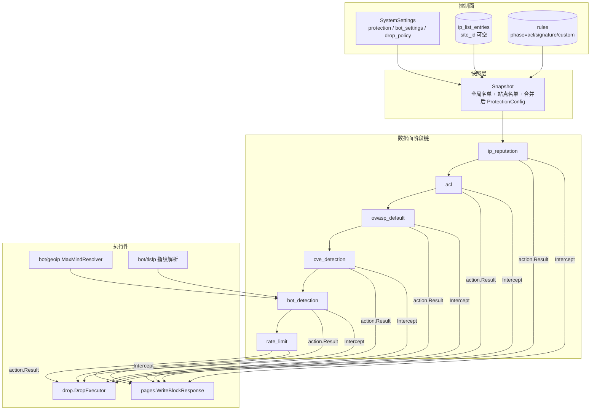
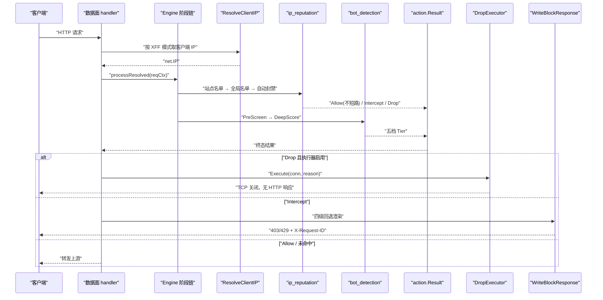
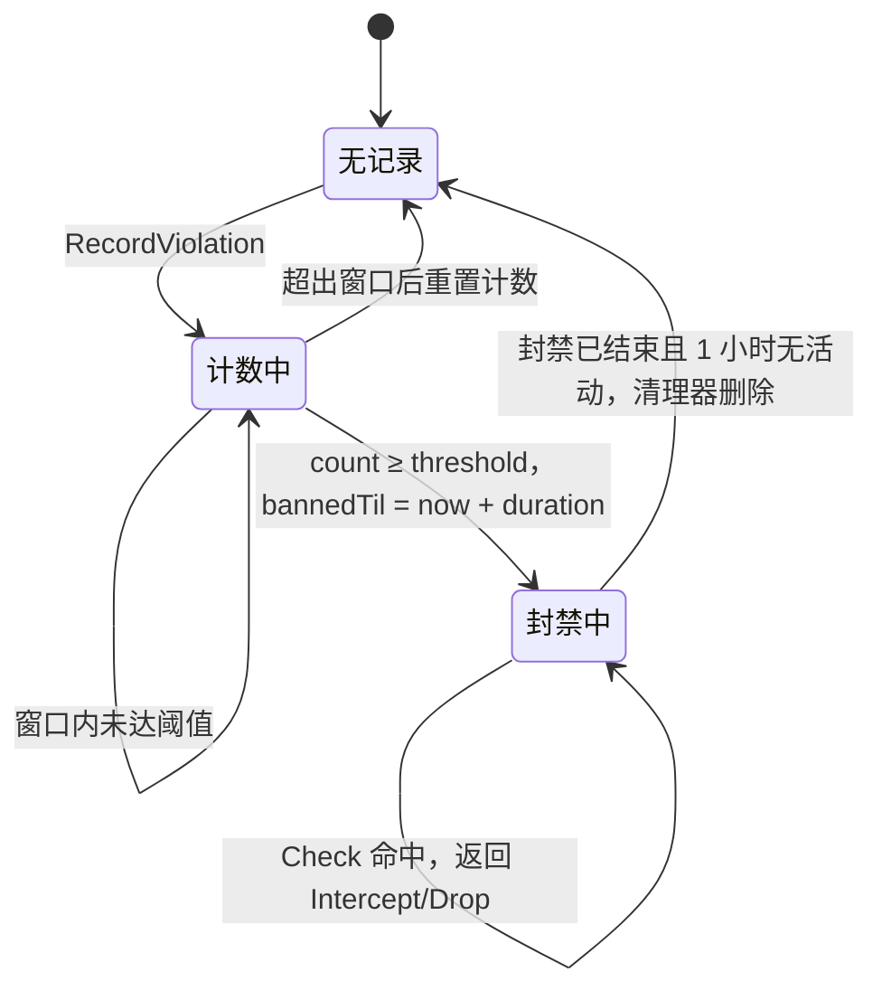
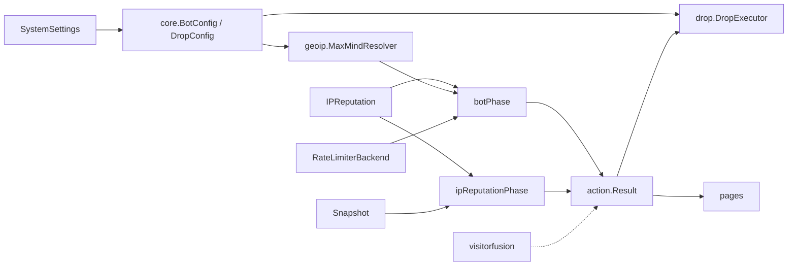

# 安全防护功能

> [返回文档索引](../index.md)

<cite>
**本文档引用的文件**
- [internal/core/engine/engine.go](file://internal/core/engine/engine.go)
- [internal/core/rules/phases.go](file://internal/core/rules/phases.go)
- [internal/core/rules/compiler.go](file://internal/core/rules/compiler.go)
- [internal/core/action/action.go](file://internal/core/action/action.go)
- [internal/core/pipeline/pipeline.go](file://internal/core/pipeline/pipeline.go)
- [internal/core/configoverride/registry.go](file://internal/core/configoverride/registry.go)
- [internal/waf/iprep/iprep.go](file://internal/waf/iprep/iprep.go)
- [internal/waf/bot/bot.go](file://internal/waf/bot/bot.go)
- [internal/waf/bot/dynamic.go](file://internal/waf/bot/dynamic.go)
- [internal/waf/bot/dynamic_tls.go](file://internal/waf/bot/dynamic_tls.go)
- [internal/waf/bot/geoip/geoip.go](file://internal/waf/bot/geoip/geoip.go)
- [internal/waf/bot/tlsfp/fingerprint.go](file://internal/waf/bot/tlsfp/fingerprint.go)
- [internal/waf/drop/drop.go](file://internal/waf/drop/drop.go)
- [internal/waf/pages/block.go](file://internal/waf/pages/block.go)
- [internal/waf/ratelimit/ratelimit.go](file://internal/waf/ratelimit/ratelimit.go)
- [internal/store/protection.go](file://internal/store/protection.go)
- [internal/store/site.go](file://internal/store/site.go)
- [internal/store/iplist/ip_list.go](file://internal/store/iplist/ip_list.go)
- [internal/snapshot/build.go](file://internal/snapshot/build.go)
- [internal/app/server.go](file://internal/app/server.go)
- [internal/dataplane/handler.go](file://internal/dataplane/handler.go)
- [internal/dataplane/handler_support.go](file://internal/dataplane/handler_support.go)
- [internal/admin/site/site.go](file://internal/admin/site/site.go)
- [internal/admin/router.go](file://internal/admin/router.go)
- [internal/security/clientip.go](file://internal/security/clientip.go)
- [internal/visitorfusion/classifier.go](file://internal/visitorfusion/classifier.go)
- [frontend/lib/api.ts](file://frontend/lib/api.ts)
- [frontend/hooks/use-api.ts](file://frontend/hooks/use-api.ts)
- [README.md](file://README.md)
- [处理阶段详解.md](file://docs/WAF 引擎系统/处理阶段详解/处理阶段详解.md)
</cite>

## 目录

1. [简介](#简介)
2. [项目结构](#项目结构)
3. [核心组件](#核心组件)
4. [架构总览](#架构总览)
5. [详细组件分析](#详细组件分析)
6. [依赖关系分析](#依赖关系分析)
7. [性能考虑](#性能考虑)
8. [故障排查指南](#故障排查指南)
9. [结论](#结论)
10. [附录](#附录)

## 简介
本文件是「安全防护功能」域的总览，只回答三个问题：这个域包含哪些功能子域、每个子域挂在处理阶段链的哪一步、配置从哪里来又向哪里生效。

- 判定动作的语义、`TerminalPriority` 与短路规则由 [动作与结果系统](../WAF 引擎系统/动作与结果系统.md) 与本域「阻断机制」共同承载
- 11 个处理阶段的入链条件、执行顺序与短路行为，完整表格见 [处理阶段详解](../WAF 引擎系统/处理阶段详解/处理阶段详解.md)，本文不复制
- OWASP 规则内容、CVE 检测器实现、限流算法、匹配器实现全部下沉到各自子文档，本文只保留入口链接与跨子域的对照关系

**章节来源**
- [internal/core/engine/engine.go:466-548](file://internal/core/engine/engine.go#L466-L548)
- [处理阶段详解.md](file://docs/WAF 引擎系统/处理阶段详解/处理阶段详解.md)

## 项目结构
数据面的防护逻辑集中在 `internal/waf/*`（判定算法）与 `internal/core/rules/phases.go`（阶段适配），控制面在 `internal/admin/protect`、`internal/admin/system/iplist`，配置真值在 `internal/store`。

| 功能子域 | 判定实现 | 阶段名 / 挂载点 | 控制面 | 子文档 |
|---|---|---|---|---|
| IP 信誉 | [internal/waf/iprep](file://internal/waf/iprep/iprep.go) | `ip_reputation`（phases.go:356） | `admin/system/iplist` | [IP 信誉系统](IP 信誉系统.md) |
| ACL 规则引擎 | [internal/core/rules](file://internal/core/rules/phases.go) | `acl`（phases.go:146） | `admin/rule` | [ACL 规则引擎](ACL 规则引擎.md) |
| 地理位置阻断 | [bot/geoip](file://internal/waf/bot/geoip/geoip.go) + `geo_block` 匹配器 | `bot_detection` 加权 + 规则阶段 | `admin/protect/bot` | [地理位置阻断](地理位置阻断.md) |
| 机器人检测 | [internal/waf/bot](file://internal/waf/bot/bot.go) | `bot_detection`（phases.go:488） | `admin/protect/bot` | [机器人检测](机器人检测.md) |
| OWASP 检测 | `internal/waf/owasp` | `owasp_default`（phases.go:616） | `admin/detect/owasprules` | [OWASP 检测](OWASP 检测/OWASP 检测.md) |
| CVE 漏洞检测 | `internal/waf/cve` | `cve_detection`（phases.go:742） | `admin/detect/cverules` | [CVE 漏洞检测](CVE 漏洞检测/CVE 漏洞检测.md) |
| 速率限制 | [internal/waf/ratelimit](file://internal/waf/ratelimit/ratelimit.go) | `rate_limit`（phases.go:314） | `admin/protect` | [速率限制机制](速率限制机制/速率限制机制.md) |
| 阻断与零响应 | [internal/waf/drop](file://internal/waf/drop/drop.go) + [pages](file://internal/waf/pages/block.go) | 阶段链之后的动作落地 | `admin/protect/drop` | [阻断机制](阻断机制.md) |

**图表来源**
- [internal/store/protection.go:13-117](file://internal/store/protection.go#L13-L117)
- [internal/store/iplist/ip_list.go:17-30](file://internal/store/iplist/ip_list.go#L17-L30)
- [internal/snapshot/build.go:707-768](file://internal/snapshot/build.go#L707-L768)
- [internal/core/engine/engine.go:479-529](file://internal/core/engine/engine.go#L479-L529)
- [internal/waf/bot/bot.go:11-14](file://internal/waf/bot/bot.go#L11-L14)
- [internal/waf/drop/drop.go:19-41](file://internal/waf/drop/drop.go#L19-L41)

**章节来源**
- [internal/admin/router.go:152-244](file://internal/admin/router.go#L152-L244)
- [internal/snapshot/build.go:192-196](file://internal/snapshot/build.go#L192-L196)

## 核心组件
- `iprep.IPReputation`：全局黑白名单 + 违规计数自动封禁，带 5 分钟清理协程（iprep.go:249）
- `rules.aclPhase` / `signaturePhase` / `customPhase`：三段用户规则阶段，共用 `Compiled` + `Matcher`（phases.go:131-192）
- `bot.CheckBotTwoPhaseWithBehavior`：预筛 + 五模块加权评分 + 五档处置（bot.go:922）
- `geoip.MaxMindResolver`：`Lookup` / `IsHighRisk` / `ScoreIP`，库文件缺失时优雅降级（geoip.go:101-180）
- `tlsfp.TLSClientFingerprint`：ClientHello 解析出的 JA3/JA3Hash/JA4/版本/SNI/ALPN 结构（fingerprint.go:27-39）
- `drop.DropExecutor`：`SetLinger(0)` + `Close`，零 HTTP 响应并按来源累计统计（drop.go:47-91）
- `pages.WriteBlockResponse`：站点 HTML → 全局 HTML → 配置化模板 → 内嵌页四级回退（block.go:20-58）
- `visitorfusion.Result`：对已放行 HTTPS 请求做事后可解释分类，不参与判定（classifier.go:166-222）

| 组件 | 位置 | 关键符号 | 消费方 |
|---|---|---|---|
| IP 信誉 | [iprep.go:20](file://internal/waf/iprep/iprep.go#L20) | `IPReputation`、`Check`、`RecordViolation` | `ipReputationPhase`、`botPhase` |
| ACL 阶段 | [phases.go:131](file://internal/core/rules/phases.go#L131) | `aclPhase`、`executeCompiledPhase` | `Engine.getOrBuildPhases` |
| Bot 阶段 | [phases.go:435](file://internal/core/rules/phases.go#L435) | `botPhase`、`verdictToResult` | 引擎 + `BotScoreLog` |
| GeoIP | [geoip.go:21](file://internal/waf/bot/geoip/geoip.go#L21) | `MaxMindResolver` | `botPhase.geo` |
| TLS 指纹 | [fingerprint.go:27](file://internal/waf/bot/tlsfp/fingerprint.go#L27) | `TLSClientFingerprint` | `RequestCtx.TLS`、`MatchCtx.TLS` |
| Drop 执行器 | [drop.go:19](file://internal/waf/drop/drop.go#L19) | `DropExecutor`、`DropStats` | `handler.go` drop 分支 |
| 阻断页渲染 | [block.go:20](file://internal/waf/pages/block.go#L20) | `WriteBlockResponse` | `handler.go` intercept 分支 |

**章节来源**
- [internal/waf/iprep/iprep.go:20-271](file://internal/waf/iprep/iprep.go#L20-L271)
- [internal/core/rules/phases.go:131-742](file://internal/core/rules/phases.go#L131-L742)
- [internal/waf/bot/bot.go:922-942](file://internal/waf/bot/bot.go#L922-L942)
- [internal/waf/bot/geoip/geoip.go:101-180](file://internal/waf/bot/geoip/geoip.go#L101-L180)
- [internal/waf/bot/tlsfp/fingerprint.go:18-39](file://internal/waf/bot/tlsfp/fingerprint.go#L18-L39)
- [internal/visitorfusion/classifier.go:166-222](file://internal/visitorfusion/classifier.go#L166-L222)

## 架构总览
一次请求先解析客户端 IP（`security.ResolveClientIP`，clientip.go:17），再由引擎按条件装配的阶段链判定，最后由数据面把 `action.Result` 落成响应、断连或放行。

| 阶段名 | 产出本域动作 | 证据 |
|---|---|---|
| `ip_reputation` | Allow / Intercept / Drop | phases.go:368-433 |
| `acl` | Allow（不短路）/ Intercept / Drop / 挑战类 | phases.go:148-150、compiler.go:32-37 |
| `owasp_default` | 配置动作（默认 intercept） | phases.go:618-685 |
| `cve_detection` | 配置动作，Critical/High 可自动升 Drop | phases.go:827-839 |
| `bot_detection` | Observe / Challenge / Intercept / Drop | phases.go:561-591 |
| `rate_limit` | 配置动作（默认 rate_limit，429） | phases.go:316-340 |

动作档位的严重度只有一处定义：`TerminalPriority` 为 drop 90、intercept 80、rate_limit 70、四类挑战同 60、redirect 50、observe 10（action.go:88-115）。同档取先出现者。

**图表来源**
- [internal/security/clientip.go:17-35](file://internal/security/clientip.go#L17-L35)
- [internal/core/rules/phases.go:368-433](file://internal/core/rules/phases.go#L368-L433)
- [internal/core/rules/phases.go:514-591](file://internal/core/rules/phases.go#L514-L591)
- [internal/waf/drop/drop.go:47-72](file://internal/waf/drop/drop.go#L47-L72)
- [internal/waf/pages/block.go:20-58](file://internal/waf/pages/block.go#L20-L58)

**章节来源**
- [internal/core/action/action.go:88-115](file://internal/core/action/action.go#L88-L115)
- [internal/core/engine/engine.go:479-529](file://internal/core/engine/engine.go#L479-L529)

## 详细组件分析

### 切面一：访问控制与信誉
本域有三条互不替代的准入路径，容易混淆，此处一次划清：

| 路径 | 数据源 | 匹配对象 | 命中动作 | 证据 |
|---|---|---|---|---|
| 全局黑白名单 | `ip_list_entries` 且 `site_id IS NULL` | `net.IP`（单 IP / CIDR） | 白 Allow（短路）/ 黑 Intercept 或 Drop | server.go:1331-1352、phases.go:404-432 |
| 站点黑白名单 | `ip_list_entries` 且 `site_id = 站点` | 同上 | 白 Allow（**不短路**）/ 黑 Intercept 或 Drop | build.go:1596-1644、phases.go:374-402 |
| 自动封禁 | 内存 `violations`（`sync.Map`） | IP 字符串键 | Intercept 或 Drop（按 `auto_ban_action`） | iprep.go:144-167、phases.go:421-432 |
| ACL 规则 | `rules` 表 `phase=acl` | `MatchCtx` 全字段 | 规则动作，Allow 不短路 | compiler.go:40-78、phases.go:148-150 |

关键语义差异：站点白名单命中返回 `stop=false`，后续阶段照常执行；全局白名单命中返回 `stop=true`，直接结束阶段链。二者都放行，但作用域完全不同（phases.go:376-384 与 411-419）。名单细节见 [IP 信誉系统](IP 信誉系统.md)，规则 DSL 与匹配器细节见 [ACL 规则引擎](ACL 规则引擎.md)。名单细节见 [IP 信誉系统](IP 信誉系统.md)，规则 DSL 与匹配器细节见 [ACL 规则引擎](ACL 规则引擎.md)。

**图表来源**
- [internal/waf/iprep/iprep.go:144-167](file://internal/waf/iprep/iprep.go#L144-L167)
- [internal/waf/iprep/iprep.go:249-271](file://internal/waf/iprep/iprep.go#L249-L271)

**章节来源**
- [internal/waf/iprep/iprep.go:105-167](file://internal/waf/iprep/iprep.go#L105-L167)
- [internal/core/rules/phases.go:368-433](file://internal/core/rules/phases.go#L368-L433)
- [internal/app/server.go:1331-1352](file://internal/app/server.go#L1331-L1352)
- [internal/snapshot/build.go:1596-1644](file://internal/snapshot/build.go#L1596-L1644)

### 切面二：自动化流量识别
`bot_detection` 是唯一「先评分、后分档」的阶段：五模块原始分按固定权重折算总分，再由 `ClassifyScore` 从阈值派生五档，危险标记走独立通道保证终止。

| 模块 | 权重 | 原始分来源 | 证据 |
|---|:--:|---|---|
| UA | 40 | `uaScore` 字面证据 | bot.go:85、604-635 |
| 请求指纹 | 25 | `fingerprintScore` + `headerOrderScore` + `evaluateDynamicTLS` | bot.go:736-741 |
| 行为 | 15 | `BehaviorScoreFromCount` | bot.go:649-663 |
| GeoIP | 5 | `MaxMindResolver.ScoreIP` | geoip.go:153-180 |
| IP 声誉 | 15 | `IPReputation.Check` 分类 | bot.go:750-767 |

TLS 指纹由数据面解析 ClientHello 得到（tlsfp），阶段内只做一致性判定：`D1`–`D3` 三条确定性矛盾置危险标记，`W1`–`W4` 四条观测级矛盾只加分（dynamic.go:12-43、118-179）。行为分使用独立 `|bot` 键后缀，避免与限流阶段重复计数（phases.go:501-512）。评分链细节见 [机器人检测](机器人检测.md)，地理维度细节见 [地理位置阻断](地理位置阻断.md)。评分链细节见 [机器人检测](机器人检测.md)，地理维度细节见 [地理位置阻断](地理位置阻断.md)。

**章节来源**
- [internal/waf/bot/bot.go:85-136](file://internal/waf/bot/bot.go#L85-L136)
- [internal/waf/bot/bot.go:594-767](file://internal/waf/bot/bot.go#L594-L767)
- [internal/waf/bot/dynamic.go:7-179](file://internal/waf/bot/dynamic.go#L7-L179)
- [internal/core/rules/phases.go:435-591](file://internal/core/rules/phases.go#L435-L591)

### 切面三：攻击特征检测
OWASP 与 CVE 都是「命中即产规则级动作」的检测阶段，二者内部实现庞大，本文不复制其类别表与检测器表：

- OWASP：`owasp_default` 阶段在 `prot.OWASPEnabled` 为真时入链（engine.go:496-498），执行入口 phases.go:618-685，动作取 `OWASPAction` 并可被规则级覆盖改写（phases.go:687-700）
- CVE：`cve_detection` 阶段在 `prot.CVEEnabled` 且 detector 非空时入链（engine.go:499-501），Critical/High 命中且规则未显式指定动作时按开关升级为 Drop（phases.go:827-839）
- 两个阶段的启用位都是站点级三态字段（`owasp_enabled` / `cve_enabled`），nil 表示继承全局

规则内容、检测器与阈值表分别见 [OWASP 检测](OWASP 检测/OWASP 检测.md) 与 [CVE 漏洞检测](CVE 漏洞检测/CVE 漏洞检测.md)，本页不复制。

规则内容、检测器与阈值表分别见 [OWASP 检测](OWASP 检测/OWASP 检测.md) 与 [CVE 漏洞检测](CVE 漏洞检测/CVE 漏洞检测.md)，本页不复制。

**章节来源**
- [internal/core/rules/phases.go:618-700](file://internal/core/rules/phases.go#L618-L700)
- [internal/core/rules/phases.go:827-864](file://internal/core/rules/phases.go#L827-L864)
- [internal/core/engine/engine.go:496-501](file://internal/core/engine/engine.go#L496-L501)

### 切面四：流量约束
`rate_limit` 阶段的键由 `RateLimitKey` 统一构造为 `bind|siteID|归一化 Host|clientIP`（phases.go:63-70），阶段内只问 `Allow(key)`；超限动作默认 `rate_limit` 并直接给出 429（phases.go:324-338）。同一限流后端的窗口计数还被 Bot 阶段借去换算行为分，两处用不同后缀键隔离（phases.go:501-512）。规则级频次限制则走 `cc_rate` 复合条件，与阶段限流是两套计数。窗口算法实现见 [速率限制机制](速率限制机制/速率限制机制.md)。窗口算法实现见 [速率限制机制](速率限制机制/速率限制机制.md)。

**章节来源**
- [internal/core/rules/phases.go:63-70](file://internal/core/rules/phases.go#L63-L70)
- [internal/core/rules/phases.go:305-340](file://internal/core/rules/phases.go#L305-L340)
- [internal/waf/ratelimit/ratelimit.go:10-36](file://internal/waf/ratelimit/ratelimit.go#L10-L36)

### 切面五：阻断与响应执行
判定与执行分离：阶段只产出 `action.Result`，数据面按 `IsDrop()` / `IsTerminal()` / `IsChallenge()` 分流。

| 流程步 | 输入 | 行为 | 证据 |
|:--:|---|---|---|
| 1 判定汇合 | `action.Result` | 管道取终端动作 | pipeline.go:517-560 |
| 2 Drop 尝试 | `Phase` 为 owasp/cve 时构建协议守卫 | h2 RST / h3 取消 / TCP 关闭 | handler.go:728-754 |
| 3 Drop 执行 | `DropExecutor.Execute` | `SetLinger(0)` 后 `Close`，记统计与告警 | drop.go:47-72 |
| 4 Drop 降级 | 无可关闭连接 | 改写为 Intercept，补 `X-OWAF-Drop-Degraded` 头 | handler.go:796-850 |
| 5 拦截渲染 | 站点/全局 HTML | 四级回退，写 `X-Request-ID` | block.go:20-58 |
| 6 事件落库 | `DropEvent` / `SecurityEvent` | 异步批量写入 | handler_support.go:334-348 |

`Server` 响应头在渲染前被删除，模板渲染只注入 `RequestID` 与 `StatusCode`，规则 ID 等内部字段一律留空，避免向客户端泄露判定细节（block.go:21-22、190-219）。断连与页面细节见 [阻断机制](阻断机制.md)。断连与页面细节见 [阻断机制](阻断机制.md)。

**章节来源**
- [internal/dataplane/handler.go:713-850](file://internal/dataplane/handler.go#L713-L850)
- [internal/waf/drop/drop.go:47-113](file://internal/waf/drop/drop.go#L47-L113)
- [internal/waf/pages/block.go:20-58](file://internal/waf/pages/block.go#L20-L58)
- [internal/dataplane/handler_support.go:334-353](file://internal/dataplane/handler_support.go#L334-L353)

### 切面六：配置继承关系
配置只有一个写入源，读取时按「环境变量 → 全局 protection → 站点覆盖 → 逐键覆盖」四级收敛。

| 配置项 | 全局载体 | 站点载体 | 三态语义 | 合并位置 |
|---|---|---|---|---|
| OWASP 开关 | `builtin_owasp_enabled` | `owasp_enabled *bool` | nil 继承，非 nil 覆盖 | build.go:726-734 |
| CVE 开关 | `cve_enabled` | `cve_enabled *bool` | nil 继承 | build.go:737-746 |
| Bot 开关 | `bot_detection_enabled` | `bot_protection_enabled *bool` | nil 继承 | build.go:711-713 |
| 请求限流 | `request_ratelimit_enabled` | `rate_limit_enabled *bool` | nil 继承 | build.go:749-760 |
| 自动封禁 | `auto_ban_*` 四项 | 无站点级覆盖 | 仅全局 | server.go:640-641 |
| Drop 策略 | `drop_policy` 设置行 | 无站点级覆盖 | 仅全局 | server.go:1416 |
| IP 名单 | `site_id IS NULL` | `site_id = 站点` | 作用域区分，非覆盖 | build.go:1596-1644 |
| 路径跳过 | `skip_path_by_phase` | `*string`，nil 继承 | 非 nil 整体覆盖 | build.go:762-766 |

站点级从属字段在开关为 nil 时会被清空，避免残留值被误当成覆盖（admin/site/site.go:490-508）。写操作一律是 POST：`/{id}/update`、`/{id}/delete`、`/start`、`/stop`、`/toggle`，路由表内没有 PUT / DELETE（admin/router.go）。

**章节来源**
- [internal/snapshot/build.go:707-768](file://internal/snapshot/build.go#L707-L768)
- [internal/store/protection.go:13-117](file://internal/store/protection.go#L13-L117)
- [internal/store/site.go:59-91](file://internal/store/site.go#L59-L91)
- [internal/admin/site/site.go:490-508](file://internal/admin/site/site.go#L490-L508)
- [internal/app/server.go:637-673](file://internal/app/server.go#L637-L673)
- [internal/admin/router.go:287-408](file://internal/admin/router.go#L287-L408)

## 依赖关系分析

| 依赖方 | 被依赖方 | 形式 | 说明 |
|---|---|---|---|
| `botPhase` | `iprep.IPReputation` | 指针注入 | 评分读名单、判定后写违规 |
| `botPhase` | `geoip.MaxMindResolver` | 指针注入 | 可为 nil，降级为无地理分 |
| `botPhase` | `ratelimit.RateLimiterBackend` | 接口注入 | 取行为分，nil 时行为分为 0 |
| `ipReputationPhase` | 快照站点名单 + 全局信誉 | 双源 | 站点名单先于全局判定 |
| `Engine` | `drop.DropExecutor` | setter 挂载 | 判定与执行分离 |
| 数据面 | `pages` | 函数调用 | 拦截/维护/挑战/错误页渲染 |
| 控制面 | `store` + `reload` | 事务 + 重载回调 | 保存即触发快照重建 |

外部依赖：MaxMind mmdb 文件（Bot GeoIP 与自动下载）、Redis（可选的分布式限流与会话）、Hertz 请求上下文。各模块职责单向，未发现循环导入。

**图表来源**
- [internal/core/engine/engine.go:74-80](file://internal/core/engine/engine.go#L74-L80)
- [internal/core/rules/phases.go:435-474](file://internal/core/rules/phases.go#L435-L474)
- [internal/app/server.go:457-470](file://internal/app/server.go#L457-L470)
- [internal/visitorfusion/classifier.go:59-66](file://internal/visitorfusion/classifier.go#L59-L66)

**章节来源**
- [internal/core/engine/engine.go:74-127](file://internal/core/engine/engine.go#L74-L127)
- [internal/core/rules/phases.go:435-474](file://internal/core/rules/phases.go#L435-L474)
- [internal/visitorfusion/classifier.go:59-93](file://internal/visitorfusion/classifier.go#L59-L93)

## 性能考虑
- 阶段链按条件入链，未启用的检测不产生任何开销；阶段链本身以 11 为容量预分配（engine.go:467）
- Bot 的预筛把五模块加权评分限制在可疑流量上，干净流量只走 `PreScreen`（bot.go:359-376）
- `Details` 在干净流量下不分配 map，首个 detail 才惰性创建（bot.go:702-705、813-818）
- IP 名单是线性匹配，名单越长越应依赖自动封禁与站点级短名单；封禁记录由清理器每 5 分钟回收（iprep.go:249-271）
- Drop 零响应路径省掉 HTTP 响应生成，是四种终端动作里代价最低的一种（drop.go:47-72）
- `BotScoreLog` 只对非 human/good 的判定写库，良性流量不落库（phases.go:536-539）
- 观测通道全部异步：Drop/事件走统一写入器批量提交，热路径不等待磁盘（handler_support.go:334-348）

**章节来源**
- [internal/core/engine/engine.go:466-477](file://internal/core/engine/engine.go#L466-L477)
- [internal/waf/bot/bot.go:359-376](file://internal/waf/bot/bot.go#L359-L376)
- [internal/waf/iprep/iprep.go:249-271](file://internal/waf/iprep/iprep.go#L249-L271)
- [internal/core/rules/phases.go:536-539](file://internal/core/rules/phases.go#L536-L539)

## 故障排查指南

| 症状 | 首查位置 | 判据 |
|---|---|---|
| 名单加了不生效 | 条目 `site_id` 作用域 | 全局条目进 `IPReputation`，站点条目只进阶段（server.go:1331、build.go:1596） |
| 白名单加了仍被拦 | 命中的是站点还是全局白 | 站点白 Allow 不短路，后续阶段仍可拦（phases.go:376-384） |
| Bot 判定全部放行 | `bot_detection_enabled` 与 GeoIP 库 | 阶段未入链或阈值 80 未达（engine.go:503、phases.go:470-473） |
| TLS 一致性判定不触发 | `RequestCtx.TLS` 是否有结构数据 | 无扩展/ALPN/SNI 时判据整体跳过（dynamic_tls.go:35-38） |
| Drop 后客户端收到 403 | 是否走了降级分支 | 响应头含 `X-OWAF-Drop-Degraded`（handler.go:839） |
| 拦截页显示默认样式 | 站点/全局 HTML 是否为空 | 四级回退顺序（block.go:29-57） |
| 页面里看不到规则 ID | 属预期脱敏 | 模板只注入 RequestID 与状态码（block.go:196-217） |
| 改了站点开关无效 | 从属字段是否被清空 | nil 继承时从属字段被清（admin/site/site.go:490-508） |

排查通则：先用 `X-Request-ID` 关联访问日志与安全事件，再按 `BotScoreLog` 的模块分与 `Details` 定位触发证据；协议级 Drop 只影响该连接，不影响同连接其他流以外的判定统计。

**章节来源**
- [internal/app/server.go:1331-1352](file://internal/app/server.go#L1331-L1352)
- [internal/core/rules/phases.go:376-384](file://internal/core/rules/phases.go#L376-L384)
- [internal/waf/bot/dynamic_tls.go:35-38](file://internal/waf/bot/dynamic_tls.go#L35-L38)
- [internal/dataplane/handler.go:796-850](file://internal/dataplane/handler.go#L796-L850)
- [internal/waf/pages/block.go:29-57](file://internal/waf/pages/block.go#L29-L57)

## 结论
本域以「阶段链 + 统一动作语义」为骨架，各功能子域只负责一个判定切面，判定与执行彻底分离：阶段产出 `action.Result`，数据面决定断连、渲染还是放行。配置只有一处真值（`SystemSettings.protection` 与 `ip_list_entries`），站点级用三态指针表达继承，避免了「空值被误存为关闭」这一类常见错误。跨子域最容易混淆的三点已在正文订正：站点白名单不短路、Bot 阶段的 TLS 判据走危险通道而非权重通道、Drop 在拿不到可关闭连接时会降级为 403。下一步的改进方向是把 `drop.DropStats` 的四个分桶字面值改成阶段名常量，使其与 `drop_events.source` 同源，省掉运维侧两套口径的对账成本。

**章节来源**
- [本节为总结，无需特定文件来源]

## 附录

### 三级子文档导航
以下清单只做入口汇总，各文档的规则表与检测器表由各自页面承载，本页不复制。

- OWASP 检测：[OWASP 检测](OWASP 检测/OWASP 检测.md)、[基本 OWASP 规则](OWASP 检测/基本 OWASP 规则.md)、[检测算法与技术](OWASP 检测/检测算法与技术.md)、[配置与管理](OWASP 检测/配置与管理.md)
- CVE 漏洞检测：[CVE 漏洞检测](CVE 漏洞检测/CVE 漏洞检测.md)、[CVE 检测器架构](CVE 漏洞检测/CVE 检测器架构.md)、[CVE 规则管理](CVE 漏洞检测/CVE 规则管理.md)、[CVE 数据源同步](CVE 漏洞检测/CVE 数据源同步.md)、[多语言检测器](多语言检测器/多语言检测器.md)、[PHP 检测器](多语言检测器/PHP 检测器.md)、[Java 检测器](多语言检测器/Java 检测器.md)、[Node.js 检测器](多语言检测器/Node.js 检测器.md)
- 速率限制机制：[速率限制机制](速率限制机制/速率限制机制.md)、[本地固定窗口限流](速率限制机制/本地固定窗口限流.md)、[分布式滑动窗口限流](速率限制机制/分布式滑动窗口限流.md)、[限流配置管理](速率限制机制/限流配置管理.md)

### 子文档与配置入口索引

| 子文档 | 管什么 | 前端真实入口 | 管理端点 |
|---|---|---|---|
| [IP 信誉系统](IP 信誉系统.md) | 黑白名单与自动封禁 | `ip-lists/` | `GET /ip-lists`、`POST /ip-lists`、`/ip-lists/{id}/update`、`/ip-lists/{id}/delete` |
| [ACL 规则引擎](ACL 规则引擎.md) | 规则 DSL 与匹配器 | `rules/` | `GET /rules`、`POST /rules`、`/rules/{id}/update`、`/rules/{id}/delete` |
| [地理位置阻断](地理位置阻断.md) | GeoIP 加权与库自举 | `captcha/`（Bot 设置块） | `GET /bot-settings`、`POST /bot-settings/update` |
| [机器人检测](机器人检测.md) | 两阶段评分与五档处置 | `captcha/`、`tls-fingerprints/` | `GET /bot-stats`、`GET /bot-scores`、`GET /fingerprints` |
| [OWASP 检测](OWASP 检测/OWASP 检测.md) | 内置规则目录与阈值 | `rules/owasp` | `GET /owasp-rules`、`GET /owasp-rules/stats` |
| [CVE 漏洞检测](CVE 漏洞检测/CVE 漏洞检测.md) | 检测器与情报同步 | `rules/cve` | `GET /cve-rules`、`GET /cve-feed/status` |
| [速率限制机制](速率限制机制/速率限制机制.md) | 窗口算法与配置 | `cc-protection/` | `GET /protection-settings`、`POST /protection-settings` |
| [阻断机制](阻断机制.md) | Drop 执行与页面渲染 | `drop-events/`、`page-templates/` | `GET /drop-policy`、`POST /drop-policy/update`、`GET /drop-stats`、`GET /drop-events` |

环境变量基线（README.md:334-337、registry.go:372-395）：

| 变量 | 默认 | 作用 |
|---|---|---|
| `MY_OPENWAF_GEOIP_DB` | 空 | MaxMind 库路径，空则不做地理加权 |
| `MY_OPENWAF_BOT_THRESHOLD` | `80` | Bot 处置阈值，`drop_policy` 存在时以后者为准 |
| `MY_OPENWAF_DROP_ENABLED` | `true` | 仅字面 `false` 关闭 TCP drop |
| `MY_OPENWAF_DROP_BOT_THRESHOLD` | `80` | Drop 决策使用的 Bot 阈值 |

**章节来源**
- [internal/admin/router.go:144-408](file://internal/admin/router.go#L144-L408)
- [frontend/lib/api.ts:1056-1061](file://frontend/lib/api.ts#L1056-L1061)
- [frontend/hooks/use-api.ts:596-601](file://frontend/hooks/use-api.ts#L596-L601)
- [README.md:334-337](file://README.md#L334-L337)
- [internal/core/configoverride/registry.go:372-395](file://internal/core/configoverride/registry.go#L372-L395)
