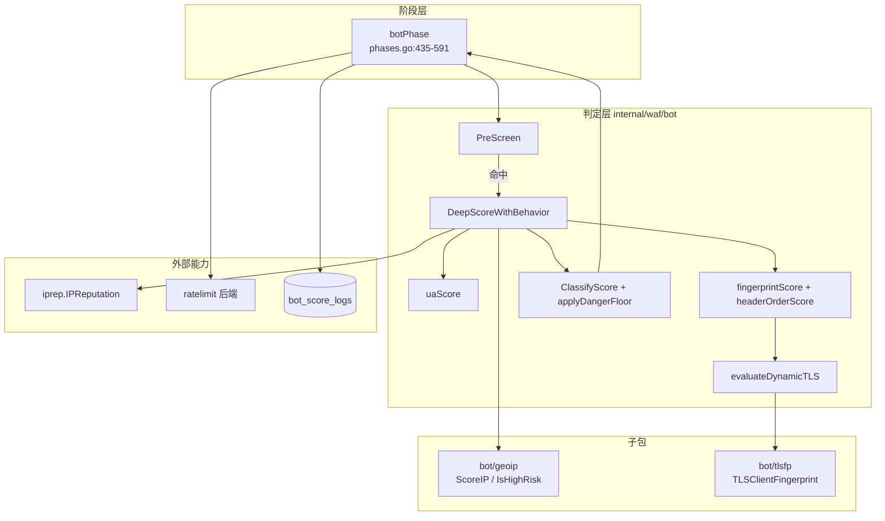
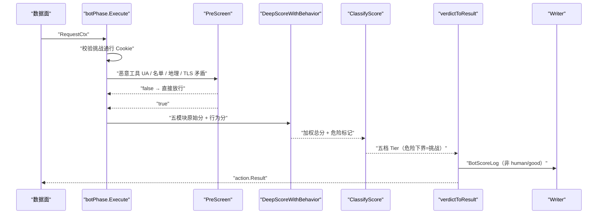
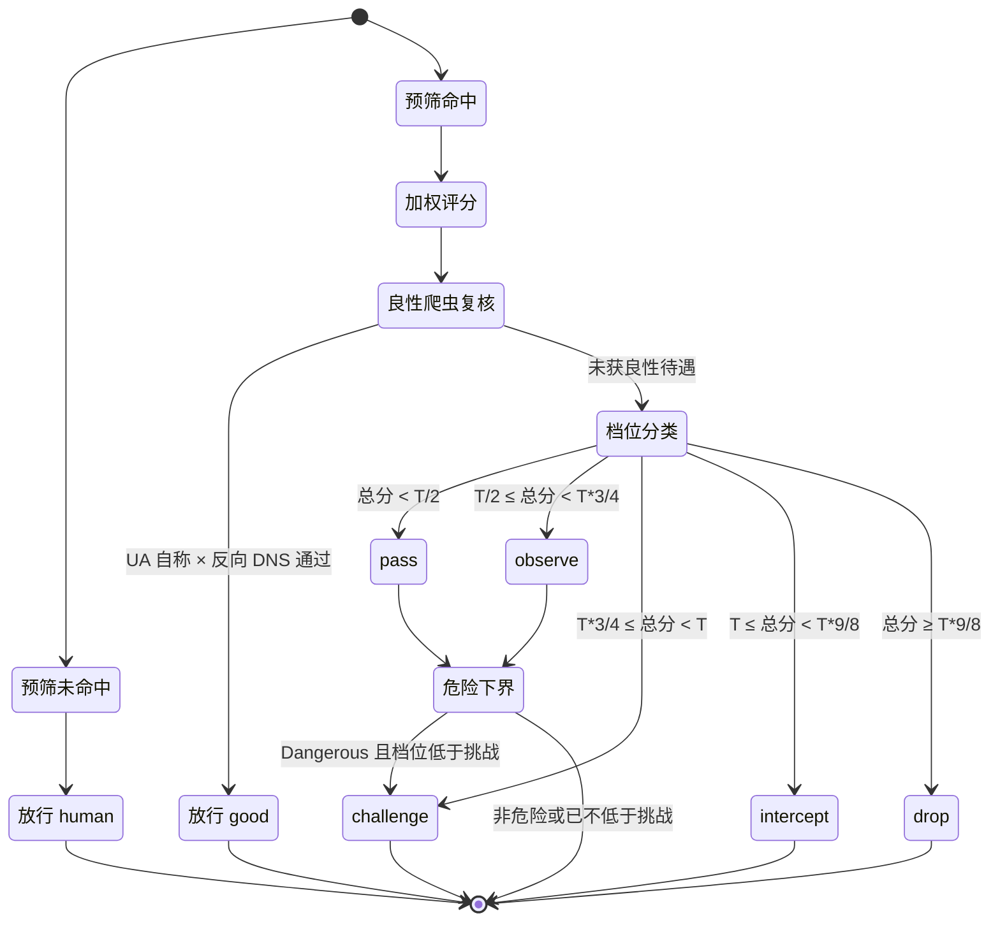
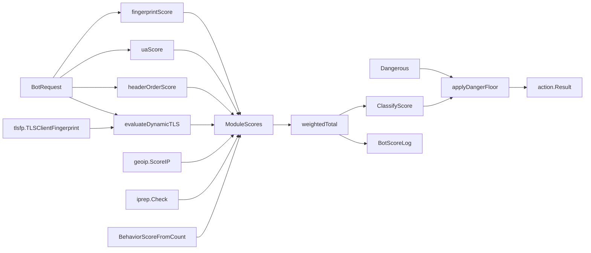

> [返回 安全防护功能](安全防护功能.md)

# 机器人检测

<cite>
**本文档引用的文件**
- [internal/waf/bot/bot.go](file://internal/waf/bot/bot.go)
- [internal/waf/bot/dynamic.go](file://internal/waf/bot/dynamic.go)
- [internal/waf/bot/dynamic_tls.go](file://internal/waf/bot/dynamic_tls.go)
- [internal/waf/bot/geoip/geoip.go](file://internal/waf/bot/geoip/geoip.go)
- [internal/waf/bot/tlsfp/fingerprint.go](file://internal/waf/bot/tlsfp/fingerprint.go)
- [internal/waf/bot/tlsfp/cache.go](file://internal/waf/bot/tlsfp/cache.go)
- [internal/waf/bot/tlsfp/conn.go](file://internal/waf/bot/tlsfp/conn.go)
- [internal/waf/bot/tlsfp/sni_presence.go](file://internal/waf/bot/tlsfp/sni_presence.go)
- [internal/core/rules/phases.go](file://internal/core/rules/phases.go)
- [internal/core/engine/engine.go](file://internal/core/engine/engine.go)
- [internal/snapshot/build.go](file://internal/snapshot/build.go)
- [internal/observability/unified_writer.go](file://internal/observability/unified_writer.go)
- [internal/core/pipeline/pipeline.go](file://internal/core/pipeline/pipeline.go)
- [internal/core/config.go](file://internal/core/config.go)
- [internal/core/configoverride/registry.go](file://internal/core/configoverride/registry.go)
- [internal/waf/iprep/iprep.go](file://internal/waf/iprep/iprep.go)
- [internal/store/protection.go](file://internal/store/protection.go)
- [internal/store/site.go](file://internal/store/site.go)
- [internal/store/events.go](file://internal/store/events.go)
- [internal/store/repository/bot/bot_score.go](file://internal/store/repository/bot/bot_score.go)
- [internal/admin/protect/bot/bot.go](file://internal/admin/protect/bot/bot.go)
- [internal/admin/protect/drop/drop.go](file://internal/admin/protect/drop/drop.go)
- [internal/admin/system/presetbots/preset_bots.go](file://internal/admin/system/presetbots/preset_bots.go)
- [internal/admin/router.go](file://internal/admin/router.go)
- [internal/app/server.go](file://internal/app/server.go)
- [internal/dataplane/handler.go](file://internal/dataplane/handler.go)
- [internal/dataplane/access_log.go](file://internal/dataplane/access_log.go)
- [internal/visitorfusion/classifier.go](file://internal/visitorfusion/classifier.go)
- [internal/waf/ratelimit/ratelimit.go](file://internal/waf/ratelimit/ratelimit.go)
- [frontend/lib/api.ts](file://frontend/lib/api.ts)
- [frontend/hooks/use-api.ts](file://frontend/hooks/use-api.ts)
- [frontend/app/(dashboard)/tls-fingerprints/page.tsx](file://frontend/app/(dashboard)/tls-fingerprints/page.tsx)
- [frontend/app/(dashboard)/captcha/page.tsx](file://frontend/app/(dashboard)/captcha/page.tsx)
- [frontend/app/(dashboard)/captcha/components/bot-observation-card.tsx](file://frontend/app/(dashboard)/captcha/components/bot-observation-card.tsx)
- [README.md](file://README.md)
</cite>

## 目录

1. [简介](#简介)
2. [项目结构](#项目结构)
3. [核心组件](#核心组件)
4. [架构总览](#架构总览)
5. [详细组件分析](#详细组件分析)
6. [依赖关系分析](#依赖关系分析)
7. [性能考虑](#性能考虑)
8. [故障排查指南](#故障排查指南)
9. [结论](#结论)
10. [附录](#附录)

## 简介
机器人检测是 `bot_detection` 阶段的判定能力，用来在爬虫、自动化工具、扫描器与真实浏览器之间做区分，并把区分结果折算成五档处置（放行 / 记录 / 挑战 / 拦截 / 断连）。

本模块的设计核心是**两条正交通道**：
- **加权总分**只回答「这请求有多可疑」，决定档位；单一弱信号叠加再多也不会直接致死
- **危险标记**只回答「能不能放过去」，任何一条确定性证据成立即保证档位不低于挑战

因此阈值调优只影响可疑度排序，不影响确定性终止；反过来加一条危险判据也不会把低分流量抬到拦截。该设计写于包内注释并落在 `applyDangerFloor`（bot.go:944-961）。

阶段名实为 `bot_detection`，不是 `bot`（phases.go:488）。TLS 指纹与 GeoIP 已从主包切分为独立子包，本文一并覆盖它们的采集与消费边界。

**章节来源**
- [internal/waf/bot/bot.go:60-136](file://internal/waf/bot/bot.go#L60-L136)
- [internal/waf/bot/bot.go:944-961](file://internal/waf/bot/bot.go#L944-L961)
- [internal/core/rules/phases.go:488](file://internal/core/rules/phases.go#L488)

## 项目结构
`internal/waf/bot/` 共 1511 行（bot.go 1046 + dynamic.go 211 + dynamic_tls.go 254），两个子包各自独立：`bot/geoip/` 607 行、`bot/tlsfp/` 1199 行。判定所需的外部能力只有名单（`iprep`）与限流后端（`ratelimit`）。

| 模块 | 文件 | 行数 | 职责 | 对外符号 |
|---|---|:--:|---|---|
| 主评分 | [bot.go](file://internal/waf/bot/bot.go) | 1046 | 五模块加权、档位分类、UA 表 | `BotScore`、`BotVerdict`、`BotRequest` |
| 动态 TLS 判据 | [dynamic.go](file://internal/waf/bot/dynamic.go) | 211 | ClientHello 与 UA/Host 一致性 | `evaluateDynamicTLS`、`dynamicPrescreenHit` |
| TLS 解析辅助 | [dynamic_tls.go](file://internal/waf/bot/dynamic_tls.go) | 254 | JA4 字段读取、UA 族系判定 | `browserFamilyFromUA`、`tlsChromiumStructuralMarkers` |
| 地理子包 | [geoip/geoip.go](file://internal/waf/bot/geoip/geoip.go) | 211 | MaxMind 查询与风险打分 | `MaxMindResolver`、`GeoResolver` |
| 地理库自举 | [geoip/fetch.go](file://internal/waf/bot/geoip/fetch.go) | 396 | 启动期库文件下载与分诊 | `GeoIPBootstrap` |
| 指纹子包 | [tlsfp/fingerprint.go](file://internal/waf/bot/tlsfp/fingerprint.go) | 954 | ClientHello → JA3/JA4 | `TLSClientFingerprint`、`ParseTLSClientHello` |
| 指纹缓存 | [tlsfp/cache.go](file://internal/waf/bot/tlsfp/cache.go) | 67 | 4096 槽直址缓存 | `lookupTLSFingerprintCacheWithHash` |
| 连接包装 | [tlsfp/conn.go](file://internal/waf/bot/tlsfp/conn.go) | 92 | 把指纹挂到 `net.Conn` | `WrapFingerprintConn`、`TLSFingerprintFromConn` |
| SNI 存在性 | [tlsfp/sni_presence.go](file://internal/waf/bot/tlsfp/sni_presence.go) | 86 | 区分「没发 SNI」与「没采到」 | `SNIPresenceFromValues` |
| 阶段适配 | [phases.go](file://internal/core/rules/phases.go) | 435-591 | 组装请求特征、映射动作 | `botPhase`、`NewBotPhaseWithGeoAndLimiter` |

**图表来源**
- [internal/core/rules/phases.go:514-534](file://internal/core/rules/phases.go#L514-L534)
- [internal/waf/bot/bot.go:359-376](file://internal/waf/bot/bot.go#L359-L376)
- [internal/waf/bot/bot.go:702-804](file://internal/waf/bot/bot.go#L702-L804)
- [internal/waf/bot/dynamic.go:118-147](file://internal/waf/bot/dynamic.go#L118-L147)
- [internal/waf/bot/geoip/geoip.go:123-180](file://internal/waf/bot/geoip/geoip.go#L123-L180)
- [internal/waf/bot/tlsfp/fingerprint.go:18-112](file://internal/waf/bot/tlsfp/fingerprint.go#L18-L112)

**章节来源**
- [internal/waf/bot/bot.go:1-905](file://internal/waf/bot/bot.go#L1-L905)
- [internal/waf/bot/dynamic.go:1-211](file://internal/waf/bot/dynamic.go#L1-L211)
- [internal/waf/bot/dynamic_tls.go:1-255](file://internal/waf/bot/dynamic_tls.go#L1-L255)

## 核心组件
- `BotRequest`：请求特征快照，字段为 UA、方法、路径、头部映射、`HeaderKeys`、`HeaderOrder`、Accept 三件套、Referer、Connection、HasCookie、`ClientIP`、`TLS`、`HostHeader`（bot.go:185-216）
- `BotScore`：加权总分、五个模块分、原始分 `Raw`、`Details`、`IsHighRisk`、危险标记与原因（bot.go:16-34）
- `BotVerdict`：`IsBot`、`Score`、`Tier`、`Category`、`Reason`、`RuleID`、危险标记（bot.go:170-183）
- `BotTier`：五档处置枚举，同时提供 `Category()` 与 `LogAction()` 两个归因映射（bot.go:94-168）
- `MaxMindResolver`：可选依赖，提供 `IsHighRisk` 预筛与 `ScoreIP` 加权（geoip.go:123-180）
- `TLSClientFingerprint`：JA3 / JA3Hash / JA4 / TLSVersion / SNI / ALPN / ALPNRaw / 加密套件 / 扩展 / 曲线 / 点格式（fingerprint.go:27-39）

| 组件 | 位置 | 输入 | 输出 | 可为 nil |
|---|---|---|---|:--:|
| `PreScreen` | [bot.go:359](file://internal/waf/bot/bot.go#L359) | `BotRequest` + 名单 + 地理 | `bool` | 名单/地理可为 nil |
| `DeepScore` | [bot.go:693](file://internal/waf/bot/bot.go#L693) | 同上 | `BotScore` | 是 |
| `CheckBotTwoPhase` | [bot.go:887](file://internal/waf/bot/bot.go#L887) | 同上 + 阈值 | `BotVerdict`、`BotScore` | 是 |
| `CheckBotTwoPhaseWithBehavior` | [bot.go:922](file://internal/waf/bot/bot.go#L922) | 同上 + 行为分 | 同上 | 是 |
| `ClassifyScore` | [bot.go:120](file://internal/waf/bot/bot.go#L120) | 总分 + 阈值 | `BotTier` | 否 |
| `BehaviorScoreFromCount` | [bot.go:649](file://internal/waf/bot/bot.go#L649) | 窗口计数 + 限流阈值 | 0 / 30 / 60 / 100 | 否 |
| `evaluateDynamicTLS` | [dynamic.go:118](file://internal/waf/bot/dynamic.go#L118) | `BotRequest` | 分数 + 原因 + 危险标记 | 否 |

**章节来源**
- [internal/waf/bot/bot.go:16-216](file://internal/waf/bot/bot.go#L16-L216)
- [internal/waf/bot/bot.go:359-961](file://internal/waf/bot/bot.go#L359-L961)
- [internal/waf/bot/dynamic.go:61-192](file://internal/waf/bot/dynamic.go#L61-L192)

## 架构总览
阶段入口在 `botPhase.Execute`：先检查挑战通行 Cookie（已通过签名的请求直接跳过），再从 `RequestCtx` 组装 `BotRequest`，取行为分后调用两阶段判定，最后把评分写入上下文并映射为动作（phases.go:514-534）。

| 步骤 | 动作 | 关键实现 | 短路 |
|:--:|---|---|:--:|
| 1 | 校验挑战通行 Cookie | `VerifyChallengePassCookieWithClaims` | 命中则 `Pass()`，stop=false |
| 2 | 组装 `BotRequest` | `NewBotRequest` + `HeaderKeys` + `TLS` + `HostHeader` | — |
| 3 | 取行为分 | `behaviorScore`（`RateLimitKey + "\|bot"`） | 限流未启用时恒 0 |
| 4 | 两阶段判定 | `CheckBotTwoPhaseWithBehavior` | — |
| 5 | 评分入库 | `storeBotScore`（human/good 不写） | — |
| 6 | 档位映射动作 | `verdictToResult`（Drop/Intercept/Challenge 短路，Observe 不短路） | 见动作表 |
| 7 | 违规计数 | `Tier ≥ TierIntercept` 时 `RecordViolation` | — |

**图表来源**
- [internal/core/rules/phases.go:514-591](file://internal/core/rules/phases.go#L514-L591)
- [internal/waf/bot/bot.go:887-942](file://internal/waf/bot/bot.go#L887-L942)
- [internal/observability/unified_writer.go:592-594](file://internal/observability/unified_writer.go#L592-L594)

**章节来源**
- [internal/core/engine/engine.go:503-510](file://internal/core/engine/engine.go#L503-L510)
- [internal/core/rules/phases.go:443-474](file://internal/core/rules/phases.go#L443-L474)

## 详细组件分析

### 两阶段判定流水线
`PreScreen` 是四条件闸门，任一成立即进入加权评分；全部不成立时直接返回 `human`，不产生任何评分开销（bot.go:359-376）：

| 预筛条件 | 判据 | 证据 |
|---|---|---|
| 恶意工具 UA | `matchMaliciousToolUA` 命中 20 条模式之一 | bot.go:262-283、378-394 |
| 名单拒绝 | `IPReputation.Check` 命中且不允许 | bot.go:364-369 |
| 地理高风险 | `MaxMindResolver.IsHighRisk` | bot.go:370-374、geoip.go:123-152 |
| 动态 TLS 矛盾 | `dynamicPrescreenHit`（任一条一致性矛盾） | bot.go:375、dynamic.go:190-192 |

`CheckBotTwoPhaseWithBehavior` 在评分完成后还会做一次良性爬虫复核：`matchGoodBotUA` 要求「UA 自称 × 反向 DNS 指向官方域」两条同时成立，UA 模式 0/1/2/5（Google、Bing、Yandex、Apple）之外的自称爬虫一律不按良性处理（bot.go:294-349、922-942、963-974）。

**章节来源**
- [internal/waf/bot/bot.go:235-394](file://internal/waf/bot/bot.go#L235-L394)
- [internal/waf/bot/bot.go:887-974](file://internal/waf/bot/bot.go#L887-L974)

### 模块权重与档位划分
五个模块的权重合计 100，原始分各自钳制到 0–100，总分按 `Σ(模块分 × 权重)/100` 四舍五入（bot.go:671-690、794-803）。

| 模块 | 权重 | 主要判据 | 满分场景 | 证据 |
|---|:--:|---|---|---|
| UA | 40 | 工具字面 / 空 UA / 短 UA / 伪造 Mozilla | 空 UA = 100 | bot.go:604-635 |
| 请求指纹 | 25 | Accept 三件套缺失、`Connection: close`、扫描路径、头序、TLS 一致性 | 多项叠加 | bot.go:822-871、dynamic.go:118-179 |
| 行为 | 15 | 窗口请求数相对限流阈值的倍数 | ≥3 倍 = 100 | bot.go:649-663 |
| GeoIP | 5 | 机房 ASN +25、VPN ASN +15、高风险国家 +20 | 三项叠加 60 | geoip.go:153-180 |
| IP 声誉 | 15 | 黑名单 60、自动封禁 50、其它拒绝 30 | 黑名单 60 | bot.go:750-767 |

`IsHighRisk` 的判据是「总分 ≥ 80 或 地理原始分 ≥ 40 或 声誉原始分 ≥ 25」，与处置档位无关（bot.go:802）。

档位流转如下，`T` 为处置阈值，缺省 80 时五档边界依次是 40 / 60 / 80 / 90：

**图表来源**
- [internal/waf/bot/bot.go:109-136](file://internal/waf/bot/bot.go#L109-L136)
- [internal/waf/bot/bot.go:887-961](file://internal/waf/bot/bot.go#L887-L961)

**章节来源**
- [internal/waf/bot/bot.go:60-136](file://internal/waf/bot/bot.go#L60-L136)
- [internal/waf/bot/bot.go:649-803](file://internal/waf/bot/bot.go#L649-L803)

### 危险通道与 UA 严重度
危险标记的三个来源互相独立，任一成立即置位（bot.go:713-721、745-748、761-764）：

| 来源 | 触发条件 | 阈值 | 证据 |
|---|---|---|---|
| 攻击工具 UA | `uaToolSeverity` 登记值 ≥ 80 | `dangerToolSeverityThreshold = 80` | bot.go:87-91、579-585 |
| 名单命中 | `IPReputation` 拒绝（黑名单/自动封禁） | 无条件置位 | bot.go:750-764 |
| TLS 确定性矛盾 | D1 假浏览器、D2 浏览器栈无 UA、D3 自动化浏览器 UA | 无条件置位 | dynamic.go:118-147 |

`uaToolSeverity` 的分档解释了为什么权重不必为「致死」而抬高：sqlmap/nikto/port_scanner 等 17 类明确工具取 95，采集与爬虫框架取 65，而 curl/wget 只给 15、python-requests 与 go-http-client 给 20、Postman 类给 25 —— 常规自动化工具的 UA 字面不构成处置依据（bot.go:575-591）。未登记工具名回落到 60（bot.go:588）。

**章节来源**
- [internal/waf/bot/bot.go:87-91](file://internal/waf/bot/bot.go#L87-L91)
- [internal/waf/bot/bot.go:575-635](file://internal/waf/bot/bot.go#L575-L635)
- [internal/waf/bot/bot.go:713-767](file://internal/waf/bot/bot.go#L713-L767)
- [internal/waf/bot/dynamic.go:23-43](file://internal/waf/bot/dynamic.go#L23-L43)

### TLS 一致性判据
`evaluateDynamicTLS` 只在 ClientHello 带有结构数据时才运行，判据分两类（dynamic.go:118-179、dynamic_tls.go:35-38）。

| 编号 | 原因码 | 类型 | 分值 | 判据 |
|:--:|---|---|:--:|---|
| D1 | `tls_fake_browser_claim` | 危险 | 30 | 自称 Chromium，但 ALPS、GREASE、h2/h3 三项同时缺失 |
| D2 | `tls_browser_stack_without_ua` | 危险 | 30 | 空 UA 却携带浏览器级 ClientHello |
| D3 | `tls_automation_browser_ua` | 危险 | 40 | UA 自称受控浏览器（HeadlessChrome/Puppeteer 等）且实况为浏览器栈 |
| W1 | `tls_alpn_ua_mismatch` | 观测 | 18 | 自称浏览器但未声明 h2/h3 |
| W2 | `tls_no_sni_for_dns_host` | 观测 | 10 | 域名为 Host 却未发 SNI |
| W3 | `tls_sni_for_ip_host` | 观测 | 8 | Host 为 IP 字面量却发了 SNI |
| W4 | `tls_browser_stack_foreign_ua` | 观测 | 25 | 浏览器级 ClientHello 搭配非浏览器 UA |

结构标记的实测分布决定了 D1 的可靠性：Chrome 桌面同时有 ALPS 与 GREASE，Edge/Safari/iOS WebKit 至少有 GREASE，Firefox 与 Go 两者皆无但声明 h2，因此任一真实栈都不会同时满足 D1 的三个否定条件（dynamic_tls.go:128-153）。SNI 存在性优先读 JA4 的指示位而非 SNI 字段，避免把「未采集」当成「未发送」（sni_presence.go:46-70）。

请求指纹模块的分数由三部分相加：`fingerprintScore`（头缺失与 TLS/UA 矛盾）、`headerOrderScore`（字母序头序 +8、UA 早于 Host +6）、`evaluateDynamicTLS` 的分数（bot.go:736-741、822-871、1016-1035）。

**章节来源**
- [internal/waf/bot/dynamic.go:7-192](file://internal/waf/bot/dynamic.go#L7-L192)
- [internal/waf/bot/dynamic_tls.go:35-255](file://internal/waf/bot/dynamic_tls.go#L35-L255)
- [internal/waf/bot/tlsfp/sni_presence.go:11-86](file://internal/waf/bot/tlsfp/sni_presence.go#L11-L86)
- [internal/waf/bot/bot.go:736-1035](file://internal/waf/bot/bot.go#L736-L1035)

### 档位到动作的映射
`verdictToResult` 是唯一把档位翻成 WAF 动作的地方，短路语义跟随动作终端性（phases.go:561-591）。

| Tier | 动作 | 是否短路 | 日志 category | LogAction |
|---|---|:--:|---|---|
| `TierPass` | 不产出（Pass） | 否 | `bot_pass` | `allow` |
| `TierObserve` | `observe` | 否 | `bot_observe` | `observe` |
| `TierChallenge` | `challenge` | 是（延迟处理） | `bot_challenge` | `challenge` |
| `TierIntercept` | `intercept` | 是 | `bot_intercept` | `intercept` |
| `TierDrop` | `drop` | 是 | `bot_drop` | `drop` |

`IsBot` 字段等价于「档位不是 pass」，因此良性爬虫命中与预筛未命中都会被标为 `IsBot=true/false` 的正确组合（bot.go:897、932）。只有 `Tier ≥ TierIntercept` 才会向 IP 信誉记违规，避免记录档就把用户封掉（phases.go:562-564）。

**章节来源**
- [internal/core/rules/phases.go:561-591](file://internal/core/rules/phases.go#L561-L591)
- [internal/waf/bot/bot.go:139-168](file://internal/waf/bot/bot.go#L139-L168)
- [internal/waf/bot/bot.go:887-942](file://internal/waf/bot/bot.go#L887-L942)

### 评分落库与观测
`storeBotScore` 把 `BotScore` 转成 `pipeline.BotScoreInfo` 挂在请求上下文上，随后由数据面写 `bot_score_logs`（phases.go:536-559、handler.go:534-545）。

| 字段 | 来源 | 说明 |
|---|---|---|
| `total_score` / `ua_score` / `fingerprint_score` / `behavior_score` / `geoip_score` / `ip_rep_score` | `BotScore` 加权分 | 五模块分解 |
| `is_high_risk` | `BotScore.IsHighRisk` | 只有高风险时才附带 `Details` |
| `dangerous` / `danger_reasons` | 危险通道 | 与分数正交 |
| `action` | `Tier.LogAction()` | 与前端 i18n 键一致 |
| `tls_ja3_hash` / `tls_ja4` / `tls_version` / `tls_sni` / `tls_alpn` / `header_order` | `RequestCtx.TLS` | 支持按指纹过滤 |

查询侧提供 `GET /bot-stats`（24 小时总数、拦截数、高风险数、平均分）与 `GET /bot-scores`（支持 IP、Host、路径、UA、请求 ID、JA3、JA4、SNI、高风险、分数区间、时间窗过滤）；`GET /fingerprints` 从访问日志按客户端指纹聚合，由 `tls-fingerprints/` 页面展示（router.go:217-218、178）。

**章节来源**
- [internal/core/rules/phases.go:536-559](file://internal/core/rules/phases.go#L536-L559)
- [internal/dataplane/handler.go:534-545](file://internal/dataplane/handler.go#L534-L545)
- [internal/store/events.go:251-278](file://internal/store/events.go#L251-L278)
- [internal/store/repository/bot/bot_score.go:63-75](file://internal/store/repository/bot/bot_score.go#L63-L75)
- [internal/admin/protect/bot/bot.go:278-338](file://internal/admin/protect/bot/bot.go#L278-L338)

### 配置与前端入口
配置分散在两个设置行与一个保护字段里，读写时互相回填，不存在第二个配置源：

| 配置 | 载体 | 默认 | 写入口 | 同步关系 |
|---|---|:--:|---|---|
| Bot 开关 | `protection.bot_detection_enabled` | `false` | `POST /bot-settings/update` | 与 `bot_settings.enabled` 双向同步 |
| 处置阈值 | `drop_policy.bot_score_threshold` | 80 | `POST /drop-policy/update` | 与 `bot_settings.score_threshold` 双向同步；`drop_policy` 行缺失时 `GET /bot-settings` 回显 60，而引擎侧仍用启动期的 80 |
| 高风险国家 / ASN 清单 | `bot_settings` | 空 / 内置清单 | `POST /bot-settings/update` | reload 时 `UpdateConfig` 生效 |
| GeoIP 库路径 | `bot_settings.geoip_db_path` | 空 | `POST /bot-settings/update` | 路径变化才 `Reload` |
| 站点级开关 | `site.bot_protection_enabled *bool` | nil | `POST /sites/{id}/update` | nil = 继承全局 |
| 预置爬虫白名单 | `ip_list_entries`（whitelist） | — | `POST /preset-bot-whitelist/seed` | 写后 reload |

`core.BotConfig` 默认已内置 13 个数据中心 ASN 与 8 个 VPN ASN，高风险国家默认为空、必须由管理员配置（config.go:22-56）。前端入口实测如下：Bot 设置与观测在 `captcha/` 页（含 `bot-observation-card.tsx` 展示统计与高风险评分，并把 `geoip_db_path`、`bot_threshold`、`drop_enabled`、`drop_bot_threshold` 等 detection 域环境变量放在同页），指纹列表在 `tls-fingerprints/` 页。**仓库中不存在 `protection/`、`bot-protection/`、`fingerprints/` 页面**。

**章节来源**
- [internal/admin/protect/bot/bot.go:17-74](file://internal/admin/protect/bot/bot.go#L17-L74)
- [internal/admin/protect/bot/bot.go:113-276](file://internal/admin/protect/bot/bot.go#L113-L276)
- [internal/admin/protect/drop/drop.go:54-135](file://internal/admin/protect/drop/drop.go#L54-L135)
- [internal/core/config.go:12-56](file://internal/core/config.go#L12-L56)
- [internal/app/server.go:661-673](file://internal/app/server.go#L661-L673)
- [internal/admin/router.go:178-218](file://internal/admin/router.go#L178-L218)

## 依赖关系分析
- `bot` → `iprep`、`geoip`、`tlsfp` 单向依赖；`geoip` 只依赖 `core.BotConfig`
- `botPhase` 依赖限流后端只为取行为分，依赖以接口 `RateLimiterBackend` 注入，未启用时行为分恒 0（phases.go:501-509）
- `visitorfusion` 读取 Bot 的模块分但不读取其结论，两者判定互不干预（classifier.go:59-66、224-242）
- 引擎依赖体 `phaseRuntimeConfig` 以原子指针保存 `geoResolver` 与 `botThreshold`，热更新不锁读路径（engine.go:74-80、165-180）

**图表来源**
- [internal/waf/bot/bot.go:702-804](file://internal/waf/bot/bot.go#L702-L804)
- [internal/waf/bot/bot.go:649-663](file://internal/waf/bot/bot.go#L649-L663)
- [internal/waf/bot/bot.go:944-961](file://internal/waf/bot/bot.go#L944-L961)
- [internal/core/rules/phases.go:561-591](file://internal/core/rules/phases.go#L561-L591)

**章节来源**
- [internal/core/engine/engine.go:74-180](file://internal/core/engine/engine.go#L74-L180)
- [internal/visitorfusion/classifier.go:59-93](file://internal/visitorfusion/classifier.go#L59-L93)
- [internal/visitorfusion/classifier.go:224-265](file://internal/visitorfusion/classifier.go#L224-L265)

## 性能考虑
- 预筛是主要成本闸门：干净流量只走四个 O(1)~O(n) 判据即返回，不分配 `BotScore`（bot.go:888-889）
- `Details` 采用惰性分配，`setDetail` 首次写入才建 map（bot.go:702-705、813-818）
- 良性爬虫反向 DNS 结果缓存 1 小时，避免同一 IP 反复查询（bot.go:285-347）
- ClientHello 解析走 4096 槽直址缓存，命中时不重新计算 JA3/JA4（cache.go:9-40）
- 良性流量不写 `bot_score_logs`，省下按请求线性增长的库写入（phases.go:536-539）
- 行为分使用独立后缀键，不会让限流阈值被双重计数减半（phases.go:490-512）
- 恶意工具 UA 匹配先用 ASCII 大小写折叠的字面扫描做前置过滤，未命中直接跳过正则遍历（bot.go:378-404）

**章节来源**
- [internal/waf/bot/bot.go:378-404](file://internal/waf/bot/bot.go#L378-L404)
- [internal/waf/bot/bot.go:702-717](file://internal/waf/bot/bot.go#L702-L717)
- [internal/waf/bot/bot.go:887-907](file://internal/waf/bot/bot.go#L887-L907)
- [internal/waf/bot/tlsfp/cache.go:9-57](file://internal/waf/bot/tlsfp/cache.go#L9-L57)
- [internal/core/rules/phases.go:490-539](file://internal/core/rules/phases.go#L490-L539)

## 故障排查指南
| 症状 | 定位路径 | 处置 |
|---|---|---|
| 正常浏览器被判 `intercept` | `BotScoreLog.details` 的 `fingerprint` 与 `header_order` | 多为中间设备重写 ALPN 触发 W1，可放宽阈值或按路径跳过该阶段 |
| curl/wget 被直接打死 | 检查 UA 严重度是否被登记为 ≥ 80 | 常规工具应为 15–25，只叠加不终止（bot.go:579-585） |
| 空 UA 只记不拦 | 空 UA 权重后恰为 40 分，落在记录档 | 属设计值，需要更强处置时结合指纹叠加 |
| Googlebot 被拦 | 来源 IP 未通过反向 DNS | 只有模式 0/1/2/5 可校验，其余自称爬虫按可疑处理 |
| 行为分恒为 0 | `RateLimiterBackend.Enabled()` 与 `rateMax` | 请求限流未开启时行为分必为 0（phases.go:501-505） |
| GeoIP 分恒为 0 | 库路径与启动日志告警 | 库缺失时 `IsHighRisk`/`ScoreIP` 直接返回 0（geoip.go:123-180） |
| 站点关掉 Bot 无效 | `bot_protection_enabled` 是否为 nil | nil 表示继承全局，需在站点详情页显式覆盖 |
| 指纹页没有数据 | `RequestCtx.TLS` 是否为空 | 明文 HTTP 或关闭 ClientHello 窃读时属预期 |

排查顺序建议：先看 `action` 与 `total_score` 判断档位来源，再看五个模块分定位具体模块，最后用 `details` 里的原因码回到代码分支。

**章节来源**
- [internal/waf/bot/bot.go:575-635](file://internal/waf/bot/bot.go#L575-L635)
- [internal/waf/bot/bot.go:285-349](file://internal/waf/bot/bot.go#L285-L349)
- [internal/waf/bot/geoip/geoip.go:123-180](file://internal/waf/bot/geoip/geoip.go#L123-L180)
- [internal/core/rules/phases.go:501-509](file://internal/core/rules/phases.go#L501-L509)
- [internal/snapshot/build.go:711-713](file://internal/snapshot/build.go#L711-L713)

## 结论
机器人检测用「五模块加权 + 五档处置 + 独立危险通道」替代了旧版「恶意 UA 直接判死 + 三分类」的做法：可伪造的弱信号进权重，确定性强的证据进危险标记，两者互不换算，档位因此既可解释又不会被单一信号误抬到断连。TLS 与 GeoIP 已按职责切分成子包，主包只消费结构字段与解析结果，代码中不存在任何内置 JA3/JA4 指纹库表。

需要提醒的两点：`GET /fingerprints` 的数据源是访问日志聚合而非独立指纹库；前端 Bot 配置的归属页是 `captcha/`，不存在独立的 bot 页面。下一步建议把 `Details` 的原因码收敛成枚举并对齐前端 i18n，减少运维侧的字符串猜测。

**章节来源**
- [本节为总结，无需特定文件来源]

## 附录

### 阈值与配置速查

| 项 | 取值 | 证据 |
|---|---|---|
| 处置阈值缺省 | 80（`≤0` 时回落） | phases.go:470-472、bot.go:120-123 |
| 五档边界（T=80） | 40 / 60 / 80 / 90 | bot.go:109-136 |
| 危险工具 UA 下界 | 80 | bot.go:91 |
| 未登记工具回落分 | 60 | bot.go:588 |
| 模块权重 | UA 40 / 指纹 25 / 行为 15 / GeoIP 5 / 声誉 15 | bot.go:85 |
| 行为分阶梯 | ≥3 倍 100、≥2 倍 60、≥1.5 倍 30 | bot.go:649-663 |
| `IsHighRisk` | 总分 ≥80 或 地理 ≥40 或 声誉 ≥25 | bot.go:802 |
| 反向 DNS 缓存 | 1 小时 | bot.go:347 |
| `MY_OPENWAF_BOT_THRESHOLD` | 80 | README.md:335、registry.go:377 |

**章节来源**
- [internal/waf/bot/bot.go:85-136](file://internal/waf/bot/bot.go#L85-L136)
- [internal/waf/bot/bot.go:347-347](file://internal/waf/bot/bot.go#L347-L347)
- [internal/waf/bot/bot.go:579-663](file://internal/waf/bot/bot.go#L579-L663)
- [internal/waf/bot/tlsfp/cache.go:9-18](file://internal/waf/bot/tlsfp/cache.go#L9-L18)
- [internal/core/rules/phases.go:469-474](file://internal/core/rules/phases.go#L469-L474)
- [internal/core/configoverride/registry.go:377-382](file://internal/core/configoverride/registry.go#L377-L382)
- [README.md:335](file://README.md#L335)

### 恶意工具 UA 模式速查
20 条模式对应 `bot:mal:001`–`bot:mal:020`，每条同时登记正则、字面 needle 与工具名（bot.go:262-283）。严重度分三类：明确攻击工具 95、采集与框架 65、常规自动化工具 15–25（bot.go:579-585）。良性爬虫的 17 条 UA 模式里只有下标 0、1、2、5 具备官方反向 DNS 后缀，其余自称者不获良性待遇（bot.go:235-253、294-299）。

**章节来源**
- [internal/waf/bot/bot.go:235-299](file://internal/waf/bot/bot.go#L235-L299)
- [internal/waf/bot/bot.go:262-283](file://internal/waf/bot/bot.go#L262-L283)
- [internal/waf/bot/bot.go:579-591](file://internal/waf/bot/bot.go#L579-L591)

### 相关文档

**章节来源**
- [本节为总结，无需特定文件来源]
- 地理维度与库自举：[地理位置阻断](地理位置阻断.md)
- 名单与自动封禁：[IP 信誉系统](IP 信誉系统.md)
- 断连执行与页面渲染：[阻断机制](阻断机制.md)
- 阶段入链与短路：[处理阶段详解](../WAF 引擎系统/处理阶段详解/处理阶段详解.md)
- API 契约：[机器人保护 API](../管理 API 系统/机器人保护 API.md)

**章节来源**
- [本节为总结，无需特定文件来源]
