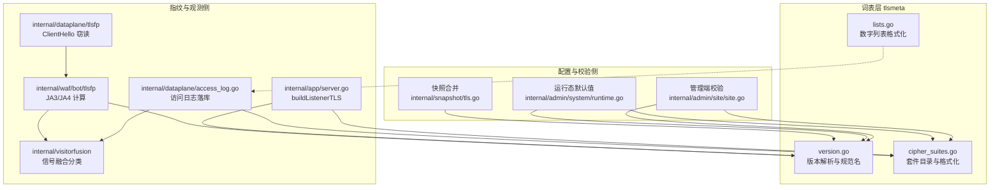
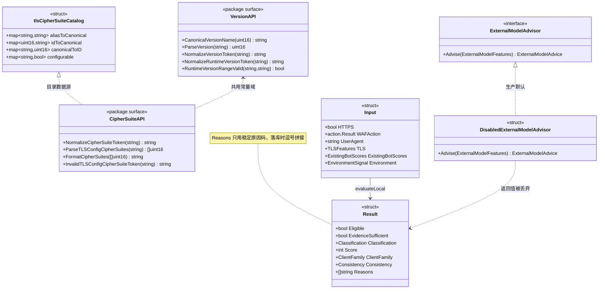
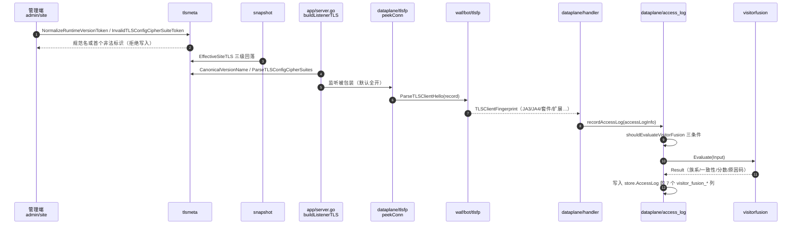
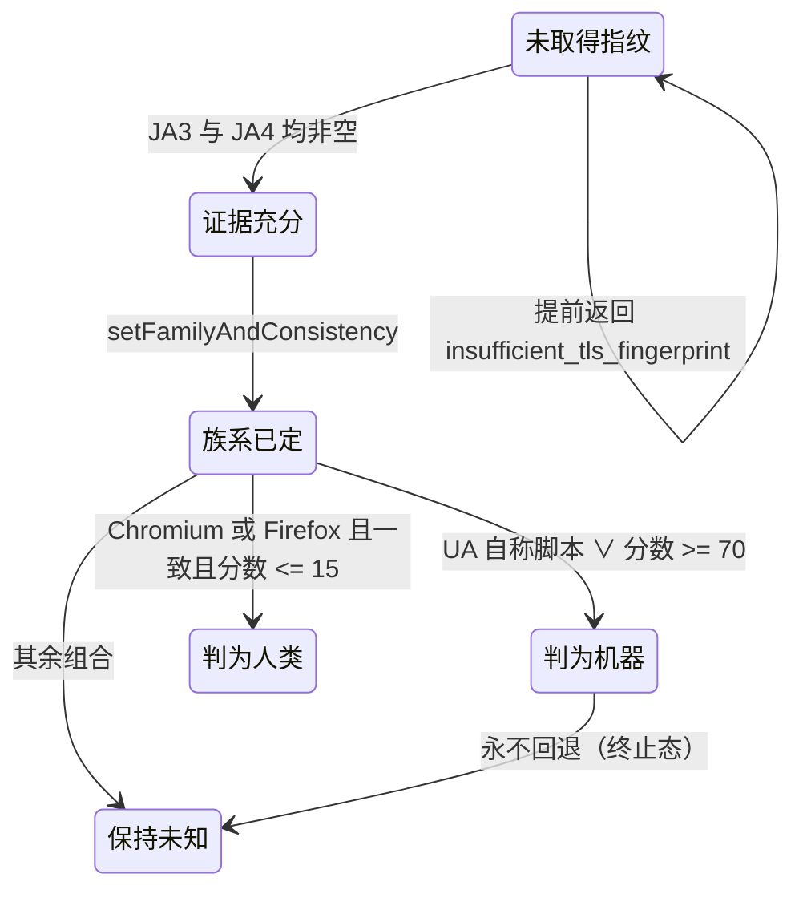
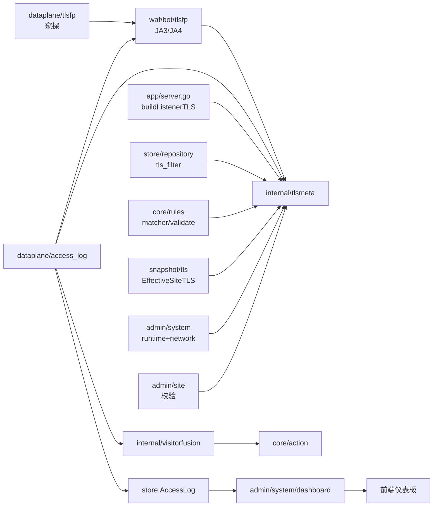

# TLS元信息与信号融合

<cite>
**本文档引用的文件**
- [cipher_suites.go](file://internal/tlsmeta/cipher_suites.go)
- [version.go](file://internal/tlsmeta/version.go)
- [lists.go](file://internal/tlsmeta/lists.go)
- [classifier.go](file://internal/visitorfusion/classifier.go)
- [access_log.go](file://internal/dataplane/access_log.go)
- [handler.go](file://internal/dataplane/handler.go)
- [handler_support.go](file://internal/dataplane/handler_support.go)
- [events.go](file://internal/store/events.go)
- [tls_filter.go](file://internal/store/repository/tls_filter.go)
- [tls.go](file://internal/snapshot/tls.go)
- [build.go](file://internal/snapshot/build.go)
- [server.go](file://internal/app/server.go)
- [tls_fingerprint_policy.go](file://internal/app/tls_fingerprint_policy.go)
- [fingerprint.go](file://internal/waf/bot/tlsfp/fingerprint.go)
- [conn.go](file://internal/waf/bot/tlsfp/conn.go)
- [sni_presence.go](file://internal/waf/bot/tlsfp/sni_presence.go)
- [tls_fingerprint_listener.go](file://internal/dataplane/tlsfp/tls_fingerprint_listener.go)
- [bot.go](file://internal/waf/bot/bot.go)
- [pipeline.go](file://internal/core/pipeline/pipeline.go)
- [matcher.go](file://internal/core/rules/matcher.go)
- [tls_cipher_suites.go](file://internal/core/rules/tls_cipher_suites.go)
- [validate.go](file://internal/core/rules/validate.go)
- [site.go](file://internal/admin/site/site.go)
- [runtime.go](file://internal/admin/system/runtime.go)
- [network.go](file://internal/admin/system/network.go)
- [dashboard.go](file://internal/admin/system/dashboard/dashboard.go)
- [types.ts](file://frontend/lib/types.ts)
</cite>

## 目录
1. [简介](#简介)
2. [项目结构](#项目结构)
3. [核心组件](#核心组件)
4. [架构总览](#架构总览)
5. [详细组件分析](#详细组件分析)
6. [依赖关系分析](#依赖关系分析)
7. [性能考虑](#性能考虑)
8. [故障排查指南](#故障排查指南)
9. [结论](#结论)
10. [附录](#附录)

## 简介

本篇覆盖「访客识别」子域中两个**独立实现**：`internal/tlsmeta`（TLS 元信息目录，负责版本与密码套件的命名规范、解析与校验）与 `internal/visitorfusion`（访客信号融合分类器，把 UA 声明、TLS 指纹与请求头一致性融合为可解释的人机分类）。两者都不是检测引擎：前者是**词表与解析层**，后者是**已放行请求的旁路观测层**。

| 项 | 内容 |
|----|------|
| 所属业务域 | 安全防护功能 / 访客识别 |
| 本篇形态 | C 三级实现文档（一实现一节，共两节） |
| 覆盖范围 | `tlsmeta` 3 文件 435 行、`visitorfusion` 1 文件 381 行；及其调用点与三类 TLS 邻居包的职责边界 |
| 明确不覆盖 | JA3/JA4 计算细节、ClientHello 窃读实现、服务端 `tls.Config` 组装、bot 阶段加权评分 |
| 上级与同级 | [访客识别总览](./访客识别.md)（同子域索引，本篇不复制其表格）、[机器人检测](../机器人检测.md) |

**实测结论前置**：`tlsmeta` 有 **11 个产线调用文件**，属深度接线；`visitorfusion` 仅有 **1 个产线调用文件**（`internal/dataplane/access_log.go`），只写访问日志、不参与任何拦截决策。详见[详细组件分析](#详细组件分析)。

**章节来源**
- [classifier.go:1-8](file://internal/visitorfusion/classifier.go#L1-L8)
- [access_log.go:23-27](file://internal/dataplane/access_log.go#L23-L27)

## 项目结构

两个实现分处 `internal/` 顶层，彼此**没有依赖关系**：`visitorfusion` 不 import `tlsmeta`，它消费的 TLS 字段是数据面已经算好的字符串。

```text
internal/
├── tlsmeta/                   # TLS 元信息目录（435 行 + 234 行测试）
│   ├── cipher_suites.go       # 套件目录：别名/ID 双向映射、可配置性判定、格式化
│   ├── version.go             # 版本目录：解析、规范名、运行态可用性、区间校验
│   └── lists.go               # 扩展/曲线/点格式的数字列表格式化
└── visitorfusion/             # 信号融合分类器（381 行 + 146 行测试）
    └── classifier.go          # 类型定义、本地评分、族系与一致性判定、外部模型接缝
```

| 路径 | 职责 | 主要语言 | 文件数 | 代表符号 | 对外暴露 |
|------|------|----------|:------:|----------|:--------:|
| `internal/tlsmeta` | TLS 版本/套件词表与解析校验 | Go | 3 | `CanonicalVersionName`、`ParseTLSConfigCipherSuites` | 是 |
| `internal/visitorfusion` | 已放行 HTTPS 请求的人机融合分类 | Go | 1 | `Evaluate`、`Input`、`Result` | 是 |
| `internal/waf/bot/tlsfp` | JA3/JA4 计算与指纹结构 | Go | 4 | `TLSClientFingerprint`、`ParseTLSClientHello` | 是 |
| `internal/dataplane/tlsfp` | 连接级 ClientHello 窃读包装 | Go | 1 | `NewTLSFingerprintListener` | 是 |



**图表来源**
- [site.go:434-449](file://internal/admin/site/site.go#L434-L449)
- [runtime.go:676-687](file://internal/admin/system/runtime.go#L676-L687)
- [tls.go:363-409](file://internal/snapshot/tls.go#L363-L409)
- [server.go:1659-1740](file://internal/app/server.go#L1659-L1740)
- [fingerprint.go:952-954](file://internal/waf/bot/tlsfp/fingerprint.go#L952-L954)
- [access_log.go:146-146](file://internal/dataplane/access_log.go#L146-L146)

`lists.go` 的三条格式化函数在产线**没有调用点**（图中虚线），数据面用的是自带的 `formatUint16Slice` / `formatUint8Slice`，详见[详细组件分析](#详细组件分析)的未接线登记。

**章节来源**
- [lists.go:8-42](file://internal/tlsmeta/lists.go#L8-L42)
- [access_log.go:375-403](file://internal/dataplane/access_log.go#L375-L403)

## 核心组件

| 模块 | 路径 | 职责 | 核心接口/符号 | 依赖模块 | 被依赖 | 规模(行) | 测试 |
|------|------|------|---------------|----------|--------|:--------:|:----:|
| tlsmeta 版本目录 | `internal/tlsmeta/version.go` | 版本串解析、规范名、运行态可用性、区间校验 | `ParseVersion`、`NormalizeRuntimeVersionToken`、`RuntimeVersionRangeValid` | `crypto/tls` | admin/snapshot/app/rules/repository | 171 | 有 |
| tlsmeta 套件目录 | `internal/tlsmeta/cipher_suites.go` | 套件别名↔ID 双向映射、可配置性判定、列表解析与格式化 | `ParseTLSConfigCipherSuites`、`FormatCipherSuites`、`InvalidTLSConfigCipherSuiteToken` | `crypto/tls`、`sync` | admin/snapshot/app/rules/dataplane | 222 | 有 |
| tlsmeta 列表格式化 | `internal/tlsmeta/lists.go` | 扩展/曲线/点格式十进制列表串 | `FormatExtensions`、`FormatCurves`、`FormatPointFormats` | `strconv` | 无（仅本包测试） | 42 | 有 |
| visitorfusion 分类器 | `internal/visitorfusion/classifier.go` | 本地信号融合、族系与一致性判定、外部模型接缝 | `Evaluate`、`Input`、`Result`、`TLSFeatures` | `internal/core/action` | `internal/dataplane` | 381 | 有 |



**图表来源**
- [cipher_suites.go:11-56](file://internal/tlsmeta/cipher_suites.go#L11-L56)
- [version.go:19-153](file://internal/tlsmeta/version.go#L19-L153)
- [classifier.go:78-158](file://internal/visitorfusion/classifier.go#L78-L158)

### 重点组件展开

**职责**：`tlsmeta` 是仓库内 TLS 版本与密码套件**唯一的命名真值来源**——管理端校验、快照合并、监听器构造、规则编译、日志过滤五个环节都必须在它给出的词表上达成一致。**关键文件**：`internal/tlsmeta/cipher_suites.go`（目录构建）、`internal/tlsmeta/version.go`（版本判定）。**核心接口**：

```go
func CanonicalVersionName(version uint16) string
func ParseVersion(raw string) uint16
func NormalizeVersionToken(raw string) string
func NormalizeRuntimeVersionToken(raw string) string
func RuntimeVersionRangeValid(minRaw string, maxRaw string) bool
func NormalizeCipherSuiteToken(raw string) string
func ParseTLSConfigCipherSuites(raw string) []uint16
func IsTLSConfigCipherSuiteToken(raw string) bool
func InvalidTLSConfigCipherSuiteToken(raw string) string
func FormatCipherSuites(cipherSuites []uint16) string
```

**职责**：`visitorfusion` 是**旁路解释器**，只回答「这条已放行的 HTTPS 请求，证据够不够、像哪一族、彼此是否一致」。**核心接口**：

```go
func Evaluate(input Input) Result
func EvaluateWithAdvisor(input Input, advisor ExternalModelAdvisor) Result
func (r Result) IsPersistable() bool
```

**章节来源**
- [cipher_suites.go:76-161](file://internal/tlsmeta/cipher_suites.go#L76-L161)
- [version.go:13-153](file://internal/tlsmeta/version.go#L13-L153)
- [classifier.go:117-177](file://internal/visitorfusion/classifier.go#L117-L177)

## 架构总览

一次 TLS 请求从监听构造到融合结论落库的端到端关系如下；`tlsmeta` 出现在**配置期与日志期**两端，`visitorfusion` 只在**日志期**出现。



**图表来源**
- [site.go:434-449](file://internal/admin/site/site.go#L434-L449)
- [tls.go:363-401](file://internal/snapshot/tls.go#L363-L401)
- [server.go:1535-1547](file://internal/app/server.go#L1535-L1547)
- [tls_fingerprint_listener.go:20-50](file://internal/dataplane/tlsfp/tls_fingerprint_listener.go#L20-L50)
- [access_log.go:247-336](file://internal/dataplane/access_log.go#L247-L336)

| 层 | 归属包 | 输入 | 输出 | 与本篇的关系 |
|----|--------|------|------|--------------|
| 词表/解析 | `internal/tlsmeta` | 版本串、套件串、数字列表 | 规范名、`[]uint16`、布尔判定 | 本篇实现一 |
| 指纹计算 | `internal/waf/bot/tlsfp` | ClientHello record 字节 | `TLSClientFingerprint` | 邻居，仅其 `tlsVersionString` 调本篇 |
| 连接窃读 | `internal/dataplane/tlsfp` | `net.Conn` 前缀字节 | 包装连接 + 指纹缓存 | 邻居，为指纹计算供字节 |
| 监听装配 | `internal/app/server.go` | 站点/快照 TLS 意图 | `*tls.Config` | 邻居，消费本篇解析结果 |
| 融合分类 | `internal/visitorfusion` | 已放行请求的信号集合 | `Result` | 本篇实现二 |

**章节来源**
- [access_log.go:187-300](file://internal/dataplane/access_log.go#L187-L300)
- [tls_fingerprint_policy.go:10-31](file://internal/app/tls_fingerprint_policy.go#L10-L31)

## 详细组件分析

### tlsmeta：TLS 元信息目录

#### 接口与注册

`tlsmeta` 没有「注册中心」形态：它的注册对象是 **Go 运行时的套件表本身**。目录在首次调用时由 `sync.Once` 懒构建，之后全程只读，因此不存在并发写风险，也没有配置项。

```go
func loadTLSCipherSuiteCatalog() tlsCipherSuiteCatalog {
	tlsCipherSuiteCatalogState.once.Do(func() {
		// ...
		for _, suite := range tls.CipherSuites() {
			register(suite.ID, suite.Name, suite.SupportedVersions)
		}
		for _, suite := range tls.InsecureCipherSuites() {
			register(suite.ID, suite.Name, suite.SupportedVersions)
		}
		tlsCipherSuiteCatalogState.catalog = catalog
	})
	return tlsCipherSuiteCatalogState.catalog
}
```

每个套件注册 4 个别名键（统一大写去空白）：规范名本身、去掉 `TLS_` 前缀的名字、十进制 ID、`0x%04x` 十六进制 ID；`configurable` 位由「SupportedVersions 是否含 TLS1.0/1.1/1.2」决定，因此 **TLS 1.3 套件永远被排除在 `tls.Config.CipherSuites` 之外**，这是 `crypto/tls` 的接口约束而非策略选择。

| 符号 | 位置 | 产线调用点（实测） | 说明 |
|------|------|--------------------|------|
| `CanonicalVersionName` | [version.go:19](file://internal/tlsmeta/version.go#L19) | `app/server.go:1973`、`waf/bot/tlsfp/fingerprint.go:953`、`admin/system/network.go:782` | 唯一的版本→规范名映射 |
| `ParseVersion` | [version.go:44](file://internal/tlsmeta/version.go#L44) | `snapshot/tls.go:408`（`ParseTLSVersion` 转发） | 供监听器取 `uint16` |
| `NormalizeVersionToken` | [version.go:110](file://internal/tlsmeta/version.go#L110) | `store/repository/tls_filter.go:6` | 日志/事件过滤归一 |
| `NormalizeRuntimeVersionToken` | [version.go:122](file://internal/tlsmeta/version.go#L122) | `snapshot/tls.go:368/371/381/384/390/391`、`admin/site/site.go:498`、`admin/system/runtime.go:738/771/784/799/800`、`admin/system/network.go:331/339`、`core/rules/matcher.go:1654`、`core/rules/validate.go:240` | 运行态可用版本（拒绝 SSL3） |
| `RuntimeVersionRangeValid` | [version.go:141](file://internal/tlsmeta/version.go#L141) | `snapshot/tls.go:389/392`、`admin/site/site.go:434`、`admin/system/runtime.go:798`、`admin/system/network.go:346` | 区间合法性 |
| `ParseTLSConfigCipherSuites` | [cipher_suites.go:114](file://internal/tlsmeta/cipher_suites.go#L114) | `app/server.go:1995`、`admin/system/runtime.go:676` | 监听器与运行态说明 |
| `InvalidTLSConfigCipherSuiteToken` | [cipher_suites.go:142](file://internal/tlsmeta/cipher_suites.go#L142) | `admin/site/site.go:444`、`admin/system/runtime.go:687`、`admin/system/network.go:351` | 返回首个不可配置项 |
| `FormatCipherSuites` | [cipher_suites.go:199](file://internal/tlsmeta/cipher_suites.go#L199) | `dataplane/access_log.go:146/278`、`core/rules/tls_cipher_suites.go:17`、`admin/system/runtime.go:682` | 数字 ID→规范名串 |
| `NormalizeCipherSuiteToken` | [cipher_suites.go:84](file://internal/tlsmeta/cipher_suites.go#L84) | `core/rules/tls_cipher_suites.go:13` | 规则编译期归一 |

#### 配置与凭据

本包不读配置、不含凭据；它服务的是以下三类配置字段（键名为 snake_case）：

- `min_tls_version` / `max_tls_version`：站点与全局网络默认值，写入前经 `NormalizeRuntimeVersionToken` + `RuntimeVersionRangeValid` 双重校验
- `cipher_suites`：逗号分隔的套件标识列表，允许规范名、去前缀名、十进制、`0x` 十六进制四种写法混用
- `alpn`：不由 `tlsmeta` 负责，归 `snapshot.NormalizeALPNList`

#### 调用与差异

`tlsmeta` 与三类 TLS 邻居的职责边界（不得混写）：

| 能力 | `tlsmeta` | `waf/bot/tlsfp` | `dataplane/tlsfp` | `app.buildListenerTLS` |
|------|:---------:|:---------------:|:-----------------:|:----------------------:|
| 版本名/套件名词表与解析 | ✓ | ✗（只调 `CanonicalVersionName`） | ✗ | ✗（调 `tlsmeta`） |
| 配置合法性校验（管理端拒绝） | ✓ | ✗ | ✗ | ✗ |
| JA3/JA4 字符串计算 | ✗ | ✓ | ✗ | ✗ |
| ClientHello 字节窃读与连接包装 | ✗ | ✗ | ✓ | ✗ |
| 服务端 `tls.Config` 组装与 SNI 证书选择 | ✗ | ✗ | ✗ | ✓ |
| 访问日志字段格式化 | 部分（仅套件串） | ✓（其余字段） | ✗ | ✗ |
| 缓存 | ✗（目录只建一次） | ✓（4096 槽指纹缓存） | ✓（`sync.Pool` 前缀缓冲） | ✗ |

两者的关键差异是**方向**：`tlsmeta` 把「人写的配置」翻译成 `crypto/tls` 常量，`waf/bot/tlsfp` 把「客户端发出的字节」翻译成指纹串。二者唯一交点是版本命名——`fingerprint.go` 不自建版本词表，直接复用 `CanonicalVersionName`，这保证了 `tls_version` 规则、访问日志列与 bot 明细里的取值同源。

```go
func tlsVersionString(v uint16) string {
	return tlsmeta.CanonicalVersionName(v)
}
```

| 步 | 动作 | 执行位置 | 输入 | 输出 | 失败分支 | 可观测点 |
|:--:|------|----------|------|------|----------|----------|
| 1 | 管理端写入前归一版本 | [site.go:498](file://internal/admin/site/site.go#L498) | `min_tls_version` 原始串 | 规范名或拒绝 | `unsupported min_tls_version` | 400 响应体 |
| 2 | 套件列表可配置性校验 | [site.go:444](file://internal/admin/site/site.go#L444) | `cipher_suites` 串 | 首个不可配置标识 | `unsupported cipher_suites: {标识}` | 400 响应体 |
| 3 | 站点/默认三级回落合并 | [tls.go:363-401](file://internal/snapshot/tls.go#L363-L401) | 站点值 + 全局默认 | 生效版本区间 | 区间非法再回落，最终取 `DefaultTLSDefaults()` | 快照诊断项 |
| 4 | 监听器构造 `tls.Config` | [server.go:1659-1740](file://internal/app/server.go#L1659-L1740) | 生效值 | `MinVersion/MaxVersion/CipherSuites` | `tlsCfg == nil` 则关原始监听 | `TLS listener configured` 日志字段 |
| 5 | 规则编译期版本归一 | [matcher.go:1654-1658](file://internal/core/rules/matcher.go#L1654-L1658) | `tls_version` 规则参数 | 匹配器或恒不匹配 | 空值退化为 `neverMatcher` | 规则调试页 |
| 6 | 日志过滤归一 | [tls_filter.go:5-10](file://internal/store/repository/tls_filter.go#L5-L10) | 查询串版本 | 规范名，失败保留原文 | 不报错（原文比对） | 列表结果为空 |
| 7 | 访问日志套件列格式化 | [access_log.go:146](file://internal/dataplane/access_log.go#L146) | `[]uint16` | 逗号分隔规范名 | 未知 ID 写 `0x%04x` | `tls_cipher_suites` 列 |

#### 限制与回退

- **SSL3 二义性**：`ParseVersion` 能识别 `3.0`/`SSLv3`/`0x0300` 并给出规范名 `SSL3`，但 `NormalizeRuntimeVersionToken` 一律返回空串。因此**词表可表达、握手不可用**。日志过滤走的是含 SSL3 的 `NormalizeVersionToken`（历史数据可能带该值），运行态路径走排除 SSL3 的版本，两者口径不同是刻意区分，不是笔误。
- **未知输入不报错**：`NormalizeCipherSuiteToken` 命中失败时返回大写原文，交由后续 `canonicalToID` 查表丢弃；`ParseTLSConfigCipherSuites` 对无法解析的项**静默跳过**，因此「全列表无效」与「空列表」同样返回 `nil`，调用方须用 `InvalidTLSConfigCipherSuiteToken` 才能拿到可诊断的失败原因。
- **`lists.go` 未接线**：`FormatExtensions` / `FormatCurves` / `FormatPointFormats` 三函数除本包测试外**无任何产线调用点**；数据面在 `access_log.go:375`、`access_log.go:390` 各自实现了等价的十进制拼接。同理 `ParseCipherSuites`（含 TLS1.3 的宽口径版本）与 `IsTLSConfigCipherSuiteToken` 也无外部产线调用点，后者仅被本包 `InvalidTLSConfigCipherSuiteToken` 使用。这三处属于**能力已实现但未接线**，不构成缺陷。
- **回退策略**：`tlsmeta` 自身不回退；回退全部发生在调用方——快照合并层用 `DefaultTLSDefaults()` 兜底，监听层在 `tlsCfg == nil` 时关闭该 bind 的原始监听。

**章节来源**
- [version.go:9-130](file://internal/tlsmeta/version.go#L9-L130)
- [cipher_suites.go:31-66](file://internal/tlsmeta/cipher_suites.go#L31-L66)
- [cipher_suites.go:84-222](file://internal/tlsmeta/cipher_suites.go#L84-L222)
- [lists.go:8-42](file://internal/tlsmeta/lists.go#L8-L42)
- [access_log.go:375-403](file://internal/dataplane/access_log.go#L375-L403)

### visitorfusion：访客信号融合分类器

#### 接口与注册

分类器只有一个入口函数，无需注册、无工厂、无开关配置：由数据面在构造访问日志条目时直接调用。生产装配使用**禁用形态**的外部模型接缝。

```go
// Evaluate 用禁用的外部模型接缝评估单个请求。
func Evaluate(input Input) Result {
	return EvaluateWithAdvisor(input, DisabledExternalModelAdvisor{})
}

// EvaluateWithAdvisor 只评估本地规则；顾问的输出按设计仅用于观测。
func EvaluateWithAdvisor(input Input, advisor ExternalModelAdvisor) Result {
	result := evaluateLocal(input)
	if result.Eligible && advisor != nil {
		_ = advisor.Advise(modelFeatures(input, result.ScoreBreakdown))
	}
	return result
}
```

`advisor.Advise` 的返回值被显式丢弃，`DisabledExternalModelAdvisor` 也永不发起网络 I/O，因此**外部模型集成当前未实现**：`ExternalModelAdvice` 只有一个 `Available bool` 字段，没有任何模型或 HTTP 客户端接入。

输入信号按来源分为三组，全部由 `buildVisitorFusionResult` 在日志构造点现取：

| 信号组 | 字段 | 采集依据 | 参与本地判定 |
|--------|------|----------|:------------:|
| UA 与结构 | `UserAgent`、`HasClientHints`、`HasFetchMetadata`、`AcceptsHTML`、`AcceptsBrotli` | `Sec-CH-UA`、`Sec-Fetch-Site/Mode/Dest` 存在性、`Accept` 含 `text/html`、`Accept-Encoding` 含 `br` | ✓（除 `AcceptsHTML` 仅用于证据缺失判定） |
| 头序 | `HeaderOrder` | 复用 `DerivedHeaderOrder` 缓存串 | ✓ |
| TLS | `TLS.JA3`/`JA4`/`TLSVersion`/`ALPN`/`CipherSuites`/`Extensions`/`Curves` | 连接级指纹 `tlsfp.TLSClientFingerprint`；后四项只取长度 | 仅 JA3/JA4 参与，其余只喂外部模型接缝 |
| 既有 bot 分 | `ExistingBotScores` 四模块分 | `pipeline.BotScoreInfo` | ✓（只取数值，不复用其结论） |
| 环境信号 | `Environment` | 已放行路径无 browser-sign 结果 | ✗（`Available` 恒为 false） |
| 其他 | `HTTPS`、`WAFAction`、`Method` | 站点 `TLSEnabled` ∧ 指纹有版本；本次动作 | `Method` 被赋值但分类器从未读取 |

#### 配置与凭据

本实现没有任何配置项与凭据：不读 `system_settings`、不读站点字段、无开关。唯一的「准入」是运行期三条件：

```go
func shouldEvaluateVisitorFusion(info accessLogInfo) bool {
	return info.VisitorFusionEligible && info.TLSFingerprint.TLSVersion != "" && !info.VisitorFusionAction.IsTerminal()
}
```

| 判据 | 取值来源 | 实测位置 | 影响 |
|------|----------|----------|------|
| 站点开启 TLS | `rt.Site.TLSEnabled` → `VisitorFusionEligible` | [handler.go:1272](file://internal/dataplane/handler.go#L1272) | 明文站点永不分类 |
| 已取到 TLS 版本 | 指纹 `TLSVersion != ""` | [access_log.go:299](file://internal/dataplane/access_log.go#L299) | 指纹缺失即不分类 |
| 本次未被终止 | `!result.Action.IsTerminal()` | [access_log.go:299](file://internal/dataplane/access_log.go#L299) | 只观测放行的请求 |
| 未被采样丢弃 | `shouldRecordAccessLog` | [access_log.go:692-703](file://internal/dataplane/access_log.go#L692-L703) | 采样丢弃时整条日志不入库 |

早退路径（`recordEarlyAccessLog`、`finalizeUnrecordedAccessLog`、挑战校验端点）构造的 `accessLogInfo` **不设置** `VisitorFusionEligible`，因此这些记录一律不带融合字段。

#### 调用与差异

判定顺序与阈值全部硬编码在 `evaluateLocal` / `localScore` / `setFamilyAndConsistency` 三处，可完整枚举：

```go
func (r Result) IsPersistable() bool {
	return r.Eligible
}
```

| 阶段 | 条件 | 结果 | 原因码 |
|:----:|------|------|--------|
| 1 | `!HTTPS` | 立即返回，`Eligible=false` | `https_required` |
| 2 | `WAFAction.IsTerminal()` | 立即返回，`Eligible=false` | `terminal_waf_action` |
| 3 | UA/ClientHints/FetchMetadata/HTML/br/头序 全缺失 | 继续但记证据缺失 | `request_signal_unavailable` |
| 4 | `TLS.JA3` 或 `TLS.JA4` 任一为空 | 提前返回，`EvidenceSufficient=false` | `insufficient_tls_fingerprint`、`environment_unavailable` |
| 5 | 五路分项求和后 `clamp(0,100)` | `Score` | — |
| 6 | `UAClaim==AutomationClaim ∨ Environment.AutomationDetected ∨ Score>=70` | `Classification=Bot` | — |
| 7 | 族系为 `chromium_like` 或 `firefox_like`，且判为一致，且 `Score<=15` | `Classification=Human` | — |
| 8 | 以上皆不成立 | `Classification=Unknown` | — |

分项权重与上限（`ScoreBreakdown` 五路独立保存，汇总后才 clamp）：

| 分项 | 来源 | 取值规则 | 上限 |
|------|------|----------|:----:|
| `IP` | `GeoIPScore + IPRepScore`（bot 模块原始分） | `clamp(0,30)`，>0 时记 `existing_ip_risk` | 30 |
| `Behavior` | bot `BehaviorScore` | `clamp(0,20)`，>0 时记 `existing_behavior_risk` | 20 |
| `Fingerprint` | bot `FingerprintScore` | `clamp(0,30)`，>0 时记 `existing_fingerprint_risk` | 30 |
| `Request` | UA 自称脚本/工具 | `+50`，记 `automation_user_agent` | 无显式上限 |
| `Fingerprint` 追加 | 头序全升序（≥5 键）`+8`；`user-agent` 先于 `host` `+6` | 记 `alphabetic_header_order` / `ua_before_host` | 与上表同源累加 |
| `Environment` | 已验证环境判定自动化 | 固定 `=50`（当前路径不可达） | 50 |
| 一致性修正 | Chromium 声明但 JA4 无 `h2` 且无 `br` | `Fingerprint += 15`，判 `Inconsistent` | — |
| 一致性修正 | Firefox 声明且 JA4 有 `h2` 但无 `br` | `Fingerprint += 8`，判 `Inconsistent` | — |

`ClientFamily` 与 `Consistency` 的全部取值与判定：

| ClientFamily 取值 | 触发条件 | 同场景 Consistency |
|-------------------|----------|--------------------|
| `automation_or_script` | UA 命中脚本/工具特征表（`python-requests`、`python-urllib`、`go-http-client`、`java/`、`curl/`、`wget/`、`libwww-perl`、`okhttp`、`apache-httpclient`、`node-fetch`、`axios/`） | `consistent` |
| `chromium_like` | UA 自称 Chromium **且** `Sec-CH-UA` 存在 **且** JA4 含 `h2` | `consistent` |
| `firefox_like` | UA 自称 Firefox **且** JA4 含 `h2` **且** `Accept-Encoding` 含 `br` | `consistent` |
| `unknown` | 其余全部（含 UA 未知、证据不足、族系条件未闭合） | `insufficient_evidence`，或上表两条不一致分支给出的 `inconsistent` |

`Consistency` 只有三值：`consistent` / `inconsistent` / `insufficient_evidence`；族系仍为 `unknown` 且未判出矛盾时会被强制回落到 `insufficient_evidence`。



**图表来源**
- [classifier.go:179-222](file://internal/visitorfusion/classifier.go#L179-L222)
- [classifier.go:267-298](file://internal/visitorfusion/classifier.go#L267-L298)

与 bot 阶段的差异是本篇最容易写错的地方，实测边界如下：

| 维度 | bot 阶段（`bot_detection`） | visitorfusion |
|------|------------------------------|---------------|
| 触发时机 | 请求处理链第 7 阶段，决策前 | 响应已产出、写访问日志时 |
| 消费方 | 动作决策（可终止） | 仅 `store.AccessLog` 的 7 个 `visitor_fusion_*` 列 |
| 权重体系 | 模块权重 UA 40 / FP 25 / Behavior 15 / GeoIP 5 / IPRep 15 | IP、Behavior、Fingerprint 三路各自 clamp 上限，五路求和后再总钳 0-100 |
| UA-vs-JA4 一致性 | `bot.go:856-866`：legacy TLS `+12`、chromium 矛盾 `+10`、firefox 矛盾 `+8` | `classifier.go:273-296`：chromium 矛盾 `+15`、firefox 矛盾 `+8`，并直接置 `Inconsistent` |
| 关系 | 上游 | 下游读者：只读取 bot 的**模块分数值**，不复用其结论、不回头修改其结论 |

结论：**visitorfusion 不参与任何拦截**，它与 bot 阶段存在刻意的判据重叠（同一族矛盾在两侧各自打分），这是「观测层独立可解释」的设计选择而非调用关系。

**章节来源**
- [classifier.go:10-57](file://internal/visitorfusion/classifier.go#L10-L57)
- [classifier.go:165-298](file://internal/visitorfusion/classifier.go#L165-L298)
- [classifier.go:317-371](file://internal/visitorfusion/classifier.go#L317-L371)
- [access_log.go:247-336](file://internal/dataplane/access_log.go#L247-L336)
- [bot.go:856-866](file://internal/waf/bot/bot.go#L856-L866)

## 依赖关系分析



**图表来源**
- [classifier.go:4-8](file://internal/visitorfusion/classifier.go#L4-L8)
- [access_log.go:15-27](file://internal/dataplane/access_log.go#L15-L27)
- [fingerprint.go:13-13](file://internal/waf/bot/tlsfp/fingerprint.go#L13-L13)
- [dashboard.go:168-180](file://internal/admin/system/dashboard/dashboard.go#L168-L180)

### 依赖矩阵

| 调用方 ↓ / 被调方 → | tlsmeta | bot/tlsfp | dataplane/tlsfp | visitorfusion | core/action | store |
|---------------------|:-------:|:---------:|:---------------:|:-------------:|:-----------:|:-----:|
| `tlsmeta` | — | ✗ | ✗ | ✗ | ✗ | ✗ |
| `waf/bot/tlsfp` | ✓ | — | ✗ | ✗ | ✗ | ✗ |
| `dataplane/tlsfp` | ✗ | ✓ | — | ✗ | ✗ | ✗ |
| `dataplane`（访问日志） | ✓ | ✓ | ✗ | ✓ | ✓ | ✓ |
| `visitorfusion` | ✗ | ✗ | ✗ | — | ✓ | ✗ |
| `admin`/`snapshot`/`rules`/`repository` | ✓ | ✗ | ✗ | ✗ | ✗ | ✓ |

`✗` 均为「不存在依赖」而非违规；唯一的跨层反向依赖检查通过：`tlsmeta` 不依赖任何项目内包，`visitorfusion` 只依赖 `core/action` 一个抽象，二者都处于依赖图底层。

**章节来源**
- [cipher_suites.go:3-9](file://internal/tlsmeta/cipher_suites.go#L3-L9)
- [version.go:3-7](file://internal/tlsmeta/version.go#L3-L7)
- [classifier.go:4-8](file://internal/visitorfusion/classifier.go#L4-L8)
- [tls_fingerprint_listener.go:3-9](file://internal/dataplane/tlsfp/tls_fingerprint_listener.go#L3-L9)

### 外部实体

| 外部实体 | 类型 | 交互方向 | 协议/方式 | 触发时机 | 数据内容 | 失败影响 | 容错处理 |
|----------|------|----------|-----------|----------|----------|----------|----------|
| Go `crypto/tls` | 标准库 | 入向 | 常量与 `CipherSuites()`/`InsecureCipherSuites()` | 目录首次构建 | 套件 ID/名/支持版本 | 目录为空则解析全失败 | `sync.Once` 单次构建 |
| 客户端 TLS 栈 | 外部对端 | 入向 | TLS record（ClientHello） | 连接首读 | 指纹原始字节 | 无指纹即不分类 | `peekConn` 上限 16 KiB |
| 客户端 HTTP 头 | 外部对端 | 入向 | `Accept`/`Accept-Encoding`/`Sec-*` | 每次请求 | UA 声明与结构信号 | 缺失记证据不足 | 回落 `unknown` |
| SQLite 日志库 | 存储 | 出向 | GORM 列写入 | 访问日志落库 | 7 个 `visitor_fusion_*` 列 | 写失败随日志批量语义 | 写队列异步 |

**章节来源**
- [cipher_suites.go:47-52](file://internal/tlsmeta/cipher_suites.go#L47-L52)
- [tls_fingerprint_listener.go:12-14](file://internal/dataplane/tlsfp/tls_fingerprint_listener.go#L12-L14)
- [events.go:119-125](file://internal/store/events.go#L119-L125)
- [dashboard.go:168-180](file://internal/admin/system/dashboard/dashboard.go#L168-L180)

## 性能考虑

### 套件目录的单次构建与常驻

- **问题**：每次配置校验或日志格式化都重新遍历标准库套件表会产生重复构造成本。
- **优化**：`sync.Once` + 四张预建 map（别名→规范名、ID→规范名、规范名→ID、可配置位），全部命中为 O(1) 查表；`FormatCipherSuites` 用 `strings.Builder` 并预分配 `24 × 元素数`。
- **效果**：目录构建一次、常驻只读，无锁竞争；单次套件串格式化开销与元素数线性相关（推断，未做微基准）。

**章节来源**
- [classifier.go:179-222](file://internal/visitorfusion/classifier.go#L179-L222)
- [cipher_suites.go:199-222](file://internal/tlsmeta/cipher_suites.go#L199-L222)

### 融合分类的纯 CPU 与零分配路径

- **问题**：分类在每条访问日志构造路径上执行，若触发额外解析会拖慢日志链路。
- **优化**：全部判据基于已有字符串与布尔量的 `strings.Contains`/`Split`，不重新计算指纹；`HeaderOrder` 直接复用 `DerivedHeaderOrder` 缓存串；`ExistingBotScores` 是值拷贝四整数。
- **效果**：分类成本远低于同一路径上的指纹格式化与脱敏；早退（明文、终止、缺 JA3/JA4）占比高时开销进一步下降。

**章节来源**
- [access_log.go:205-212](file://internal/dataplane/access_log.go#L205-L212)
- [classifier.go:335-371](file://internal/visitorfusion/classifier.go#L335-L371)

### 采样与写队列的耦合

- **问题**：全量分类若叠加全量日志写入会放大写开销。
- **优化**：分类严格发生在 `shouldRecordAccessLog` 通过之后，采样丢弃时不执行分类；仪表板只聚合 `visitor_fusion_evidence_sufficient` 索引前导列。
- **效果**：分类开销与实际入库行数 1:1，不随请求量放大；24 小时窗口查询走 `idx_al_visitor_fusion_window`。

**章节来源**
- [access_log.go:692-703](file://internal/dataplane/access_log.go#L692-L703)
- [events.go:119-125](file://internal/store/events.go#L119-L125)

## 故障排查指南

### 问题：站点保存报 `unsupported cipher_suites: {标识}`

**症状**：`POST /api/v1/sites/{id}/update` 或网络默认值写入返回 400，错误串带具体标识。

**可能原因**：标识四种合法写法之外（大小写不影响，但拼写、多余空格、非 `0x` 前缀的十六进制均不合法）；或列表含 **TLS 1.3 套件**，它被 `configurable` 位有意排除。

**排查步骤**：
1. 用 `InvalidTLSConfigCipherSuiteToken` 的返回标识定位第一个不可配置项。
2. 对照运行态说明接口返回的「当前 TLS 默认解析出 N 个可写入 `tls.Config.CipherSuites` 的 TLS1.0-1.2 套件」文案，确认目标套件是否只在 TLS 1.3 下存在。

**解决方案**：TLS 1.3 套件无需也无法配置，从列表移除即可；其余拼写错误按规范名或 `0x%04x` 重写。

**章节来源**
- [cipher_suites.go:114-161](file://internal/tlsmeta/cipher_suites.go#L114-L161)
- [runtime.go:676-687](file://internal/admin/system/runtime.go#L676-L687)
- [site.go:440-449](file://internal/admin/site/site.go#L440-L449)

### 问题：规则里的 `tls_version` 恒不命中

**症状**：自定义规则配置了 TLS 版本条件但从未产生命中记录。

**可能原因**：参数被 `NormalizeRuntimeVersionToken` 判为空（写成 `SSLv3`、`0x0300` 或无法识别的拼写），编译期直接退化为恒不匹配匹配器；或该 bind 未开启 ClientHello 指纹，日志里没有版本字段可比对。

**排查步骤**：
1. 先用 `tlsmeta` 口径自查参数：能被 `NormalizeRuntimeVersionToken` 接受的只有 TLS 1.0/1.1/1.2/1.3 四类写法。
2. 再看访问日志 `tls_version` 列是否有值；`buildListenerTLS` 与监听日志中的 `min_tls`/`max_tls` 也走同一命名函数，可交叉核对。

**解决方案**：改写参数为规范名；若确需按 SSL3 观测，只能在日志过滤侧使用（那里走的是含 SSL3 的 `NormalizeVersionToken`），运行态握手不支持该版本。

**章节来源**
- [matcher.go:1653-1658](file://internal/core/rules/matcher.go#L1653-L1658)
- [tls_filter.go:5-10](file://internal/store/repository/tls_filter.go#L5-L10)
- [server.go:1555-1556](file://internal/app/server.go#L1555-L1556)

### 问题：仪表板「人机融合」恒为 0 或与流量不符

**症状**：`visitor_fusion_human_24h` 等四个指标为 0，或数值远小于请求总量。

**可能原因**：站点未开启 TLS；请求被 WAF 终止；连接未取得 JA3/JA4（明文、或 `MY_OPENWAF_H2WS_PEEKER_OFF=1` 豁免路径）；日志被采样丢弃；早退路径写入的最小记录本就不带融合字段。

**排查步骤**：
1. 确认监听日志的 `client_hello_fingerprint_enabled` 为 true。
2. 检查具体请求的访问日志行：`visitor_fusion_reasons` 会给出 `https_required`、`terminal_waf_action`、`insufficient_tls_fingerprint` 之一。
3. 仪表板只统计 `visitor_fusion_evidence_sufficient = true` 的行，与「全量流量」口径不同，前端说明文案已标注这一点。

**解决方案**：需要更高覆盖时调整访问日志采样率或确认该 bind 的 TLS 与指纹开关；不要把该面板当成全量比例使用。

**章节来源**
- [access_log.go:298-336](file://internal/dataplane/access_log.go#L298-L336)
- [tls_fingerprint_policy.go:10-31](file://internal/app/tls_fingerprint_policy.go#L10-L31)
- [dashboard.go:168-180](file://internal/admin/system/dashboard/dashboard.go#L168-L180)
- [types.ts:759-762](file://frontend/lib/types.ts#L759-L762)

## 结论

两个实现分别补齐了「TLS 词表唯一真值」与「放行请求的可解释观测」两块能力：`tlsmeta` 以 11 个产线调用文件的规模成为管理端、快照、监听、规则、仓储、数据面、指纹计算七类的公共底座；`visitorfusion` 则刻意收敛为单点消费，只做日志列与仪表板口径。

- **优势**：版本与套件命名同源，不存在多份词表漂移；分类结果带稳定原因码，可逐请求解释；外部模型接缝默认禁用且返回值被丢弃，不引入网络依赖。
- **建议**：其一，`lists.go` 三条格式化函数与 `ParseCipherSuites` 属未接线代码，若要保留应在数据面收敛调用，否则删除以减少双实现；其二，`WatermarkSpec` 式的「解析了但未应用」风险在 `Method`、`Environment`、`TLS` 计数字段上同样存在，后续若接入 browser-sign 结果，需要明确它只作为环境证据进入 `Environment`；其三，与 bot 阶段重复的族系矛盾判据应在拆到共享判定层后再演进，避免两侧阈值各自漂移。

[本节为总结，无需特定文件来源]

## 附录

### 配置参数说明

`tlsmeta` 与 `visitorfusion` 都不新增配置键；下表是本篇涉及的既有配置字段口径。

| 配置项 | 类型 | 默认值 | 必填 | 校验函数 | 证据位置 |
|--------|------|--------|:----:|----------|----------|
| `min_tls_version` | string | 取全局网络默认 | 否 | `NormalizeRuntimeVersionToken` | [site.go:492-505](file://internal/admin/site/site.go#L492-L505) |
| `max_tls_version` | string | 取全局网络默认 | 否 | `NormalizeRuntimeVersionToken` + `RuntimeVersionRangeValid` | [site.go:428-436](file://internal/admin/site/site.go#L428-L436) |
| `cipher_suites` | string | 取全局网络默认 | 否 | `InvalidTLSConfigCipherSuiteToken` | [site.go:440-447](file://internal/admin/site/site.go#L440-L447) |
| `tls_enabled`（站点） | bool | 站点级 | 是 | 融合准入的前置条件 | [handler.go:1272](file://internal/dataplane/handler.go#L1272) |
| 访问日志采样率 | uint32 | 全量 | 是 | 决定融合结论是否入库 | [access_log.go:692-703](file://internal/dataplane/access_log.go#L692-L703) |
| `MY_OPENWAF_H2WS_PEEKER_OFF` | 环境变量 | 未设置 | 否 | 关闭 ClientHello 窃读，此时 JA3/JA4 为空 | [tls_fingerprint_policy.go:26-31](file://internal/app/tls_fingerprint_policy.go#L26-L31) |

**章节来源**
- [site.go:428-505](file://internal/admin/site/site.go#L428-L505)
- [access_log.go:692-703](file://internal/dataplane/access_log.go#L692-L703)
- [tls_fingerprint_policy.go:26-31](file://internal/app/tls_fingerprint_policy.go#L26-L31)

### 枚举取值速查

| 维度 | 全部取值 | 语义要点 |
|------|----------|----------|
| 版本规范名 | `SSL3` `TLS10` `TLS11` `TLS12` `TLS13`，未知为 `""` | `SSL3` 仅词表可表达，运行态拒绝 |
| 版本可接受写法 | 规范名、`1.0`/`1.1`/`1.2`/`1.3`/`3.0`、`TLSv1.x`、`SSLv3`、十进制线值、`0x%04x` | 空格/`-`/`_`/`.` 在压缩阶段被剥离 |
| `Classification` | `human` `bot` `unknown` | 三值穷尽，默认 `unknown` |
| `ClientFamily` | `chromium_like` `firefox_like` `automation_or_script` `unknown` | 粗粒度协议栈族系，不表达精确浏览器身份或版本 |
| `UAClaim` | `chromium` `firefox` `automation_or_script` `unknown` | UA 的**自称**，未证实 |
| `Consistency` | `consistent` `inconsistent` `insufficient_evidence` | 描述信号彼此是否吻合，非真假判定 |
| 原因码 | `https_required` `terminal_waf_action` `request_signal_unavailable` `insufficient_tls_fingerprint` `environment_unavailable` `existing_ip_risk` `existing_behavior_risk` `existing_fingerprint_risk` `existing_behavior_unavailable` `existing_ip_risk_unavailable` `automation_user_agent` `alphabetic_header_order` `ua_before_host` `verified_environment_automation` `chromium_tls_http_mismatch` `chromium_structural_consistency` `firefox_encoding_mismatch` `firefox_structural_consistency` | 落库时逗号拼接进 `visitor_fusion_reasons`（列上限 1024 字节） |

**章节来源**
- [version.go:19-102](file://internal/tlsmeta/version.go#L19-L102)
- [classifier.go:10-46](file://internal/visitorfusion/classifier.go#L10-L46)
- [classifier.go:179-298](file://internal/visitorfusion/classifier.go#L179-L298)
- [events.go:119-125](file://internal/store/events.go#L119-L125)

### 落库与消费字段

| 列名（JSON） | 类型 | 来源字段 | 消费方 |
|--------------|------|----------|--------|
| `visitor_fusion_class` | string(16)，复合索引次列 | `Result.Classification` | 仪表板 24 小时三档计数 |
| `visitor_fusion_score` | int | `Result.Score`（0-100） | 仅展示，无阈值动作 |
| `visitor_fusion_client_family` | string(32) | `Result.ClientFamily` | 访问日志详情 |
| `visitor_fusion_ua_claim` | string(32) | `Result.UAClaim` | 访问日志详情 |
| `visitor_fusion_consistency` | string(32) | `Result.Consistency` | 访问日志详情 |
| `visitor_fusion_evidence_sufficient` | bool，复合索引前导列 | `Result.EvidenceSufficient` | 仪表板统计准入口径 |
| `visitor_fusion_reasons` | string(1024) | `Result.Reasons` 逗号拼接 | 排障归因 |

**章节来源**
- [events.go:119-125](file://internal/store/events.go#L119-L125)
- [access_log.go:286-294](file://internal/dataplane/access_log.go#L286-L294)
- [dashboard.go:168-180](file://internal/admin/system/dashboard/dashboard.go#L168-L180)
- [types.ts:663-669](file://frontend/lib/types.ts#L663-L669)

### 调用示例

配置侧一次可接受的写入形态（字段名 snake_case，值取实测合法词表；凭据与证书内容不在本篇范围）：

```json
{
  "min_tls_version": "1.2",
  "max_tls_version": "TLSv1.3",
  "cipher_suites": "TLS_ECDHE_RSA_WITH_AES_128_GCM_SHA256,0xc02f,49199"
}
```

三种写法（规范名、`0x%04x`、十进制）指向同一套件，去重后按解析顺序输出为 ID 列表；日志侧再经 `FormatCipherSuites` 还原为逗号分隔的规范名串。分类结果的消费示例：`Result{Eligible: true, EvidenceSufficient: true, Classification: "unknown", Consistency: "insufficient_evidence", Reasons: ["environment_unavailable"]}` 表示指纹齐但族系未定，属正常观测结果而非错误。

**章节来源**
- [cipher_suites.go:163-189](file://internal/tlsmeta/cipher_suites.go#L163-L189)
- [classifier.go:187-222](file://internal/visitorfusion/classifier.go#L187-L222)

### 特性与限制对比

| 能力 | tlsmeta | visitorfusion | 备注 |
|------|:-------:|:-------------:|------|
| 参与拦截决策 | ✗ | ✗ | 两者都是观测/校验层，动作由 WAF 阶段决定 |
| 有产线调用点 | ✓（11 文件） | ✓（1 文件） | 后者仅访问日志 |
| 独立配置键 | ✗ | ✗ | 无配置即无覆盖问题；也无专用管理端点 |
| 结论可解释 | — | ✓（原因码） | 分数不可反向调参 |
| 外部模型接线 | — | ✗ 未实现 | 默认禁用且返回值丢弃 |

**章节来源**
- [classifier.go:117-163](file://internal/visitorfusion/classifier.go#L117-L163)
- [cipher_suites.go:47-52](file://internal/tlsmeta/cipher_suites.go#L47-L52)
- [access_log.go:247-250](file://internal/dataplane/access_log.go#L247-L250)
