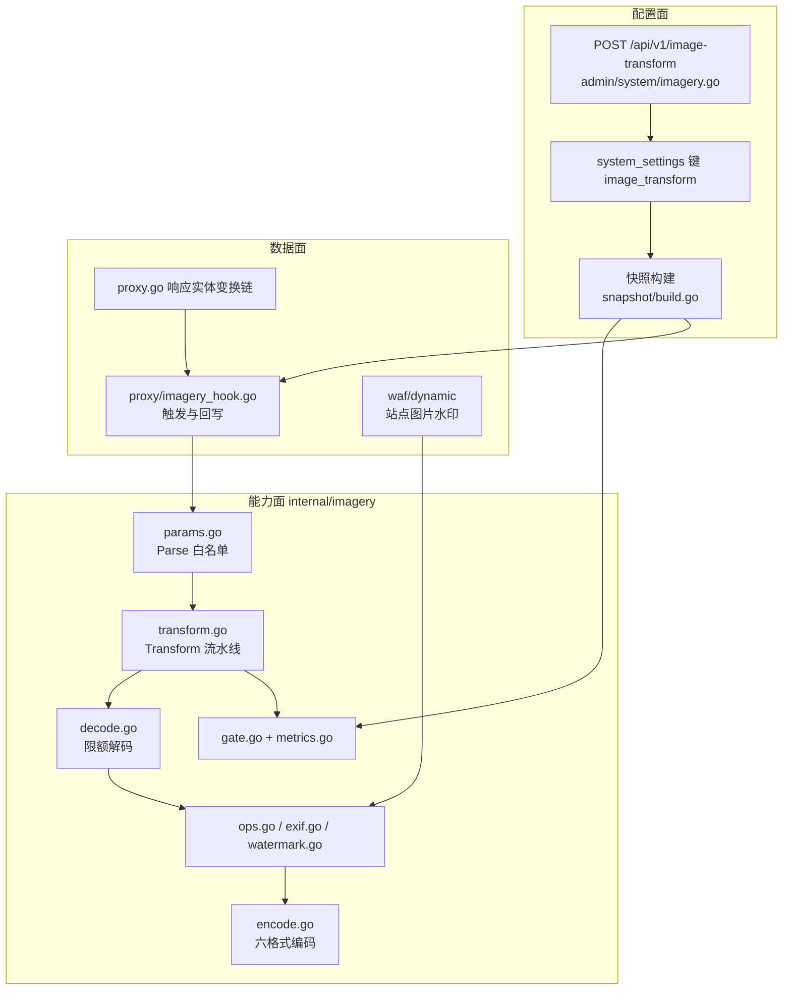
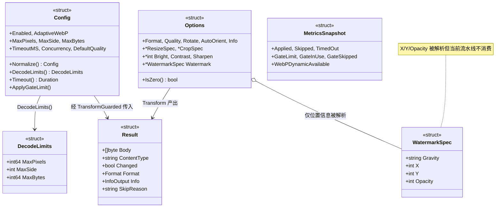
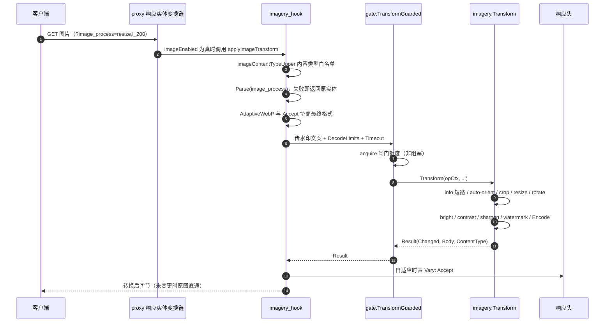
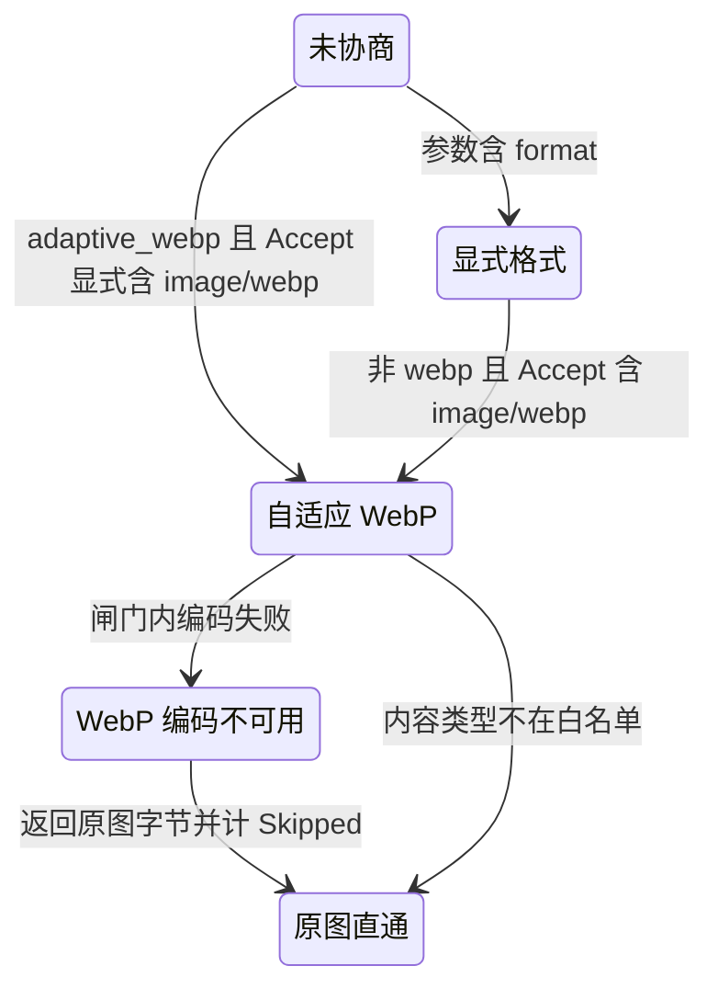
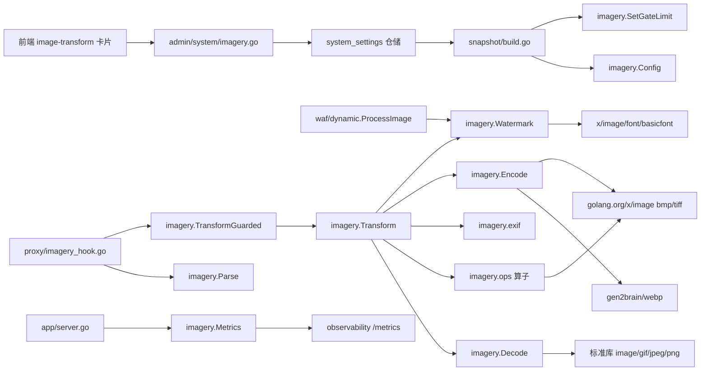

# 图像转换能力

<cite>
**本文档引用的文件**
- [config.go](file://internal/imagery/config.go)
- [decode.go](file://internal/imagery/decode.go)
- [encode.go](file://internal/imagery/encode.go)
- [exif.go](file://internal/imagery/exif.go)
- [gate.go](file://internal/imagery/gate.go)
- [metrics.go](file://internal/imagery/metrics.go)
- [ops.go](file://internal/imagery/ops.go)
- [params.go](file://internal/imagery/params.go)
- [transform.go](file://internal/imagery/transform.go)
- [watermark.go](file://internal/imagery/watermark.go)
- [imagery_hook.go](file://internal/proxy/imagery_hook.go)
- [proxy.go](file://internal/proxy/proxy.go)
- [html_to_markdown.go](file://internal/proxy/html_to_markdown.go)
- [imagery.go](file://internal/admin/system/imagery.go)
- [router.go](file://internal/admin/router.go)
- [settings.go](file://internal/admin/system/settings.go)
- [build.go](file://internal/snapshot/build.go)
- [snapshot.go](file://internal/snapshot/snapshot.go)
- [server.go](file://internal/app/server.go)
- [metrics.go](file://internal/observability/metrics.go)
- [processor.go](file://internal/waf/dynamic/processor.go)
- [types.ts](file://frontend/lib/types.ts)
- [api.ts](file://frontend/lib/api.ts)
- [use-api.ts](file://frontend/hooks/use-api.ts)
- [image-transform-card.tsx](file://frontend/app/(dashboard)/captcha/components/image-transform-card.tsx)
- [go.mod](file://go.mod)
</cite>

## 目录
1. [简介](#简介)
2. [项目结构](#项目结构)
3. [核心组件](#核心组件)
4. [架构总览](#架构总览)
5. [详细组件分析](#详细组件分析)
6. [依赖关系分析](#依赖关系分析)
7. [性能考虑](#性能考虑)
8. [故障排查指南](#故障排查指南)
9. [结论](#结论)
10. [附录](#附录)

## 简介

图像转换能力（`internal/imagery`）对**上游返回的图片响应**做服务端再加工：格式转换、质量、缩放、裁剪、旋转、亮度/对比度/锐化、元信息 `info` 查询与文字水印，并可选按客户端 `Accept` 自适应转码 WebP。它由 URL 查询参数 `image_process` 逐请求触发，与站点的 HTML/JS 混淆开关正交。

| 项 | 内容 |
|----|------|
| 所属业务域 | 安全防护功能 / 访客识别（响应内容加工族） |
| 本篇形态 | C 三级实现文档（按实现单元分节，节内 `####` 拆接口/注册/调用） |
| 覆盖范围 | `internal/imagery` 10 文件 2910 行非测试代码，及数据面接入链、管理端配置、指标投影 |
| 明确不覆盖 | HTML/JS 混淆与浏览器签名注入细节、`html-to-markdown` 转换、站点级覆盖（当前不存在） |
| 上级与同级 | [访客识别总览](./访客识别.md)（同子域索引，本篇不复制其表格）、[TLS元信息与信号融合](./TLS元信息与信号融合.md) |
| 防护面口径 | 本篇只描述能力边界与拒绝规则，不给出任何绕过配方 |

**章节来源**
- [decode.go:1-12](file://internal/imagery/decode.go#L1-L12)
- [config.go:13-37](file://internal/imagery/config.go#L13-L37)

## 项目结构

包位于 `internal/imagery`，被三类调用方引用：数据面响应变换链（`internal/proxy`）、快照构建（`internal/snapshot`）、管理端与指标投影（`internal/admin/system`、`internal/app`）。

```text
internal/imagery/
├── params.go      # image_process 参数语法解析与白名单校验（609 行）
├── decode.go      # 解码与解压炸弹防线、容器完整性、帧数扫描（558 行）
├── transform.go   # 流水线编排与 info 短路（365 行）
├── ops.go         # 像素算子：缩放/裁剪/旋转/亮度/对比度/锐化（390 行）
├── exif.go        # EXIF Orientation 只读解析与朝向修正（236 行）
├── encode.go      # 六格式编码器与质量映射（124 行）
├── watermark.go   # 服务端文案水印（159 行）
├── gate.go        # 并发闸门与 TransformGuarded（150 行）
├── config.go      # 全局配置、钳制、AcceptsWebP（170 行）
└── metrics.go     # 原子计数、指标快照、libwebp 可用性（149 行）
```

| 路径 | 职责 | 主要语言 | 文件数 | 代表符号 | 对外暴露 |
|------|------|----------|:------:|----------|:--------:|
| `internal/imagery` | 图片解码/变换/编码/护栏 | Go | 10 | `TransformGuarded`、`Parse`、`Watermark`、`Metrics` | 是 |
| `internal/proxy` | 触发判定与响应实体回写 | Go | 1 | `applyImageTransform`、`imageTransformPlanFor` | 否 |
| `internal/snapshot` | 配置装载与闸门额度下发 | Go | 2 | `SiteRuntime.ImageTransform`、`ApplyGateLimit` | 是 |
| `internal/admin/system` | 配置读写端点 | Go | 2 | `GetImageTransformConfig`、`UpdateImageTransformConfig` | 是 |



**图表来源**
- [imagery.go:45-107](file://internal/admin/system/imagery.go#L45-L107)
- [build.go:169-185](file://internal/snapshot/build.go#L169-L185)
- [imagery_hook.go:124-160](file://internal/proxy/imagery_hook.go#L124-L160)
- [proxy.go:174-190](file://internal/proxy/proxy.go#L174-L190)
- [processor.go:199-211](file://internal/waf/dynamic/processor.go#L199-L211)

**章节来源**
- [config.go:10-17](file://internal/imagery/config.go#L10-L17)
- [snapshot.go:103-108](file://internal/snapshot/snapshot.go#L103-L108)

## 核心组件

| 模块 | 路径 | 职责 | 核心接口/符号 | 依赖模块 | 被依赖 | 规模(行) | 测试 |
|------|------|------|---------------|----------|--------|:--------:|:----:|
| 参数解析 | `internal/imagery/params.go` | `image_process` 语法与白名单校验 | `Parse(raw string) (Options, error)` | `strconv`、`errors` | proxy | 609 | 有 |
| 解码与护栏 | `internal/imagery/decode.go` | 限额校验、容器完整性、帧数扫描 | `Decode`、`DecodeLimits`、`Format` | 标准库 `image`、`x/image` | transform、watermark | 558 | 有 |
| 流水线 | `internal/imagery/transform.go` | 操作顺序编排与 `info` 短路 | `Transform(ctx, data, contentType, opts, watermarkText, limits) Result` | decode/ops/exif/encode | gate | 365 | 有 |
| 像素算子 | `internal/imagery/ops.go` | 缩放/裁剪/旋转/调色/锐化 | `Resize`、`Crop`、`Rotate`、`Sharpen` | `x/image/draw` | transform | 390 | 有 |
| EXIF | `internal/imagery/exif.go` | Orientation 只读解析与朝向修正 | `exifOrientation`、`applyOrientation`（非导出） | 标准库 `encoding/binary` | transform | 236 | 有 |
| 编码 | `internal/imagery/encode.go` | 六格式编码与质量映射 | `Encode(img imageLike, opts EncodingOptions)` | `gen2brain/webp`、`x/image` | transform | 124 | 有 |
| 水印 | `internal/imagery/watermark.go` | 服务端文案水印 | `Watermark(imgData []byte, text string)` | `x/image/font/basicfont` | transform、dynamic | 159 | 有 |
| 闸门 | `internal/imagery/gate.go` | 非阻塞并发额度与墙钟预算 | `TransformGuarded(...)`、`SetGateLimit(n int)` | `runtime`、`context` | proxy、snapshot | 150 | 有 |
| 配置 | `internal/imagery/config.go` | 全局配置与 `Accept` 判定 | `LoadConfig`、`Normalize`、`AcceptsWebP` | `encoding/json` | snapshot、admin、proxy | 170 | 有 |
| 指标 | `internal/imagery/metrics.go` | 原子计数与指标快照 | `Metrics() MetricsSnapshot`、`WebPDynamicAvailable` | `sync/atomic`、`webp` | app/observability | 149 | 有 |



**图表来源**
- [params.go:26-96](file://internal/imagery/params.go#L26-L96)
- [config.go:18-49](file://internal/imagery/config.go#L18-L49)
- [transform.go:73-88](file://internal/imagery/transform.go#L73-L88)
- [metrics.go:37-50](file://internal/imagery/metrics.go#L37-L50)
- [decode.go:41-48](file://internal/imagery/decode.go#L41-L48)

### 重点接口展开

**职责**：`TransformGuarded` 是产线唯一入口（数据面与水印旁路各自到达它的下游）。**核心接口**（签名逐字取自源码）：

```go
func TransformGuarded(
	ctx context.Context,
	data []byte,
	contentType string,
	opts Options,
	watermarkText string,
	limits DecodeLimits,
	timeout time.Duration,
) Result

func Parse(raw string) (Options, error)

func AcceptsWebP(accept string) bool

func Watermark(imgData []byte, text string) ([]byte, Format, error)
```

**章节来源**
- [gate.go:108-150](file://internal/imagery/gate.go#L108-L150)
- [params.go:98-115](file://internal/imagery/params.go#L98-L115)
- [config.go:149-170](file://internal/imagery/config.go#L149-L170)
- [watermark.go:35-35](file://internal/imagery/watermark.go#L35-L35)

## 架构总览

一次带 `image_process` 的图片请求在响应变换链上的端到端行为如下。



**图表来源**
- [proxy.go:182-190](file://internal/proxy/proxy.go#L182-L190)
- [imagery_hook.go:46-74](file://internal/proxy/imagery_hook.go#L46-L74)
- [imagery_hook.go:124-159](file://internal/proxy/imagery_hook.go#L124-L159)
- [gate.go:132-149](file://internal/imagery/gate.go#L132-L149)
- [transform.go:148-239](file://internal/imagery/transform.go#L148-L239)

| 层 | 落位 | 判定内容 | 未通过时的行为 |
|----|------|----------|----------------|
| 站点开关 | `SiteRuntime.ImageTransform.Enabled` | 总开关 | 不注册图像变换，零开销 |
| 内容类型 | `imageContentTypeUpper` | 8 个图片 MIME 取值 | 原实体返回 |
| 参数 | `imagery.Parse` | 白名单语法与区间 | 返回 nil 计划，原实体返回 |
| 护栏 | `acquire` + `context.WithTimeout` | 并发额度与墙钟预算 | 原图直通并计数 |
| 编解码 | `Decode` / `Encode` | 限额与格式可支持性 | `SkipReason` + 原图直通 |

**章节来源**
- [imagery_hook.go:32-112](file://internal/proxy/imagery_hook.go#L32-L112)
- [gate.go:132-147](file://internal/imagery/gate.go#L132-L147)

## 详细组件分析

### 参数驱动的转换流水线

#### 接口与注册

语法与 ESA 对齐：`/` 分隔操作、`,` 分隔操作内参数、`name_value` 形式取值。产线**无注册中心**：操作集合以 `switch name` 硬编码白名单形式存在于 `Parse` 内，新增操作即新增一个 `case`。

```go
const (
	paramSeparator = "/"
	argSeparator   = ","
)

var errInvalidParams = errors.New("imagery: invalid image_process parameters")
```

解析策略是严格白名单：未知操作名整体忽略；已知操作内的未知参数名忽略；已知参数的取值非法（非数字、负数、越界、非法枚举）**返回错误**，调用方（`imageTransformPlanFor`）据此返回 nil 计划，即原图直通。

| 符号 | 位置 | 职责 | 上游调用者 | 下游依赖 | 副作用 | 影响面 |
|------|------|------|------------|----------|--------|--------|
| `Parse` | [params.go:115](file://internal/imagery/params.go#L115) | 语法解析与校验 | `imagery_hook.go:53` | `strconv` | 无 | 高：唯一入口 |
| `parseWatermarkOp` | [params.go:507](file://internal/imagery/params.go#L507) | 水印参数白名单 | `Parse` | `isValidGravity` | 无 | 高：防护面所在 |
| `Transform` | [transform.go:148](file://internal/imagery/transform.go#L148) | 顺序编排 | `TransformGuarded` | `Decode`/`Encode`/算子 | 原子计数 | 高 |
| `applyResize` | [transform.go:288](file://internal/imagery/transform.go#L288) | 驱动边优先级 | `Transform` | `Resize*` | 无 | 中 |
| `targetFormatOf` | [transform.go:360](file://internal/imagery/transform.go#L360) | 显式格式优先 | `Transform` | 无 | 无 | 中 |

#### 配置与凭据

无凭据。当前**没有站点级覆盖**：`Config` 的注释明确「首版只做全局配置，站点级覆盖留待需要时再加」，因此限额、超时、并发、默认质量对全部站点一致生效。管理端更新采用指针字段的局部合并保存，未出现的字段保留既有值。

#### 调用与差异

固定执行顺序保证同一输入与参数得到同一输出（可缓存前提）：

```text
info 短路 → auto-orient → crop → resize → rotate → bright → contrast
→ sharpen → watermark → 编码输出
```

| 步 | 动作 | 执行位置 | 输入 | 输出 | 失败分支 | 可观测点 |
|:--:|------|----------|------|------|----------|----------|
| 1 | 取首个 `image_process` 值 | [imagery_hook.go:83-92](file://internal/proxy/imagery_hook.go#L83-L92) | 查询串 | 原始串 | 无参数则空串 | 无计划，原图 |
| 2 | 解析并校验 | [params.go:115-232](file://internal/imagery/params.go#L115-L232) | 原始串 | `Options` | `errInvalidParams` | `Skipped` 计数 |
| 3 | `info` 短路 | [transform.go:160-174](file://internal/imagery/transform.go#L160-L174) | 原始字节 | JSON 元信息 | 头解析失败回退直通 | `Content-Type: application/json` |
| 4 | 限额解码 | [decode.go:191-244](file://internal/imagery/decode.go#L191-L244) | 原始字节 | `DecodeInput` | `ErrTooLarge`/`ErrUnsupported` | `Skipped` |
| 5 | 像素算子 | [transform.go:186-214](file://internal/imagery/transform.go#L186-L214) | RGBA | RGBA | 越界取交集，不报错 | 无 |
| 6 | 目标格式判定 | [transform.go:216-220](file://internal/imagery/transform.go#L216-L220) | `Options.Format` 或输入格式 | `Format` | 空格式记 `unknown input format` | `Skipped` |
| 7 | 编码 | [encode.go:51-107](file://internal/imagery/encode.go#L51-L107) | RGBA | 字节 + 格式 | 编码器错误 → 直通 | `encode: ...` 跳过原因 |
| 8 | 回写实体 | [imagery_hook.go:140-159](file://internal/proxy/imagery_hook.go#L140-L159) | `Result` | 新 Body/CT | `!Changed` 原样返回 | `Vary: Accept` |

缩放驱动边优先级固定：`p_`（比例）> `fw_`+`fh_`（指定宽高）> `l_`（最长边）> `s_`（最短边）> `w_`/`h_`。裁剪定位优先级：`crop,mid` > 显式 `x_`/`y_` > 九宫格 `g_` > 居中。`threshold` 是独立操作，可出现在 `resize` 前后，解析完再绑定，语义为「仅当原图字节数 ≥ 阈值才执行本次缩放」。

#### 限制与回退

- **只缩不放**：`Resize` 对超过原图尺寸的维度回退到原图长度，两目标皆为 0 时恒等返回。
- **旋转只支持三档**：`rotate` 取模 360 后必须是 0/90/180/270，其余角度返回错误；不做插值。
- **多帧退化**：动画 GIF/动画 WebP 在需要像素变换时只处理首帧（`image.Decode` 的固有行为），完整动画重编码**当前未实现**；仅 `info` 查询时 `FrameCount` 如实报告不丢帧。
- **`circle` 圆形裁剪未实现**：按未知参数忽略，使该操作退化为「只应用其余裁剪参数」。
- **相对质量 `q_` 未实现**：纯 Go 解码路径拿不到「原图当前质量」，`q_` 一律按「不指定质量」处理（返回 0）；只有绝对质量 `Q_` 生效。
- **总回退策略**：任何解码/编码/参数问题都不向上抛错误，返回「跳过原因 + 原图直通」，避免把图片打成 5xx。唯一例外是 `info` 路径对「容器自洽但压缩数据损坏」的输入返回 200 元信息 JSON，其后果有界（只输出真实头部字段），截断输入不在该例外内。

**章节来源**
- [params.go:98-232](file://internal/imagery/params.go#L98-L232)
- [params.go:243-461](file://internal/imagery/params.go#L243-L461)
- [transform.go:90-239](file://internal/imagery/transform.go#L90-L239)
- [transform.go:278-308](file://internal/imagery/transform.go#L278-L308)
- [ops.go:48-133](file://internal/imagery/ops.go#L48-L133)
- [imagery_hook.go:46-92](file://internal/proxy/imagery_hook.go#L46-L92)

### 自适应 WebP 协商

#### 接口与注册

```go
func AcceptsWebP(accept string) bool
```

判定依据是**显式媒体类型**：按 `,` 切分 `Accept`，剥离 `;` 后的参数，仅当某一段 `EqualFold` 等于 `image/webp` 时返回 true。`image/*` 与 `*/*` 通配符**不算**支持，按「未声明即不支持」处理，避免把 WebP 推给明确声明了具体类型的客户端。

#### 配置与凭据

- `adaptive_webp`：布尔开关，随全局配置存储于 `system_settings` 的 `image_transform` 键，无独立凭据。
- 无站点级覆盖，开启即全站生效。

#### 调用与差异

| 场景 | `image_process` | `Accept` 含 `image/webp` | 结果格式 | 是否声明 `Vary: Accept` |
|------|-----------------|--------------------------|----------|:-----------------------:|
| 纯自适应（参数集为空） | 无 | 是 | `webp` | 是 |
| 自适应 + 其他参数（非 webp） | `resize,l_200` | 是 | `webp` | 是 |
| 显式指定 webp | `format,webp` | 任意 | `webp` | 否 |
| 显式指定其他格式 | `format,png` | 是 | `png` | 否 |
| 客户端不支持 | 任意 | 否 | 按参数/原格式 | 否 |

差异点在于 `adaptiveWebP` 标记只在「由 Accept 协商得来」时置真：显式 `format,webp` 的响应与 `Accept` 无关，此时声明 `Vary` 只会无谓地把响应排除出共享缓存。

#### 限制与回退

- **只声明 Vary，不改缓存策略**：转换产物沿用响应变换链既有的 `Cache-Control` 处理，不额外延长 TTL。原因是水印文案来自站点配置，配置变更后中间缓存里的旧水印图会在 TTL 内继续可见；给转换产物设定独立缓存生命周期需要先具备「按配置修订号失效」的能力，当前未实现。
- `appendVaryAccept` 对已含 `Accept` 的 `Vary` 头做去重追加，不会产生重复项。
- 协商失败（`Accept` 无 `image/webp`）不报错，按原格式继续。



**图表来源**
- [imagery_hook.go:56-73](file://internal/proxy/imagery_hook.go#L56-L73)
- [imagery_hook.go:139-159](file://internal/proxy/imagery_hook.go#L139-L159)
- [config.go:149-170](file://internal/imagery/config.go#L149-L170)

**章节来源**
- [config.go:149-170](file://internal/imagery/config.go#L149-L170)
- [imagery_hook.go:22-74](file://internal/proxy/imagery_hook.go#L22-L74)
- [imagery_hook.go:144-188](file://internal/proxy/imagery_hook.go#L144-L188)

### 水印与 EXIF 处理

#### 接口与注册

两条水印路径共用同一实现：

```go
func Watermark(imgData []byte, text string) ([]byte, Format, error)
```

- **流水线内水印**：`Options.Watermark != nil` 时在锐化之后叠加，位置由 `addTextWatermark` 固定（右下角带半透明底条 + 居中淡化大字），文案由调用方传入。
- **站点图片水印旁路**：`internal/waf/dynamic` 的 `ProcessImage` 在 `ImageWatermarkEnabled` 且路径命中 `ImageWatermarkPaths` 时直接调用 `imagery.Watermark`，返回的格式被丢弃、只取字节。依赖方向单向 `dynamic → imagery`。

#### 配置与凭据

- 水印文案**只来自服务端配置** `rt.DynamicProtection.WatermarkText`；为空时回退常量 `Protected`。
- 无任何客户端可影响的文案来源（见「限制与回退」的拒绝规则）。
- 字体使用 `x/image/font/basicfont` 的 `Face7x13`，不需外部字体文件，因此不存在字体路径配置。

#### 调用与差异

EXIF 处理是**只读朝向、不保留元数据**：

| 维度 | 实测行为 | 位置 |
|------|----------|------|
| 解析范围 | 仅第一个 IFD 的 `0x0112`（Orientation），且类型必须是 `SHORT(3)` | [exif.go:194-236](file://internal/imagery/exif.go#L194-L236) |
| 支持容器 | JPEG `APP1`/`Exif\0\0`、WebP RIFF `EXIF` chunk、PNG `eXIf` chunk | [exif.go:89-103](file://internal/imagery/exif.go#L89-L103) |
| 朝向修正 | `auto-orient` 且 Orientation ∈ 2..8 时做无损镜像/旋转 | [exif.go:19-62](file://internal/imagery/exif.go#L19-L62) |
| 其余 EXIF | 不解析、不拷贝；重编码后输出字节不含 EXIF | [encode.go:51-107](file://internal/imagery/encode.go#L51-L107) |
| GIF/BMP/TIFF | `findTIFFHeader` 不识别这三类容器，朝向恒为 0 | [exif.go:89-103](file://internal/imagery/exif.go#L89-L103) |

`Watermark` 与 `Transform` 的差异：`Watermark` 只覆盖 PNG/JPEG/GIF 三种输入（其余原样返回并如实回报格式），且 GIF 因无法承载半透明文字统一转为 PNG 输出——调用方必须用返回的格式设置 `Content-Type`，否则会出现「GIF 头 + PNG 字节」。`Transform` 覆盖全部六格式。

#### 限制与回退

- **参数拒绝规则（防护面）**：`parseWatermarkOp` 对 `image`、`text`、`type`、`fill`、`size`、`rotate`、`color` 六个参数名一律返回「不被接受」错误，从而让整个请求原图直通。安全意图是两条边界：外链水印参数会让边缘节点按客户端给出的地址发起出站取数（SSRF 面），客户端可控的文本会被渲染进服务端下发的图片（内容注入面）。位置类参数（`g_`/`x_`/`y_`/`t_`）只影响叠加位置、不引入外部数据，予以保留。

```go
case "image", "text", "type", "fill", "size", "rotate", "color":
	return nil, fmt.Errorf("%w: watermark argument %q is not accepted", errInvalidParams, name)
```

- **解析但未应用**：`WatermarkSpec.X`/`Y`/`Opacity` 在 `Parse` 中被完整校验和赋值，但 `applyWatermarkOverlay` 只接收文案，不消费位置与透明度，因此这三项当前**不改变输出**；`Gravity` 同理（仅 `crop` 的 `g_` 生效）。水印透明度实际由源码常量固定：底条 A=100、右下角文字 A=180、居中文 A=40 且按字节截断到 20。
- **失败不报错**：`Watermark` 的所有返回分支 error 均为 nil，畸形输入返回原字节，因此 `dynamic` 侧的 `err` 恒为 nil。

**章节来源**
- [params.go:494-552](file://internal/imagery/params.go#L494-L552)
- [transform.go:310-324](file://internal/imagery/transform.go#L310-L324)
- [watermark.go:16-159](file://internal/imagery/watermark.go#L16-L159)
- [exif.go:1-236](file://internal/imagery/exif.go#L1-L236)
- [processor.go:195-212](file://internal/waf/dynamic/processor.go#L195-L212)

### 限额、并发闸门与指标护栏

#### 接口与注册

```go
func SetGateLimit(n int)

func SnapshotGateStats() GateStats

func Metrics() MetricsSnapshot
```

闸门是**进程级单例**变量，额度在快照构建期由 `imageTransform.ApplyGateLimit()` 下发（`Concurrency` 为 0 时重置为 `runtime.NumCPU()`，下限 1）。`webp.Dynamic()` 的探测在包 `init()` 中执行一次并写入原子布尔。

#### 配置与凭据

八项配置键的默认值、钳制边界与证据位置统一列在[附录·配置参数说明](#配置参数说明)，本篇不重复展开；本节只强调两点：配置**没有站点级覆盖**（`Config` 注释明确首版只做全局配置），且 `Concurrency` 为 0 时不代表关闭而是取 CPU 核数。

#### 调用与差异

护栏设计取「超限即原图直通」而非排队或报错：排队会把请求线程全部堵在 CPU 密集路径上放大尾延迟，报错则与该包的失败语义冲突。因此 `acquire` 不阻塞，拿不到额度立刻返回，并同时递增 `waiting` 与 `skipped`（当前实现二者同义）。

闸门判定顺序为：内容类型白名单 → `Parse` 成功且参数非零或自适应命中 → `acquire` 成功 → 上下文未超时 → 才进入编码；任一环节不满足都返回 `Changed == false`，实体逐字未变（判定条件的完整口径见[架构总览](#架构总览)的层级表）。

解码防线在**分配像素之前**生效，这是与「先看 magic bytes」做法的本质区别：`decodeConfigChecked` 走 `image.DecodeConfig`（内存 O(1)），三重限额依次判定 `MaxBytes` → 维度为正 → `MaxSide` → `MaxPixels`，任何一条不满足即 `ErrTooLarge`。伪造头部声明超大尺寸的路径会被真实解码器的头部解析拒绝。`decodeHeaderOnly` 与 `Decode` 共用同一段校验，两条路径的头部拒绝集合逐字相同。

#### 限制与回退

- 容器完整性判定失败时**不做猜测**，一律回退到 `Decode`，因此截断输入的行为与改造前一致；TIFF 与未知格式没有可靠完整性特征，永远回退。
- `webp` 编码器在加载不到系统 libwebp 时静默退回纯 Go 转译路径，功能照常但慢数倍；该状态只由 `openwaf_imagery_webp_dynamic_available` 这一条 gauge 暴露（未装载记 0，而非缺席）。
- `LastSkipReason()` 有意不投影到 `/metrics`：语义是「最近一次」而非累计量，做成 counter 无意义、做成 gauge 会随抓取时刻抖动；排障时需读进程内诊断而非指标。
- 指标为累计原子计数，不随配置重载清零；`ResetStats()` 仅供测试使用。

**章节来源**
- [gate.go:10-106](file://internal/imagery/gate.go#L10-L106)
- [gate.go:108-150](file://internal/imagery/gate.go#L108-L150)
- [decode.go:37-59](file://internal/imagery/decode.go#L37-L59)
- [decode.go:181-244](file://internal/imagery/decode.go#L181-L244)
- [metrics.go:9-149](file://internal/imagery/metrics.go#L9-L149)

## 依赖关系分析



**图表来源**
- [imagery_hook.go:11-12](file://internal/proxy/imagery_hook.go#L11-L12)
- [transform.go:3-9](file://internal/imagery/transform.go#L3-L9)
- [encode.go:10-13](file://internal/imagery/encode.go#L10-L13)
- [decode.go:28-34](file://internal/imagery/decode.go#L28-L34)
- [watermark.go:11-13](file://internal/imagery/watermark.go#L11-L13)
- [server.go:579-594](file://internal/app/server.go#L579-L594)

### 依赖矩阵

| 调用方 ↓ / 被调方 → | imagery | proxy | snapshot | admin | dynamic | app | 外部库 |
|---------------------|:-------:|:-----:|:--------:|:-----:|:-------:|:---:|:------:|
| `imagery` | — | ✗ | ✗ | ✗ | ✗ | ✗ | ✓ |
| `proxy` | ✓ | — | ✓ | ✗ | ✗ | ✗ | ✓ |
| `snapshot` | ✓ | ✗ | — | ✗ | ✗ | ✗ | ✓ |
| `admin/system` | ✓ | ✗ | ✗ | — | ✗ | ✗ | ✓ |
| `waf/dynamic` | ✓ | ✗ | ✗ | ✗ | — | ✗ | ✗ |
| `app` | ✓ | ✗ | ✓ | ✗ | ✗ | — | ✓ |

依赖方向单一（除 `imagery` 自身外无人反向依赖调用方），`imagery → 标准库/x-image/webp` 是唯一的第三方出口。`waf/dynamic` 不再持有任何图像编解码代码。

**章节来源**
- [processor.go:195-198](file://internal/waf/dynamic/processor.go#L195-L198)
- [build.go:169-185](file://internal/snapshot/build.go#L169-L185)
- [imagery.go:10-24](file://internal/admin/system/imagery.go#L10-L24)

### 外部实体

| 外部实体 | 类型 | 交互方向 | 协议/方式 | 触发时机 | 数据内容 | 失败影响 | 容错处理 |
|----------|------|----------|-----------|----------|----------|----------|----------|
| 系统 libwebp | 本地动态库 | 出向 | cgo/纯 Go 转译 | WebP 编码 | 像素 | 编码慢数倍 | 探测结果记 gauge，功能不中断 |
| `golang.org/x/image` | 第三方 Go 库 | 出向 | `draw.CatmullRom`、`bmp`/`tiff` 编解码 | 缩放与 BMP/TIFF | 像素 | 编码器错误 → 直通 | `SkipReason` + 计数 |
| `system_settings` 存储 | 数据库 | 入向 | GORM 单键 JSON | 快照构建、管理端读写 | 配置 JSON | 解析失败退回默认（关闭） | 记快照诊断项 |
| 上游源站 | 第三方服务 | 入向 | HTTP 响应体 | 每次图片响应 | 图片字节 | 不额外影响 | 类型/尺寸/字节三重限额 |
| 客户端 `Accept` | 外部输入 | 入向 | HTTP 头 | 每次请求 | 媒体类型 | 通配符不视为支持 | 保守判定 |

**章节来源**
- [metrics.go:9-20](file://internal/imagery/metrics.go#L9-L20)
- [server.go:579-581](file://internal/app/server.go#L579-L581)
- [build.go:169-183](file://internal/snapshot/build.go#L169-L183)

## 性能考虑

### 并发闸门是首要护栏

- **问题**：解码与编码是 CPU 与内存的双重放大器——声明 16,777,216 像素的输入按 RGBA 计即 64 MiB，叠加中间画布与编码器缓冲，单张峰值可达 130-200 MiB；而响应变换链本身没有任何并发限制。
- **优化**：`gate` 以 `NumCPU` 为额度做非阻塞占用（`gate.go:22-106`），拿不到额度立即直通，不排队、不报错。
- **效果**：突发流量下 CPU 占用被封顶，尾延迟不因排队放大；代价是部分请求拿到原图，可通过 `openwaf_imagery_gate_skipped_total` 观察比例。

**章节来源**
- [gate.go:10-106](file://internal/imagery/gate.go#L10-L106)

### info 路径不分配像素

- **问题**：只查元信息的请求若走全量解码，成本与像素变换同量级。
- **优化**：`info` 分支走 `decodeHeaderOnly`，只读容器头部与帧结构（`transform.go:160-174`、`decode.go:311-326`）。
- **效果**：源码记录的本机交替配对实测（4000×3000 JPEG）显示中位耗时由 `5.32e8 ns` 降到 `1.05e4 ns`，单次内存由 `36.2 MB` 降到 `18.8 KB`；该数据为实现内自述，本篇未复测，仅作量级参考。

**章节来源**
- [transform.go:159-174](file://internal/imagery/transform.go#L159-L174)
- [decode.go:268-326](file://internal/imagery/decode.go#L268-L326)

### 编码质量映射与 GIF 量化

- **问题**：PNG 与 GIF 无「质量」维度，直接套用会误导调用方。
- **优化**：PNG 把 1-100 质量映射为压缩等级（≥90 最高压缩、≥70 默认、≥40 偏快、其余最快）；GIF 固定 `NumColors: 256` 并启用 Floyd-Steinberg 抖动；TIFF 默认 deflate + predictor。
- **效果**：体积与保真度的取舍可预期；GIF 输出格式与响应头一致（旧实现「GIF 一律转 PNG」且不回报格式的缺陷已修复）。

[本节为通用指导，无需特定文件来源]

## 故障排查指南

### 问题：带了 `image_process` 但图片没变

**症状**：响应字节与源站一致，无报错，状态码正常。

**可能原因**：全局 `enabled` 为 false；响应 `Content-Type` 不在 8 个白名单取值内；参数被白名单判为非法（越界、负数、不支持格式、水印含被拒参数名）；闸门已满；墙钟超时；解码被限额拒绝。

**排查步骤**：
1. 看 `GET /api/v1/image-transform` 的 `enabled` 与 `adaptive_webp`。
2. 看 `/metrics` 的 `openwaf_imagery_{applied,skipped,timed_out,gate_skipped}_total` 增量，判断是「未触发」还是「触发后跳过」。
3. `gate_in_use` 长期等于 `gate_limit` 说明并发打满，可提高 `concurrency` 或降低触发面。

**解决方案**：按计数归属处置——参数类问题改参数；限额类问题调 `max_pixels`/`max_side`/`max_bytes`；超时类提高 `timeout_ms`（上限 30000）；并发类提高 `concurrency`（上限 256）。

**章节来源**
- [imagery_hook.go:46-74](file://internal/proxy/imagery_hook.go#L46-L74)
- [imagery_hook.go:94-127](file://internal/proxy/imagery_hook.go#L94-L127)
- [gate.go:132-149](file://internal/imagery/gate.go#L132-L149)
- [metrics.go:113-120](file://internal/imagery/metrics.go#L113-L120)

### 问题：`/metrics` 里 `openwaf_imagery_webp_dynamic_available` 为 0

**症状**：WebP 转换功能正常，但该 gauge 恒为 0。

**可能原因**：部署镜像内没有可加载的系统 libwebp，`webp.Dynamic()` 返回错误，`gen2brain/webp` 静默改用纯 Go 转译路径。

**排查步骤**：
1. 确认这条指标**存在**（存在但为 0 与完全不输出是两回事：完全不输出说明 provider 未接线）。
2. 对比 WebP 转换的耗时分布，纯 Go 路径慢数倍属预期。

**解决方案**：需要原生性能时在镜像内安装 libwebp 动态库；若接受纯 Go 路径，把该 gauge 仅作为部署形态记录。

**章节来源**
- [metrics.go:9-20](file://internal/imagery/metrics.go#L9-L20)
- [server.go:579-594](file://internal/app/server.go#L579-L594)
- [metrics.go:350-391](file://internal/observability/metrics.go#L350-L391)

### 问题：转换后图片丢失拍摄信息与朝向

**症状**：经转换的图片不再携带 EXIF 元数据段；手机照片在页面上朝向变化。

**原因与处置**：EXIF 只被读取第一个 IFD 的 Orientation 一项，任何像素变换后的重编码都不携带原元数据段，这是能力边界而非缺陷；朝向只有在带 `auto-orient` 且 Orientation ∈ 2..8 时才被显式修正，未带该操作时像素不会被旋正。先用带 `info` 的请求确认 `Orientation` 键是否出现（仅当原图确实携带朝向时才返回该键），再决定是补 `auto-orient` 还是对该类资源关闭本能力。

**章节来源**
- [transform.go:27-71](file://internal/imagery/transform.go#L27-L71)
- [transform.go:186-188](file://internal/imagery/transform.go#L186-L188)
- [exif.go:64-103](file://internal/imagery/exif.go#L64-L103)

## 结论

图像转换能力把「上游图片响应」纳入服务端可控的加工面，同时把该面带来的解码攻击与资源放大风险收敛在三道护栏内：入参严格白名单、像素分配前的三重限额、非阻塞并发闸门与墙钟预算。所有失败都退化为原图直通，不产生 5xx。

- **优势**：格式与参数口径与 ESA 对齐，便于既有 URL 迁移；解析、限额、闸门、指标四件事各自独立且可单测；水印文案与外链参数被明确切断客户端控制路径，SSRF 与内容注入面在解析层即关闭；`webp` 装载状态有专属 gauge。
- **建议**：其一，`WatermarkSpec` 的 `x_`/`y_`/`t_` 已校验但未消费，要么接入 `applyWatermarkOverlay`，要么在解析层一并拒绝，避免形成「看似可配实则无效」的第二口径；其二，`EncodingOptions.Lossless` 与 `SniffFormat`、`DecodeInput.Animated` 在产线无调用点，属预留接缝，应在明确需求后再启用；其三，站点级覆盖缺失会让单一限额约束全部站点，若引入覆盖须按三态语义（继承/开启/关闭）建模，不得把空值写成 false。

[本节为总结，无需特定文件来源]

## 附录

### 配置参数说明

| 配置项 | JSON 键 | 默认值 | 钳制边界 | 说明 | 证据位置 |
|--------|---------|--------|----------|------|----------|
| 总开关 | `enabled` | false | — | 关闭时数据面完全忽略 `image_process`，也不做协商 | [config.go:19-21](file://internal/imagery/config.go#L19-L21) |
| 自适应 WebP | `adaptive_webp` | false | — | `Accept` 显式含 `image/webp` 时转码并声明 `Vary` | [config.go:22-24](file://internal/imagery/config.go#L22-L24) |
| 像素上限 | `max_pixels` | 16777216 | ≤0 回落默认 | 宽×高乘积上限，像素分配前判定 | [decode.go:237-242](file://internal/imagery/decode.go#L237-L242) |
| 单边上限 | `max_side` | 16384 | ≤0 回落默认 | 与 WebP 编码器单边约束一致 | [decode.go:50-59](file://internal/imagery/decode.go#L50-L59) |
| 字节上限 | `max_bytes` | 10485760 | ≤0 回落默认 | 输入字节长度上限 | [decode.go:226-228](file://internal/imagery/decode.go#L226-L228) |
| 墙钟预算 | `timeout_ms` | 2000 | 50 ≤ x ≤ 30000 | 单张转换超时，越界钳制 | [config.go:40-49](file://internal/imagery/config.go#L40-L49) |
| 并发额度 | `concurrency` | 0（=NumCPU） | 0 ≤ x ≤ 256 | 闸门额度，快照构建期下发 | [gate.go:32-56](file://internal/imagery/gate.go#L32-L56) |
| 默认质量 | `default_quality` | 0（编码器默认） | 0 ≤ x ≤ 100 | 仅在参数未给 `quality` 时补上 | [imagery_hook.go:135-137](file://internal/proxy/imagery_hook.go#L135-L137) |

**章节来源**
- [config.go:18-147](file://internal/imagery/config.go#L18-L147)
- [imagery.go:45-91](file://internal/admin/system/imagery.go#L45-L91)
- [types.ts:1024-1043](file://frontend/lib/types.ts#L1024-L1043)

### `image_process` 操作与取值枚举

| 操作 | 参数 | 合法取值 | 越界行为 | 位置 |
|------|------|----------|----------|------|
| `format` | 位置参数或 `f_` | `jpeg`/`jpg`/`png`/`gif`/`bmp`/`tiff`/`tif`/`webp` | 不支持的格式（如 avif/jp2）返回错误 → 直通 | [params.go:247-270](file://internal/imagery/params.go#L247-L270) |
| `quality` | `Q_90` 绝对 / `q_90` 相对 / 裸数字 | 1-100 | 非正或 >100 报错；相对质量按未指定处理 | [params.go:272-311](file://internal/imagery/params.go#L272-L311) |
| `resize` | `w_` `h_` `fw_` `fh_` `l_` `s_` `p_` `threshold` | 正整数；`p_` ≤100 | 非正报错；未识别参数名忽略 | [params.go:317-363](file://internal/imagery/params.go#L317-L363) |
| `threshold` | 单值 | 1..2^31-1 | 非正报错 | [params.go:166-174](file://internal/imagery/params.go#L166-L174) |
| `crop` | `w_` `h_` `x_` `y_` `g_` `mid` `circle` | 非负整数；`g_` 九宫格 | 非法坐标报错；`circle` 忽略 | [params.go:369-422](file://internal/imagery/params.go#L369-L422) |
| `rotate` | `a_` 或裸数字 | 0/90/180/270（模 360） | 其他角度报错 | [params.go:428-461](file://internal/imagery/params.go#L428-L461) |
| `bright` / `contrast` | 单值 | [-100,100] | 越界报错 | [params.go:189-200](file://internal/imagery/params.go#L189-L200) |
| `sharpen` | 单值 | [50,399] | 越界报错 | [params.go:201-206](file://internal/imagery/params.go#L201-L206) |
| `auto-orient` | 无 | — | — | [params.go:187-188](file://internal/imagery/params.go#L187-L188) |
| `info` | 无 | — | 触发后短路全部像素变换 | [params.go:207-208](file://internal/imagery/params.go#L207-L208) |
| `watermark` | `g_` `x_` `y_` `t_` 可用；`image`/`text`/`type`/`fill`/`size`/`rotate`/`color` 拒绝 | 非负整数；`t_` ≤100 | 被拒参数名报错 → 直通 | [params.go:507-552](file://internal/imagery/params.go#L507-L552) |

九宫格 `g_` 取值穷尽为 `nw` `north` `ne` `west` `center` `east` `sw` `south` `se`，未知定位按居中处理。

**章节来源**
- [params.go:115-232](file://internal/imagery/params.go#L115-L232)
- [params.go:598-609](file://internal/imagery/params.go#L598-L609)
- [transform.go:326-353](file://internal/imagery/transform.go#L326-L353)

### 指标清单

| 指标名 | 类型 | 含义 | 来源符号 |
|--------|------|------|----------|
| `openwaf_imagery_applied_total` | counter | 产出新字节的转换次数 | `statApplied` |
| `openwaf_imagery_skipped_total` | counter | 解码/编码/参数/闸门导致的原图直通次数 | `statSkipped` |
| `openwaf_imagery_timed_out_total` | counter | 墙钟预算耗尽而放弃的次数（同时计入 Skipped） | `statTimedOut` |
| `openwaf_imagery_gate_limit` | gauge | 当前并发额度 | `SnapshotGateStats().Limit` |
| `openwaf_imagery_gate_in_use` | gauge | 当前占用额度 | `SnapshotGateStats().InUse` |
| `openwaf_imagery_gate_skipped_total` | counter | 因闸门满而直通的累计次数 | `SnapshotGateStats().Skipped` |
| `openwaf_imagery_webp_dynamic_available` | gauge | 系统 libwebp 是否装载（1/0） | `WebPDynamicAvailable()` |

`/metrics` 挂在管理端口；指标经 `MetricsSnapshot` 转 `observability.ImageTransformStatsSnapshot` 后渲染，未接线 provider 时整族不输出。

**章节来源**
- [metrics.go:27-67](file://internal/imagery/metrics.go#L27-L67)
- [metrics.go:113-149](file://internal/imagery/metrics.go#L113-L149)
- [metrics.go:350-391](file://internal/observability/metrics.go#L350-L391)
- [server.go:579-594](file://internal/app/server.go#L579-L594)

### 与响应变换链其他环节的关系

| 环节 | 归属 | 与图像转换的关系 | 差异要点 |
|------|------|------------------|----------|
| 图像转换 | `proxy/imagery_hook.go` | 本体 | 输入为图片字节，输出可为任意格式 |
| HTML→Markdown | `proxy/html_to_markdown.go` | 同链上的**独立能力** | 用 `html-to-markdown/v2`，由 bot 设置项开关；与 `imagery` 无任何依赖或代码共享 |
| 浏览器签名注入 | `waf/challenge` | 排在图像转换之后 | 只处理 HTML 内容类型 |
| HTML/JS 混淆 | `waf/dynamic` | 排在图像转换之后 | 水印与格式转换都需要上游**原图**，因此图像转换必须先执行 |
| 站点图片水印 | `waf/dynamic.ProcessImage` | 复用 `imagery.Watermark` | 按路径模式触发，不读 `image_process` |

| 端点 | 方法 | 用途 | 鉴权 | 处理位置 |
|------|------|------|:----:|----------|
| `/api/v1/image-transform` | GET | 读取全局配置 | 读权限 | [router.go:212](file://internal/admin/router.go#L212) |
| `/api/v1/image-transform` | POST | 局部合并更新并触发重载 | admin | [router.go:393](file://internal/admin/router.go#L393) |

更新成功后必须 `reload()`，且 `image_transform` **确实在快照构建的读取集内**（`settingsMap[imagery.SettingKey]`），因此配置会真正进入 `SiteRuntime.ImageTransform`，不存在「只递增代次不生效」的情形。

**章节来源**
- [proxy.go:182-205](file://internal/proxy/proxy.go#L182-L205)
- [html_to_markdown.go:9-13](file://internal/proxy/html_to_markdown.go#L9-L13)
- [build.go:167-171](file://internal/snapshot/build.go#L167-L171)
- [imagery.go:30-35](file://internal/admin/system/imagery.go#L30-L35)
- [settings.go:30-30](file://internal/admin/system/settings.go#L30-L30)

### 未接线与能力边界登记

| 项 | 状态 | 依据 |
|----|------|------|
| `WatermarkSpec.X`/`Y`/`Opacity` | 已解析、未消费 | `transform.go:212-213` 只传文案 |
| `EncodingOptions.Lossless` | 产线恒为 false | `transform.go:227` 未传该字段 |
| `SniffFormat` | 产线无调用点 | 仅 `proxy` 测试与包内测试引用 |
| `DecodeInput.Animated()` | 无调用点 | 包内外均未消费 |
| `LastSkipReason()` | 不投影到 `/metrics` | `metrics.go:137-149` 自述 |
| `ResetStats()` | 仅供测试 | `metrics.go:90-96` |
| `Transform`（导出形态） | 产线走 `TransformGuarded` | `imagery_hook.go:139` |
| 动画多帧重编码 | 未实现 | `transform.go:137-139` 自述 |
| 圆形裁剪 `circle` | 未实现 | `params.go:383-387` |
| 相对质量 `q_` | 未实现，按未指定处理 | `params.go:272-311` |
| 站点级配置覆盖 | 未实现 | `config.go:13-17` |
| 转换产物独立缓存生命周期 | 未实现 | `imagery_hook.go:146-153` |
| `golang/freetype` 依赖 | **不属于本包** | 由 `waf/challenge/gocaptcha.go` 使用 |
| `html-to-markdown` 依赖 | **不属于本包** | 由 `proxy/html_to_markdown.go` 使用 |

**章节来源**
- [transform.go:212-227](file://internal/imagery/transform.go#L212-L227)
- [params.go:383-387](file://internal/imagery/params.go#L383-L387)
- [ops.go:177-179](file://internal/imagery/ops.go#L177-L179)
- [go.mod:6-32](file://go.mod#L6-L32)
- [image-transform-card.tsx:25-40](file://frontend/app/(dashboard)/captcha/components/image-transform-card.tsx#L25-L40)
- [use-api.ts:1569-1587](file://frontend/hooks/use-api.ts#L1569-L1587)
