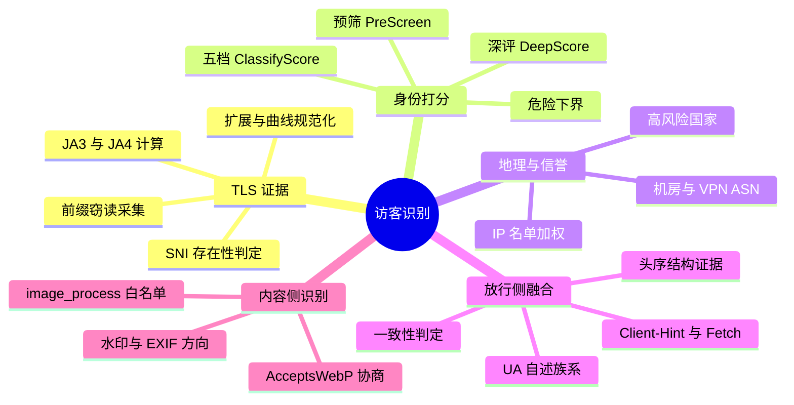
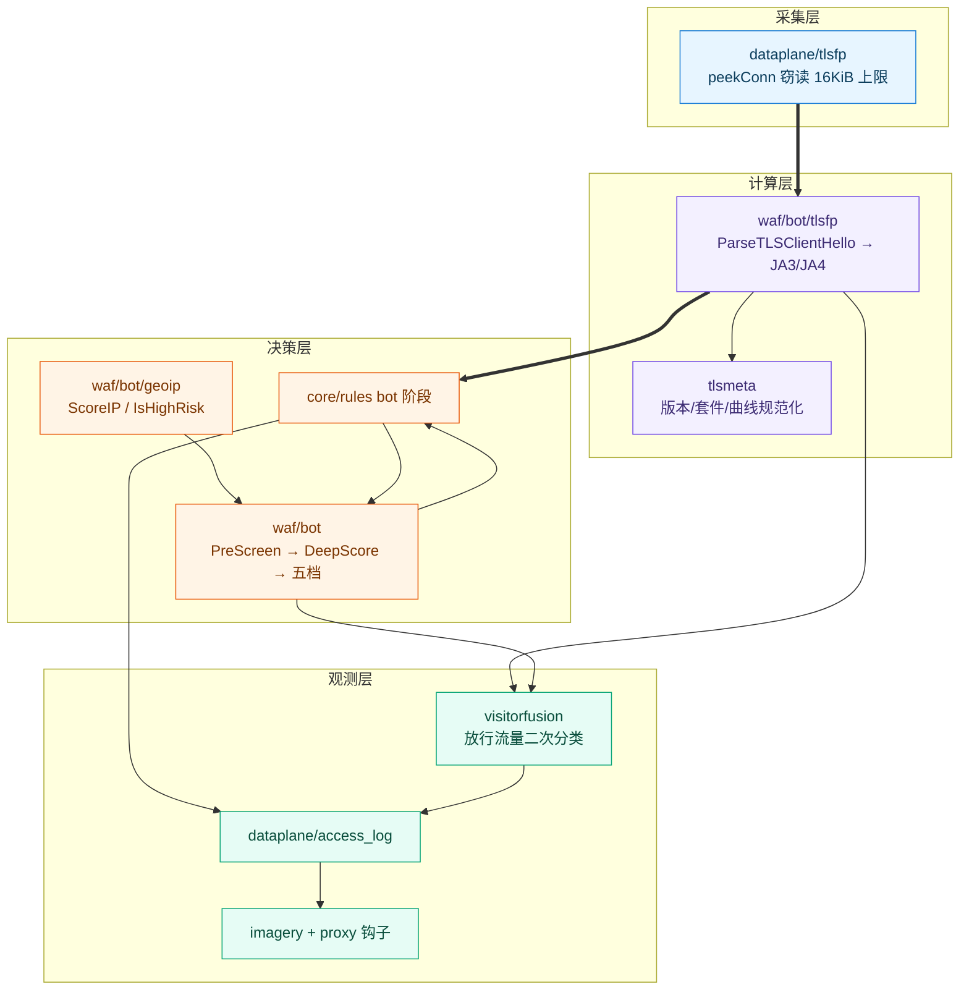
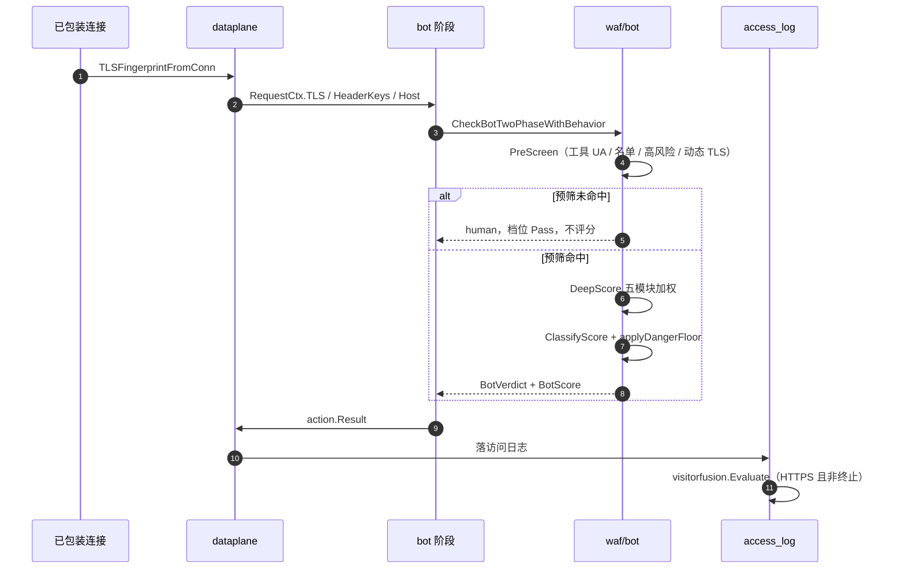
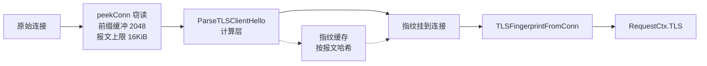
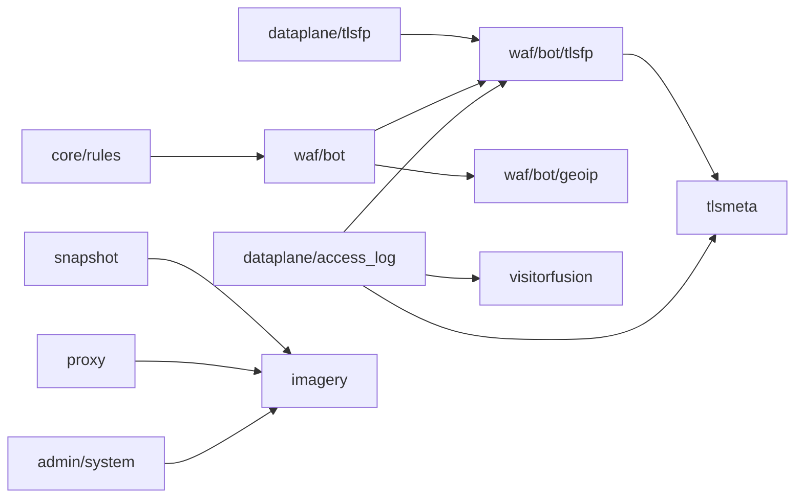
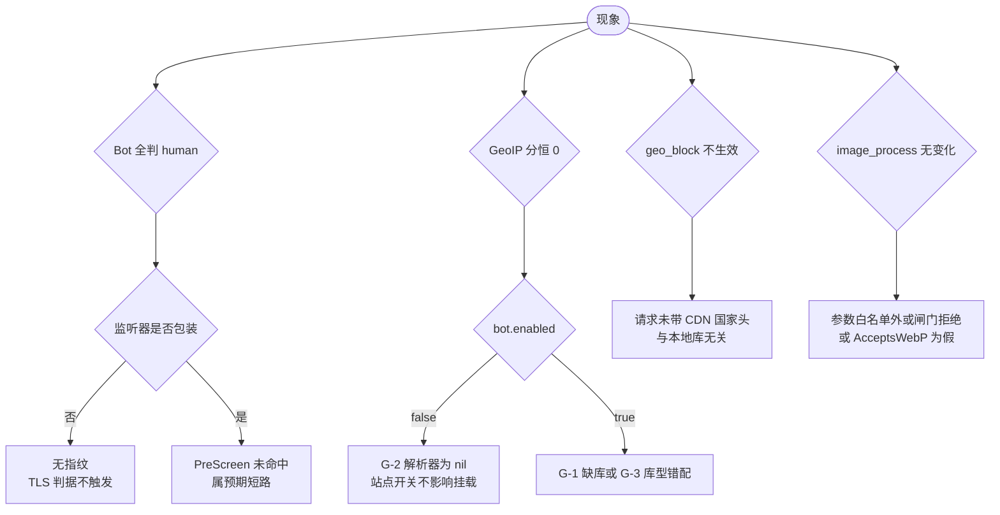

# 访客识别

> [返回 安全防护功能](../安全防护功能.md)

<cite>
**本文档引用的文件**
- [internal/waf/bot/bot.go](file://internal/waf/bot/bot.go)
- [internal/waf/bot/dynamic.go](file://internal/waf/bot/dynamic.go)
- [internal/waf/bot/dynamic_tls.go](file://internal/waf/bot/dynamic_tls.go)
- [internal/waf/bot/tlsfp/fingerprint.go](file://internal/waf/bot/tlsfp/fingerprint.go)
- [internal/waf/bot/tlsfp/conn.go](file://internal/waf/bot/tlsfp/conn.go)
- [internal/waf/bot/tlsfp/cache.go](file://internal/waf/bot/tlsfp/cache.go)
- [internal/waf/bot/tlsfp/sni_presence.go](file://internal/waf/bot/tlsfp/sni_presence.go)
- [internal/waf/bot/geoip/geoip.go](file://internal/waf/bot/geoip/geoip.go)
- [internal/waf/bot/geoip/fetch.go](file://internal/waf/bot/geoip/fetch.go)
- [internal/dataplane/tlsfp/tls_fingerprint_listener.go](file://internal/dataplane/tlsfp/tls_fingerprint_listener.go)
- [internal/visitorfusion/classifier.go](file://internal/visitorfusion/classifier.go)
- [internal/tlsmeta/version.go](file://internal/tlsmeta/version.go)
- [internal/tlsmeta/cipher_suites.go](file://internal/tlsmeta/cipher_suites.go)
- [internal/tlsmeta/lists.go](file://internal/tlsmeta/lists.go)
- [internal/imagery/config.go](file://internal/imagery/config.go)
- [internal/imagery/gate.go](file://internal/imagery/gate.go)
- [internal/imagery/params.go](file://internal/imagery/params.go)
- [internal/imagery/transform.go](file://internal/imagery/transform.go)
- [internal/imagery/decode.go](file://internal/imagery/decode.go)
- [internal/imagery/metrics.go](file://internal/imagery/metrics.go)
- [internal/imagery/watermark.go](file://internal/imagery/watermark.go)
- [internal/core/rules/phases.go](file://internal/core/rules/phases.go)
- [internal/core/engine/engine.go](file://internal/core/engine/engine.go)
- [internal/core/rules/matcher.go](file://internal/core/rules/matcher.go)
- [internal/core/config.go](file://internal/core/config.go)
- [internal/app/server.go](file://internal/app/server.go)
- [internal/dataplane/handler.go](file://internal/dataplane/handler.go)
- [internal/dataplane/access_log.go](file://internal/dataplane/access_log.go)
- [internal/dataplane/inbound_conn.go](file://internal/dataplane/inbound_conn.go)
- [internal/observability/metrics.go](file://internal/observability/metrics.go)
- [internal/snapshot/snapshot.go](file://internal/snapshot/snapshot.go)
- [internal/snapshot/build.go](file://internal/snapshot/build.go)
- [internal/proxy/imagery_hook.go](file://internal/proxy/imagery_hook.go)
- [internal/admin/system/imagery.go](file://internal/admin/system/imagery.go)
- [internal/admin/router.go](file://internal/admin/router.go)
- [README.md](file://README.md)
</cite>

## 目录

1. [简介](#简介)
2. [项目结构](#项目结构)
3. [核心组件](#核心组件)
4. [架构总览](#架构总览)
5. [详细组件分析](#详细组件分析)
6. [依赖关系分析](#依赖关系分析)
7. [性能考虑](#性能考虑)
8. [故障排查指南](#故障排查指南)
9. [结论](#结论)
10. [附录](#附录)

## 简介

访客识别是「先看清来的是谁，再决定怎么处置」的能力集合。它不把请求当作字符串匹配的对象，
而是把 **TLS 握手实况、请求头结构、UA 自述、地理与 IP 信誉、响应侧内容** 五类证据合成一个
可解释的身份判断，再交给阶段链处置。

### 子域范围与三篇分工

本篇是子域总览，给出全景、索引与跨模块的硬事实；细节由同目录两篇承担。

| 文档 | 覆盖包 | 侧重 |
|---|---|---|
| [访客识别](访客识别.md)（本篇） | 全部 | 全景、索引、跨模块结论 |
| [TLS 元信息与信号融合](TLS元信息与信号融合.md) | `tlsmeta`、`visitorfusion`、`waf/bot/tlsfp`、`dataplane/tlsfp` | 规范化与融合算法实现 |
| [图像转换能力](图像转换能力.md) | `imagery`、`proxy/imagery_hook.go` | 解码限额、参数白名单、闸门 |

涉及六个代码集合：`internal/visitorfusion`（381 行）、`internal/tlsmeta`（435 行）、
`internal/imagery`（10 文件 2910 行）、`internal/waf/bot/tlsfp`（1199 行）、
`internal/waf/bot/geoip`（607 行）、`internal/waf/bot` 本体（`bot.go` 1046 行 + `dynamic.go` 211 行 +
`dynamic_tls.go` 254 行）。`internal/dataplane/tlsfp`（395 行）属采集层，一并纳入依赖关系分析。

**章节来源**
- [internal/visitorfusion/classifier.go:1-9](file://internal/visitorfusion/classifier.go#L1-L9)
- [internal/waf/bot/bot.go:40-85](file://internal/waf/bot/bot.go#L40-L85)
- [internal/imagery/config.go:11-35](file://internal/imagery/config.go#L11-L35)

## 项目结构

### 目录树

```text
internal/
├── dataplane/tlsfp/          采集层：监听器与窃读连接，395 行
│   └── tls_fingerprint_listener.go
├── waf/bot/                  计算与决策层
│   ├── bot.go                两阶段打分、五档处置、危险下界，1046 行
│   ├── dynamic.go            动态 TLS 判据权重与原因码，211 行
│   ├── dynamic_tls.go        ClientHello 结构一致性判定，254 行
│   ├── tlsfp/                JA3/JA4 计算与指纹存取，1199 行
│   └── geoip/                MaxMind 解析与库自举，607 行
├── visitorfusion/classifier.go  放行流量的本地人机融合，381 行
├── tlsmeta/                  版本/套件/曲线规范化，435 行
└── imagery/                  图像转换与内容协商，2910 行
```

**章节来源**
- [internal/waf/bot/bot.go:1-20](file://internal/waf/bot/bot.go#L1-L20)
- [internal/dataplane/tlsfp/tls_fingerprint_listener.go:1-20](file://internal/dataplane/tlsfp/tls_fingerprint_listener.go#L1-L20)

### 模块清单

| 模块 | 路径 | 行数 | 关键符号 | 对外暴露 |
|---|---|---:|---|---|
| TLS 采集层 | `internal/dataplane/tlsfp` | 395 | `NewTLSFingerprintListener`、`peekConn` | `net.Conn` 包装 |
| 指纹计算层 | `internal/waf/bot/tlsfp` | 1199 | `ParseTLSClientHello`、`TLSClientFingerprint`、`SNIPresence` | 指纹值 |
| Bot 决策 | `internal/waf/bot` | 1511 | `PreScreen`、`DeepScore`、`ClassifyScore`、`applyDangerFloor` | `BotVerdict` |
| GeoIP | `internal/waf/bot/geoip` | 607 | `MaxMindResolver`、`ScoreIP`、`IsHighRisk`、`GeoIPBootstrap` | 地理分数 |
| 信号融合 | `internal/visitorfusion` | 381 | `Evaluate`、`TLSFeatures`、`ClientFamily`、`Result` | 分类结论 |
| TLS 元信息 | `internal/tlsmeta` | 435 | `CanonicalVersionName`、`ParseTLSConfigCipherSuites`、`FormatCurves` | 规范串 |
| 图像能力 | `internal/imagery` | 2910 | `Config`、`AcceptsWebP`、`Parse`、`TransformGuarded` | 变换结果 |

**章节来源**
- [internal/waf/bot/tlsfp/fingerprint.go:27-46](file://internal/waf/bot/tlsfp/fingerprint.go#L27-L46)
- [internal/waf/bot/geoip/geoip.go:21-51](file://internal/waf/bot/geoip/geoip.go#L21-L51)
- [internal/imagery/params.go:98-116](file://internal/imagery/params.go#L98-L116)

## 核心组件

### 组件清单与职责

| 组件 | 职责 | 消费方 | 缺失时行为 |
|---|---|---|---|
| `peekConn` | 首次读取窃读 ClientHello 并回放 | 数据面监听器 | 无指纹，Bot 的 TLS 判据不触发 |
| `tlsfp.TLSClientFingerprint` | 承载 JA3/JA4/SNI/ALPN/扩展/曲线 | `bot`、`pipeline`、`access_log` | 记为空值 |
| `bot.CheckBotTwoPhaseWithBehavior` | 两阶段打分并出档位 | `core/rules` bot 阶段 | 阶段不入链 |
| `geoip.MaxMindResolver` | 国家/城市/ASN 查询与加权 | `bot`、`engine` | GeoIP 模块恒 0 分 |
| `visitorfusion.Evaluate` | 放行请求的人机二次分类 | `dataplane/access_log` | 融合字段留空 |
| `tlsmeta` | 版本/套件/曲线规范化 | `tlsfp`、`access_log`、监听 TLS 配置 | 无 |
| `imagery` | webp/缩放/水印/EXIF 与门控 | `proxy/imagery_hook` | 原图直通 |

**章节来源**
- [internal/core/rules/phases.go:552-572](file://internal/core/rules/phases.go#L552-L572)
- [internal/dataplane/access_log.go:299-336](file://internal/dataplane/access_log.go#L299-L336)
- [internal/proxy/imagery_hook.go:124-160](file://internal/proxy/imagery_hook.go#L124-L160)

### 能力地图



**图表来源**
- [internal/waf/bot/dynamic.go:60-100](file://internal/waf/bot/dynamic.go#L60-L100)
- [internal/visitorfusion/classifier.go:179-222](file://internal/visitorfusion/classifier.go#L179-L222)
- [internal/imagery/config.go:158-176](file://internal/imagery/config.go#L158-L176)

**章节来源**
- [internal/waf/bot/bot.go:359-376](file://internal/waf/bot/bot.go#L359-L376)
- [internal/waf/bot/geoip/geoip.go:153-180](file://internal/waf/bot/geoip/geoip.go#L153-L180)

## 架构总览

### 分层与调用关系



**图表来源**
- [internal/dataplane/tlsfp/tls_fingerprint_listener.go:200-220](file://internal/dataplane/tlsfp/tls_fingerprint_listener.go#L200-L220)
- [internal/waf/bot/tlsfp/fingerprint.go:92-114](file://internal/waf/bot/tlsfp/fingerprint.go#L92-L114)
- [internal/core/rules/phases.go:552-572](file://internal/core/rules/phases.go#L552-L572)
- [internal/dataplane/access_log.go:247-336](file://internal/dataplane/access_log.go#L247-L336)

**章节来源**
- [internal/dataplane/inbound_conn.go:57-57](file://internal/dataplane/inbound_conn.go#L57-L57)
- [internal/core/rules/phases.go:552-572](file://internal/core/rules/phases.go#L552-L572)

### 单请求身份链路



**图表来源**
- [internal/dataplane/inbound_conn.go:57-57](file://internal/dataplane/inbound_conn.go#L57-L57)
- [internal/waf/bot/bot.go:887-907](file://internal/waf/bot/bot.go#L887-L907)
- [internal/core/rules/phases.go:599-629](file://internal/core/rules/phases.go#L599-L629)

**章节来源**
- [internal/dataplane/handler.go:1272-1272](file://internal/dataplane/handler.go#L1272-L1272)

### 架构分层表

| 层 | 组成 | 核心职责 | 允许依赖 | 禁止依赖 |
|---|---|---|---|---|
| 采集层 | `dataplane/tlsfp` | 窃读、回放、握手回填 | `waf/bot/tlsfp`、`net` | 决策层、观测层 |
| 计算层 | `waf/bot/tlsfp`、`tlsmeta` | 解析与规范化 | `crypto/tls`、`utls`、`tlsmeta` | `dataplane`、`bot` |
| 决策层 | `waf/bot`、`waf/bot/geoip` | 打分、档位、终止 | `tlsfp`、`iprep`、`maxminddb` | `admin`、`store` |
| 观测层 | `visitorfusion`、`imagery` | 二次分类与内容转换 | `core/action`、`tlsmeta` | 决策层 |

**章节来源**
- [internal/waf/bot/tlsfp/fingerprint.go:3-17](file://internal/waf/bot/tlsfp/fingerprint.go#L3-L17)
- [internal/visitorfusion/classifier.go:4-8](file://internal/visitorfusion/classifier.go#L4-L8)

## 详细组件分析

### TLS 指纹：采集层与计算层的单向关系

#### 两层职责

`internal/dataplane/tlsfp`（395 行）只做三件事：`Accept` 时包装连接、首次 `Read` 时窃读前缀、
把解析结果与握手信息挂在连接上。它**不实现任何指纹算法**——`peekConn` 在拼出完整
ClientHello 报文后调用 `waftlsfp.ParseTLSClientHello(parseRecord)`
（`tls_fingerprint_listener.go:215`）取回 `TLSClientFingerprint`。

`internal/waf/bot/tlsfp`（1199 行）是计算层：`ParseTLSClientHello`/`TLSFingerprintFromClientHelloInfo`
产出 JA3（MD5 摘要）与 JA4（协议段 + 套件数 + 扩展数 + ALPN 码），并保留
`Extensions`、`Curves`、`PointFormats` 原始列表；版本与套件的规范名一律委托 `internal/tlsmeta`。

依赖方向是**单向**的：`dataplane/tlsfp → waf/bot/tlsfp → tlsmeta`，计算层不含任何
`dataplane` 导入，因此可被 h3 路径、控制面与测试独立复用。数据流方向相反且同样是单层：
采集层产生的指纹经 `TLSFingerprintFromConn`（`conn.go:40`）交给请求上下文，决策层只读值。



**图表来源**
- [internal/dataplane/tlsfp/tls_fingerprint_listener.go:16-40](file://internal/dataplane/tlsfp/tls_fingerprint_listener.go#L16-L40)
- [internal/dataplane/tlsfp/tls_fingerprint_listener.go:200-220](file://internal/dataplane/tlsfp/tls_fingerprint_listener.go#L200-L220)
- [internal/waf/bot/tlsfp/cache.go:21-59](file://internal/waf/bot/tlsfp/cache.go#L21-L59)

#### SNI 存在性三态

`tls_sni` 为空有两种截然不同的含义，`SNIPresenceFromValues`（`sni_presence.go:46-74`）按四步判定：
SNI 名非空即 `present`；否则读 JA4 首段第 4 字符（`'d'`/`'i'`）；JA4 缺位但有握手信息时按
RFC 6066 判 `absent`；两者都无（明文请求或握手未完成）返回 `unknown`（空串，便于 `omitempty`）。
IP 字面量访问不发 SNI 属协议正确行为，不得当作采集故障。

**章节来源**
- [internal/waf/bot/tlsfp/sni_presence.go:1-28](file://internal/waf/bot/tlsfp/sni_presence.go#L1-L28)
- [internal/waf/bot/tlsfp/sni_presence.go:46-84](file://internal/waf/bot/tlsfp/sni_presence.go#L46-L84)
- [internal/waf/bot/tlsfp/conn.go:36-84](file://internal/waf/bot/tlsfp/conn.go#L36-L84)

### Bot 两阶段打分

#### 流程步骤

| 步骤 | 入口 | 判定 | 出处 |
|:---:|---|---|---|
| 1 | `PreScreen` | 工具 UA / 名单命中 / `IsHighRisk` / 动态 TLS 有原因码 | `bot.go:359-376` |
| 2 | 未命中短路 | 返回 `human` + `TierPass`，不做加权 | `bot.go:888-889` |
| 3 | `DeepScoreWithBehavior` | 五模块原始分 → 加权总分 | `bot.go:698-700` |
| 4 | 良性爬虫复核 | 反向 DNS 通过则 `good` + `TierPass` | `bot.go:892-894` |
| 5 | `ClassifyScore` | 按阈值派生五档 | `bot.go:120-136` |
| 6 | `applyDangerFloor` | 危险请求档位不低于 `TierChallenge` | `bot.go:956-961` |
| 7 | `verdictToResult` | 档位 → `Drop`/`Intercept`/`Challenge`/`Observe` | `phases.go:599-629` |

#### 权重与代码上下文

`botModuleWeights = {UA: 40, Fingerprint: 25, Behavior: 15, GeoIP: 5, IPRep: 15}`（`bot.go:85`），
总分为 `Σ(模块分 × 权重) + 50` 再整除 100，模块原始分先夹到 `[0,100]`（`bot.go:671-690`）。
两条正交通道：**加权总分只决定档位，危险标记决定终止**——因此权重不必为「保证致死」而抬高。

| 模块 | 代表证据与原始分 | 出处 |
|---|---|---|
| UA | 空 UA 100；`sqlmap`/`nikto`/`nuclei` 等 95；未登记工具兜底 60；`java/`、`okhttp` 等库字面 25；`curl`/`wget` 类 15；短 UA（<12 字符）70 | `bot.go:588-645` |
| Fingerprint | 缺 `Accept` 25、缺 `Accept-Language` 20、缺 `Accept-Encoding` 15、扫描路径 10、POST 无 `Referer` 8、TLS1.0/1.1 12、Chromium 栈矛盾 10 | `bot.go:822-871` |
| Fingerprint（动态） | D1 伪装浏览器声明 30、D2 浏览器栈 + 空 UA 30、D3 自动化浏览器 UA 40；观测级 W1 18/W2 10/W3 8/W4 25 | `dynamic.go:15-40` |
| Behavior | 窗口计数 ≥3× 阈值 100、≥2× 60、≥1.5× 30 | `bot.go:649-663` |
| GeoIP | 机房 ASN +25、VPN ASN +15、高风险国家 +20 | `geoip/geoip.go:153-180` |
| IPRep | 黑名单 60、自动封禁 50、其它命中 30，且一律置危险 | `bot.go:750-766` |

五档边界由阈值 `T`（默认 80，`config.go:19`）派生：`<T/2` 放行、`<T*3/4` 记录、`<T` 挑战、
`<T*9/8` 拦截、`≥T*9/8` 断连。危险来源仅三类：明确攻击工具 UA（严重度 ≥80）、IP 名单命中、
动态 TLS 的 D1/D2/D3——`curl`/`wget`/`python-requests` 属常规自动化，不置危险。
行为分使用带 `|bot` 后缀的独立限流键，避免与限流阶段的同窗口重复计数（`phases.go:539-550`）。

**章节来源**
- [internal/waf/bot/bot.go:51-91](file://internal/waf/bot/bot.go#L51-L91)
- [internal/waf/bot/bot.go:649-700](file://internal/waf/bot/bot.go#L649-L700)
- [internal/waf/bot/bot.go:822-871](file://internal/waf/bot/bot.go#L822-L871)
- [internal/waf/bot/dynamic.go:12-41](file://internal/waf/bot/dynamic.go#L12-L41)
- [internal/waf/bot/dynamic.go:96-136](file://internal/waf/bot/dynamic.go#L96-L136)
- [internal/waf/bot/dynamic_tls.go:73-160](file://internal/waf/bot/dynamic_tls.go#L73-L160)

### GeoIP：三条真实缺陷

`MaxMindResolver` 打开 city 与 ASN 两个 `maxminddb` 句柄，按机房 ASN、VPN ASN、高风险国家三张
集合表加权。以下三条缺陷均已核实，属当前实现事实而非推测：

| 编号 | 缺陷 | 证据 | 后果 |
|:---:|---|---|---|
| G-1 | `GeoIPBootstrap` 无生产调用点 | 定义 `fetch.go:77-88`，全库仅测试引用 | 缺库不会自动补齐，须手工放置 |
| G-2 | 全局 `bot.enabled=false` 时 `geoResolver` 为 nil | `server.go:462-473` 在 `if botCfg.Enabled` 内构造；而阶段入链由站点级 `prot.BotDetectionEnabled` 决定（`engine.go:503-509`） | 阶段仍执行评分，但 GeoIP 模块恒 0 分且 `IsHighRisk` 预筛分支不执行 |
| G-3 | 同一库路径同时充当 city 与 ASN | `server.go:467` 两次传同一 `botCfg.GeoIPDBPath` | ASN 维度静默 0 分，或国家维度静默 0 分 |

G-3 的机制是：`ScoreIP` 对 ASN 面查 `maxmindASN`，若打开的其实是 City 库，
`Lookup` 返回结构不匹配错误或 `ASN == 0`，两处集合命中判断均落空，`ScoreIP` 直接返回 0，
不产生任何告警。环境变量为 `MY_OPENWAF_GEOIP_DB`（`config.go:387-388`，默认空）。
`UpdateConfig`/`Reload` 只换集合表与库句柄，不会纠正这个错配。

**章节来源**
- [internal/waf/bot/geoip/geoip.go:44-51](file://internal/waf/bot/geoip/geoip.go#L44-L51)
- [internal/waf/bot/geoip/geoip.go:153-180](file://internal/waf/bot/geoip/geoip.go#L153-L180)
- [internal/waf/bot/geoip/fetch.go:69-88](file://internal/waf/bot/geoip/fetch.go#L69-L88)
- [internal/app/server.go:461-473](file://internal/app/server.go#L461-L473)
- [internal/core/engine/engine.go:503-509](file://internal/core/engine/engine.go#L503-L509)

### geo_block：只读 CDN 头，不查本地库

`geoBlockMatcher.Match`（`matcher.go:733-746`）的取值顺序是：先看 `x-geo-country`，
命中即返回；否则看 `cf-ipcountry`，大写去空白后查国家集合。它**不引用**
`MaxMindResolver`，也不读 `waf/bot/geoip` 的任何符号——即 MaxMind 库只服务于 Bot 加权
（+25/+15/+20），地理阻断完全依赖前置 CDN 提供的国家码头。两者是互不相干的两条路径，
配了库不等于能阻断，反之亦然。规则侧的 `geo_block` kind 在 `compiler.go` 注册、
在 `validate.go:136` 归入免校验分支。

**章节来源**
- [internal/core/rules/matcher.go:731-746](file://internal/core/rules/matcher.go#L731-L746)

### visitorfusion：放行流量的本地人机融合

#### 输入信号与门槛

融合只在「HTTPS ∧ 非终止动作 ∧ `TLSVersion` 非空」时评估（`access_log.go:299-300`，
资格位由 `rt.Site.TLSEnabled` 给出，`handler.go:1272`），且 `JA3` 与 `JA4` 必须同时存在才算
证据充分（`classifier.go:198-201`）。信号集是本地可解释的八项：UA 自述、`Sec-CH-UA`、
`Sec-Fetch-*`、`Accept` 含 `text/html`、`Accept-Encoding` 含 `br`、头序、TLS 结构化字段、
以及既有 Bot 的分模块原始分（只复制分数、不复用结论）。

| 取值 | `ClientFamily` | `UAClaim` | 判定要点 |
|---|---|---|---|
| `chromium_like` | Chromium 系 | `chromium` | 需 JA4 含 `h2` 且有 `Sec-CH-UA`，否则保持未知 |
| `firefox_like` | Firefox 系 | `firefox` | 需 `h2` 且接受 `br` |
| `automation_or_script` | 自动化/脚本 | `automation_or_script` | UA 命中 `curl/`、`python-requests`、`go-http-client`、`okhttp`、`axios/` 等 |
| `unknown` | 未知 | `unknown` | 证据不足时一律未知，不做猜测 |

#### 打分与结论

分项上限为 IP 30、Behavior 20、Fingerprint 30；自动化 UA 直接给请求项 +50，头序按字母升序 +8，
`user-agent` 出现在 `host` 之前 +6；环境项（已验证的 browser-sign/challenge 结果）当前恒不可用。
族系与协议不一致时加计矛盾分并置 `inconsistent`（Chromium 侧 +15、Firefox 侧 +8）。
结论规则：`AutomationClaim` 或环境自动化或总分 ≥70 判 `bot`；族系已知且 `consistent`
且总分 ≤15 判 `human`；其余为 `unknown`。外部模型接缝 `ExternalModelAdvisor`
默认实现永不发网络请求，其输出按设计仅用于观测。

**章节来源**
- [internal/visitorfusion/classifier.go:10-57](file://internal/visitorfusion/classifier.go#L10-L57)
- [internal/visitorfusion/classifier.go:179-298](file://internal/visitorfusion/classifier.go#L179-L298)
- [internal/dataplane/access_log.go:299-336](file://internal/dataplane/access_log.go#L299-L336)

### tlsmeta：规范化的三件事

`tlsmeta` 不提供解析能力，只提供**跨模块一致的字面量**。版本侧 `CanonicalVersionName` 把
`crypto/tls` 常量映射为 `SSL3`/`TLS10`/`TLS11`/`TLS12`/`TLS13`，`ParseVersion` 接受规范名、
别名、十进制与 `0x` 十六进制线值，`NormalizeRuntimeVersionToken` 额外把 SSL3 排除在可握手范围外
（`version.go:19-130`）。套件侧在 `sync.Once` 里由 `tls.CipherSuites()` 与
`tls.InsecureCipherSuites()` 构建目录，`ParseTLSConfigCipherSuites` 只放行可写入
`tls.Config.CipherSuites` 的 TLS 1.0–1.2 套件（`cipher_suites.go:58-66`、114-116），
TLS 1.3 套件被有意排除；`FormatCipherSuites` 与 `lists.go` 的
`FormatExtensions`/`FormatCurves`/`FormatPointFormats` 是访问日志字段的唯一格式化出口。

**章节来源**
- [internal/tlsmeta/version.go:13-51](file://internal/tlsmeta/version.go#L13-L51)
- [internal/tlsmeta/cipher_suites.go:58-116](file://internal/tlsmeta/cipher_suites.go#L58-L116)
- [internal/tlsmeta/lists.go:8-42](file://internal/tlsmeta/lists.go#L8-L42)

### imagery：识别侧的门控与白名单

图像能力在识别侧的接口是三个「是否」判断，而不是像素变换本身。
`AcceptsWebP(accept)` 只在显式出现 `image/webp` 时返回真，**不接受 `image/*` 通配**
（`config.go:156-176`），自适应 WebP 还需 `Config.AdaptiveWebP` 为真，且只在最终格式不是由 URL
显式指定时补 `Vary: Accept`（`imagery_hook.go:68-73`、154-156）。
`image_process` 参数走严格白名单：`format`、`quality`、`resize`、`threshold`、`crop`、`rotate`、
`auto-orient`、`bright`、`contrast`、`sharpen`、`info`、`watermark`；水印的 `image_`、`text_`
以及 `type_`、`fill_`、`size_`、`rotate_`、`color_` **一律判为非法**
（`params.go:519-520`），前者是 SSRF 面、后者是内容注入面，水印文案只能来自服务端配置。
配置存于 `system_settings` 的 `image_transform` 键，读写实现是 `admin/system/imagery.go:30-45` 的两个处理器，
挂在 `GET /api/v1/image-transform`（`router.go:212`）与 `POST /api/v1/image-transform`
（`router.go:393`，带重载），默认 `Enabled=false`。
闸门额度取 `runtime.NumCPU()`，超限**原图直通**而非排队或报错（`gate.go:34-46`、123-149）。

**章节来源**
- [internal/imagery/config.go:36-76](file://internal/imagery/config.go#L36-L76)
- [internal/imagery/params.go:98-136](file://internal/imagery/params.go#L98-L136)
- [internal/imagery/params.go:508-520](file://internal/imagery/params.go#L508-L520)
- [internal/imagery/gate.go:110-149](file://internal/imagery/gate.go#L110-L149)
- [internal/imagery/watermark.go:34-35](file://internal/imagery/watermark.go#L34-L35)
- [internal/proxy/imagery_hook.go:46-74](file://internal/proxy/imagery_hook.go#L46-L74)
- [internal/admin/system/imagery.go:30-45](file://internal/admin/system/imagery.go#L30-L45)
- [internal/admin/router.go:212-212](file://internal/admin/router.go#L212-L212)
- [internal/admin/router.go:393-393](file://internal/admin/router.go#L393-L393)

### 观测出口

识别结果全部落到访问日志：TLS 侧写 `TLSVersion`/`TLSSNI`/`TLSSNIPresence`/`TLSALPN`/
`TLSJA3`/`TLSJA3Hash`/`TLSJA4`/`TLSCipherSuites`（经 `tlsmeta.FormatCipherSuites`）/
`TLSExtensions`/`TLSCurves`/`TLSPointFormats`/`HeaderOrder`；融合侧写六个
`visitor_fusion_*` 字段，且仅在 `IsPersistable()` 为真时写。
Bot 分档只在 `category` 非 `human`/`good` 时入库，避免良性流量制造写放大。
指标侧：`openwaf_imagery_*`（`webp_dynamic_available` 是 libwebp 装载失败的唯一信号）、
缓存族 `owaf_cache_*` 与数据面 `openwaf_dataplane_*` 属不同体系，不得混用。

**章节来源**
- [internal/dataplane/access_log.go:250-296](file://internal/dataplane/access_log.go#L250-L296)
- [internal/observability/metrics.go:364-378](file://internal/observability/metrics.go#L364-L378)
- [internal/core/rules/phases.go:574-597](file://internal/core/rules/phases.go#L574-L597)
- [internal/snapshot/build.go:473-473](file://internal/snapshot/build.go#L473-L473)

## 依赖关系分析

### 包依赖矩阵

| 依赖方 | 被依赖方 | 形式 | 说明 |
|---|---|---|---|
| `dataplane/tlsfp` | `waf/bot/tlsfp` | 具体类型 + 函数 | 采集调用解析，反向不存在 |
| `waf/bot/tlsfp` | `tlsmeta` | 包级函数 | 版本与套件规范名 |
| `waf/bot` | `waf/bot/tlsfp`、`waf/bot/geoip`、`waf/iprep` | 指针入参，均可 nil | 三源证据 |
| `core/rules` | `waf/bot` | `NewBotPhaseWithGeoAndLimiter` | 阶段装配 |
| `dataplane/access_log` | `visitorfusion`、`tlsmeta`、`waf/bot/tlsfp` | 函数调用 | 观测出口 |
| `snapshot` | `imagery`、`appresource` | 结构体内嵌 | 站点运行时配置 |
| `proxy` | `imagery` | 函数 + 配置投影 | 响应钩子 |



**图表来源**
- [internal/waf/bot/tlsfp/fingerprint.go:3-17](file://internal/waf/bot/tlsfp/fingerprint.go#L3-L17)
- [internal/dataplane/access_log.go:24-25](file://internal/dataplane/access_log.go#L24-L25)
- [internal/snapshot/snapshot.go:103-108](file://internal/snapshot/snapshot.go#L103-L108)

**章节来源**
- [internal/waf/bot/bot.go:7-16](file://internal/waf/bot/bot.go#L7-L16)
- [internal/app/server.go:461-473](file://internal/app/server.go#L461-L473)

### 外部依赖

| 外部实体 | 用途 | 接入方式 | 失败影响 | 容错处理 |
|---|---|---|---|---|
| MaxMind mmdb | 国家/城市/ASN 查询 | `maxminddb.Open` | GeoIP 模块 0 分 | 打开失败仅告警，优雅降级 |
| 公开库下载地址 | 库自举候选清单 | `fetch.go:28-57` | 无（G-1 未接线） | 显式路径优先 |
| CDN 国家头 | `geo_block` 唯一输入 | `x-geo-country`/`cf-ipcountry` | 阻断不生效 | 无（风险） |
| libwebp 动态库 | WebP 编解码 | `gen2brain/webp` | 回落纯 Go 路径 | `WebPDynamicAvailable` gauge |
| utls | ClientHello 结构与扩展号 | 计算层 | 解析失败返回空指纹 | 空值不触发判据 |

**章节来源**
- [internal/waf/bot/geoip/geoip.go:50-79](file://internal/waf/bot/geoip/geoip.go#L50-L79)
- [internal/waf/bot/geoip/fetch.go:23-57](file://internal/waf/bot/geoip/fetch.go#L23-L57)
- [internal/imagery/metrics.go:9-17](file://internal/imagery/metrics.go#L9-L17)

## 性能考虑

### 问题与手段

| 问题 | 手段 | 出处 |
|---|---|---|
| 每连接重复解析大包 ClientHello | 前缀缓冲 2048 + 报文上限 16KiB + `sync.Pool` 复用 | `tls_fingerprint_listener.go:11-13` |
| 同报文重复计算 JA3/JA4 | 按报文哈希的指纹缓存 | `tlsfp/cache.go:21-53` |
| 干净流量过度评分 | `PreScreen` 未命中直接短路 | `bot.go:888-889` |
| 评分产生堆分配 | `BotScore.Details` 保持 nil 至首次写入 | `bot.go:703-704、808-813` |
| 行为分与限流重复计数 | 独立 `|bot` 后缀窗口键 | `phases.go:539-550` |
| 图像解码放大 CPU/内存 | 闸门超限原图直通 + 墙钟 2 秒 + 像素/边长/字节三重限额 | `gate.go:110-149`、`decode.go:52-58` |
| 良性流量写库 | 仅非 `human`/`good` 落 Bot 分日志 | `phases.go:574-577` |

解码限额的具体值：`MaxPixels` 16,777,216（按 RGBA 约 64 MiB/张）、`MaxSide` 16384、
`MaxBytes` 10 MiB；单张墙钟预算 `DefaultOpTimeout` 2 秒。

**章节来源**
- [internal/imagery/decode.go:40-58](file://internal/imagery/decode.go#L40-L58)
- [internal/imagery/transform.go:11-16](file://internal/imagery/transform.go#L11-L16)

## 故障排查指南

### 排查决策



**图表来源**
- [internal/app/server.go:461-473](file://internal/app/server.go#L461-L473)
- [internal/core/rules/matcher.go:731-746](file://internal/core/rules/matcher.go#L731-L746)
- [internal/imagery/params.go:508-520](file://internal/imagery/params.go#L508-L520)

**章节来源**
- [internal/waf/bot/bot.go:887-890](file://internal/waf/bot/bot.go#L887-L890)

### 症状与处置

| 症状 | 原因 | 依据 | 处置 |
|---|---|---|---|
| `visitor_fusion_*` 全空 | 非 HTTPS 或动作已终止 | `access_log.go:299-300` | 属预期，仅放行流量评估 |
| 融合结论恒 `unknown` | JA3 或 JA4 缺失 | `classifier.go:198-201` | 检查窃读与 h3 元数据转发 |
| `tls_sni` 空被判故障 | IP 字面量访问无 SNI | `sni_presence.go:19-28` | 按 `absent` 读，不是缺陷 |
| 机房 IP 不得分 | ASN 库缺或库型错配（G-3） | `geoip.go:160-170` | 分别放置 city 与 ASN 库 |
| curl 被拦截 | 工具 UA 严重度 ≥80 置危险 | `bot.go:713-721` | 常规工具应落 15/20/25 档 |
| 挑战通过仍被打标 | 挑战放行 cookie 校验在阶段首部 | `phases.go:552-558` | 复核 `ChallengeIdentityCaptured` |
| 图片恒原图 | `Enabled=false` 或闸门超限 | `config.go:57-66`、`gate.go:87-96` | 看 `openwaf_imagery_skipped_total` |

```bash
# 期望：webp_dynamic_available=1；为 0 表示已回落纯 Go 路径
curl -s "http://127.0.0.1:8000/metrics" | grep '^openwaf_imagery_'
```

**章节来源**
- [internal/imagery/gate.go:87-96](file://internal/imagery/gate.go#L87-L96)
- [internal/observability/metrics.go:364-378](file://internal/observability/metrics.go#L364-L378)

## 结论

访客识别以「采集/计算/决策/观测」四层组织：采集层只做窃读，计算层只做规范化与指纹，
决策层用两阶段打分与危险下界出档位，观测层对放行流量做二次分类并把结论结构化落库。
需要特别记住四条跨模块事实：GeoIP 三缺陷（G-1/G-2/G-3）、`geo_block` 与本地库无关、
`visitorfusion` 的证据门是 JA3 + JA4、`image_`/`text_` 参数一律拒绝。

改进优先级：把 `GeoIPBootstrap` 接入启动链、把 city 与 ASN 拆成两个独立路径配置、
给 `visitor_fusion_*` 增加专属指标以便核对分类分布。

**章节来源**
- [本节为总结，无需特定文件来源]

## 附录

### 关键接口与符号速查

| 符号 | 位置 | 签名要点 |
|---|---|---|
| `ParseTLSClientHello` | `tlsfp/fingerprint.go:92` | `([]byte) → (TLSClientFingerprint, error)` |
| `TLSFingerprintFromConn` | `tlsfp/conn.go:40` | 从包装链取回指纹 |
| `SNIPresenceFromValues` | `tlsfp/sni_presence.go:46` | `(sni, ja4, hasMetadata) → 三态` |
| `CheckBotTwoPhaseWithBehavior` | `bot/bot.go:922` | `(BotRequest, rep, geo, threshold, behaviorScore)` |
| `ClassifyScore` | `bot/bot.go:120` | `(total, threshold) → BotTier` |
| `ScoreIP` | `geoip/geoip.go:153` | `(net.IP) → int` |
| `Evaluate` | `visitorfusion/classifier.go:166` | `(Input) → Result` |
| `ParseTLSConfigCipherSuites` | `tlsmeta/cipher_suites.go:114` | 仅 TLS 1.0–1.2 可配置套件 |
| `AcceptsWebP` | `imagery/config.go:167` | 仅显式 `image/webp` |
| `TransformGuarded` | `imagery/gate.go:118` | 闸门 + 墙钟预算包裹 `Transform` |

**章节来源**
- [internal/waf/bot/tlsfp/fingerprint.go:92-114](file://internal/waf/bot/tlsfp/fingerprint.go#L92-L114)
- [internal/imagery/gate.go:110-149](file://internal/imagery/gate.go#L110-L149)

### 配置项速查

| 配置 | 载体 | 默认值 | 影响面 |
|---|---|---|---|
| `MY_OPENWAF_GEOIP_DB` | 环境变量 | 空 | GeoIP 加权与高风险预筛 |
| `bot.score_threshold` | `core.BotConfig` | 80 | 五档边界 |
| `image_transform` | `system_settings` JSON | `Enabled=false` | 图像转换与自适应 WebP |
| `concurrency`（图像） | 同上 | 0 → `NumCPU` | 闸门额度 |
| `timeout_ms`（图像） | 同上 | 2000（范围 50–30000） | 单张墙钟预算 |

**章节来源**
- [internal/core/config.go:13-27](file://internal/core/config.go#L13-L27)
- [internal/core/config.go:385-392](file://internal/core/config.go#L385-L392)
- [internal/imagery/config.go:36-51](file://internal/imagery/config.go#L36-L51)
- [README.md:334-334](file://README.md#L334-L334)
