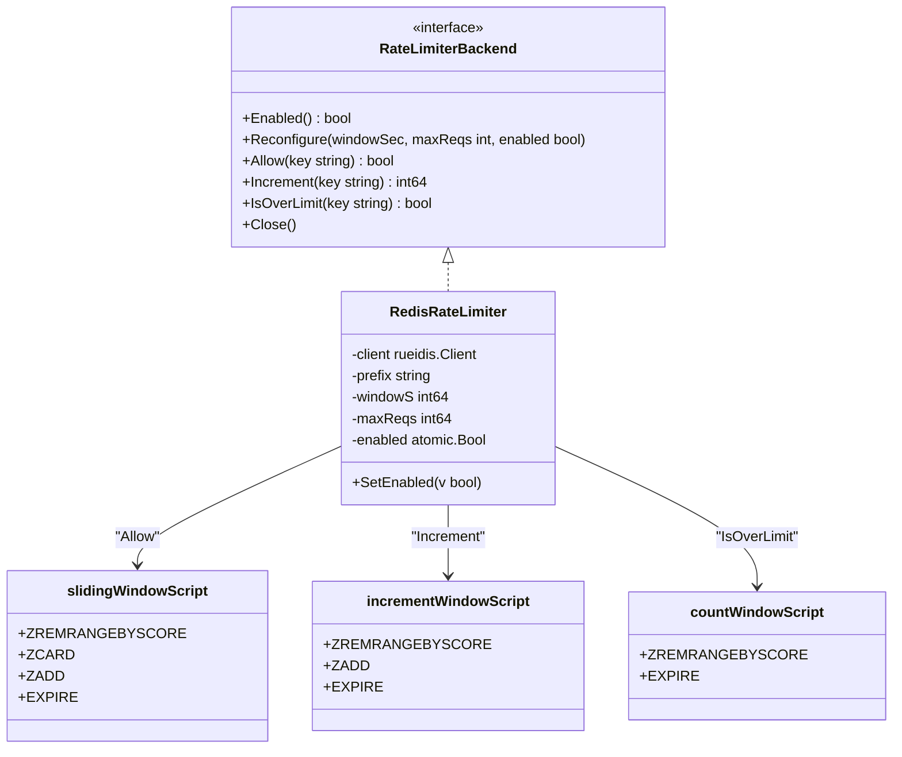
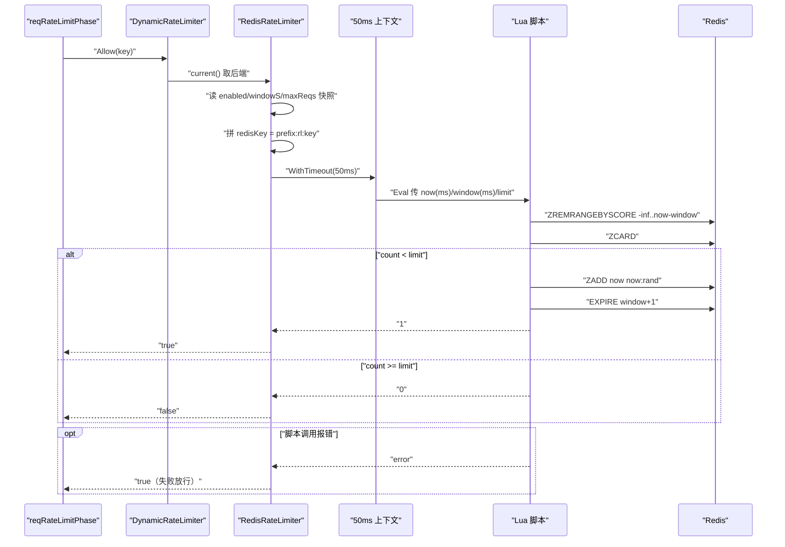
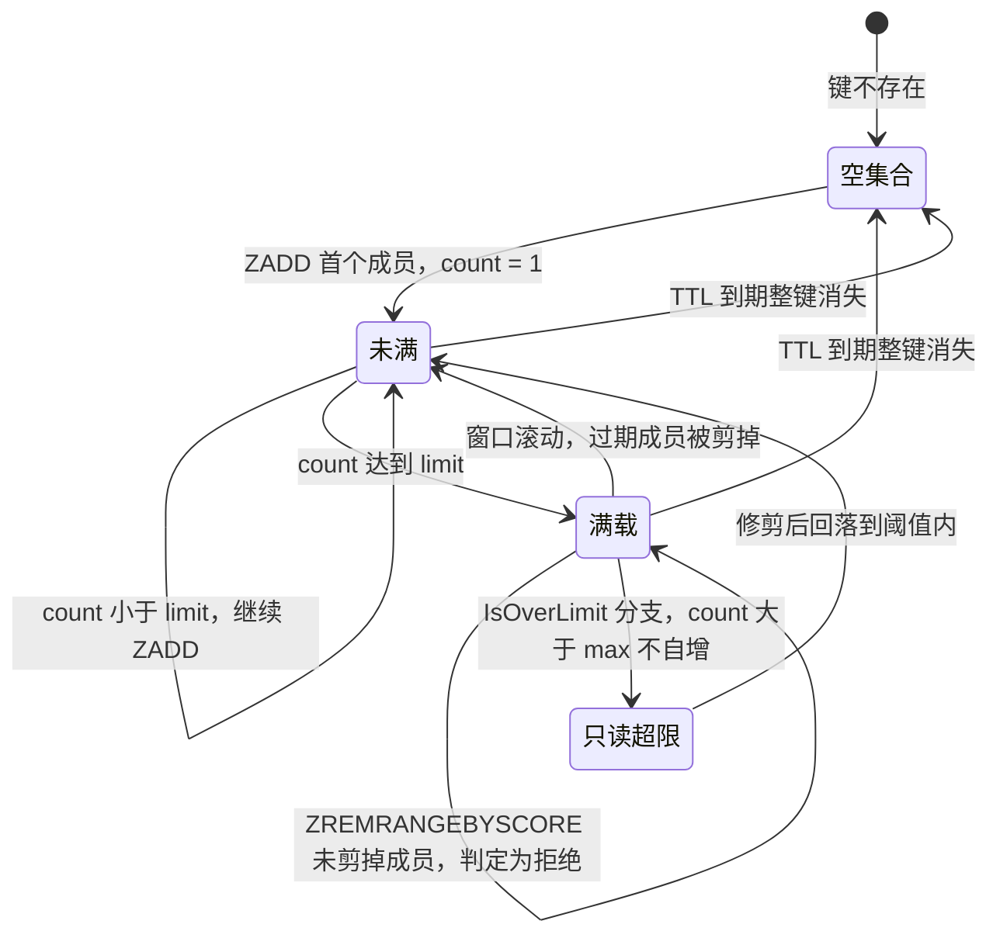
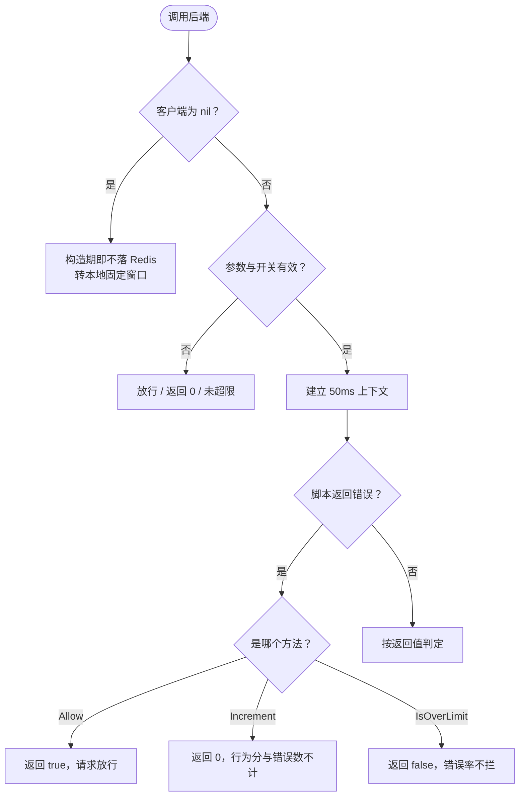
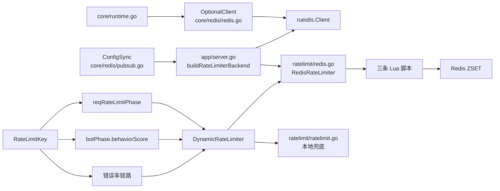

> [返回 安全防护功能](../安全防护功能.md)

# 分布式滑动窗口限流

<cite>
**本文档引用的文件**
- [redis.go](file://internal/waf/ratelimit/redis.go)
- [ratelimit.go](file://internal/waf/ratelimit/ratelimit.go)
- [dynamic.go](file://internal/waf/ratelimit/dynamic.go)
- [redis_test.go](file://internal/waf/ratelimit/redis_test.go)
- [phases.go](file://internal/core/rules/phases.go)
- [matcher.go](file://internal/core/rules/matcher.go)
- [engine.go](file://internal/core/engine/engine.go)
- [server.go](file://internal/app/server.go)
- [runtime.go](file://internal/core/runtime.go)
- [redis.go](file://internal/core/redis/redis.go)
- [pubsub.go](file://internal/core/redis/pubsub.go)
- [protection.go](file://internal/store/protection.go)
- [site.go](file://internal/store/site.go)
- [build.go](file://internal/snapshot/build.go)
- [snapshot.go](file://internal/snapshot/snapshot.go)
- [handler_support.go](file://internal/dataplane/handler_support.go)
- [handler.go](file://internal/dataplane/handler.go)
- [bot.go](file://internal/waf/bot/bot.go)
</cite>

## 目录

1. [简介](#简介)
2. [项目结构](#项目结构)
3. [核心组件](#核心组件)
4. [架构总览](#架构总览)
5. [详细组件分析](#详细组件分析)
6. [依赖关系分析](#依赖关系分析)
7. [性能考虑](#性能考虑)
8. [故障排查指南](#故障排查指南)
9. [结论](#结论)
10. [附录](#附录)

## 简介

本篇只讲 `internal/waf/ratelimit/redis.go` 中的 `RedisRateLimiter`：以 Redis 有序集合承载滑动窗口、以三条 Lua 脚本保证单往返原子性的分布式限流后端。它与本地固定窗口实现共享 `RateLimiterBackend` 契约，由 `DynamicRateLimiter` 在运行时择优注入，因此 Redis 是**可选**依赖而非前置条件：客户端为 `nil` 时构造函数直接返回 `nil`，装配层随即落回本地实现。

本篇覆盖的内容按风险从高到低排列：

- 窗口边界的精确定义与它与「配额」之间的比较口径差异（`Allow` 与 `IsOverLimit` 相差一个请求）。
- 三条 Lua 脚本的逐指令语义、单键约束与集群可用性。
- 时间来源全部取自 WAF 节点时钟，因而存在的时钟漂移影响与缓解手段。
- Redis 报错与超时构成的三条独立失败路径，以及它们的共同取向：失败即放行。
- ZSET 的规模上界，以及 `Allow` 路径与 `Increment` 路径在上界上的本质区别。
- TTL 计算单位与窗口参数不一致造成的键滞留问题，这是键基数上限的主导因素。

计数键的真实构成是 `bind|siteID|归一化 Host|clientIP` 四段（`phases.go:63-70`），旧文档所写的「IP + Host」已不成立；bot 行为分在此基础上追加 `|bot` 后缀（`phases.go:501-512`）。

**章节来源**
- [redis.go:13-37](file://internal/waf/ratelimit/redis.go#L13-L37)
- [redis.go:77-113](file://internal/waf/ratelimit/redis.go#L77-L113)
- [phases.go:63-70](file://internal/core/rules/phases.go#L63-L70)
- [phases.go:501-512](file://internal/core/rules/phases.go#L501-L512)
- [ratelimit.go:10-17](file://internal/waf/ratelimit/ratelimit.go#L10-L17)

## 项目结构

### 模块清单

| 模块 | 路径 | 职责 | 关键符号与位置 |
|------|------|------|----------------|
| 滑动窗口后端 | `internal/waf/ratelimit/redis.go` | ZSET 窗口与三条脚本 | `RedisRateLimiter` :13-20，`Allow` :115-139 |
| 脚本定义 | 同上 | 判定、自增、只读计数 | `slidingWindowScript` :77-92，`incrementWindowScript` :94-103，`countWindowScript` :105-113 |
| 后端包装 | `internal/waf/ratelimit/dynamic.go` | 运行时替换，免重建引擎 | `Swap` :23-32，委托方法 :34-68 |
| 后端择优 | `internal/app/server.go` | Redis 优先、本地兜底 | `buildRateLimiterBackend` :123-129 |
| 客户端与降级 | `internal/core/redis/redis.go`、`internal/core/runtime.go` | 可选构造与连通性探测 | `OptionalClient` :18-34，降级 :99-116 |
| 键构造 | `internal/core/rules/phases.go` | 四段键与 Host 归一化 | `RateLimitKey` :63-70 |
| 消费方 | `internal/core/rules/phases.go`、`internal/dataplane/handler_support.go` | 判定与旁路计数 | :316-341、:355-422 |
| 配置模型 | `internal/store/protection.go` | 窗口、配额、动作 | 字段 :14-25，默认值 :159-168 |

### 结构分层

| 层 | 对象 | 该层职责 | 失败归属 |
|----|------|----------|----------|
| 判定层 | `reqRateLimitPhase` | 构键、调用 `Allow`、映射动作 | 后端放行即放行 |
| 委托层 | `DynamicRateLimiter` | 取当前后端并转发 | 后端 `nil` 即放行 |
| 算法层 | `RedisRateLimiter` | 参数快照、超时、脚本调用 | 任何错误都返回放行/零/未超限 |
| 传输层 | `rueidis.Client` | 命令与脚本往返 | 由上层吞掉，不上抛 |
| 存储层 | Redis | ZSET 读写与过期 | 不可用时整条链路退化为「不限流」 |

**章节来源**
- [redis.go:13-20](file://internal/waf/ratelimit/redis.go#L13-L20)
- [dynamic.go:7-68](file://internal/waf/ratelimit/dynamic.go#L7-L68)
- [server.go:123-129](file://internal/app/server.go#L123-L129)
- [redis.go:18-34](file://internal/core/redis/redis.go#L18-L34)
- [runtime.go:99-116](file://internal/core/runtime.go#L99-L116)
- [phases.go:316-341](file://internal/core/rules/phases.go#L316-L341)

## 核心组件

### 代码上下文

| 符号 | 文件:行 | 签名 | 语义 | 调用方 |
|------|---------|------|------|--------|
| `NewRedisRateLimiter` | `redis.go:22-37` | `func(client, prefix, windowSec, maxReqs, enabled) *RedisRateLimiter` | 客户端为 `nil` 返回 `nil`；参数非正则停用 | `buildRateLimiterBackend` |
| `slidingWindowScript` | `redis.go:77-92` | Lua，`KEYS[1]` + `ARGV[1..3]` | 修剪、计数、条件写入、续期，返回 1/0 | `Allow` |
| `incrementWindowScript` | `redis.go:94-103` | Lua，`KEYS[1]` + `ARGV[1..2]` | 修剪、无条件写入、续期，返回计数 | `Increment` |
| `countWindowScript` | `redis.go:105-113` | Lua，`KEYS[1]` + `ARGV[1..2]` | 修剪、续期，返回计数，不写入 | `IsOverLimit` |
| `Allow` | `redis.go:115-139` | `func(key string) bool` | 单次 50ms 往返，异常返回 `true` | `reqRateLimitPhase` |
| `Increment` | `redis.go:142-165` | `func(key string) int64` | 异常返回 0 | `botPhase.behaviorScore`、错误率累加 |
| `IsOverLimit` | `redis.go:168-192` | `func(key string) bool` | `count > maxReqs`，异常返回 `false` | `shouldApplyErrorRateLimit` |
| `Reconfigure` | `redis.go:63-75` | `func(windowSec, maxReqs, enabled)` | 原地改参，保留既有 ZSET | 热重载 |
| `Close` | `redis.go:194` | `func()` | 空实现，客户端生命周期不归它管 | `Swap` |

### 组件关系

**图表来源**
- [redis.go:13-20](file://internal/waf/ratelimit/redis.go#L13-L20)
- [redis.go:50-113](file://internal/waf/ratelimit/redis.go#L50-L113)
- [redis.go:115-194](file://internal/waf/ratelimit/redis.go#L115-L194)
- [ratelimit.go:10-17](file://internal/waf/ratelimit/ratelimit.go#L10-L17)

**章节来源**
- [redis.go:22-194](file://internal/waf/ratelimit/redis.go#L22-L194)
- [server.go:123-129](file://internal/app/server.go#L123-L129)
- [phases.go:310-312](file://internal/core/rules/phases.go#L310-L312)
- [bot.go:649-663](file://internal/waf/bot/bot.go#L649-L663)

## 架构总览

一次 `Allow` 调用的完整链路如下。图中只表达调用与返回次序，参数取值与脚本指令语义见后文表格。

**图表来源**
- [redis.go:115-139](file://internal/waf/ratelimit/redis.go#L115-L139)
- [redis.go:77-92](file://internal/waf/ratelimit/redis.go#L77-L92)
- [dynamic.go:16-21](file://internal/waf/ratelimit/dynamic.go#L16-L21)
- [phases.go:316-341](file://internal/core/rules/phases.go#L316-L341)

流程步骤的逐步分解与上表不重复，聚焦判定条件：

| 序 | 步骤 | 代码位置 | 判定要点 |
|:--:|------|----------|----------|
| 1 | 后端 `nil` 或未启用短路 | `redis.go:116-124` | `nil` 接收者返回 `true` |
| 2 | 参数三元组一致快照读取 | `redis.go:119-123` | `configMu` 读锁一次取全 |
| 3 | 窗口或配额非正即放行 | `redis.go:124-126` | 与本地实现同口径 |
| 4 | 建立 50ms 超时上下文 | `redis.go:127-128` | 每个方法各自建立 |
| 5 | 拼接 Redis 键 | `redis.go:130` | `prefix + ":rl:" + key` |
| 6 | 取节点毫秒时钟 | `redis.go:131` | 不使用 Redis `TIME` |
| 7 | 窗口换算为毫秒 | `redis.go:132` | `windowS * 1000` |
| 8 | 执行脚本并取整型返回 | `redis.go:134` | `AsInt64` |
| 9 | 报错即放行 | `redis.go:135-137` | 不记录、不重试 |
| 10 | 结果为 1 判允许 | `redis.go:138` | 其余值一律拒绝 |

**章节来源**
- [redis.go:115-139](file://internal/waf/ratelimit/redis.go#L115-L139)
- [phases.go:316-341](file://internal/core/rules/phases.go#L316-L341)
- [dynamic.go:16-21](file://internal/waf/ratelimit/dynamic.go#L16-L21)

## 详细组件分析

### 键空间与数据结构

| 键模板 | 结构 | 成员 | 分数 | TTL 实算 | 使用方 |
|--------|:----:|------|------|----------|--------|
| `openwaf:request:rl:` + 四段键 | ZSET | `毫秒时间戳:1..1000000` 随机串 | 毫秒时间戳 | 见下节缺陷 | `Allow`（`redis.go:130`） |
| 同上 + `\|bot` | ZSET | 同上 | 同上 | 同上 | `botPhase.behaviorScore`（`phases.go:506`） |
| `openwaf:error:rl:` + 四段键 | ZSET | 同上 | 同上 | 同上 | 错误率链路（`server.go:384`） |

键的四段来源依次为监听器绑定地址、站点主键、`NormalizeMatchHost` 归一化后的 Host、客户端 IP 串（`phases.go:63-70`、`snapshot.go:409-435`）。前缀由装配层写死为 `openwaf:request` 与 `openwaf:error`（`server.go:383-384`），因此请求限流与错误率限流在键空间上天然隔离，互不挤占。

三条脚本都只声明 `KEYS[1]`，不含跨键操作，故 Redis Cluster 下单键路由即可执行，无需 hash tag。

**章节来源**
- [redis.go:77-113](file://internal/waf/ratelimit/redis.go#L77-L113)
- [redis.go:130-132](file://internal/waf/ratelimit/redis.go#L130-L132)
- [phases.go:63-70](file://internal/core/rules/phases.go#L63-L70)
- [phases.go:501-512](file://internal/core/rules/phases.go#L501-L512)
- [snapshot.go:409-435](file://internal/snapshot/snapshot.go#L409-L435)
- [server.go:383-384](file://internal/app/server.go#L383-L384)
- [handler_support.go:355-357](file://internal/dataplane/handler_support.go#L355-L357)

### 窗口边界与脚本语义

滑动窗口的区间定义完全由脚本决定：`min_ts = now - window`，随后 `ZREMRANGEBYSCORE key -inf min_ts`。分数等于 `min_ts` 的成员会被删除，因此窗口是左开右闭区间 `(now-window, now]`。

| 指令 | 语义 | 在三条脚本中的出现 | 缺失后果 |
|------|------|--------------------|----------|
| `ZREMRANGEBYSCORE key -inf (now-window)` | 修剪窗口外成员 | 三条均有（`:84`、`:99`、`:110`） | 集合无界增长，计数永久偏大 |
| `ZCARD key` | 取当前窗口内事件数 | `:85`、`:102`、`:112` | 无法判定 |
| `ZADD key now now:rand` | 写入本次事件 | `:87`（条件）、`:100`（无条件） | 事件不计入 |
| `EXPIRE key (window+1)` | 续期整键 | `:88`、`:101`、`:111` | 空闲键永不回收 |
| `return 1 / 0` | 判定结果 | `:89`、`:91` | 上层无法区分 |

比较口径的差异是这套实现里最容易踩的一点：`Allow` 走 `count < limit` 才写入，故一个窗口内恰好通过 `limit` 个请求；`IsOverLimit` 走 `count > maxReqs` 才为真，故需先累积到 `maxReqs + 1` 个事件。两条路径相差一个事件。

**图表来源**
- [redis.go:77-92](file://internal/waf/ratelimit/redis.go#L77-L92)
- [redis.go:94-113](file://internal/waf/ratelimit/redis.go#L94-L113)
- [redis.go:168-192](file://internal/waf/ratelimit/redis.go#L168-L192)

**章节来源**
- [redis.go:77-113](file://internal/waf/ratelimit/redis.go#L77-L113)
- [redis.go:115-192](file://internal/waf/ratelimit/redis.go#L115-L192)

### 成员唯一性与碰撞风险

`ZADD` 的成员名是 `now .. ':' .. math.random(1, 1000000)`。同一毫秒内两次取到相同随机数时，成员名重复，`ZADD` 只更新分数而不新增成员，于是两个事件被计成一个。

| 同毫秒事件数 | 至少一次碰撞的近似概率 | 对判定的影响 |
|:------------:|:----------------------:|--------------|
| 10 | 约 0.005% | 可忽略 |
| 100 | 约 0.5% | 偶发少计一次 |
| 1000 | 约 39% | 显著少计，实际放过量高于配额 |
| 大于 1414 | 概率过半 | 随机空间 1e6 成为硬上界 |

这是设计上的取舍：随机后缀保证成员在跨毫秒场景下必然唯一，代价是同毫秒高并发时窗口会略微放松。对判定精度的要求若高于此，应缩短窗口或降低配额，使同毫秒事件数落回百位以内。

**章节来源**
- [redis.go:87](file://internal/waf/ratelimit/redis.go#L87)
- [redis.go:100](file://internal/waf/ratelimit/redis.go#L100)

### TTL 单位不一致与键滞留

三条脚本都以 `redis.call('EXPIRE', key, window + 1)` 续期，而 `window` 传入的是毫秒值（`redis.go:132` 计算 `windowMs := windowS * 1000` 后作为 `ARGV[2]`）。`EXPIRE` 的单位是秒，于是实际 TTL 是「窗口毫秒数 + 1 秒」。

| 配置窗口 | 期望 TTL | 实际 TTL | 偏差倍数 |
|:--------:|:--------:|:--------:|:--------:|
| 10 秒 | 11 秒 | 10001 秒（约 2.78 小时） | 约 910 倍 |
| 60 秒 | 61 秒 | 60001 秒（约 16.67 小时） | 约 984 倍 |
| 300 秒 | 301 秒 | 300001 秒（约 3.47 天） | 约 997 倍 |

后果不是判定错误——修剪逻辑保证计数正确——而是内存滞留：一个键在最后一次写入后的整个 TTL 周期内都不会消失，即便该客户端早已停止访问。键基数因此取决于「TTL 周期内出现过的不同四元组数」，而不是「当前活跃客户端数」。默认请求窗口 60 秒（`protection.go:161`）意味着近 17 小时的滞留窗口。

**章节来源**
- [redis.go:77-113](file://internal/waf/ratelimit/redis.go#L77-L113)
- [redis.go:130-134](file://internal/waf/ratelimit/redis.go#L130-L134)
- [protection.go:159-168](file://internal/store/protection.go#L159-L168)

### 时钟漂移

`now` 取自 WAF 节点的 `time.Now().UnixMilli()`（`redis.go:131`、`:157`、`:184`），Redis 自身的 `TIME` 从未被调用。这意味着窗口的时间轴由客户端节点定义，多节点部署时各节点写入的分数处于同一个 ZSET 中，却来自不同时钟。

| 场景 | 直接后果 | 对限流的影响 | 缓解 |
|------|----------|--------------|------|
| 节点 A 快 5 秒 | A 写入未来分数成员 | B 的 `now - window` 剪不掉它，窗口被拉长，判定偏严 | NTP 强制同步 |
| 节点 B 慢 5 秒 | B 的修剪下界偏早 | 有效成员被提前删除，判定偏松 | 同上 |
| 节点间偏差与窗口同量级 | 窗口边界随机漂移 | 配额越接近窗口长度，误差占比越大 | 放宽窗口或统一时钟源 |
| 节点时钟回拨 | 分数出现倒退成员 | 旧成员长期滞留直到被 TTL 回收 | 禁用闰秒回拨策略 |

由于三条脚本都不做单调性检查，任何时钟异常都表现为「计数偏移」而不是报错，因此不会触发失败放行路径，也就不会出现在 Redis 侧的监控里。排查时应优先比对节点与 Redis 服务器的时间差。

**章节来源**
- [redis.go:131](file://internal/waf/ratelimit/redis.go#L131)
- [redis.go:157](file://internal/waf/ratelimit/redis.go#L157)
- [redis.go:184](file://internal/waf/ratelimit/redis.go#L184)
- [redis.go:77-113](file://internal/waf/ratelimit/redis.go#L77-L113)

### Redis 失败路径

三条方法的失败返回值都朝「放行」方向取值，构成一个有意为之的失败开放矩阵。

**图表来源**
- [redis.go:22-37](file://internal/waf/ratelimit/redis.go#L22-L37)
- [redis.go:115-192](file://internal/waf/ratelimit/redis.go#L115-L192)
- [redis.go:18-34](file://internal/core/redis/redis.go#L18-L34)
- [runtime.go:99-116](file://internal/core/runtime.go#L99-L116)

| 方法 | 出错时返回 | 位置 | 对上游判定的影响 | 测试锚点 |
|------|------------|------|------------------|----------|
| `Allow` | `true` | `redis.go:135-137` | 该请求放行，不写窗口 | `redis_test.go:186-207` |
| `Increment` | `0` | `redis.go:161-163` | bot 行为分按 0 计算，错误事件丢失 | `redis_test.go:209-228` |
| `IsOverLimit` | `false` | `redis.go:188-190` | 错误率前置拦截不触发 | `redis_test.go:230-249` |
| `Enabled` | 不涉及 I/O | `redis.go:39-47` | 只反映本地开关位 | — |

失败路径没有重试与熔断：50ms 超时后即放弃该次调用，下一次请求仍会尝试。这与 `OptionalClient` 的构造期降级是两级不同的机制——后者只在启动或客户端重建时被评估一次（`runtime.go:99-116`、`server.go:1241-1245`）。

`ConnWriteTimeout` 为 3 秒、拨号超时 5 秒（`core/redis/redis.go:26-28`），但每次限流调用的上下文只有 50ms，因此真实上限是 50ms；`DisableCache: true` 又关闭了客户端响应缓存，意味着每次判定都是一次完整往返。

**章节来源**
- [redis.go:39-47](file://internal/waf/ratelimit/redis.go#L39-L47)
- [redis.go:115-192](file://internal/waf/ratelimit/redis.go#L115-L192)
- [redis.go:18-34](file://internal/core/redis/redis.go#L18-L34)
- [runtime.go:99-116](file://internal/core/runtime.go#L99-L116)
- [server.go:1241-1245](file://internal/app/server.go#L1241-L1245)
- [redis_test.go:186-249](file://internal/waf/ratelimit/redis_test.go#L186-L249)

### 键基数与内存上界

ZSET 的规模上界由「哪条路径在写入」决定，两者差别极大。

| 路径 | 写入条件 | 单键规模上界 | 说明 |
|------|----------|--------------|------|
| `Allow` | 仅当 `count < limit` 时 `ZADD` | 不超过配额本身 | 满载后不再写入，集合被配额钳住 |
| `Increment` | 无条件 `ZADD` | 窗口内的真实事件数 | 与配额无关，可远超配额 |
| `IsOverLimit` | 不写入 | 只剪不增 | 只读 |

据此可给出估算口径（非实测值，按成员名与分数的典型 Redis 编码开销估算）：

| 场景 | 参数 | 单键估算 | 键数 | 总量估算 |
|------|------|----------|------|----------|
| 请求限流满载 | 配额 300 | 约 300 成员 | 活跃四元组数 | 成员数线性于配额 |
| 行为分高流量 | 窗口 60 秒、单键 100 QPS | 约 6000 成员 | 活跃四元组数 | 明显高于限流路径 |
| 键滞留 | 窗口 60 秒，TTL 约 16.7 小时 | 冻结当时的成员数 | TTL 周期内出现过的四元组 | 主导因素 |

控制内存的三个变量因此是：配额（钳住 `Allow` 路径）、窗口长度（同时决定修剪半径与 TTL 滞留）、以及键的四元组基数（`bind`、`siteID`、Host、IP 的笛卡尔组合）。降低 `siteID` 与 `bind` 维度不能省内存，因为那是隔离语义所需；真正有效的是缩短窗口、控制暴露面使无效 Host 不产生新键，以及在 IP 维度前做聚合。

**章节来源**
- [redis.go:77-113](file://internal/waf/ratelimit/redis.go#L77-L113)
- [redis.go:142-165](file://internal/waf/ratelimit/redis.go#L142-L165)
- [phases.go:63-70](file://internal/core/rules/phases.go#L63-L70)
- [phases.go:501-510](file://internal/core/rules/phases.go#L501-L510)
- [bot.go:649-663](file://internal/waf/bot/bot.go#L649-L663)

### 与本地固定窗口的精度对照

| 维度 | 本地固定窗口 | Redis 滑动窗口 |
|------|--------------|----------------|
| 窗口对齐 | 整数秒，边界突变 | 毫秒滚动，无突变 |
| 最坏放过量 | 约 2 倍配额（相邻两窗） | 约配额 + 同毫秒碰撞误差 |
| 判定开销 | 一次锁 + 一次原子自增 | 一次 50ms 上限的往返 |
| 状态归属 | 单进程 | 全集群共享 |
| 失败模式 | 无外部依赖 | 一律放行 |
| 内存归属 | 本进程堆 | Redis 实例 |
| 计数持久性 | `Close` 即失 | 与进程无关，`Swap` 只换视图 |

`Reconfigure` 与 `Swap` 的区别在这里最关键：改窗口或改配额走 `Reconfigure`，既有 ZSET 完好（`redis.go:63-75`）；只有 Redis 客户端本身变化才走 `Swap` 并关闭旧后端（`dynamic.go:23-32`、`redis.go:194` 的空 `Close` 保证不会误关客户端）。

**章节来源**
- [redis.go:63-75](file://internal/waf/ratelimit/redis.go#L63-L75)
- [redis.go:194](file://internal/waf/ratelimit/redis.go#L194)
- [dynamic.go:23-32](file://internal/waf/ratelimit/dynamic.go#L23-L32)
- [ratelimit.go:96-118](file://internal/waf/ratelimit/ratelimit.go#L96-L118)

## 依赖关系分析

**图表来源**
- [redis.go:18-34](file://internal/core/redis/redis.go#L18-L34)
- [runtime.go:99-131](file://internal/core/runtime.go#L99-L131)
- [server.go:123-129](file://internal/app/server.go#L123-L129)
- [redis.go:22-192](file://internal/waf/ratelimit/redis.go#L22-L192)
- [dynamic.go:7-72](file://internal/waf/ratelimit/dynamic.go#L7-L72)
- [phases.go:63-70](file://internal/core/rules/phases.go#L63-L70)
- [pubsub.go:38-82](file://internal/core/redis/pubsub.go#L38-L82)

| 依赖方 | 被依赖方 | 强度 | 缺失后果 |
|--------|----------|:----:|----------|
| `RedisRateLimiter` | `rueidis.Client` | 强 | 构造返回 `nil`，装配层落回本地 |
| 三条脚本 | Redis 单键操作能力 | 强 | 报错即走失败放行 |
| `reqRateLimitPhase` | `RateLimiterBackend` | 弱 | `nil` 或未启用即放行 |
| `botPhase.behaviorScore` | `RateLimiterBackend` | 弱 | 行为分恒 0 |
| 错误率链路 | `RateLimiterBackend` + 快照三条件 | 强 | 任一不满足则不拦 |
| `ConfigSync` | `rueidis.Client` | 强 | 返回 `nil`，跨节点同步关闭 |

错误率链路对快照的额外要求值得单列：`errorRateLimitConfigEnabled` 同时校验开关、窗口为正、配额为正，原因是热重载期间后端可能仍保留上一代参数，只信 `Enabled()` 会用旧配额做新判定（`handler_support.go:368-374`）。

**章节来源**
- [redis.go:22-37](file://internal/waf/ratelimit/redis.go#L22-L37)
- [phases.go:317-321](file://internal/core/rules/phases.go#L317-L321)
- [phases.go:501-510](file://internal/core/rules/phases.go#L501-L510)
- [handler_support.go:359-374](file://internal/dataplane/handler_support.go#L359-L374)
- [handler.go:521](file://internal/dataplane/handler.go#L521)
- [pubsub.go:38-54](file://internal/core/redis/pubsub.go#L38-L54)
- [server.go:123-129](file://internal/app/server.go#L123-L129)

## 性能考虑

| 问题 | 优化手段 | 效果与代价 |
|------|----------|------------|
| 每请求一次网络往返 | 单条 Lua 完成修剪、计数、写入、续期 | 往返从多次降到一次；尾延迟受 RTT 支配 |
| Redis 抖动拖垮主链路 | 50ms 上下文超时，超时即放行 | 可用性优先；代价是故障期间等于不限流 |
| ZSET 无界增长 | 每次调用先 `ZREMRANGEBYSCORE` | 集合规模被窗口与配额双重约束 |
| 空闲键长期滞留 | `EXPIRE` 续期 | 因单位不一致而远超预期，见「TTL 单位不一致」 |
| 热点键集中单分片 | 键含 `bind`/`siteID`/Host/IP 四段 | 天然分散；极端单 IP 刷全站仍会集中 |
| 脚本重复传输 | 脚本以包级变量一次性构造 | 由客户端负责缓存与回退，进程内只编译一次 |

选型建议以判定开销为主轴：单节点或同机房多节点优先本地固定窗口；确需跨节点共享额度时才引入 Redis，并把窗口设为不小于 10 秒，以免 50ms 超时在跨地域链路上频繁触发。

**章节来源**
- [redis.go:77-139](file://internal/waf/ratelimit/redis.go#L77-L139)
- [redis.go:22-37](file://internal/waf/ratelimit/redis.go#L22-L37)
- [redis.go:18-34](file://internal/core/redis/redis.go#L18-L34)

## 故障排查指南

| 症状 | 可能根因 | 排查动作 | 处置 |
|------|----------|----------|------|
| 配额很小却几乎不拦 | Redis 报错触发失败放行 | 比对 Redis 可用性与延迟 | 修复链路或改用本地窗口 |
| 打开 Redis 后限流明显变松 | 50ms 超时在跨地域链路上频繁命中 | 测 RTT，观察 P99 | 就近部署或缩短判定频次 |
| ZSET 键数量异常庞大 | TTL 单位不一致叠加高键基数 | `SCAN` 统计 `openwaf:request:rl:` 前缀 | 缩短窗口，收敛暴露面 |
| 实际放过量高于配额 | 同毫秒成员碰撞 | 检查单键 QPS 是否达千级 | 缩短窗口或降低配额 |
| 多节点判定不一致 | 节点间时钟漂移 | 比对各节点与 Redis 时间 | 统一 NTP |
| 切换 Redis 后短时流量突增 | `Swap` 后视图归零，旧键要等修剪 | 观察切换时刻 | 预期行为，错峰操作 |
| 行为分始终为 0 | `Increment` 报错返回 0，或 `rateMax` 非正 | 查 `phases.go:501-510` 前置条件 | 修正配额参数 |

`Scan` 之类的运维命令只用于观察，不要在限流路径上执行；`KEYS` 在生产实例上会阻塞。失败放行不产生日志，因此定位必须依赖 Redis 侧监控（延迟、拒绝连接、`EVALSHA` 错误计数）而非应用日志。

**章节来源**
- [redis.go:115-192](file://internal/waf/ratelimit/redis.go#L115-L192)
- [redis.go:131](file://internal/waf/ratelimit/redis.go#L131)
- [redis.go:87](file://internal/waf/ratelimit/redis.go#L87)
- [dynamic.go:23-32](file://internal/waf/ratelimit/dynamic.go#L23-L32)
- [phases.go:501-510](file://internal/core/rules/phases.go#L501-L510)

## 结论

`RedisRateLimiter` 用三条单键 Lua 脚本把滑动窗口压缩成一次往返，精度、可用性与实现复杂度之间取了明确的优先序：可用性最高，其次是跨节点一致性，最后才是判定精度。这一取舍集中体现在三处——报错一律放行、50ms 上限、成员随机后缀可能少计——以及一处客观缺陷：`EXPIRE` 拿到的是毫秒数值却按秒解释，使空闲键滞留时间被放大约千倍。把它当作「Redis 可用时的增强项」来部署，而不是当作强约束的额度控制器，才与该实现的实际能力相符。

**章节来源**
- [本节为总结，无需特定文件来源]

## 附录

### 配置项速查

| 字段 | 类型 | 默认值 | 位置 | 站点继承 |
|------|------|--------|------|----------|
| `request_ratelimit_enabled` | `bool` | 未置位（假） | `protection.go:14`、`:159-168` | `rate_limit_enabled *bool`，`nil` 继承 |
| `request_ratelimit_window` | `int`（秒） | `60` | `protection.go:15`、`:161` | 站点值需大于 0 |
| `request_ratelimit_max` | `int` | `300` | `protection.go:16`、`:162` | 同上 |
| `request_ratelimit_action` | `string` | `rate_limit` | `protection.go:17`、`:163` | 站点值需非空 |
| `error_ratelimit_window` | `int`（秒） | `300` | `protection.go:20`、`:164` | 仅全局 |
| `error_ratelimit_max` | `int` | `30` | `protection.go:21`、`:165` | 仅全局 |

合并逻辑位于快照层：只有站点覆盖开关非 `nil` 时才读取从属字段，且要求值大于 0，否则保留全局值（`build.go:749-757`、`site.go:81-84`）。

### 脚本与超时清单

| 项 | 取值 | 位置 |
|----|------|------|
| 判定脚本 | `slidingWindowScript` | `redis.go:77-92` |
| 自增脚本 | `incrementWindowScript` | `redis.go:94-103` |
| 计数脚本 | `countWindowScript` | `redis.go:105-113` |
| 单调用超时 | 50ms | `redis.go:127`、`:153`、`:180` |
| 拨号超时 | 5s | `core/redis/redis.go:26` |
| 写超时 | 3s | `core/redis/redis.go:27` |
| 配置广播超时 | 2s | `core/redis/pubsub.go:77` |
| 广播频道 | `openwaf:config:reload` | `core/redis/pubsub.go:16` |
| 回环抑制 | `source_id` 相同即忽略 | `core/redis/pubsub.go:114-116` |

### 延伸阅读

- [本地固定窗口限流](本地固定窗口限流.md)
- [限流配置管理](限流配置管理.md)
- [速率限制机制](速率限制机制.md)
- [请求速率限制阶段](../../WAF%20引擎系统/处理阶段详解/请求速率限制阶段.md)

**章节来源**
- [protection.go:14-25](file://internal/store/protection.go#L14-L25)
- [protection.go:159-168](file://internal/store/protection.go#L159-L168)
- [site.go:81-84](file://internal/store/site.go#L81-L84)
- [build.go:749-757](file://internal/snapshot/build.go#L749-L757)
- [redis.go:77-192](file://internal/waf/ratelimit/redis.go#L77-L192)
- [redis.go:18-34](file://internal/core/redis/redis.go#L18-L34)
- [pubsub.go:16-116](file://internal/core/redis/pubsub.go#L16-L116)
