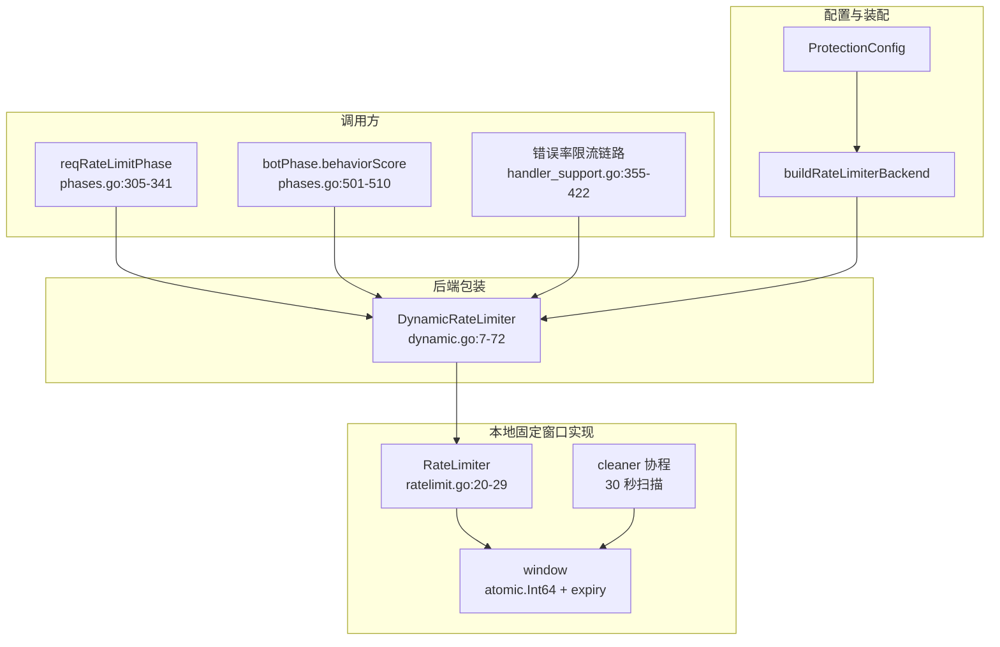
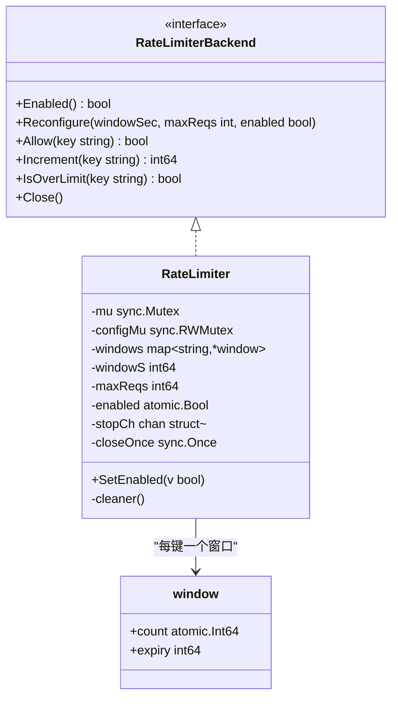
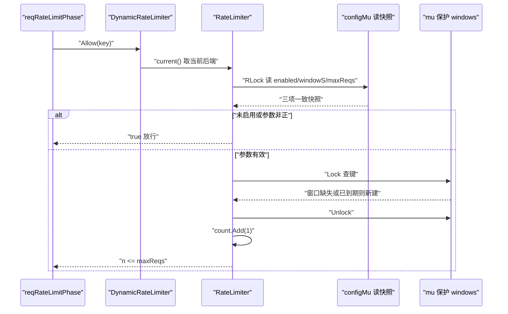
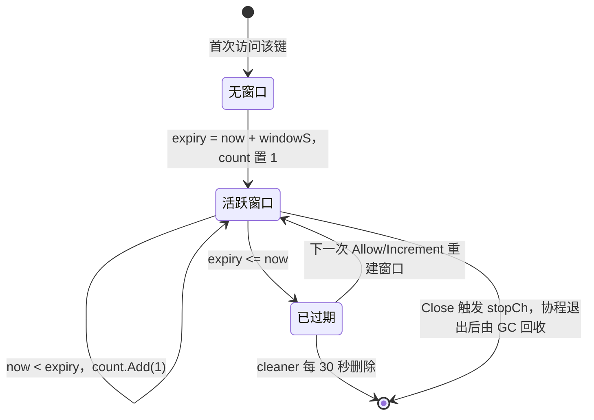
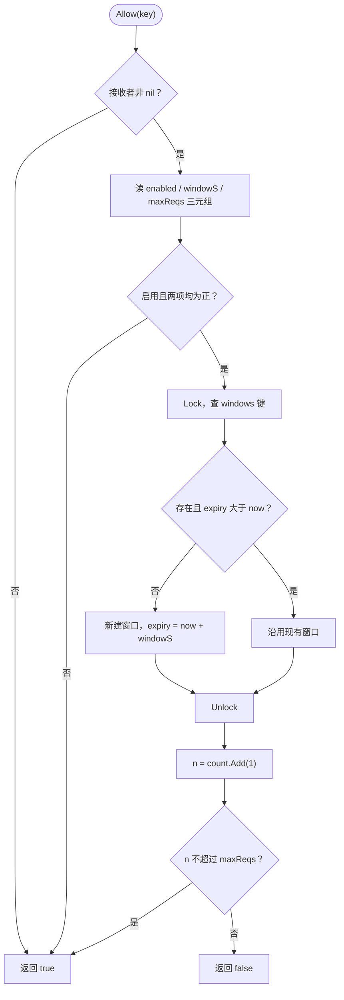
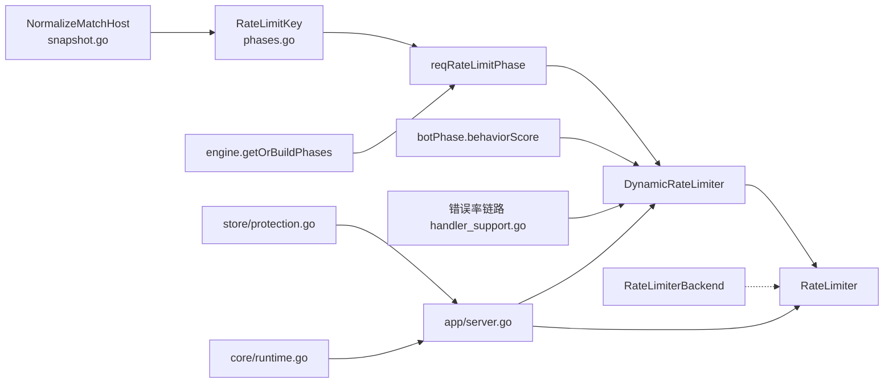
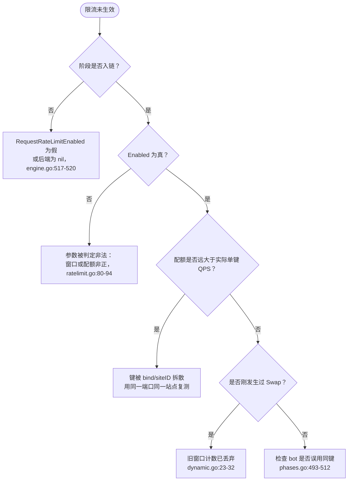

> [返回 安全防护功能](../安全防护功能.md)

# 本地固定窗口限流

<cite>
**本文档引用的文件**
- [ratelimit.go](file://internal/waf/ratelimit/ratelimit.go)
- [ratelimit_test.go](file://internal/waf/ratelimit/ratelimit_test.go)
- [ratelimit_extra_test.go](file://internal/waf/ratelimit/ratelimit_extra_test.go)
- [dynamic.go](file://internal/waf/ratelimit/dynamic.go)
- [redis.go](file://internal/waf/ratelimit/redis.go)
- [phases.go](file://internal/core/rules/phases.go)
- [matcher.go](file://internal/core/rules/matcher.go)
- [snapshot.go](file://internal/snapshot/snapshot.go)
- [engine.go](file://internal/core/engine/engine.go)
- [server.go](file://internal/app/server.go)
- [runtime.go](file://internal/core/runtime.go)
- [redis.go](file://internal/core/redis/redis.go)
- [protection.go](file://internal/store/protection.go)
- [site.go](file://internal/store/site.go)
- [site.go](file://internal/admin/site/site.go)
- [build.go](file://internal/snapshot/build.go)
- [pubsub.go](file://internal/core/redis/pubsub.go)
- [handler_support.go](file://internal/dataplane/handler_support.go)
- [protection.go](file://internal/admin/protect/protection.go)
- [bot.go](file://internal/waf/bot/bot.go)
</cite>

## 目录

1. [简介](#简介)
2. [项目结构](#项目结构)
3. [核心组件](#核心组件)
4. [架构总览](#架构总览)
5. [详细组件分析](#详细组件分析)
6. [依赖关系分析](#依赖关系分析)
7. [性能考虑](#性能考虑)
8. [故障排查指南](#故障排查指南)
9. [结论](#结论)
10. [附录](#附录)

## 简介

本篇只讲 `internal/waf/ratelimit/ratelimit.go` 中的 `RateLimiter`：一个进程内的固定窗口计数器。它是 Redis 滑动窗口不可用时的默认后端，也是单节点部署的推荐形态。选取该实现的理由有三点：

- 零外部依赖，判定路径不产生网络往返，尾延迟与请求处理线程绑定。
- 与 `RedisRateLimiter` 共享同一个 `RateLimiterBackend` 契约（`ratelimit.go:10-17`），装配层可在运行时互换两者而无需重建引擎。
- 参数非法时采取「整体停用」而非「全部拦截」的失效保护，避免零配额被解读成人为 429。

本篇覆盖：窗口结构与原子计数、`Allow`/`Increment`/`IsOverLimit` 的判定语义差异、`cleaner` 协程的回收粒度、无效参数的失效保护路径、配置来源与热重配，以及与滑动窗口的边界。计数键的真实构成是 `bind|siteID|归一化 Host|clientIP` 四段而非「IP + Host」，这一点在「限流键的构成」一节展开。

**章节来源**
- [ratelimit.go:9-51](file://internal/waf/ratelimit/ratelimit.go#L9-L51)
- [phases.go:63-70](file://internal/core/rules/phases.go#L63-L70)
- [dynamic.go:5-14](file://internal/waf/ratelimit/dynamic.go#L5-L14)

## 项目结构

### 模块定位

| 关注点 | 路径 | 关键符号与位置 |
|--------|------|----------------|
| 限流器本体 | `internal/waf/ratelimit/ratelimit.go` | `RateLimiter` :20-29，`window` :31-34 |
| 对外契约 | `internal/waf/ratelimit/ratelimit.go` | `RateLimiterBackend` :10-17 |
| 生命周期 | 同上 | `NewRateLimiter` :36-51，`Close` :164-173，`cleaner` :175-196 |
| 判定入口 | 同上 | `Allow` :96-118，`Increment` :121-141，`IsOverLimit` :144-162 |
| 配置入口 | `internal/store/protection.go` | 字段 :14-25，默认值 :159-168，校验 :135-143 |
| 后端选择 | `internal/app/server.go` | `buildRateLimiterBackend` :123-129，实例化 :383-384 |
| 阶段注入 | `internal/core/engine/engine.go` | `getOrBuildPhases` :441，限流段 :517-520 |
| 键构造 | `internal/core/rules/phases.go` | `RateLimitKey` :63-70 |
| 消费方 | `internal/core/rules/phases.go`、`internal/dataplane/handler_support.go` | `reqRateLimitPhase` :305-341，错误率链路 :355-422 |
| 单元测试 | `internal/waf/ratelimit/ratelimit_test.go`、`ratelimit_extra_test.go` | 配额边界 :7-19，失效保护 :100-133 |

单节点场景下该实现不需要任何 Redis 配置：`redis.OptionalClient` 在地址为空时直接返回 `nil`（`internal/core/redis/redis.go:19-21`），装配层随即落回本实现（`internal/core/runtime.go:99-116`）。

**章节来源**
- [ratelimit.go:10-34](file://internal/waf/ratelimit/ratelimit.go#L10-L34)
- [ratelimit.go:36-196](file://internal/waf/ratelimit/ratelimit.go#L36-L196)
- [server.go:123-129](file://internal/app/server.go#L123-L129)
- [engine.go:441](file://internal/core/engine/engine.go#L441)
- [redis.go:18-34](file://internal/core/redis/redis.go#L18-L34)
- [runtime.go:99-116](file://internal/core/runtime.go#L99-L116)
- [ratelimit_test.go:7-19](file://internal/waf/ratelimit/ratelimit_test.go#L7-L19)

### 结构关系

**图表来源**
- [phases.go:305-341](file://internal/core/rules/phases.go#L305-L341)
- [phases.go:501-510](file://internal/core/rules/phases.go#L501-L510)
- [handler_support.go:355-422](file://internal/dataplane/handler_support.go#L355-L422)
- [dynamic.go:7-72](file://internal/waf/ratelimit/dynamic.go#L7-L72)
- [ratelimit.go:20-34](file://internal/waf/ratelimit/ratelimit.go#L20-L34)
- [ratelimit.go:175-196](file://internal/waf/ratelimit/ratelimit.go#L175-L196)
- [server.go:123-129](file://internal/app/server.go#L123-L129)

**章节来源**
- [ratelimit.go:20-34](file://internal/waf/ratelimit/ratelimit.go#L20-L34)
- [dynamic.go:16-32](file://internal/waf/ratelimit/dynamic.go#L16-L32)

## 核心组件

### 组件清单

| 组件 | 类型 | 职责 | 位置 | 是否可 `nil` |
|------|------|------|------|:------------:|
| `RateLimiter` | 结构体 | 窗口映射与判定 | `ratelimit.go:20-29` | 是，`nil` 接收者全部放行 |
| `window` | 结构体 | 单键窗口状态（计数 + 到期秒） | `ratelimit.go:31-34` | 否，缺失即新建 |
| `RateLimiterBackend` | 接口 | 本地与 Redis 共同契约 | `ratelimit.go:10-17` | — |
| `cleaner` | 协程 | 周期回收到期窗口 | `ratelimit.go:175-196` | 随 `NewRateLimiter` 启动 |
| `DynamicRateLimiter` | 包装器 | 委托与运行时替换 | `dynamic.go:7-72` | 后端为 `nil` 时放行 |

**章节来源**
- [ratelimit.go:10-34](file://internal/waf/ratelimit/ratelimit.go#L10-L34)
- [ratelimit.go:175-196](file://internal/waf/ratelimit/ratelimit.go#L175-L196)
- [dynamic.go:7-72](file://internal/waf/ratelimit/dynamic.go#L7-L72)

### 对外方法集

接口只暴露六个方法，具体实现另有 `SetEnabled` 不在接口内，因此热重载路径不会调用它（`ratelimit.go:10-17`、`:63-78`）。所有方法都以 `if rl == nil` 开头，把「未装配」与「已停用」统一收敛为放行。

**图表来源**
- [ratelimit.go:10-17](file://internal/waf/ratelimit/ratelimit.go#L10-L17)
- [ratelimit.go:20-34](file://internal/waf/ratelimit/ratelimit.go#L20-L34)
- [ratelimit.go:63-78](file://internal/waf/ratelimit/ratelimit.go#L63-L78)
- [ratelimit.go:175-196](file://internal/waf/ratelimit/ratelimit.go#L175-L196)

### 代码上下文

| 符号 | 文件:行 | 签名 | 判定语义 | 调用方 |
|------|---------|------|----------|--------|
| `Allow` | `ratelimit.go:96-118` | `func(key string) bool` | 计数不超过配额则放行 | `reqRateLimitPhase.Execute` |
| `Increment` | `ratelimit.go:121-141` | `func(key string) int64` | 自增并返回当前计数，不做判定 | `botPhase.behaviorScore`、错误率链路 |
| `IsOverLimit` | `ratelimit.go:144-162` | `func(key string) bool` | 计数严格大于配额才为真，不自增 | `shouldApplyErrorRateLimit` |
| `Reconfigure` | `ratelimit.go:80-94` | `func(windowSec, maxReqs int, enabled bool)` | 一次提交三值，非法即停用 | `applyProtectionRuntimeConfig` |
| `SetEnabled` | `ratelimit.go:63-78` | `func(v bool)` | 拒绝把非法参数组合启用 | 仅测试与非接口路径 |
| `Enabled` | `ratelimit.go:53-61` | `func() bool` | 读取开关快照 | 阶段与包装器短路判定 |
| `Close` | `ratelimit.go:164-173` | `func()` | `sync.Once` 关闭清理协程 | `DynamicRateLimiter.Swap` |

**章节来源**
- [ratelimit.go:53-173](file://internal/waf/ratelimit/ratelimit.go#L53-L173)
- [phases.go:316-341](file://internal/core/rules/phases.go#L316-L341)
- [handler_support.go:359-422](file://internal/dataplane/handler_support.go#L359-L422)
- [dynamic.go:23-32](file://internal/waf/ratelimit/dynamic.go#L23-L32)
- [server.go:637-639](file://internal/app/server.go#L637-L639)

## 架构总览

本地限流器位于阶段链的第九个阶段，前置于签名与自定义规则；错误率链路则不在阶段链内，由数据面在响应后调用同一套方法。下图只表达时序，语义取值见后续表格。

| 层 | 参与对象 | 本实现的角色 |
|----|----------|--------------|
| 数据面 | `handler.go` | 计算错误率键，触发 `IsOverLimit`/`Increment` |
| 引擎 | `engine.go` | 开关为真且后端非 `nil` 时把阶段入链 |
| 规则阶段 | `reqRateLimitPhase` | 构键并调用 `Allow` |
| 限流执行 | `RateLimiter` | 窗口创建、计数、判定 |
| 装配 | `server.go` | 创建实例、`Reconfigure`、`Swap` 时 `Close` |

**图表来源**
- [ratelimit.go:96-118](file://internal/waf/ratelimit/ratelimit.go#L96-L118)
- [dynamic.go:16-21](file://internal/waf/ratelimit/dynamic.go#L16-L21)
- [phases.go:316-324](file://internal/core/rules/phases.go#L316-L324)
- [engine.go:517-520](file://internal/core/engine/engine.go#L517-L520)

**章节来源**
- [engine.go:441](file://internal/core/engine/engine.go#L441)
- [ratelimit.go:96-118](file://internal/waf/ratelimit/ratelimit.go#L96-L118)

## 详细组件分析

### 结构体与并发保护

窗口映射与配置参数由两把不同的锁分别守护，这是实现里最容易读错的一点。

| 字段 | 类型 | 保护方式 | 写入点 | 读取点 |
|------|------|----------|--------|--------|
| `mu` | `sync.Mutex` | 互斥 | 窗口新建 | `Allow`、`Increment`、`IsOverLimit`、`cleaner` |
| `configMu` | `sync.RWMutex` | 读写锁 | `SetEnabled`、`Reconfigure` | `Enabled`、`Allow`、`Increment`、`IsOverLimit` |
| `windows` | `map[string]*window` | `mu` | `Allow`、`Increment`、`cleaner` | 同上 |
| `windowS` / `maxReqs` | `int64` | `mu` 取值，`configMu` 提交 | `Reconfigure` | `Allow` 等一次读快照 |
| `enabled` | `atomic.Bool` | 原子 | `SetEnabled`、`Reconfigure` | 各判定入口 |
| `stopCh` | `chan struct{}` | 关闭信号 | `Close` | `cleaner` |
| `closeOnce` | `sync.Once` | 幂等 | `Close` | `Close` |

`Allow` 的关键设计是：先在 `configMu` 读锁下一次性取到 `enabled`、`windowS`、`maxReqs` 三项（`ratelimit.go:100-104`），再在 `mu` 下完成窗口查建并立即解锁，最后的自增走 `atomic.Int64`（`:116`）。因此临界区只覆盖 map 操作，计数完全无锁。`TestRateLimiterReconfigureAndAllowDoNotExposePartialConfig` 以 2000 轮「先置非法再恢复」与并发 `Allow` 交叉执行，验证读取到的永远是完整一致的参数三元组（`ratelimit_extra_test.go:143-159`）。

**章节来源**
- [ratelimit.go:20-29](file://internal/waf/ratelimit/ratelimit.go#L20-L29)
- [ratelimit.go:80-118](file://internal/waf/ratelimit/ratelimit.go#L80-L118)
- [ratelimit.go:121-162](file://internal/waf/ratelimit/ratelimit.go#L121-L162)
- [ratelimit_extra_test.go:143-159](file://internal/waf/ratelimit/ratelimit_extra_test.go#L143-L159)

### 限流键的构成

`RateLimiter` 自身不产生键，键由调用方构造。真实构成是四段（`phases.go:63-70`）：

| 键段 | 取值 | 为空时的表现 | 隔离目的 |
|------|------|--------------|----------|
| `bind` | 监听器绑定地址，如 `:443` | 空串，键以分隔符开头 | 同站点在不同监听端口各有一份额度 |
| `siteID` | 站点主键十进制串 | `0` | 通配兜底站点不与显式 host 站点互挤配额 |
| 归一化 Host | `snapshot.NormalizeMatchHost` | 空串 | 大小写、首尾空白、端口差异不得拆桶 |
| `clientIP` | `net.IP.String()` | `nil` 时写空串 | 客户端维度 |

Host 归一化只做三件事：小写化、去首尾空白、在末冒号后全是数字时剥离端口（`snapshot.go:409-435`）。数据面与规则阶段共用同一构造函数：`reqRateLimitPhase` 直接调用（`phases.go:320`），数据面经 `rateLimitKey` 转调（`handler_support.go:355-357`），CC 规则的 `ccRateKey` 亦同源（`matcher.go:107-109`）。

**章节来源**
- [phases.go:63-70](file://internal/core/rules/phases.go#L63-L70)
- [phases.go:320](file://internal/core/rules/phases.go#L320)
- [snapshot.go:409-435](file://internal/snapshot/snapshot.go#L409-L435)
- [handler_support.go:355-357](file://internal/dataplane/handler_support.go#L355-L357)
- [matcher.go:107-109](file://internal/core/rules/matcher.go#L107-L109)

### 窗口状态迁移

单个键的窗口在进程内只有三种状态，迁移条件全部由「到期秒」与当前秒比较决定。

**图表来源**
- [ratelimit.go:31-34](file://internal/waf/ratelimit/ratelimit.go#L31-L34)
- [ratelimit.go:108-117](file://internal/waf/ratelimit/ratelimit.go#L108-L117)
- [ratelimit.go:132-140](file://internal/waf/ratelimit/ratelimit.go#L132-L140)
- [ratelimit.go:175-196](file://internal/waf/ratelimit/ratelimit.go#L175-L196)

迁移的判定细节如下表，其中「已过期但仍在 map 中」是正常中间态，由下一次访问就地重建，而非由清理协程负责。

| 状态 | 判定条件 | 触发点 | 是否计数 |
|------|----------|--------|:--------:|
| 无窗口 | map 中不存在该键 | `Allow` :110、`Increment` :134 | 建窗后计数 |
| 活跃窗口 | `expiry > now` | 同上 | 是 |
| 已过期（滞留） | `expiry <= now` 且尚未被 `cleaner` 扫到 | `IsOverLimit` :156-161 | 判定仍读旧计数 |
| 已删除 | `cleaner` 遍历删除 | `cleaner` :185-189 | 否 |

`IsOverLimit` 是唯一不重建窗口的入口，因此它可能对已过期但未被清理的窗口返回「超限」。这一保守偏差只在错误率限流链路上出现，且下一次判定即会因窗口重建而消失。

**章节来源**
- [ratelimit.go:108-117](file://internal/waf/ratelimit/ratelimit.go#L108-L117)
- [ratelimit.go:132-140](file://internal/waf/ratelimit/ratelimit.go#L132-L140)
- [ratelimit.go:144-162](file://internal/waf/ratelimit/ratelimit.go#L144-L162)
- [ratelimit.go:175-196](file://internal/waf/ratelimit/ratelimit.go#L175-L196)

### Allow 的决策路径

**图表来源**
- [ratelimit.go:96-118](file://internal/waf/ratelimit/ratelimit.go#L96-L118)

| 序 | 步骤 | 代码位置 | 语义要点 |
|:--:|------|----------|----------|
| 1 | `nil` 接收者直接放行 | `:97-99` | 未装配等价于未启用 |
| 2 | 读参数三元组 | `:100-104` | `configMu` 读锁，一次取全 |
| 3 | 参数校验短路 | `:105-107` | 任一非正即放行，不产生计数 |
| 4 | 窗口查建 | `:109-115` | `mu` 临界区，过期即重建 |
| 5 | 原子自增 | `:116` | 锁外执行 |
| 6 | 配额比较 | `:117` | `n <= maxReqs`，故恰好放过 `maxReqs` 个 |

测试对该语义的直接锚定：配额 3 时前 3 个请求放行、第 4 个被拦（`ratelimit_test.go:7-19`）；`Reconfigure(60, 2, true)` 后同样在第 3 个请求拦截（`ratelimit_test.go:33-43`）。

**章节来源**
- [ratelimit.go:96-118](file://internal/waf/ratelimit/ratelimit.go#L96-L118)
- [ratelimit_test.go:7-19](file://internal/waf/ratelimit/ratelimit_test.go#L7-L19)
- [ratelimit_test.go:33-43](file://internal/waf/ratelimit/ratelimit_test.go#L33-L43)

### Increment 与 IsOverLimit 的语义差异

两者常被误认为同一判定的读写两面，实际存在三处差异。

| 维度 | `Increment` | `IsOverLimit` |
|------|-------------|---------------|
| 是否改变计数 | 是，自增后返回 | 否，只读 |
| 比较口径 | 无比较 | `count > maxReqs`，严格大于 |
| 窗口缺失时 | 重建窗口并计 1 | 返回 `false` |
| 参数非正时 | 返回 0，不建窗 | 返回 `false` |
| 停用校验项 | 只看 `enabled` 与 `windowS` | 只看 `enabled` 与 `maxReqs` |
| 主要调用方 | `botPhase.behaviorScore`、错误率累加 | 错误率前置拦截 |

差异的直接后果：`Allow` 用 `<=` 放行配额个请求，`IsOverLimit` 用 `>` 判定超限，两者在同一配额下的触发点相差一个请求。`ratelimit_extra_test.go` 中配额 2 时第 3 次 `Allow` 之后 `IsOverLimit` 才为真（`:39-49`），配额 3 时 2 次请求仍判为未超限（`:28-37`）。

**章节来源**
- [ratelimit.go:121-141](file://internal/waf/ratelimit/ratelimit.go#L121-L141)
- [ratelimit.go:144-162](file://internal/waf/ratelimit/ratelimit.go#L144-L162)
- [ratelimit_extra_test.go:28-49](file://internal/waf/ratelimit/ratelimit_extra_test.go#L28-L49)
- [phases.go:501-510](file://internal/core/rules/phases.go#L501-L510)
- [handler_support.go:359-365](file://internal/dataplane/handler_support.go#L359-L365)
- [bot.go:649-663](file://internal/waf/bot/bot.go#L649-L663)

### 无效参数的失效保护

三条入口对非法参数的处理方向一致：宁可停用，不可把零配额变成全量 429。

| 入口 | 输入条件 | 结果 | 位置 |
|------|----------|------|------|
| `NewRateLimiter` | `windowSec <= 0` 或 `maxReqs <= 0` | 强制 `enabled = false` 后仍启动 `cleaner` | `:36-51` |
| `Reconfigure` | 同上 | 提交新参数并把 `enabled` 置假 | `:80-94` |
| `SetEnabled(true)` | 当前参数非法 | 拒绝启用 | `:63-78` |
| `Allow` | 三元组任一非正 | 放行 | `:105-107` |
| `Increment` | `enabled` 为假或 `windowS <= 0` | 返回 0 | `:129-131` |
| `IsOverLimit` | `enabled` 为假或 `maxReqs <= 0` | 返回 `false` | `:152-154` |
| 持久化层 | 启用但窗口或配额非正 | `ValidateRateLimits` 返回错误 | `protection.go:135-143` |
| 控制面 | 窗口或配额为负 | 400 拒绝，即使处于停用状态 | `admin/protect/protection.go:305-318` |

`TestRateLimiterInvalidEnabledConfigFailsOpen` 覆盖窗口为 0、配额为 0、窗口为负三种输入，断言 `Enabled()` 为假且 `Allow` 放行（`ratelimit_extra_test.go:100-121`）；`TestRateLimiterSetEnabledCannotEnableInvalidConfig` 则确认恢复开关也无法激活非法组合（`:161-169`）。

**章节来源**
- [ratelimit.go:36-51](file://internal/waf/ratelimit/ratelimit.go#L36-L51)
- [ratelimit.go:63-94](file://internal/waf/ratelimit/ratelimit.go#L63-L94)
- [ratelimit.go:105-154](file://internal/waf/ratelimit/ratelimit.go#L105-L154)
- [protection.go:135-143](file://internal/store/protection.go#L135-L143)
- [protection.go:305-318](file://internal/admin/protect/protection.go#L305-L318)
- [ratelimit_extra_test.go:100-121](file://internal/waf/ratelimit/ratelimit_extra_test.go#L100-L121)
- [ratelimit_extra_test.go:161-169](file://internal/waf/ratelimit/ratelimit_extra_test.go#L161-L169)

### 清理协程与内存上界

`cleaner` 以 30 秒为固定周期扫描整张映射，删除 `expiry <= now` 的窗口；当映射长度归零时重建空 map，以释放底层数组容量（`ratelimit.go:175-196`）。`Close` 通过 `sync.Once` 关闭 `stopCh`，重复调用安全（`ratelimit.go:164-173`、`ratelimit_extra_test.go:135-141`）。

| 参数 | 取值 | 影响 |
|------|------|------|
| 扫描周期 | 30 秒，硬编码 | 窗口过期后最长滞留 30 秒 |
| 键的上界 | 周期内的不同 `(bind, siteID, host, ip)` 组合数 | 决定常驻内存规模 |
| 单窗口开销 | 一个 `window`（两个 `int64`）+ map 项 + 字符串键 | 与配额无关，远小于 Redis ZSET |
| 停用后行为 | 协程随实例存活直到 `Close` | 停用不清空映射，只停止写入 |

与 Redis 实现相比，本实现的内存规模与「活跃键数」成正比而与配额无关，Redis 侧则两者都相关。`DynamicRateLimiter.Swap` 在替换后端时关闭旧实例，因此运行期切换会把旧映射整体丢弃（`dynamic.go:23-32`）。

**章节来源**
- [ratelimit.go:164-196](file://internal/waf/ratelimit/ratelimit.go#L164-L196)
- [ratelimit_extra_test.go:135-141](file://internal/waf/ratelimit/ratelimit_extra_test.go#L135-L141)
- [dynamic.go:23-32](file://internal/waf/ratelimit/dynamic.go#L23-L32)

### 配置来源与热重配

| 字段 | 类型 | 默认值 | 位置 | 站点覆盖 |
|------|------|--------|------|----------|
| `request_ratelimit_enabled` | `bool` | 未置位（假） | `protection.go:14`、`:159-168` | `rate_limit_enabled *bool`，`nil` 继承 |
| `request_ratelimit_window` | `int`（秒） | `60` | `protection.go:15`、`:161` | 仅在站点值大于 0 时覆盖 |
| `request_ratelimit_max` | `int` | `300` | `protection.go:16`、`:162` | 同上 |
| `request_ratelimit_action` | `string` | `rate_limit` | `protection.go:17`、`:163` | 仅在站点值非空时覆盖 |

站点三态字段的从属关系由控制面在写入前收敛：`rate_limit_enabled` 为 `nil` 时，窗口、配额与动作会被一并清零，防止「继承开关但覆盖参数」的半吊子状态被持久化（`admin/site/site.go:505-524`，字段定义见 `store/site.go:81-84`）。快照合并仅在覆盖开关非 `nil` 时读取站点值，且要求大于 0（`build.go:749-757`）。

热重配路径是原地改参而非换后端：`applyProtectionRuntimeConfig` 对两个 `DynamicRateLimiter` 调 `Reconfigure`（`server.go:637-639`），窗口内既有计数因此得以保留。只有 Redis 客户端本身发生变化时才走 `Swap`（`server.go:1241-1245`）。

**章节来源**
- [protection.go:14-25](file://internal/store/protection.go#L14-L25)
- [protection.go:159-168](file://internal/store/protection.go#L159-L168)
- [site.go:81-84](file://internal/store/site.go#L81-L84)
- [site.go:505-524](file://internal/admin/site/site.go#L505-L524)
- [build.go:749-757](file://internal/snapshot/build.go#L749-L757)
- [server.go:637-639](file://internal/app/server.go#L637-L639)
- [server.go:1241-1245](file://internal/app/server.go#L1241-L1245)

### 与 Redis 滑动窗口的边界

| 维度 | 本地固定窗口 | Redis 滑动窗口 |
|------|--------------|----------------|
| 窗口形态 | 整数秒对齐，边界突变 | 毫秒级滚动 |
| 状态位置 | 进程内 map | Redis ZSET |
| 判定开销 | 一次锁 + 一次原子自增 | 一次 Lua 往返，50ms 超时 |
| 跨节点一致性 | 无，各节点独立配额 | 全集群共享受控额度 |
| 失败语义 | 无外部依赖 | 异常一律放行 |
| 内存上界 | 活跃键数 | 活跃键数 × 窗口内事件数 |
| 切换成本 | — | `Swap` 丢弃既有计数 |

选型判据与完整对照见 [速率限制机制](速率限制机制.md) 的「两种算法对照与选型判据」一节；Redis 侧实现细节见 [分布式滑动窗口限流](分布式滑动窗口限流.md)。本篇只对本地实现负责：它是默认后端，且在 Redis 缺失时始终可用。

**章节来源**
- [ratelimit.go:96-118](file://internal/waf/ratelimit/ratelimit.go#L96-L118)
- [redis.go:77-139](file://internal/waf/ratelimit/redis.go#L77-L139)
- [server.go:123-129](file://internal/app/server.go#L123-L129)

## 依赖关系分析

**图表来源**
- [phases.go:63-70](file://internal/core/rules/phases.go#L63-L70)
- [phases.go:305-341](file://internal/core/rules/phases.go#L305-L341)
- [snapshot.go:409-435](file://internal/snapshot/snapshot.go#L409-L435)
- [dynamic.go:7-32](file://internal/waf/ratelimit/dynamic.go#L7-L32)
- [ratelimit.go:10-29](file://internal/waf/ratelimit/ratelimit.go#L10-L29)
- [engine.go:517-520](file://internal/core/engine/engine.go#L517-L520)
- [server.go:123-129](file://internal/app/server.go#L123-L129)
- [runtime.go:99-116](file://internal/core/runtime.go#L99-L116)

| 依赖方 | 被依赖方 | 强度 | 缺失后果 |
|--------|----------|:----:|----------|
| `reqRateLimitPhase` | `RateLimiterBackend` | 弱 | `nil` 或未启用即放行 |
| `botPhase.behaviorScore` | `RateLimiterBackend` | 弱 | 行为分恒为 0，其余 bot 模块不受影响 |
| 错误率链路 | `RateLimiterBackend` | 弱 | 不产生 429 |
| `RateLimiter` | 标准库 `sync`、`sync/atomic`、`time` | 强 | 编译期依赖 |
| `server.go` | `store.ProtectionConfig` | 强 | 参数来源 |
| `server.go` | `rueidis.Client` | 弱 | 为 `nil` 时选本实现 |

`RateLimiter` 不引用任何 Redis 类型，可单独编译与单测，这是它作为降级目标的根本前提。配置广播频道 `openwaf:config:reload` 属于重载链路而非限流链路，两者只在「触发一次 `Reconfigure`」上相交（`core/redis/pubsub.go:16`、`:77`）。

**章节来源**
- [phases.go:317-321](file://internal/core/rules/phases.go#L317-L321)
- [phases.go:501-510](file://internal/core/rules/phases.go#L501-L510)
- [handler_support.go:359-365](file://internal/dataplane/handler_support.go#L359-L365)
- [ratelimit.go:3-7](file://internal/waf/ratelimit/ratelimit.go#L3-L7)
- [server.go:123-129](file://internal/app/server.go#L123-L129)
- [pubsub.go:16-77](file://internal/core/redis/pubsub.go#L16-L77)

## 性能考虑

| 问题 | 优化手段 | 效果与代价 |
|------|----------|------------|
| 锁竞争 | 参数读取用 `configMu` 读锁，映射操作只在 `mu` 下进行 | 临界区只覆盖 map 查找与新建 |
| 计数开销 | `window.count` 为 `atomic.Int64`，自增在解锁后执行 | 高并发下无原子争用以外的开销 |
| 参数撕裂 | 三元组在同一次 `RLock` 下读取 | 代价是多一次读锁 |
| 键基数膨胀 | 30 秒周期清理 + 空映射重建 | 清理粒度粗于窗口粒度，最长滞留 30 秒 |
| 边界突发 | 无内建平滑 | 固定窗口在窗口切换处最坏放过约 2 倍配额 |
| 协程泄漏 | `Close` 幂等关闭 `stopCh`，`ticker` 随 `defer` 停止 | 实例必须显式 `Close`，`Swap` 已代为处理 |

边界突发的量化例子：窗口 60 秒、配额 300 时，在第 59 秒与第 61 秒各打满 300 次请求，任意 60 秒滑动区间内实际通过 600 次。若业务对峰值平滑度敏感，应缩短窗口（例如 10 秒 / 配额 50）使边界误差按比例下降，而不是引入 Redis 往返。

**章节来源**
- [ratelimit.go:80-118](file://internal/waf/ratelimit/ratelimit.go#L80-L118)
- [ratelimit.go:175-196](file://internal/waf/ratelimit/ratelimit.go#L175-L196)
- [dynamic.go:23-32](file://internal/waf/ratelimit/dynamic.go#L23-L32)

## 故障排查指南

**图表来源**
- [engine.go:517-520](file://internal/core/engine/engine.go#L517-L520)
- [ratelimit.go:80-94](file://internal/waf/ratelimit/ratelimit.go#L80-L94)
- [phases.go:63-70](file://internal/core/rules/phases.go#L63-L70)
- [phases.go:493-512](file://internal/core/rules/phases.go#L493-L512)
- [dynamic.go:23-32](file://internal/waf/ratelimit/dynamic.go#L23-L32)

| 症状 | 根因 | 排查动作 | 处置 |
|------|------|----------|------|
| 打开开关但无人被限 | 窗口或配额非正，`Reconfigure` 把启用位强制置假 | 看 `ValidateRateLimits` 是否报错 | 填正整数 |
| 同一 IP 换端口即不受限 | 键含 `bind`，属预期隔离 | 固定 `bind` 复测 | 按监听器分别设配额 |
| 阈值像是减半 | bot 行为分与限流共用键 | 确认 bot 键带 `|bot` 后缀 | 属设计约束，勿改后缀 |
| 停用后内存不降 | `cleaner` 只删到期窗口，实例未 `Close` | 检查是否仍在 `DynamicRateLimiter` 中 | 由 `Swap`/`Close` 统一释放 |
| 刚超限就恢复 | 窗口按整数秒对齐，到期即清零 | 缩短窗口 | 接受粒度或改用滑动窗口 |

**章节来源**
- [ratelimit.go:36-51](file://internal/waf/ratelimit/ratelimit.go#L36-L51)
- [ratelimit.go:80-94](file://internal/waf/ratelimit/ratelimit.go#L80-L94)
- [ratelimit.go:164-196](file://internal/waf/ratelimit/ratelimit.go#L164-L196)
- [phases.go:493-512](file://internal/core/rules/phases.go#L493-L512)
- [protection.go:135-143](file://internal/store/protection.go#L135-L143)

## 结论

`RateLimiter` 把「固定窗口」这一经典算法收敛到不到两百行代码里，并用两把锁的分工换取热路径的低开销：参数三元组一致、计数无锁、映射有界。它的三条判定入口各有口径——`Allow` 用不大于配额放行、`Increment` 只自增、`IsOverLimit` 用严格大于判定——混用会得出与实际相反的阈值。作为默认后端与 Redis 缺失时的落点，它在整个速率限制体系中的角色是「基线」，而不是「简易版」。

**章节来源**
- [本节为总结，无需特定文件来源]

## 附录

### 窗口参数速查

| 项 | 取值 | 位置 |
|----|------|------|
| 窗口单位 | 秒（`int64` 秒级时间戳） | `ratelimit.go:33`、`:108` |
| 配额单位 | 请求数，恰好放行 `maxReqs` 个 | `ratelimit.go:117` |
| 清理周期 | 30 秒 | `ratelimit.go:176` |
| 全局默认窗口 / 配额 | 60 秒 / 300 | `protection.go:161-162` |
| 错误率默认窗口 / 配额 | 300 秒 / 30 | `protection.go:164-165` |
| 默认动作 | `rate_limit`，映射 429 | `protection.go:163`、`phases.go:336-338` |

### 术语与易混点

| 术语 | 含义 | 易混对象 | 区分依据 |
|------|------|----------|----------|
| 固定窗口 | 按整数秒对齐、到期即清零的计数窗口 | 滑动窗口 | 是否随时间连续修剪 |
| 配额 | 一个窗口内允许通过的请求数 | 阈值 | `IsOverLimit` 用严格大于，触发点差 1 |
| 后端 | 实现 `RateLimiterBackend` 的任一实例 | 包装器 | 包装器不含算法，只委托与替换 |
| 行为分窗口 | 限流键加 `|bot` 后缀 | 限流窗口 | 独立计数，避免重复计入 |
| 动态混淆 | `internal/waf/dynamic` 包 | 动态限流 | 前者是响应信封加密，与限流无关 |

### 延伸阅读

- [分布式滑动窗口限流](分布式滑动窗口限流.md)
- [限流配置管理](限流配置管理.md)
- [速率限制机制](速率限制机制.md)
- [请求速率限制阶段](../../WAF%20引擎系统/处理阶段详解/请求速率限制阶段.md)

**章节来源**
- [ratelimit.go:31-34](file://internal/waf/ratelimit/ratelimit.go#L31-L34)
- [ratelimit.go:108-117](file://internal/waf/ratelimit/ratelimit.go#L108-L117)
- [ratelimit.go:144-196](file://internal/waf/ratelimit/ratelimit.go#L144-L196)
- [phases.go:336-338](file://internal/core/rules/phases.go#L336-L338)
- [phases.go:512](file://internal/core/rules/phases.go#L512)
- [protection.go:159-168](file://internal/store/protection.go#L159-L168)
