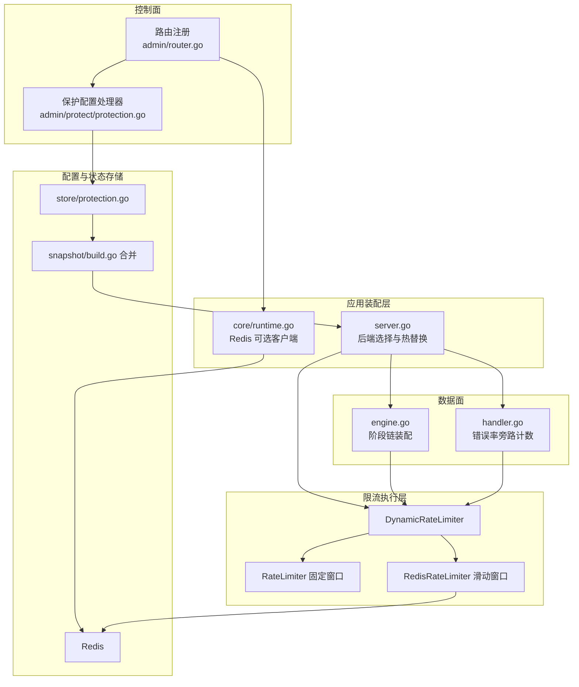
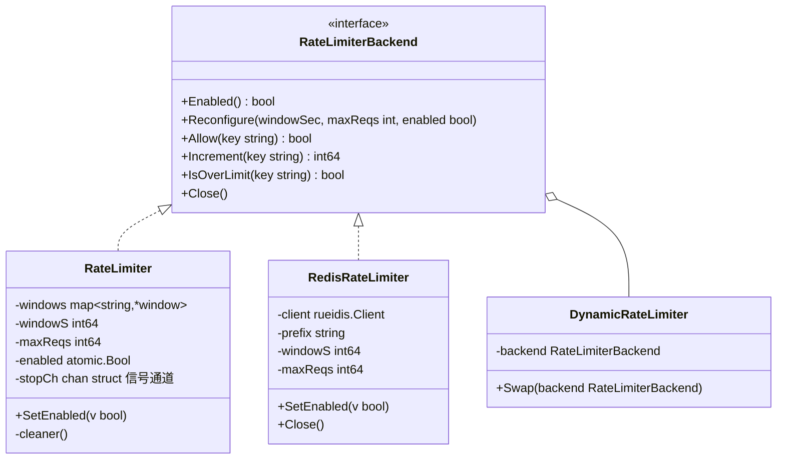
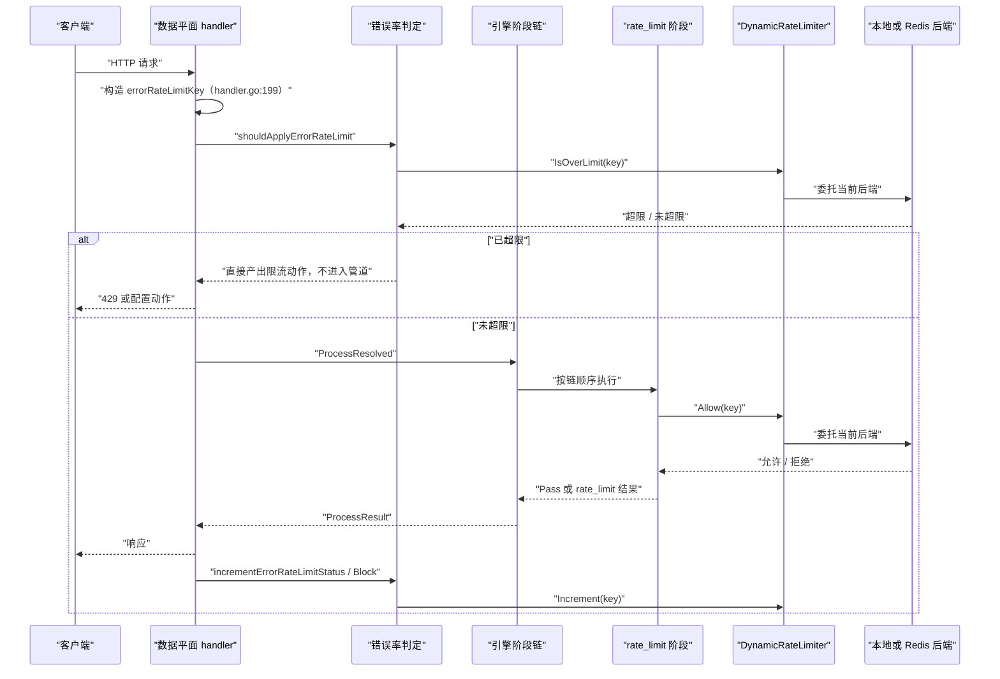
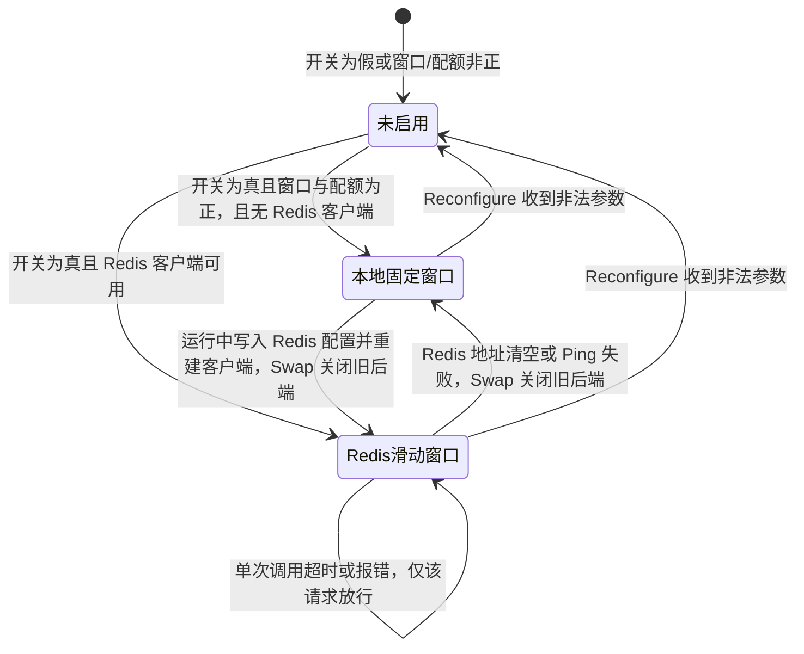
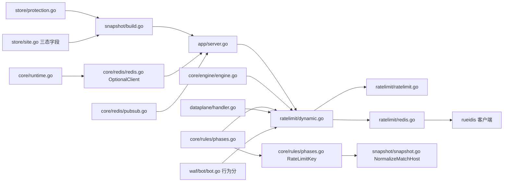
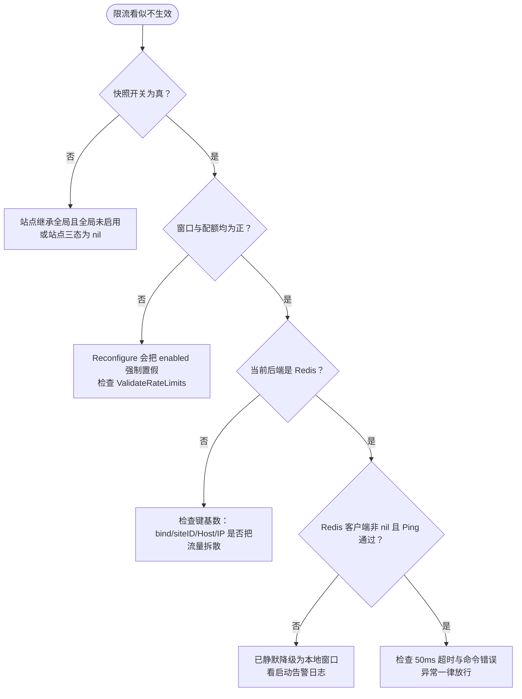

> [返回 安全防护功能](../安全防护功能.md)

# 速率限制机制

<cite>
**本文档引用的文件**
- [ratelimit.go](file://internal/waf/ratelimit/ratelimit.go)
- [redis.go](file://internal/waf/ratelimit/redis.go)
- [dynamic.go](file://internal/waf/ratelimit/dynamic.go)
- [phases.go](file://internal/core/rules/phases.go)
- [matcher.go](file://internal/core/rules/matcher.go)
- [validate.go](file://internal/core/rules/validate.go)
- [engine.go](file://internal/core/engine/engine.go)
- [build.go](file://internal/snapshot/build.go)
- [snapshot.go](file://internal/snapshot/snapshot.go)
- [protection.go](file://internal/store/protection.go)
- [site.go](file://internal/store/site.go)
- [server.go](file://internal/app/server.go)
- [redis.go](file://internal/core/redis/redis.go)
- [pubsub.go](file://internal/core/redis/pubsub.go)
- [runtime.go](file://internal/core/runtime.go)
- [redis_kv.go](file://internal/cache/redis_kv.go)
- [handler.go](file://internal/dataplane/handler.go)
- [handler_support.go](file://internal/dataplane/handler_support.go)
- [resource_aggregator.go](file://internal/dataplane/resource_aggregator.go)
- [metrics.go](file://internal/dataplane/metrics/metrics.go)
- [escalation.go](file://internal/waf/escalation/escalation.go)
- [iprep.go](file://internal/waf/iprep/iprep.go)
- [bot.go](file://internal/waf/bot/bot.go)
- [action.go](file://internal/core/action/action.go)
- [protection.go](file://internal/admin/protect/protection.go)
- [helpers.go](file://internal/admin/shared/helpers.go)
- [router.go](file://internal/admin/router.go)
</cite>

## 目录

1. [简介](#简介)
2. [项目结构](#项目结构)
3. [核心组件](#核心组件)
4. [架构总览](#架构总览)
5. [详细组件分析](#详细组件分析)
6. [依赖关系分析](#依赖关系分析)
7. [性能考虑](#性能考虑)
8. [故障排查指南](#故障排查指南)
9. [结论](#结论)
10. [附录](#附录)

## 简介

本篇是「速率限制机制」域的总览，负责把分散在三篇子文档中的事实收敛为一份可对账的索引：

- 两套限流算法：本地固定窗口（`RateLimiter`）与 Redis 滑动窗口（`RedisRateLimiter`），由 `DynamicRateLimiter` 统一包装成可在运行时互换的后端。
- 三条计数链路：请求频率限制（引擎 `rate_limit` 阶段）、错误频率限制（数据面响应后旁路计数）、bot 行为分（复用请求限流后端但使用独立键后缀）。
- 一条与限流器无关的频次通道：CC 自定义规则编译出的 `cc_rate` 复合匹配器，自带内存窗口状态，不经 `RateLimiterBackend`。
- Redis 是**可选**依赖：客户端由 `redis.OptionalClient` 构造，地址为空或连通性探测失败时返回 `nil`，限流后端自动退化为本地实现，不存在「必须部署 Redis」的前提。
- 限流键的真实构成是 `bind|siteID|归一化 Host|clientIP` 四段，旧文档所写的「IP + Host」已不成立。
- 站点级限流字段是三态语义：`rate_limit_enabled` 为 `*bool`，`nil` 表示继承全局，非 `nil` 才允许覆盖窗口与配额。

需要特别澄清的命名冲突：`internal/waf/dynamic` 包是**动态混淆 / 响应信封加密**子系统，与「动态限流」无关；本域所说的运行时可替换后端位于 `internal/waf/ratelimit/dynamic.go`。

**章节来源**
- [ratelimit.go:9-17](file://internal/waf/ratelimit/ratelimit.go#L9-L17)
- [dynamic.go:5-14](file://internal/waf/ratelimit/dynamic.go#L5-L14)
- [phases.go:54-70](file://internal/core/rules/phases.go#L54-L70)
- [redis.go:18-34](file://internal/core/redis/redis.go#L18-L34)
- [site.go:81-84](file://internal/store/site.go#L81-L84)

## 项目结构

### 模块清单

与速率限制直接相关的模块及其归属层如下。层归属以「谁在请求路径上调用」为准，而不是以目录位置为准。

| 模块 | 路径 | 职责 | 关键符号与位置 | 所属层 |
|------|------|------|----------------|--------|
| 本地固定窗口限流器 | `internal/waf/ratelimit/ratelimit.go` | 内存窗口计数与过期清理 | `RateLimiter` 结构体 :20-29，`Allow` :96-118，`cleaner` :175-196 | 限流执行 |
| Redis 滑动窗口限流器 | `internal/waf/ratelimit/redis.go` | 基于 ZSET 的跨节点窗口 | `RedisRateLimiter` :13-20，`slidingWindowScript` :77-92 | 限流执行 |
| 后端包装器 | `internal/waf/ratelimit/dynamic.go` | 运行时替换后端，免重建引擎 | `DynamicRateLimiter` :7-10，`Swap` :23-32 | 限流执行 |
| 请求限流阶段 | `internal/core/rules/phases.go` | 阶段链中的 `rate_limit` 判定 | `reqRateLimitPhase` :305-308，`Execute` :316-341 | 规则阶段 |
| 限流键构造 | `internal/core/rules/phases.go` | 四段键拼接与 Host 归一化 | `RateLimitKey` :63-70 | 规则阶段 |
| bot 行为分 | `internal/core/rules/phases.go` | 独立 `|bot` 后缀窗口换算 | `behaviorScore` :501-510，`botBehaviorKeySuffix` :512 | 规则阶段 |
| CC 频次匹配器 | `internal/core/rules/matcher.go` | `cc_rate` 自有内存窗口 | `ccRateMatcher` :25-31，`Match` :47-91 | 规则阶段 |
| 阶段链装配 | `internal/core/engine/engine.go` | 按配置决定是否入链并注入后端 | `getOrBuildPhases` :441，限流段 :517-520，`ErrRateLimiter` :591 | 引擎 |
| 数据面错误率链路 | `internal/dataplane/handler_support.go` | 超限前置判定与响应后累加 | `shouldApplyErrorRateLimit` :359-365，`incrementErrorRateLimitStatus` :402-412 | 数据面 |
| 后端选择与热替换 | `internal/app/server.go` | Redis/本地择优、参数重配、客户端切换 | `buildRateLimiterBackend` :123-129，`applyProtectionRuntimeConfig` :637-639，`Swap` :1241-1245 | 应用装配 |
| Redis 可选客户端 | `internal/core/redis/redis.go`、`internal/core/runtime.go` | 构造与连通性探测，失败即降级 | `OptionalClient` :18-34，`Ping` :37-42，降级判定 `runtime.go` :99-116 | 基础设施 |
| 配置模型 | `internal/store/protection.go`、`internal/store/site.go` | 全局字段与站点三态覆盖 | 字段 :14-23，默认值 :161-170，站点字段 `site.go` :81-84 | 存储 |
| 配置合并 | `internal/snapshot/build.go` | 站点非 nil 才覆盖，且要求大于 0 | `mergeProtection` :707-759，限流段 :749-757 | 快照 |
| 控制面入口 | `internal/admin/protect/protection.go` | 读改写与负值/零配额校验 | `GetProtectionSettings` :18-27，`validateRateLimitConfig` :305-318 | 控制面 |

**章节来源**
- [ratelimit.go:20-29](file://internal/waf/ratelimit/ratelimit.go#L20-L29)
- [redis.go:13-20](file://internal/waf/ratelimit/redis.go#L13-L20)
- [dynamic.go:7-32](file://internal/waf/ratelimit/dynamic.go#L7-L32)
- [phases.go:305-341](file://internal/core/rules/phases.go#L305-L341)
- [engine.go:517-520](file://internal/core/engine/engine.go#L517-L520)
- [handler_support.go:359-412](file://internal/dataplane/handler_support.go#L359-L412)
- [server.go:123-129](file://internal/app/server.go#L123-L129)
- [runtime.go:99-116](file://internal/core/runtime.go#L99-L116)
- [protection.go:14-23](file://internal/store/protection.go#L14-L23)
- [build.go:707-759](file://internal/snapshot/build.go#L707-L759)

### 协作结构

下图只表达模块之间的调用方向，属性取值见上方清单表，不做重复。



**图表来源**
- [server.go:123-129](file://internal/app/server.go#L123-L129)
- [server.go:383-384](file://internal/app/server.go#L383-L384)
- [runtime.go:99-131](file://internal/core/runtime.go#L99-L131)
- [engine.go:116-125](file://internal/core/engine/engine.go#L116-L125)
- [handler.go:199](file://internal/dataplane/handler.go#L199)
- [protection.go:18-27](file://internal/admin/protect/protection.go#L18-L27)
- [router.go:152](file://internal/admin/router.go#L152)
- [router.go:287](file://internal/admin/router.go#L287)

**章节来源**
- [server.go:383-384](file://internal/app/server.go#L383-L384)
- [runtime.go:99-131](file://internal/core/runtime.go#L99-L131)

## 核心组件

### 组件清单

| 组件 | 算法 | 状态载体 | 是否依赖 Redis | 可空 | 位置 |
|------|------|----------|:--------------:|:----:|------|
| `RateLimiter` | 固定窗口 | 进程内 `map[string]*window` | 否 | 允许 `nil`，`nil` 时 `Allow` 返回放行 | `ratelimit.go:20-29` |
| `RedisRateLimiter` | 滑动窗口 | Redis ZSET | 是（客户端为 `nil` 时构造直接返回 `nil`） | `NewRedisRateLimiter` 返回 `nil` | `redis.go:13-37` |
| `DynamicRateLimiter` | 无算法，纯委托 | 无 | 否 | 后端为 `nil` 时全部放行 | `dynamic.go:7-72` |
| `reqRateLimitPhase` | 调用后端 `Allow` | 无自有状态 | 否 | 后端 `nil` 或未启用即短路放行 | `phases.go:305-341` |
| `ccRateMatcher` | 固定窗口 + 封禁时长 | 进程内 `ccRateSharedState` | 否 | `window`/`threshold` 非正时视为恒命中 | `matcher.go:25-91` |
| 错误率限流链路 | 调用后端 `IsOverLimit`/`Increment` | 复用所属后端 | 由后端决定 | 快照开关、窗口、配额三者同时有效才生效 | `handler_support.go:359-422` |

### 后端契约

`RateLimiterBackend` 是本地与 Redis 两套实现共享的抽象，方法集固定为六个：`Enabled`、`Reconfigure`、`Allow`、`Increment`、`IsOverLimit`、`Close`（`ratelimit.go:10-17`）。两个具体实现另有 `SetEnabled`，该方法**不在接口内**，热重载路径不会调用它，只经 `Reconfigure` 一次性提交窗口、配额与开关三项。



**图表来源**
- [ratelimit.go:10-17](file://internal/waf/ratelimit/ratelimit.go#L10-L17)
- [ratelimit.go:20-29](file://internal/waf/ratelimit/ratelimit.go#L20-L29)
- [ratelimit.go:63-78](file://internal/waf/ratelimit/ratelimit.go#L63-L78)
- [redis.go:13-20](file://internal/waf/ratelimit/redis.go#L13-L20)
- [redis.go:50-60](file://internal/waf/ratelimit/redis.go#L50-L60)
- [dynamic.go:7-32](file://internal/waf/ratelimit/dynamic.go#L7-L32)

### 代码上下文

| 符号 | 文件:行 | 签名 | 职责 | 主要调用方 |
|------|---------|------|------|------------|
| `RateLimitKey` | `phases.go:63-70` | `func(bind string, siteID uint, host string, clientIP net.IP) string` | 拼接四段计数键 | `reqRateLimitPhase.Execute`、`botPhase.behaviorScore`、`ccRateKey`、数据面 `rateLimitKey` |
| `NormalizeMatchHost` | `snapshot.go:409-435` | `func(host string) string` | 小写化、去空白、剥离端口 | `RateLimitKey`、站点解析 |
| `NewReqRateLimitPhase` | `phases.go:310-312` | `func(limiter ratelimit.RateLimiterBackend, act action.Type) pipeline.Phase` | 构造 `rate_limit` 阶段 | `engine.buildPhases` :519 |
| `buildRateLimiterBackend` | `server.go:123-129` | `func(client rueidis.Client, prefix string, windowSec, maxReqs int, enabled bool) ratelimit.RateLimiterBackend` | Redis 优先、本地兜底 | 启动 :383-384、客户端切换 :1241-1245 |
| `shouldApplyErrorRateLimit` | `handler_support.go:359-365` | `func(eng, prot, key) bool` | 超限前置判定，命中则不进管道 | `handler.go:521` |
| `incrementErrorRateLimitStatus` | `handler_support.go:402-412` | `func(eng, prot, key, statusCode)` | 按 4xx/5xx 开关累加 | `handler.go:1264` |
| `validateRateLimitConfig` | `protection.go:305-318` | `func(cfg, present) error` | 拒绝负值与「已启用但零配额」 | `PutProtectionSettings` :191 |

**章节来源**
- [ratelimit.go:10-17](file://internal/waf/ratelimit/ratelimit.go#L10-L17)
- [redis.go:22-37](file://internal/waf/ratelimit/redis.go#L22-L37)
- [dynamic.go:23-32](file://internal/waf/ratelimit/dynamic.go#L23-L32)
- [phases.go:63-70](file://internal/core/rules/phases.go#L63-L70)
- [phases.go:310-312](file://internal/core/rules/phases.go#L310-L312)
- [snapshot.go:409-435](file://internal/snapshot/snapshot.go#L409-L435)
- [server.go:123-129](file://internal/app/server.go#L123-L129)
- [handler_support.go:359-412](file://internal/dataplane/handler_support.go#L359-L412)
- [protection.go:305-318](file://internal/admin/protect/protection.go#L305-L318)
- [matcher.go:25-91](file://internal/core/rules/matcher.go#L25-L91)

## 架构总览

### 分层与职责

| 层 | 输入 | 转换 | 输出 | 失败语义 |
|----|------|------|------|----------|
| 控制面 | `POST /api/v1/protection-settings` | 校验窗口/配额非负、启用时窗口与配额为正 | 持久化 `protection` 设置项 | 400 并回显原因 |
| 快照层 | 全局配置 + 站点三态覆盖 | `mergeProtection` 逐字段判空合并 | 站点生效 `ProtectionConfig` | 站点值非正视为未覆盖 |
| 装配层 | 快照配置 + Redis 客户端 | 选择后端、`Reconfigure` 或 `Swap` | 两个 `DynamicRateLimiter` | Redis 不可用则退本地 |
| 规则阶段 | 请求上下文 | 构键 + `Allow` | 放行或限流动作 | 后端 `nil`/未启用直接放行 |
| 数据面 | 上游响应状态码 | `IsOverLimit` 前置判定 + 响应后 `Increment` | 429 或按配置动作 | 后端异常按放行处理 |

### 请求限流主链路

下图表达一次请求在限流维度上的实际交互次序；配置字段的取值不在图中重复。



**图表来源**
- [handler.go:199](file://internal/dataplane/handler.go#L199)
- [handler.go:521](file://internal/dataplane/handler.go#L521)
- [handler.go:1264](file://internal/dataplane/handler.go#L1264)
- [handler_support.go:359-412](file://internal/dataplane/handler_support.go#L359-L412)
- [phases.go:316-341](file://internal/core/rules/phases.go#L316-L341)
- [dynamic.go:46-68](file://internal/waf/ratelimit/dynamic.go#L46-L68)
- [engine.go:517-520](file://internal/core/engine/engine.go#L517-L520)

**章节来源**
- [protection.go:305-318](file://internal/admin/protect/protection.go#L305-L318)
- [build.go:749-757](file://internal/snapshot/build.go#L749-L757)
- [server.go:383-384](file://internal/app/server.go#L383-L384)

## 详细组件分析

### 两种算法对照与选型判据

| 算法 | 状态存储 | 键构成 | 精度 | 降级行为 | 适用场景 |
|------|----------|--------|------|----------|----------|
| 本地固定窗口 | 进程内 map，值含 `atomic.Int64` 与到期秒 | `bind\|siteID\|host\|clientIP` | 窗口边界最坏可放过约 2 倍配额 | 无降级概念，本身就是降级目标；`nil` 接收者放行 | 单节点、无 Redis、可容忍边界突发 |
| Redis 滑动窗口 | ZSET，成员为「毫秒时间戳:随机数」，分数为毫秒时间戳 | 同上，外加 `openwaf:request:rl:` 前缀 | 逐请求滚动，无桶边界 | Redis 报错或 50ms 超时即放行（fail-open） | 多节点共享同一份额度 |
| CC `cc_rate` 匹配器 | 进程内 `ccRateSharedState`，按规则状态键分桶 | 与限流键同源（`ccRateKey`） | 固定窗口，但命中后可追加封禁时长 | 无外部依赖，不受 Redis 影响 | 按条件维度（路径、UA、头）精细限流 |

选型判据按下表顺序判定，任一条件命中即定型，不再评估后续条件：

| 判据顺序 | 条件 | 结论 |
|:--------:|------|------|
| 1 | 快照中存在多实例部署且需要共享配额 | 配置 Redis 地址，走滑动窗口 |
| 2 | 未配置 Redis 或连通性探测失败 | 自动本地固定窗口，无需改代码 |
| 3 | 需要按路径/UA/请求头等条件维度限流 | 用 CC 规则 `cc_rate`，与全局限流并存 |
| 4 | 只想压低错误率并快速拦截高错误来源 | 叠加错误率限流，独立后端与独立前缀 |
| 5 | 对边界突发敏感且只有单节点 | 缩小窗口（如 10 秒）而非引入 Redis |

**章节来源**
- [ratelimit.go:96-118](file://internal/waf/ratelimit/ratelimit.go#L96-L118)
- [redis.go:77-92](file://internal/waf/ratelimit/redis.go#L77-L92)
- [redis.go:115-139](file://internal/waf/ratelimit/redis.go#L115-L139)
- [matcher.go:25-91](file://internal/core/rules/matcher.go#L25-L91)
- [matcher.go:107-109](file://internal/core/rules/matcher.go#L107-L109)
- [runtime.go:99-116](file://internal/core/runtime.go#L99-L116)

### 限流键的真实构成

`RateLimitKey` 依次拼接四段，段间以竖线分隔：监听器绑定地址、站点 ID、归一化后的 Host、客户端 IP 字符串（`phases.go:63-70`）。Host 归一化复用站点解析的同一函数，做小写化、去首尾空白与端口剥离（`snapshot.go:409-435`）。

| 键段 | 取值来源 | 为空时的键表现 | 隔离维度 | 引入动机 |
|------|----------|----------------|----------|----------|
| `bind` | `pipeline.RequestCtx.Bind` | 空串，键以竖线开头 | 监听端口/协议 | 同站点在 :80 与 :443 各有一份额度 |
| `siteID` | 站点主键 | `0` | 站点 | 通配兜底站点与显式 host 站点不得互挤配额 |
| 归一化 Host | `NormalizeMatchHost(ctx.Host)` | 空串 | 域名 | 大小写与端口差异不得拆桶 |
| `clientIP` | `RequestCtx.ClientIP` | 空串 | 客户端 | `nil` IP 走空串而非 panic |
| `|bot` 后缀 | `botBehaviorKeySuffix`（`phases.go:512`） | 不追加 | 行为分独立窗口 | 避免与 `Allow` 的计数重复 |

bot 阶段与请求限流阶段共用同一个 `RateLimiterBackend`，但 bot 用带 `|bot` 后缀的键调用 `Increment`：请求限流的 `Allow` 已经给同窗口计数加一，若行为分复用同一个键，每个请求会被计两次，使限流阈值实际减半（`phases.go:493-510`）。行为分再按 `BehaviorScoreFromCount` 以 `RequestRateLimitMax` 为基准换算为原始分（`bot.go:649-663`）。

**章节来源**
- [phases.go:63-70](file://internal/core/rules/phases.go#L63-L70)
- [phases.go:493-512](file://internal/core/rules/phases.go#L493-L512)
- [snapshot.go:409-435](file://internal/snapshot/snapshot.go#L409-L435)
- [bot.go:649-663](file://internal/waf/bot/bot.go#L649-L663)
- [matcher.go:107-109](file://internal/core/rules/matcher.go#L107-L109)

### 请求限流阶段的执行次序

| 序 | 动作 | 代码位置 | 不满足时的行为 |
|:--:|------|----------|----------------|
| 1 | 后端为 `nil` 或 `Enabled()` 为假则直接放行 | `phases.go:317-319` | 返回 `Pass`，不进入计数 |
| 2 | 构造四段计数键 | `phases.go:320` | — |
| 3 | 调用后端 `Allow(key)` | `phases.go:321` | Redis 异常/超时按允许处理 |
| 4 | 允许则返回 `Pass` | `phases.go:322-324` | — |
| 5 | 归一化配置动作，空值回落 `rate_limit` | `phases.go:326-329`、`normalizeConfiguredAction` :1301-1310 | 非法动作回落 `intercept` |
| 6 | 组装结果，标记 `phase=rate_limit`、`rule_id=request_rate_limit`、`category=rate_limit` | `phases.go:330-336` | — |
| 7 | 动作为 `rate_limit` 时状态码置 429 | `phases.go:336-338` | 其他动作交由通用渲染 |
| 8 | 终止性判定后短路退出链 | `phases.go:339` | `observe` 不终止，继续后续阶段 |

本地实现的关键语义：窗口不存在或已到期即新建，随后对原子计数加一并判断是否不超过配额，因此一个窗口内恰好放过 `maxReqs` 个请求（`ratelimit.go:96-118`）。后台清理协程每 30 秒扫描一次，删除到期窗口，映射清空后重建空 map（`ratelimit.go:175-196`）。

**章节来源**
- [phases.go:316-341](file://internal/core/rules/phases.go#L316-L341)
- [phases.go:1301-1310](file://internal/core/rules/phases.go#L1301-L1310)
- [ratelimit.go:96-118](file://internal/waf/ratelimit/ratelimit.go#L96-L118)
- [ratelimit.go:175-196](file://internal/waf/ratelimit/ratelimit.go#L175-L196)

### 后端选择的运行时状态迁移

`DynamicRateLimiter` 使 Redis 与本地实现可在运行时互换而无需重建引擎（`dynamic.go:5-32`）。选择函数 `buildRateLimiterBackend` 先尝试 Redis，客户端为 `nil` 时 `NewRedisRateLimiter` 返回 `nil`，随即落回本地实现（`server.go:123-129`、`redis.go:22-25`）。



**图表来源**
- [dynamic.go:23-32](file://internal/waf/ratelimit/dynamic.go#L23-L32)
- [dynamic.go:39-44](file://internal/waf/ratelimit/dynamic.go#L39-L44)
- [server.go:123-129](file://internal/app/server.go#L123-L129)
- [server.go:1235-1246](file://internal/app/server.go#L1235-L1246)
- [redis.go:22-37](file://internal/waf/ratelimit/redis.go#L22-L37)
- [ratelimit.go:36-51](file://internal/waf/ratelimit/ratelimit.go#L36-L51)
- [redis.go:63-75](file://internal/waf/ratelimit/redis.go#L63-L75)
- [runtime.go:99-116](file://internal/core/runtime.go#L99-L116)

降级矩阵是状态迁移的取值面，与上图不重复：

| 触发条件 | 判定点 | 结果 | 计数影响 |
|----------|--------|------|----------|
| Redis 地址为空 | `OptionalClient` 直接返回 `nil`（`redis.go:19-21`） | 使用本地固定窗口 | 无 |
| 地址已填但 Ping 失败 | `runtime.go:104-116` 关闭客户端并置 `nil`，仅告警 | 使用本地固定窗口 | 无 |
| 运行中 Redis 客户端被替换 | `server.go:1241-1245` 调 `Swap` | 切换到新后端 | 旧窗口计数丢失 |
| 单次 Lua 调用超时 | 每次调用带 50ms 上下文超时（`redis.go:127`、`153`、`180`） | 该请求放行，`Increment` 返回 0，`IsOverLimit` 返回 false | 该请求不计入 |
| 后端被 `Close` | `DynamicRateLimiter.Close` 走 `Swap(nil)`（`dynamic.go:70-72`） | 全部放行 | 无 |

**章节来源**
- [dynamic.go:23-72](file://internal/waf/ratelimit/dynamic.go#L23-L72)
- [redis.go:22-25](file://internal/waf/ratelimit/redis.go#L22-L25)
- [redis.go:127-139](file://internal/waf/ratelimit/redis.go#L127-L139)
- [runtime.go:104-116](file://internal/core/runtime.go#L104-L116)
- [server.go:1235-1246](file://internal/app/server.go#L1235-L1246)

### 错误率限流的旁路语义

错误率限流不是引擎阶段，而是数据面上的两次插入：响应前判定、响应后累加。判定与累加分属两个后端实例，前缀 `openwaf:error` 与请求限流的 `openwaf:request` 天然隔离（`server.go:383-384`）。

| 触发源 | 累加函数 | 开关字段 | 位置 |
|--------|----------|----------|------|
| 上游或本站返回 4xx | `incrementErrorRateLimitStatus` | `error_ratelimit_count_4xx` | `handler_support.go:402-412` |
| 返回 5xx | 同上 | `error_ratelimit_count_5xx` | 同上 |
| WAF 命中终止动作 | `incrementErrorRateLimitBlock` | `error_ratelimit_count_block` | `handler_support.go:395-400`，调用于 `handler.go:660` |
| 超限前置拦截 | `shouldApplyErrorRateLimit` | 快照开关 + 窗口 + 配额三者同时有效 | `handler_support.go:359-374`，调用于 `handler.go:521` |

生效门槛刻意严于后端状态：`errorRateLimitConfigEnabled` 同时要求快照开关为真、窗口与配额为正，因为热重载期间后端可能仍保留上一代参数（`handler_support.go:368-374`）。判定使用 `IsOverLimit`，其语义是「计数严格大于配额」，因此第 `max+1` 个被计事件之后的请求才会被拦。若配置动作被归一化为 `observe`，数据面会把结果降级为放行并把命中放进 `ObserveHits`（`handler.go:522-527`）。

**章节来源**
- [handler_support.go:355-422](file://internal/dataplane/handler_support.go#L355-L422)
- [handler.go:199](file://internal/dataplane/handler.go#L199)
- [handler.go:521-527](file://internal/dataplane/handler.go#L521-L527)
- [handler.go:660](file://internal/dataplane/handler.go#L660)
- [server.go:383-384](file://internal/app/server.go#L383-L384)
- [redis.go:168-192](file://internal/waf/ratelimit/redis.go#L168-L192)

### 限流动作与后续处置

| 配置动作 | 归一化结果 | 状态码 | 终止优先级 | 是否计入错误率（开关开启时） | 位置 |
|----------|------------|:------:|:----------:|------------------------------|------|
| `rate_limit` | `rate_limit` | 429 | 70 | 是 | `action.go:95-97`、`phases.go:336-338` |
| `intercept` | `intercept` | 由拦截页决定 | 80 | 是 | `action.go:92`、`handler.go:660` |
| `observe` | `observe` | 不拦 | 10 | 是（终止动作分支不触发） | `action.go:104`、`handler.go:524-526` |
| `drop` | `drop` | 无响应 | 90 | 是 | `action.go:91`；TCP 关断由 `drop` 子系统执行 |
| `captcha_challenge` / `shield_challenge` / `chain_challenge` / `challenge` | 原样 | 挑战页 | 同为 60 | 是 | `action.go:98-101` |

同优先级时取阶段链中先出现者，故 `rate_limit` 阶段之后的规则无法覆盖限流结论。限流与自动封禁是两条独立链路：自动封禁由 IP 信誉模块自有计数实现，默认阈值 10、窗口 60 秒、封禁时长 3600 秒（`iprep.go:44-47`），不读取 `RateLimiterBackend`。

**章节来源**
- [action.go:87-120](file://internal/core/action/action.go#L87-L120)
- [phases.go:326-341](file://internal/core/rules/phases.go#L326-L341)
- [handler.go:658-666](file://internal/dataplane/handler.go#L658-L666)
- [iprep.go:42-51](file://internal/waf/iprep/iprep.go#L42-L51)

### 与 CC 规则频次限制的边界

CC 规则在快照构建期被编译为 `cc_rate` 复合匹配器，携带 `window`、`threshold`、`duration`、`duration_unit` 与派生的 `duration_seconds`（`build.go:1085-1091`）。它拥有独立的进程内状态 `ccRateSharedState`，与 `RateLimiterBackend` 无关，因此关闭全局限流不会影响 CC 规则计数。

`duration_unit` 的缺省口径是一处需要明示的陷阱：三处判定都接受空串，而空串按「分钟」换算，不是「秒」。

```json
[
  {
    "name": "高频路径拦截",
    "enabled": true,
    "action": "rate_limit",
    "conditions": [{ "target": "url_path", "operator": "prefix", "value": "/api/search" }],
    "window": 60,
    "threshold": 30,
    "duration": 5,
    "duration_unit": ""
  }
]
```

上述载荷的封禁时长是 300 秒而非 5 秒：`validCCDurationUnit` 与 `validCompoundDurationUnit` 均把空串列为合法值（`helpers.go:252-258`、`validate.go:114-121`），而 `ccDurationSeconds` 的 `""` 分支与 `default` 分支同样乘以 60（`matcher.go:1844-1855`）；快照侧 `normalizedCCDurationUnit` 的默认返回值也是 `minutes`（`build.go:1015-1024`）。要得到秒级封禁必须显式写 `"seconds"`。

**章节来源**
- [build.go:1015-1033](file://internal/snapshot/build.go#L1015-L1033)
- [build.go:1085-1091](file://internal/snapshot/build.go#L1085-L1091)
- [matcher.go:1837-1876](file://internal/core/rules/matcher.go#L1837-L1876)
- [matcher.go:1907-1919](file://internal/core/rules/matcher.go#L1907-L1919)
- [validate.go:80-121](file://internal/core/rules/validate.go#L80-L121)
- [helpers.go:252-258](file://internal/admin/shared/helpers.go#L252-L258)

## 依赖关系分析



**图表来源**
- [build.go:707-759](file://internal/snapshot/build.go#L707-L759)
- [server.go:123-129](file://internal/app/server.go#L123-L129)
- [engine.go:116-125](file://internal/core/engine/engine.go#L116-L125)
- [phases.go:63-70](file://internal/core/rules/phases.go#L63-L70)
- [dynamic.go:16-32](file://internal/waf/ratelimit/dynamic.go#L16-L32)
- [pubsub.go:65-82](file://internal/core/redis/pubsub.go#L65-L82)

| 依赖方 | 被依赖方 | 依赖强度 | 缺失后果 |
|--------|----------|:--------:|----------|
| `reqRateLimitPhase` | `RateLimiterBackend` | 弱 | `nil` 或未启用即放行，阶段短路 |
| `botPhase.behaviorScore` | `RateLimiterBackend` | 弱 | `nil` 时行为分恒为 0，其余 bot 模块不受影响 |
| 数据面错误率链路 | `RateLimiterBackend` | 弱 | 后端缺失则不产生 429 |
| `RedisRateLimiter` | `rueidis.Client` | 强 | 客户端 `nil` 时构造函数返回 `nil`，装配层落回本地 |
| `ConfigSync` | `rueidis.Client` | 强 | `NewConfigSync` 返回 `nil`，跨节点同步关闭，本地重载仍生效 |
| `ccRateMatcher` | 无外部依赖 | — | 始终可用 |

配置广播频道为 `openwaf:config:reload`，发布带 2 秒超时，消息内含 `source_id` 用于回环抑制，节点忽略自身发出的重载事件（`pubsub.go:16`、`77`、`114-116`）。这与限流后端的切换是两条独立链路：前者改快照，后者改客户端。

**章节来源**
- [engine.go:116-125](file://internal/core/engine/engine.go#L116-L125)
- [phases.go:317-319](file://internal/core/rules/phases.go#L317-L319)
- [phases.go:501-510](file://internal/core/rules/phases.go#L501-L510)
- [redis.go:22-37](file://internal/waf/ratelimit/redis.go#L22-L37)
- [pubsub.go:16-116](file://internal/core/redis/pubsub.go#L16-L116)
- [matcher.go:1907-1919](file://internal/core/rules/matcher.go#L1907-L1919)

## 性能考虑

| 问题 | 优化手段 | 效果与代价 |
|------|----------|------------|
| Redis 滑动窗口的 ZSET 随配额线性增长 | 每次脚本执行前 `ZREMRANGEBYSCORE` 修剪窗口外成员 | 内存上界约为「配额 × 成员大小」；高配额站点应缩短窗口而非放大配额 |
| 每次判定一次 Redis 往返 | 单条 Lua 完成修剪、计数、写入、续期，一次往返 | 网络往返从多次降为 1 次；代价是 50ms 超时后即放行 |
| 本地窗口键数随 IP 基数膨胀 | 30 秒周期清理到期窗口，映射清空后重建 | 内存与 CPU 折中；清理粒度粗于窗口粒度 |
| `Allow` 与 bot `Increment` 争用同一映射 | bot 使用 `|bot` 后缀独立键，且各自单次加锁后立即原子自增 | 锁临界区只覆盖窗口查找/创建 |
| 后端切换导致计数丢失 | 仅在客户端真实变化时 `Swap`，否则用 `Reconfigure` 原地改参 | `Reconfigure` 保留既有窗口，`Swap` 不保留 |
| 边界突发放过约 2 倍配额 | 需要平滑时改用 Redis 滑动窗口 | 精度换一次网络往返 |

数据面指标可用来验证限流效果：`Metrics` 提供请求总量、2xx/4xx/5xx 分档、WAF 拦截与观察计数，以及 10 秒环形缓冲的 QPS 估算（`metrics.go:14-28`、`64-77`、`112`）。`/metrics` 暴露在管理端口，不属于数据面。

**章节来源**
- [redis.go:77-92](file://internal/waf/ratelimit/redis.go#L77-L92)
- [redis.go:127-139](file://internal/waf/ratelimit/redis.go#L127-L139)
- [ratelimit.go:109-118](file://internal/waf/ratelimit/ratelimit.go#L109-L118)
- [ratelimit.go:175-196](file://internal/waf/ratelimit/ratelimit.go#L175-L196)
- [dynamic.go:23-44](file://internal/waf/ratelimit/dynamic.go#L23-L44)
- [metrics.go:14-112](file://internal/dataplane/metrics/metrics.go#L14-L112)

## 故障排查指南



**图表来源**
- [engine.go:517-520](file://internal/core/engine/engine.go#L517-L520)
- [phases.go:317-321](file://internal/core/rules/phases.go#L317-L321)
- [ratelimit.go:36-51](file://internal/waf/ratelimit/ratelimit.go#L36-L51)
- [redis.go:63-75](file://internal/waf/ratelimit/redis.go#L63-L75)
- [redis.go:127-139](file://internal/waf/ratelimit/redis.go#L127-L139)
- [runtime.go:99-116](file://internal/core/runtime.go#L99-L116)
- [protection.go:135-143](file://internal/store/protection.go#L135-L143)

| 症状 | 根因 | 排查动作 | 处置 |
|------|------|----------|------|
| 配额明明很小却几乎不拦 | 键含 `bind` 与 `siteID`，同一 IP 经不同监听器或站点落在不同桶 | 用同一 `bind`、同一站点复测 | 按站点收敛配额 |
| 阈值实际减半 | bot 行为分与限流共用同一键 | 确认 bot 键带 `|bot` 后缀 | 属设计约束，勿改后缀 |
| 打开 Redis 后限流变松 | 单次调用 50ms 超时即放行 | 观察 Redis 延迟与慢日志 | 缩短 RTT 或回本地窗口 |
| 保存限流配置返回 400 | 窗口或配额为负，或启用时为零 | 对比 `validateRateLimitConfig` 三条判据 | 填正值 |
| 站点填了窗口但没生效 | 覆盖以 `rate_limit_enabled` 非 `nil` 为前提，且值需大于 0 | 检查站点三态是否为「继承」 | 显式覆盖启用 |
| 切换 Redis 后短时流量突增 | `Swap` 丢弃旧后端计数 | 观察切换时间点 | 预期行为，必要时错峰切换 |

**章节来源**
- [protection.go:305-318](file://internal/admin/protect/protection.go#L305-L318)
- [build.go:749-757](file://internal/snapshot/build.go#L749-L757)
- [site.go:81-84](file://internal/store/site.go#L81-L84)
- [phases.go:493-512](file://internal/core/rules/phases.go#L493-L512)
- [redis.go:115-139](file://internal/waf/ratelimit/redis.go#L115-L139)
- [dynamic.go:23-32](file://internal/waf/ratelimit/dynamic.go#L23-L32)

## 结论

本域的实现把「限流算法」与「状态存储」解耦成六个方法的接口，再由装配层按 Redis 是否真实可用择优注入，因此 Redis 是增强项而非前提。三种计数通道各有归属：全局限流走引擎阶段，错误率限流走数据面旁路，CC 频次走规则匹配器自有状态，三者键语义同源但状态互不干扰。文档层面最容易出错的两点是限流键的四段构成与站点三态覆盖的前置条件，本篇已按代码逐处对齐；`duration_unit` 空串按分钟换算属于现存语义，任何改写都应显式写单位。

**章节来源**
- [本节为总结，无需特定文件来源]

## 附录

### 配置项速查

| 字段 | 类型 | 默认值 | 作用域:行 | 继承语义 |
|------|------|--------|-----------|----------|
| `request_ratelimit_enabled` | `bool` | `false`（默认值函数未置位） | `protection.go:14`、缺项见 :159-168 | 站点 `rate_limit_enabled` 为 `*bool`，`nil` 继承 |
| `request_ratelimit_window` | `int`（秒） | `60` | `protection.go:15`、`:161` | 站点覆盖仅在 `>0` 时生效 |
| `request_ratelimit_max` | `int` | `300` | `protection.go:16`、`:162` | 同上 |
| `request_ratelimit_action` | `string` | `rate_limit` | `protection.go:17`、`:163` | 站点覆盖仅在非空时生效 |
| `error_ratelimit_enabled` | `bool` | `false`（默认值函数未置位） | `protection.go:19`、缺项见 :159-168 | 仅全局，无站点覆盖字段 |
| `error_ratelimit_window` | `int`（秒） | `300` | `protection.go:20`、`:164` | 同上 |
| `error_ratelimit_max` | `int` | `30` | `protection.go:21`、`:165` | 同上 |
| `error_ratelimit_count_4xx` | `bool` | `true` | `protection.go:22`、`:167` | 同上 |
| `error_ratelimit_count_5xx` | `bool` | `true` | `protection.go:23`、`:168` | 同上 |
| `error_ratelimit_count_block` | `bool` | `false`（默认值函数未置位） | `protection.go:24`、缺项见 :159-168 | 同上 |
| `error_ratelimit_action` | `string` | `rate_limit` | `protection.go:25`、`:166` | 同上 |

### Redis 键与数据结构

| 键模板 | 结构 | TTL | Lua 脚本:行 | 使用方 |
|--------|:----:|-----|-------------|--------|
| `openwaf:request:rl:` + 四段限流键 | ZSET | 脚本按 `window + 1` 续期，`window` 传入的是毫秒值（`redis.go:88`、`:132`） | `slidingWindowScript` :77-92 | `RedisRateLimiter.Allow` |
| 同上 + `|bot` | ZSET | 同上 | `incrementWindowScript` :94-103 | `botPhase.behaviorScore` |
| `openwaf:error:rl:` + 四段限流键 | ZSET | 同上 | 计数 :105-113，自增 :94-103 | 错误率限流链路 |
| `openwaf:config:reload` | Pub/Sub 频道 | — | — | `ConfigSync` |
| `openwaf:` + 调用方键 | STRING | `PEXPIRE` 毫秒 | `incrFixedWindowScript` :20-26 | Lua 插件 KV，非限流器 |
| `openwaf:recorded_res:sink_lock` | STRING + NX + PX | 30 秒 | `releaseLockScript` :384-389 | 资源聚合 sink 选主，非限流器 |

Redis 侧限流一律使用 Lua 脚本保证单往返原子性；`internal/cache` 的固定窗口自增同样是 Lua；只有分级响应模块采用 `INCR` + `EXPIRE` 的双命令管道（`escalation.go:127`），三者不要混为一谈。

### 延伸阅读

- [本地固定窗口限流](本地固定窗口限流.md)
- [分布式滑动窗口限流](分布式滑动窗口限流.md)
- [限流配置管理](限流配置管理.md)
- [请求速率限制阶段](../../WAF%20引擎系统/处理阶段详解/请求速率限制阶段.md)

**章节来源**
- [protection.go:14-24](file://internal/store/protection.go#L14-L24)
- [protection.go:159-170](file://internal/store/protection.go#L159-L170)
- [redis.go:77-113](file://internal/waf/ratelimit/redis.go#L77-L113)
- [redis.go:130-132](file://internal/waf/ratelimit/redis.go#L130-L132)
- [phases.go:512](file://internal/core/rules/phases.go#L512)
- [handler_support.go:355-357](file://internal/dataplane/handler_support.go#L355-L357)
- [pubsub.go:16](file://internal/core/redis/pubsub.go#L16)
- [redis_kv.go:16-26](file://internal/cache/redis_kv.go#L16-L26)
- [redis_kv.go:365-402](file://internal/cache/redis_kv.go#L365-L402)
- [resource_aggregator.go:35-36](file://internal/dataplane/resource_aggregator.go#L35-L36)
- [escalation.go:127](file://internal/waf/escalation/escalation.go#L127)
