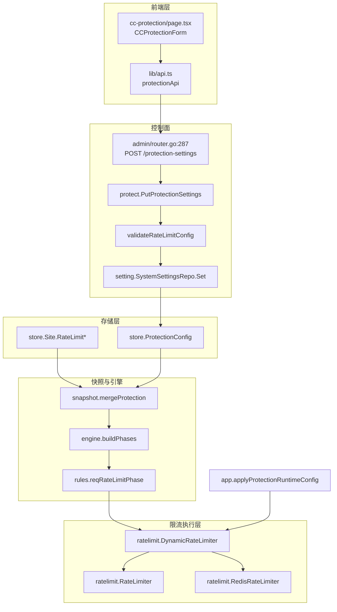
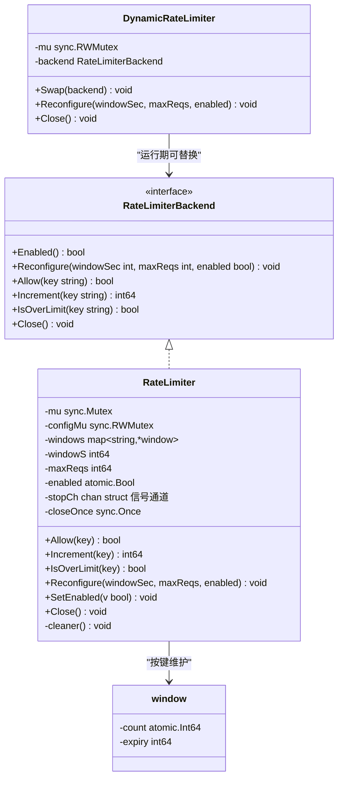
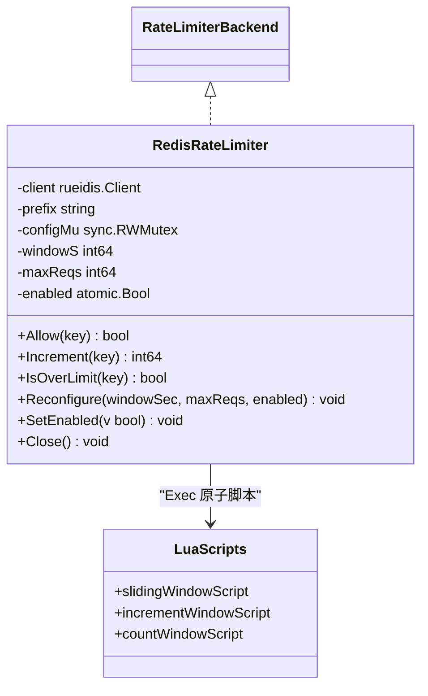
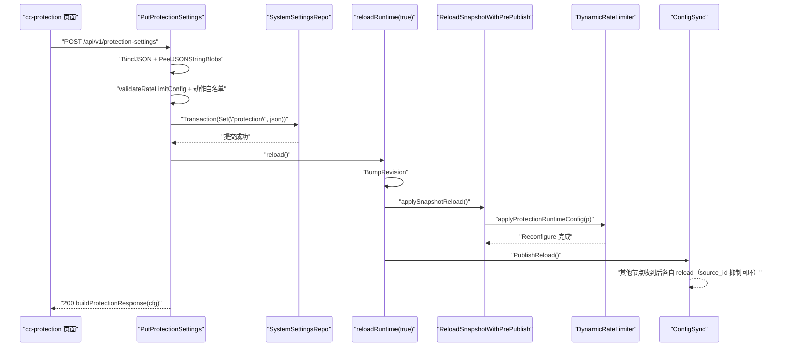
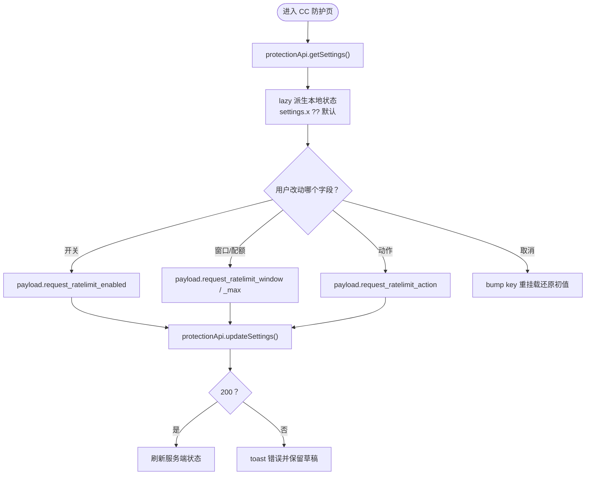
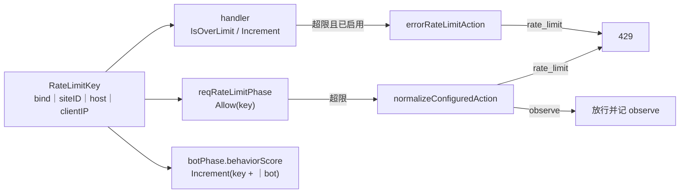
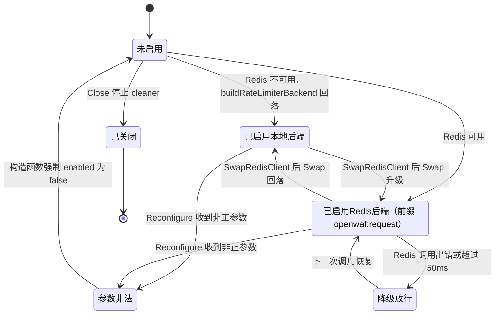
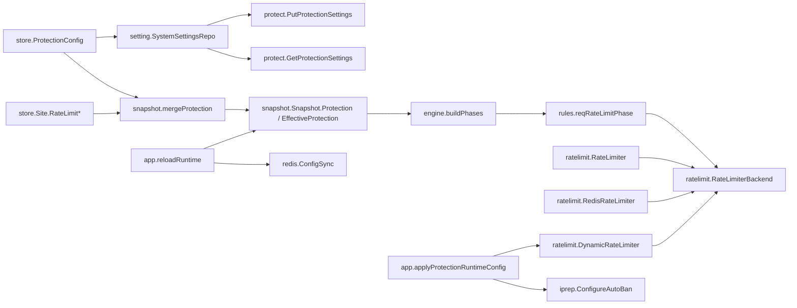
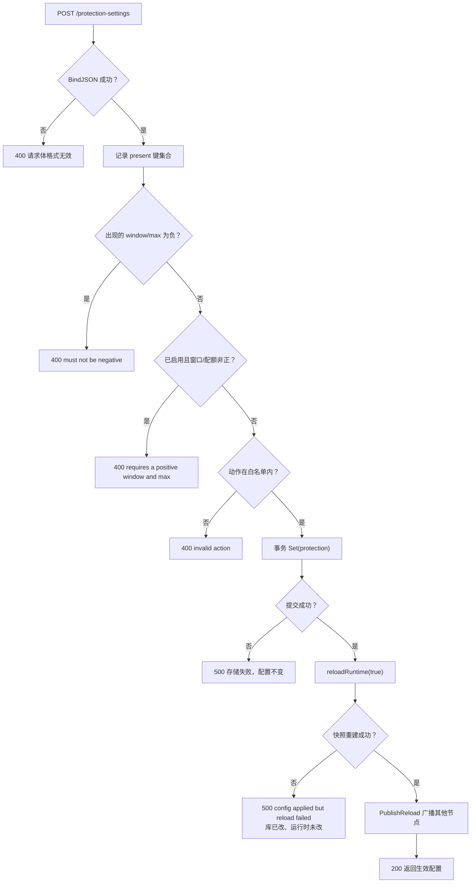

> [返回 安全防护功能](../安全防护功能.md)

# 限流配置管理

<cite>
**本文档引用的文件**
- [ratelimit.go](file://internal/waf/ratelimit/ratelimit.go)
- [redis.go](file://internal/waf/ratelimit/redis.go)
- [dynamic.go](file://internal/waf/ratelimit/dynamic.go)
- [phases.go](file://internal/core/rules/phases.go)
- [engine.go](file://internal/core/engine/engine.go)
- [handler.go](file://internal/dataplane/handler.go)
- [handler_support.go](file://internal/dataplane/handler_support.go)
- [protection.go](file://internal/store/protection.go)
- [site.go](file://internal/store/site.go)
- [build.go](file://internal/snapshot/build.go)
- [snapshot.go](file://internal/snapshot/snapshot.go)
- [registry.go](file://internal/core/configoverride/registry.go)
- [system_settings.go](file://internal/store/repository/setting/system_settings.go)
- [router.go](file://internal/admin/router.go)
- [protection.go](file://internal/admin/protect/protection.go)
- [helpers.go](file://internal/admin/shared/helpers.go)
- [pubsub.go](file://internal/core/redis/pubsub.go)
- [server.go](file://internal/app/server.go)
- [page.tsx](file://frontend/app/(dashboard)/cc-protection/page.tsx)
- [api.ts](file://frontend/lib/api.ts)
</cite>

## 目录

1. [简介](#简介)
2. [项目结构](#项目结构)
3. [核心组件](#核心组件)
4. [架构总览](#架构总览)
5. [详细组件分析](#详细组件分析)
6. [依赖关系分析](#依赖关系分析)
7. [性能考虑](#性能考虑)
8. [故障排查指南](#故障排查指南)
9. [结论](#结论)
10. [附录](#附录)

## 简介
本文件面向限流配置管理系统，聚焦请求频率、错误频率与自动封禁三组配置项的模型、写入口与生效路径。系统提供两类可互换的限流后端：
- 本地限流器 `RateLimiter`：进程内固定窗口计数，`sync.Mutex` 保护窗口表、`atomic.Int64` 做窗口内自增 [ratelimit.go:20-34](file://internal/waf/ratelimit/ratelimit.go#L20-L34)。
- Redis 分布式限流器 `RedisRateLimiter`：基于 Sorted Set 的滑动窗口，三段 Lua 脚本保证原子性，单命令 50ms 超时、出错一律放行（fail-open）[redis.go:77-139](file://internal/waf/ratelimit/redis.go#L77-L139)。

两者都实现同一个 `RateLimiterBackend` 接口，由 `DynamicRateLimiter` 包装成进程级单例，Redis 可用性变化时在运行时 `Swap` 后端而不重建引擎 [ratelimit.go:9-17](file://internal/waf/ratelimit/ratelimit.go#L9-L17)、[dynamic.go:7-32](file://internal/waf/ratelimit/dynamic.go#L7-L32)。

配置只有一份真相：`ProtectionConfig` JSON 落在 `system_settings` 的 `protection` 行，唯一写入口是 `POST /api/v1/protection-settings`；进程级覆盖注册表 `internal/core/configoverride` 中没有 `request_ratelimit_*` 系列键，因此不存在第二配置源 [protection.go:12-25](file://internal/store/protection.go#L12-L25)、[router.go:287](file://internal/admin/router.go#L287)。

## 项目结构
限流配置管理涉及前端表单、Admin 写入口、系统设置存储、快照合并、阶段链装配与限流执行层六个环节：

| 环节 | 路径 | 关键符号 | 职责 |
|------|------|----------|------|
| 前端表单 | `frontend/app/(dashboard)/cc-protection/page.tsx` | `CCProtectionForm` | 三项限流开关与参数编辑、本地初值派生 |
| 前端 API | `frontend/lib/api.ts` | `protectionApi.getSettings/updateSettings` | GET/POST `/protection-settings` |
| Admin 写入口 | `internal/admin/protect/protection.go` | `PutProtectionSettings` | 解析、校验、事务落库、触发 reload |
| 配置模型 | `internal/store/protection.go` | `ProtectionConfig` | 字段定义、默认值、`ValidateRateLimits` |
| 站点覆盖 | `internal/store/site.go`、`internal/snapshot/build.go` | `Site.RateLimitEnabled`、`mergeProtection` | 三态继承与合并 |
| 阶段装配 | `internal/core/engine/engine.go` | `buildPhases` | 按站点生效配置决定是否入链 |
| 执行层 | `internal/waf/ratelimit/`、`internal/core/rules/phases.go` | `RateLimiter`、`reqRateLimitPhase` | 计数与超限判定 |
| 运行时装配 | `internal/app/server.go` | `buildRateLimiterBackend`、`applyProtectionRuntimeConfig` | 创建/热更新/热替换后端 |



**图表来源**
- [router.go:287](file://internal/admin/router.go#L287)
- [protection.go:96-240](file://internal/admin/protect/protection.go#L96-L240)
- [system_settings.go:46-51](file://internal/store/repository/setting/system_settings.go#L46-L51)
- [protection.go:12-40](file://internal/store/protection.go#L12-L40)
- [site.go:81-84](file://internal/store/site.go#L81-L84)
- [build.go:748-759](file://internal/snapshot/build.go#L748-L759)
- [engine.go:517-520](file://internal/core/engine/engine.go#L517-L520)
- [phases.go:305-339](file://internal/core/rules/phases.go#L305-L339)
- [dynamic.go:7-32](file://internal/waf/ratelimit/dynamic.go#L7-L32)
- [server.go:637-640](file://internal/app/server.go#L637-L640)

**章节来源**
- [page.tsx:56-153](file://frontend/app/(dashboard)/cc-protection/page.tsx#L56-L153)
- [api.ts:878-882](file://frontend/lib/api.ts#L878-L882)
- [router.go:287](file://internal/admin/router.go#L287)
- [protection.go:96-240](file://internal/admin/protect/protection.go#L96-L240)
- [build.go:707-759](file://internal/snapshot/build.go#L707-L759)
- [engine.go:517-520](file://internal/core/engine/engine.go#L517-L520)
- [server.go:637-640](file://internal/app/server.go#L637-L640)

## 核心组件

### 本地限流器（RateLimiter）
- 固定窗口算法：键首次访问或 `expiry <= now` 时重建窗口，随后 `count.Add(1)` 与 `maxReqs` 比较 [ratelimit.go:96-118](file://internal/waf/ratelimit/ratelimit.go#L96-L118)。
- 双锁分工：`configMu sync.RWMutex` 保护窗口/配额/开关三元组的读写，`mu sync.Mutex` 只保护窗口表 [ratelimit.go:20-29](file://internal/waf/ratelimit/ratelimit.go#L20-L29)。
- 参数无效即视为未启用：`NewRateLimiter` 与 `Reconfigure` 在 `windowSec <= 0 || maxReqs <= 0` 时强制 `enabled = false`，避免零配额把首个请求判成超限 [ratelimit.go:36-51](file://internal/waf/ratelimit/ratelimit.go#L36-L51)、[ratelimit.go:80-94](file://internal/waf/ratelimit/ratelimit.go#L80-L94)。
- 后台回收：`cleaner` 协程每 30 秒删除过期窗口，表空时整体替换为新 map [ratelimit.go:175-196](file://internal/waf/ratelimit/ratelimit.go#L175-L196)。
- 全部方法 nil 安全，`Close` 用 `sync.Once` 关闭 `stopCh` [ratelimit.go:164-173](file://internal/waf/ratelimit/ratelimit.go#L164-L173)。



**图表来源**
- [ratelimit.go:9-34](file://internal/waf/ratelimit/ratelimit.go#L9-L34)
- [ratelimit.go:96-196](file://internal/waf/ratelimit/ratelimit.go#L96-L196)
- [dynamic.go:7-44](file://internal/waf/ratelimit/dynamic.go#L7-L44)

**章节来源**
- [ratelimit.go:9-34](file://internal/waf/ratelimit/ratelimit.go#L9-L34)
- [ratelimit.go:80-196](file://internal/waf/ratelimit/ratelimit.go#L80-L196)
- [dynamic.go:7-72](file://internal/waf/ratelimit/dynamic.go#L7-L72)

### Redis 分布式限流器
- 滑动窗口：三段 Lua 脚本先在 Sorted Set 上 `ZREMRANGEBYSCORE` 清出窗口外成员，再按 `ZCARD < limit` 决定是否 `ZADD`，并把键 TTL 设为 `window + 1` 秒 [redis.go:77-113](file://internal/waf/ratelimit/redis.go#L77-L113)。
- 客户端类型是 `rueidis.Client`（非 go-redis），键前缀由装配处传入 `openwaf:request` / `openwaf:error`，实际键形如 `openwaf:request:rl:<计数键>` [redis.go:13-37](file://internal/waf/ratelimit/redis.go#L13-L37)、[server.go:383-384](file://internal/app/server.go#L383-L384)。
- 时间基准是毫秒：`now = UnixMilli()`、`windowMs = windowS * 1000`，与本地实现按秒取整不同 [redis.go:130-133](file://internal/waf/ratelimit/redis.go#L130-L133)。
- 降级：`client == nil` 时构造函数返回 `nil`，装配处回退本地限流器；Redis 调用错误（含 50ms 超时）时 `Allow` 返回 true、`Increment` 返回 0、`IsOverLimit` 返回 false，即 fail-open [redis.go:22-37](file://internal/waf/ratelimit/redis.go#L22-L37)、[redis.go:115-192](file://internal/waf/ratelimit/redis.go#L115-L192)。
- `Close()` 是空实现，连接生命周期由上层 Redis 客户端统一管理 [redis.go:194](file://internal/waf/ratelimit/redis.go#L194)。



**图表来源**
- [redis.go:13-37](file://internal/waf/ratelimit/redis.go#L13-L37)
- [redis.go:77-194](file://internal/waf/ratelimit/redis.go#L77-L194)

**章节来源**
- [redis.go:13-194](file://internal/waf/ratelimit/redis.go#L13-L194)
- [server.go:123-128](file://internal/app/server.go#L123-L128)

### 配置模型（ProtectionConfig）
限流相关字段全部挂在 `store.ProtectionConfig` 上，以 JSON 形式存放于 `system_settings` 的 `protection` 行；默认值由 `DefaultProtectionConfig` 给出，启用却配置非法的情形由 `ValidateRateLimits` 在持久化层拒绝 [protection.go:12-40](file://internal/store/protection.go#L12-L40)、[protection.go:132-143](file://internal/store/protection.go#L132-L143)、[protection.go:159-199](file://internal/store/protection.go#L159-L199)。

作用域列区分三层：**全局** = `protection` 设置行；**站点** = `Site` 表可空覆盖列，经 `mergeProtection` 合并进 `EffectiveProtection`；**进程** = 后端实例本身（窗口与配额只有进程级一份）。继承语义按实测：开关是 `*bool`，`nil` 表示继承全局、非 `nil` 才覆盖；窗口与配额是普通 `int`，只有 `> 0` 才覆盖，`0` 是「未覆盖」而不是 0 值配置 [site.go:81-84](file://internal/store/site.go#L81-L84)、[build.go:748-759](file://internal/snapshot/build.go#L748-L759)。

| 配置项 | 类型 | 默认（定义位置:行） | 作用域 | 继承语义 |
|--------|------|--------------------|--------|----------|
| `request_ratelimit_enabled` | bool | `false`（未列出，零值）[protection.go:159-199](file://internal/store/protection.go#L159-L199) | 全局 + 站点 | 站点 `rate_limit_enabled` 为 `*bool`，`nil` = 继承 [site.go:81](file://internal/store/site.go#L81) |
| `request_ratelimit_window` | int | `60` [protection.go:161](file://internal/store/protection.go#L161) | 仅全局生效 | 站点 `rate_limit_window` 需 `> 0` 才覆盖，仅影响 bot 阈值链路 [build.go:751-752](file://internal/snapshot/build.go#L751-L752) |
| `request_ratelimit_max` | int | `300` [protection.go:162](file://internal/store/protection.go#L162) | 全局 + 站点（bot 阈值） | 站点 `rate_limit_max > 0` 才覆盖；同时作为 bot 行为分基准 [engine.go:509](file://internal/core/engine/engine.go#L509)、[build.go:754-755](file://internal/snapshot/build.go#L754-L755) |
| `request_ratelimit_action` | string | `rate_limit` [protection.go:163](file://internal/store/protection.go#L163) | 全局 + 站点 | 站点 `rate_limit_action` 非空串才覆盖 [build.go:757-758](file://internal/snapshot/build.go#L757-L758) |
| `error_ratelimit_enabled` | bool | `false`（零值）[protection.go:159-199](file://internal/store/protection.go#L159-L199) | 仅全局 | 无站点覆盖列，数据面读 `sn.Protection` [handler.go:521](file://internal/dataplane/handler.go#L521) |
| `error_ratelimit_window` | int | `300` [protection.go:164](file://internal/store/protection.go#L164) | 仅全局 | 同上 [protection.go:19-25](file://internal/store/protection.go#L19-L25) |
| `error_ratelimit_max` | int | `30` [protection.go:165](file://internal/store/protection.go#L165) | 仅全局 | 同上 [protection.go:19-25](file://internal/store/protection.go#L19-L25) |
| `error_ratelimit_count_4xx` | bool | `true` [protection.go:167](file://internal/store/protection.go#L167) | 仅全局 | 无站点覆盖 [handler_support.go:403-412](file://internal/dataplane/handler_support.go#L403-L412) |
| `error_ratelimit_count_5xx` | bool | `true` [protection.go:168](file://internal/store/protection.go#L168) | 仅全局 | 无站点覆盖 [handler_support.go:403-412](file://internal/dataplane/handler_support.go#L403-L412) |
| `error_ratelimit_count_block` | bool | `false`（默认函数未赋值）[protection.go:159-199](file://internal/store/protection.go#L159-L199) | 仅全局 | 前端回退值同为 `false` [page.tsx:94](file://frontend/app/(dashboard)/cc-protection/page.tsx#L94) |
| `error_ratelimit_action` | string | `rate_limit` [protection.go:166](file://internal/store/protection.go#L166) | 仅全局 | 空串按 `rate_limit` 兜底 [handler_support.go:377-394](file://internal/dataplane/handler_support.go#L377-L394) |
| `auto_ban_enabled` | bool | `false` [protection.go:173](file://internal/store/protection.go#L173) | 仅全局 | 交给 IP 信誉模块，非限流器 [server.go:640-641](file://internal/app/server.go#L640-L641) |
| `auto_ban_threshold` | int | `10` [protection.go:174](file://internal/store/protection.go#L174) | 仅全局 | 同上 [protection.go:37-40](file://internal/store/protection.go#L37-L40) |
| `auto_ban_window` | int | `60` [protection.go:175](file://internal/store/protection.go#L175) | 仅全局 | 同上 [protection.go:37-40](file://internal/store/protection.go#L37-L40) |
| `auto_ban_duration` | int | `3600` [protection.go:176](file://internal/store/protection.go#L176) | 仅全局 | 同上 [protection.go:37-40](file://internal/store/protection.go#L37-L40) |
| `auto_ban_action` | string | `intercept`（DB 列默认）[protection.go:54](file://internal/store/protection.go#L54) | 仅全局 | 白名单只允许 `intercept`/`drop` [protection.go:220-226](file://internal/admin/protect/protection.go#L220-L226) |

**章节来源**
- [protection.go:12-54](file://internal/store/protection.go#L12-L54)
- [protection.go:132-199](file://internal/store/protection.go#L132-L199)
- [site.go:81-84](file://internal/store/site.go#L81-L84)
- [build.go:707-759](file://internal/snapshot/build.go#L707-L759)
- [handler_support.go:377-412](file://internal/dataplane/handler_support.go#L377-L412)
- [page.tsx:66-97](file://frontend/app/(dashboard)/cc-protection/page.tsx#L66-L97)
- [server.go:637-641](file://internal/app/server.go#L637-L641)

## 架构总览
配置写入链路是「校验 → 落库 → 本地重载 → 跨节点广播」四步。`reload` 闭包在 `reloadRuntime(true)` 中先 `store.BumpRevision`，再 `applySnapshotReload` 重建快照并对新实例执行 `applyProtectionRuntimeConfig`，最后 `publishConfigReload` 通过 Redis 频道 `openwaf:config:reload` 广播；订阅端按 `source_id` 抑制回环 [server.go:1001-1034](file://internal/app/server.go#L1001-L1034)、[pubsub.go:16-17](file://internal/core/redis/pubsub.go#L16-L17)、[pubsub.go:108-118](file://internal/core/redis/pubsub.go#L108-L118)。



**图表来源**
- [page.tsx:133-153](file://frontend/app/(dashboard)/cc-protection/page.tsx#L133-L153)
- [api.ts:879-881](file://frontend/lib/api.ts#L879-L881)
- [protection.go:96-296](file://internal/admin/protect/protection.go#L96-L296)
- [system_settings.go:22-51](file://internal/store/repository/setting/system_settings.go#L22-L51)
- [server.go:1001-1034](file://internal/app/server.go#L1001-L1034)
- [server.go:868-886](file://internal/app/server.go#L868-L886)
- [server.go:637-640](file://internal/app/server.go#L637-L640)
- [pubsub.go:76-118](file://internal/core/redis/pubsub.go#L76-L118)

**章节来源**
- [protection.go:96-296](file://internal/admin/protect/protection.go#L96-L296)
- [server.go:637-640](file://internal/app/server.go#L637-L640)
- [server.go:868-886](file://internal/app/server.go#L868-L886)
- [server.go:1001-1034](file://internal/app/server.go#L1001-L1034)
- [pubsub.go:16-118](file://internal/core/redis/pubsub.go#L16-L118)

## 详细组件分析

### 前端配置界面与保存流程
CC 防护页把限流拆成「请求频率 / 错误频率 / 自定义 CC 规则」三个 Tab 编辑，本地状态在挂载时以 `settings.<字段> ?? <默认>` 的 lazy 初始化派生，因此取消编辑由父组件 bump key 重挂载还原服务端初值，而不是在 effect 里回写 [page.tsx:44-62](file://frontend/app/(dashboard)/cc-protection/page.tsx#L44-L62)。

`error_ratelimit_count_block` 的前端回退值是 `false`，与后端 `DefaultProtectionConfig` 未赋值（零值 `false`）一致 [page.tsx:94](file://frontend/app/(dashboard)/cc-protection/page.tsx#L94)。保存时只把用户实际改过的字段拼进 payload，未出现的键由后端保持原值，这正是 `present`  map 校验语义的前端配套 [page.tsx:133-153](file://frontend/app/(dashboard)/cc-protection/page.tsx#L133-L153)。



**图表来源**
- [page.tsx:56-153](file://frontend/app/(dashboard)/cc-protection/page.tsx#L56-L153)
- [api.ts:879-881](file://frontend/lib/api.ts#L879-L881)

**章节来源**
- [page.tsx:44-153](file://frontend/app/(dashboard)/cc-protection/page.tsx#L44-L153)
- [api.ts:878-882](file://frontend/lib/api.ts#L878-L882)

### 后端写入口与校验链
写入口只有一个：`POST /api/v1/protection-settings`（读入口是同名 GET），没有 PUT/DELETE 变体 [router.go:152](file://internal/admin/router.go#L152)、[router.go:287](file://internal/admin/router.go#L287)。校验顺序决定报错文本，逐条实测如下：

| 步 | 动作 | 执行位置 | 输入 | 输出 / 失败分支 | 可观测点 |
|:--:|------|----------|------|-----------------|----------|
| 1 | 解析原始 JSON | [protection.go:101-105](file://internal/admin/protect/protection.go#L101-L105) | 请求体 | `map[string]json.RawMessage` / 400「请求体格式无效」 | 响应状态码 |
| 2 | 摘出 JSON 文本块 | [protection.go:129-130](file://internal/admin/protect/protection.go#L129-L130) | raw | `preserved` 与 `plainBytes` | 400 invalid config |
| 3 | 读取现存配置 | [protection.go:136-139](file://internal/admin/protect/protection.go#L136-L139) | `protection` 行 | 完整 `ProtectionConfig` / 500 | `LoadProtectionConfigStrict` |
| 4 | 局部覆盖合并 | [protection.go:141-145](file://internal/admin/protect/protection.go#L141-L145) | plainBytes | 合并后的 cfg / 400 | 未出现的键保持原值 |
| 5 | 质询参数校验 | [protection.go:187-190](file://internal/admin/protect/protection.go#L187-L190) | cfg + present | 400 | `ValidateChallengeConfig` |
| 6 | 限流参数校验 | [protection.go:191-194](file://internal/admin/protect/protection.go#L191-L194) | cfg + present | 400「window and max must not be negative」 | `validateRateLimitConfig` |
| 7 | 动作白名单 | [protection.go:204-231](file://internal/admin/protect/protection.go#L204-L231) | `*_action` | 400 invalid action | `ValidateActionWithoutRedirectTarget` |
| 8 | 事务落库 | [protection.go:256-291](file://internal/admin/protect/protection.go#L256-L291) | JSON | `Set("protection", ...)` / 500 | `system_settings` 行 |
| 9 | 触发热重载 | [protection.go:294-298](file://internal/admin/protect/protection.go#L294-L298) | reload() | 200 或 500「config applied but reload failed」 | 日志 + 响应 |

限流校验有两道互补闸门：Admin 层拒绝「本次出现且为负」，模型层 `ValidateRateLimits` 拒绝「已启用但窗口或配额非正」，后者覆盖历史脏数据与手工写库的路径 [protection.go:305-318](file://internal/admin/protect/protection.go#L305-L318)、[protection.go:135-143](file://internal/store/protection.go#L135-L143)。`auto_ban_action` 额外收窄到 `intercept`/`drop` 两个取值 [protection.go:220-226](file://internal/admin/protect/protection.go#L220-L226)。

**章节来源**
- [router.go:152](file://internal/admin/router.go#L152)
- [router.go:287](file://internal/admin/router.go#L287)
- [protection.go:96-318](file://internal/admin/protect/protection.go#L96-L318)
- [protection.go:132-143](file://internal/store/protection.go#L132-L143)
- [helpers.go:116-125](file://internal/admin/shared/helpers.go#L116-L125)
- [helpers.go:158-181](file://internal/admin/shared/helpers.go#L158-L181)

### 计数键构造与阶段装配
限流与频次计数共用一个键构造函数：`bind|siteID|归一化 Host|clientIP`，四段分隔符为竖线，Host 走 `snapshot.NormalizeMatchHost` [phases.go:53-70](file://internal/core/rules/phases.go#L53-L70)。请求限流阶段直接用该键调用 `Allow`；错误限流在数据面用同一个 `RateLimitKey` 生成键后调用 `IsOverLimit`/`Increment`，保证两类计数在键空间上不会串站 [phases.go:316-339](file://internal/core/rules/phases.go#L316-L339)、[handler.go:199](file://internal/dataplane/handler.go#L199)、[handler_support.go:355-366](file://internal/dataplane/handler_support.go#L355-L366)。

bot 行为分复用同一份频率数据但带独立后缀 `|bot`，避免与限流阶段的 `Allow` 重复计数导致阈值减半 [phases.go:490-513](file://internal/core/rules/phases.go#L490-L513)。



**图表来源**
- [phases.go:53-70](file://internal/core/rules/phases.go#L53-L70)
- [phases.go:316-339](file://internal/core/rules/phases.go#L316-L339)
- [phases.go:490-513](file://internal/core/rules/phases.go#L490-L513)
- [handler_support.go:355-394](file://internal/dataplane/handler_support.go#L355-L394)
- [handler_support.go:415-423](file://internal/dataplane/handler_support.go#L415-L423)

**章节来源**
- [phases.go:53-70](file://internal/core/rules/phases.go#L53-L70)
- [phases.go:305-339](file://internal/core/rules/phases.go#L305-L339)
- [phases.go:490-513](file://internal/core/rules/phases.go#L490-L513)
- [phases.go:1301-1310](file://internal/core/rules/phases.go#L1301-L1310)
- [handler.go:199](file://internal/dataplane/handler.go#L199)
- [handler.go:521-527](file://internal/dataplane/handler.go#L521-L527)
- [handler_support.go:355-423](file://internal/dataplane/handler_support.go#L355-L423)

### 引擎装配与生效边界
阶段链按「站点生效配置」决定是否挂限流阶段：`prot.RequestRateLimitEnabled && deps.reqRateLimiter != nil` 才 `NewReqRateLimitPhase(deps.reqRateLimiter, act)`，其中 `prot` 取自 `rt.EffectiveProtection`，否则回落 `sn.Protection` [engine.go:352-356](file://internal/core/engine/engine.go#L352-L356)、[engine.go:517-520](file://internal/core/engine/engine.go#L517-L520)。

必须如实记录的边界：`reqRateLimiter` 挂在 `phaseRuntimeConfig`（[engine.go:75-80](file://internal/core/engine/engine.go#L75-L80)，[engine.go:125](file://internal/core/engine/engine.go#L125) 初始化），`errRateLimiter` 是 `Engine` 字段（[engine.go:85](file://internal/core/engine/engine.go#L85)），两者都是进程级单例；`applyProtectionRuntimeConfig` 用**全局**快照的 `Protection` 调 `Reconfigure`，因此站点级 `rate_limit_window` / `rate_limit_max` 覆盖不会改变后端实例的窗口与配额，只会改变阶段是否入链、超限动作，以及 bot 行为分阈值 `rateMax` [engine.go:509](file://internal/core/engine/engine.go#L509)、[server.go:637-640](file://internal/app/server.go#L637-L640)、[server.go:884](file://internal/app/server.go#L884)。



**图表来源**
- [server.go:123-128](file://internal/app/server.go#L123-L128)
- [redis.go:22-37](file://internal/waf/ratelimit/redis.go#L22-L37)
- [redis.go:115-192](file://internal/waf/ratelimit/redis.go#L115-L192)
- [ratelimit.go:36-51](file://internal/waf/ratelimit/ratelimit.go#L36-L51)
- [ratelimit.go:80-94](file://internal/waf/ratelimit/ratelimit.go#L80-L94)
- [dynamic.go:23-32](file://internal/waf/ratelimit/dynamic.go#L23-L32)
- [server.go:1235-1246](file://internal/app/server.go#L1235-L1246)

**章节来源**
- [engine.go:75-80](file://internal/core/engine/engine.go#L75-L80)
- [engine.go:85](file://internal/core/engine/engine.go#L85)
- [engine.go:117-126](file://internal/core/engine/engine.go#L117-L126)
- [engine.go:352-356](file://internal/core/engine/engine.go#L352-L356)
- [engine.go:509](file://internal/core/engine/engine.go#L509)
- [engine.go:517-520](file://internal/core/engine/engine.go#L517-L520)
- [server.go:637-640](file://internal/app/server.go#L637-L640)
- [server.go:1235-1246](file://internal/app/server.go#L1235-L1246)

### 后端能力兼容矩阵
两套后端可互换，但语义并不完全等价，配置迁移时必须按矩阵核对：

| 能力 | 本地 RateLimiter | Redis RateLimiter | 备注 |
|------|:----------------:|:-----------------:|------|
| 窗口算法 | ✓ | ✓ | 固定窗口 vs Sorted Set 滑动窗口 |
| 跨节点共享状态 | ✗ | ✓ | 本地计数只在本进程 |
| 时间粒度 | 秒（`Unix()`） | 毫秒（`UnixMilli()`） | 同一窗口长度下边界不同 |
| 故障降级 | — | ✓ | Redis 出错 fail-open，本地无外部依赖 |
| 单次调用超时 | 无（内存操作） | 50ms | `context.WithTimeout` |
| 空闲回收 | ✓ | ✓ | 本地靠 30s cleaner，Redis 靠 `EXPIRE window+1` |
| 运行时热替换 | ✓ | ✓ | 均由 `DynamicRateLimiter.Swap` 承载 |
| `Close` 释放资源 | ✓ | ✗ | Redis 实现的 `Close()` 为空函数体 |

**章节来源**
- [ratelimit.go:96-196](file://internal/waf/ratelimit/ratelimit.go#L96-L196)
- [redis.go:115-194](file://internal/waf/ratelimit/redis.go#L115-L194)
- [dynamic.go:23-32](file://internal/waf/ratelimit/dynamic.go#L23-L32)

### reload 触发矩阵
限流参数只有走 `reload` 闭包才会生效，而 `reload` 是否被调用取决于端点自身签名：

| 写入口 | 是否传入 reload | 是否重建快照 | 是否广播其他节点 | 限流参数是否生效 |
|--------|:--------------:|:------------:|:----------------:|:----------------:|
| `POST /protection-settings` | ✓ [router.go:287](file://internal/admin/router.go#L287) | ✓ | ✓ | ✓ |
| `POST /sites/:id/update` | ✓ | ✓ | ✓ | 开关/动作生效，窗口配额仍取全局 |
| `POST /settings/:key` | ✓ [router.go:376](file://internal/admin/router.go#L376) | ✓ | ✓ | 直接改写 `protection` 行时生效 |
| `POST /redis-config` | ✗（走 `ReloadRedis`）[router.go:394](file://internal/admin/router.go#L394) | ✗ | ✗ | 仅触发后端 `Swap`，不改窗口配额 |
| `POST /log-config` | ✗（handler 未接收 reload）[router.go:395](file://internal/admin/router.go#L395) | ✗ | ✗ | 不涉及限流 |
| `POST /certificates/acme/config` | ✓ [router.go:397](file://internal/admin/router.go#L397) | ✓ | ✓ | 顺带重放 `applyProtectionRuntimeConfig` |

订阅端在收到广播后走 `reloadRuntime(false)`，不再 `BumpRevision`，靠 `source_id` 回环抑制避免发布节点重复重载 [server.go:1040-1042](file://internal/app/server.go#L1040-L1042)、[pubsub.go:108-118](file://internal/core/redis/pubsub.go#L108-L118)。

**章节来源**
- [router.go:287](file://internal/admin/router.go#L287)
- [router.go:376](file://internal/admin/router.go#L376)
- [router.go:394-397](file://internal/admin/router.go#L394-L397)
- [server.go:1001-1042](file://internal/app/server.go#L1001-L1042)
- [pubsub.go:108-118](file://internal/core/redis/pubsub.go#L108-L118)

### 外部服务依赖
限流配置管理只依赖两个外部实体，超时与降级策略全部来自代码常量：

| 依赖 | 用途 | 接入方式 | 配置来源 | 超时 | 重试 | 降级 | 可用性影响 |
|------|------|----------|----------|:----:|:----:|------|------------|
| Redis | 滑动窗口计数与跨节点配置广播 | rueidis 客户端 | `redis_config` 设置行 / `MY_OPENWAF_REDIS_*`（`ScopeDelegated`）[registry.go:311-328](file://internal/core/configoverride/registry.go#L311-L328) | 限流单命令 50ms；发布 2s | 无 | 计数 fail-open；后端回落本地 | 多节点计数退化为各节点独立 |
| 主库 `system_settings` | 存放 `protection` 配置行 | GORM upsert | 启动引导（`ScopeBootstrap`） | 未设置（风险） | 无 | 读写失败返回 500 | 配置无法保存与回放 |

**章节来源**
- [registry.go:311-328](file://internal/core/configoverride/registry.go#L311-L328)
- [redis.go:127-139](file://internal/waf/ratelimit/redis.go#L127-L139)
- [pubsub.go:76-82](file://internal/core/redis/pubsub.go#L76-L82)
- [system_settings.go:46-51](file://internal/store/repository/setting/system_settings.go#L46-L51)
- [server.go:1235-1246](file://internal/app/server.go#L1235-L1246)

## 依赖关系分析
限流配置管理的依赖方向是单向的：控制面写配置、快照层合并配置、引擎按配置挂阶段、执行层只做计数，执行层不反向依赖管理面。



**图表来源**
- [protection.go:12-40](file://internal/store/protection.go#L12-L40)
- [system_settings.go:22-51](file://internal/store/repository/setting/system_settings.go#L22-L51)
- [site.go:81-84](file://internal/store/site.go#L81-L84)
- [build.go:707-759](file://internal/snapshot/build.go#L707-L759)
- [snapshot.go:94-95](file://internal/snapshot/snapshot.go#L94-L95)
- [snapshot.go:230](file://internal/snapshot/snapshot.go#L230)
- [engine.go:517-520](file://internal/core/engine/engine.go#L517-L520)
- [phases.go:305-339](file://internal/core/rules/phases.go#L305-L339)
- [ratelimit.go:9-17](file://internal/waf/ratelimit/ratelimit.go#L9-L17)
- [dynamic.go:7-32](file://internal/waf/ratelimit/dynamic.go#L7-L32)
- [server.go:637-641](file://internal/app/server.go#L637-L641)
- [server.go:1001-1034](file://internal/app/server.go#L1001-L1034)
- [pubsub.go:29-54](file://internal/core/redis/pubsub.go#L29-L54)

关键依赖矩阵：

| 调用方 | 被调方 | 依赖形态 | 证据位置 |
|--------|--------|----------|----------|
| `protect.PutProtectionSettings` | `SystemSettingsRepo.Set` | 直接调用（事务内） | [protection.go:257-259](file://internal/admin/protect/protection.go#L257-L259) |
| `app.applyProtectionRuntimeConfig` | `DynamicRateLimiter.Reconfigure` | 闭包捕获 | [server.go:638-639](file://internal/app/server.go#L638-L639) |
| `engine.buildPhases` | `rules.NewReqRateLimitPhase` | 接口注入 | [engine.go:517-520](file://internal/core/engine/engine.go#L517-L520) |
| `dataplane.handler` | `Engine.ErrRateLimiter` | 接口调用（响应后计数） | [handler_support.go:415-423](file://internal/dataplane/handler_support.go#L415-L423) |
| `rules.botPhase` | `RateLimiterBackend.Increment` | 接口注入（带 `\|bot` 后缀键） | [phases.go:502-513](file://internal/core/rules/phases.go#L502-L513) |
| `app` Redis 热切换 | `DynamicRateLimiter.Swap` | 依赖注入回调 | [server.go:1235-1246](file://internal/app/server.go#L1235-L1246) |

**章节来源**
- [protection.go:96-318](file://internal/admin/protect/protection.go#L96-L318)
- [system_settings.go:22-62](file://internal/store/repository/setting/system_settings.go#L22-L62)
- [site.go:81-84](file://internal/store/site.go#L81-L84)
- [build.go:707-759](file://internal/snapshot/build.go#L707-L759)
- [snapshot.go:94-95](file://internal/snapshot/snapshot.go#L94-L95)
- [snapshot.go:230](file://internal/snapshot/snapshot.go#L230)
- [engine.go:517-520](file://internal/core/engine/engine.go#L517-L520)
- [phases.go:305-513](file://internal/core/rules/phases.go#L305-L513)
- [handler_support.go:355-423](file://internal/dataplane/handler_support.go#L355-L423)
- [server.go:637-641](file://internal/app/server.go#L637-L641)
- [server.go:1235-1246](file://internal/app/server.go#L1235-L1246)

## 性能考虑
本地限流器
- 窗口对象是 `{count atomic.Int64; expiry int64}`，自增走原子操作，但**取窗口仍要过 `rl.mu` 互斥锁**，高基数键（大量不同客户端 IP）会在锁上排队 [ratelimit.go:31-34](file://internal/waf/ratelimit/ratelimit.go#L31-L34)、[ratelimit.go:108-118](file://internal/waf/ratelimit/ratelimit.go#L108-L118)。
- 回收周期固定 30 秒，`map` 无容量上限；键基数由「bind × 站点 × Host × 客户端 IP」笛卡尔积决定，扫描式清理没有 LRU 兜底 [ratelimit.go:175-196](file://internal/waf/ratelimit/ratelimit.go#L175-L196)。

Redis 限流器
- 每次判定一次 `Eval`，脚本内 `ZREMRANGEBYSCORE + ZCARD (+ ZADD)` 保证原子，单次调用上限 50ms；错误即放行，不会把 Redis 故障放大成 5xx [redis.go:77-139](file://internal/waf/ratelimit/redis.go#L77-L139)。
- 键 TTL 为 `window + 1` 秒，空闲键自然过期，无需清理协程 [redis.go:88](file://internal/waf/ratelimit/redis.go#L88)。

调优建议
- 窗口分档：突发抑制取 10-60 秒，均值抑制取 60-300 秒（默认请求 60/300、错误 300/30），长周期统计不建议用限流器承载。
- 多节点部署必须开 Redis，否则同一客户端在 N 个节点上的实际配额约为配置值的 N 倍。
- bot 行为分与请求限流共用窗口长度，调 `request_ratelimit_max` 会同步改变行为分基准，需一并回归 [engine.go:509](file://internal/core/engine/engine.go#L509)。

**章节来源**
- [ratelimit.go:31-34](file://internal/waf/ratelimit/ratelimit.go#L31-L34)
- [ratelimit.go:108-196](file://internal/waf/ratelimit/ratelimit.go#L108-L196)
- [redis.go:77-139](file://internal/waf/ratelimit/redis.go#L77-L139)
- [engine.go:509](file://internal/core/engine/engine.go#L509)

## 故障排查指南

| 症状 | 可能原因 | 排查动作 | 处理方案 |
|------|----------|----------|----------|
| 保存返回 400 | 窗口或配额为负、或已启用却非正 | 看响应 `error` 文本 | 修正参数；非法组合由两层校验共同拦截 [protection.go:305-318](file://internal/admin/protect/protection.go#L305-L318) |
| 保存 200 但不生效 | reload 失败（响应含 `config applied but reload failed`） | 查管理端口日志与 `config_revision` | 重试保存或查快照重建错误 [protection.go:294-298](file://internal/admin/protect/protection.go#L294-L298) |
| 站点级窗口不生效 | 后端窗口/配额是进程级单例 | 对比全局 `protection` 行 | 把窗口配额改到全局；站点覆盖只管开关与动作 |
| 多节点配额偏大 | 未启用 Redis，各节点独立计数 | 确认 `redis_config` 是否启用 | 启用 Redis 让后端切到 `RedisRateLimiter` [server.go:123-128](file://internal/app/server.go#L123-L128) |
| 429 突增但流量未变 | bot 行为分与限流共窗，阈值被下调 | 查 `rate_limit` 与 `bot_detection` 事件 | 恢复 `request_ratelimit_max` 并回归 [phases.go:490-513](file://internal/core/rules/phases.go#L490-L513) |
| Redis 抖动导致放行 | 50ms 超时后 fail-open | 查 Redis 侧延迟 | 缩短网络路径或接受降级语义 [redis.go:127-139](file://internal/waf/ratelimit/redis.go#L127-L139) |

配置校验与生效路径决策树：



**图表来源**
- [protection.go:96-298](file://internal/admin/protect/protection.go#L96-L298)
- [protection.go:305-318](file://internal/admin/protect/protection.go#L305-L318)
- [protection.go:132-143](file://internal/store/protection.go#L132-L143)
- [helpers.go:116-125](file://internal/admin/shared/helpers.go#L116-L125)
- [server.go:1001-1034](file://internal/app/server.go#L1001-L1034)
- [pubsub.go:66-82](file://internal/core/redis/pubsub.go#L66-L82)

**章节来源**
- [protection.go:96-318](file://internal/admin/protect/protection.go#L96-L318)
- [protection.go:132-143](file://internal/store/protection.go#L132-L143)
- [helpers.go:116-125](file://internal/admin/shared/helpers.go#L116-L125)
- [redis.go:115-192](file://internal/waf/ratelimit/redis.go#L115-L192)
- [server.go:123-128](file://internal/app/server.go#L123-L128)
- [server.go:1001-1034](file://internal/app/server.go#L1001-L1034)
- [pubsub.go:66-118](file://internal/core/redis/pubsub.go#L66-L118)

## 结论
限流配置管理保持了单一配置源：字段定义与默认值在 `store.ProtectionConfig`，唯一写入口是 `POST /api/v1/protection-settings`，生效路径统一经 `reloadRuntime(true)` → 快照重建 → `applyProtectionRuntimeConfig` → Redis 广播。两套后端通过 `RateLimiterBackend` 与 `DynamicRateLimiter` 实现可替换，Redis 不可用时自动回落本地且不放大故障。

需要注意两处边界：窗口与配额的实际执行值是进程级单例上的全局值，站点覆盖只作用于开关、动作与 bot 阈值；本地后端没有键基数上限。建议生产多节点部署启用 Redis 后端，并把配额回归与 bot 行为分一并验证。

## 附录

### 配置示例
以下为 `protection` 设置行中限流相关片段的 JSON 结构（值取自默认配置，不含任何机密）：

```json
{
  "request_ratelimit_enabled": false,
  "request_ratelimit_window": 60,
  "request_ratelimit_max": 300,
  "request_ratelimit_action": "rate_limit",
  "error_ratelimit_enabled": false,
  "error_ratelimit_window": 300,
  "error_ratelimit_max": 30,
  "error_ratelimit_count_4xx": true,
  "error_ratelimit_count_5xx": true,
  "error_ratelimit_action": "rate_limit",
  "auto_ban_enabled": false,
  "auto_ban_threshold": 10,
  "auto_ban_window": 60,
  "auto_ban_duration": 3600,
  "auto_ban_action": "intercept"
}
```

站点级覆盖只需提交对应字段，`rate_limit_enabled` 传 `null` 即回到继承态：

```json
{
  "rate_limit_enabled": true,
  "rate_limit_window": 30,
  "rate_limit_max": 100,
  "rate_limit_action": "challenge"
}
```

**章节来源**
- [protection.go:159-199](file://internal/store/protection.go#L159-L199)
- [site.go:81-84](file://internal/store/site.go#L81-L84)
- [build.go:748-759](file://internal/snapshot/build.go#L748-L759)

### 运维清单
- 变更前记录当前 `protection` 行 JSON，便于回滚。
- 变更后用 `GET /api/v1/protection-settings` 复核生效值，并确认响应非「applied but reload failed」。
- 观察 `rate_limit` 阶段事件的 `rule_id_str`：请求限流是 `request_rate_limit`，错误限流是 `error_rate_limit`，两者 `category` 同为 `rate_limit` [phases.go:328-336](file://internal/core/rules/phases.go#L328-L336)、[handler_support.go:381-388](file://internal/dataplane/handler_support.go#L381-L388)。
- 灰度期优先使用 `observe` 动作，确认误判率后再切 `rate_limit` 或 `intercept`。
- 配额调整必须同时评估 bot 行为分基准，避免单点调参引发连锁判定。

**章节来源**
- [phases.go:328-336](file://internal/core/rules/phases.go#L328-L336)
- [handler_support.go:377-394](file://internal/dataplane/handler_support.go#L377-L394)
