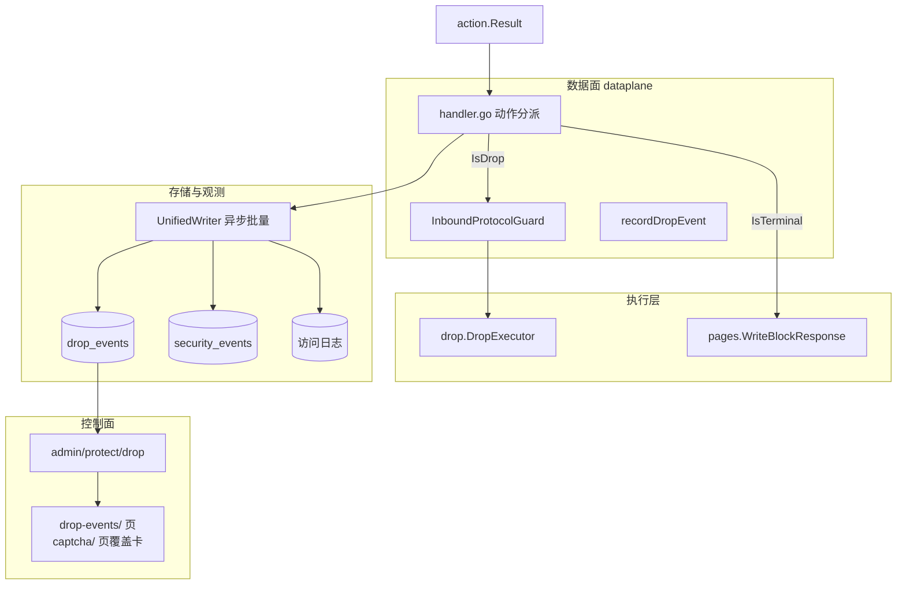
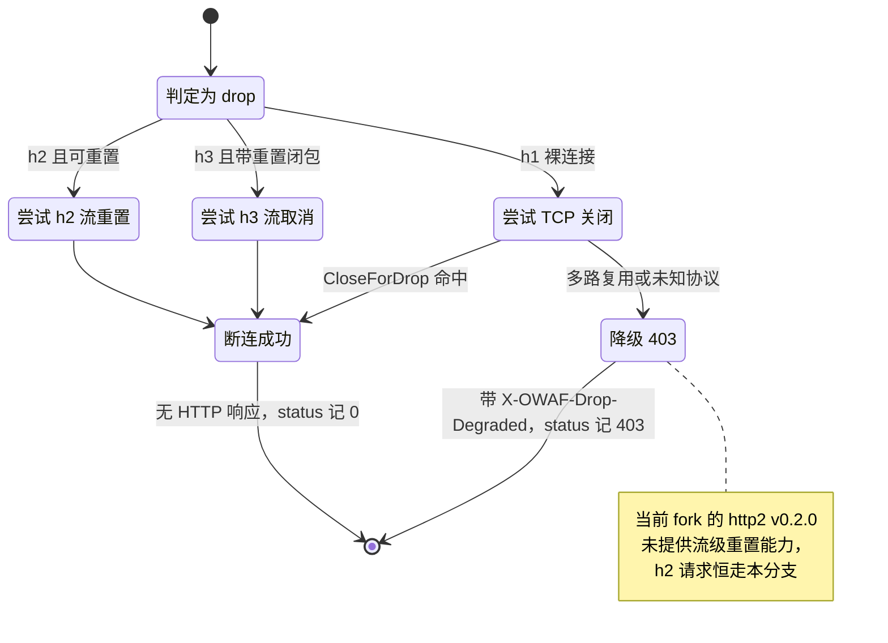
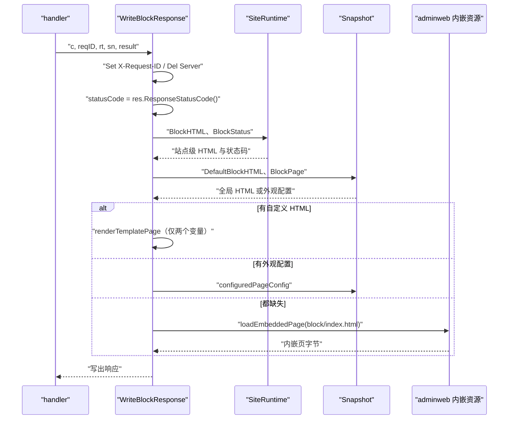
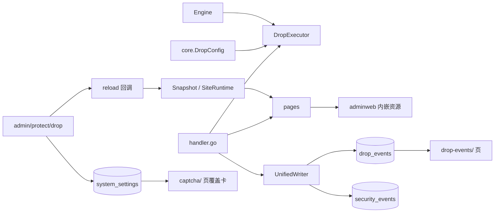

> [返回 安全防护功能](安全防护功能.md)

# 阻断机制

<cite>
**本文档引用的文件**
- [internal/waf/drop/drop.go](file://internal/waf/drop/drop.go)
- [internal/waf/pages/block.go](file://internal/waf/pages/block.go)
- [internal/waf/pages/error_pages.go](file://internal/waf/pages/error_pages.go)
- [internal/waf/pages/templates.go](file://internal/waf/pages/templates.go)
- [internal/waf/pageconfig/config.go](file://internal/waf/pageconfig/config.go)
- [internal/core/action/action.go](file://internal/core/action/action.go)
- [internal/core/engine/engine.go](file://internal/core/engine/engine.go)
- [internal/core/pipeline/pipeline.go](file://internal/core/pipeline/pipeline.go)
- [internal/core/rules/phases.go](file://internal/core/rules/phases.go)
- [internal/core/config.go](file://internal/core/config.go)
- [internal/snapshot/build.go](file://internal/snapshot/build.go)
- [internal/core/configoverride/registry.go](file://internal/core/configoverride/registry.go)
- [internal/dataplane/handler.go](file://internal/dataplane/handler.go)
- [internal/dataplane/handler_support.go](file://internal/dataplane/handler_support.go)
- [internal/dataplane/inbound_conn.go](file://internal/dataplane/inbound_conn.go)
- [internal/store/events.go](file://internal/store/events.go)
- [internal/store/protection.go](file://internal/store/protection.go)
- [internal/store/site.go](file://internal/store/site.go)
- [internal/store/repository/drop_event.go](file://internal/store/repository/drop_event.go)
- [internal/admin/protect/drop/drop.go](file://internal/admin/protect/drop/drop.go)
- [internal/admin/site/observability/observability.go](file://internal/admin/site/observability/observability.go)
- [internal/admin/router.go](file://internal/admin/router.go)
- [internal/app/server.go](file://internal/app/server.go)
- [internal/observability/unified_writer.go](file://internal/observability/unified_writer.go)
- [frontend/lib/api.ts](file://frontend/lib/api.ts)
- [frontend/hooks/use-api.ts](file://frontend/hooks/use-api.ts)
- [frontend/lib/types.ts](file://frontend/lib/types.ts)
- [frontend/app/(dashboard)/drop-events/page.tsx](file://frontend/app/(dashboard)/drop-events/page.tsx)
- [frontend/app/(dashboard)/captcha/components/bot-observation-card.tsx](file://frontend/app/(dashboard)/captcha/components/bot-observation-card.tsx)
- [frontend/app/(dashboard)/captcha/page.tsx](file://frontend/app/(dashboard)/captcha/page.tsx)
- [frontend/app/(dashboard)/cc-protection/page.tsx](file://frontend/app/(dashboard)/cc-protection/page.tsx)
- [frontend/components/cc-rules-editor.tsx](file://frontend/components/cc-rules-editor.tsx)
- [frontend/app/block/page.tsx](file://frontend/app/block/page.tsx)
- [README.md](file://README.md)
</cite>

## 目录

1. [简介](#简介)
2. [项目结构](#项目结构)
3. [核心组件](#核心组件)
4. [架构总览](#架构总览)
5. [详细组件分析](#详细组件分析)
6. [依赖关系分析](#依赖关系分析)
7. [性能考虑](#性能考虑)
8. [故障排查指南](#故障排查指南)
9. [结论](#结论)
10. [附录](#附录)

## 简介
阻断是判定之后的**动作落地层**：阶段链只产出 `action.Result`，本模块负责把它变成「断连、响应页、还是放行」。它由两部分组成：

- **零响应阻断**：`internal/waf/drop` 直接关闭 TCP 连接，不产生任何 HTTP 响应，是严重度最高（`TerminalPriority` 90）的处置
- **响应式阻断**：`internal/waf/pages` 按四级回退渲染拦截页、维护页、挑战页与上游错误页

实测澄清三点常被写错的事实：**仓库中不存在 `drop-policy` 前端页面**（配置入口在 `captcha/` 页的 detection 域覆盖卡，策略读写另有 REST 接口）；**代码中没有 `X-WAF-Action` 响应头**，对外只有 `X-Request-ID` 与降级标记 `X-OWAF-Drop-Degraded`；**阻断页模板只注入请求 ID 与状态码**，规则 ID、阶段名、命中描述一律留空，避免向客户端泄露判定细节。

**章节来源**
- [internal/waf/drop/drop.go:19-41](file://internal/waf/drop/drop.go#L19-L41)
- [internal/waf/pages/block.go:19-58](file://internal/waf/pages/block.go#L19-L58)
- [internal/core/action/action.go:88-115](file://internal/core/action/action.go#L88-L115)

## 项目结构
执行器、渲染器、事件模型与管理接口分居四处，数据面 handler 是唯一把它们串起来的地方。

| 模块 | 文件 | 行数 | 职责 | 关键符号 |
|---|---|:--:|---|---|
| 断连执行器 | [drop.go](file://internal/waf/drop/drop.go) | 113 | 关闭连接、统计、采样告警 | `DropExecutor`、`DropStats`、`DropReason` |
| 响应页渲染 | [block.go](file://internal/waf/pages/block.go) | 307 | 拦截/维护/挑战/上游错误页 | `WriteBlockResponse`、`WriteMaintenanceResponse` |
| 模板与回退 | [templates.go](file://internal/waf/pages/templates.go) | 209 | 内嵌模板与回退 HTML | `renderConfiguredBlockPage`、`renderFallbackPage` |
| 错误页配置 | [error_pages.go](file://internal/waf/pages/error_pages.go) | 143 | 内置状态码文案与自定义覆盖 | `ErrorPageConfig`、`RenderErrorPage` |
| 页面外观配置 | [config.go](file://internal/waf/pageconfig/config.go) | 274 | 品牌色/背景/文案与 CSS 净化 | `BlockPageConfig`、`SanitizeCSS` |
| 动作语义 | [action.go](file://internal/core/action/action.go) | — | 终端性与状态码 | `IsDrop`、`DefaultStatusCode`、`TerminalPriority` |
| 协议守卫 | [inbound_conn.go](file://internal/dataplane/inbound_conn.go) | — | 找到可关闭的裸 TCP 连接 | `InboundProtocolGuard.Execute`、`CloseForDrop` |
| 事件仓储 | [drop_event.go](file://internal/store/repository/drop_event.go) | — | 批量写、24 小时聚合、分批清理 | `DropEventRepo`、`DropStatsSummary` |
| 管理接口 | [protect/drop/drop.go](file://internal/admin/protect/drop/drop.go) | 176 | 策略读写与统计列表 | `GetDropPolicy`、`UpdateDropPolicy` |



**图表来源**
- [internal/dataplane/handler.go:713-850](file://internal/dataplane/handler.go#L713-L850)
- [internal/dataplane/handler_support.go:334-353](file://internal/dataplane/handler_support.go#L334-L353)
- [internal/dataplane/inbound_conn.go:529-564](file://internal/dataplane/inbound_conn.go#L529-L564)
- [internal/waf/drop/drop.go:47-91](file://internal/waf/drop/drop.go#L47-L91)
- [internal/admin/protect/drop/drop.go:54-176](file://internal/admin/protect/drop/drop.go#L54-L176)

**章节来源**
- [internal/waf/pages/templates.go:11-50](file://internal/waf/pages/templates.go#L11-L50)
- [internal/store/events.go:238-248](file://internal/store/events.go#L238-L248)

## 核心组件
- `DropExecutor`：持有 `*DropStats`、启用位、logger 与日志计数器；`enabled` 是普通 bool，由 `Reconfigure` 在 reload 时替换（drop.go:19-45）
- `DropReason`：断连归因上下文，字段 `Source`、`RuleID`、`Detail`、`ClientIP`、`Host`、`Path`、`Timestamp`（drop.go:26-34）
- `DropStats`：六个原子字段，`LastDropTime` 用 `atomic.Value` 存 `time.Time`（drop.go:10-17）
- `InboundProtocolGuard`：解包最多 6 层连接包装以拿到 `*net.TCPConn`，多路复用或未知协议时拒绝触碰连接（inbound_conn.go:529-595）
- `WriteBlockResponse` / `WriteMaintenanceResponse` / `WriteChallengeResponse` / `WriteUpstreamErrorResponse`：四类响应入口（block.go:20-188）
- `DropEvent`：站点、客户端 IP、来源、规则 ID、详情、Host、路径、时间；`(source, created_at)` 与 `created_at` 上有索引（events.go:238-248）

| 符号 | 位置 | 签名 | 说明 |
|---|---|---|---|
| `NewDropExecutor` | [drop.go:36](file://internal/waf/drop/drop.go#L36) | `(enabled bool, log *slog.Logger) *DropExecutor` | log 为 nil 时用 `slog.Default()` |
| `Execute` | [drop.go:47](file://internal/waf/drop/drop.go#L47) | `(conn net.Conn, reason DropReason) error` | conn 为 nil 时静默返回 |
| `recordStats` | [drop.go:78](file://internal/waf/drop/drop.go#L78) | `(reason DropReason)` | 按 `Source` 分桶 |
| `GetStats` | [drop.go:93](file://internal/waf/drop/drop.go#L93) | `() *DropStats` | 返回快照副本 |
| `ResetStats` | [drop.go:106](file://internal/waf/drop/drop.go#L106) | `()` | 全部归零 |
| `WriteBlockResponse` | [block.go:20](file://internal/waf/pages/block.go#L20) | `(c, reqID, rt, sn, res)` | 四级回退 |
| `Stats24hBySite` | [drop_event.go:194](file://internal/store/repository/drop_event.go#L194) | `(siteID uint) (*DropStatsSummary, error)` | `siteID=0` 为全局 |

**章节来源**
- [internal/waf/drop/drop.go:10-113](file://internal/waf/drop/drop.go#L10-L113)
- [internal/waf/pages/block.go:20-188](file://internal/waf/pages/block.go#L20-L188)
- [internal/store/repository/drop_event.go:156-208](file://internal/store/repository/drop_event.go#L156-L208)

## 架构总览
动作分派顺序固定：先判 Drop，再判挑战，其余终端动作走拦截渲染，未命中继续转发（handler.go:713-860）。

| 流程步 | 触发条件 | 行为 | 证据 |
|:--:|---|---|---|
| 1 | `result.Action.IsDrop()` 且执行器启用 | 记 console 采样日志（首 16 条 + 每 1024 条） | handler.go:713-724、access_log.go:51-57 |
| 2 | 阶段为 `cve_detection` 或 `owasp_default` | 构建 `InboundProtocolGuard`，其余阶段 guard 为 nil | handler.go:728-731 |
| 3 | h2 流可重置 | 发 `RST_STREAM(CANCEL)`，视为 drop 成功 | handler.go:743-744、inbound_conn.go:440-449 |
| 4 | h3 请求带一次性重置闭包 | 取消写流，视为 drop 成功 | handler.go:745-747、inbound_conn.go:459-474 |
| 5 | 兜底 | `guard.Execute(dropExec, reason)` 关闭裸 TCP | handler.go:748-754、inbound_conn.go:549-564 |
| 6 | drop 成功 | 写 `SecurityEvent(action=drop, status 0)` + 访问日志 + `DropEvent` | handler.go:755-794 |
| 7 | drop 失败 | 动作改写为 Intercept，补 `X-OWAF-Drop-Degraded`，返回 403 | handler.go:796-850 |



**图表来源**
- [internal/dataplane/handler.go:713-850](file://internal/dataplane/handler.go#L713-L850)
- [internal/dataplane/inbound_conn.go:440-474](file://internal/dataplane/inbound_conn.go#L440-L474)
- [internal/dataplane/inbound_conn.go:529-564](file://internal/dataplane/inbound_conn.go#L529-L564)

**章节来源**
- [internal/core/action/action.go:168-190](file://internal/core/action/action.go#L168-L190)
- [internal/core/pipeline/pipeline.go:517-560](file://internal/core/pipeline/pipeline.go#L517-L560)

## 详细组件分析

### 零响应执行器
`Execute` 的三步顺序是刻意的：先 `SetLinger(0)` 再 `Close`，让内核发 RST 而不是 FIN，避免客户端看到半开连接；只有关闭成功才记统计与告警（drop.go:47-72）。

```go
// internal/waf/drop/drop.go:51-56
rST := func() error {
	if tcp, ok := conn.(*net.TCPConn); ok {
		_ = tcp.SetLinger(0)
	}
	return conn.Close()
}
```

日志采样阈值为「前 16 条全打，之后每 1024 条打一条」，攻击期不会把日志刷满（drop.go:74-76）。

| 统计字段 | 计数来源（`DropReason.Source`） | 说明 |
|---|---|---|
| `TotalDropped` | 所有来源 | 进程内累计，`ResetStats` 可清零 |
| `DroppedByBot` | `bot` | — |
| `DroppedByCVE` | `cve` | — |
| `DroppedByRule` | `rule` **与** `ip_reputation` | 两类合并计同一桶 |
| `DroppedOther` | 其它任意值 | — |
| `LastDropTime` | 最近一次断连时间 | `atomic.Value` |

实测口径注意：数据面传入的 `Source` 是阶段名（如 `bot_detection`、`cve_detection`、`owasp_default`、`ip_reputation`），而 `recordStats` 只识别 `bot`/`cve`/`rule`/`ip_reputation` 四个字面值，因此除 `ip_reputation` 外其余来源都落进 `DroppedOther`；落库的 `drop_events.source` 则是原始阶段名（handler.go:733-741、drop.go:78-91）。内存统计与数据库聚合不能直接互相核对。

**章节来源**
- [internal/waf/drop/drop.go:47-113](file://internal/waf/drop/drop.go#L47-L113)
- [internal/dataplane/handler.go:733-741](file://internal/dataplane/handler.go#L733-L741)

### 拦截页四级回退
状态码先取动作的默认值（`intercept` → 403、`rate_limit` → 429、挑战类 → 403、`redirect` → 302），站点 `BlockStatus` 只在结果为 403 时覆盖（action.go:283-312、block.go:24-37）。

| 优先级 | 来源 | 渲染分支 | 证据 |
|:--:|---|---|---|
| 1 | 站点 `site.block_html` | `renderTemplatePage` | block.go:30-42 |
| 2 | 快照 `DefaultBlockHTML`（全局自定义） | `renderTemplatePage` | block.go:26-28 |
| 3 | 快照 `BlockPage` 外观配置 | `renderConfiguredBlockPage` | block.go:44-55 |
| 4 | 内嵌 `block/index.html` | `renderEmbeddedPage` | block.go:57 |
| 5 | 兜底字符串页 | `defaultFallbackHTML` | block.go:247-267 |



**图表来源**
- [internal/waf/pages/block.go:20-58](file://internal/waf/pages/block.go#L20-L58)
- [internal/waf/pages/block.go:190-245](file://internal/waf/pages/block.go#L190-L245)

`renderTemplatePage` 的模板变量表只有 `RequestID` 与 `StatusCode` 有值，`RuleID`、`RuleIDStr`、`Phase`、`Action`、`Category`、`MatchDesc` 一律传空串——这是防信息泄露的显式设计，不是遗漏（block.go:196-217）。内嵌页的占位符替换包含 `__WAF_STATUS_CODE__`、`__WAF_REQUEST_ID__`、`__WAF_RULE_ID__`，其中 block 页会主动把 `ruleID` 置空，并把 `/_next/` 改写为 `/__owaf/_next/` 以适配内嵌资源路径（block.go:221-237）。

**章节来源**
- [internal/waf/pages/block.go:20-58](file://internal/waf/pages/block.go#L20-L58)
- [internal/waf/pages/block.go:190-245](file://internal/waf/pages/block.go#L190-L245)
- [internal/core/action/action.go:283-312](file://internal/core/action/action.go#L283-L312)

### 维护页、挑战页与错误页
- 维护页顺序为「站点 HTML + 站点状态码 → 全局 HTML + 全局状态码 → 内嵌 maintenance 页」，默认 503（block.go:61-86）
- 挑战页固定 `Cache-Control: no-store, no-cache, must-revalidate`，并生成绑定客户端身份的 token 对；开启环境检查时注入加密的采集脚本与 PoW 分片脚本（block.go:97-137）
- 上游错误页取内嵌 `error/index.html`，缺失时按状态码生成 502/503/504 的中英文文案（block.go:174-188、276-307）
- 独立错误页配置覆盖 403/404/429/431/502/503/504 七个状态码，`customConfig.HTML` 非空时走整页 HTML 分支（error_pages.go:11-70）
- 页面外观字段全部经净化：品牌色、背景、Logo URL、自定义 CSS 各有白名单，模板执行失败即回落默认（pageconfig/config.go:148-272、templates.go:42-51）

**章节来源**
- [internal/waf/pages/block.go:61-188](file://internal/waf/pages/block.go#L61-L188)
- [internal/waf/pages/block.go:276-307](file://internal/waf/pages/block.go#L276-L307)
- [internal/waf/pages/error_pages.go:11-70](file://internal/waf/pages/error_pages.go#L11-L70)
- [internal/waf/pageconfig/config.go:114-272](file://internal/waf/pageconfig/config.go#L114-L272)

### 策略配置与继承
策略以 JSON 存在 `SystemSettings` 的 `drop_policy` 键里，四个字段与 `core.DropConfig` 一一对应。

| 配置项 | 类型 | 默认 | 载体 | 证据 |
|---|---|:--:|---|---|
| `enabled` | bool | `true` | `drop_policy` | config.go:60、protect/drop/drop.go:18 |
| `bot_score_threshold` | int | 80 | `drop_policy`，与 `bot_settings.score_threshold` 双向同步 | config.go:61、bot/bot.go:257-261 |
| `cve_auto_drop_critical` | bool | `true` | `protection`（同时镜像进 `drop_policy`） | config.go:62、protection.go:50 |
| `cve_auto_drop_high` | bool | `true` | `protection`（同时镜像进 `drop_policy`） | config.go:63、protection.go:51 |

优先级链是：`drop_policy` 设置行 > `MY_OPENWAF_DROP_ENABLED` / `MY_OPENWAF_DROP_BOT_THRESHOLD` 环境变量与逐键覆盖 > `DefaultDropConfig`。环境变量只在启动期落进 `rt.Config.Drop` 作为兜底，reload 时 `loadDropPolicy` 重新读设置行覆盖它（config.go:419-427、server.go:457、server.go:659-661）。`MY_OPENWAF_DROP_ENABLED` 只认字面 `false`，其它任意值都是「不关闭」（registry.go:384-388）。

站点级三态：站点表没有任何 drop 专属字段，`*bool` 三态列（如 `owasp_enabled`、`cve_enabled`、`bot_protection_enabled`、`rate_limit_enabled`）决定的是「哪个能产出 Drop 的阶段入链」，nil = 继承全局（site.go:60-91、build.go:711-760）。唯一能由站点关掉自动升 Drop 的路径是把 `cve_action` 覆盖为 `observe`，此时合并阶段会显式清掉两个 auto-drop 开关（build.go:737-746）。

**章节来源**
- [internal/core/config.go:58-74](file://internal/core/config.go#L58-L74)
- [internal/core/config.go:419-427](file://internal/core/config.go#L419-L427)
- [internal/app/server.go:456-459](file://internal/app/server.go#L456-L459)
- [internal/app/server.go:637-673](file://internal/app/server.go#L637-L673)
- [internal/admin/protect/drop/drop.go:16-52](file://internal/admin/protect/drop/drop.go#L16-L52)
- [internal/store/site.go:59-91](file://internal/store/site.go#L59-L91)
- [internal/snapshot/build.go:707-768](file://internal/snapshot/build.go#L707-L768)

### 管理接口与前端入口
写接口一律是 POST，路由表中没有 PUT/DELETE。

| 端点 | 方法 | 分组 | 处理器 | 证据 |
|---|---|---|---|---|
| `/drop-policy` | GET | readGroup | `GetDropPolicy` | router.go:242 |
| `/drop-policy/update` | POST | adminGroup（仅 admin） | `UpdateDropPolicy` | router.go:408 |
| `/drop-stats` | GET | readGroup | `GetDropStats` → `Stats24h` | router.go:243 |
| `/drop-events` | GET | readGroup | `GetDropEvents`（分页 + IP/来源/时间过滤） | router.go:244 |
| `/sites/{id}/drop-stats` | GET | readGroup | 站点维度统计 | router.go:192 |
| `/sites/{id}/drop-events` | GET | readGroup | 站点维度事件 | router.go:191 |

前端实测：
- `drop-events/` 页展示时间、IP、来源、Host、路径五列，支持 source/ip/host 过滤与 20 条分页（drop-events/page.tsx:48-80）
- `drop-stats` 由 `captcha/` 页的 `bot-observation-card.tsx` 消费，与 bot 统计并排展示（bot-observation-card.tsx:16、106-111）
- Drop 开关阈值的可操作入口是 `captcha/` 页的 detection 域覆盖卡，键为 `drop_enabled`、`drop_bot_threshold`（captcha/page.tsx:80-87、1908）；`settings/` 页的覆盖卡**不含** detection 域（settings/page.tsx:59-69）
- `cc-protection/` 页只在 CC 规则动作下拉里提供 `drop` 作为可选动作，不承载 Drop 策略本身（cc-rules-editor.tsx:49-58）
- `useDropPolicy` / `useDropPolicyUpdate` 两个 hook 已在 `use-api.ts` 定义，但当前没有任何页面消费它们（use-api.ts:596-601、1209-1212）

**章节来源**
- [internal/admin/router.go:191-244](file://internal/admin/router.go#L191-L244)
- [internal/admin/router.go:408](file://internal/admin/router.go#L408)
- [internal/admin/protect/drop/drop.go:54-176](file://internal/admin/protect/drop/drop.go#L54-L176)
- [frontend/app/(dashboard)/drop-events/page.tsx:29-80](file://frontend/app/(dashboard)/drop-events/page.tsx#L29-L80)
- [frontend/app/(dashboard)/captcha/page.tsx:80-87](file://frontend/app/(dashboard)/captcha/page.tsx#L80-L87)
- [frontend/app/(dashboard)/captcha/components/bot-observation-card.tsx:106-111](file://frontend/app/(dashboard)/captcha/components/bot-observation-card.tsx#L106-L111)
- [frontend/components/cc-rules-editor.tsx:49-58](file://frontend/components/cc-rules-editor.tsx#L49-L58)
- [frontend/hooks/use-api.ts:596-601](file://frontend/hooks/use-api.ts#L596-L601)

### 事件追踪与统计
`DropEvent` 与 `SecurityEvent` 是两条独立记录：前者专供 Drop 面板，后者覆盖所有命中。二者都在 drop 成功分支同批写入，状态码一个记 0（无响应）一个由访问日志记 0。

| 字段 | 表 | 来源 | 备注 |
|---|---|---|---|
| `site_id` | `drop_events` | `rt.Site.ID` | 站点维度过滤键 |
| `client_ip` | `drop_events` | 解析后的客户端 IP | 字符串存储，支持 IPv6 |
| `source` | `drop_events` | `result.Action.Phase` | 阶段名，非执行器分桶值 |
| `rule_id` | `drop_events` | `RuleIDStr` | 内置规则带前缀，如 `owasp:sqli:001` |
| `detail` | `drop_events` | `MatchDesc` | 长度上限 512 |
| `status_code` | `security_events` | 成功为 0，降级为 403 | 用于区分两种结局 |

聚合口径：`Stats24hBySite` 用一条 `SUM(CASE WHEN source = ? ...)` 产出总数与四类分来源计数；`DeleteOlderThan` 以 5000 为一批分批删除，降低大表锁竞争（drop_event.go:156-208）。计数缓存会在每次直接写入或批量提交后按前缀失效，保证列表总数与详情一致（drop_event.go:26-32）。

**章节来源**
- [internal/dataplane/handler.go:755-794](file://internal/dataplane/handler.go#L755-L794)
- [internal/dataplane/handler_support.go:334-348](file://internal/dataplane/handler_support.go#L334-L348)
- [internal/store/events.go:238-248](file://internal/store/events.go#L238-L248)
- [internal/store/repository/drop_event.go:26-208](file://internal/store/repository/drop_event.go#L26-L208)
- [internal/observability/unified_writer.go:583-585](file://internal/observability/unified_writer.go#L583-L585)

## 依赖关系分析
- 执行器由引擎持有，数据面只经 `Engine.DropExecutor()` 读取，不自行构造（engine.go:93、593-604）
- `pages` 依赖 `snapshot.SiteRuntime` 与 `snapshot.Snapshot` 提供配置，依赖 `adminweb` 内嵌文件系统提供静态页（block.go:11-17、239-245）
- 事件写入依赖 `UnifiedWriter` 的异步通道，`opts.Writer` 为 nil 时静默跳过而不影响阻断本身（handler_support.go:334-337）
- 管理接口依赖 `SystemSettingsRepo` 事务 + reload 回调；reload 失败时返回「配置已应用但重载失败」并回显当前策略（protect/drop/drop.go:105-133）



**图表来源**
- [internal/core/engine/engine.go:93-127](file://internal/core/engine/engine.go#L93-L127)
- [internal/app/server.go:456-459](file://internal/app/server.go#L456-L459)
- [internal/waf/pages/block.go:11-17](file://internal/waf/pages/block.go#L11-L17)
- [internal/admin/protect/drop/drop.go:105-133](file://internal/admin/protect/drop/drop.go#L105-L133)

**章节来源**
- [internal/core/engine/engine.go:593-604](file://internal/core/engine/engine.go#L593-L604)
- [internal/waf/pages/block.go:239-245](file://internal/waf/pages/block.go#L239-L245)

## 性能考虑
- Drop 跳过 HTTP 响应生成与上游转发，是四种终端动作里开销最小的一种
- `SetLinger(0)` 让连接立刻释放，不进入 `TIME_WAIT` 堆积
- 告警与统计全用原子量与采样阈值，断连风暴期间不引入锁竞争（drop.go:61-76）
- 模板解析失败即走字符串兜底页，不做二次解析（block.go:190-195）
- 事件写入异步批量，队列容量与批量大小可调；容量吃紧时表现为「慢速宽限」而非丢请求
- 自定义 HTML 越大，模板解析成本越高，拦截页应保持精简

**章节来源**
- [internal/waf/drop/drop.go:47-76](file://internal/waf/drop/drop.go#L47-L76)
- [internal/waf/pages/block.go:190-195](file://internal/waf/pages/block.go#L190-L195)
- [internal/core/config.go:76-121](file://internal/core/config.go#L76-L121)

## 故障排查指南
| 症状 | 判据 | 处置 |
|---|---|---|
| 判定 drop 但客户端收到 403 | 响应头 `X-OWAF-Drop-Degraded: h2-h3-no-stream-reset` | 属协议限制，h2 当前恒走降级分支 |
| Drop 统计全为 0 | 执行器 `Enabled()` 是否为假 | `MY_OPENWAF_DROP_ENABLED=false` 会关掉 |
| 面板数字与内存统计不符 | 两侧 `source` 口径不同 | 库中存阶段名，执行器只认四个短名 |
| 拦截页空白或默认样式 | `block_html` / `DefaultBlockHTML` / `BlockPage` 是否为空 | 按四级回退逐级检查 |
| 模板变量不显示规则 ID | 属预期 | 渲染只注入 RequestID 与状态码 |
| 站点改了 `block_status` 没变 | 仅当结果为 403 时覆盖生效 | 429 等状态码不受该字段影响 |
| 事件表膨胀 | 归档任务是否运行 | `DeleteOlderThan` 分批 5000 删除 |
| 保存策略报 reload failed | 返回体含 `policy` 字段 | 配置已落库，重载失败需查快照构建日志 |

**章节来源**
- [internal/dataplane/handler.go:796-850](file://internal/dataplane/handler.go#L796-L850)
- [internal/waf/drop/drop.go:78-91](file://internal/waf/drop/drop.go#L78-L91)
- [internal/waf/pages/block.go:24-57](file://internal/waf/pages/block.go#L24-L57)
- [internal/store/repository/drop_event.go:165-188](file://internal/store/repository/drop_event.go#L165-L188)
- [internal/admin/protect/drop/drop.go:127-133](file://internal/admin/protect/drop/drop.go#L127-L133)

## 结论
阻断层的价值在于把「判定」与「落地」解耦：阶段不需要知道连接能否关闭、页面来自哪一级模板，只需给出 `action.Result`。本模块的两个关键设计是零响应路径的 `SetLinger(0)` 与协议不可触达时的 403 降级，以及响应页对内部字段的强制脱敏。

已知遗留项：`DropExecutor` 的分桶字面值与数据面传入的阶段名不一致，导致内存统计的 bot/cve/rule 三桶长期为空；`useDropPolicy` 系列 hook 已就绪但无页面消费者。建议后续把来源值统一为阶段名常量，并在前端补一个策略编辑面板。

**章节来源**
- [本节为总结，无需特定文件来源]

## 附录

### 默认值速查

| 项 | 默认 | 证据 |
|---|:--:|---|
| Drop 启用 | `true` | config.go:69 |
| Drop Bot 阈值 | 80 | config.go:70 |
| CVE Critical / High 自动 Drop | `true` / `true` | config.go:71-72、protection.go:180-181 |
| 拦截状态码 | 403（限流 429、重定向 302） | action.go:283-307 |
| 维护页状态码 | 503 | protection.go:171、block.go:66 |
| 内嵌资源前缀 | `/__owaf/` | block.go:185-186、234-235 |

**章节来源**
- [internal/core/config.go:66-74](file://internal/core/config.go#L66-L74)
- [internal/core/action/action.go:283-312](file://internal/core/action/action.go#L283-L312)
- [internal/store/protection.go:159-203](file://internal/store/protection.go#L159-L203)
- [internal/waf/pages/block.go:185-235](file://internal/waf/pages/block.go#L185-L235)

### 术语
- **零响应阻断**：不发送任何 HTTP 响应即关闭连接，访问日志状态码记 0
- **降级阻断**：判定为 Drop 但拿不到可关闭的连接时，改写为 Intercept 返回 403
- **四级回退**：站点 HTML → 全局 HTML → 外观配置模板 → 内嵌页 → 字符串兜底
- **协议守卫**：`InboundProtocolGuard`，负责在多协议/多层包装下找到能安全触碰的裸 TCP 连接

**章节来源**
- [internal/waf/drop/drop.go:26-34](file://internal/waf/drop/drop.go#L26-L34)
- [internal/dataplane/inbound_conn.go:529-564](file://internal/dataplane/inbound_conn.go#L529-L564)
- [internal/waf/pages/block.go:20-58](file://internal/waf/pages/block.go#L20-L58)

### 相关文档
- 判定侧的档位来源：[机器人检测](机器人检测.md)、[IP 信誉系统](IP 信誉系统.md)
- 阶段链顺序与短路语义：[处理阶段详解](../WAF 引擎系统/处理阶段详解/处理阶段详解.md)
- REST 契约：[阻断策略 API](../管理 API 系统/阻断策略 API.md)
- 页面模板管理：[前端管理界面](../前端管理界面/前端管理界面.md)

**章节来源**
- [本节为总结，无需特定文件来源]
