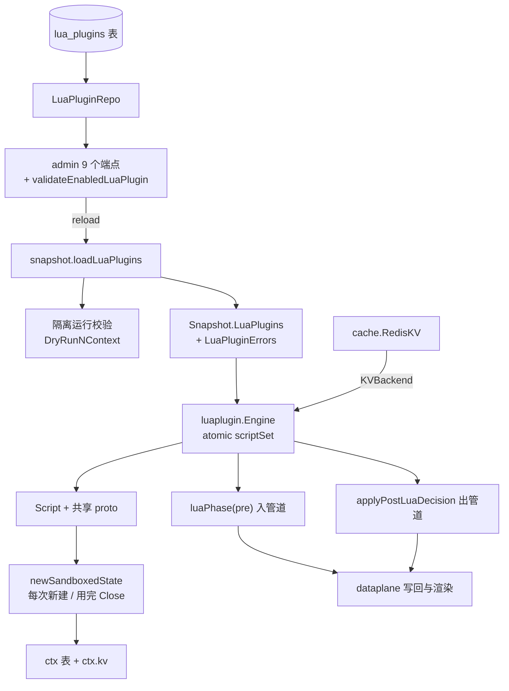
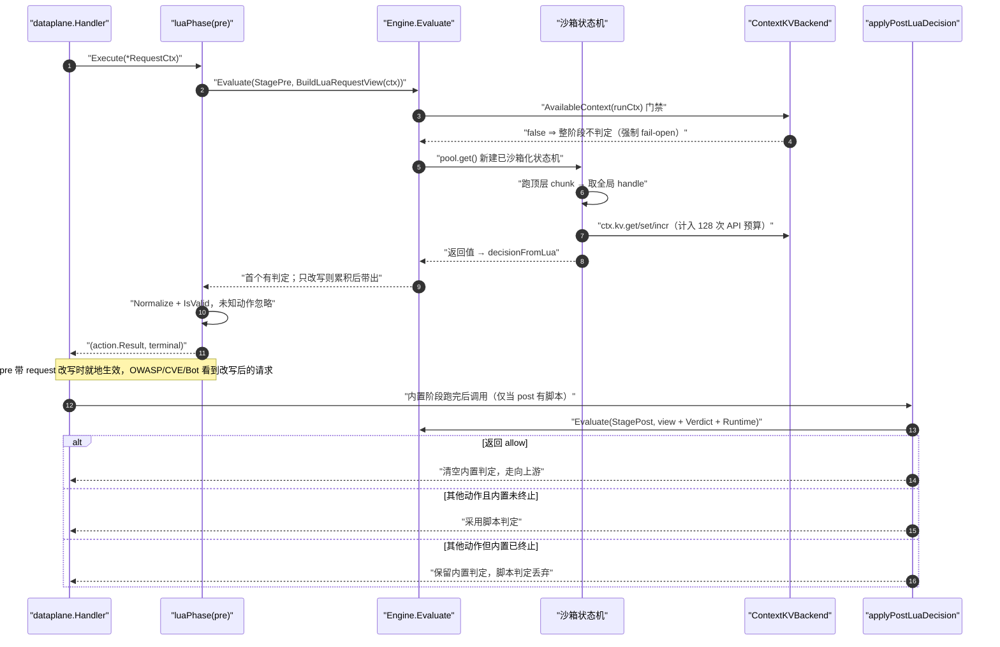
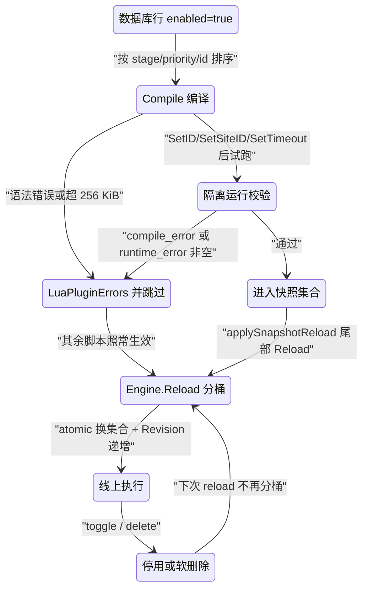

# Lua 策略插件

> [返回 扩展与插件系统](扩展与插件系统.md)

<cite>
**本文档引用的文件**
- [internal/waf/luaplugin/runtime.go](file://internal/waf/luaplugin/runtime.go)
- [internal/waf/luaplugin/sandbox.go](file://internal/waf/luaplugin/sandbox.go)
- [internal/waf/luaplugin/exec.go](file://internal/waf/luaplugin/exec.go)
- [internal/waf/luaplugin/api.go](file://internal/waf/luaplugin/api.go)
- [internal/waf/luaplugin/engine.go](file://internal/waf/luaplugin/engine.go)
- [internal/waf/luaplugin/mutation.go](file://internal/waf/luaplugin/mutation.go)
- [internal/waf/luaplugin/dryrun.go](file://internal/waf/luaplugin/dryrun.go)
- [internal/core/rules/lua_phase.go](file://internal/core/rules/lua_phase.go)
- [internal/core/engine/engine.go](file://internal/core/engine/engine.go)
- [internal/core/action/action.go](file://internal/core/action/action.go)
- [internal/core/pipeline/pipeline.go](file://internal/core/pipeline/pipeline.go)
- [internal/snapshot/lua.go](file://internal/snapshot/lua.go)
- [internal/store/luaplugin/lua_plugin.go](file://internal/store/luaplugin/lua_plugin.go)
- [internal/store/repository/plugin/lua_plugin.go](file://internal/store/repository/plugin/lua_plugin.go)
- [internal/store/migrate.go](file://internal/store/migrate.go)
- [internal/store/js_plugin.go](file://internal/store/js_plugin.go)
- [internal/admin/system/luaplugin/lua_plugin.go](file://internal/admin/system/luaplugin/lua_plugin.go)
- [internal/admin/system/sitescope/site_scope.go](file://internal/admin/system/sitescope/site_scope.go)
- [internal/admin/router.go](file://internal/admin/router.go)
- [internal/app/server.go](file://internal/app/server.go)
- [internal/cache/redis_kv.go](file://internal/cache/redis_kv.go)
- [internal/observability/metrics.go](file://internal/observability/metrics.go)
- [internal/dataplane/handler.go](file://internal/dataplane/handler.go)
- [internal/dataplane/handler_support.go](file://internal/dataplane/handler_support.go)
- [internal/proxy/js_plugin_response.go](file://internal/proxy/js_plugin_response.go)
- [internal/waf/jsplugin/types.go](file://internal/waf/jsplugin/types.go)
- [docs/扩展与插件系统/lua-examples/01-ip-rate-limit.lua](file://docs/扩展与插件系统/lua-examples/01-ip-rate-limit.lua)
</cite>

## 目录

1. [简介](#简介)
2. [项目结构](#项目结构)
3. [核心组件](#核心组件)
4. [架构总览](#架构总览)
5. [详细组件分析](#详细组件分析)
6. [依赖关系分析](#依赖关系分析)
7. [性能考虑](#性能考虑)
8. [故障排查指南](#故障排查指南)
9. [结论](#结论)
10. [附录](#附录)

## 简介

Lua 策略插件让运维在不改 Go 代码、不重新编译的前提下写自定义判定：脚本存于 `lua_plugins` 表，
随配置重载编译，运行在受限沙箱中，**每请求同步执行**。适用于内置规则 DSL 表达不了的组合条件
（多字段联合判断、按 IP 计数、按站点分流、对已确认误报定点放行）；不适用于需要文件系统、
网络出向、外部命令或重计算的逻辑——沙箱不提供这些能力，默认 50 ms 挂钟超时也不允许长耗时操作。
底线是：**自定义策略出问题绝不能让站点不可用**——语法错误、运行时错误、panic、超时、
KV 不可用，一律降级为「该脚本不判定」，其余脚本与内置检测照常生效。

三处必须与旧版本文区分开。其一，状态机**不跨请求复用**：`vmPool.get()` 每次新建已沙箱化状态机、
`put()` 立即 `Close`（`sandbox.go:66-93`），旧文档所称「`sync.Pool` 复用 + `resetGlobals` 清全局」
描述的是已被替换的实现，`resetGlobals`/`scriptGlobalWhitelist` 在现库中已不存在。其二，快照构建期除
编译外还做一次**隔离运行校验**，运行期报错的脚本同样进不了执行集合（`snapshot/lua.go:82-107`）。
其三，`ctx.kv.incr` 是**固定窗口**而非旧文档所称的空闲过期窗口（证据见 KV 一节）。

**章节来源**
- [internal/waf/luaplugin/sandbox.go:66-124](file://internal/waf/luaplugin/sandbox.go#L66-L124)
- [internal/snapshot/lua.go:82-172](file://internal/snapshot/lua.go#L82-L172)
- [internal/waf/luaplugin/runtime.go:1-24](file://internal/waf/luaplugin/runtime.go#L1-L24)

## 项目结构

实现分四层：运行时与沙箱、管道接入、配置装载、持久化与管理面。

| 文件 | 规模 | 职责 | 关键符号 |
|------|:----:|------|----------|
| `internal/waf/luaplugin/runtime.go` | 321 行 | `Stage`/`Decision`/`Script`/`KVBackend` 与全部常量 | `Compile`、`SetTimeout` |
| `internal/waf/luaplugin/sandbox.go` | 124 行 | 标准库白名单、危险函数摘除、状态机池 | `allowedLibs`、`newSandboxedState` |
| `internal/waf/luaplugin/exec.go` | 428 行 | 单次执行、返回值转换、panic 隔离、请求视图 | `RequestView`、`decisionFromTable` |
| `internal/waf/luaplugin/api.go` | 389 行 | `ctx` 表与 `ctx.kv`、前缀与体积限制 | `buildContextTable`、`kvKeyPrefix` |
| `internal/waf/luaplugin/engine.go` | 303 行 | 脚本集合、按阶段分桶、原子热替换 | `Reload`、`Evaluate`、`Revision` |
| `internal/waf/luaplugin/dryrun.go` | 132 行 | `Validate` 与 `DryRun`/`DryRunN` | `DryRunBatchResult` |
| `internal/core/rules/lua_phase.go` | 235 行 | `pre` 阶段管道实现 | `NewLuaPhase`、`BuildLuaRequestView` |
| `internal/core/engine/engine.go` | 646 行 | 阶段链装配 + `post` 覆盖规则 | `getOrBuildPhases:441`、`applyPostLuaDecision:234` |
| `internal/snapshot/lua.go` | 172 行 | 装载、编译、隔离校验 | `loadLuaPlugins` |
| `internal/store/repository/plugin/lua_plugin.go` | 68 行 | CRUD 与稳定排序 | `ListEnabled`、`Toggle` |
| `internal/admin/system/luaplugin/lua_plugin.go` | 595 行 | 9 个端点、双重校验、试运行 | `CreateLuaPlugin`、`DryRunLuaPlugin` |
| `internal/app/server.go` | — | 引擎装配与热替换挂载 | `:400-401`、`:886` |



**图表来源**
- [internal/snapshot/lua.go:82-172](file://internal/snapshot/lua.go#L82-L172)
- [internal/waf/luaplugin/engine.go:42-105](file://internal/waf/luaplugin/engine.go#L42-L105)
- [internal/waf/luaplugin/sandbox.go:96-124](file://internal/waf/luaplugin/sandbox.go#L96-L124)

与 QuickJS 侧（`internal/waf/jsplugin`，2191 行）是**并列而非依赖**：共享 `pipeline` 改写出口与
`action` 词表，但后端、超时默认与失败语义不同（对照见附录）。`internal/waf/dynamic`（954 行）与插件
注入无关，它是响应侧的 HTML/JS 混淆信封，不参与脚本装载。

**章节来源**
- [internal/waf/jsplugin/types.go:16-49](file://internal/waf/jsplugin/types.go#L16-L49)
- [internal/store/js_plugin.go:11-18](file://internal/store/js_plugin.go#L11-L18)

## 核心组件

`Engine` 是唯一外部入口，`Script` 是不可变编译产物，`RequestView` 与 `Decision` 是沙箱进出的
两份数据，KV 后端只接受可响应取消的实现。


代码上下文表——扩展前先确认落点：

| 符号与签名 | 定义:行 | 职责 |
|------------|---------|------|
| `func Compile(name string, stage Stage, source string) (*Script, error)` | `runtime.go:274` | 编译期拒绝超限与语法错误，唯一编译入口 |
| `func (e *Engine) Reload(scripts []*Script)` | `engine.go:78` | 原子热替换 + 代际递增，由 `server.go:886` 调用 |
| `func (e *Engine) Evaluate(ctx context.Context, stage Stage, req RequestView) Decision` | `engine.go:177` | 顺序执行、首个判定返回、改写累积，失败在此吞掉 |
| `func (s *Script) Run(ctx context.Context, pool *vmPool, req RequestView, kv KVBackend) (Decision, error)` | `exec.go:190` | 借状态机执行一次并归类错误与超时 |
| `func buildContextTable(L *lua.LState, runCtx context.Context, req RequestView, kv KVBackend, budget *apiBudget) *lua.LTable` | `api.go:45` | 沙箱可见的全部输入，新增 `ctx` 字段的唯一位置 |
| `func decisionFromLua(v lua.LValue) (Decision, error)` | `exec.go:283` | 三形态返回值解析，新增返回形态的位置 |
| `func (p *luaPhase) Execute(ctx *pipeline.RequestCtx) (action.Result, bool)` | `lua_phase.go:53` | 管道接入与动作归一化 |
| `func applyPostLuaDecision(lp *luaplugin.Engine, reqCtx *pipeline.RequestCtx, builtin action.Result) action.Result` | `engine.go:234` | 唯一 post 入口与覆盖规则 |
| `func loadLuaPlugins(db *gorm.DB) ([]*luaplugin.Script, map[string]string, error)` | `snapshot/lua.go:119` | 装载与校验，校验强度在此调 |

`Engine` 读路径无锁：脚本集合与 KV 后端均由 `atomic.Pointer` 持有（`engine.go:43-44`），
`Reload` 构造全新集合再原子换指针，在途调用继续持有旧集合跑完；`rules` 包只认
`LuaPluginEvaluator` 的两个方法（`lua_phase.go:14-17`），不依赖具体引擎类型。

**章节来源**
- [internal/waf/luaplugin/engine.go:11-105](file://internal/waf/luaplugin/engine.go#L11-L105)
- [internal/waf/luaplugin/runtime.go:26-37](file://internal/waf/luaplugin/runtime.go#L26-L37)
- [internal/waf/luaplugin/runtime.go:274-293](file://internal/waf/luaplugin/runtime.go#L274-L293)
- [internal/waf/luaplugin/exec.go:190-297](file://internal/waf/luaplugin/exec.go#L190-L297)

## 架构总览

`pre` 在管道内、`post` 在管道外，两者共用 `Engine.Evaluate`，但消费的返回值不同：



**图表来源**
- [internal/core/rules/lua_phase.go:53-131](file://internal/core/rules/lua_phase.go#L53-L131)
- [internal/waf/luaplugin/engine.go:177-263](file://internal/waf/luaplugin/engine.go#L177-L263)
- [internal/waf/luaplugin/exec.go:190-297](file://internal/waf/luaplugin/exec.go#L190-L297)

阶段链实测 11 阶段：`ip_reputation → anti_replay → acl → lua_pre → owasp_default → cve →
bot_detection → browser_sign → rate_limit → signature → custom`（`engine.go:467-528`，
容量预分配 11），`lua_pre` 仅在存在启用的 `pre` 脚本时入链（`engine.go:491-494`）。
`lua_post` **不是**管道阶段：管道遇终止动作立即 return，链尾阶段永远读不到「已被拦截」的判定，
实现不了「对误报放行」这一核心用例，故由 `processResolved` 在 `pipeline.Run` 之后调用
（`engine.go:369-370`）。

**章节来源**
- [internal/core/engine/engine.go:369-370](file://internal/core/engine/engine.go#L369-L370)
- [internal/core/engine/engine.go:467-528](file://internal/core/engine/engine.go#L467-L528)

## 详细组件分析

### 沙箱能力与限制

只注册四个标准库（`sandbox.go:32-40`）：`base`（部分可用）、`table`、`string`、`math`。

| 被禁对象 | 原因 | 证据 |
|----------|------|------|
| `io` / `os` | 文件系统、环境变量、子进程与时钟访问 | `sandbox.go:20-31` |
| `debug` | 可改他人函数、读局部变量、取上值，绕过一切限制 | 同上 |
| `package`（`require`/`loadlib`） | 可加载任意模块与 C 动态库 | 同上 |
| `coroutine` | 协程内执行不受调用方 context 约束，与超时中断冲突 | 同上 |
| `load`/`loadstring`/`loadfile`/`dofile`/`require` | 从字符串动态构造代码，静态审计与体积限制失效 | `bannedBaseFuncs:49-65` |
| `collectgarbage` | 脚本可主动触发 STW GC，廉价拒绝服务 | 同上 |
| `print` | 直写进程 stdout，绕过统一日志且可刷日志 | 同上 |
| `getmetatable`/`setmetatable` | 实测穿透入口：`getmetatable("").__index.upper = ...` 可改写字符串方法 | 同上 + 元表逃逸测试 |
| `rawset`/`rawget`/`rawequal`/`rawlen` | 绕过元方法直接操作表 | 同上 |
| `newproxy` / `module` | 构造带元表的 userdata / 写全局命名空间 | 同上 |
| `math.randomseed` | gopher-lua 用它动进程级 `math/rand` 状态，影响其他请求 | `sandbox.go:117-121` |

仍可用的 base 函数：`assert`、`error`、`ipairs`、`next`、`pairs`、`pcall`、`xpcall`、`select`、
`tonumber`、`tostring`、`type`、`unpack` 与 `_G`/`_VERSION`；`#`、`..`、`==` 等**运算符**不受影响。

真实隔离形态：`newSandboxedState` 以 `SkipOpenLibs: true` 建状态机并逐个 `PCall` 注册白名单库，
任一注册失败即 `Close` 返回 nil——**绝不交付半沙箱**（:96-112）；摘除方式是全局名直接置 `LNil`
（:114-116）；`vmPool.get()` 每次新建、`put()` 先 `SetTop(0)` 再 `Close`（:74-93），
因此全局名不会泄漏到下一次执行，共享的只有 `*lua.FunctionProto`。源码上限 256 KiB（`runtime.go:50`）。

**章节来源**
- [internal/waf/luaplugin/sandbox.go:20-124](file://internal/waf/luaplugin/sandbox.go#L20-L124)
- [internal/waf/luaplugin/runtime.go:49-50](file://internal/waf/luaplugin/runtime.go#L49-L50)

### 入口契约与热替换生命周期

脚本必须定义**全局**函数 `handle(ctx)`，入口名来自 `exec.go:17` 的 `handlerName`：

```lua
function handle(ctx)
  if ctx.path == "/health" then
    return "allow"
  end
  return nil
end
```

`local function handle` 取不到全局，判为 `ErrNoHandler`；顶层代码**每次调用都重跑**
（`callHandler` 先 `NewFunctionFromProto` + `PCall` 整个 chunk 再调 `handle`，`exec.go:252-270`），
所以顶层 `local T = {...}` 每请求重建；返回 `nil` 表示不判定，这是绝大多数请求应有的分支。



**图表来源**
- [internal/snapshot/lua.go:119-172](file://internal/snapshot/lua.go#L119-L172)
- [internal/waf/luaplugin/dryrun.go:56-113](file://internal/waf/luaplugin/dryrun.go#L56-L113)
- [internal/app/server.go:882-887](file://internal/app/server.go#L882-L887)

`Revision()` 是热替换的可观测锚点：每次 `Reload` 都 `generation.Add(1)` 并把新代际与集合一起发布
（`engine.go:101-123`）；阶段链缓存把它列为第四判据（`entry.luaRevision == luaRevision`，
`engine.go:455-465`），所以脚本内容未变但重新装载一次也会重建对应站点的阶段链——刻意保守，非缺陷。
驱动整条链的是 `store.BumpRevision`（`migrate.go:141-160`）：管理端写操作成功后 `reload()`，
重载完成再经 Redis 频道广播（见[消息队列集成](第三方集成/消息队列集成.md)）。站点作用域由宿主强制：
装载时 `Script.SetSiteID` 写入编译结果（`snapshot/lua.go:157`），执行前逐个比对 `req.SiteID`
（`engine.go:223`），脚本改 `ctx.site_id` 无效。

**章节来源**
- [internal/waf/luaplugin/engine.go:101-123](file://internal/waf/luaplugin/engine.go#L101-L123)
- [internal/waf/luaplugin/exec.go:17-20](file://internal/waf/luaplugin/exec.go#L17-L20)
- [internal/waf/luaplugin/exec.go:252-270](file://internal/waf/luaplugin/exec.go#L252-L270)
- [internal/core/engine/engine.go:455-465](file://internal/core/engine/engine.go#L455-L465)

### 执行时机与同阶段顺序

| 维度 | `pre` | `post` |
|------|-------|--------|
| 位置 | ACL 之后、OWASP 之前（管道内） | 全部内置阶段之后（管道外） |
| 能否读到内置判定 | 否，`ctx.phase`/`ctx.action` 恒空串 | 是，另有 `ctx.verdict` 子表 |
| 能否省掉昂贵检测 | 是，`allow` 短路 OWASP/CVE/Bot | 否，检测已跑完 |
| 能否推翻内置拦截 | 不适用 | **只有 `allow` 能** |
| 请求改写 / 响应改写 | 请求生效；响应忽略 | 请求忽略；响应生效 |
| 典型用途 | 自定义限速、扫描器拦截、指纹分流、观察打点 | 误报放行、内置判定的二次决策 |

同阶段按 `stage ASC, priority ASC, id ASC` 排序（`snapshot/lua.go:125-127`、
`repository/plugin/lua_plugin.go:25-31`），数值小者先执行；`Evaluate` 返回**第一个给出判定**的脚本，
之后不再执行；只改写不判定的脚本不结束阶段，改写被累积带出（`engine.go:212-262`）。
`post` 覆盖规则刻意收紧（`engine.go:218-232` 注释、`:290-309` 实现）：`allow` 是唯一能清空内置判定的
动作，其余仅在内置未终止时采纳，无法识别的动作忽略——脚本因此无法把 `drop` 降级成 `redirect`
绕过内置优先级（`drop 90 > intercept 80 > rate 70 > 四类挑战 60 > redirect 50`，`action.go:88-118`）。

**章节来源**
- [internal/snapshot/lua.go:125-127](file://internal/snapshot/lua.go#L125-L127)
- [internal/store/repository/plugin/lua_plugin.go:25-31](file://internal/store/repository/plugin/lua_plugin.go#L25-L31)
- [internal/waf/luaplugin/engine.go:212-262](file://internal/waf/luaplugin/engine.go#L212-L262)
- [internal/core/engine/engine.go:218-309](file://internal/core/engine/engine.go#L218-L309)

### ctx 字段与 KV 契约

`ctx` 由 `buildContextTable` 构造（`api.go:45-99`），是当次请求的**只读副本视图**：改它既不影响
WAF 内部状态，也不影响转发给上游的请求。基础字段：`request_id`、`client_ip`、`method`、
`path`（原始未解码）、`query`（原始未解码，不含 `?`）、`host`、`user_agent`、`site_id`（number）、
`content_type`、`body`（最多 48 KiB，由 `handler.go:377` 的 `maxWAFBody` 截断）。

| 子表 / 字段 | 构造:行 | 说明 |
|-------------|---------|------|
| `ctx.headers` | `api.go:59` | 键一律小写；缺失返回 `nil`；上限 256 项、单值 16 KiB |
| `ctx.query_params` / `ctx.query_values` | `api.go:60-61` | 前者重复键保留首个值，后者按请求顺序保留全部值 |
| `ctx.tls` | `api.go:63-68` | `version`/`ja3`（哈希，非原串）/`ja4`/`sni` |
| `ctx.phase`、`ctx.action` | `api.go:71-72` | 仅 post 有值 |
| `ctx.verdict` | `api.go:73-83` | `matched`/`phase`/`action`/`category`/`rule_id`/`rule_id_str`/`status_code`/`redirect_to`/`tags` |
| `ctx.response` | `api.go:85-90` | 上游响应快照，敏感头渲染为 `[redacted]`（:109-111、:192-199） |
| `ctx.config` / `ctx.runtime` / `ctx.metrics` | `api.go:92-94` | `runtime` 由宿主写：`stage`/`phase`/`request_id`（`lua_phase.go:191-200`） |
| `ctx.kv` / `ctx.log` / `ctx.debug` | `api.go:95-97` | 跨请求状态；日志回调未知 level 按 info 记录 |

`ctx.kv` 的五个成员是**普通函数不是方法，必须点号调用**；`ctx.kv:incr(...)` 会把表本身当第一参数
传入，`CheckString(1)` 直接报错。

| 调用 | 返回 | 失败形态 |
|------|------|----------|
| `ctx.kv.available()` | boolean | 后端非 context 型或未启用时 `false`（`api.go:232-237`） |
| `ctx.kv.get(key)` | string / `nil` | 键非法、未命中、后端不可用均 `nil` |
| `ctx.kv.set(key, value [, ttl])` | boolean | 键非法 / 值超 64 KiB / 后端不可用为 `false`；`ttl` 非正数钳到默认 |
| `ctx.kv.delete(key)` | 无返回 | 静默 |
| `ctx.kv.incr(key [, ttl])` | number / `nil` | 显式 `ttl` 必须是 1..86400 的**整数**，否则抛 Lua 错误使脚本失败（`api.go:375-389`） |

```lua
-- 节选自 lua-examples/01-ip-rate-limit.lua：点号调用 + 降级为不判定
local count = ctx.kv.incr("rl:api:" .. ctx.client_ip, WINDOW_SECONDS)
if count == nil then
  return nil
end
if count > MAX_REQUESTS then
  return { action = "rate_limit", status_code = 429, message = "lua rate limit" }
end
```

键设计：脚本侧前缀 `owaf:lua:`（`api.go:18`），后端 `RedisKV` 再加 `openwaf:`（`redis_kv.go:16`），
故真实键形如 **`openwaf:owaf:lua:<你的键>`**，双层前缀是「键找不到」的首要误判点。

`incr` 的窗口是**固定窗口**：`RedisKV.IncrContext` 执行一段脚本，只在自增结果为 1 时 `PEXPIRE`
（`redis_kv.go:20-26`、`:188-204`），窗口从首次计数起算、期间不后移。旧文档「每次调用都重置过期时间、
属空闲过期窗口」与该实现不符；`lua-examples/01-ip-rate-limit.lua` 的头注释同样沿用了这一错误说法，
以代码为准。沙箱没有时钟（`os` 被禁），脚本无法自带时间桶，需要「每整点清零」请改用内置限速阶段。

降级优先于报错：后端不可用时所有 `kv.*` 返回 `nil`/`false`；宿主另有一道强制门禁——`Evaluate` 只在
`ContextKVBackend.AvailableContext` 为真时执行脚本，执行期间转不可用则丢弃本次及后续判定
（`engine.go:196-201`、`:235-237`）。所以**线上 KV 不可用时所有 Lua 脚本一律 fail-open**，
脚本无法靠直接返回终止动作绕过。

**章节来源**
- [internal/waf/luaplugin/api.go:15-99](file://internal/waf/luaplugin/api.go#L15-L99)
- [internal/waf/luaplugin/api.go:101-199](file://internal/waf/luaplugin/api.go#L101-L199)
- [internal/waf/luaplugin/api.go:229-389](file://internal/waf/luaplugin/api.go#L229-L389)
- [internal/cache/redis_kv.go:14-30](file://internal/cache/redis_kv.go#L14-L30)

### 返回值形态与动作

`decisionFromLua` 接受三种形态（`exec.go:283-297`）：`nil`/`false`/`true`/无返回值均为不判定
（`true` 无明确语义，按不判定处理以免误拦）；字符串等价于只给 `action`；表可携带附加信息：

| 字段 | 类型 | 上限 | 说明 |
|------|------|:----:|------|
| `action` | string | 64 B | 缺失或空串即不判定 |
| `message` | string | 512 B | 进 `Result.MatchDesc`；含认证秘密词时整条丢弃 |
| `redirect_to` | string | 2048 B | 仅 `redirect` 有意义，`safeRedirectTarget` 过滤外部地址与 CRLF |
| `status_code` | number | 100..599 | 类型不符（如 `"302"`）静默忽略 |
| `headers` | table | 32 项 / 名 256 B / 值 2048 B | 仅普通 Lua 终止拦截响应使用 |
| `response_body` | string | 16 KiB | 非空时替换标准拦截页正文 |
| `tags` | table | 32 项 / 128 B | 只进 `action.Result.Tags`，无独立日志字段 |
| `request` / `response` | table | 见改写一节 | 分别仅 `pre` / `post` 消费 |

出沙箱前统一净化：`containsSensitiveDecisionText` 命中 `authorization`/`cookie`/`set-cookie`/`bearer`
即丢弃该字段（`exec.go:382-390`）；`allowedDecisionHeader` 拒绝认证与会话头、逐跳头、`Content-Length`、
`Location`（:394-403）；`ctx.log`/`ctx.debug` 的消息截断到 2 KiB 并把 CR/LF 换成空格，
防止一条脚本日志伪造多行（:132-176）。动作名经 `action.Normalize` 归一化
（去空白、大写转小写、`block → intercept`、`log_only → observe`，`action.go:29-44`），
仍不认识的动作按不判定处理（:73-86）——笔误不升级为误封。

| 动作 | `pre` 行为 | `post` 行为 |
|------|-----------|-------------|
| `allow` | 短路后续阶段，直接走向上游 | **清空内置判定** |
| `intercept`（`block`） | 终止，拦截页 403 | 仅内置未终止时生效 |
| `drop` | 终止，断 TCP 不发响应 | 仅内置未终止时生效 |
| `rate_limit` | 终止，429 | 仅内置未终止时生效 |
| `redirect` | 终止，302 到 `redirect_to` | 仅内置未终止时生效 |
| `challenge` / `captcha_challenge` / `shield_challenge` / `chain_challenge` | 终止，对应挑战形态 | 仅内置未终止时生效 |
| `observe`（`log_only`） | 非终止，落一条安全事件 | 非终止，但不产生日志 |
| `tag` | 非终止；当前无任何记录 | 非终止；无记录 |

**观察打点只有一个有效组合：`pre` + `observe`。** `pipeline.Run` 把它收进 `ObserveHits`
（`pipeline.go:523-528`），数据面为每条写 `action = "observe"`、`phase = "lua_pre"`、
`category = "lua_plugin"` 的事件（`handler.go:591-624`）；`tag` 因 `ShouldLog()` 为假
（`action.go:261-272`）既不进 `ObserveHits` 也不落库，`post` 的非终止判定同样无痕。
挑战类另有细节：`pipeline.Run` 会**暂存**挑战继续跑后续阶段，若之后出现优先级更高的终止动作则覆盖
（`pipeline.go:529-553`）。

**章节来源**
- [internal/waf/luaplugin/exec.go:132-176](file://internal/waf/luaplugin/exec.go#L132-L176)
- [internal/waf/luaplugin/exec.go:283-403](file://internal/waf/luaplugin/exec.go#L283-L403)
- [internal/core/action/action.go:29-118](file://internal/core/action/action.go#L29-L118)
- [internal/core/action/action.go:261-308](file://internal/core/action/action.go#L261-L308)

### 请求与响应改写

返回表可携带 `request` 与 `response` 两个子表，分别改写**发往上游的请求**与**回给客户端的响应**。
两条通道与判定相互独立：只改写不判定是合法形态，宿主会把改写带出沙箱。

```lua
function handle(ctx)
  return {
    request = {                     -- 仅 pre 生效
      method = "POST", path = "/internal/backend", query = "debug=1",
      body = "rewritten body", headers = { ["X-Internal"] = "1" },
      delete_headers = { "X-Remove" },
    },
    response = {                    -- 仅 post 生效
      status_code = 503, body = "maintenance",
      headers = { ["X-Served-By"] = "waf" }, delete_headers = { "X-Upstream-Debug" },
    },
  }
end
```

别名宽容但成对：`query` 是 `raw_query` 的别名，`set_headers` 与 `headers` 双向接受，
`delete_headers` 支持数组 `{ "X-A" }` 与对象 `{ ["X-A"] = true }`（`mutation.go:55-91`、`:151-172`、
`:216-266`）。资源上限与 JS 侧同组数值：体 16 KiB、单次 32 个头、头名 256 B、头值 2048 B
（`mutation.go:22-33`）。保留头两侧各一张表：请求侧禁改 `host`、`content-length`、
`transfer-encoding` 与逐跳头（`allowedRequestHeader`，:301-309）；响应侧另禁 `set-cookie`、`location`
（`allowedDecisionHeader`，`exec.go:394-403`）。`path` 必须是单个 `/` 开头的站内相对路径，
禁 `//` 前缀、`?#` 与控制字符（:317-331）；状态码越界不采纳。非法条目**逐项丢弃**、
合法条目照常生效，整份改写不会让请求失败。

生效链路三段：`pre` 在管道内经 `ApplyRequestMutation` 就地生效，使 OWASP/CVE/Bot 看到改写后的请求
（`lua_phase.go:67-89` → `pipeline.go:319-388`）；随后数据面把同一份意图写回真实 Hertz 请求，
与 JS 改写共用 `applyJSMutationPlan`（`handler.go:1056-1075`）；`post` 的响应改写经
`AppendResponseMutation` 挂上下文（`engine.go:265-272`），由 proxy 的响应变换链在响应体到手后消费
（见[中间件开发](中间件开发.md) 的响应侧变换链一节）。`headers`/`response_body` 只用于普通 Lua
终止拦截响应（`handler_support.go:114-135` → `handler.go:1017`），`allow`、`observe`、`tag`、`drop`、
`redirect`、各类挑战与上游响应都不消费它们。

**章节来源**
- [internal/waf/luaplugin/mutation.go:16-172](file://internal/waf/luaplugin/mutation.go#L16-L172)
- [internal/waf/luaplugin/mutation.go:216-343](file://internal/waf/luaplugin/mutation.go#L216-L343)
- [internal/core/rules/lua_phase.go:67-89](file://internal/core/rules/lua_phase.go#L67-L89)
- [internal/core/pipeline/pipeline.go:300-410](file://internal/core/pipeline/pipeline.go#L300-L410)

### 超时与失败语义

| 情况 | 结果 | 计数 | 证据 |
|------|------|:----:|------|
| 超过挂钟超时 | 中断，视为未判定，继续下一个脚本 | `timeouts` | `exec.go:214-237` |
| `error()`、运行时报错、panic、返回类型不支持 | `recover` 转普通错误，不打崩数据面，视为未判定 | `failures` | `exec.go:236-296` |
| 未定义全局 `handle` | `ErrNoHandler` | `failures` | `exec.go:260-263` |
| KV 后端执行前不可用 | **不执行任何线上脚本** | — | `engine.go:196-201` |
| KV 后端执行中转为不可用 | 丢弃本次及后续判定，强制 fail-open | — | `engine.go:235-237` |
| 编译或装载期校验失败 | 跳过该脚本，其余照常生效 | 快照错误 | `snapshot/lua.go:148-167` |
| 请求 context 取消 | 中断并返回空判定 | — | `engine.go:184-232` |

默认超时 **50 ms**（`runtime.go:40-45`）；单脚本可用 `timeout_ms` 覆盖，管理端限制 0..1000
（`admin/system/luaplugin/lua_plugin.go:43`），脚本侧再钳到 1..1000 ms（`runtime.go:308-321`）。
双闸为挂钟超时**加** context 取消，`while true do end` 可被可靠中断。错误文案有五种形态：
`exceeded 50ms: context deadline exceeded`、`handle() failed: ...`、`init failed: ...`、
`panicked: ...`、`script must define a global function handle(ctx)`。

统计是**进程级计数器、重启归零**，三个入口同源（`Engine.Stats()`）：管理页统计区、
`GET /api/v1/lua-plugins/stats`、`/metrics` 上的 `openwaf_lua_script_{runs,failures,timeouts}_total`
与 `openwaf_lua_script_avg_duration_ms`（label `{script,stage}`，`metrics.go:611-633`）。
`Failures` 与 `Timeouts` 互斥，成功次数是 `Runs - Failures - Timeouts`（`admin:206-212`）。
看 `Timeouts` 只看占比：默认 50 ms 对微秒级脚本有三个数量级余量，偶发超时几乎都来自 GC 停顿或
CPU 争抢。「不判定」不等于「放行」：脚本故障只是它不给判定，请求继续走剩下阶段。

**章节来源**
- [internal/waf/luaplugin/runtime.go:40-47](file://internal/waf/luaplugin/runtime.go#L40-L47)
- [internal/waf/luaplugin/runtime.go:308-321](file://internal/waf/luaplugin/runtime.go#L308-L321)
- [internal/waf/luaplugin/exec.go:212-296](file://internal/waf/luaplugin/exec.go#L212-L296)
- [internal/admin/system/luaplugin/lua_plugin.go:202-243](file://internal/admin/system/luaplugin/lua_plugin.go#L202-L243)

### 管理面与校验链路

读接口在 `readGroup`（admin/operator/readonly），写接口在 `opsGroup`（admin/operator）；
**写操作只有 POST**，无 PUT/DELETE。

| 方法 | 路径 | 注册:行 | 处理:行 | reload |
|------|------|---------|---------|:------:|
| GET | `/lua-plugins` | `router.go:159` | `ListLuaPlugins` | 否 |
| GET | `/lua-plugins/stats` | `router.go:162` | `GetLuaPluginStats` | 否 |
| GET | `/lua-plugins/:id` | `router.go:163` | `GetLuaPlugin` | 否 |
| POST | `/lua-plugins` | `router.go:300` | `CreateLuaPlugin` | 是 |
| POST | `/lua-plugins/:id/update` | `router.go:301` | `UpdateLuaPlugin` | 是 |
| POST | `/lua-plugins/:id/delete` | `router.go:302` | `DeleteLuaPlugin` | 是 |
| POST | `/lua-plugins/:id/toggle` | `router.go:303` | `ToggleLuaPlugin` | 是 |
| POST | `/lua-plugins/validate` | `router.go:304` | `ValidateLuaPlugin` | 否 |
| POST | `/lua-plugins/dry-run` | `router.go:305` | `DryRunLuaPlugin` | 否 |

校验分两道，都在写库前：`applyLuaPluginRequest` 先做 `Validate`（仅编译，`admin:561`），
`validateEnabledLuaPlugin` 再用隔离 KV 后端试跑一次，编译或运行错误以 400 返回（:110-134、:261、
:301、:372）。`validate` 端点失败仍返回 **200** + `{"valid": false, "error": ...}`（:407-411）。
`site_id` 是三态：缺省保持原值、显式 `null` 改回全站、正整数绑定站点，`0` 与非数字报错——
用 `json.RawMessage` 承载是因为 `encoding/json` 对 `null` 的语义是「不修改目标」，
`*uint` 无法区分缺省与显式 `null`（`sitescope/site_scope.go:11-36`）。

dry-run 请求体支持 `iterations`（1..100，命中判定或错误即提前结束），响应是**批量形态**：

```json
{
  "compile_error": "", "runtime_error": "",
  "decision": {"ScriptID": 3, "ScriptName": "api-rate-limit", "Action": "allow",
               "Message": "known false positive", "StatusCode": 0, "SetHeaders": null,
               "ResponseBody": "", "Tags": null, "RequestMutation": null, "ResponseMutation": null},
  "elapsed_ms": 0.12, "iteration": 1, "iterations": 1, "kv_available": false, "runs": []
}
```

`Decision` 的 JSON 键就是 Go 字段名（该结构体无 json tag，`runtime.go:78-108`），与多数响应体的
snake_case 约定不同。dry-run 与线上三处差异：用独立状态机池、不注入生产 KV（`kv_available` 恒
`false`）、不经过线上 `Evaluate` 的可用性门禁与 `post` 判定合并（`dryrun.go:56-113`、
`admin:493-495`）。脚本返回 `block`/`log_only` 时试运行会显示别名，界面判定不能当作最终 WAF 响应。

**章节来源**
- [internal/admin/router.go:159-163](file://internal/admin/router.go#L159-L163)
- [internal/admin/router.go:300-305](file://internal/admin/router.go#L300-L305)
- [internal/admin/system/luaplugin/lua_plugin.go:110-148](file://internal/admin/system/luaplugin/lua_plugin.go#L110-L148)
- [internal/admin/system/luaplugin/lua_plugin.go:248-497](file://internal/admin/system/luaplugin/lua_plugin.go#L248-L497)

### 新增一个 Lua 脚本的流程

| 步 | 动作 | 参照位置 | 完成判据 |
|:--:|------|----------|----------|
| 1 | 定阶段：昂贵检测之前决策用 `pre`，需读内置判定用 `post` | `engine.go:491-494`、`:369-370` | 能一句话说清「谁先看到我的判定」 |
| 2 | 只读 `ctx` 已有字段，不假设未文档化的键 | `api.go:45-99` | 字段名逐项对照本文表格 |
| 3 | 头几行早退，绝大多数请求 `return nil` | `exec.go:252-270` | 热路径分支位于函数顶部 |
| 4 | 需要跨请求状态才用 `kv`，且先判 `available()` | `api.go:232-237` | Redis 缺席时脚本不报错 |
| 5 | `POST /lua-plugins/validate` 过编译 | `admin:391-413` | `valid == true` |
| 6 | `POST /lua-plugins/dry-run` 固定样例看判定与耗时 | `admin:449-497` | `decision` 与 `elapsed_ms` 符合预期 |
| 7 | `POST /lua-plugins` 保存，必要时给 `site_id`/`priority`/`timeout_ms` | `admin:248-276` | 返回 201 且列表无 `compile_error` |
| 8 | 观察 `GET /lua-plugins/stats` 与 `openwaf_lua_script_*` | `admin:225-243`、`metrics.go:611-633` | `failures`/`timeouts` 占比可接受 |

```lua
-- 误报放行：post 阶段唯一能推翻内置拦截的动作是 allow
function handle(ctx)
  if ctx.phase == "owasp_default" and ctx.action == "intercept"
     and ctx.path == "/api/report/render" and ctx.query_params["id"] == "12" then
    return { action = "allow", message = "confirmed false positive" }
  end
  return nil
end
```

`lua-examples/` 的六个示例都经 `luaplugin.DryRun` 口径验证：限速（`01`）、误报放行（`02`）、
扫描器拦截（`03`）、JA4 指纹分流（`04`）、观察打点（`05`）、全站脚本按站点分流（`06`）。

**章节来源**
- [internal/core/engine/engine.go:369-494](file://internal/core/engine/engine.go#L369-L494)
- [internal/waf/luaplugin/api.go:45-99](file://internal/waf/luaplugin/api.go#L45-L99)
- [internal/waf/luaplugin/exec.go:252-270](file://internal/waf/luaplugin/exec.go#L252-L270)
- [internal/admin/system/luaplugin/lua_plugin.go:248-497](file://internal/admin/system/luaplugin/lua_plugin.go#L248-L497)

### 新增一个 Lua 宿主 API 的流程

给脚本加新能力（新 `ctx` 子表或新 `kv` 动词）横跨五个文件，顺序错了会出现
「Lua 侧可见但 Go 侧未限额」的危险组合。

| 步 | 动作 | 参照位置 | 完成判据 |
|:--:|------|----------|----------|
| 1 | 扩 `RequestView`（Go 侧输入） | `exec.go:28-63` | 字段是宿主确定、脚本无法自报的 |
| 2 | 在 `buildContextTable` 挂到 `ctx` | `api.go:45-99` | map 类走 `stringMapToTable`，自动获得 256 项与 16 KiB 截断 |
| 3 | 敏感值与体积净化 | `api.go:101-115`、`exec.go:382-390` | `authorization`/`cookie` 类不外泄 |
| 4 | 新增函数一律走 `budget.allow()` | `api.go:33-43`、`runtime.go:53` | 单次执行的宿主调用有 128 次上界 |
| 5 | 若产生命中，扩 `Decision` 与 `decisionFromTable` | `runtime.go:78-108`、`exec.go:299-377` | 未识别字段静默忽略 |
| 6 | 宿主消费侧显式处理新字段 | `lua_phase.go:101-131`、`engine.go:265-309` | `pre`/`post` 作用域写清 |
| 7 | 需 KV 时扩 `ContextKVBackend` 而非 `KVBackend` | `runtime.go:148-169` | 不响应取消的后端按不可用处理 |
| 8 | 补 dry-run 入口与本文常量表 | `admin:416-497`、本文件附录 | 校验与试跑覆盖新字段 |

```go
// 与实测契约一致的宿主 API 注册骨架：预算 + 类型校验 + 降级而非报错
t.RawSetString("path_class", L.NewFunction(func(l *lua.LState) int {
	if !budget.allow() {
		l.Push(lua.LNil)
		return 1
	}
	prefix := l.CheckString(1)
	if len(prefix) > kvMaxKeyLen {
		l.Push(lua.LBool(false)) // 非法入参降级为 false，不抛错
		return 1
	}
	l.Push(lua.LBool(strings.HasPrefix(req.Path, prefix)))
	return 1
}))
```

**章节来源**
- [internal/waf/luaplugin/exec.go:28-63](file://internal/waf/luaplugin/exec.go#L28-L63)
- [internal/waf/luaplugin/api.go:33-115](file://internal/waf/luaplugin/api.go#L33-L115)
- [internal/waf/luaplugin/runtime.go:52-58](file://internal/waf/luaplugin/runtime.go#L52-L58)
- [internal/waf/luaplugin/exec.go:299-390](file://internal/waf/luaplugin/exec.go#L299-L390)

## 依赖关系分析

| 模块 | 依赖方向 | 抽象形式 | 位置 |
|------|----------|----------|------|
| `rules.luaPhase` → `luaplugin.Engine` | 消费方定义接口 | `LuaPluginEvaluator`（仅 `HasScripts`/`Evaluate`） | `lua_phase.go:14-17` |
| `luaplugin` → `cache.RedisKV` | 消费方定义接口 | `KVBackend` / `ContextKVBackend` | `runtime.go:148-169` |
| `core/engine` → `luaplugin` | 直接依赖 | `applyPostLuaDecision` 复用 `rules.BuildLuaRequestView` | `engine.go:234-240` |
| `snapshot` → `luaplugin` | 直接依赖 | 装载期 `Compile` + `DryRunNContext` | `snapshot/lua.go:148-161` |
| `dataplane` → Lua 改写 | 意图传递 | `RequestMutator`/`ResponseMutator`，不含 Lua 类型 | `handler.go:1056`、`engine.go:265` |
| `proxy` → Lua 响应改写 | 查找函数注入 | `LuaResponseRewrite` 自定义于 proxy 侧 | `js_plugin_response.go:25-44` |
| `admin` → `snapshot` | 只读错误映射 | `LuaPluginErrors` → `compile_error` | `admin:142-148` |

新 KV 后端若只实现同步 `KVBackend` 而不实现 `ContextKVBackend`，会被宿主按不可用处理
（`engine.go:196-201`），因为无法响应取消的同步 I/O 会阻塞数据面请求；`pipeline` 既不认识 hertz
也不认识 luaplugin，改写意图必须经 `RequestCtx` 中转（`pipeline.go:282-296` 注释）。

| 外部实体 | 交互 | 触发时机 | 失败影响 | 容错 |
|----------|:----:|----------|----------|------|
| `lua_plugins` 表 | 读 | 每次快照构建 | 脚本不进集合 | 单脚本失败不中断整次重载 |
| Redis（经 `RedisKV`，含频道） | 双向 | 脚本 `ctx.kv` / 管理端写操作 | Lua 判定被丢弃 / 他节点不重载 | 1s 超时 + 5s 熔断 + fail-open；发布仅告警 |
| 上游源站 | 出向 | 放行后 | 改写不生效即原样转发 | 逐项丢弃非法改写 |

**章节来源**
- [internal/core/rules/lua_phase.go:14-17](file://internal/core/rules/lua_phase.go#L14-L17)
- [internal/waf/luaplugin/runtime.go:148-169](file://internal/waf/luaplugin/runtime.go#L148-L169)
- [internal/waf/luaplugin/engine.go:192-201](file://internal/waf/luaplugin/engine.go#L192-L201)
- [internal/core/pipeline/pipeline.go:282-296](file://internal/core/pipeline/pipeline.go#L282-L296)

## 性能考虑

- **固定成本来自每次新建状态机**：`newSandboxedState` 要建栈、逐个 `PCall` 开四个库、把 17 个 base
  函数置 nil，结束即 `Close`（`sandbox.go:74-124`）。这是为可靠性付的代价——标准库与 `_G` 是可变对象，
  复用无法安全复原。因此脚本的**调用次数**比单条指令数更值得关注。
- **顶层代码每请求重跑**：顶层 `local T = {...}` 每请求重建一遍，哪怕 `handle` 第一行就返回；
  热路径上的大常量表应放到早退判断之后。「尽早 `return nil`」是收益最大的一条。
- 用 `string.find(s, needle, 1, true)` 的 plain 模式做子串匹配，比模式匹配快且不解析特殊字符；
  不要遍历 `ctx.body`（可达 48 KiB）；每请求一次 `kv.incr` 就是每请求一次 Redis 往返，
  先用路径/方法过滤掉不需要计数的请求。
- `HasScripts` 每请求都会走，已用 `atomic.Pointer` 无锁读（`engine.go:141-160`）；无脚本时 `lua_pre`
  不入链、`lua_post` 被短路，零配置部署不付额外代价。单次执行的宿主 API 调用上限 128、map 表项上限
  256（`runtime.go:53-54`），超预算的 `ctx.kv`/`ctx.log` 调用静默返回空值。
- 改动检测引擎后按项目约定压测（`./blazehttp -t http://127.0.0.1:80 -c 40`），确认无明显回退。

[本节为总结，无需特定文件来源]

## 故障排查指南

| 症状 | 原因 | 排查 | 方案 |
|------|------|------|------|
| 保存返回 400 | 编译或装载期运行校验失败 | 文案含 `compile`/`runtime validation` | 先 `validate` 再 `dry-run` |
| 脚本存下来但不生效 | 重载时校验失败被跳过 | 列表接口 `compile_error`（`admin:142-148`） | 修脚本；其余脚本不受影响 |
| 完全不执行且无失败日志 | KV 后端不可用，宿主门禁生效 | `openwaf_lua_script_runs_total` 不增长 | 恢复 Redis；这是 fail-open 设计 |
| `runs` 与 `failures` 同步增长 | 入口非全局 / 返回类型不支持 / `incr` TTL 非法 | 日志 `lua plugin failed, skipping` | 对照 `exec.go` 与 `api.go:375-389` |
| `timeouts` 偶发 | GC 停顿或 CPU 争抢 | `Timeouts / Runs` 占比 + `avg_ms` | 占比稳定即可忽略 |
| 改写没生效或部分丢失 | 阶段用反 / 非法条目逐项丢弃 | `dry-run` 返回的 mutation 字段 | 换阶段；检查保留头与 `path` 规则 |
| 观察打点没日志 | 用了 `tag` 或放在 `post` | `ShouldLog()` 与 `IsTerminal()` | 改 `pre` + `observe` |
| 想拦但拦不住 | 内置已判终止而脚本给非 `allow` | `applyPostLuaDecision` 规则 3 | 改用 `pre` 脚本 |
| Redis 里找不到键 | 真实键是双层前缀 | `SCAN MATCH openwaf:owaf:lua:*` | 按双层前缀查 |
| 计数不像限速 | `incr` 是固定窗口 | `redis_kv.go:20-26` | 接受语义或改用内置限速阶段 |
| `ctx.headers["User-Agent"]` 取不到 | 键一律小写 | `api.go:59` | 用 `ctx.headers["user-agent"]` |
| 试运行显示拦截、线上未拦 | dry-run 不经过门禁与 post 合并 | `engine.go:196-201` | 以线上统计与安全事件为准 |

```bash
# 校验与试跑（写操作只有 POST；令牌与地址均为占位）
curl -s -X POST "{ADMIN}/api/v1/lua-plugins/validate" \
  -H "Authorization: Bearer {占位}" -H 'Content-Type: application/json' \
  -d '{"stage":"pre","source":"function handle(ctx) return nil end"}'

# 回归口径：改动 luaplugin 后至少跑这三组
CGO_ENABLED=1 go test -tags=quickjs ./internal/waf/luaplugin/... ./internal/snapshot/... ./internal/core/engine/...
```

**章节来源**
- [internal/admin/system/luaplugin/lua_plugin.go:142-148](file://internal/admin/system/luaplugin/lua_plugin.go#L142-L148)
- [internal/core/engine/engine.go:290-309](file://internal/core/engine/engine.go#L290-L309)
- [internal/waf/luaplugin/api.go:341-389](file://internal/waf/luaplugin/api.go#L341-L389)
- [internal/cache/redis_kv.go:20-26](file://internal/cache/redis_kv.go#L20-L26)

## 结论

Lua 插件的能力被刻意限定在「读一份只读请求视图、做一次有界计算、给一个词表内动作」三件事上。
相对旧版本，本文纠正了四处与代码不符的描述：状态机**不再跨请求复用**（每次新建并关闭，共享的只有
编译原型）；`resetGlobals`/`scriptGlobalWhitelist` 已不存在，隔离由全新状态机保证；`ctx.kv.incr`
走一段只在首次写入设过期的 Lua 脚本，是**固定窗口**而非空闲过期窗口；装载期除编译外还有隔离运行校验，
报错脚本同样进不了执行集合。同时补齐旧版遗漏的输入面（`ctx.query_values`、`ctx.verdict`、
`ctx.response`、`ctx.config`、`ctx.runtime`、`ctx.metrics`、`ctx.log`/`ctx.debug`）与 dry-run 的
`iterations` 及批量响应形态。下一步值得推进三项：给装载期校验失败加独立指标（目前只有列表接口能看见）、
把 `ctx.kv` 后端可用性纳入 `/metrics`、为 `lua_post` 的非终止判定补一条可观测出口
（现在 `post` + `observe` 完全无痕）。

**章节来源**
- [internal/waf/luaplugin/sandbox.go:66-124](file://internal/waf/luaplugin/sandbox.go#L66-L124)
- [internal/cache/redis_kv.go:186-205](file://internal/cache/redis_kv.go#L186-L205)

## 附录

### 常量速查

| 项 | 值 | 定义:行 |
|----|:--:|---------|
| 入口函数名 | `handle` | `exec.go:17` |
| 默认超时 / 下限 / 上限 | 50 ms / 1 ms / 1000 ms | `runtime.go:45-47`、`admin:43` |
| 脚本源码上限 | 256 KiB | `runtime.go:50` |
| 宿主 API 调用上限 / map 表项 / 单值 | 128 / 256 项 / 16 KiB | `runtime.go:53-55` |
| Lua 响应头值 / 响应体 / `ctx.log` 消息 | 4 KiB / 16 KiB / 2 KiB | `runtime.go:56-58` |
| 判定 headers / tags / 表遍历 / 状态码区间 | 32 项（名 256、值 2048）/ 32 项 128 B / 128 / 100..599 | `runtime.go:62-72` |
| 改写体 / 字段 / 头数 / 头值 | 16 KiB / 16 KiB / 32 / 2048 B | `mutation.go:22-33` |
| KV 前缀（脚本侧 / 最终键） | `owaf:lua:` / `openwaf:owaf:lua:` | `api.go:18`、`redis_kv.go:16` |
| KV 键长 / 值 / 默认 TTL / TTL 上限 | 256 B / 64 KiB / 5 min / 24 h | `api.go:22-29` |
| 请求体可见上限 | 48 KiB | `handler.go:377` |
| 同阶段执行顺序 | `stage, priority, id` 升序 | `snapshot/lua.go:126` |
| name / description 上限 / dry-run 迭代上限 | 128 / 512 字符 / 100 次 | `store:24`、`admin:536-582`、`dryrun.go:72-74` |

**章节来源**
- [internal/waf/luaplugin/runtime.go:40-72](file://internal/waf/luaplugin/runtime.go#L40-L72)
- [internal/waf/luaplugin/api.go:15-29](file://internal/waf/luaplugin/api.go#L15-L29)
- [internal/waf/luaplugin/mutation.go:22-33](file://internal/waf/luaplugin/mutation.go#L22-L33)
- [internal/store/luaplugin/lua_plugin.go:24-42](file://internal/store/luaplugin/lua_plugin.go#L24-L42)

### 与 QuickJS 插件的对照

| 维度 | Lua 策略插件 | QuickJS 插件 |
|------|--------------|--------------|
| 后端 | gopher-lua，纯 Go | QuickJS，需 `-tags=quickjs` 与 CGO（`types.go:16-30`） |
| 阶段名 | `pre` / `post` | `request` / `response`（`store/js_plugin.go:11-12`） |
| 默认超时 | 50 ms（`runtime.go:45`） | 10 ms（`types.go:45`） |
| 源码上限 | 256 KiB | 256 KiB（`types.go:49`） |
| 执行资源 | 每次新建状态机 | 有界执行槽，默认 4 槽、8 MiB 堆、512 KiB 栈（`types.go:37-43`） |
| 失败语义 | 恒 fail-open | 脚本可选 `fail_open` / `fail_closed` |
| 跨请求状态 | `ctx.kv`（Redis） | 无对应 KV 通道 |
| 响应改写落点 | proxy 链尾（最后消费） | proxy 链中，早于 Lua |

**章节来源**
- [internal/waf/jsplugin/types.go:16-49](file://internal/waf/jsplugin/types.go#L16-L49)
- [internal/store/js_plugin.go:11-18](file://internal/store/js_plugin.go#L11-L18)
- [internal/proxy/js_plugin_response.go:113-160](file://internal/proxy/js_plugin_response.go#L113-L160)

### 相关文档

- [中间件开发](中间件开发.md)：`lua_pre`/`lua_post` 在处理层与响应变换链中的位置
- [执行阶段系统](规则引擎扩展/执行阶段系统.md)：11 阶段链与新增阶段流程；[管道执行机制](../WAF%20引擎系统/引擎核心架构/管道执行机制.md)：`Run` 的短路与挑战延迟裁决
- [NoSQL 存储适配](存储后端扩展/NoSQL%20存储适配.md)：`ctx.kv` 后端与前缀体系的能力边界
- [消息队列集成](第三方集成/消息队列集成.md)：`store.BumpRevision` 驱动的重载广播链路
- [规则引擎扩展](规则引擎扩展/规则引擎扩展.md)：QuickJS 侧同一套改写契约与四条扩展路线

[本节为总结，无需特定文件来源]
