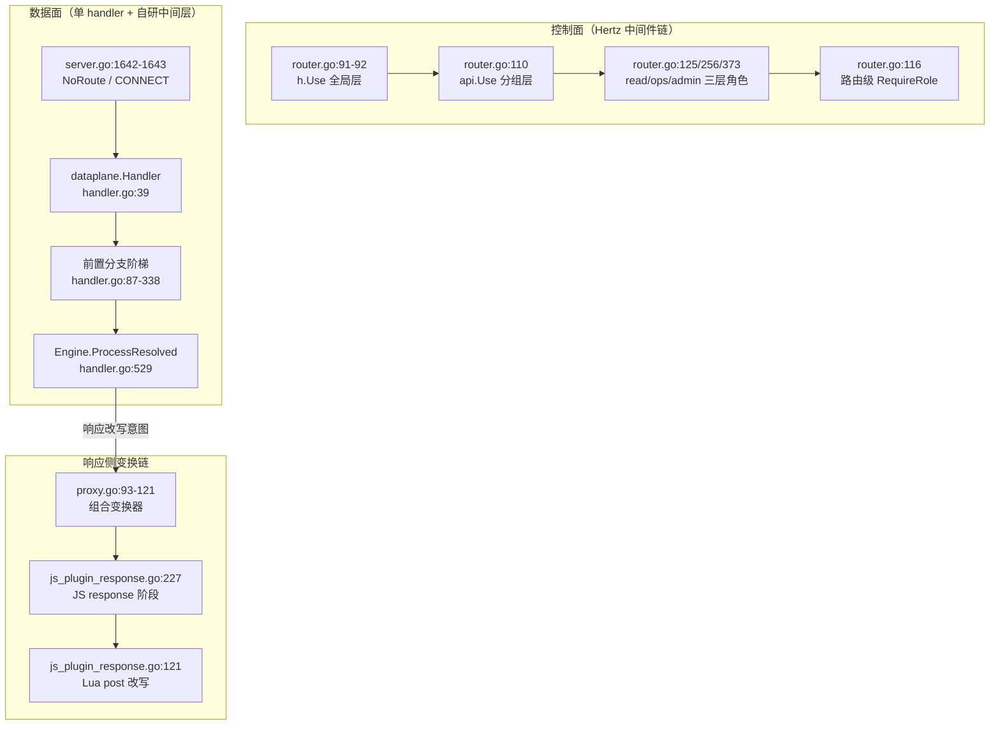
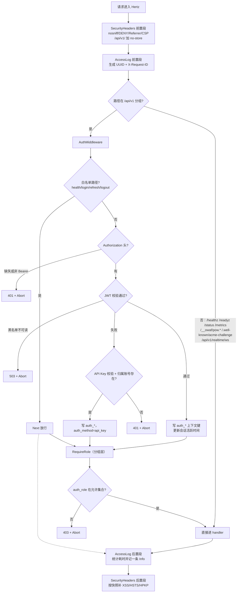
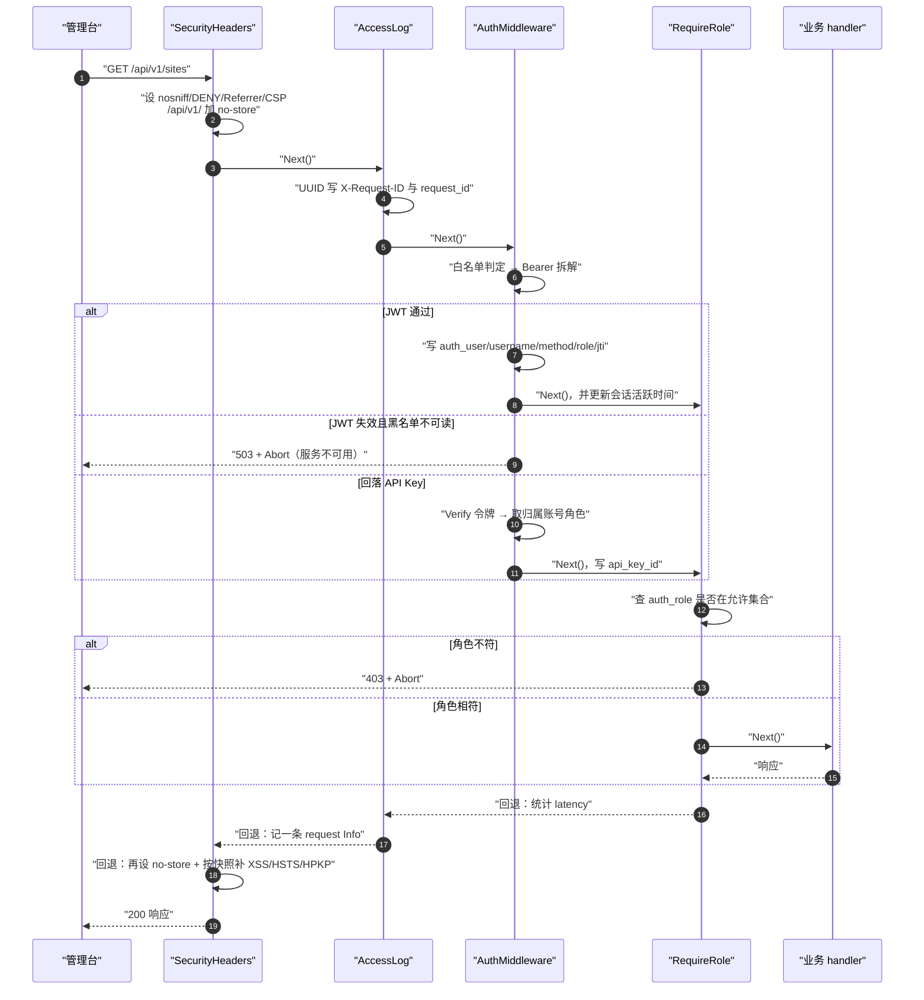
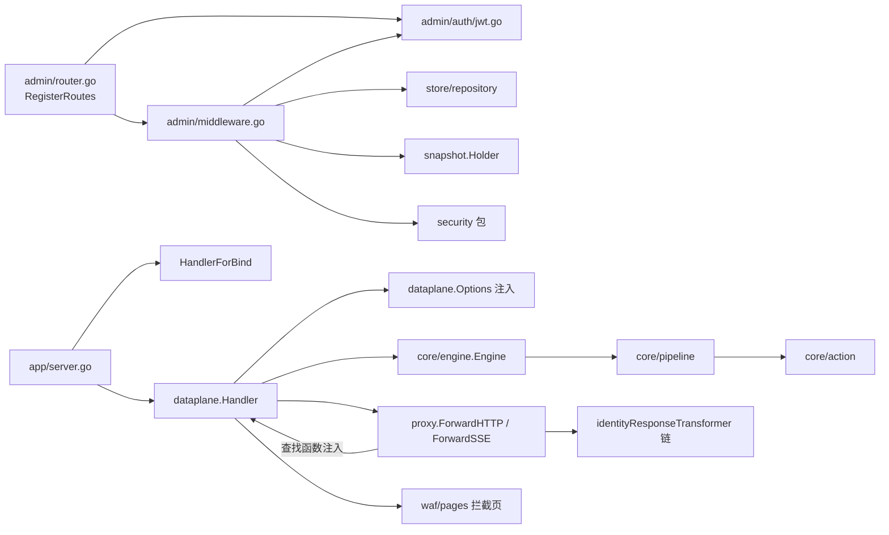

# 中间件开发

> [返回 扩展与插件系统](扩展与插件系统.md)

<cite>
**本文档引用的文件**
- [internal/admin/router.go](file://internal/admin/router.go)
- [internal/admin/middleware.go](file://internal/admin/middleware.go)
- [internal/admin/auth/jwt.go](file://internal/admin/auth/jwt.go)
- [internal/store/auth/auth.go](file://internal/store/auth/auth.go)
- [internal/app/server.go](file://internal/app/server.go)
- [internal/dataplane/handler.go](file://internal/dataplane/handler.go)
- [internal/dataplane/handler_support.go](file://internal/dataplane/handler_support.go)
- [internal/dataplane/js_request.go](file://internal/dataplane/js_request.go)
- [internal/dataplane/endpoints.go](file://internal/dataplane/endpoints.go)
- [internal/core/pipeline/pipeline.go](file://internal/core/pipeline/pipeline.go)
- [internal/core/pipeline/pool.go](file://internal/core/pipeline/pool.go)
- [internal/core/engine/engine.go](file://internal/core/engine/engine.go)
- [internal/core/action/action.go](file://internal/core/action/action.go)
- [internal/core/rules/lua_phase.go](file://internal/core/rules/lua_phase.go)
- [internal/proxy/proxy.go](file://internal/proxy/proxy.go)
- [internal/proxy/js_plugin_response.go](file://internal/proxy/js_plugin_response.go)
- [internal/waf/pages/block.go](file://internal/waf/pages/block.go)
</cite>

## 目录

1. [简介](#简介)
2. [项目结构](#项目结构)
3. [核心组件](#核心组件)
4. [架构总览](#架构总览)
5. [详细组件分析](#详细组件分析)
6. [依赖关系分析](#依赖关系分析)
7. [性能考虑](#性能考虑)
8. [故障排查指南](#故障排查指南)
9. [结论](#结论)
10. [附录](#附录)

## 简介

本项目的「中间件」有两种完全不同的形态，本文同时覆盖，并明确划界：

- **控制面 Hertz 中间件**：真正使用 Hertz 的 `app.HandlerFunc` 链式模型，注册点集中在
  `internal/admin/router.go` 与 `internal/admin/middleware.go`，只有 4 个
  （`SecurityHeaders`、`AccessLog`、`AuthMiddleware`、`RequireRole`）；
- **数据面自研请求处理层**：**不使用** Hertz 中间件链。数据面的每个监听只挂一个
  `app.HandlerFunc`（`dataplane.Handler(opts)`，经 `srv.NoRoute` 与 `CONNECT` 注册），
  拦截、判定、改写、代理全部写在这一个函数体的有序分支里，配合
  `internal/core/pipeline` 的阶段接口与 `internal/proxy` 的响应变换链构成中间层。

这条分界是刻意的架构选择，不是遗漏：数据面的分支需要读取**同一个**已解析请求上下文并就地短路，
用 Hertz 链表达会把状态拆散到多个闭包里，也无法复用 `sync.Pool` 归还语义。

**与既有文档的分工**（避免重复）：11 阶段的语义、短路优先级与缓存失效见
[执行阶段系统](规则引擎扩展/执行阶段系统.md) 与
[管道执行机制](../WAF%20引擎系统/引擎核心架构/管道执行机制.md)；
本文只讲**注册点、挂载层级、执行顺序骨架以及如何新增一个环节**，不重述阶段算法。

**章节来源**
- [internal/admin/router.go:89-125](file://internal/admin/router.go#L89-L125)
- [internal/dataplane/handler.go:38-54](file://internal/dataplane/handler.go#L38-L54)
- [internal/app/server.go:1642-1643](file://internal/app/server.go#L1642-L1643)

## 项目结构

| 层 | 路径 | 规模 | 职责 | 注册方式 |
|----|------|:----:|------|----------|
| 控制面注册 | `internal/admin/router.go` | 465 行 | 路由分组与中间件挂载顺序 | `h.Use` / `group.Use` / 路由级实参 |
| 控制面中间件 | `internal/admin/middleware.go` | 334 行 | 鉴权、角色、访问日志、安全头 | 工厂函数返回 `app.HandlerFunc` |
| 数据面入口 | `internal/dataplane/handler.go` | 1280 行 | 单 handler 内的有序处理层 | `srv.NoRoute` + `srv.Handle("CONNECT")` |
| 数据面选项与工具 | `internal/dataplane/handler_support.go` | 454 行 | `Options` 依赖注入、`HandlerForBind`、`applyLuaResponse` | 构造期注入 |
| 数据面内部端点 | `internal/dataplane/endpoints.go` | — | `serveOWAFStatic`/`handleACMEChallenge`/`handleWASMAssets` | 前置分支调用 |
| 脚本请求阶段 | `internal/dataplane/js_request.go` | 403 行 | `executeJSRequestStage`、改写写回、响应运行时挂载 | 处理层内联调用 |
| 阶段抽象 | `internal/core/pipeline/pipeline.go` | 565 行 | `Phase` 接口、`Run`、`RequestMutator`/`ResponseMutator` | 引擎建链 |
| 上下文对象池 | `internal/core/pipeline/pool.go` | 113 行 | `AcquireCtx`/`ReleaseCtx` | 处理层出入口 |
| 响应变换链 | `internal/proxy/proxy.go` | 6009 行 | `identityResponseTransformer` 组合 | 代理内部组合 |
| 脚本响应变换 | `internal/proxy/js_plugin_response.go` | 315 行 | JS/Lua 响应改写接入与查找函数注入 | `Set*Lookup` 注入 |



**图表来源**
- [internal/admin/router.go:91-116](file://internal/admin/router.go#L91-L116)
- [internal/admin/router.go:125](file://internal/admin/router.go#L125)
- [internal/admin/router.go:256](file://internal/admin/router.go#L256)
- [internal/admin/router.go:373](file://internal/admin/router.go#L373)
- [internal/app/server.go:1642-1643](file://internal/app/server.go#L1642-L1643)
- [internal/dataplane/handler.go:39-54](file://internal/dataplane/handler.go#L39-L54)
- [internal/dataplane/handler.go:529](file://internal/dataplane/handler.go#L529)
- [internal/proxy/proxy.go:93-121](file://internal/proxy/proxy.go#L93-L121)
- [internal/proxy/js_plugin_response.go:121-246](file://internal/proxy/js_plugin_response.go#L121-L246)

两处的注册点数量差异本身就是结论：控制面 6 个 `Use` 调用加 1 个路由级实参，
数据面 0 个 Hertz 中间件注册点——`rg "\.Use\("` 全库只会命中 `internal/admin`，可据此复核。

**章节来源**
- [internal/admin/router.go:89-373](file://internal/admin/router.go#L89-L373)
- [internal/app/server.go:1626-1643](file://internal/app/server.go#L1626-L1643)

## 核心组件

组件清单表（控制面 4 个中间件 + 数据面 3 个可复用注入件）：

| 组件 | 定义:行 | 挂载点:行 | 作用域 | 短路方式 | 失败响应 |
|------|---------|-----------|--------|----------|----------|
| `SecurityHeaders(holder)` | `middleware.go:172` | `router.go:91` | 全局，含静态与 WS 升级 | 不短路 | 只加响应头 |
| `AccessLog(log)` | `middleware.go:150` | `router.go:92` | 全局 | 不短路 | 只记日志 |
| `AuthMiddleware(keyRepo, accountRepo, tm, sessionMgr)` | `middleware.go:42` | `router.go:110` | `/api/v1` 分组 | `c.Abort()` | 401 / 503 |
| `RequireRole(roles...)` | `middleware.go:127` | `router.go:125/256/373` 与 :116 | 三个分组 + 单路由 | `c.Abort()` | 403 |
| `HandlerForBind(bind, handler)` | `handler_support.go:95` | `server.go:1642-1643` | 每监听一个实例 | 不短路 | 写 `dataplane_bind` 上下文键 |
| `proxy.SetJSResponseRuntimeLookup` | `js_plugin_response.go:21` | `handler.go:45` | 进程级注入 | 未注入即跳过 | fail-open |
| `proxy.SetLuaResponseRewriteLookup` | `js_plugin_response.go:42` | `handler.go:47` | 进程级注入 | 未注入即跳过 | fail-open |

数据面侧最容易被误认为「中间件」的三件东西，实际形态各不相同：

1. **`HandlerForBind`** 是唯一的装饰器形态：把监听地址写进 Hertz 上下文，供
   `listenerBind`（`handler_support.go:102-110`）在 handler 内读回，实现「一个 handler 函数、
   多个监听各自绑定」；
2. **Alt-Svc 包装**（`server.go:1633-1640`）是闭包级装饰器，只在启用 HTTP/3 播报时把原 handler
   包一层加头逻辑，不改变处理顺序；
3. **`WithOnConnect`**（`server.go:1597-1609`）不是中间件而是连接级钩子，
   它把 TLS 握手信息与 JA3/JA4 指纹注入 `context`，handler 再用
   `tlsFingerprintFromContext` 取回（`handler.go:66-68`）。

上下文键是两套体系之间唯一共享的表达方式。控制面写入的键全部是字符串键，
由 `c.Set`/`c.Get` 传递：

| 键 | 写入方:行 | 读取方 | 语义 |
|----|-----------|--------|------|
| `request_id` | `middleware.go:154` | handler 与日志 | UUID，同时写 `X-Request-ID` 响应头 |
| `auth_user` / `auth_username` | `middleware.go:72-73`、`:116-117` | 业务 handler | 真实账号名（API Key 也取归属账号） |
| `auth_method` | `middleware.go:74`、`:118` | `AccessLog` :160 | `jwt` 或 `api_key` |
| `auth_role` | `middleware.go:75`、`:120` | `RequireRole` :133 | `admin`/`operator`/`readonly` |
| `auth_jti` | `middleware.go:76` | 会话与撤销链路 | JWT ID |
| `api_key_id` | `middleware.go:119` | 令牌审计 | 令牌主键 |
| `dataplane_bind` | `handler_support.go:96` | `listenerBind` | 数据面监听绑定串 |
| `dataplane_tls_fingerprint` | `handler.go:67` | 指纹与 Bot 阶段 | TLS 客户端指纹 |

**章节来源**
- [internal/admin/middleware.go:42-192](file://internal/admin/middleware.go#L42-L192)
- [internal/admin/router.go:91-125](file://internal/admin/router.go#L91-L125)
- [internal/dataplane/handler_support.go:60-110](file://internal/dataplane/handler_support.go#L60-L110)
- [internal/dataplane/handler.go:45-68](file://internal/dataplane/handler.go#L45-L68)
- [internal/app/server.go:1597-1640](file://internal/app/server.go#L1597-L1640)
- [internal/store/auth/auth.go:86-88](file://internal/store/auth/auth.go#L86-L88)

## 架构总览

控制面的注册顺序决定执行顺序，`Next()` 之后按反序回退。下图给出真实挂载次序与
每个环节是否可能短路：



**图表来源**
- [internal/admin/router.go:91-125](file://internal/admin/router.go#L91-L125)
- [internal/admin/middleware.go:42-192](file://internal/admin/middleware.go#L42-L192)
- [internal/admin/middleware.go:250-334](file://internal/admin/middleware.go#L250-L334)
- [internal/app/server.go:1052-1056](file://internal/app/server.go#L1052-L1056)
- [internal/admin/router.go:418-437](file://internal/admin/router.go#L418-L437)

三个容易踩空的层级事实：

1. **`/api/v1/realtime/ws` 不经过 `AuthMiddleware`**。它挂在根实例上
   （`router.go:424`），不在 `api` 分组内，鉴权由一次性票据完成
   （见 [消息队列集成](第三方集成/消息队列集成.md) 的扇出通道一节）；
2. **`/healthz`、`/readyz`、`/status`、`/metrics` 在 `RegisterRoutes` 之前注册**
   （`server.go:1053-1056`），此时 `h.Use` 尚未执行，因此这四个端点**不带**安全头与访问日志；
3. **`NoRoute` 只在静态资源可解析时注册**（`router.go:442-456`），
   `/api/` 前缀未匹配返回 JSON 404，其余回落静态文件。

数据面没有这张图，它是一条线性阶梯，见下一节。

把上图按「一次带凭据请求」的时间轴展开，就是控制面唯一的真实调用序：



**图表来源**
- [internal/admin/middleware.go:42-192](file://internal/admin/middleware.go#L42-L192)
- [internal/admin/router.go:91-125](file://internal/admin/router.go#L91-L125)

**章节来源**
- [internal/admin/router.go:418-456](file://internal/admin/router.go#L418-L456)
- [internal/app/server.go:1052-1056](file://internal/app/server.go#L1052-L1056)

## 详细组件分析

### 控制面中间件逐个拆解

`AuthMiddleware` 的判定顺序是「白名单 → 头存在性 → Bearer 前缀 → JWT → API Key」，
每一步的失败响应码都不同，这决定了排障时看哪个字段：

```go
// internal/admin/middleware.go:42-53（签名与白名单为实测原文）
func AuthMiddleware(keyRepo *repository.AdminAPIKeyRepo, accountRepo *repository.AdminAccountRepo,
	tm *auth.TokenManager, sessionMgr *auth.SessionManager) app.HandlerFunc {
	return func(ctx context.Context, c *app.RequestContext) {
		path := string(c.Path())
		if path == "/api/v1/health" ||
			path == "/api/v1/auth/login" ||
			path == "/api/v1/auth/refresh" ||
			path == "/api/v1/auth/logout" {
			c.Next(ctx)
			return
		}
```

两条特殊分支值得单列：`tm.VerifyAccessToken` 返回
`auth.ErrTokenBlacklistUnavailable` 时给 **503** 而不是 401（`middleware.go:85-89`），
因为那是服务不可用而非凭据无效，告警口径完全不同；
API Key 分支必须解析**归属账号**后才能取角色（:105-120），账号被删除令牌即失效，
不存在「API Key 默认 admin」的旧口径。

`RequireRole` 是无状态变参工厂：允许集合在构造期折叠成 map（:128-131），
运行期只做一次 `c.Get("auth_role")` 与查表；键不存在给「no role」，值不匹配给
「insufficient permissions」（:132-145）。它既可 `group.Use`，也可作为路由级实参
（`router.go:116`），后者用于「同组内个别端点需要更高权限」，
本项目只有强制下线这一处这么写。

`AccessLog` 与 `SecurityHeaders` 都是前后两段式：

- `AccessLog`（:150-170）前置生成 `request_id` 并写响应头，`Next()` 之后取
  `time.Since(start)` 与状态码记一条 `Info`；
- `SecurityHeaders`（:172-192）前置设 4 个固定头，并对 `/api/v1/` 前后各设一次
  `Cache-Control: no-store`（:180-186）——后置那一次是必需的，因为 handler 可能重写头；
  随后 4 个 `ensureAdmin*` 依据快照开关决定是否补 `X-XSS-Protection`、`Strict-Transport-Security`、
  `Public-Key-Pins`、`Public-Key-Pins-Report-Only`（:194-248）。判定条件统一是
  「快照非 nil ∧ 对应开关为真 ∧ 状态码 > 0」，HSTS/HPKP 还额外要求协议为 `https`/`h3`
  （:258-313），协议识别走 `adminRequestProtocol`（:315-334），
  其中回环来源才允许采信 `X-Forwarded-Proto`。

**章节来源**
- [internal/admin/middleware.go:42-123](file://internal/admin/middleware.go#L42-L123)
- [internal/admin/middleware.go:127-192](file://internal/admin/middleware.go#L127-L192)
- [internal/admin/middleware.go:194-334](file://internal/admin/middleware.go#L194-L334)
- [internal/admin/auth/jwt.go:61-63](file://internal/admin/auth/jwt.go#L61-L63)

### 数据面处理层的阶梯结构

`dataplane.Handler(opts)` 返回的单个 `app.HandlerFunc` 内部是一条有序阶梯。
下表是实测的分支顺序，「短路即返回」意味着后续所有环节都不再执行：

| 序 | 分支 | 位置:行 | 短路即返回 | 触发条件 |
|:--:|------|---------|:----------:|----------|
| 1 | 绑定 CloseNotify + 生成请求 ID + 删 `Server` 头 | `handler.go:55-58` | 否 | 每请求 |
| 2 | 注册 `defer` 收尾（补记访问日志、还原请求体流、取消通知） | `handler.go:59-65` | 否 | 每请求 |
| 3 | 取 TLS 指纹写入上下文 + HTTP/3 内部元数据 | `handler.go:66-84` | 否 | 仅相应传输 |
| 4 | `handleWASMAssets` | `handler.go:87` | 是 | `/__owaf/pow.*` |
| 5 | `handleACMEChallenge` | `handler.go:91` | 是 | `/.well-known/acme-challenge/` |
| 6 | `handleChallengeVerify` | `handler.go:96` | 是 | 挑战验证端点 |
| 7 | `handleDynamicProtectionKey` | `handler.go:101` | 是 | `/__owaf/dynamic/key` |
| 8 | `handleAccessControlEndpoints` | `handler.go:106` | 是 | 访问控制登录/OAuth/注销 |
| 9 | `serveOWAFStatic` | `handler.go:110` | 是 | 其余 `/__owaf/` 路径 |
| 10 | 快照缺失 → 503 | `handler.go:119-127` | 是 | `Holder.Load()` 为 nil |
| 11 | 头字段数超限 → 431 | `handler.go:129-134` | 是 | `MaxHeaderFields` |
| 12 | 站点解析失败 → 欢迎页 200 + `routing_error` | `handler.go:141-162` | 是 | `MatchSite` 未命中 |
| 13 | 引擎缺失 → 503 | `handler.go:164-168` | 是 | 装配异常 |
| 14 | 客户端 IP 解析 + SNI/Host 不一致观察事件 | `handler.go:170-221` | 否 | TLS 站点 |
| 15 | 请求体采样 + 解压降级观察 | `handler.go:223-231` | 否 | 带 `Content-Encoding` |
| 16 | 挑战提交校验（POST） | `handler.go:232-278` | 否 | `method == POST` |
| 17 | 防重放 cookie 处理（原路径） | `handler.go:288-305` | 是 | 站点启用防重放 |
| 18 | `enforceAccessControl`（原路径） | `handler.go:310-317` | 是 | 命中访问控制 |
| 19 | Basic Auth | `handler.go:320-327` | 是 | 全局开关 |
| 20 | 内置 OWASP 内联哨兵（原路径） | `handler.go:332-338` | 是 | 未配置跳过路径 |
| 21 | 取池化 `RequestCtx` 并填充 + `defer ReleaseCtx` | `handler.go:340-387` | 否 | 每请求 |
| 22 | JS 请求阶段脚本 | `handler.go:398` | 是（fail-closed 时 503） | 有脚本 |
| 23 | 脚本改写后的路径二次校验 | `handler.go:440-515` | 是 | 改写命中内部路径/访问控制/哨兵 |
| 24 | `Engine.ProcessResolved`（内含 11 阶段与 Lua post） | `handler.go:529` | 否 | 常规路径 |
| 25 | 移交 Lua 响应改写意图 | `handler.go:533` | 否 | post 有改写 |
| 26 | 观察命中落库 + 终止动作渲染 | `handler.go:591-1020` | 是 | 有判定 |
| 27 | 上游派发（h2 扩展 CONNECT / WS / SSE / 代理） | `handler.go:1100-1150` | 是 | 放行 |

阶梯的表达方式就是「函数体内的 if 顺序」，可读性靠分支命名与行号维持，
这也是为什么新增环节必须按上表插入而不是随意追加——第 4~9 步的内部端点必须早于站点解析，
第 23 步的二次校验必须晚于脚本改写。终止动作的渲染出口统一是
`pages.WriteBlockResponse`（`block.go:19-22`：先写 `X-Request-ID`、删 `Server` 头，
再按站点模板与状态码覆盖渲染），自定义分支不应另起一套响应写法。

对象生命周期是这套结构的关键约束：`RequestCtx` 从 `pool.AcquireCtx()`（`pool.go:31`）
到 `defer pipeline.ReleaseCtx(reqCtx)`（`handler.go:387`）之间有效，
`ReleaseCtx` 会清空 30 余个字段并按容量上限重建 map/slice（`pool.go:37-113`），
任何把 `*RequestCtx` 逃逸出该区间的新分支都是内存 bug。

**章节来源**
- [internal/dataplane/handler.go:39-65](file://internal/dataplane/handler.go#L39-L65)
- [internal/dataplane/handler.go:87-168](file://internal/dataplane/handler.go#L87-L168)
- [internal/dataplane/handler.go:170-231](file://internal/dataplane/handler.go#L170-L231)
- [internal/dataplane/handler.go:288-338](file://internal/dataplane/handler.go#L288-L338)
- [internal/dataplane/handler.go:340-398](file://internal/dataplane/handler.go#L340-L398)
- [internal/dataplane/handler.go:440-533](file://internal/dataplane/handler.go#L440-L533)
- [internal/dataplane/handler.go:1100-1150](file://internal/dataplane/handler.go#L1100-L1150)
- [internal/dataplane/endpoints.go:87-150](file://internal/dataplane/endpoints.go#L87-L150)
- [internal/waf/pages/block.go:19-22](file://internal/waf/pages/block.go#L19-L22)
- [internal/core/pipeline/pool.go:31-113](file://internal/core/pipeline/pool.go#L31-L113)

### 阶段接口：中间层的可插拔点

`internal/core/pipeline` 提供数据面唯一的扩展抽象，签名是实测原文：

```go
// internal/core/pipeline/pipeline.go:277-280
type Phase interface {
	Name() string
	Execute(ctx *RequestCtx) (action.Result, bool)
}
```

第二个返回值是「停止本阶段链的后续处理」而非「请求终止」——`Run` 对挑战类结果会
把 `stop` 与 `IsChallenge` 分开处理，先暂存再让后续阶段有机会给出更高优先级的判定
（`pipeline.go:517-560`，优先级由 `action.TerminalPriority` 决定，`action.go:88-118`）。
`Category`、`Phase`、`MatchDesc` 三个字段最终会进安全事件表，
以 `rules.NewLuaPhase` 生成的结果为例（`lua_phase.go:101-109`）：

| 字段 | 来源 | 说明 |
|------|------|------|
| `Type` | `action.Normalize` 归一化结果 | 未知动作直接忽略，不拦截 |
| `RuleID` / `RuleIDStr` | 判定产出者的 ID/Name | Lua 场景为脚本 ID/脚本名 |
| `Matched` | 恒 `true` | 未命中的 `stop` 不进入 `ObserveHits` |
| `Phase` | `Name()` 返回值 | 如 `lua_pre`、`lua_post`、`owasp_default` |
| `Category` | 阶段自定 | Lua 固定 `lua_plugin` |

阶段与处理层的边界：阶段**拿不到** Hertz 对象，因此任何对真实请求的改写都必须经
`RequestCtx.SetRequestMutation` / `DrainRequestMutation`（`pipeline.go:300-306`、`:448-455`）
表达意图，由数据面在 `handler.go:1056-1075` 写回；管道内的就地生效则通过
`ApplyRequestMutation`（:319-388）完成，它先整体校验再整体应用，任何一项非法都让
整份改写失败而不留部分效果。保留头名单与 JS/Lua 侧逐项一致
（`pipeline.go:398-410`）。

**章节来源**
- [internal/core/pipeline/pipeline.go:277-306](file://internal/core/pipeline/pipeline.go#L277-L306)
- [internal/core/pipeline/pipeline.go:319-410](file://internal/core/pipeline/pipeline.go#L319-L410)
- [internal/core/pipeline/pipeline.go:448-491](file://internal/core/pipeline/pipeline.go#L448-L491)
- [internal/core/pipeline/pipeline.go:517-560](file://internal/core/pipeline/pipeline.go#L517-L560)
- [internal/core/action/action.go:88-118](file://internal/core/action/action.go#L88-L118)
- [internal/core/rules/lua_phase.go:101-131](file://internal/core/rules/lua_phase.go#L101-L131)
- [internal/dataplane/handler.go:1056-1075](file://internal/dataplane/handler.go#L1056-L1075)

### 响应侧变换链：另一种中间件

响应方向的「中间件」是 `identityResponseTransformer`，它的组合顺序即执行顺序，
实测在 `proxy.go:93-160`：

```go
// internal/proxy/proxy.go:61-63
type identityResponseTransformer interface {
	Transform(identityResponseEntity) (identityResponseEntity, error)
}
```

组合规则有两条硬语义：

1. **HTML → Markdown 协商短路整条链**。客户端显式请求 Markdown 时直接返回该变换器
   （`proxy.go:99-103`），因为动态混淆产出的是密文、脚本改写面向 HTML 形态，两者都无意义；
2. **固定顺序：图像转换 → browser sign 注入 → 动态保护 → JS response 脚本 → Lua post 改写**。
   图像必须早于动态保护（水印与格式转换都需要上游原图，`proxy.go:183-186`）；
   JS 早于 Lua，让 post 看到最终形态（`proxy.go:141-160`、
   `js_plugin_response.go:46-56` 的注释同口径）。

链的输入输出是 `identityResponseEntity`（`proxy.go:49-58`，含 `Body`、`ContentType`、
`ScriptNonces` 等），失败语义分两套：JS 侧按脚本 `FailureMode` 决定继续或返回错误
（`js_plugin_response.go:87-101`），Lua 侧逐项 fail-safe 跳过（:119-152）。
SSE/WebSocket 路径不使用 identity 实体，因此不受该链影响（`js_plugin_response.go:49-52`）。

打破 `proxy → dataplane` 反向依赖的手法值得复用：`proxy` 不认识 `dataplane`，
只持有两个由数据面在 `Handler(opts)` 构造期注入的查找函数
（`handler.go:45-47` → `js_plugin_response.go:21,42`）。

**章节来源**
- [internal/proxy/proxy.go:49-160](file://internal/proxy/proxy.go#L49-L160)
- [internal/proxy/proxy.go:163-200](file://internal/proxy/proxy.go#L163-L200)
- [internal/proxy/js_plugin_response.go:18-101](file://internal/proxy/js_plugin_response.go#L18-L101)
- [internal/proxy/js_plugin_response.go:113-152](file://internal/proxy/js_plugin_response.go#L113-L152)
- [internal/dataplane/handler.go:43-47](file://internal/dataplane/handler.go#L43-L47)

### 新增一个控制面中间件的流程

| 步 | 动作 | 参照位置 | 完成判据 | 跳过的后果 |
|:--:|------|----------|----------|------------|
| 1 | 写工厂函数，返回 `app.HandlerFunc`，依赖通过实参注入 | `middleware.go:42,127,150,172` | 无包级可变状态 | 多实例测试互串 |
| 2 | 决定层级：全局 / `api` 分组 / 角色分组 / 单路由实参 | `router.go:91,110,125,116` | 与所需最小作用域一致 | 无鉴权端点被漏保护 |
| 3 | 前置写上下文键，读取方只用键不用全局 | `middleware.go:153-154,72-76` | `c.Get` 可取到 | 跨中间件丢状态 |
| 4 | 失败分支必须 `c.Abort()`，且状态码语义正确 | `middleware.go:57-59,86-88,135-143` | 401/403/503 各归其位 | 下游 handler 仍执行 |
| 5 | 若写响应头，`Next()` 之后要再写一次 | `middleware.go:180-186` | handler 覆盖后被补回 | `no-store` 丢失 |
| 6 | 新增写端点一律用 POST 形态（`/update`、`/delete`、`/toggle`） | `router.go:256-305` | 无 PUT/DELETE 路由 | 违反 API 契约 |
| 7 | 记录耗时与 request id，不打印凭据 | `middleware.go:160-168` | 日志无 Authorization/Cookie | 敏感值入日志 |
| 8 | 补单测覆盖「白名单 / 缺头 / 格式错 / 校验失败」四支 | `internal/admin` 测试 | 四支各有断言 | 状态码回归无人守 |

```go
// 与实测签名一致的控制面中间件骨架：工厂 + app.HandlerFunc + Abort 语义
func AuditTrail(store *repository.SystemSettingsRepo, log *slog.Logger) app.HandlerFunc {
	return func(ctx context.Context, c *app.RequestContext) {
		start := time.Now()
		c.Next(ctx)                       // 先放行，后置统计
		if !strings.HasPrefix(string(c.Path()), "/api/v1/") {
			return
		}
		var actor string
		if v, ok := c.Get("auth_username"); ok {
			actor, _ = v.(string)
		}
		log.Info("admin mutation",
			slog.String("actor", actor),          // 不打印任何凭据
			slog.String("method", string(c.Method())),
			slog.String("path", string(c.Path())),
			slog.Int("status", c.Response.StatusCode()),
			slog.Duration("latency", time.Since(start)),
		)
	}
}
```

挂载时机要注意：`h.Use` 只对其后注册的路由生效，而 `/healthz` 等四个端点在
`RegisterRoutes` 之前注册（`server.go:1053-1056`），
新增全局中间件不会覆盖它们；反之若希望覆盖，必须在 `server.Default` 处用
`server.WithMiddleware` 之类的方式提前配置，而不是在 `RegisterRoutes` 里补。

**章节来源**
- [internal/admin/middleware.go:42-192](file://internal/admin/middleware.go#L42-L192)
- [internal/admin/router.go:91-305](file://internal/admin/router.go#L91-L305)
- [internal/app/server.go:1052-1056](file://internal/app/server.go#L1052-L1056)

### 新增一个数据面处理环节的流程

「数据面环节」有三种落点，选错落点比写错代码更常见：

| 需求形态 | 正确落点 | 参照位置 | 不应选的原因说明 |
|----------|----------|----------|------------------|
| 需要短路请求并自己写响应（如内部端点） | `handler.go` 阶梯前置分支 | `handler.go:87-110` | 阶段接口拿不到 Hertz 对象 |
| 只读写请求视图、给出动作判定 | 实现 `pipeline.Phase` 并入链 | `engine.go:441-528` | 阶梯里写判定会绕开阶段缓存 |
| 只改写响应 | `identityResponseTransformer` | `proxy.go:93-160` | 响应体在代理之后才有 |

以新增一个阶段为例的步骤表：

| 步 | 动作 | 参照位置 | 完成判据 |
|:--:|------|----------|----------|
| 1 | 在 `internal/core/rules` 定义 `Name()` 与 `Execute(*RequestCtx)` | `pipeline.go:277-280` | `Name()` 与要跳过的路径配置键一致 |
| 2 | 用 `action.Normalize` + `action.IsValid` 过滤外部动作 | `lua_phase.go:94-99` | 未知动作不升级为拦截 |
| 3 | 结果填齐 `Phase`/`Category`/`RuleIDStr`/`MatchDesc` | `lua_phase.go:101-109` | 安全事件可归因 |
| 4 | 终止性由 `stop` 返回值与 `IsTerminal` 一致表达 | `pipeline.go:521-553` | 挑战延迟语义不被破坏 |
| 5 | 在 `getOrBuildPhases` 按启用条件入链，并更新容量预分配 | `engine.go:467-528` | 缓存四判据仍成立 |
| 6 | 需要改请求时只挂 `RequestMutation`，保留头交给校验 | `pipeline.go:319-410` | 非法条目整份失败 |
| 7 | 需要跨阶段缓存派生值时用 `Derived*` 惰性口 | `pipeline.go:232-257` | 每请求至多计算一次 |
| 8 | 在 `ReleaseCtx` 清零新增字段 | `pool.go:37-113` | 复用不残留 |

```go
// 与实测 Phase 契约一致的最小骨架
type echoPhase struct{ name string }

func (p *echoPhase) Name() string { return p.name }

// 第二个返回值表示停止后续阶段；非终止判定应返回 false 并由 Run 收集观察命中
func (p *echoPhase) Execute(ctx *pipeline.RequestCtx) (action.Result, bool) {
	if ctx.Path == "/internal/health" {
		return action.Result{
			Type:      action.Observe,
			Category:  "echo",
			Phase:     p.name,
			RuleIDStr: p.name,
			Matched:   true,
			MatchDesc: "health path observed",
		}, false
	}
	return action.Result{}, false
}
```

最后强调一条不可让渡的约束：**新增分支不得把 `*RequestCtx` 或池对象存到请求之外**
（`pool.go:20-34` 的 `sync.Pool` 会跨请求复用同一块内存），
需要跨请求状态时用 `ctx.kv`（Lua）或独立的原子结构，而不是持有指针。

**章节来源**
- [internal/core/pipeline/pipeline.go:277-280](file://internal/core/pipeline/pipeline.go#L277-L280)
- [internal/core/engine/engine.go:441-528](file://internal/core/engine/engine.go#L441-L528)
- [internal/core/rules/lua_phase.go:94-131](file://internal/core/rules/lua_phase.go#L94-L131)
- [internal/core/pipeline/pipeline.go:319-410](file://internal/core/pipeline/pipeline.go#L319-L410)
- [internal/core/pipeline/pool.go:20-113](file://internal/core/pipeline/pool.go#L20-L113)

### 能力边界

| 事项 | 支持情况 | 证据 |
|------|:--------:|------|
| 控制面按路径动态选择中间件 | 部分：仅白名单硬编码 4 条 | `middleware.go:47-53` |
| 中间件读取请求体 | 支持，但须先采样/解压 | `handler.go:223-231` |
| 阶段改写真实 Hertz 请求 | 支持，但只能经改写意图回写 | `handler.go:1056-1075` |
| 阶段改写响应 | 不支持在阶段内做 | `pipeline.go:463-473`（意图挂起，由 proxy 消费） |
| SSE/WS 走响应变换链 | 不支持 | `js_plugin_response.go:49-52` |
| 数据面复用 Hertz 中间件链 | 未使用 | 全库 `.Use(` 只在 `internal/admin` |
| 连接级上下文注入 | 支持 | `server.go:1594-1607` |
| 中间件顺序配置化 | 不支持，顺序由代码决定 | `router.go:91-125` |

**章节来源**
- [internal/admin/middleware.go:42-53](file://internal/admin/middleware.go#L42-L53)
- [internal/dataplane/handler.go:223-231](file://internal/dataplane/handler.go#L223-L231)
- [internal/dataplane/handler.go:1056-1075](file://internal/dataplane/handler.go#L1056-L1075)
- [internal/core/pipeline/pipeline.go:463-473](file://internal/core/pipeline/pipeline.go#L463-L473)
- [internal/proxy/js_plugin_response.go:46-52](file://internal/proxy/js_plugin_response.go#L46-L52)
- [internal/app/server.go:1597-1609](file://internal/app/server.go#L1597-L1609)

## 依赖关系分析



**图表来源**
- [internal/admin/router.go:89-125](file://internal/admin/router.go#L89-L125)
- [internal/admin/middleware.go:3-19](file://internal/admin/middleware.go#L3-L19)
- [internal/app/server.go:1626-1643](file://internal/app/server.go#L1626-L1643)
- [internal/dataplane/handler.go:14-36](file://internal/dataplane/handler.go#L14-L36)
- [internal/dataplane/handler_support.go:33-58](file://internal/dataplane/handler_support.go#L33-L58)
- [internal/proxy/js_plugin_response.go:18-44](file://internal/proxy/js_plugin_response.go#L18-L44)

依赖矩阵（行依赖列）：

| 模块 | router | middleware | dataplane | pipeline | engine | proxy | snapshot |
|------|:------:|:----------:|:---------:|:--------:|:------:|:-----:|:--------:|
| `admin/router.go` | — | ✓ | ✓ | — | — | — | ✓ |
| `admin/middleware.go` | — | — | — | — | — | — | ✓ |
| `dataplane/handler.go` | — | — | — | ✓ | ✓ | ✓ | ✓ |
| `core/pipeline` | — | — | — | — | — | — | — |
| `core/engine` | — | — | — | ✓ | — | — | ✓ |
| `proxy` | — | — | — | ✓（经注入） | — | — | ✓ |

`pipeline` 不依赖任何上层包，这是阶段接口能被引擎与规则两侧共享的前提；
`proxy` 对 `dataplane` 的依赖全部通过函数注入消除，因此不出现 import cycle。

| 外部实体 | 交互方向 | 协议/方式 | 触发时机 | 失败影响 | 容错处理 |
|----------|:--------:|-----------|----------|----------|----------|
| 浏览器管理台 | 入向 | HTTP + Bearer/ApiKey | 每个控制面请求 | 401/403 | 白名单 + `Abort` |
| 客户端流量 | 入向 | HTTP/1.1/h2/h3/WS/SSE | 每个数据面请求 | 阶梯短路返回错误页 | `defer` 收尾保证日志不缺失 |
| 上游源站 | 出向 | HTTP/WS/SSE | 放行后 | 502/504 | `Mark` 探活反馈 |
| 静态前端资源 | 入向 | `adminweb.ResolveFS` | `NoRoute` | 未解析则不注册回退 | 按前缀区分 JSON/文件 |

**章节来源**
- [internal/core/pipeline/pipeline.go:1-12](file://internal/core/pipeline/pipeline.go#L1-L12)
- [internal/proxy/js_plugin_response.go:15-44](file://internal/proxy/js_plugin_response.go#L15-L44)
- [internal/dataplane/handler.go:14-36](file://internal/dataplane/handler.go#L14-L36)
- [internal/admin/router.go:442-456](file://internal/admin/router.go#L442-L456)

## 性能考虑

- **控制面开销可忽略**：4 个中间件合计只有一次 UUID 生成、若干头写入与两次 map 查表；
  `RequireRole` 的允许集合在构造期折叠为 map（`middleware.go:128-131`），不在请求路径上分配。
- **数据面的成本在阶梯深度而非链长**：分支是顺序 `if`，未命中的分支只付一次字符串比较；
  真正需要关注的是第 14~21 步的解析与采样，以及 `matchInlineOWASPGuards` 的两次调用
  （`handler.go:332`、`:500`）——第二次仅在路径被脚本改写后才可能发生，前置有
  `jsRequestMutated && !skipInlineOWASP` 守卫（:499-501）。
- **对象池收益明确**：`AcquireCtx`/`ReleaseCtx` 复用 header map 与观察命中缓冲
  （`pool.go:20-34`），代价是 `ReleaseCtx` 必须穷举清理；新增字段忘记清理会表现为
  「偶发的跨请求串数据」，比性能问题更难查。
- **派生字段惰性化**：`HeaderOrder`/`ALPN`/`CipherSuites` 各只算一次
  （`pipeline.go:232-257`），避免每请求多次 `strings.Join`。
- **中间件不要做 I/O**：`AuthMiddleware` 的 API Key 分支走仓储 `Verify`（内存/缓存态），
  若在自定义中间件里查库，会把控制面的 P99 直接抬到 DB 水平。

[本节为总结，无需特定文件来源]

## 故障排查指南

| 症状 | 原因 | 排查 | 方案 |
|------|------|------|------|
| 新加的中间件对某些端点无效 | 注册晚于路由，或该端点不在 `/api/v1` 分组 | `router.go:91-125` 顺序 + :418-437 | 把 `h.Use` 前移，或把端点并入分组 |
| `/metrics` 没有安全头 | 它在 `RegisterRoutes` 之前注册 | `server.go:1053-1056` | 属预期；需要就在 server 构造期加 |
| 写端点返回 404 | 用 PUT/DELETE 访问 | 项目写操作只有 POST | 改 `/update`、`/delete`、`/toggle` |
| 403 但凭据正确 | 角色不匹配或 `auth_role` 未写入 | `middleware.go:132-145` | 确认 `AuthMiddleware` 在前且 `RequireRole` 集合正确 |
| 401 且日志有 `blacklist` | 黑名单不可读返回 503 被上游改写 | `middleware.go:85-89` | 先修持久化，别改鉴权顺序 |
| API Key 权限比预期低 | 角色取归属账号 | `middleware.go:103-120` | 调整账号角色 |
| 响应丢 `no-store` | handler 覆盖头 | `middleware.go:180-186` | 保留后置赋值段 |
| HSTS 不出现 | 协议判定非 `https`/`h3` 或快照未开 | `middleware.go:258-275`、`:315-334` | 检查快照开关与转发头 |
| 数据面新分支不生效 | 分支位置晚于短路分支 | `handler.go:87-168` 顺序 | 按阶梯表插入到正确位置 |
| 跨请求脏数据 | 池对象字段未清理 | `pool.go:37-113` | 在 `ReleaseCtx` 补清零 |
| 响应改写不生效 | 阶段只改了 `RequestCtx` 未挂意图 | `pipeline.go:300-306` | 走 `SetRequestMutation` |
| Lua 响应改写丢失 | 用了 SSE/WS 路径 | `js_plugin_response.go:49-52` | 属预期边界 |

```bash
# 复核「数据面零 Hertz 中间件」这条事实
rg -n --glob '!*_test.go' '\.Use\(' internal/ | rg -v 'internal/admin' || echo "dataplane 无 .Use 注册点"

# 复核控制面挂载点数量（应为 6 处 Use + 1 处路由级 RequireRole）
rg -n --glob '!*_test.go' '\.Use\(|RequireRole\(' internal/admin/router.go

# 阶段接口契约回归：改动 pipeline / engine 后至少跑这两组
CGO_ENABLED=1 go test -tags=quickjs ./internal/core/pipeline/... ./internal/core/engine/...
```

**章节来源**
- [internal/admin/router.go:91-125](file://internal/admin/router.go#L91-L125)
- [internal/admin/middleware.go:85-145](file://internal/admin/middleware.go#L85-L145)
- [internal/admin/middleware.go:180-186](file://internal/admin/middleware.go#L180-L186)
- [internal/admin/middleware.go:258-334](file://internal/admin/middleware.go#L258-L334)
- [internal/dataplane/handler.go:87-168](file://internal/dataplane/handler.go#L87-L168)
- [internal/core/pipeline/pool.go:37-113](file://internal/core/pipeline/pool.go#L37-L113)
- [internal/proxy/js_plugin_response.go:46-52](file://internal/proxy/js_plugin_response.go#L46-L52)

## 结论

本项目把「中间件」一分为二：控制面沿用 Hertz 原生链，只有 4 个中间件、6 个挂载点，
顺序即注册顺序，能力边界是鉴权、角色、日志与安全头；数据面刻意不使用该链，
把全部拦截与判定收进一个 handler 的有序阶梯，再用 `pipeline.Phase` 提供可插拔点、
用 `identityResponseTransformer` 提供响应侧组合。两种形态的取舍标准一致：
**能被同一份请求上下文解释的逻辑就不要拆开**。

扩展时的三个硬约束：写操作只有 POST；`*RequestCtx` 不得逃逸出 `AcquireCtx`/`ReleaseCtx` 区间；
`proxy` 与 `dataplane` 之间只能通过查找函数注入，不得新增直接依赖。

**章节来源**
- [internal/admin/router.go:89-373](file://internal/admin/router.go#L89-L373)
- [internal/dataplane/handler.go:39-529](file://internal/dataplane/handler.go#L39-L529)
- [internal/core/pipeline/pipeline.go:277-560](file://internal/core/pipeline/pipeline.go#L277-L560)

## 附录

### 挂载点速查

| 挂载点 | 文件:行 | 影响范围 |
|--------|---------|----------|
| `h.Use(SecurityHeaders(deps.Snapshot))` | `router.go:91` | 注册后的全部路由 |
| `h.Use(AccessLog(adminLog))` | `router.go:92` | 注册后的全部路由 |
| `api.Use(AuthMiddleware(...))` | `router.go:110` | `/api/v1/*` |
| `RequireRole(admin,operator,readonly)` | `router.go:125` | `readGroup` |
| `RequireRole(admin,operator)` | `router.go:256` | `opsGroup` |
| `RequireRole(admin)` | `router.go:373` | `adminGroup` |
| 路由级 `RequireRole(admin)` | `router.go:116` | 强制下线单端点 |
| `srv.NoRoute(HandlerForBind(bind, handler))` | `server.go:1642` | 数据面某监听的全部请求 |
| `srv.Handle("CONNECT", "/*any", ...)` | `server.go:1643` | CONNECT 方法 |
| `proxy.SetJSResponseRuntimeLookup` | `handler.go:45` | 进程级注入 |
| `proxy.SetLuaResponseRewriteLookup` | `handler.go:47` | 进程级注入 |

**章节来源**
- [internal/admin/router.go:91-373](file://internal/admin/router.go#L91-L373)
- [internal/app/server.go:1597-1643](file://internal/app/server.go#L1597-L1643)
- [internal/dataplane/handler.go:43-47](file://internal/dataplane/handler.go#L43-L47)

### 动作与终止性对照

阶段与中间件给出的动作必须落在 `action.Type` 白名单内，终止性由 `IsTerminal` 判定：

| 动作 | 终止 | `TerminalPriority` | 默认状态码 | 备注 |
|------|:----:|:------------------:|:----------:|------|
| `drop` | 是 | 90 | 无响应 | 直接断连 |
| `intercept`（别名 `block`） | 是 | 80 | 403 | 走拦截页或受控响应体 |
| `rate_limit` | 是 | 70 | 429 | — |
| `challenge`/`captcha_challenge`/`shield_challenge`/`chain_challenge` | 是 | 60 | 403 | 管道内延迟裁决 |
| `redirect` | 是 | 50 | 302 | 需 `RedirectTo` |
| `observe`（别名 `log_only`） | 否 | 10 | — | 进 `ObserveHits` 并落一条事件 |
| `tag` | 否 | 0 | — | `ShouldLog()` 为假，当前无可观测效果 |
| `allow` | 视调用方 | 0 | — | 阶段内 `allow` 短路后续 |

**章节来源**
- [internal/core/action/action.go:8-118](file://internal/core/action/action.go#L8-L118)
- [internal/core/action/action.go:164-308](file://internal/core/action/action.go#L164-L308)

### 相关文档

- [执行阶段系统](规则引擎扩展/执行阶段系统.md)：11 阶段语义与新增阶段的完整流程
- [管道执行机制](../WAF%20引擎系统/引擎核心架构/管道执行机制.md)：`Run` 的短路与挑战延迟裁决
- [Lua 策略插件](Lua%20策略插件.md)：`lua_pre`/`lua_post` 两个环节的脚本侧契约
- [REST API 设计规范](../管理%20API%20系统/REST%20API%20设计规范/REST%20API%20设计规范.md)：GET/POST 与角色分组约定
- [消息队列集成](第三方集成/消息队列集成.md)：`/api/v1/realtime/ws` 的票据鉴权细节

[本节为总结，无需特定文件来源]
