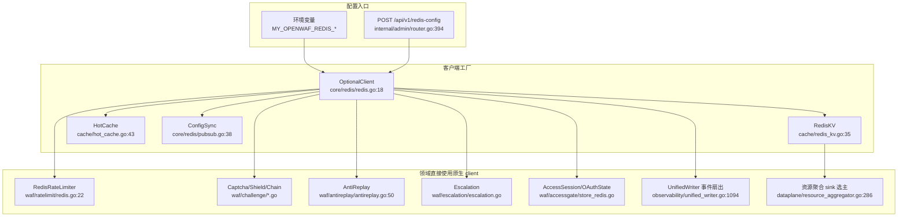
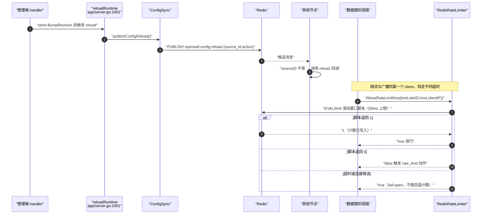
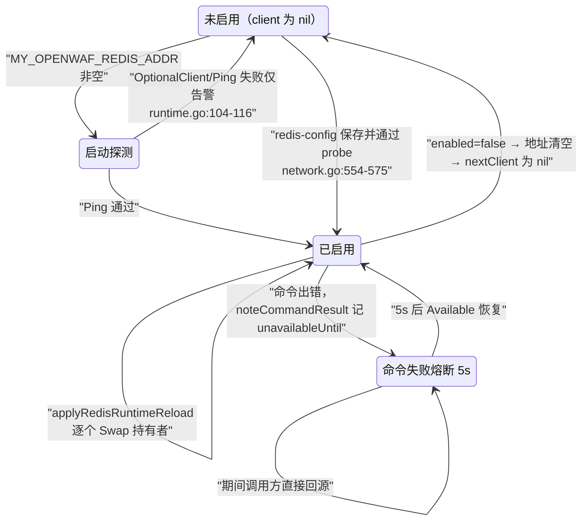
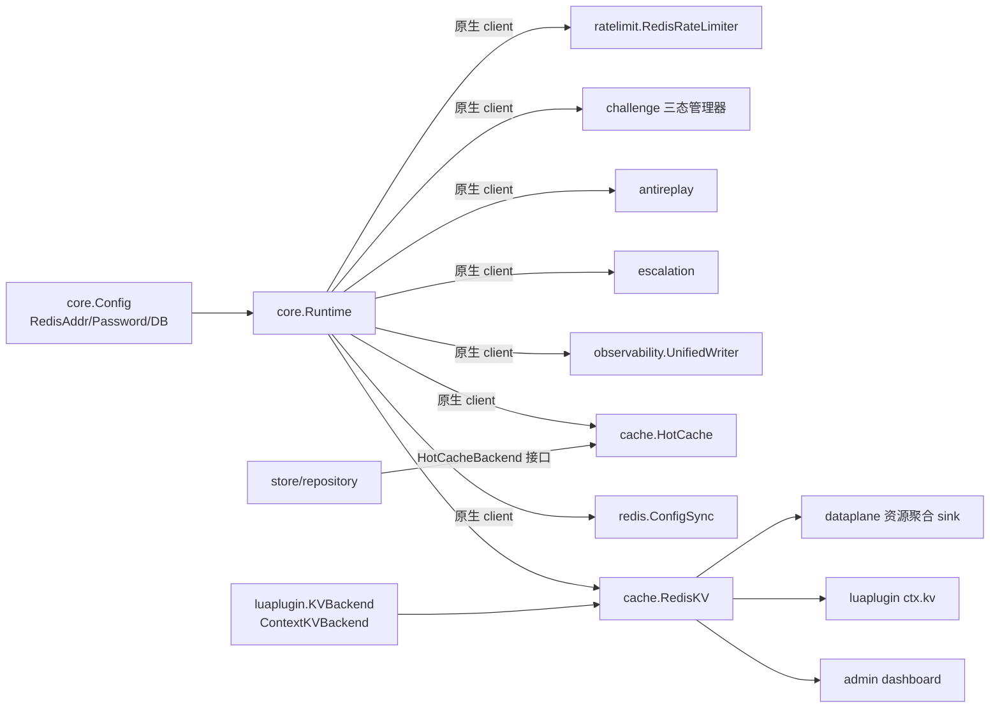

# NoSQL 存储适配

> [返回 存储后端扩展](存储后端扩展.md) · [返回 扩展与插件系统](../扩展与插件系统.md)

<cite>
**本文档引用的文件**
- [README.md](file://README.md)
- [go.mod](file://go.mod)
- [internal/core/redis/redis.go](file://internal/core/redis/redis.go)
- [internal/core/redis/pubsub.go](file://internal/core/redis/pubsub.go)
- [internal/core/runtime.go](file://internal/core/runtime.go)
- [internal/app/server.go](file://internal/app/server.go)
- [internal/core/database/gorm.go](file://internal/core/database/gorm.go)
- [internal/cache/redis_kv.go](file://internal/cache/redis_kv.go)
- [internal/cache/hot_cache.go](file://internal/cache/hot_cache.go)
- [internal/waf/ratelimit/redis.go](file://internal/waf/ratelimit/redis.go)
- [internal/waf/ratelimit/ratelimit.go](file://internal/waf/ratelimit/ratelimit.go)
- [internal/waf/ratelimit/dynamic.go](file://internal/waf/ratelimit/dynamic.go)
- [internal/waf/luaplugin/runtime.go](file://internal/waf/luaplugin/runtime.go)
- [internal/waf/luaplugin/api.go](file://internal/waf/luaplugin/api.go)
- [internal/waf/accessgate/store_redis.go](file://internal/waf/accessgate/store_redis.go)
- [internal/waf/challenge/captcha.go](file://internal/waf/challenge/captcha.go)
- [internal/waf/challenge/shield.go](file://internal/waf/challenge/shield.go)
- [internal/waf/challenge/chain.go](file://internal/waf/challenge/chain.go)
- [internal/waf/escalation/escalation.go](file://internal/waf/escalation/escalation.go)
- [internal/waf/antireplay/antireplay.go](file://internal/waf/antireplay/antireplay.go)
- [internal/observability/unified_writer.go](file://internal/observability/unified_writer.go)
- [internal/dataplane/resource_aggregator.go](file://internal/dataplane/resource_aggregator.go)
- [internal/dataplane/access_control.go](file://internal/dataplane/access_control.go)
- [internal/admin/system/dashboard/dashboard.go](file://internal/admin/system/dashboard/dashboard.go)
- [internal/admin/system/network.go](file://internal/admin/system/network.go)
- [internal/admin/router.go](file://internal/admin/router.go)
- [internal/store/system.go](file://internal/store/system.go)
- [internal/store/repository/repository.go](file://internal/store/repository/repository.go)
- [internal/store/repository/access_log.go](file://internal/store/repository/access_log.go)
- [internal/store/repository/security_event.go](file://internal/store/repository/security_event.go)
- [internal/store/repository/fingerprint_cache.go](file://internal/store/repository/fingerprint_cache.go)
- [internal/core/rules/phases.go](file://internal/core/rules/phases.go)
</cite>

## 目录

1. [简介](#简介)
2. [项目结构](#项目结构)
3. [核心组件](#核心组件)
4. [架构总览](#架构总览)
5. [详细组件分析](#详细组件分析)
6. [依赖关系分析](#依赖关系分析)
7. [性能考虑](#性能考虑)
8. [故障排查指南](#故障排查指南)
9. [结论](#结论)
10. [附录](#附录)

## 简介

本篇的标题沿用了目录里既有的文件名 `NoSQL 存储适配`，但**定位需要纠偏**：本项目不存在
MongoDB、Cassandra、DynamoDB、RedisJSON、RedisSearch 等任何 NoSQL 数据库驱动或适配器，
也不存在形如 `NoSQLStore`、`DocumentRepository` 的抽象接口。实测依据有三条：

1. `go.mod` 的 require 段里与非关系型存储有关的客户端只有一个
   `github.com/redis/rueidis v1.0.78`，没有任何 mongo/cassandra/dynamo/influx 依赖；
2. 持久化只有 `sqlite`（默认）/ `mysql` / `postgres` 三种 GORM 方言，且驱动分支为白名单式，
   其余值直接报错（`internal/core/database/gorm.go:45-53`）；
3. 全库使用 `rueidis` 的非测试文件只有 16 个（`internal/cache`、`internal/core/redis`、
   `internal/waf/{ratelimit,challenge,escalation,antireplay,accessgate,luaplugin}`、
   `internal/observability`、`internal/dataplane`、`internal/admin`、`internal/app`、
   `internal/core/runtime.go`），全部是 KV / ZSET / HASH / LIST / Pub-Sub 五类用法。

因此本篇的真实主题是：**Redis 作为可选扩展存储后端的能力边界与接入方式**——它能承担什么、
不能承担什么、键怎么设计、原子性靠什么保证、失败时每条路径各自降级到什么行为。
任何把本篇当作「新增 NoSQL 后端的扩展指南」的读法都会落空；新增关系型后端的流程见
[数据库适配器](数据库适配器.md)，替换 KV/限流类扩展存储的流程见
[存储后端扩展](存储后端扩展.md) 的「替换 KV / 限流类扩展存储」一节。

Redis 在本项目中的定位是**可选加速与跨节点协同件，不是事实源**：所有权威状态都在
SQLite/MySQL/Postgres 里，Redis 只承载计数、会话、缓存与通知。这一句是后文所有降级设计的前提。

**章节来源**
- [go.mod:5-37](file://go.mod#L5-L37)
- [internal/core/database/gorm.go:45-53](file://internal/core/database/gorm.go#L45-L53)
- [internal/cache/redis_kv.go:12-13](file://internal/cache/redis_kv.go#L12-L13)

## 项目结构

Redis 能力分散在四层：客户端工厂（连接与可选启用）、通用 KV/锁（`internal/cache`）、
领域内直接使用原生客户端的模块（挑战、访问会话、防重放、升级计数、限流）、
以及两类横切消费方（事件扇出与读穿透缓存）。

| 路径 | 职责 | 关键符号 | 规模 | 启用形式 |
|------|------|----------|:----:|----------|
| `internal/core/redis/redis.go` | 可选客户端工厂与连通性探测 | `RedisOptions`、`OptionalClient`、`Ping` | 42 行 | `Addr` 为空即返回 nil |
| `internal/core/redis/pubsub.go` | 配置重载广播与订阅 | `ConfigSync`、`PublishReload`、`Subscribe` | 132 行 | client 为 nil 时构造函数返回 nil |
| `internal/cache/redis_kv.go` | 全局前缀 KV、固定窗口自增、HASH 聚合、分布式锁 | `RedisKV`、`AcquireLock`、`ReleaseLock` | 401 行 | `NewRedisKV(nil)` 仍可用，全程降级 |
| `internal/cache/hot_cache.go` | 读穿透热缓存与击穿合并 | `HotCache`、`SetList`、`GetListRaw` | 367 行 | `NewHotCache(nil,…)` 为空操作实例 |
| `internal/waf/ratelimit/redis.go` | 分布式滑动窗口限流 | `RedisRateLimiter` 与三段 Lua | 194 行 | client nil 时构造函数返回 nil |
| `internal/observability/unified_writer.go` | 事件扇出到四个 LIST | `pushToRedis`、`SetRedis` | 1198 行 | `SetRedis(nil)` 时整体跳过 |
| `internal/dataplane/resource_aggregator.go` | 资源命中跨节点卸载 + sink 选主 | `HAggregateFlush`、`DrainAggregated` | 332 行 | `redis.Available()` 判定 |
| `internal/waf/{challenge,accessgate,antireplay,escalation}` | 领域状态直接持有原生 client | 各 `SetRedis` | — | 构造可为 nil，运行期热替换 |



**图表来源**
- [internal/core/redis/redis.go:18-34](file://internal/core/redis/redis.go#L18-L34)
- [internal/core/redis/pubsub.go:38-54](file://internal/core/redis/pubsub.go#L38-L54)
- [internal/cache/redis_kv.go:35-39](file://internal/cache/redis_kv.go#L35-L39)
- [internal/cache/hot_cache.go:43-51](file://internal/cache/hot_cache.go#L43-L51)
- [internal/waf/ratelimit/redis.go:22-37](file://internal/waf/ratelimit/redis.go#L22-L37)
- [internal/observability/unified_writer.go:1094-1152](file://internal/observability/unified_writer.go#L1094-L1152)
- [internal/dataplane/resource_aggregator.go:286-291](file://internal/dataplane/resource_aggregator.go#L286-L291)
- [internal/admin/router.go:394](file://internal/admin/router.go#L394)
- [README.md:322-333](file://README.md#L322-L333)

**章节来源**
- [internal/core/runtime.go:100-131](file://internal/core/runtime.go#L100-L131)
- [internal/app/server.go:304-325](file://internal/app/server.go#L304-L325)

## 核心组件

`OptionalClient` 是唯一的启用判定入口：地址为空直接返回 nil，构造失败同样返回 nil 而不向上报错，
调用方据此决定「无 Redis」形态。运行时的 `Runtime.Redis` 与 `Runtime.RedisKV` 由此分离——
前者是原生 client（可为 nil），后者是永不 nil 的包装体（`NewRedisKV(nil)` 依然可用）。

```go
// internal/core/redis/redis.go:11-34
type RedisOptions struct {
	Addr     string
	Password string
	DB       int
}

func OptionalClient(opt RedisOptions) rueidis.Client {
	if opt.Addr == "" {
		return nil
	}
	client, err := rueidis.NewClient(rueidis.ClientOption{
		InitAddress:      []string{opt.Addr},
		Password:         opt.Password,
		SelectDB:         opt.DB,
		Dialer:           net.Dialer{Timeout: 5 * time.Second},
		ConnWriteTimeout: 3 * time.Second,
		DisableCache:     true,
	})
	if err != nil {
		return nil
	}
	return client
}
```

| 符号 | 定义位置 | 形态 | 职责 | 可扩展点 |
|------|----------|------|------|----------|
| `OptionalClient(opt RedisOptions) rueidis.Client` | `core/redis/redis.go:18` | 工厂函数 | 可选启用判定 | 唯一 client 构造入口 |
| `RedisKV` | `cache/redis_kv.go:28` | struct（含 health 熔断） | KV/计数/锁 | `SetClient` 支持热替换 |
| `RedisKV.IncrContext(ctx, key, ttl)` | `cache/redis_kv.go:190` | 脚本执行 | 固定窗口自增 | 新脚本照 `NewLuaScript` 口径 |
| `RedisKV.AcquireLock(key, token, ttl) bool` | `cache/redis_kv.go:367` | SET NX PX | 单写者选主 | 可被任意后台任务复用 |
| `HotCache.SetList(key, items, total, ttl)` | `cache/hot_cache.go:357` | 接口 `HotCacheBackend` | 大结果集读穿透 | 新增仓储只需实现该接口 |
| `RateLimiterBackend` | `waf/ratelimit/ratelimit.go:10` | 6 方法接口 | 限流后端抽象 | 新后端接 `DynamicRateLimiter.Swap` |
| `KVBackend` / `ContextKVBackend` | `waf/luaplugin/runtime.go:148,162` | 插件侧接口 | Lua `ctx.kv` 契约 | 非 Redis KV 后端接入点 |
| `ConfigSync` | `core/redis/pubsub.go:29` | struct + `Close` _once_ | 重载广播 | 频道名与消息体可扩展 |

组件与降级口径的对应关系如下，这张表是判断「Redis 挂了会怎样」的唯一依据：

| 组件 | 抽象层级 | 键空间 | 单命令超时 | 故障时的降级动作 |
|------|----------|--------|:----------:|------------------|
| `RedisKV` | 全局 KV + 锁 | `openwaf:` 自动前缀 | 1s（聚合命令 2s） | 记 error、5s 熔断，`Available()` 转假 |
| `HotCache` | 读穿透缓存 | `openwaf:hot:` | 1s | 回源 DB，故障计入 `errs` 而非 `misses` |
| `RedisRateLimiter` | 限流后端 | `openwaf:{request,error}:rl:` | 50ms | **fail-open**，放行请求 |
| `CaptchaManager` | 挑战会话 | `owaf:captcha:` | 50ms | 签发返回 error，不回落内存 |
| `ShieldManager` | 5 秒盾会话 | `owaf:shield:` | 3s | 签发返回 error |
| `ChainChallengeManager` | 链式状态 | `owaf:chain:` | 3s | 写入静默失败，读取返回 nil 视为过期 |
| `AntiReplayManager` | nonce 消费表 | `waf:nonce:*` | 80ms | **fail-closed**，判定无效并拦截 |
| `EscalationManager` | 升级计数 | `owaf:escalation:` | 50ms | 回落进程内 `sync.Map` 计数 |
| `RedisSessionStore` | 访问控制会话 | `owaf:access:session:` | 100ms | 回落内存实现 `local` |
| `UnifiedWriter` | 事件扇出 | 四个 LIST | 整批 5s | 记 `redis push failed` 日志，DB 事务照常 |
| `recordedResourceAggregator` | 跨节点计数卸载 | 两个 HASH + 锁 | 2s / 1s | 退化为纯内存聚合 + 本地直写 |
| `ConfigSync` | 重载通知 | 1 个频道 | 发布 2s | 发布失败仅告警，本地重载不受影响 |

**章节来源**
- [internal/core/redis/redis.go:11-42](file://internal/core/redis/redis.go#L11-L42)
- [internal/cache/hot_cache.go:357-372](file://internal/cache/hot_cache.go#L357-L372)
- [internal/waf/luaplugin/runtime.go:148-169](file://internal/waf/luaplugin/runtime.go#L148-L169)
- [internal/waf/ratelimit/redis.go:127-138](file://internal/waf/ratelimit/redis.go#L127-L138)
- [internal/waf/antireplay/antireplay.go:140-146](file://internal/waf/antireplay/antireplay.go#L140-L146)
- [internal/waf/escalation/escalation.go:119-139](file://internal/waf/escalation/escalation.go#L119-L139)
- [internal/waf/accessgate/store_redis.go:18](file://internal/waf/accessgate/store_redis.go#L18)

## 架构总览

一次典型的管理端变更，与一次数据面请求对 Redis 的使用是两条互不阻塞的链路。下图以真实调用
顺序给出「写入 → 广播 → 他节点重载」和「读计数 → Redis 故障 → 放行」两条路径。



**图表来源**
- [internal/app/server.go:1001-1029](file://internal/app/server.go#L1001-L1029)
- [internal/core/redis/pubsub.go:64-82](file://internal/core/redis/pubsub.go#L64-L82)
- [internal/waf/ratelimit/redis.go:115-139](file://internal/waf/ratelimit/redis.go#L115-L139)
- [internal/core/rules/phases.go:63-70](file://internal/core/rules/phases.go#L63-L70)

Redis 关闭（`rt.Redis == nil`）时，上图所有 `RS` 参与者都不存在：限流改用本地固定窗口
（`buildRateLimiterBackend` 回落到 `NewRateLimiter`），事件不再扇出，热缓存全部回源，
挑战与防重放改用进程内存储。整条链路没有一处会因缺 Redis 而中断服务。

**章节来源**
- [internal/app/server.go:123-128](file://internal/app/server.go#L123-L128)
- [internal/waf/ratelimit/redis.go:22-37](file://internal/waf/ratelimit/redis.go#L22-L37)

## 详细组件分析

### 可选启用与运行时热切换

启用路径有两条：进程启动时的环境变量，以及管理端 `POST /api/v1/redis-config`
（`internal/admin/router.go:394`，落库键 `redis_config`，见 `internal/store/system.go:12`）。
两条路径最终都汇聚到同一组 `SetClient`/`SetRedis` 调用，把新 client 逐个换进持有者。



**图表来源**
- [internal/core/runtime.go:100-131](file://internal/core/runtime.go#L100-L131)
- [internal/admin/system/network.go:538-575](file://internal/admin/system/network.go#L538-L575)
- [internal/app/server.go:1179-1253](file://internal/app/server.go#L1179-L1253)
- [internal/cache/redis_kv.go:71-97](file://internal/cache/redis_kv.go#L71-L97)

热切换的关键约束有两条，都是实测出来的：

- `reloadRedisRuntimeInternal`（`internal/app/server.go:925-978`）在换 client 时会用
  `currentProtection()` 的**全局**窗口/配额重建限流后端并 `Swap`（:1241、:1244），
  但它**不重建快照、不改站点级配置**，也不触碰 `cc_rate` 共享状态
  （`internal/core/rules/matcher.go:45` 的 `ccRateStates` 是进程级 `sync.Map`，不随 Swap 清理）；
  保存 Redis 配置不触发快照重载，这与 `log-config` 同属「不 propagate」的两处例外。
- `ConfigSync` 的重建走 `replaceConfigSync`（`internal/app/server.go:834-846`）：先新建再
  `old.Close()`，而 `ConfigSync.Close()` 会连带 `cs.client.Close()`（`pubsub.go:93-96`），
  因此旧实例只能持有旧 client，复用同一实例会导致订阅被误杀。

**章节来源**
- [internal/core/runtime.go:100-131](file://internal/core/runtime.go#L100-L131)
- [internal/app/server.go:925-978](file://internal/app/server.go#L925-L978)
- [internal/app/server.go:1179-1253](file://internal/app/server.go#L1179-L1253)
- [internal/core/redis/pubsub.go:86-132](file://internal/core/redis/pubsub.go#L86-L132)

### RedisKV 键空间与数据结构

`RedisKV` 的所有命令都对入参键加上全局前缀 `openwaf:`（`redis_kv.go:16`），
因此「键设计表」里的最终形态要区分三类：经 `RedisKV` 写入（自动加前缀）、
`HotCache` 写入（`openwaf:hot:`）、以及领域模块直接持有原生 client 自拼前缀（`owaf:` 与 `waf:nonce:`）。
实测键空间共 **22 个前缀 + 1 个发布/订阅频道**，无文档型集合、无二级索引、无事务。

| 键前缀（最终形态） | 数据结构 | TTL | 写入方:行 | 主要消费方 | 失败行为 |
|--------------------|----------|-----|-----------|------------|----------|
| `openwaf:`（基前缀） | STRING | 调用方传入 | `redis_kv.go:107-117` | 全部 `RedisKV` 使用者 | 返回 error；5s 熔断 |
| `openwaf:dashboard:summary` | STRING(JSON) | 30s | `dashboard/dashboard.go:161` | 同文件 :139 `GetJSON` | 回源 DB，本地缓存退避 2s |
| `openwaf:hot:al_list:<filters>:o<off>:l<limit>` | STRING(JSON) | 5s | `repository/access_log.go:406` | 同文件 :333 | 回源 DB + 进程内 queryCache |
| `openwaf:hot:se_list:<filters>:o<off>:l<limit>` | STRING(JSON) | 5s | `repository/security_event.go:157` | 同文件 :116 | 回源 DB |
| `openwaf:hot:fp_list:v1:n<ns>:g<gen>:<digest>` | STRING(JSON) | 5s | `repository/access_log.go:549`（键名由 `fingerprint_cache.go:20,246` 生成） | 同文件 :536 指纹列表查询 | 回源 DB |
| `openwaf:request:rl:<bind\|site\|host\|ip>` | ZSET | 窗口+1s（脚本内 EXPIRE） | `ratelimit/redis.go:130-134` | 引擎 `rate_limit` 阶段 | fail-open 放行 |
| `openwaf:error:rl:<bind\|site\|host\|ip>` | ZSET | 窗口+1s | `ratelimit/redis.go:156-160` | 错误率限流与 `IsOverLimit` | fail-open / 返回 0 |
| `openwaf:recorded_res:counts` | HASH | 10min | `dataplane/resource_aggregator.go:249` | sink 节点 `DrainAggregated` | 退化为内存聚合直写 DB |
| `openwaf:recorded_res:meta` | HASH | 10min | 同上 | 同上 | 同上 |
| `openwaf:recorded_res:sink_lock` | STRING(token)+NX | 30s | `resource_aggregator.go:286` | 同文件 :289 `ReleaseLock` | 未抢到锁则本轮不回流 |
| `openwaf:security_events` | LIST(LPUSH+LTRIM 99999) | 7 天 | `observability/unified_writer.go:1130` | 外部实时消费方 | 记 warn，DB 事务继续 |
| `openwaf:access_logs` | LIST(LTRIM 99999) | 7 天 | 同文件 :1137 | 同上 | 同上 |
| `openwaf:drop_events` | LIST(LTRIM 49999) | 7 天 | 同文件 :1144 | 同上 | 同上 |
| `openwaf:bot_scores` | LIST(LTRIM 49999) | 7 天 | 同文件 :1151 | 同上 | 同上 |
| `openwaf:owaf:lua:<脚本键>` | STRING | 默认 5min，上限 24h | `luaplugin/api.go:347`→`redis_kv.go:107` | Lua 脚本 `ctx.kv.get/incr` | 脚本侧返回 nil/false |
| `owaf:captcha:<sessionID>` | STRING(JSON) | 签发超时值（默认 120s） | `challenge/captcha.go:595-598` | :374 一次性兑换 | 签发返回 error |
| `owaf:shield:<sessionID>` | STRING(JSON) | 会话 `TimeoutSecs` | `challenge/shield.go:646` | :667 `takeAndDeleteBound` | 签发返回 error |
| `owaf:chain:<sessionID>` | STRING(JSON) | 10min（`chainStateTTL`） | `challenge/chain.go:682` | :697/:734 | 写失败静默返回，读失败视为过期 |
| `owaf:access:session:<token>` | STRING(JSON) | 剩余会话寿命 | `accessgate/store_redis.go:136` | :249 SCAN + 校验 | 回落 `local` 内存实现 |
| `owaf:access:oauth-state:<state>` | STRING(JSON) | 剩余 state 寿命 | `accessgate/store_redis.go:400` | :526 SCAN 清理 | 回落 `local` |
| `owaf:escalation:<ip>:<siteID>` | STRING(计数) | `WindowSecs` | `escalation/escalation.go:126-128` | :160-173 `getCountRedis` | 回落本地 `sync.Map` |
| `waf:nonce:spent:<nonce>` | STRING NX | 会话剩余寿命，下限 5s、上限 1 天 | `antireplay/antireplay.go:142-144` | 同段 Lua | fail-closed，判定非法并重签 |
| `waf:nonce:idem:<nonce>` | STRING(新 nonce) | 8s（`antiReplayIdemSeconds`） | 同上 | 同上 | 同上 |
| 频道 `openwaf:config:reload` | Pub/Sub 消息 | 不适用 | `core/redis/pubsub.go:79` | `Subscribe` :97 | 发布失败仅告警 |

两处命名口径值得特别注意：`owaf:lua:` 前缀本身已由脚本层拼好，再经 `RedisKV` 加 `openwaf:`，
最终键形如 `openwaf:owaf:lua:foo`（双层前缀，实测于 `api.go:347` + `redis_kv.go:114`）；
而 `waf:nonce:` 与 `owaf:` 系列因为直接使用原生 client，不含 `openwaf:` 前缀。
这两条是排查「键找不到」时最常见的误判点。

**章节来源**
- [internal/cache/redis_kv.go:15-26](file://internal/cache/redis_kv.go#L15-L26)
- [internal/dataplane/resource_aggregator.go:26-40](file://internal/dataplane/resource_aggregator.go#L26-L40)
- [internal/observability/unified_writer.go:1094-1152](file://internal/observability/unified_writer.go#L1094-L1152)
- [internal/waf/luaplugin/api.go:15-31](file://internal/waf/luaplugin/api.go#L15-L31)
- [internal/waf/challenge/chain.go:73-74](file://internal/waf/challenge/chain.go#L73-L74)
- [internal/waf/antireplay/antireplay.go:32-48](file://internal/waf/antireplay/antireplay.go#L32-L48)
- [internal/store/repository/fingerprint_cache.go:18-20](file://internal/store/repository/fingerprint_cache.go#L18-L20)
- [internal/store/repository/access_log.go:536-549](file://internal/store/repository/access_log.go#L536-L549)

### Lua 原子操作：`Incr` 走脚本而非 Pipeline

`RedisKV.Incr` 的语义是「固定窗口首次写入才设置过期」。用 Pipeline 表达这条语义存在竞态：
并发下两个自增都可能观察到「键刚创建」，第二次 `PEXPIRE` 会把窗口往后推，形成滑动漂移。
实测实现为一段脚本，`rueidis.NewLuaScript` 预加载后 `EvalSha` 执行：

```go
// internal/cache/redis_kv.go:20-26,188-204
const incrFixedWindowScript = `
local value = redis.call("INCR", KEYS[1])
if value == 1 then
	redis.call("PEXPIRE", KEYS[1], ARGV[1])
end
return value
`

var incrFixedWindowLua = rueidis.NewLuaScript(incrFixedWindowScript)

func (r *RedisKV) IncrContext(ctx context.Context, key string, ttl time.Duration) (int64, error) {
	client := r.clientValue()
	if client == nil {
		return 0, errors.New("redis kv unavailable")
	}
	ctx, cancel := context.WithTimeout(ctx, time.Second)
	defer cancel()
	resp := incrFixedWindowLua.Exec(ctx, client, []string{redisPrefix + key},
		[]string{strconv.FormatInt(ttl.Milliseconds(), 10)})
	value, err := resp.AsInt64()
	r.noteCommandResult(client, err)
	if err != nil {
		return 0, err
	}
	return value, nil
}
```

同理，`releaseLockScript`、`drainHashPairScript`（`redis_kv.go:222-227`）、
防重放 `redisNonceLua`（`antireplay.go:32-45`）、限流三段脚本
（`ratelimit/redis.go:77-113`）与挑战的一次性兑换 `takeAndDeleteBoundScript` 都必须原子执行。
**唯一使用 Pipeline 的是 `HAggregateFlush`**（`redis_kv.go:234-265`，`DoMulti` 批量
`HINCRBY`/`HSET`/`EXPIRE`），因为它只做累加与刷新 TTL，不含读-判-写分支，
因此不需要原子性；`escalation.recordHitRedis` 的 `DoMulti`（`INCR` + `EXPIRE`）同理。
旧文档把 `Incr` 描述为「流水线自增」是错的，必须按脚本口径理解。

**章节来源**
- [internal/cache/redis_kv.go:20-26](file://internal/cache/redis_kv.go#L20-L26)
- [internal/cache/redis_kv.go:188-204](file://internal/cache/redis_kv.go#L188-L204)
- [internal/cache/redis_kv.go:222-265](file://internal/cache/redis_kv.go#L222-L265)
- [internal/waf/ratelimit/redis.go:77-113](file://internal/waf/ratelimit/redis.go#L77-L113)
- [internal/waf/antireplay/antireplay.go:32-48](file://internal/waf/antireplay/antireplay.go#L32-L48)
- [internal/waf/escalation/escalation.go:119-139](file://internal/waf/escalation/escalation.go#L119-L139)

### `AcquireLock` 与 `ReleaseLock`：sink 选主

锁的实现是 `SET key token NX PX ttl`（`redis_kv.go:367-381`），释放是带令牌比对的 Lua `DEL`
（:383-401），因此不会误删他人持有的锁；`client == nil` 时 `AcquireLock` 直接返回 false，
调用方据此走单节点路径。目前唯一的锁持有者是资源聚合器的 sink 选主：
同一时刻只有持锁节点把两个 HASH 排空并回写 DB，避免多节点重复 `Upsert` 造成双重累加。

```go
// internal/dataplane/resource_aggregator.go:286-291
if !a.redis.AcquireLock(aggregatorSinkLockKey, a.sinkToken, aggregatorSinkLockTTL) {
	return
}
defer a.redis.ReleaseLock(aggregatorSinkLockKey, a.sinkToken)

counts, metas, err := a.redis.DrainAggregated(aggregatorRedisCountKey, aggregatorRedisMetaKey)
```

锁的 TTL 为 30s（`aggregatorSinkLockTTL`，:35），回流周期为 5s
（`aggregatorSinkInterval`，:32），因此节点崩溃后最迟 30s 由其他节点接管，
期间未回流的计数留在两个 HASH 里，10min TTL 是最后一道防残留栅栏。
需要强调：这把锁**只提供「同一时刻单写者」语义，不提供 fencing token**，
若 sink 节点 GC 停顿超过 30s，可能出现两个写者短暂并存；由于 `Upsert` 是累加语义，
后果是计数重复而非丢失，这一点在扩展时必须自行评估。

**章节来源**
- [internal/cache/redis_kv.go:365-401](file://internal/cache/redis_kv.go#L365-L401)
- [internal/dataplane/resource_aggregator.go:26-40](file://internal/dataplane/resource_aggregator.go#L26-L40)
- [internal/dataplane/resource_aggregator.go:249-291](file://internal/dataplane/resource_aggregator.go#L249-L291)

### 配置同步频道与回环抑制

频道名固定为 `openwaf:config:reload`（`pubsub.go:16`），消息体是
`{"source_id":"...","action":"reload"}`。发布侧 2s 超时（:77），失败只写 warn 日志（:80），
不影响本地重载已完成的事实。订阅侧的核心是回环抑制：

```go
// internal/core/redis/pubsub.go:111-120
if event.Action != configSyncActionReload {
	return
}
if event.SourceID != "" && event.SourceID == cs.sourceID {
	return
}
cs.log.Info("received config sync reload")
if err := reload(); err != nil {
	cs.log.Error("config sync reload failed", slog.Any("err", err))
}
```

`sourceID` 由 `NewConfigSync` 在缺省时用 8 字节随机数生成（:45-62），
`replaceConfigSync` 传的正是空串，所以每次 Redis 热切换都会得到新的 `sourceID`。
这条链路有两个必须知道的边界：

1. 兼容旧格式：裸字符串 `"reload"` 也会被处理（:98-104），但裸串没有 `source_id`，
   因此**发起节点自身也会再次重载一次**；新代码必须走 JSON 形态。
2. `Subscribe` 只调用一次 `client.Receive` 且不重连（:97），返回即结束订阅；
   Redis 端断连后本节点会静默失去跨节点重载通知，只能靠下一次本地变更或重启恢复。

**章节来源**
- [internal/core/redis/pubsub.go:16-22](file://internal/core/redis/pubsub.go#L16-L22)
- [internal/core/redis/pubsub.go:64-132](file://internal/core/redis/pubsub.go#L64-L132)
- [internal/app/server.go:834-865](file://internal/app/server.go#L834-L865)
- [internal/app/server.go:1001-1029](file://internal/app/server.go#L1001-L1029)

### 限流后端与 fail-open

`RateLimiterBackend` 是唯一的限流抽象接口（`ratelimit/ratelimit.go:10-17`），
本地固定窗口与 Redis 滑动窗口都实现它，`DynamicRateLimiter` 用读写锁持有可换后端
（`dynamic.go:6-31`）。Redis 侧的三个入口 `Allow` / `Increment` / `IsOverLimit`
统一采用 **50ms 超时 + 出错即放行**的口径：

```go
// internal/waf/ratelimit/redis.go:127-138
ctx, cancel := context.WithTimeout(context.Background(), 50*time.Millisecond)
defer cancel()

redisKey := rl.prefix + ":rl:" + key
now := time.Now().UnixMilli()
windowMs := windowS * 1000

result, err := slidingWindowScript.Exec(ctx, rl.client, []string{redisKey},
	[]string{strconv.FormatInt(now, 10), strconv.FormatInt(windowMs, 10), strconv.FormatInt(maxReqs, 10)}).AsInt64()
if err != nil {
	return true
}
return result == 1
```

三个细节容易踩坑：`NewRedisRateLimiter` 在 `client == nil` 时返回 nil，
因此调用方必须做 nil 接口判空（`buildRateLimiterBackend` 正是为此存在）；
`SetEnabled`/`Reconfigure` 不接受非法 window/quota 组合，会把 enabled 强制压回 false（:50-75）；
`Close()` 是空函数（:194），Redis 连接由共享 client 统一管理，不在限流器内关闭。

**章节来源**
- [internal/waf/ratelimit/redis.go:22-75](file://internal/waf/ratelimit/redis.go#L22-L75)
- [internal/waf/ratelimit/redis.go:115-194](file://internal/waf/ratelimit/redis.go#L115-L194)
- [internal/waf/ratelimit/ratelimit.go:10-17](file://internal/waf/ratelimit/ratelimit.go#L10-L17)
- [internal/waf/ratelimit/dynamic.go:6-31](file://internal/waf/ratelimit/dynamic.go#L6-L31)
- [internal/app/server.go:123-128](file://internal/app/server.go#L123-L128)

### 事件扇出与读穿透缓存

`UnifiedWriter` 在每次 flush 前把四类记录 `LPUSH` 到各自的 LIST，随后 `LTRIM` + `EXPIRE`
（`unified_writer.go:1094-1152`），整批 5s 超时（:1099）。要点有三：
扇出**先于** DB 事务执行（:922-927），因此 Redis 里可能短暂存在尚未落库的记录；
`LTRIM` 上限为 99999（事件、访问日志）与 49999（drop、bot 分数），TTL 固定 7 天；
失败只置 `failed` 标记并告警，不影响落库，也不会重试——LIST 是**尽力而为的下游通道**，
不是可靠队列。需要可靠消费时应当读 DB，而不是读这四个 LIST。

读穿透侧 `HotCache` 用 `singleflight` 合并同键回源（`hot_cache.go:22`），
并把「键不存在」与「Redis 故障」分开计数（:27-32、`recordReadErr` :104-120），
这一区分直接决定 `/metrics` 里 `owaf_cache_*_total{cache="hot"}` 的可解释性：
若混记，Redis 整体故障会显示为命中率 0%，把排障方向引向「缓存没生效」。

**章节来源**
- [internal/observability/unified_writer.go:916-935](file://internal/observability/unified_writer.go#L916-L935)
- [internal/observability/unified_writer.go:1094-1152](file://internal/observability/unified_writer.go#L1094-L1152)
- [internal/cache/hot_cache.go:16-51](file://internal/cache/hot_cache.go#L16-L51)
- [internal/store/repository/access_log.go:331-340](file://internal/store/repository/access_log.go#L331-L340)
- [internal/store/repository/security_event.go:114-157](file://internal/store/repository/security_event.go#L114-L157)
- [internal/store/repository/repository.go:16-26](file://internal/store/repository/repository.go#L16-L26)

### 能力边界

| 用途 | 是否支持（证据） | 说明 |
|------|------------------|------|
| 跨节点计数与限流 | 支持：`ratelimit/redis.go:77-113` | ZSET 滑动窗口，50ms 超时，fail-open |
| 跨节点共享 KV / 会话 | 支持：`redis_kv.go:100-179` | 仅字节与 JSON 两种编码，无压缩 |
| 分布式锁与单写者选主 | 支持：`redis_kv.go:367-401` | 无 fencing token，最坏 30s 接管窗口 |
| 配置变更广播 | 支持：`pubsub.go:64-121` | 至少一次语义，无持久化，断连不重连 |
| 事件流下游通道 | 部分：`unified_writer.go:1130-1151` | 尽力而为、有 `LTRIM` 上限，不可靠 |
| 文档/集合模型（NoSQL DB） | 不支持：`go.mod` 无相应驱动 | 全库只有 KV/ZSET/HASH/LIST/频道 |
| 二级索引与范围查询 | 不支持 | 只有 `SCAN MATCH 前缀*`（`store_redis.go:249,284,526`） |
| 事务与多键原子提交 | 不支持 | 原子性只由单个 Lua 脚本提供 |
| Redis Cluster / Sentinel | 不支持：`redis.go:22-29` | `InitAddress` 单地址，无 TLS、无哨兵发现 |
| 作为权威数据源 | 不支持 | 所有权威状态在关系库，TTL 到期即消失 |
| 多租户键隔离 | 部分 | 前缀只有 `openwaf:`/`owaf:`/`waf:` 三套体系，无租户维度 |
| 缓存预热 | 不支持 | 只有被动 `Set`/`SetList`，无启动预热逻辑 |

**章节来源**
- [internal/core/redis/redis.go:18-34](file://internal/core/redis/redis.go#L18-L34)
- [internal/cache/redis_kv.go:100-179](file://internal/cache/redis_kv.go#L100-L179)
- [internal/waf/accessgate/store_redis.go:249-284](file://internal/waf/accessgate/store_redis.go#L249-L284)
- [internal/observability/unified_writer.go:1130-1151](file://internal/observability/unified_writer.go#L1130-L1151)

### 接入新消费方的流程与步骤表

新增一个依赖 Redis 的模块时，顺序不能颠倒：先定降级语义，再定键与原子性，最后才接热替换。

| 步 | 动作 | 参照位置 | 完成判据 | 跳过的后果 |
|:--:|------|----------|----------|------------|
| 1 | 明确失败语义（放行 / 拦截 / 回落本地） | `ratelimit/redis.go:134-138`、`antireplay.go:145-150` | 断连场景有单测覆盖 | 故障时行为不可预期 |
| 2 | 决定走 `RedisKV` 还是原生 client，并写死前缀口径 | `redis_kv.go:16`、`captcha.go:207` | `SCAN MATCH` 能看到真实键形态 | 出现 `openwaf:owaf:` 双层前缀误判 |
| 3 | 读-判-写逻辑改用 Lua 脚本，不用 Pipeline 拼装 | `redis_kv.go:20-26`、`ratelimit/redis.go:77-113` | 并发窗口只有一次过期设置生效 | 计数窗口漂移 |
| 4 | 依赖接口而非 `*RedisKV` 具体类型 | `repository/repository.go:18-26`、`luaplugin/runtime.go:162` | `go vet -tags=quickjs ./...` 通过 | 形成反向依赖或 import cycle |
| 5 | 暴露 `SetClient`/`SetRedis` 以便热替换 | `redis_kv.go:51-60`、`server.go:1208-1235` | `redis-config` 切换后读写恢复 | 热切换漏配，新后端拿不到 client |
| 6 | 设置分级超时并接入熔断统计 | `redis_kv.go:82-97`、`hot_cache.go:118-140` | 慢节点不会拖平请求延迟 | 每请求都等满超时 |
| 7 | 命中/未命中/故障三类计数分开 | `hot_cache.go:19-32` | `/metrics` 可区分故障与未命中 | 排障方向被引偏 |
| 8 | 回填本篇键设计表与能力边界表 | 本文件 | 表格行与代码行号一致 | 文档与实现漂移 |

**章节来源**
- [internal/waf/ratelimit/redis.go:134-138](file://internal/waf/ratelimit/redis.go#L134-L138)
- [internal/waf/antireplay/antireplay.go:145-150](file://internal/waf/antireplay/antireplay.go#L145-L150)
- [internal/cache/redis_kv.go:51-97](file://internal/cache/redis_kv.go#L51-L97)
- [internal/cache/hot_cache.go:19-32](file://internal/cache/hot_cache.go#L19-L32)
- [internal/app/server.go:1208-1235](file://internal/app/server.go#L1208-L1235)

## 依赖关系分析



**图表来源**
- [internal/store/repository/repository.go:16-26](file://internal/store/repository/repository.go#L16-L26)
- [internal/waf/luaplugin/runtime.go:148-169](file://internal/waf/luaplugin/runtime.go#L148-L169)
- [internal/core/runtime.go:100-141](file://internal/core/runtime.go#L100-L141)

依赖方向上唯一的抽象点有两处：`repository.HotCacheBackend`
（`repository.go:18-26`，为避免 `store → cache` 反向依赖而定义）与
`luaplugin.KVBackend`/`ContextKVBackend`（`runtime.go:148-169`，
脚本侧 KV 的可插拔契约，`RedisKV` 是其唯一实现）。
新增其他 KV 后端只需满足 `ContextKVBackend`：不实现它，Lua 侧一律按不可用处理，
因为无法响应取消的同步 I/O 会阻塞数据面请求。

| 外部实体 | 类型 | 交互方向 | 协议/方式 | 触发时机 | 失败影响 | 容错处理 |
|----------|------|:--------:|-----------|----------|----------|----------|
| Redis 实例 | 存储 | 出向 | RESP（rueidis） | 计数/会话/缓存/锁 | 限流与缓存退化 | 50ms-5s 分级超时 + 5s 熔断 |
| Redis 频道 | 消息通道 | 双向 | Pub/Sub | 配置变更广播 | 他节点不重载 | 本地重载照常，发布仅告警 |
| 下游事件消费方 | 第三方 | 入向 | `LRANGE`/`BLPOP` 自取 | 实时分析 | 事件缺失 | `LTRIM` + 7 天 TTL，DB 为准 |
| SQLite/MySQL/Postgres | 存储 | 出向 | GORM | 权威读写 | 服务不可用 | 与 Redis 无关，独立降级 |
| Lua/JS 插件脚本 | 扩展 | 出向 | `ctx.kv` | 脚本执行 | 策略降级不中断站点 | 返回 nil/false + 调用配额 |


**章节来源**
- [internal/core/runtime.go:100-141](file://internal/core/runtime.go#L100-L141)
- [internal/waf/luaplugin/runtime.go:148-169](file://internal/waf/luaplugin/runtime.go#L148-L169)
- [internal/store/repository/repository.go:16-26](file://internal/store/repository/repository.go#L16-L26)

## 性能考虑

- 超时分级：热路径（限流、升级计数）50ms、防重放 80ms、访问会话 100ms、
  KV 与热缓存 1s、聚合与排空 2s、链式会话与 5 秒盾 3s、事件扇出整批 5s。
  新增调用点必须显式 `context.WithTimeout`，不要沿用 `context.Background()` 无超时写法。
- 往返合并：`HAggregateFlush` 用一次 `DoMulti` 提交 `2 + len(counts) + len(metas)` 条命令
  （`redis_kv.go:244-255`），`pushToRedis` 同理；单键原子语义一律走脚本而非多命令拼装。
- 熔断与回源：`noteCommandResult` 在失败时写入 `unavailableUntil`（5s），
  期间 `Available()` 返回假，调用方直接回源，避免每请求都等一次超时（`redis_kv.go:82-97`）。
- 内存侧的镜像成本：`ccRateStates` 全局 `sync.Map` 与 `regexCache` 都不做淘汰，
  Redis 卸载失败时聚合器还会退回 2048 键封顶的内存表（`resource_aggregator.go:21`），
  三者叠加是长期运行进程的主要粘滞来源，扩容前应优先控制规则与资源键基数。

**章节来源**
- [internal/cache/redis_kv.go:82-97](file://internal/cache/redis_kv.go#L82-L97)
- [internal/cache/redis_kv.go:234-265](file://internal/cache/redis_kv.go#L234-L265)
- [internal/dataplane/resource_aggregator.go:19-24](file://internal/dataplane/resource_aggregator.go#L19-L24)

## 故障排查指南

| 症状 | 原因 | 排查 | 方案 |
|------|------|------|------|
| 日志出现 `redis unavailable, continuing without redis` | 启动时 Ping 失败，地址/密码/DB 不对 | `runtime.go:104-116` 打印的 addr/db | 修正 `MY_OPENWAF_REDIS_*` 后重启，或改走 redis-config |
| 限流形同不存在 | Redis 慢/断连触发 fail-open | 抓 `Allow` 返回与 50ms 超时 | 恢复 Redis；不可用时接受放行语义 |
| 防重放在 Redis 抖动时大量拦截 | `ValidateAndRotate` 出错返回 `valid=false` | `antireplay.go:145-150` + `phases.go:1277-1287` | 与限流不同，这里是 fail-closed，需保证 Redis 可用性 |
| 多节点配置不同步 | `Receive` 返回后不重连；或旧裸串触发回环 | `pubsub.go:97`、`PublishReload` 日志 | 触发一次本地变更重载，或重启节点 |
| 找不到 Lua 脚本写的键 | 键实际是 `openwaf:owaf:lua:*` 双层前缀 | `api.go:347` + `redis_kv.go:114` | 按双层前缀 SCAN |
| 资源命中数重复累加 | sink 锁 TTL 30s 内出现双写者 | `resource_aggregator.go:286`、锁剩余 TTL | 缩短回流周期或接受重复（累加语义） |
| 事件 LIST 无限增长 | 消费方停摆但写入继续 | `LTRIM` 上限 99999/49999 | 上限由 `pushJSON` 控制，属自保护而非丢数据 |
| 保存 redis-config 返回 400 | `validateRedisConfig` 或 `probeRedisConfig` 失败 | `network.go:538-575` | 地址必须是 `host:port`，密码含特殊字符时注意分词 |

```bash
# 环境变量口径（README.md:322-333），密码一律脱敏
export MY_OPENWAF_REDIS_ADDR="127.0.0.1:6379"
export MY_OPENWAF_REDIS_PASSWORD="{占位}"
export MY_OPENWAF_REDIS_DB=0

# 回归口径（README.md:433-435）
CGO_ENABLED=1 go test -tags=quickjs -timeout=30m ./internal/cache/... ./internal/waf/ratelimit/...
```

**章节来源**
- [internal/core/runtime.go:104-116](file://internal/core/runtime.go#L104-L116)
- [internal/admin/system/network.go:538-575](file://internal/admin/system/network.go#L538-L575)
- [internal/core/rules/phases.go:1277-1287](file://internal/core/rules/phases.go#L1277-L1287)
- [README.md:322-333](file://README.md#L322-L333)
- [README.md:422-435](file://README.md#L422-L435)

## 结论

本项目对 Redis 的使用边界非常清晰：**只做计数、会话、缓存、锁与通知，不做数据源**。
本篇把旧的「NoSQL 适配器」叙述纠正为实测口径——单一可选 client（rueidis）、
22 个键空间加 1 个频道、原子性一律由 Lua 脚本而非 Pipeline 提供、
限流 fail-open 而防重放 fail-closed、事件扇出为尽力而为。
这样的设计带来一个直接好处：Redis 全灭时系统仍可对外服务，代价是
「跨节点一致性」从强保证退化为尽力保证。扩展者在决定是否依赖 Redis 之前，
应先回答「该状态丢了会怎样」——答案决定它是进 `RedisKV`、进关系库，还是留在进程内。

**章节来源**
- [internal/cache/redis_kv.go:100-401](file://internal/cache/redis_kv.go#L100-L401)
- [internal/core/redis/pubsub.go:64-132](file://internal/core/redis/pubsub.go#L64-L132)

## 附录

### 配置项表

| 配置项 | 载体 | 默认值 | 生效方式 | 校验点 |
|--------|------|--------|----------|--------|
| `MY_OPENWAF_REDIS_ADDR` | 环境变量 | 空（不启用） | 启动时 | `OptionalClient` 判空 |
| `MY_OPENWAF_REDIS_PASSWORD` | 环境变量 | 空 | 启动时 | 原样传入 `ClientOption` |
| `MY_OPENWAF_REDIS_DB` | 环境变量 | `0` | 启动时 | `SelectDB`；负值在加载期拒绝 |
| `redis_config.enabled` | 系统设置表 | 假 | `POST /api/v1/redis-config` | `validateRedisConfig` |
| `redis_config.addr` | 系统设置表 | 空 | 同上 | 必须 `host:port` |
| `redis_config.password` | 系统设置表 | 空 | 同上 | 响应中脱敏 |
| `redis_config.db` | 系统设置表 | 0 | 同上 | 必须 `>= 0` |

**章节来源**
- [README.md:322-333](file://README.md#L322-L333)
- [internal/admin/system/network.go:413-575](file://internal/admin/system/network.go#L413-L575)
- [internal/store/system.go:12](file://internal/store/system.go#L12)

### 兼容矩阵：三类后端的职责划分

| 能力 | 关系库（sqlite/mysql/postgres） | Redis | 进程内实现 |
|------|:-------------------------------:|:-----:|:----------:|
| 站点/规则/证书权威存储 | ✓ | ✗ | ✗ |
| 访问日志与安全事件落库 | ✓ | 部分（扇出副本，非可靠） | ✗ |
| 跨节点限流计数 | ✗ | ✓ | ✗（仅本节点） |
| 挑战会话跨节点共享 | ✗ | ✓ | ✓（单节点，重启丢失） |
| 配置变更通知 | ✓（修订号） | ✓（频道广播） | ✗ |
| 大结果集读缓存 | 回源代价高 | ✓（5s TTL） | queryCache 兜底 |

[本节为总结，无需特定文件来源]

### 相关文档

- [存储后端扩展](存储后端扩展.md)：关系库适配器与替换 KV/限流后端的完整流程
- [数据库适配器](数据库适配器.md)：三种方言的 DSN 与 PRAGMA 口径
- [连接池管理](连接池管理.md)：GORM 与 rueidis 的连接参数边界
- [消息队列集成](../第三方集成/消息队列集成.md)：Pub/Sub 与事件扇出的下游视角
- [Redis 集成](../../数据存储层/Redis%20集成.md)：存储层视角的同一批事实

[本节为总结，无需特定文件来源]
