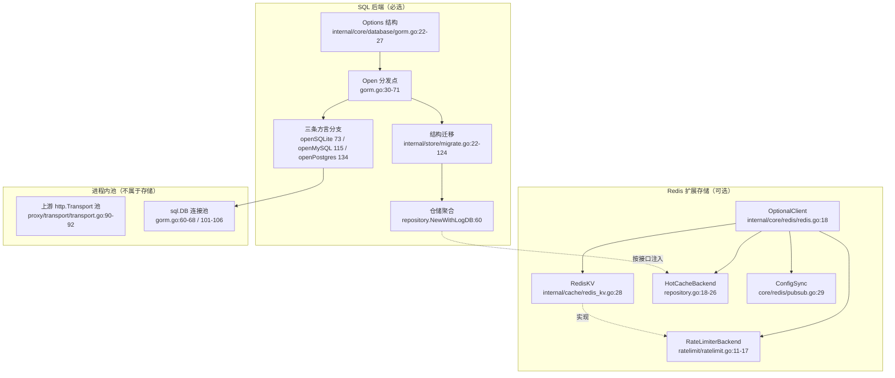
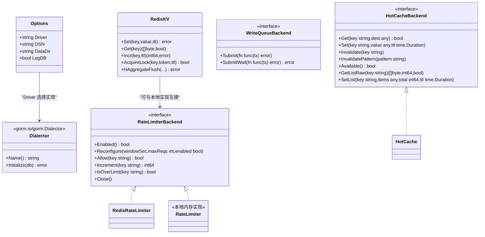
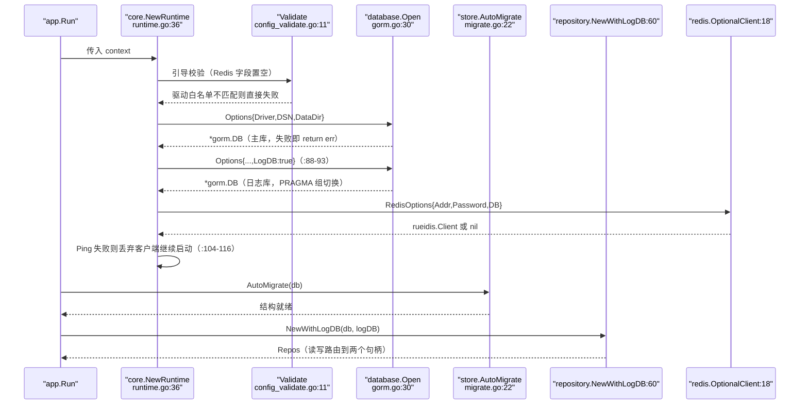
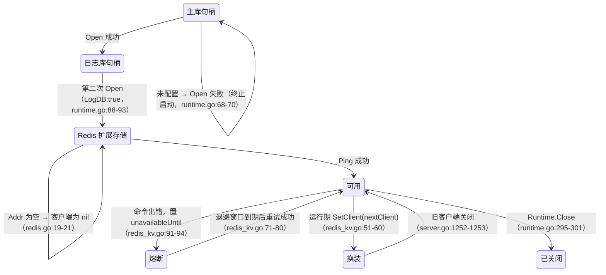
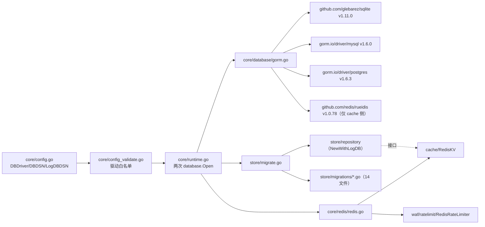
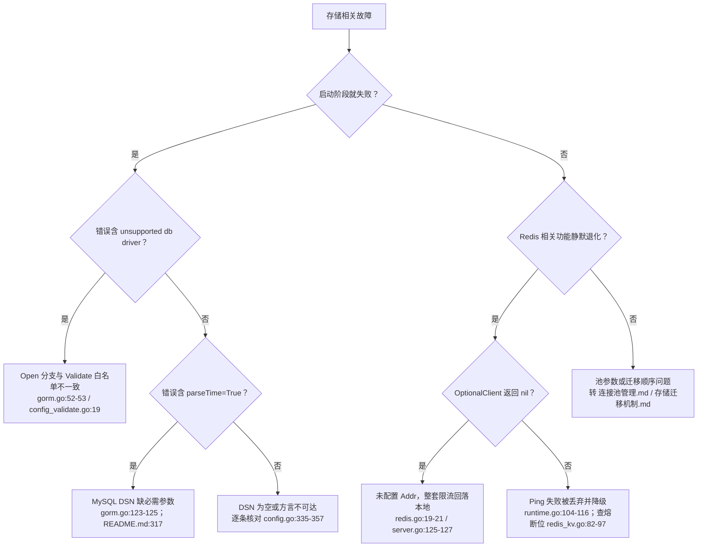

# 存储后端扩展

> [返回 扩展与插件系统](../扩展与插件系统.md)

<cite>
**本文档引用的文件**
- [internal/core/database/gorm.go](file://internal/core/database/gorm.go)
- [internal/core/config.go](file://internal/core/config.go)
- [internal/core/config_validate.go](file://internal/core/config_validate.go)
- [internal/core/runtime.go](file://internal/core/runtime.go)
- [internal/store/migrate.go](file://internal/store/migrate.go)
- [internal/store/repository/repository.go](file://internal/store/repository/repository.go)
- [internal/core/redis/redis.go](file://internal/core/redis/redis.go)
- [internal/cache/redis_kv.go](file://internal/cache/redis_kv.go)
- [internal/waf/ratelimit/ratelimit.go](file://internal/waf/ratelimit/ratelimit.go)
- [internal/waf/ratelimit/redis.go](file://internal/waf/ratelimit/redis.go)
- [internal/proxy/transport/transport.go](file://internal/proxy/transport/transport.go)
- [go.mod](file://go.mod)
- [README.md](file://README.md)
</cite>

## 目录

1. [简介](#简介)
2. [项目结构](#项目结构)
3. [核心组件](#核心组件)
4. [架构总览](#架构总览)
5. [详细组件分析](#详细组件分析)
6. [依赖关系分析](#依赖关系分析)
7. [性能考虑](#性能考虑)
8. [故障排查指南](#故障排查指南)
9. [结论](#结论)
10. [附录](#附录)

## 简介

本篇是「存储后端扩展」子域的索引文档，面向需要**替换或新增存储后端**的开发者。它回答三个问题：存储侧到底有哪些可扩展的接缝（seam）、每类扩展要改动哪些文件、扩展时必须守住哪些边界。

必须先厘清一件事：本项目的存储后端**不是可插拔注册表**。SQL 侧只有一个分发点 `database.Open`，通过 `Options.Driver` 在编译期已确定的三种方言（sqlite、mysql、postgres）之间选择；KV / 限流 / 事件扇出侧只有一个可选客户端工厂 `redis.OptionalClient`。因此「扩展存储后端」在本仓库中的真实含义是两条：一是在 `database` 包内增加一条方言分支，二是为 `RedisKV`、`RateLimiterBackend`、`HotCacheBackend` 这类已有接口增加第二个实现。任何「插入一个 MongoDB 驱动」式的设想都没有代码依据，具体论证放在 [NoSQL 存储适配](NoSQL%20存储适配.md)。

与已完成的 [数据存储层](../../数据存储层/数据存储层.md) 7 篇的分工是明确的：那 7 篇描述**现状与模型**（表结构、字段、仓储路由、Redis 现有用途），本 5 篇描述**如何扩展与替换**，两侧不重复同一张表，只互相链接。

**章节来源**
- [internal/core/database/gorm.go:21-71](file://internal/core/database/gorm.go#L21-L71)
- [internal/core/redis/redis.go:11-34](file://internal/core/redis/redis.go#L11-L34)
- [internal/store/repository/repository.go:9-26](file://internal/store/repository/repository.go#L9-L26)

## 项目结构

存储扩展面按「谁持有连接」划分成三个互不重叠的模块群，扩展动作只可能落在这三处之一。



**图表来源**
- [internal/core/database/gorm.go:22-134](file://internal/core/database/gorm.go#L22-L134)
- [internal/store/migrate.go:22-124](file://internal/store/migrate.go#L22-L124)
- [internal/core/redis/redis.go:18-34](file://internal/core/redis/redis.go#L18-L34)
- [internal/proxy/transport/transport.go:90-92](file://internal/proxy/transport/transport.go#L90-L92)

### 模块清单表

| 模块群 | 路径 | 规模 | 扩展职责 | 对应子文档 |
|--------|------|:----:|----------|-----------|
| SQL 适配 | `internal/core/database/` | 310 行 | 新增/替换关系型方言 | [数据库适配器](数据库适配器.md) |
| 结构迁移 | `internal/store/migrations/` | 14 文件 / 15 函数 | 新增迁移版本 | [存储迁移机制](存储迁移机制.md) |
| 仓储聚合 | `internal/store/repository/` | 3206 行 | 新增实体仓储、换库路由 | 见下文「扩展点」 |
| 连接池 | `gorm.go` + `proxy/transport/` | 两处独立实现 | 调参或增池 | [连接池管理](连接池管理.md) |
| Redis KV | `internal/cache/redis_kv.go` | 401 行 | 新增键族、换 KV 后端 | [NoSQL 存储适配](NoSQL%20存储适配.md) |
| Redis 限流 | `internal/waf/ratelimit/` | 462 行 | 新增限流后端实现 | 同上 |
| Redis 同步 | `internal/core/redis/` | 174 行 | 新增广播频道 | 同上 |

**章节来源**
- [internal/core/database/gorm.go:1-310](file://internal/core/database/gorm.go#L1-L310)
- [internal/store/migrate.go:1-168](file://internal/store/migrate.go#L1-L168)
- [internal/cache/redis_kv.go:1-401](file://internal/cache/redis_kv.go#L1-L401)
- [go.mod:14-15](file://go.mod#L14-L15)
- [go.mod:36-38](file://go.mod#L36-L38)

## 核心组件

存储侧的可扩展抽象一共四类，其中三类是 Go interface（可新增实现），一类是 switch 分支（只能改代码）。



**图表来源**
- [internal/core/database/gorm.go:22-27](file://internal/core/database/gorm.go#L22-L27)
- [internal/waf/ratelimit/ratelimit.go:9-28](file://internal/waf/ratelimit/ratelimit.go#L9-L28)
- [internal/store/repository/repository.go:11-26](file://internal/store/repository/repository.go#L11-L26)
- [internal/cache/redis_kv.go:28-401](file://internal/cache/redis_kv.go#L28-L401)

### 代码上下文表

| 符号 | 定义位置 | 职责 | 扩展时的用法 |
|------|----------|------|--------------|
| `Options` | `gorm.go:22-27` | 连接参数容器 | 新增字段只加不改，保持与 `core.Config` 无导入环 |
| `Open` | `gorm.go:30-71` | 唯一方言分发点 | 新方言在此加 `case`，并在 `config_validate.go:15-20` 加白名单 |
| `openSQLite` | `gorm.go:73-109` | PRAGMA 与 8 连接池 | 池参数改 `sqliteMaxOpenConns`（`gorm.go:113`） |
| `openMySQL` | `gorm.go:115-132` | `parseTime=True` 硬校验 | 新增必选参数校验照此写法 |
| `openPostgres` | `gorm.go:134-149` | `pgbouncer=true` 切简单协议 | 池化中间件兼容项照此写法 |
| `maskDSN` | `gorm.go:162-199` | 错误信息脱敏 | 新方言 DSN 必须走此函数再抛错 |
| `Repos` | `repository.go:29-54` | 24 个实体仓储聚合 | 新实体在此加字段并在 `NewWithLogDB:60` 装配 |
| `RateLimiterBackend` | `ratelimit.go:11-17` | 限流后端抽象 | 新 KV 后端只需实现这 6 个方法 |
| `HotCacheBackend` | `repository.go:18-26` | 热缓存抽象 | 非 Redis 缓存实现该接口即可换 |
| `WriteQueueBackend` | `repository.go:11-14` | 异步写入抽象 | 换批量落库通道时实现此接口 |

**章节来源**
- [internal/core/database/gorm.go:22-199](file://internal/core/database/gorm.go#L22-L199)
- [internal/store/repository/repository.go:11-60](file://internal/store/repository/repository.go#L11-L60)
- [internal/waf/ratelimit/ratelimit.go:9-17](file://internal/waf/ratelimit/ratelimit.go#L9-L17)

## 架构总览

启动阶段决定了两条后端的可用性等级：SQL 后端失败即终止启动，Redis 失败只降级。这条不对称是所有存储扩展设计的前提。



**图表来源**
- [internal/core/runtime.go:36-141](file://internal/core/runtime.go#L36-L141)
- [internal/core/database/gorm.go:30-71](file://internal/core/database/gorm.go#L30-L71)
- [internal/store/migrate.go:22-124](file://internal/store/migrate.go#L22-L124)
- [internal/core/redis/redis.go:18-42](file://internal/core/redis/redis.go#L18-L42)

### 扩展点表

| 扩展点 | 定义位置 | 现有实现 | 新增实现步骤 |
|--------|----------|----------|--------------|
| SQL 方言分支 | `gorm.go:45-54` switch | sqlite / mysql / postgres | 加 `case` + 白名单 + 打开函数 + DSN 校验 |
| 连接池参数 | `gorm.go:60-68`、`101-106` | 非 SQLite 25/10、SQLite 8 | 改常量或按方言分支设置 |
| 迁移版本 | `migrate.go:24-123` 顺序调用 | V2–V15 共 15 个函数 | 新写 `VnMigrateXxx` 并插入调用点 |
| 实体仓储 | `repository.go:29-54` | 24 个仓储 | 加字段 + `NewXxxRepo(db 或 logDB)` |
| 限流后端 | `ratelimit.go:11-17` | Redis 与本地内存两套 | 实现 6 方法 + 改 `buildRateLimiterBackend:123` |
| 热缓存后端 | `repository.go:18-26` | `cache.HotCache`（Redis） | 实现 7 方法 + 换注入点 |
| KV 键族 | `redis_kv.go:16` 前缀 | 19 个数据键族 | 新键名走 `RedisKV` 方法，前缀集中管理 |
| 广播频道 | `pubsub.go:16` | `openwaf:config:reload` | 新增频道常量与订阅回调 |

**章节来源**
- [internal/core/database/gorm.go:45-106](file://internal/core/database/gorm.go#L45-L106)
- [internal/store/migrate.go:22-123](file://internal/store/migrate.go#L22-L123)
- [internal/store/repository/repository.go:18-60](file://internal/store/repository/repository.go#L18-L60)
- [internal/waf/ratelimit/ratelimit.go:11-17](file://internal/waf/ratelimit/ratelimit.go#L11-L17)
- [internal/core/redis/pubsub.go:16-16](file://internal/core/redis/pubsub.go#L16-L16)

## 详细组件分析

### 新增一种关系型数据库后端（最小闭环）

真实约束是「四处一起改」，缺一个就会在运行时才暴露。`database.Open` 只认 `Options.Driver`，而 `core.Config.Validate` 有独立白名单，两者必须一致（`postgresql` 别名在两处都要认，`dialect_test.go:98-109` 就是为锁死这个一致性而写的）。

```go
// 文件：internal/core/database/gorm.go
// 目标：接入名为 mydb 的第四种方言（示意，gorm 官方 driver 存在时可直接用）

import (
    mydbdriver "gorm.io/driver/mydb" // 新增依赖，同时写进 go.mod
    "gorm.io/gorm"
)

// 1) Options.Driver 的取值集合扩大，结构本身不变（gorm.go:22-27）。
//    不新增字段即可承载新方言，是这里唯一的 KISS 约束。

// 2) 打开函数：DSN 必填校验 + 错误脱敏，与 openPostgres 保持同构（gorm.go:134-149）。
func openMyDB(opt Options, gcfg *gorm.Config) (*gorm.DB, error) {
    dsn := strings.TrimSpace(opt.DSN)
    if dsn == "" {
        return nil, fmt.Errorf("mydb requires MY_OPENWAF_DSN")
    }
    db, err := gorm.Open(mydbdriver.Open(dsn), gcfg)
    if err != nil {
        // 复用 maskDSN，避免把凭据写进启动日志（gorm.go:162-199）
        return nil, maskDatabaseOpenError(err, dsn)
    }
    return db, nil
}

// 3) Open 的 switch 加分支（gorm.go:45-54），并在 config_validate.go:15-20
//    的白名单里加同一个字符串，否则校验阶段就会拒绝启动。
// 4) gorm.go:60-68 的非 SQLite 池调优分支会自动覆盖新方言，
//    若该方言需要不同取值，在此按 opt.Driver 再分支。
```

围栏说明：`Options`、`Open` 的签名与 `maskDatabaseOpenError`、`preferSimpleProtocolFromDSN` 的写法均来自 `gorm.go` 原文；`mydbdriver` 只是占位名称，仓库中不存在该依赖，落地时必须换成真实存在的 `gorm.io/driver/*` 包。DSN 全部以 `{占位}` 形态出现在文档其余部分。

| 步骤 | 改动点 | 位置 | 验证方式 |
|:----:|--------|------|----------|
| 1 | 加依赖 | `go.mod` | `go build ./internal/core/database/` |
| 2 | 写 `openXxx` | `gorm.go` 尾部 | 空 DSN 必须返回错误 |
| 3 | 加 `case` | `gorm.go:45-54` | `TestOpenUnsupportedDriver` 同类断言 |
| 4 | 加白名单 | `config_validate.go:15-20` | 别名不匹配应走到 DSN 校验而非 unsupported |
| 5 | 池参数 | `gorm.go:60-68` | 检查 `sql.DB` 统计 |
| 6 | 迁移方言分支 | `migrations/site_tls_inheritance_defaults.go:17` | 三种 DDL 路径都要覆盖 |
| 7 | 查询侧方言 | `repository/security_event.go:606`、`owasprules/owasp_read_query.go:63` | 时间分桶与标识符引用 |

**章节来源**
- [internal/core/database/gorm.go:45-199](file://internal/core/database/gorm.go#L45-L199)
- [internal/core/database/dialect_test.go:53-109](file://internal/core/database/dialect_test.go#L53-L109)
- [internal/core/config_validate.go:15-20](file://internal/core/config_validate.go#L15-L20)
- [internal/store/migrations/site_tls_inheritance_defaults.go:10-40](file://internal/store/migrations/site_tls_inheritance_defaults.go#L10-L40)
- [internal/store/repository/security_event.go:598-616](file://internal/store/repository/security_event.go#L598-L616)

### 替换 KV / 限流类扩展存储

`RateLimiterBackend` 是本项目唯一「同一语义双实现」的存储接口：`ratelimit.RateLimiter`（进程内固定窗口）与 `ratelimit.RedisRateLimiter`（Redis 有序集合滑动窗口）。`buildRateLimiterBackend` 在 Redis 客户端为 nil 时静默回落本地实现，这就是新增第三种后端的标准接入形状。

```go
// 文件：internal/app/server.go:123-128 的现有形状（原文节选，未改动）
func buildRateLimiterBackend(client rueidis.Client, prefix string, windowSec, maxReqs int, enabled bool) ratelimit.RateLimiterBackend {
    if rl := ratelimit.NewRedisRateLimiter(client, prefix, windowSec, maxReqs, enabled); rl != nil {
        return rl
    }
    return ratelimit.NewRateLimiter(windowSec, maxReqs, enabled)
}

// 扩展方式：实现 ratelimit.RateLimiterBackend 的 6 个方法
// （Enabled / Reconfigure / Allow / Increment / IsOverLimit / Close，
//   见 ratelimit.go:11-17），然后在本函数里加一条优先级分支。
// 注意 Allow 的语义是「失败开路」：RedisRateLimiter.Allow 在脚本出错时
// 返回 true（redis.go:134-138），新实现必须保持一致，否则 Redis 抖动会
// 变成整站 429。
```

同样的接口化形状出现在仓储侧：`HotCacheBackend`（`repository.go:18-26`）与 `WriteQueueBackend`（`repository.go:11-14`）之所以定义在 repository 包内，是为了切断 repository → cache/observability 的反向依赖。替换这两类后端时不要把它们挪到实现包，否则导入环立刻出现。

**章节来源**
- [internal/app/server.go:123-128](file://internal/app/server.go#L123-L128)
- [internal/waf/ratelimit/ratelimit.go:9-28](file://internal/waf/ratelimit/ratelimit.go#L9-L28)
- [internal/waf/ratelimit/redis.go:115-139](file://internal/waf/ratelimit/redis.go#L115-L139)
- [internal/store/repository/repository.go:9-26](file://internal/store/repository/repository.go#L9-L26)

### 连接池与迁移的扩展边界

两条边界必须由文档守住，否则改动会串台：

1. **DB 连接池 ≠ HTTP 上游连接池**。前者由 `database/sql` 管理（`gorm.go:63-66`、`gorm.go:103-105`），后者由 `net/http.Transport` 与 hertz、quic-go 客户端管理（`transport.go:157-177`、`transport.go:872-876`）。两者没有任何共享旋钮，取值也刻意不同量级。详见 [连接池管理](连接池管理.md)。
2. **结构迁移 ≠ 数据迁移**。`store.AutoMigrate` 内两类操作按固定顺序编排，`V8` 必须早于结构迁移、`V9` 必须晚于默认槽列，这类因果写在调用点注释里（`migrate.go:45-49`、`migrate.go:96-101`）。新增迁移不得重排既有顺序，详见 [存储迁移机制](存储迁移机制.md)。

| 维度 | DB 连接池 | HTTP 上游连接池 | Redis 客户端池 |
|------|-----------|-----------------|----------------|
| 管理者 | `database/sql` | `net/http` + hertz + quic-go | rueidis 内部池 |
| 粒度 | 每个 `*gorm.DB` 句柄一份 | 每站点类 / h2c 单例 / h3 键 | 全进程一个 `Client` |
| 扩展改点 | `gorm.go:60-68`、`101-106` | `transport.go:145-180` 等 | `redis.go:22-29` |
| 是否影响存储语义 | 是（锁竞争、连接寿命） | 否 | 是（命令超时上限） |

**章节来源**
- [internal/core/database/gorm.go:60-106](file://internal/core/database/gorm.go#L60-L106)
- [internal/proxy/transport/transport.go:145-180](file://internal/proxy/transport/transport.go#L145-L180)
- [internal/store/migrate.go:45-101](file://internal/store/migrate.go#L45-L101)

### 存储后端可用性状态机

SQL 句柄与 Redis 客户端的状态迁移路径不同：前者只有「未装配 / 已装配 / 已关闭」三态且任一失败即终止启动，后者额外拥有「未配置」「降级」两态，并可在运行期被整颗换掉。新增后端必须声明自己落在哪一侧，否则会破坏 `/readyz` 的判定口径（就绪要求 DB Ping 成功）。



**图表来源**
- [internal/core/runtime.go:68-93](file://internal/core/runtime.go#L68-L93)
- [internal/core/runtime.go:291-302](file://internal/core/runtime.go#L291-L302)
- [internal/core/redis/redis.go:18-21](file://internal/core/redis/redis.go#L18-L21)
- [internal/cache/redis_kv.go:51-97](file://internal/cache/redis_kv.go#L51-L97)
- [internal/app/server.go:1204-1253](file://internal/app/server.go#L1204-L1253)

**章节来源**
- [internal/core/runtime.go:63-116](file://internal/core/runtime.go#L63-L116)
- [internal/core/runtime.go:291-302](file://internal/core/runtime.go#L291-L302)
- [internal/cache/redis_kv.go:51-97](file://internal/cache/redis_kv.go#L51-L97)

## 依赖关系分析



**图表来源**
- [internal/core/config.go:261-277](file://internal/core/config.go#L261-L277)
- [internal/core/runtime.go:63-141](file://internal/core/runtime.go#L63-L141)
- [internal/store/migrate.go:6-19](file://internal/store/migrate.go#L6-L19)
- [go.mod:14-15](file://go.mod#L14-L15)
- [go.mod:23-23](file://go.mod#L23-L23)
- [go.mod:36-38](file://go.mod#L36-L38)

### 外部依赖矩阵

| 依赖 | 版本（`go.mod`） | 引入位置 | 可否替换 |
|------|------------------|----------|----------|
| `gorm.io/gorm` | v1.31.2 | `gorm.go:17` | 否，仓储层全面依赖 |
| `github.com/glebarez/sqlite` | v1.11.0 | `gorm.go:13` | 可换 `gorm.io/driver/sqlite`，需保留 PRAGMA 拼接 |
| `modernc.org/sqlite` | v1.60.1（间接） | 纯 Go 后端，无 cgo | 随上层驱动 |
| `gorm.io/driver/mysql` | v1.6.0 | `gorm.go:15` | 是，独立方言包 |
| `gorm.io/driver/postgres` | v1.6.3 | `gorm.go:16` | 是，独立方言包 |
| `github.com/go-sql-driver/mysql` | v1.10.1 | `gorm.go:14`，仅用于 `ParseDSN` 脱敏 | 是，但需保留关键字 DSN 兜底 |
| `github.com/redis/rueidis` | v1.0.78 | `redis.go:8`、`redis_kv.go:12` | 接口面窄，可换但需重做健康位 |

**章节来源**
- [go.mod:14-15](file://go.mod#L14-L15)
- [go.mod:36-38](file://go.mod#L36-L38)
- [go.mod:76-76](file://go.mod#L76-L76)
- [internal/core/database/gorm.go:13-18](file://internal/core/database/gorm.go#L13-L18)
- [internal/core/redis/redis.go:8-8](file://internal/core/redis/redis.go#L8-L8)

## 性能考虑

存储扩展的性能红线只有三条，都来自代码而非经验判断：

- **SQLite 是 8 连接而非单连接**。`sqliteMaxOpenConns = 8`（`gorm.go:113`），`SetMaxOpenConns`/`SetMaxIdleConns` 都用它（`gorm.go:103-104`），`SetConnMaxLifetime(0)` 表示本地文件连接不轮换（`gorm.go:105`）。把「单连接」当既成事实去优化会得出错误结论。
- **主库与日志库是两份独立句柄**。`LogDB` 不是布尔开关式的共用连接，而是第二次 `database.Open`（`runtime.go:88-93`）产生的独立句柄，日志库的 PRAGMA 组与主库不同（`gorm.go:89` 对比 `gorm.go:94`）。
- **PrepareStmt 与方言池化可能冲突**。`gorm.go:39` 全局开启 `PrepareStmt`，PostgreSQL 走 PgBouncer 事务池时必须靠 `pgbouncer=true` 切简单协议（`gorm.go:143`、`gorm.go:157-159`），否则服务端预处理语句报错。

扩展新后端时，凡使用预处理语句的中间件都要提供同类「显式关闭」开关，并把它做成 DSN 参数而非新增配置字段，保持 `Options` 不变。

**章节来源**
- [internal/core/database/gorm.go:31-40](file://internal/core/database/gorm.go#L31-L40)
- [internal/core/database/gorm.go:89-113](file://internal/core/database/gorm.go#L89-L113)
- [internal/core/database/gorm.go:139-159](file://internal/core/database/gorm.go#L139-L159)
- [internal/core/runtime.go:88-93](file://internal/core/runtime.go#L88-L93)

## 故障排查指南



**图表来源**
- [internal/core/database/gorm.go:52-125](file://internal/core/database/gorm.go#L52-L125)
- [internal/core/config_validate.go:19-26](file://internal/core/config_validate.go#L19-L26)
- [internal/core/runtime.go:104-116](file://internal/core/runtime.go#L104-L116)
- [internal/core/redis/redis.go:18-21](file://internal/core/redis/redis.go#L18-L21)
- [internal/cache/redis_kv.go:82-97](file://internal/cache/redis_kv.go#L82-L97)

### 症状 / 原因 / 排查 / 方案

| 症状 | 原因 | 排查 | 方案 |
|------|------|------|------|
| 报 `unsupported MY_OPENWAF_DB_DRIVER` | 驱动字符串不在两处白名单 | `config.go:355-357` 的归一化结果 | 对齐 `gorm.go:45-54` 与 `config_validate.go:15-20` |
| MySQL 启动即失败并提示 parseTime | DSN 缺 `parseTime=True` | 错误串已被 `maskDSN` 遮蔽 | 按 README 补参数，口令用 `{占位}` 记录 |
| PgBouncer 后报预处理语句不存在 | `PrepareStmt` 与事务池化冲突 | DSN 是否含 `pgbouncer=true` | 加上该参数走简单协议（`gorm.go:157-159`） |
| 限流在多节点不一致 | Redis 未启用，回落本地窗口 | `NewRedisRateLimiter` 返回 nil | 配 `MY_OPENWAF_REDIS_ADDR` 并看启动告警行 |
| 站点配置改了但另一节点不生效 | 广播链路未建立 | `ConfigSync` 是否为 nil（`pubsub.go:38-41`） | 检查频道与 sourceID 回环抑制（`pubsub.go:114-116`） |

**章节来源**
- [internal/core/database/gorm.go:45-159](file://internal/core/database/gorm.go#L45-L159)
- [internal/core/config.go:355-357](file://internal/core/config.go#L355-L357)
- [internal/core/redis/redis.go:18-21](file://internal/core/redis/redis.go#L18-L21)
- [internal/core/redis/pubsub.go:38-116](file://internal/core/redis/pubsub.go#L38-L116)
- [README.md:317-319](file://README.md#L317-L319)

## 结论

本项目的存储扩展性是「窄接缝 + 明确边界」的产物：SQL 侧靠单一分发点与一份 `Options` 结构维持简单，Redis 侧靠 `RateLimiterBackend`、`HotCacheBackend`、`WriteQueueBackend` 三个接口维持可替换性。KISS 体现在不建插件注册表；YAGNI 体现在没有第二种 NoSQL 实现时就不预留驱动位；DRY 体现在 `maskDSN` 一处覆盖三种 DSN 形态；SRP 体现在方言选择、迁移编排、池管理、命令封装各占一个包。

已知取舍：驱动白名单在两处重复，用测试而非抽象来锁一致性（`dialect_test.go:98-109`）。下一步若真要接入第四种方言，工作量集中在第 6、7 步的方言分支，而不是打开函数本身。

**章节来源**
- [internal/core/database/dialect_test.go:96-126](file://internal/core/database/dialect_test.go#L96-L126)

## 附录

### 子文档导航

| 文档 | 主题 | 关键产物 |
|------|------|----------|
| [数据库适配器](数据库适配器.md) | 方言选择、DSN 校验、脱敏 | classDiagram + 驱动兼容矩阵 |
| [连接池管理](连接池管理.md) | DB 池与 HTTP 上游池分离 | 三类池参数对照表 |
| [存储迁移机制](存储迁移机制.md) | 新增迁移版本 | stateDiagram-v2 + 注册顺序表 |
| [NoSQL 存储适配](NoSQL%20存储适配.md) | Redis 能力边界与键族扩展 | Redis 键设计表 + 边界表 |

[本节为总结，无需特定文件来源]

### 扩展自检清单

| 检查项 | 依据 |
|--------|------|
| 新方言同时进 `Open` 与 `Validate` | `gorm.go:45-54` / `config_validate.go:15-20` |
| 新方言的建连错误走脱敏函数 | `gorm.go:201-210` |
| 新迁移函数自带 `HasTable` 守卫 | `migrations/*.go` 全部一致 |
| 新键族不引入第四种顶层命名空间 | 现状三类：`openwaf:`、`owaf:`、`waf:` |
| 新后端不改变「Redis 可降级、SQL 不可降级」 | `runtime.go:63-70` / `runtime.go:104-116` |

**章节来源**
- [internal/core/database/gorm.go:45-210](file://internal/core/database/gorm.go#L45-L210)
- [internal/core/config_validate.go:15-20](file://internal/core/config_validate.go#L15-L20)
- [internal/core/runtime.go:63-116](file://internal/core/runtime.go#L63-L116)

### 配置项速查

| 环境变量 | 默认值 | 说明（出处） |
|----------|--------|--------------|
| `MY_OPENWAF_DB_DRIVER` | `sqlite` | `config.go:355-357`；README.md:316 |
| `MY_OPENWAF_DSN` | `{占位}` | `config.go:335-344`；MySQL 必含 `parseTime=True`（README.md:317-318） |
| `MY_OPENWAF_LOG_DSN` | `{占位}` | `config.go:347-352`；别名 `MY_OPENWAF_LOG_DB` |
| `MY_OPENWAF_DATA` | `./data` | `config.go:339-341` |
| `MY_OPENWAF_REDIS_ADDR` | 空（不启用） | README.md:320；`Validate` 要求合法 host:port（`config_validate.go:33-37`） |

[本节为速查汇总，无需特定文件来源]
