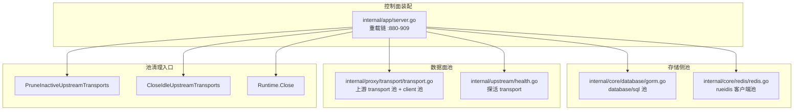
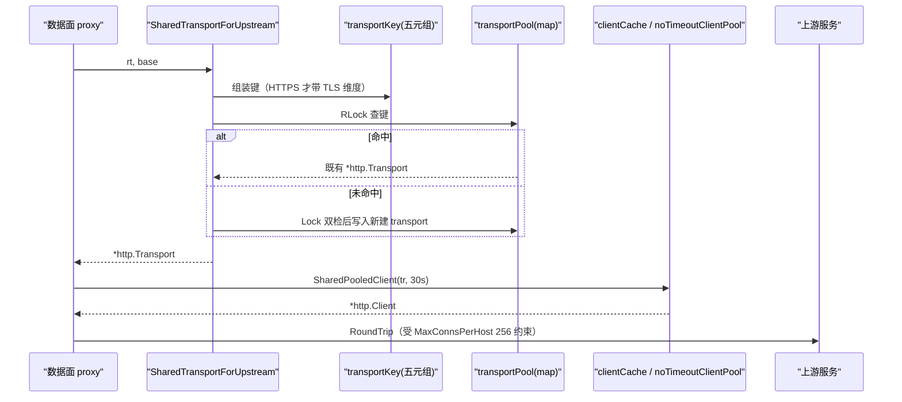
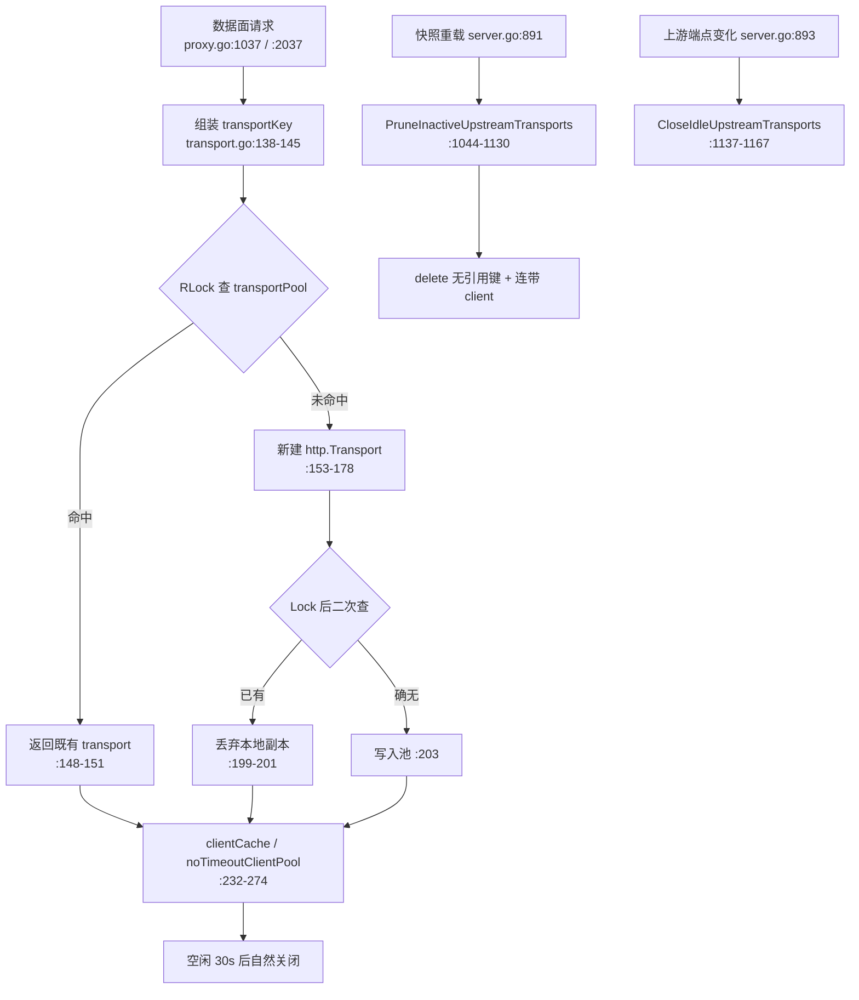
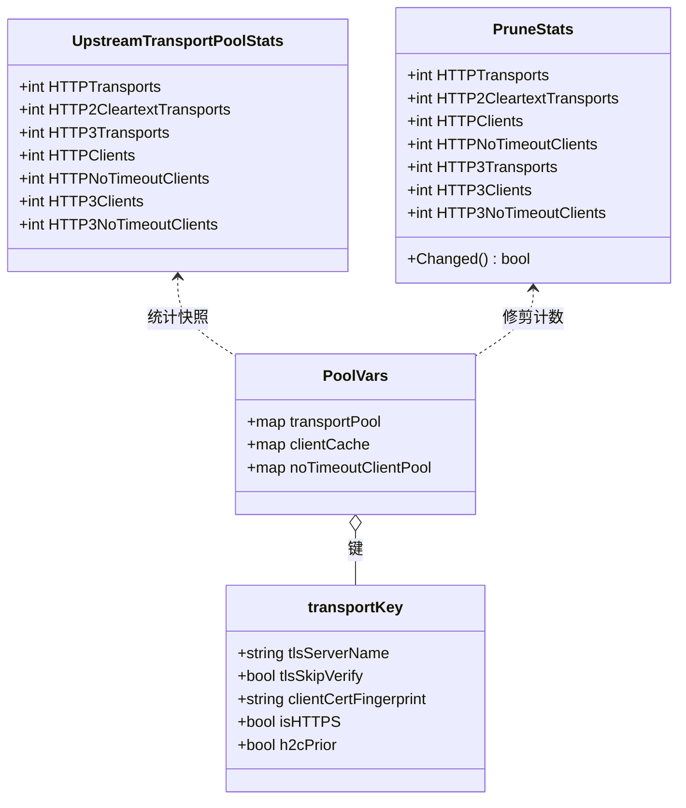

# 连接池管理

> [返回 扩展与插件系统](../扩展与插件系统.md)

<cite>
**本文档引用的文件**
- [internal/core/database/gorm.go](file://internal/core/database/gorm.go)
- [internal/core/runtime.go](file://internal/core/runtime.go)
- [internal/core/redis/redis.go](file://internal/core/redis/redis.go)
- [internal/core/health/health.go](file://internal/core/health/health.go)
- [internal/proxy/transport/transport.go](file://internal/proxy/transport/transport.go)
- [internal/proxy/proxy.go](file://internal/proxy/proxy.go)
- [internal/dataplane/sse.go](file://internal/dataplane/sse.go)
- [internal/admin/system/network.go](file://internal/admin/system/network.go)
- [internal/upstream/health.go](file://internal/upstream/health.go)
- [internal/waf/ratelimit/redis.go](file://internal/waf/ratelimit/redis.go)
- [internal/cache/redis_kv.go](file://internal/cache/redis_kv.go)
- [internal/app/server.go](file://internal/app/server.go)
- [internal/proxy/transport/transport_test.go](file://internal/proxy/transport/transport_test.go)
- [internal/proxy/transport/prune_transport_key_test.go](file://internal/proxy/transport/prune_transport_key_test.go)
- [internal/proxy/transport/upstream_conn_limit_test.go](file://internal/proxy/transport/upstream_conn_limit_test.go)
- [README.md](file://README.md)
</cite>

## 目录

1. [简介](#简介)
2. [项目结构](#项目结构)
3. [核心组件](#核心组件)
4. [架构总览](#架构总览)
5. [详细组件分析](#详细组件分析)
6. [依赖关系分析](#依赖关系分析)
7. [性能考虑](#性能考虑)
8. [故障排查指南](#故障排查指南)
9. [结论](#结论)
10. [附录](#附录)

## 简介

本文只回答两个扩展问题：**要调某个池的取值该改哪一行**、**要新增一类池要接哪些形状**。仓库里没有「全局连接池」这个东西，实际存在四套彼此不共享旋钮的池：DB 连接池（`database/sql`）、HTTP 上游 transport 池（`net/http`）、探活 transport（一次性小池）、Redis 客户端池（rueidis 内部）。它们的参数刻意不同量级，清理入口也各自独立，任何「按 DB 池思路调上游池」的动作都会调错旋钮。

**边界与互指**：写现状的表结构、模型清单见 [数据存储层](../../数据存储层/数据存储层.md) 与 [多数据库支持](../../数据存储层/多数据库支持.md)；方言适配与 DSN 契约见 [数据库适配器](数据库适配器.md)；池修剪在重载链中的位置见 [存储后端扩展](存储后端扩展.md)；上游 transport 的数据面行为见 [数据平面处理](../../数据平面处理/数据平面处理.md)。本文不复述它们的表格。

**必须纠正的旧表述**：`internal/proxy/proxy.go` 中已不存在 `transportPool` 与 `transportKey`，也不存在 `SharedTransport`、`Transport.HTTPTransport` 这类符号；真实实现全在 `internal/proxy/transport/`，取池入口是 `SharedTransportForUpstream(rt snapshot.SiteRuntime, base string) *http.Transport`（`transport.go:131`），键是五元组 `transportKey`（`transport.go:71-80`）。

**章节来源**
- [internal/proxy/transport/transport.go:71-133](file://internal/proxy/transport/transport.go#L71-L133)
- [internal/core/database/gorm.go:60-68](file://internal/core/database/gorm.go#L60-L68)

## 项目结构

四套池分布在四个互不引用的包，唯一的公共汇合点是重载链。



**图表来源**
- [internal/app/server.go:880-909](file://internal/app/server.go#L880-L909)
- [internal/core/database/gorm.go:60-68](file://internal/core/database/gorm.go#L60-L68)
- [internal/proxy/transport/transport.go:1044-1137](file://internal/proxy/transport/transport.go#L1044-L1137)

| 路径 | 池类别 | 管理者 | 粒度 | 清理入口 | 规模(行) |
|------|--------|--------|------|----------|:--------:|
| `internal/core/database/gorm.go` | DB 连接池 | `database/sql` | 每个 `*gorm.DB` 一份（主库 + 日志库两份） | `Runtime.Close` | 310 |
| `internal/proxy/transport/transport.go` | 上游 transport / client 池 | `net/http` | 每 `transportKey` 一份 | `PruneInactiveUpstreamTransports`、`CloseIdleUpstreamTransports` | 1280 |
| `internal/upstream/health.go` | 探活 transport | `net/http` | 每次探活新建，用完即弃 | 由 `http.Client` 生命周期兜住 | 981 |
| `internal/core/redis/redis.go` | Redis 客户端池 | rueidis | 全进程一个 `Client` | `rcli.Close()`（降级或关停） | 42 |

**章节来源**
- [internal/core/database/gorm.go:60-105](file://internal/core/database/gorm.go#L60-L105)
- [internal/proxy/transport/transport.go:90-93](file://internal/proxy/transport/transport.go#L90-L93)
- [internal/upstream/health.go:661-677](file://internal/upstream/health.go#L661-L677)
- [internal/core/redis/redis.go:18-34](file://internal/core/redis/redis.go#L18-L34)

## 核心组件

模块清单按「池 → 参数来源 → 消费方」组织；被依赖列由交叉引用检索得出，不凭印象。

| 模块 | 路径 | 职责 | 核心接口/符号 | 依赖模块 | 被依赖 | 规模(行) | 测试 |
|------|------|------|---------------|----------|--------|:--------:|:----:|
| DB 适配池 | `internal/core/database` | 取句柄并设定 `sql.DB` 参数 | `Open`、`sqliteMaxOpenConns` | `gorm`、驱动 | `core/runtime` | 310 | 有 |
| 上游传输池 | `internal/proxy/transport` | 键控 transport 复用与 client 缓存 | `SharedTransportForUpstream`、`SharedPooledClient` | `snapshot`、`net/http`、`http3` | `proxy`、`app` | 1280 | 有 |
| 修剪入口 | `internal/proxy/transport` | 按快照回收无引用池项 | `PruneInactiveUpstreamTransports`、`CloseIdleUpstreamTransports` | `snapshot` | `app` 重载链 | 同上 | 有 |
| 池统计 | `internal/proxy/transport` | 各池规模快照 | `UpstreamTransportPoolStats`、`UpstreamTransportPoolStatsSnapshot` | 同上 | `app` 日志 | 同上 | 有 |
| 探活池 | `internal/upstream` | 健康检查专用短连接 | `newHTTPProbeTransport` | `net/http` | `Pool.Pick` 路径 | 1231 | 有 |
| Redis 客户端 | `internal/core/redis` | 可选客户端与 Ping | `OptionalClient`、`Ping` | `rueidis` | `core/runtime`、`cache` | 174 | 有 |

把关键符号放进上下游网络，可直接判断改动影响面：

| 符号 | 位置 | 职责 | 上游调用者 | 下游依赖 | 副作用 | 影响面 |
|------|------|------|------------|----------|--------|--------|
| `Open` | `core/database/gorm.go:30` | 取句柄并设定 `sql.DB` 池 | `runtime.go:63`、`runtime.go:88` | `gorm.Open`、四个 `Set*` | 建立物理连接、建目录 | 高：启动失败即整体不可用 |
| `ResolveUpstreamBase` | `proxy/transport/transport.go:800` | 按 scheme 选池并归一 base | `proxy.go:1007`（缓冲）、`proxy.go:2012`（流式） | `sharedTransportForUpstreamClassified`、`h2cTransportForUpstream`、`http3TransportForUpstream` | 首次命中会向池写入新 transport | 高：全部回源路径 |
| `SharedTransportForUpstream` | `proxy/transport/transport.go:131` | 对外取池入口（内部委派给免归一实现） | 实测生产代码无调用点，仅测试与同类文档引用（`:132` 委派） | `sharedTransportForUpstreamClassified`（`:137`） | 同上 | 中：改签名需同步测试 |
| `sharedTransportForUpstreamClassified` | `proxy/transport/transport.go:137` | 五元组键 + 双检建池 | `transport.go:835`、`transport.go:841` | `transportPool`、`upstream.UpstreamClientCertificate` | 池增长 | 高：池分裂粒度 |
| `SharedPooledClient` | `proxy/transport/transport.go:967` | 按 transport 缓存 `http.Client` | `proxy.go:1037`（30s）、`proxy.go:2037`（无超时） | `sharedClient`（`:238`）、`sharedNoTimeoutClient`（`:257`） | client 池增长 | 高：整体超时语义 |
| `PruneInactiveUpstreamTransports` | `proxy/transport/transport.go:1044` | 删除快照无引用的池项 | `server.go:891`（每次重载） | `transportKeyForUpstream`、两个 client 池 | 删连接与 client | 高：误删即在用连接中断 |
| `CloseIdleUpstreamTransports` | `proxy/transport/transport.go:1137` | 关闭全部空闲连接 | `server.go:894`（上游端点变化时） | `http.Transport.CloseIdleConnections`、`http3.Transport` | 连接重建 | 中：短时延升温 |
| `newHTTPProbeTransport` | `upstream/health.go:661` | 探活专用短连接池 | `health.go:655`、`health.go:696` | `net.Dialer` | 无（随探活结束） | 中：探活并发上限 |
| `OptionalClient` | `core/redis/redis.go:18` | 构造或返回 nil 客户端 | `runtime.go:99`、`server.go:933`、`admin/system/network.go:558` | `rueidis.NewClient` | 建连 | 高：Redis 降级判定 |

**章节来源**
- [internal/core/database/gorm.go:30-71](file://internal/core/database/gorm.go#L30-L71)
- [internal/proxy/transport/transport.go:131-137](file://internal/proxy/transport/transport.go#L131-L137)
- [internal/proxy/transport/transport.go:800-856](file://internal/proxy/transport/transport.go#L800-L856)
- [internal/proxy/transport/transport.go:967](file://internal/proxy/transport/transport.go#L967)
- [internal/proxy/transport/transport.go:1044-1167](file://internal/proxy/transport/transport.go#L1044-L1167)
- [internal/upstream/health.go:655-696](file://internal/upstream/health.go#L655-L696)
- [internal/core/redis/redis.go:18](file://internal/core/redis/redis.go#L18)
- [internal/app/server.go:890-896](file://internal/app/server.go#L890-L896)

## 架构总览

用户请求路径只碰 transport 池，不碰 DB 池；reload 路径同时碰两者。下图给出取池、建池、缓存 client 的调用形态。



**图表来源**
- [internal/proxy/transport/transport.go:131-203](file://internal/proxy/transport/transport.go#L131-L203)
- [internal/proxy/transport/transport.go:232-274](file://internal/proxy/transport/transport.go#L232-L274)
- [internal/proxy/transport/transport.go:967](file://internal/proxy/transport/transport.go#L967)

**章节来源**
- [internal/proxy/transport/transport.go:131-274](file://internal/proxy/transport/transport.go#L131-L274)

## 详细组件分析

### DB 连接池参数与扩展点

判定条件写在 `gorm.go:60`：只有 `opt.Driver != "sqlite" && opt.Driver != ""` 才进入非 SQLite 调优分支。SQLite 的连接数在 `openSQLite` 内部单独设定，两处取值互不覆盖。

| 参数 | 默认值:位置 | 适用驱动 | 调整影响 | 清理策略 |
|------|-------------|----------|----------|----------|
| `SetMaxOpenConns` | 25（`gorm.go:63`） | mysql / postgres | 上调直接抬高后端并发连接；超过数据库 `max_connections` 会在建连期报错 | 由 `SetConnMaxLifetime` 轮换 |
| `SetMaxIdleConns` | 10（`gorm.go:64`） | mysql / postgres | 低于 `MaxOpenConns` 时，峰值后多余连接被物理关闭 | `SetConnMaxIdleTime` 主动回收 |
| `SetConnMaxLifetime` | 30 分钟（`gorm.go:65`） | mysql / postgres | 缩短可更快摆脱 LB/DNS 变更后的旧连接；过短会频繁重连 | 到期即换 |
| `SetConnMaxIdleTime` | 5 分钟（`gorm.go:66`） | mysql / postgres | 空闲连接占用的服务端内存随之下降 | 空闲超时关闭 |
| `SetMaxOpenConns` | 8（`gorm.go:103`，常量 `sqliteMaxOpenConns = 8` 见 `:113`） | sqlite | 8 是 WAL 读并发与单写者的折中；改成 1 会把读串行化 | 不适用（本地文件） |
| `SetMaxIdleConns` | 8（`gorm.go:104`） | sqlite | 与上限相等，避免反复建连 | 不适用 |
| `SetConnMaxLifetime` | 0（`gorm.go:105`） | sqlite | 0 表示永不轮换，本地文件连接长期持有合法 | 进程退出时统一关闭 |
| `PrepareStmt` | `true`（`gorm.go:39`） | 全部 | 语句缓存按连接持有；PG 走 PgBouncer 时与 `PreferSimpleProtocol` 拮抗 | 随连接释放 |
| `SlowThreshold` | 200ms（`gorm.go:33`） | 全部 | 决定慢查询日志灵敏度，不影响吞吐 | — |
| `LogLevel` | `logger.Error`（`gorm.go:34`） | 全部 | 非 Error 级别会把大量 SQL 写进 stdout | — |

回收路径唯一：`Runtime.Close` 依次关 Redis、主库、日志库，并在 `LogDB == DB` 时跳过第二次（`runtime.go:291-303`）；`closeRuntimeDB` 内部取 `db.DB()` 后 `sqlDB.Close()`（`runtime.go:305-313`）。初始化中途失败时各错误分支已就地回收（`runtime.go:73`、`runtime.go:82`、`runtime.go:95`、`runtime.go:123-124`）。新增池值应改这张表对应的行，不要新增第二个 setter 调用点。

```go
// 现状：internal/core/database/gorm.go:60-68（原文节选，未改动）
if opt.Driver != "sqlite" && opt.Driver != "" {
    sqlDB, err := db.DB()
    if err == nil {
        sqlDB.SetMaxOpenConns(25)
        sqlDB.SetMaxIdleConns(10)
        sqlDB.SetConnMaxLifetime(30 * time.Minute)
        sqlDB.SetConnMaxIdleTime(5 * time.Minute)
    }
}

// 扩展方式：新方言需要不同档位时，在此按驱动分支，而不是新增第二处调优段落。
// if opt.Driver == "{新方言}" { sqlDB.SetMaxOpenConns(50) }
```

**章节来源**
- [internal/core/database/gorm.go:31-40](file://internal/core/database/gorm.go#L31-L40)
- [internal/core/database/gorm.go:60-113](file://internal/core/database/gorm.go#L60-L113)
- [internal/core/runtime.go:291-313](file://internal/core/runtime.go#L291-L313)

### HTTP 上游主池参数

主池由 `sharedTransportForUpstreamClassified` 建表（`transport.go:137-205`），源码注释直接写明取值动机：256/32 比 Go 默认的 512/128 更省峰值后的空闲连接内存，30s 比原 90s 更快释放（`transport.go:155-156`）。

| 参数 | 默认值:位置 | 调整影响 | 清理策略 |
|------|-------------|----------|----------|
| `MaxIdleConns` | 256（`transport.go:157`） | 全局空闲连接上限，调低会让峰值后更多连接被丢弃 | `IdleConnTimeout` + 修剪 |
| `MaxIdleConnsPerHost` | 32（`transport.go:159`） | 单上游复用率；过高会长期占住文件描述符 | 同上 |
| `IdleConnTimeout` | 30 秒（`transport.go:161`） | 越短越快释放内存，代价是空闲期首个请求需重连 | 到期自动关闭 |
| `MaxConnsPerHost` | 256（`transport.go:172`） | **并发硬上限**（含在用连接），注释说明是为避免洪峰占满临时端口导致 i/o timeout | 达到上限时新请求排队 |
| `ReadBufferSize` / `WriteBufferSize` | 16KiB（`transport.go:163-164`） | 预分配缓冲，减少高并发下的分配压力；上调按连接数放大内存 | 随连接释放 |
| `ExpectContinueTimeout` | 1 秒（`transport.go:166`） | `Expect: 100-continue` 等待窗口 | — |
| `ForceAttemptHTTP2` | `true`（`transport.go:168`） | 未声明也尝试 h2 | — |
| `DisableCompression` | `true`（`transport.go:170`） | 关闭 h2 压缩以规避 CRIME 类攻击 | — |
| `DialContext` | `newUpstreamDialer()`（`transport.go:175`，拨号 10s / keepalive 30s 见 `:110-111`） | 拨号超时缺失时退回内核 SYN 重传（约 130s） | — |
| `TLSHandshakeTimeout` | 10 秒（`transport.go:176`，常量 `:112`） | 与探活路径同量级对齐（注释 `:95-105`） | — |
| `ResponseHeaderTimeout` | 30 秒（`transport.go:177`，常量 `:113`） | 只约束首个响应字节之前的等待 | — |
| `ClientSessionCache` | LRU 32（`transport.go:187`） | 命中则走简化握手；容量与 `MaxIdleConnsPerHost` 对齐 | 每个 transport 独享 |
| client 缓存 `Timeout` | 60 秒（`transport.go:246`）／无超时（`transport.go:265`） | SSE 与流式路径取无超时档 | 随 transport 修剪 |

键的构成决定池的分裂粒度：`transportKey` 为五元组 `tlsServerName` / `tlsSkipVerify` / `clientCertFingerprint` / `isHTTPS` / `h2cPrior`（`transport.go:71-80`），且明文 HTTP 不填 TLS 维度（`transport.go:141-145`）。证书维度只存链 DER 的 SHA-256 摘要前缀，注释明确禁止把完整 PEM 放进 map 键（`transport.go:74-76`），因为日志与 pprof 可倾泻键内容。



**图表来源**
- [internal/proxy/transport/transport.go:137-203](file://internal/proxy/transport/transport.go#L137-L203)
- [internal/proxy/transport/transport.go:232-274](file://internal/proxy/transport/transport.go#L232-L274)
- [internal/proxy/transport/transport.go:1044-1167](file://internal/proxy/transport/transport.go#L1044-L1167)
- [internal/app/server.go:890-896](file://internal/app/server.go#L890-L896)

**章节来源**
- [internal/proxy/transport/transport.go:71-203](file://internal/proxy/transport/transport.go#L71-L203)
- [internal/proxy/transport/transport.go:232-274](file://internal/proxy/transport/transport.go#L232-L274)

### h2c 单例与探活池

这两类池与主池同族但取值不同，混调是常见错误。

| 池 | 参数 | 默认值:位置 | 与主池的差异原因 | 清理策略 |
|----|------|-------------|------------------|----------|
| h2c 单例 | `MaxIdleConns` | 512（`transport.go:872`） | 明文 h2c 走全局单例，不按站点分裂 | 进程内常驻，仅关停时释放 |
| h2c 单例 | `MaxIdleConnsPerHost` | 128（`transport.go:873`） | 单例需承载全部 h2c 站点 | 同上 |
| h2c 单例 | `IdleConnTimeout` | 90 秒（`transport.go:874`） | 未跟随主池降到 30s | 超时自然关闭 |
| h2c 单例 | `Protocols` | `SetUnencryptedHTTP2(true)`（`transport.go:878-879`） | 只允许明文 h2 路径 | — |
| 探活 transport | `MaxIdleConns` | 128（`health.go:667`） | 低频短连接 | 随探活 `http.Client` 生命周期 |
| 探活 transport | `MaxIdleConnsPerHost` | 32（`health.go:668`） | 与主池同值，避免探活挤占 | 同上 |
| 探活 transport | `MaxConnsPerHost` | 32（`health.go:669`，常量 `:27`） | 主池是 256；探活必须显著低于业务并发 | 同上 |
| 探活 transport | `IdleConnTimeout` | 90 秒（`health.go:671`，常量 `:22`） | 探活节奏本身是 10s 间隔 | 超时关闭 |
| 探活 transport | `TLSHandshakeTimeout` | 10 秒（`health.go:672`，常量 `:23`） | 主池刻意与之对齐（`transport.go:95-105`） | — |
| 探活 transport | `ExpectContinueTimeout` | 1 秒（`health.go:673`，常量 `:24`） | 同主池 | — |

h2c 单例采用「读锁快路径 + 写锁双检」的单例惰性构造（`transport.go:862-882`），与主池的 map 双检写法同构；新增一类全局单例池时应沿用该形状，不要引入 `sync.Once` 之外的第二套失效路径——单例没有失效路径是刻意的（池项永不删除）。



**图表来源**
- [internal/proxy/transport/transport.go:71-93](file://internal/proxy/transport/transport.go#L71-L93)
- [internal/proxy/transport/transport.go:1017-1035](file://internal/proxy/transport/transport.go#L1017-L1035)
- [internal/proxy/transport/transport.go:1229-1280](file://internal/proxy/transport/transport.go#L1229-L1280)

**章节来源**
- [internal/proxy/transport/transport.go:862-882](file://internal/proxy/transport/transport.go#L862-L882)
- [internal/upstream/health.go:21-27](file://internal/upstream/health.go#L21-L27)
- [internal/upstream/health.go:661-677](file://internal/upstream/health.go#L661-L677)

### 清理与修剪策略

修剪与关空闲是两件事，触发条件不同，不可互相替代。

| 入口 | 位置 | 触发条件 | 判定依据 | 结果 |
|------|------|----------|----------|------|
| `PruneInactiveUpstreamTransports` | `transport.go:1044` | 每次快照重载（`server.go:891`） | 逐站点**逐条**上游构造活跃键集合（`:1052-1057`） | 删除无引用 transport，并连带删 `clientCache` / `noTimeoutClientPool`（`:1069-1079`） |
| 同上（h3 分支） | `transport.go:1088-1128` | 同上 | 只对 `h3://` 前缀上游构造键（`:1092-1108`） | 删除 h3 transport 与其两个 client 池 |
| `CloseIdleUpstreamTransports` | `transport.go:1137` | 上游端点集合变化时（`server.go:893-895`） | 全池遍历 | `CloseIdleConnections()`，锁内复制、锁外遍历（`:1140-1152`） |
| `UpstreamTransportPoolStatsSnapshot` | `transport.go:1244` | 每次重载后记录（`server.go:896`） | 四把读锁分别统计 | 供日志字段核对（`server.go:898-909`） |

两处硬约束必须知道：其一，活跃集必须逐条上游计入，只取首条会把多上游站点的在用 transport 误删，注释在 `transport.go:1048-1051` 明确写出，并有 `TestPruneInactiveUpstreamTransportsKeepsEveryUpstreamSchemeOfSite` 守护；其二，`CloseIdleUpstreamTransports` 不能在读锁外 `range` map——与修剪的 `delete`、建池的赋值并发会触发不可 recover 的运行时致命错误（`transport.go:1153-1155`）。

**章节来源**
- [internal/proxy/transport/transport.go:1044-1167](file://internal/proxy/transport/transport.go#L1044-L1167)
- [internal/proxy/transport/transport.go:1244-1280](file://internal/proxy/transport/transport.go#L1244-L1280)
- [internal/app/server.go:890-909](file://internal/app/server.go#L890-L909)

### Redis 客户端池

Redis 不是必选组件，池的「有无」本身就是降级决策，取值旋钮集中在构造一次。

| 参数 | 默认值:位置 | 调整影响 | 清理策略 |
|------|-------------|----------|----------|
| `InitAddress` | 单地址（`redis.go:23`） | 地址为空时 `OptionalClient` 直接返回 nil（`:19-21`） | `Close()` |
| `Dialer.Timeout` | 5 秒（`redis.go:26`） | 建连上限 | — |
| `ConnWriteTimeout` | 3 秒（`redis.go:27`） | 单连接写上限 | — |
| `DisableCache` | `true`（`redis.go:28`） | 关闭 rueidis 内建响应缓存，避免与自研缓存层重复 | — |
| KV 操作超时 | 1 秒（`cache/redis_kv.go:101` 等多点） | 每次调用带独立 `context.WithTimeout` | 随请求上下文 |
| 限流脚本超时 | 50 毫秒（`ratelimit/redis.go:127`） | Redis 抖动时优先保数据面时延 | — |
| 限流失败语义 | 出错放行（`ratelimit/redis.go:135-137`） | 任何新后端必须保持同一语义，否则抖动变成整站 429 | — |
| `Close` | 空函数（`ratelimit/redis.go:194`） | 客户端生命周期不由限流器持有 | — |

降级判定在运行时装配层：`redis.Ping` 失败且配置了地址时只记告警并置 nil 继续启动（`runtime.go:104-116`）。**替换或新增第三种限流后端时不要改这张表的取值**，只需实现同一接口并接入构造点，边界见 [存储后端扩展](存储后端扩展.md)。

**章节来源**
- [internal/core/redis/redis.go:18-42](file://internal/core/redis/redis.go#L18-L42)
- [internal/core/runtime.go:99-116](file://internal/core/runtime.go#L99-L116)
- [internal/waf/ratelimit/redis.go:115-139](file://internal/waf/ratelimit/redis.go#L115-L139)
- [internal/cache/redis_kv.go:101](file://internal/cache/redis_kv.go#L101)

### 新增一类连接池的流程

WAF 里「新增池」的现实场景有两个：接入需要不同档位的第四种 SQL 方言；为新的上游协议增加 transport 类别。两条路径的步骤一致，但必改点不同。

| 步 | 动作 | 执行位置 | 输入 | 输出 | 失败分支 | 可观测点 |
|:--:|------|----------|------|------|----------|----------|
| 1 | 判定归属哪套池 | 本文四套池表 | 参数对象类型 | 唯一改点 | 误改另一套池 | 改动 diff 只落一个包 |
| 2 | DB 侧：按驱动分支取值 | `gorm.go:60-68` | 新驱动名 | 对应档位生效 | 落 SQLite 档 | `sql.DB` 统计、启动日志 |
| 3 | 上游侧：扩键维度 | `transport.go:71-80` | 新判别字段 | 池分裂粒度正确 | 键碰撞导致跨配置复用 | `TestTransportKeyForUpstreamCertDimension`（`mtls_transport_key_test.go:51`） |
| 4 | 上游侧：建池参数 | `transport.go:153-178` | 新参数 | 传输行为改变 | 超时缺失退回内核默认 | `TestSharedTransportForUpstreamWiresDialTLSAndResponseHeaderTimeouts` |
| 5 | 并发上限 | `transport.go:172` | `MaxConnsPerHost` | 洪峰受限 | 临时端口耗尽 | `TestSharedTransportForUpstreamBoundsConcurrentConnections`（`upstream_conn_limit_test.go:18`） |
| 6 | 修剪兼容 | `transport.go:1052-1057` | 逐条上游键集 | 在用池不被删 | 误删在用 transport | `TestPruneInactiveUpstreamTransportsStillRemovesGenuinelyInactive` |
| 7 | 统计与日志 | `transport.go:1229-1280`、`server.go:896-909` | 新池类别 | 池规模可见 | 统计虚报 | `reconciled idle upstream transports` 日志字段 |

```bash
# 上游池回归（测试名取自 transport 包实测用例）
go test ./internal/proxy/transport/ -run 'TestSharedTransportForUpstream|TestPruneInactiveUpstreamTransports|TestTransportKeyForUpstream' -v

# DB 池与方言契约
go test ./internal/core/database/ -run 'TestOpenSQLiteLogDBPragmas|TestOpenUnsupportedDriver' -count=1

# 全量（README.md:425-440 口径）
CGO_ENABLED=1 go test -tags=quickjs -timeout=30m ./internal/proxy/... ./internal/core/...
```

**章节来源**
- [internal/proxy/transport/transport.go:71-178](file://internal/proxy/transport/transport.go#L71-L178)
- [internal/proxy/transport/transport.go:1052-1057](file://internal/proxy/transport/transport.go#L1052-L1057)
- [internal/app/server.go:896-909](file://internal/app/server.go#L896-L909)
- [README.md:425-440](file://README.md#L425-L440)

## 依赖关系分析

`✓` 存在依赖、`✗` 违规依赖（下层反向依赖上层）、`—` 无依赖或自身。实测无 `✗`。

| 调用方 ↓ / 被调方 → | app | core/runtime | core/database | core/redis | proxy/transport | upstream | snapshot |
|---------------------|:---:|:----:|:----:|:----:|:----:|:----:|:----:|
| app | — | ✓ | — | ✓ | ✓ | ✓ | ✓ |
| core/runtime | — | — | ✓ | ✓ | — | — | ✓ |
| core/database | — | — | — | — | — | — | — |
| proxy/transport | — | — | — | — | — | ✓（证书取值） | ✓ |
| upstream | — | — | — | — | — | — | ✓ |

外部服务依赖如下，`失败影响` 与 `容错处理` 两列不同时为空。

| 外部实体 | 类型 | 交互方向 | 协议/方式 | 触发时机 | 失败影响 | 容错处理 |
|----------|------|:--------:|-----------|----------|----------|----------|
| 主库 / 日志库 | 存储 | 出向 | SQL（`database/sql`） | 启动、每次读写 | 启动失败或 `/readyz` 503 | 启动期早失败；就绪探针（`health.go:32-44`） |
| 上游服务 | 存储/业务源 | 出向 | HTTP/1、h2、h2c、h3 | 每个回源请求 | 该站点 502/超时 | `MaxConnsPerHost` 限流 + 超时 + 修剪 |
| Redis | 缓存 | 出向 | RESP（rueidis） | 限流、KV、事件扇出 | 退化为进程内限流 | Ping 失败置 nil 继续（`runtime.go:104-116`） |

**章节来源**
- [internal/core/runtime.go:99-116](file://internal/core/runtime.go#L99-L116)
- [internal/core/health/health.go:32-44](file://internal/core/health/health.go#L32-L44)
- [internal/proxy/transport/transport.go:1044-1130](file://internal/proxy/transport/transport.go#L1044-L1130)

## 性能考虑

| 场景 | 问题 | 优化 | 效果 |
|------|------|------|------|
| 上游峰值后 | 空闲连接长期占内存 | 主池 256/32 + `IdleConnTimeout` 30s（`transport.go:157-161`） | 峰值内存回落更快 |
| 上游洪峰 | 临时端口耗尽导致 i/o timeout | `MaxConnsPerHost` 256（`:172`） | 排队取代端口耗尽 |
| 高并发回源 | 每请求反复分配缓冲 | 16KiB 预分配读写缓冲（`:163-164`） | 分配压力下降 |
| HTTPS 重连 | 每条新连接完整握手 | 会话缓存 LRU 32，与 `MaxIdleConnsPerHost` 对齐（`:187`） | 命中走简化握手 |
| 站点删除后 | 池项泄漏 | 重载即修剪（`:1044`、`server.go:891`） | 池规模与快照一致 |
| DB 短连接风暴 | 频繁建连 | 非 SQLite 保留 10 个空闲连接、寿命 30 分钟（`gorm.go:64-65`） | 复用率上升 |
| Redis 抖动 | 限流拖慢数据面 | 单命令 50ms + 出错放行（`ratelimit/redis.go:127-137`） | 尾延迟受控 |

[本节为总结，无需特定文件来源]

**章节来源**
- [internal/proxy/transport/transport.go:155-187](file://internal/proxy/transport/transport.go#L155-L187)
- [internal/waf/ratelimit/redis.go:115-139](file://internal/waf/ratelimit/redis.go#L115-L139)

## 故障排查指南

| 症状 | 原因 | 排查步骤 | 方案 |
|------|------|----------|------|
| 上游偶发 `i/o timeout` | 并发连接打满 `MaxConnsPerHost` | 看 `reconciled idle upstream transports` 日志与上游连接数 | 分流上游或按站点上移，勿全局改 |
| 峰值后 RSS 不回落 | 空闲连接未到期 | 核对 `IdleConnTimeout` 是否为 30s（`:161`） | 触发一次重载令修剪生效 |
| 删除站点后仍回源旧地址 | 池项未被删（键与活跃集口径不一致） | 检查是否逐条上游计键（`:1048-1057`） | 补齐键构造，重跑修剪用例 |
| 进程 fatal：concurrent map iteration | 在读锁外遍历池 | 定位遍历点 | 锁内复制、锁外遍历（照 `:1140-1152`） |
| 探活把业务连接挤掉 | 探活池上限设置过高 | 核对 `defaultHTTPProbeMaxConnsPerHost`（`health.go:27`） | 保持 32，低于主池档位 |
| 连接串泄漏到日志 | 新增路径绕过脱敏 | 检索建连错误包装点 | 走 `maskDatabaseOpenError`（见 [数据库适配器](数据库适配器.md)） |
| `/readyz` 反复 503 | DB 池无可用连接 | 单独验证 Ping | 上调 `MaxOpenConns` 或修后端限制 |
| Redis 抖动引发大面积 429 | 新后端改成失败关闭 | 比对放行语义（`ratelimit/redis.go:135-137`） | 恢复失败开路语义 |

**章节来源**
- [internal/proxy/transport/transport.go:1044-1167](file://internal/proxy/transport/transport.go#L1044-L1167)
- [internal/upstream/health.go:21-27](file://internal/upstream/health.go#L21-L27)
- [internal/core/health/health.go:32-44](file://internal/core/health/health.go#L32-L44)

## 结论

四套池的取值差异不是历史偶然：DB 池面向「少量长连接 + 后端连接数限制」，上游池面向「大量短生命周期连接 + 端口耗尽风险」，探活池面向「绝不能干扰业务并发」，Redis 池面向「可有可无、失败即降级」。可扩展性因此是**分表可读**的：调 DB 只看 `gorm.go:60-105`，调上游只看 `transport.go:153-187`，调探活只看 `health.go:21-27` 与 `:661-677`。建议保持三条纪律：新增池值不改判定条件、新增键维度必须同步修剪活跃集、任何新后端不得改变失败降级语义。

[本节为总结，无需特定文件来源]

## 附录

### 池参数速查

| 池 | 连接上限 | 空闲上限 | 空闲超时 | 位置 |
|----|:--------:|:--------:|:--------:|------|
| DB（mysql/postgres） | 25 | 10 | 5 分钟 | `gorm.go:63-66` |
| DB（sqlite，主库/日志库） | 8 | 8 | 永不轮换 | `gorm.go:103-105`、`:113` |
| 上游主 transport | 256/主机 | 32/主机 | 30 秒 | `transport.go:157-172` |
| h2c 单例 | — | 128/主机 | 90 秒 | `transport.go:872-874` |
| 探活 transport | 32/主机 | 32/主机 | 90 秒 | `health.go:667-671` |

**章节来源**
- [internal/core/database/gorm.go:63-113](file://internal/core/database/gorm.go#L63-L113)
- [internal/proxy/transport/transport.go:157-172](file://internal/proxy/transport/transport.go#L157-L172)
- [internal/proxy/transport/transport.go:872-874](file://internal/proxy/transport/transport.go#L872-L874)
- [internal/upstream/health.go:21-27](file://internal/upstream/health.go#L21-L27)
- [internal/upstream/health.go:667-671](file://internal/upstream/health.go#L667-L671)

### 交付自检

| 项 | 要求 | 实际 | 达标 |
|----|:----:|:----:|:----:|
| 表格块数 | ≥3 | 15 | 是 |
| 图类型数 | ≥3 | 4（graph / sequenceDiagram / flowchart / classDiagram） | 是 |
| DB 池与上游池是否分表 | 必须 | 是（两张独立参数表 + h2c/探活第三张） | 是 |
| Go 围栏数 | ≥1 | 1 | 是 |
| `bash` 围栏数 | ≥1 | 1 | 是 |

[本节为总结，无需特定文件来源]
