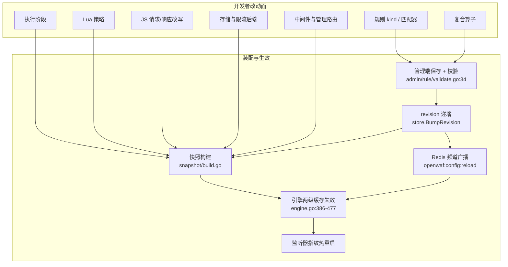
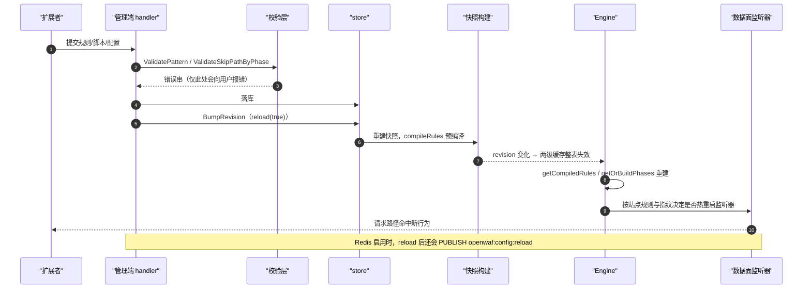
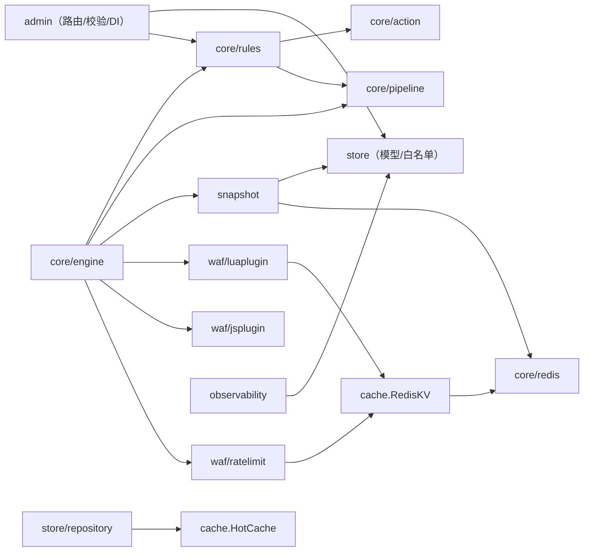

# 扩展与插件系统

> [返回文档索引](../index.md)

<cite>
**本文档引用的文件**
- [internal/app/server.go](file://internal/app/server.go)
- [internal/core/engine/engine.go](file://internal/core/engine/engine.go)
- [internal/core/pipeline/pipeline.go](file://internal/core/pipeline/pipeline.go)
- [internal/core/action/action.go](file://internal/core/action/action.go)
- [internal/core/rules/compiler.go](file://internal/core/rules/compiler.go)
- [internal/core/rules/matcher.go](file://internal/core/rules/matcher.go)
- [internal/core/rules/validate.go](file://internal/core/rules/validate.go)
- [internal/core/rules/phases.go](file://internal/core/rules/phases.go)
- [internal/core/rules/phase_skip.go](file://internal/core/rules/phase_skip.go)
- [internal/core/rules/lua_phase.go](file://internal/core/rules/lua_phase.go)
- [internal/core/redis/redis.go](file://internal/core/redis/redis.go)
- [internal/core/redis/pubsub.go](file://internal/core/redis/pubsub.go)
- [internal/core/lifecycle/lifecycle.go](file://internal/core/lifecycle/lifecycle.go)
- [internal/core/database/gorm.go](file://internal/core/database/gorm.go)
- [internal/cache/redis_kv.go](file://internal/cache/redis_kv.go)
- [internal/cache/hot_cache.go](file://internal/cache/hot_cache.go)
- [internal/store/policy.go](file://internal/store/policy.go)
- [internal/store/protection.go](file://internal/store/protection.go)
- [internal/store/repository/repository.go](file://internal/store/repository/repository.go)
- [internal/snapshot/build.go](file://internal/snapshot/build.go)
- [internal/snapshot/snapshot.go](file://internal/snapshot/snapshot.go)
- [internal/admin/router.go](file://internal/admin/router.go)
- [internal/admin/middleware.go](file://internal/admin/middleware.go)
- [internal/admin/shared/json_bind.go](file://internal/admin/shared/json_bind.go)
- [internal/admin/rule/validate.go](file://internal/admin/rule/validate.go)
- [internal/admin/rule/rule.go](file://internal/admin/rule/rule.go)
- [internal/admin/system/threatintel/threat_intel.go](file://internal/admin/system/threatintel/threat_intel.go)
- [internal/waf/luaplugin/runtime.go](file://internal/waf/luaplugin/runtime.go)
- [internal/waf/luaplugin/api.go](file://internal/waf/luaplugin/api.go)
- [internal/waf/luaplugin/engine.go](file://internal/waf/luaplugin/engine.go)
- [internal/waf/jsplugin/script.go](file://internal/waf/jsplugin/script.go)
- [internal/waf/jsplugin/types.go](file://internal/waf/jsplugin/types.go)
- [internal/waf/ratelimit/ratelimit.go](file://internal/waf/ratelimit/ratelimit.go)
- [internal/waf/ratelimit/dynamic.go](file://internal/waf/ratelimit/dynamic.go)
- [internal/waf/ratelimit/redis.go](file://internal/waf/ratelimit/redis.go)
- [internal/waf/drop/drop.go](file://internal/waf/drop/drop.go)
- [internal/waf/accessgate/gate.go](file://internal/waf/accessgate/gate.go)
- [internal/waf/accessgate/oauth.go](file://internal/waf/accessgate/oauth.go)
- [internal/waf/bot/geoip/geoip.go](file://internal/waf/bot/geoip/geoip.go)
- [internal/observability/metrics.go](file://internal/observability/metrics.go)

- [frontend/package.json](file://frontend/package.json)
- [README.md](file://README.md)
</cite>

## 目录

1. [简介](#简介)
2. [项目结构](#项目结构)
3. [核心组件](#核心组件)
4. [架构总览](#架构总览)
5. [详细组件分析](#详细组件分析)
6. [依赖关系分析](#依赖关系分析)
7. [性能考虑](#性能考虑)
8. [故障排查指南](#故障排查指南)
9. [结论](#结论)
10. [附录](#附录)

## 简介

`扩展与插件系统` 是本仓库的开发者入口域，回答「要改什么行为，应该动哪一层、
按什么顺序动、会不会静默失效」。项目没有动态加载的插件二进制机制，
扩展面分为四类，全部通过**接口 + 装配点 + 快照重载**三步完成：

- **声明式规则面**：规则 DSL 的 kind、匹配器、复合算子、执行阶段与动作；
- **脚本插件面**：Lua 策略插件（`pre`/`post`）与 JS 插件（请求/响应两阶段改写）；
- **存储与后端面**：关系库方言、Redis KV/限流后端、仓库侧缓存与写队列接口；
- **管理面与横切**：Hertz 中间件、`admin.Dependencies` 依赖注入、指标 Provider、
  生命周期 `Server`/`Readiness` 契约。

所有扩展最终都要经过同一条生效路径：代码改动 → 落库/编译 → 快照 revision 递增 →
引擎缓存失效 → 监听器按指纹决定是否热重启。理解这条链比记住某个函数更重要，
因为它解释了「为什么配置保存成功却看不见效果」这一类高频问题。

**章节来源**
- [internal/app/server.go:1001-1043](file://internal/app/server.go#L1001-L1043)
- [internal/core/engine/engine.go:441-477](file://internal/core/engine/engine.go#L441-L477)
- [internal/core/pipeline/pipeline.go:276-280](file://internal/core/pipeline/pipeline.go#L276-L280)

## 项目结构

| 模块 | 扩展职责 | 关键文件 | 对外契约 |
|------|----------|----------|----------|
| `internal/core/rules` | 规则编译、匹配器、阶段与阶段跳过 | `compiler.go`、`matcher.go`、`validate.go`、`phases.go`、`phase_skip.go` | `Matcher`、`Compiled` |
| `internal/core/pipeline` | 阶段接口与请求上下文 | `pipeline.go` | `Phase`、`RequestCtx`、`RequestMutator` |
| `internal/core/engine` | 阶段链装配与两级缓存 | `engine.go` | `Engine.Process` |
| `internal/waf/luaplugin` | Lua 沙箱与脚本 API | `runtime.go`、`api.go`、`engine.go` | `KVBackend`、`ContextKVBackend`、`Decision` |
| `internal/waf/jsplugin` | QuickJS 请求/响应改写 | `script.go`、`types.go`、`quickjs_cgo.go` | `Executor`、`ResponseExecutor` |
| `internal/waf/ratelimit` | 限流后端可替换 | `ratelimit.go`、`redis.go`、`dynamic.go` | `RateLimiterBackend` |
| `internal/store` | 模型与保护配置白名单 | `policy.go`、`protection.go` | `Rule`、`SkipPathPhaseKeys` |
| `internal/store/repository` | 仓储聚合与缓存接口 | `repository.go` | `HotCacheBackend`、`WriteQueueBackend` |
| `internal/core/database` | 关系库方言选择 | `gorm.go` | `Options.Driver` |
| `internal/core/redis` + `internal/cache` | 可选扩展存储 | `redis.go`、`pubsub.go`、`redis_kv.go`、`hot_cache.go` | `OptionalClient`、`RedisKV` |
| `internal/admin` | 路由注册与依赖注入 | `router.go`、`middleware.go`、`shared/json_bind.go` | `Dependencies` |
| `internal/observability` | 指标暴露契约 | `metrics.go` | `UnifiedWriterStatsProvider` 等 |
| `frontend/.../rules/components` | DSL 双向映射 | `rule-pattern-mapper.ts` | `translateRow`、`parsePatternToRows` |



**图表来源**
- [internal/admin/rule/validate.go:34-75](file://internal/admin/rule/validate.go#L34-L75)
- [internal/snapshot/build.go:920-934](file://internal/snapshot/build.go#L920-L934)
- [internal/core/engine/engine.go:386-477](file://internal/core/engine/engine.go#L386-L477)
- [internal/app/server.go:1001-1043](file://internal/app/server.go#L1001-L1043)
- [internal/core/redis/pubsub.go:16-82](file://internal/core/redis/pubsub.go#L16-L82)

**章节来源**
- [internal/app/server.go:1001-1043](file://internal/app/server.go#L1001-L1043)
- [internal/core/engine/engine.go:386-477](file://internal/core/engine/engine.go#L386-L477)

## 核心组件

扩展点总表（全景）——按「改动成本从低到高」排序，前四行不需要写 Go 代码：

| # | 扩展点 | 契约位置 | 注册/装配位置 | 需要写 Go 代码 | 生效条件 |
|:--:|--------|----------|----------------|:--------------:|----------|
| 1 | 规则表达式（既有 kind 组合） | `rules.Compile`（`compiler.go:40`） | `POST /api/v1/rules`（`router.go:280`） | 否 | 快照 revision 变化 |
| 2 | 复合条件树（and/or/not/if/cc_rate） | `buildCompound`（`matcher.go:1878`） | 规则 `pattern` 为 JSON | 否 | 同上 |
| 3 | 按路径跳过阶段 | `rules.NewSkipByPathPhase`（`phase_skip.go:29`） | `skip_path_by_phase`（`json_bind.go:44`） | 否 | 阶段名须在白名单内 |
| 4 | Lua 策略脚本 | `ctx` 表 + `Decision`（`api.go:45`、`runtime.go:84-108`） | 快照编译期（`luaplugin/engine.go:95-97`） | 否（写 Lua） | 脚本代次变化 |
| 5 | JS 插件脚本 | `Executor`/`ResponseExecutor`（`script.go:203-210`） | 引擎重建（`ensureJSEngine`） | 否（写 JS） | 脚本代次变化 |
| 6 | 新匹配器 kind | `Matcher.Match(MatchCtx)`（`matcher.go:21-23`） | `knownPrefixes` + `buildMatcher` | 是 | 两处白名单同步 |
| 7 | 新执行阶段 | `pipeline.Phase`（`pipeline.go:277-280`） | `getOrBuildPhases`（`engine.go:441-477`） | 是 | revision + 四判据 |
| 8 | 新动作类型 | `action.Type` + `Normalize`（`action.go:9-44`） | 阶段 `Execute` 返回 | 是 | 数据面消费点同步 |
| 9 | 新限流后端 | `RateLimiterBackend`（`ratelimit.go:10-17`） | `DynamicRateLimiter.Swap`（`dynamic.go:23`） | 是 | 进程级单例替换 |
| 10 | 新 KV/扩展存储 | `KVBackend`/`ContextKVBackend`（`runtime.go:148-169`） | `NewRedisKV` 注入点（`server.go:304`） | 是 | 启动或 redis-config |
| 11 | 新关系库方言 | `Options.Driver`（`gorm.go:45-53`） | `core.NewRuntime` | 是 | 重启 |
| 12 | 会话/状态存储后端 | `SessionStore`/`OAuthStateStore`（`gate.go:64`、`oauth.go:59`） | `dataplane.SetAccessStoreRedisClients`（`access_control.go:30`） | 是 | 热切换 |
| 13 | 地理/外部订阅源 | `GeoResolver`（`geoip.go:182`）、`ThreatIntelSyncer`（`threat_intel.go:21`） | `server.go` 启动装配 | 是 | 重启或同步周期 |
| 14 | 指标 Provider | `UnifiedWriterStatsProvider` 等（`metrics.go:16,26`） | `observability.NewMetrics` | 是 | 重启 |
| 15 | 管理端路由与中间件 | `Dependencies`（`router.go:60`）、`RequireRole`（`middleware.go:127`） | `RegisterRoutes` | 是 | 重启 |
| 16 | 可停止服务实例 | `lifecycle.Server`/`Readiness`（`lifecycle.go:26-34`） | `lm.AddHertz` / `lm.AddWithTag` | 是 | 启动序列 |

脚本插件面的三个契约类型可以用一张类图对齐，注意**两者都不是「万能接口」**：
Lua 侧返回 `Decision`（含可选改写意图），JS 侧返回 `MutationPlan`/`ResponseMutationPlan`
（含可选裁决），动作词汇共用 `internal/core/action`，不另立第二套。

```mermaid
classDiagram
    class Matcher {
        <<interface>>
        +Match(ctx MatchCtx) bool
    }
    class Phase {
        <<interface>>
        +Name() string
        +Execute(ctx *RequestCtx) (action.Result, bool)
    }
    class KVBackend {
        <<interface>>
        +Available() bool
        +Get(key string) ([]byte, bool)
        +Set(key string, value []byte, ttl time.Duration) error
        +Delete(key string)
        +Incr(key string, ttl time.Duration) (int64, error)
    }
    class ContextKVBackend {
        <<interface>>
        +AvailableContext(ctx) bool
        +GetContext(ctx, key)
        +SetContext(ctx, key, value, ttl) error
        +IncrContext(ctx, key, ttl) (int64, error)
    }
    class RateLimiterBackend {
        <<interface>>
        +Enabled() bool
        +Reconfigure(windowSec, maxReqs int, enabled bool)
        +Allow(key string) bool
        +Increment(key string) int64
        +IsOverLimit(key string) bool
        +Close()
    }
    class Executor {
        <<interface>>
        +Execute(ctx, script, RequestSnapshot) MutationPlan
    }
    class ResponseExecutor {
        <<interface>>
        +ExecuteResponse(ctx, script, ResponseSnapshot) ResponseMutationPlan
    }
    class HotCacheBackend {
        <<interface>>
        +Get(key, dest) bool
        +Set(key, value, ttl)
        +Invalidate(key)
        +Available() bool
    }
    class Server {
        <<interface>>
        +Spin()
        +Shutdown(ctx) error
    }
    KVBackend <|-- ContextKVBackend
    RedisKV ..|> ContextKVBackend
    RedisRateLimiter ..|> RateLimiterBackend
    RateLimiter ..|> RateLimiterBackend
    JsEngine ..|> Executor
    JsEngine ..|> ResponseExecutor
    HotCache ..|> HotCacheBackend
```



**图表来源**
- [internal/core/rules/matcher.go:21-23](file://internal/core/rules/matcher.go#L21-L23)
- [internal/core/pipeline/pipeline.go:276-280](file://internal/core/pipeline/pipeline.go#L276-L280)
- [internal/waf/luaplugin/runtime.go:148-169](file://internal/waf/luaplugin/runtime.go#L148-L169)
- [internal/waf/ratelimit/ratelimit.go:10-17](file://internal/waf/ratelimit/ratelimit.go#L10-L17)
- [internal/waf/ratelimit/redis.go:13-20](file://internal/waf/ratelimit/redis.go#L13-L20)
- [internal/waf/jsplugin/script.go:202-213](file://internal/waf/jsplugin/script.go#L202-L213)
- [internal/store/repository/repository.go:16-26](file://internal/store/repository/repository.go#L16-L26)
- [internal/core/lifecycle/lifecycle.go:25-34](file://internal/core/lifecycle/lifecycle.go#L25-L34)

**章节来源**
- [internal/core/rules/matcher.go:21-23](file://internal/core/rules/matcher.go#L21-L23)
- [internal/waf/luaplugin/runtime.go:148-169](file://internal/waf/luaplugin/runtime.go#L148-L169)
- [internal/waf/jsplugin/script.go:202-213](file://internal/waf/jsplugin/script.go#L202-L213)
- [internal/store/repository/repository.go:16-26](file://internal/store/repository/repository.go#L16-L26)

## 架构总览

一次扩展从「写完代码」到「线上生效」的完整链路如下。图中每一步都有对应的失败模式，
排障时应按同一顺序回溯。



**图表来源**
- [internal/admin/rule/validate.go:34-75](file://internal/admin/rule/validate.go#L34-L75)
- [internal/admin/shared/json_bind.go:44-63](file://internal/admin/shared/json_bind.go#L44-L63)
- [internal/snapshot/build.go:920-934](file://internal/snapshot/build.go#L920-L934)
- [internal/core/engine/engine.go:386-477](file://internal/core/engine/engine.go#L386-L477)
- [internal/app/server.go:1001-1043](file://internal/app/server.go#L1001-L1043)

## 详细组件分析

### 规则引擎侧扩展面

规则面是唯一「双白名单」的区域：快照构建期与引擎期各有一份 kind 清单，
前者 30 项、后者 57 项，且快照清单是引擎清单的真子集。
扩展编译器本身的改动点、顺序与陷阱见 [规则编译器扩展](规则引擎扩展/规则编译器扩展.md)；
匹配器族与 DSL 速查见 [匹配器开发](规则引擎扩展/匹配器开发.md)；
阶段注册与短路语义见 [执行阶段系统](规则引擎扩展/执行阶段系统.md)；
动作与执行器见 [动作集成](规则引擎扩展/动作集成.md)。

本篇只保留一条选型判据：**能用既有 kind 组合表达的行为，一律不要新增 kind**。
`and`/`or`/`not`/`if`/`cc_rate` 五个算子已经覆盖「多条件 + 分支 + 频次」三类结构，
新增 kind 的成本是 6 个改动点与 2 处静默失败面，远高于写一条复合规则。

**章节来源**
- [internal/core/rules/compiler.go:117-142](file://internal/core/rules/compiler.go#L117-L142)
- [internal/snapshot/build.go:1197-1222](file://internal/snapshot/build.go#L1197-L1222)
- [internal/core/rules/validate.go:54-104](file://internal/core/rules/validate.go#L54-L104)

### 脚本插件侧扩展面

两类脚本插件的 API 面**不等价**，这是选型时最容易误判的地方：

| 维度 | Lua 策略插件 | JS 插件 |
|------|--------------|---------|
| 执行时机 | `pre`（ACL 后、OWASP 前）/ `post`（内置阶段后）（`runtime.go:30-33`） | 请求阶段 / 响应阶段两个执行器（`script.go:203-210`） |
| 输入 | `ctx` 表：请求字段、`headers`、`query_params`、`tls`、`verdict`（`api.go:45-82`） | `RequestSnapshot` / `ResponseSnapshot`（`types.go:86,197`） |
| 输出 | `Decision`：动作、状态码、消息、标签、可选改写（`runtime.go:84-108`） | `MutationPlan` / `ResponseMutationPlan`，可携带裁决（`types.go:152-186`） |
| 跨请求状态 | 有：`ctx.kv`（`get/set/delete/incr/available`，键前缀 `owaf:lua:`） | 无（未见 KV/Redis 依赖） |
| 调用预算 | 每次运行 128 次宿主 API（`runtime.go:53`、`api.go:38-42`） | 由脚本超时与 VMP 层约束 |
| 阶段错配 | 仅 `pre` 的 `RequestMutation` 生效、仅 `post` 的 `ResponseMutation` 生效 | `validateExecutionStage` 直接报错（`script.go:195-199`） |

Lua 的 `ctx.kv` 在 Redis 不可用时 `available()` 返回假，
脚本应据此降级而不是让站点不可用（`api.go:232-237`）；
这一语义与限流的 fail-open 一致，但与防重放的 fail-closed 相反，
写脚本时不能把「Redis 挂了」当成「计数为 0」。
详见 [Lua 策略插件](Lua%20策略插件.md) 与可直接运行的 [示例目录](lua-examples)。

**章节来源**
- [internal/waf/luaplugin/runtime.go:28-53](file://internal/waf/luaplugin/runtime.go#L28-L53)
- [internal/waf/luaplugin/api.go:45-82](file://internal/waf/luaplugin/api.go#L45-L82)
- [internal/waf/luaplugin/api.go:229-237](file://internal/waf/luaplugin/api.go#L229-L237)
- [internal/waf/jsplugin/script.go:195-213](file://internal/waf/jsplugin/script.go#L195-L213)
- [internal/waf/jsplugin/types.go:152-186](file://internal/waf/jsplugin/types.go#L152-L186)

### 存储与后端侧扩展面

存储面只有两个真实抽象点：`repository.HotCacheBackend`
（`repository.go:16-26`，为避开 `store → cache` 反向依赖而定义）与
`luaplugin.KVBackend`/`ContextKVBackend`（`runtime.go:148-169`）。
`RedisKV` 是 `ContextKVBackend` 的唯一实现；不实现该接口的后端会被脚本侧
按「不可用」处理，因为无法响应取消的同步 I/O 会阻塞数据面请求。

关系库侧不提供插件机制：`gorm.go:45-53` 是白名单 `switch`，
新增方言必须改这个函数并同步 `MY_OPENWAF_DB_DRIVER` 的说明与迁移路径，
流程见 [数据库适配器](存储后端扩展/数据库适配器.md) 与
[存储迁移机制](存储后端扩展/存储迁移机制.md)。
Redis 侧的能力边界（22 个键空间 + 1 个频道、原子性只由 Lua 提供、
限流 fail-open 而防重放 fail-closed）见
[NoSQL 存储适配（Redis 能力边界）](存储后端扩展/NoSQL%20存储适配.md)。

```go
// internal/waf/ratelimit/ratelimit.go:10-17 —— 新限流后端只需满足这 6 个方法
type RateLimiterBackend interface {
	Enabled() bool
	Reconfigure(windowSec, maxReqs int, enabled bool)
	Allow(key string) bool
	Increment(key string) int64
	IsOverLimit(key string) bool
	Close()
}
```

装配点唯一：`buildRateLimiterBackend`（`server.go:123-128`）在 Redis client 为 nil 时
回落本地实现，再由 `DynamicRateLimiter.Swap`（`dynamic.go:23-31`）在不重建引擎的前提下热替换。
限流窗口/配额后端是**进程级单例**，`Reconfigure` 只读全局防护配置值，
站点级覆盖仅影响入链与动作。

**章节来源**
- [internal/store/repository/repository.go:16-26](file://internal/store/repository/repository.go#L16-L26)
- [internal/waf/luaplugin/runtime.go:148-169](file://internal/waf/luaplugin/runtime.go#L148-L169)
- [internal/core/database/gorm.go:45-53](file://internal/core/database/gorm.go#L45-L53)
- [internal/waf/ratelimit/ratelimit.go:10-17](file://internal/waf/ratelimit/ratelimit.go#L10-L17)
- [internal/waf/ratelimit/dynamic.go:23-31](file://internal/waf/ratelimit/dynamic.go#L23-L31)
- [internal/app/server.go:123-128](file://internal/app/server.go#L123-L128)

### 管理面与横切扩展点

管理端没有「插件注册表」，扩展方式是往 `admin.Dependencies`
（`router.go:60` 起）加字段、在 `RegisterRoutes` 里加路由。
新增字段时必须同步 `Reload` / `ReloadRedis` 两条重载链的语义差别：
`Reload` 会 `BumpRevision` 并向其他节点广播，`ReloadRedis` 只换后端不推 revision（:1066-1070）。

鉴权面的扩展点是 `RequireRole`（`middleware.go:127`）与 API Key 归属账号取角色
这一事实（`middleware.go:103-120`）：**新增 API Key 类型不会自动获得 admin 权限**，
自定义路由若忘记挂 `RequireRole` 会直接落到「任意已认证用户可访问」。
中间件链与执行顺序见 [中间件开发](中间件开发.md)，
前端如何接入新端点见 [前端管理界面/API 集成](../前端管理界面/API%20集成.md)。

观测面的扩展方式是实现 Provider 接口而不是改指标文件：
`UnifiedWriterStatsProvider`、`WriteQueueStatsProvider`（`metrics.go:16,26`）
各自刻意分离，因为两个队列的生命周期与丢失语义不同；
新增自定义队列时应新建 Provider，不要复用既有两个接口之一。

**章节来源**
- [internal/admin/router.go:60-80](file://internal/admin/router.go#L60-L80)
- [internal/app/server.go:1063-1081](file://internal/app/server.go#L1063-L1081)
- [internal/admin/middleware.go:95-127](file://internal/admin/middleware.go#L95-L127)
- [internal/observability/metrics.go:14-30](file://internal/observability/metrics.go#L14-L30)

### 扩展约束与常见陷阱

| 陷阱 | 事实 | 证据 | 规避 |
|------|------|------|------|
| 三处白名单互相不认识 | 两处 kind 白名单（57 / 30）+ 一处 phase 白名单（9），无编译期或测试期约束 | `compiler.go:119-142`、`build.go:1205-1215`、`protection.go:326-334` | 改动时三处同时核对，见 [规则编译器扩展](规则引擎扩展/规则编译器扩展.md) |
| DSL 静默丢弃 | `kind == ""` 时 `continue`，规则既不在快照也不在引擎产物里，且不报错 | `compiler.go:46-49`、`build.go:923-925` | 保存后必用 `POST /api/v1/rules/test` 复现 |
| 恒假降级 | 校验失败或构建失败 → `neverMatcher`，规则「看起来是启用的」 | `compiler.go:50-53`、`matcher.go:1772-1774` | 单测断言不被编译成 `neverMatcher` |
| 派生字段未登记 | 新 kind 读 TLS/头顺序却未进 `ruleNeedsDerivedHeaders`，字段恒为零值 | `phases.go:236-248` | 与 5 个既登记 kind 逐字对照 |
| 插件 API 面不等价 | Lua 有 `ctx.kv` 与 128 次调用预算，JS 无跨请求状态但有响应阶段改写 | `runtime.go:53,148-169`、`script.go:203-210` | 选型前先看本表，不要假设同构 |
| 改写意图被忽略 | Lua 的 `RequestMutation` 只在 `pre` 生效、`ResponseMutation` 只在 `post` 生效 | `runtime.go:100-108` | 阶段与字段必须配对 |
| Redis 前缀体系三套 | `openwaf:`（RedisKV 自动）、`openwaf:hot:`、`owaf:`/`waf:nonce:`（原生 client 自拼） | `redis_kv.go:16`、`hot_cache.go:39`、`antireplay.go:142-143` | 排障先确认最终键形态 |
| 缓存不随代码改动失效 | 两级缓存只在 revision 变化时重建，无 LRU/容量上限 | `engine.go:386-430`、`engine.go:441-461` | 灰度必须推一次配置变更 |
| 动作别名归一化双点 | 非法动作在编译期被升级为 `intercept`，新增别名要同步两处 | `phases.go:1301-1310`、`action.go:28-44` | 见 [动作集成](规则引擎扩展/动作集成.md) |

**章节来源**
- [internal/core/rules/compiler.go:40-142](file://internal/core/rules/compiler.go#L40-L142)
- [internal/snapshot/build.go:920-934](file://internal/snapshot/build.go#L920-L934)
- [internal/core/rules/matcher.go:1772-1774](file://internal/core/rules/matcher.go#L1772-L1774)
- [internal/core/rules/phases.go:236-248](file://internal/core/rules/phases.go#L236-L248)
- [internal/store/protection.go:320-334](file://internal/store/protection.go#L320-L334)
- [internal/waf/luaplugin/runtime.go:100-134](file://internal/waf/luaplugin/runtime.go#L100-L134)
- [internal/core/rules/lua_phase.go:14-20](file://internal/core/rules/lua_phase.go#L14-L20)
- [internal/core/engine/engine.go:386-461](file://internal/core/engine/engine.go#L386-L461)

### 子目录索引与阅读路径

各子目录文档索引如下，本篇不重复其表格；按需直达，不必顺序通读。

| 子目录 | 文档 | 该文档负责的问题 |
|--------|------|------------------|
| 规则引擎扩展 | [规则引擎扩展](规则引擎扩展/规则引擎扩展.md) | 扩展路线选型与端到端流程 |
| 规则引擎扩展 | [规则编译器扩展](规则引擎扩展/规则编译器扩展.md) | 新增校验规则 / 归一化步骤 / 编译目标 |
| 规则引擎扩展 | [匹配器开发](规则引擎扩展/匹配器开发.md) | `Matcher` 实现与 kind 登记 |
| 规则引擎扩展 | [执行阶段系统](规则引擎扩展/执行阶段系统.md) | `Phase` 注册、短路、跳过装饰器 |
| 规则引擎扩展 | [动作集成](规则引擎扩展/动作集成.md) | 动作类型、Drop 执行器、自定义动作 |
| 存储后端扩展 | [存储后端扩展](存储后端扩展/存储后端扩展.md) | 方言与仓库扩展总览 |
| 存储后端扩展 | [数据库适配器](存储后端扩展/数据库适配器.md) | GORM 多方言与 DSN |
| 存储后端扩展 | [连接池管理](存储后端扩展/连接池管理.md) | 连接池参数与优雅关闭 |
| 存储后端扩展 | [存储迁移机制](存储后端扩展/存储迁移机制.md) | 迁移、种子与修订号 |
| 存储后端扩展 | [NoSQL 存储适配](存储后端扩展/NoSQL%20存储适配.md) | Redis 能力边界与接入方式 |
| 第三方集成 | [第三方集成](第三方集成/第三方集成.md) | 集成面总览 |
| 第三方集成 | [服务集成](第三方集成/服务集成.md) | 路由注册与外部风控对接 |
| 第三方集成 | [监控系统集成](第三方集成/监控系统集成.md) | 指标导出与前端可视化 |
| 第三方集成 | [消息队列集成](第三方集成/消息队列集成.md) | Pub/Sub 与异步事件写入 |
| 根级 | [Lua 策略插件](Lua%20策略插件.md) | 沙箱边界与 `ctx` API 面 |
| 根级 | [中间件开发](中间件开发.md) | Hertz 中间件链与鉴权 |

[本节为总结，无需特定文件来源]

## 依赖关系分析



**图表来源**
- [internal/core/engine/engine.go:625-646](file://internal/core/engine/engine.go#L625-L646)
- [internal/store/repository/repository.go:16-26](file://internal/store/repository/repository.go#L16-L26)
- [internal/waf/luaplugin/runtime.go:148-169](file://internal/waf/luaplugin/runtime.go#L148-L169)

依赖方向上有一条硬约束：`core/rules` 不引用 `snapshot` 与 `engine`，
引擎通过 `convertAndCompile`（`engine.go:625-646`）把快照结构体反向映射成
`store.Rule` 再编译，从而保持规则子系统自洽。
`store/repository` 也不引用 `cache`，而是用 `HotCacheBackend` 接口倒置依赖
（`repository.go:16-26`）。扩展时若在这两处出现反向 import，说明抽象点选错。

| 依赖 | 方向 | 形式 | 违规后果 |
|------|------|------|----------|
| `admin → rules/store` | 正向 | 直接调用 `ValidatePattern` | 校验绕过导致静默丢弃 |
| `snapshot → store` | 正向 | 读模型 + 自解析 DSL | 与 `rules` 白名单漂移 |
| `engine → rules` | 正向 | `Compile` + `Compiled.Match` | 缓存键与判据不一致 |
| `rules → action/pipeline/tlsmeta` | 正向 | 值类型与上下文 | 动作归一化缺点 |
| `repository → cache` | 倒置（接口） | `HotCacheBackend` | import cycle |
| `luaplugin → cache` | 倒置（接口） | `ContextKVBackend` | 无法响应取消 |
| `dataplane → engine` | 单向调用 | `Process` | 数据面反向依赖控制面 |


**章节来源**
- [internal/core/engine/engine.go:625-646](file://internal/core/engine/engine.go#L625-L646)
- [internal/store/repository/repository.go:16-26](file://internal/store/repository/repository.go#L16-L26)

## 性能考虑

- 扩展点的成本梯度：DSL 组合 ≈ 0（编译期一次），匹配器新增 = 编译期常数项，
  阶段新增 = 每请求多一次 `Execute` 调用，脚本插件 = 每次运行受沙箱与 128 次 API 预算约束。
- `knownPrefixes`（57 项）在 `init` 期构表，`ParsePattern` 是哈希查表而非线性前缀匹配
  （`compiler.go:119-142`、:157-168）；相比之下快照期的 30 项清单是**顺序前缀比较**，
  新增项插入位置会影响匹配耗时，但不影响正确性。
- 两级缓存的写代价是写时复制整表（`engine.go:413-428`、`532-546`），
  站点数多时首次冷启动会集中触发重建；扩展阶段时应保持判据「只增不减」，
  否则每次请求都可能触发重建。
- 正则缓存无淘汰（`matcher.go:1785-1808`），`cc_rate` 状态表亦然（`matcher.go:45`）。
  任何把可变值拼进 arg 的 kind 都会放大这两张表，属于必须避免的设计。
- 数据面预算的分配基线：`/metrics` 在管理端口暴露
  `openwaf_dataplane_*` 与 `owaf_cache_*` 两套体系，
  扩展前后应对比同一组指标而不是只看单测耗时。

**章节来源**
- [internal/core/rules/compiler.go:117-170](file://internal/core/rules/compiler.go#L117-L170)
- [internal/core/engine/engine.go:413-477](file://internal/core/engine/engine.go#L413-L477)
- [internal/core/rules/matcher.go:1785-1808](file://internal/core/rules/matcher.go#L1785-L1808)

## 故障排查指南

| 症状 | 首查 | 判定 | 处置 |
|------|------|------|------|
| 改代码后行为不变 | 是否推了 revision | `sn.Revision` 与缓存快照一致即未重建 | 触发一次 `reload(true)` 或重启 |
| 规则保存成功不生效 | 两处 kind 白名单 | `ValidateRule` 通过但快照无该条 | 补 `build.go` 或 `compiler.go` |
| 规则恒不命中 | 是否降级为 `neverMatcher` | `POST /api/v1/rules/test` 用合成请求复现 | 校验 arg 语法与构建分支 |
| Lua 脚本报 `kv` 不可用 | Redis 是否启用/熔断 | `RedisKV.Available()` | 接受降级或修复连接 |
| Lua 改写不生效 | 阶段与字段是否配对 | `pre` 才认 `RequestMutation` | 调整脚本阶段 |
| JS 响应脚本被拒 | `validateExecutionStage` | 返回 `stage ... executor` 错误 | 按阶段正确挂载脚本 |
| 新端点权限异常 | 是否挂 `RequireRole` | API Key 角色取归属账号 | 补角色中间件 |
| 多节点不同步 | 频道订阅是否仍在 | `pubsub.go:97` 的 `Receive` 已返回 | 触发本地重载或重启 |

```bash
# 环境变量口径（README.md:322-333）；密码脱敏
export MY_OPENWAF_REDIS_ADDR="127.0.0.1:6379"
export MY_OPENWAF_REDIS_PASSWORD="{占位}"
export MY_OPENWAF_DB_DRIVER=sqlite

# 契约与回归（README.md:432-451）
bun run check:rule-pattern-roundtrip
CGO_ENABLED=1 go test -tags=quickjs -timeout=30m ./internal/core/... ./internal/waf/...
```

**章节来源**
- [internal/core/engine/engine.go:386-477](file://internal/core/engine/engine.go#L386-L477)
- [internal/waf/jsplugin/script.go:195-199](file://internal/waf/jsplugin/script.go#L195-L199)
- [internal/waf/luaplugin/runtime.go:100-108](file://internal/waf/luaplugin/runtime.go#L100-L108)
- [internal/core/redis/pubsub.go:91-121](file://internal/core/redis/pubsub.go#L91-L121)
- [README.md:322-333](file://README.md#L322-L333)

## 结论

本域的扩展模型可以压缩成一句话：**声明式优先、接口装配、快照生效**。
声明式（规则 DSL、复合条件、跳过路径、脚本）不需要改 Go 代码，也不引入新的失效面；
一旦触碰 kind、阶段、动作、后端四类抽象，就同时接过了「双白名单一致性」、
「编译期静默降级」与「缓存判据」三项维护责任。
实测下来最危险的并不是复杂度，而是**失败不报错**：
DSL 静默丢弃、`neverMatcher`、派生字段零值三种失效形态在数据面完全不可区分。
因此本篇把「如何验证」与「改哪里」放在同等位置，并在附录给出统一自检清单。

**章节来源**
- [internal/core/rules/phases.go:226-248](file://internal/core/rules/phases.go#L226-L248)
- [internal/core/rules/compiler.go:40-78](file://internal/core/rules/compiler.go#L40-L78)

## 附录

### 扩展自检清单

| 检查项 | 通过判据 | 关联文档 |
|--------|----------|----------|
| kind 是否同时进两处白名单 | 快照产物与引擎产物中都能看到 | [规则编译器扩展](规则引擎扩展/规则编译器扩展.md) |
| 是否补了 `validateSimplePattern` 分支 | 空 arg / 非法 arg 均有中文错误 | 同上 |
| 是否登记派生字段需求 | `ruleNeedsDerivedHeaders` 返回真 | 同上 |
| 是否有「不落 neverMatcher」断言 | 表驱动单测存在且失败可复现 | [匹配器开发](规则引擎扩展/匹配器开发.md) |
| 阶段是否可被按路径跳过 | 新 phase 名是否加入 `skipPathPhaseKeys`（有意不加需在文档说明） | [执行阶段系统](规则引擎扩展/执行阶段系统.md) |
| 动作是否同步 `Normalize` 与编译期归一化 | 别名不被升级为 intercept | [动作集成](规则引擎扩展/动作集成.md) |
| 脚本是否声明阶段与改写配对 | `pre`/`post` 与 mutation 字段一致 | [Lua 策略插件](Lua%20策略插件.md) |
| 后端是否实现接口而非具体类型 | 无 import cycle，可被 `Swap`/`SetClient` 热替换 | [NoSQL 存储适配](存储后端扩展/NoSQL%20存储适配.md) |
| 新端点是否挂鉴权与角色 | `RequireRole` 生效，写操作仅 POST | [中间件开发](中间件开发.md) |

[本节为总结，无需特定文件来源]

### 验证命令速查

| 目的 | 命令 | 来源 |
|------|------|------|
| 规则 DSL 往返契约 | `bun run check:rule-pattern-roundtrip` | `README.md:447` |
| 跳过路径 phase 契约 | `bun run check:skip-path-contract` | `README.md:444` |
| 管理端路由契约 | `bun run check:api-route-contract` | `README.md:451` |
| Go 静态检查 | `CGO_ENABLED=1 go vet -tags=quickjs ./...` | `README.md:432` |
| Go 全量回归 | `go test -p 1 -count=1 -timeout=30m ./...` | `README.md:435` |

**章节来源**
- [README.md:424-451](file://README.md#L424-L451)
- [frontend/package.json:13-23](file://frontend/package.json#L13-L23)
