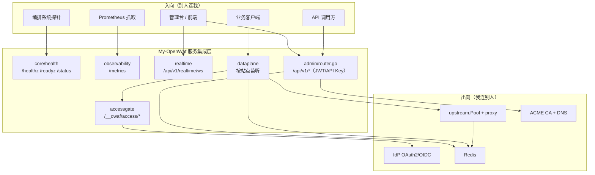
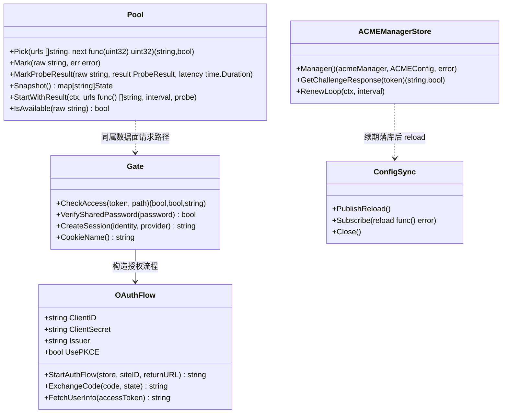
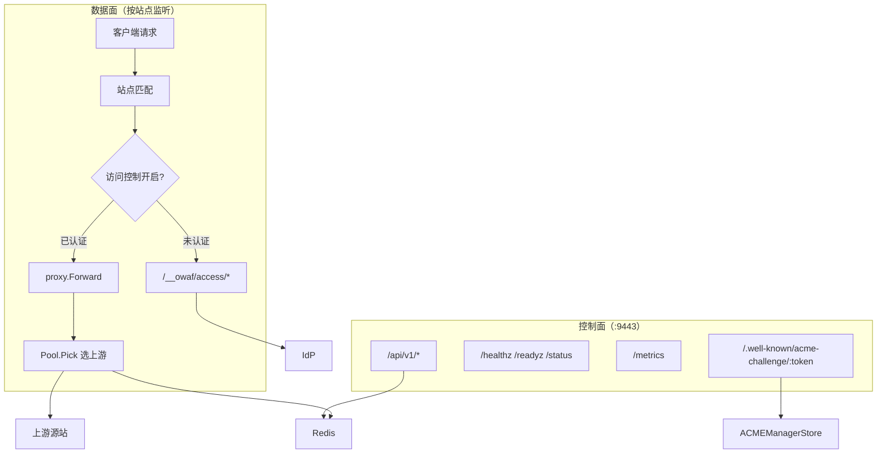
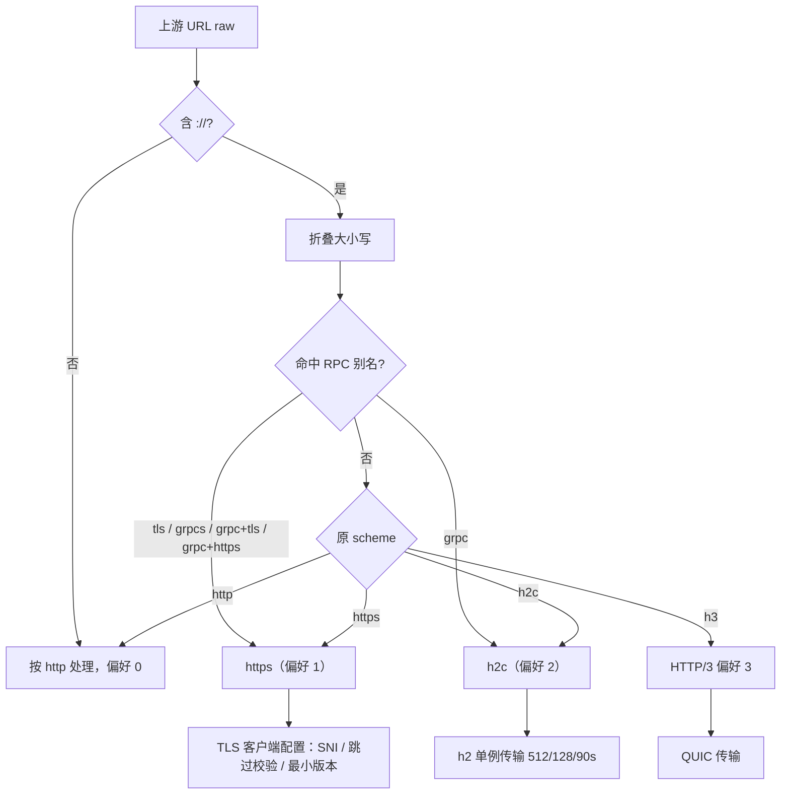
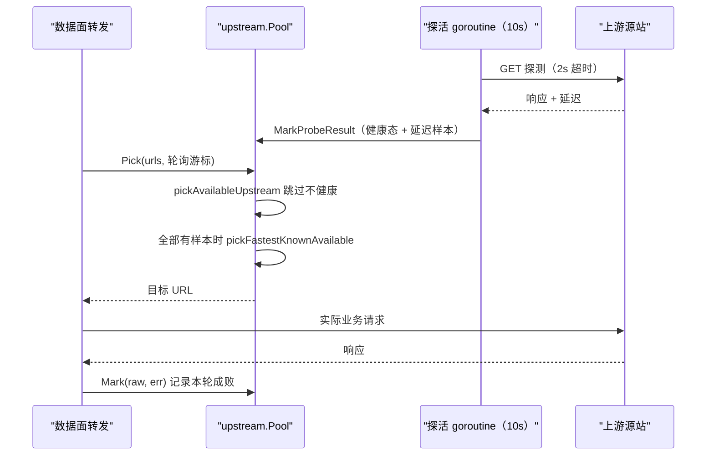
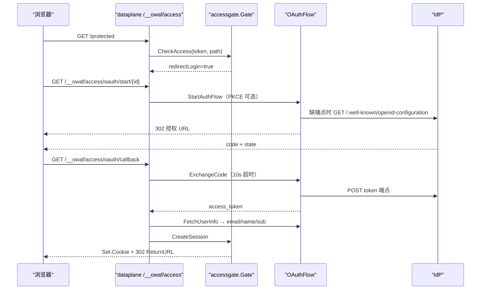
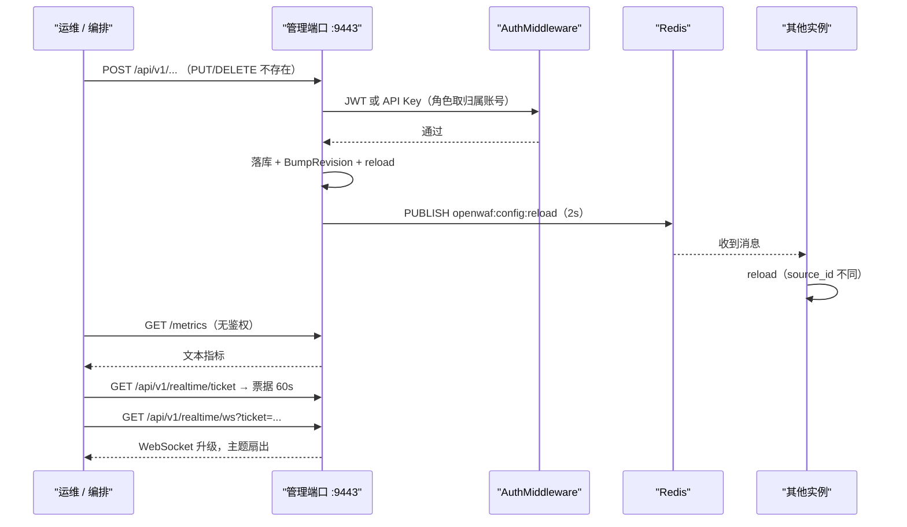
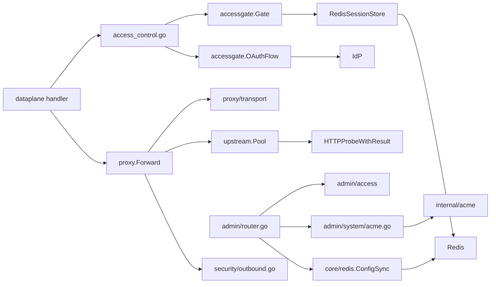
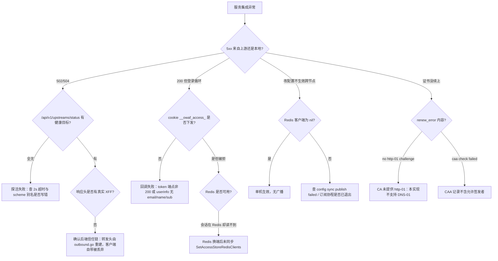

# 服务集成

> [返回 扩展与插件系统](../扩展与插件系统.md)

<cite>
**本文档引用的文件**
- [server.go](file://internal/app/server.go)
- [router.go](file://internal/admin/router.go)
- [health.go](file://internal/upstream/health.go)
- [scheme_alias.go](file://internal/upstream/scheme_alias.go)
- [transport.go](file://internal/upstream/transport.go)
- [transport.go](file://internal/proxy/transport/transport.go)
- [proxy.go](file://internal/proxy/proxy.go)
- [outbound.go](file://internal/security/outbound.go)
- [gate.go](file://internal/waf/accessgate/gate.go)
- [oauth.go](file://internal/waf/accessgate/oauth.go)
- [access_control.go](file://internal/dataplane/access_control.go)
- [providers.go](file://internal/admin/access/providers.go)
- [crypto.go](file://internal/admin/access/crypto.go)
- [acme.go](file://internal/acme/acme.go)
- [acme.go](file://internal/admin/system/acme.go)
- [pubsub.go](file://internal/core/redis/pubsub.go)
- [redis.go](file://internal/core/redis/redis.go)
- [health.go](file://internal/core/health/health.go)
- [realtime.go](file://internal/admin/system/realtime/realtime.go)
- [config.go](file://internal/core/config.go)
</cite>

## 目录

1. [简介](#简介)
2. [项目结构](#项目结构)
3. [核心组件](#核心组件)
4. [架构总览](#架构总览)
5. [详细组件分析](#详细组件分析)
6. [依赖关系分析](#依赖关系分析)
7. [性能考虑](#性能考虑)
8. [故障排查指南](#故障排查指南)
9. [结论](#结论)
10. [附录](#附录)

## 简介

本篇聚焦「服务集成」的双向语义：**出向**是 My-OpenWaf 作为客户端去连别人（上游源站、IdP、ACME CA、Redis），**入向**是别人作为客户端来连它（Prometheus、探针、管理台浏览器、编排系统、API 调用方）。

能力边界表必须先钉死，避免把本项目写成服务网格：

| 集成意图 | 本项目实况 | 判定依据 |
|---|---|---|
| 上游协议适配 | HTTP/1.1、HTTP/2、h2c、HTTP/3、WebSocket、SSE 透传；gRPC 仅 scheme 别名 + 字节透传 | `internal/upstream/scheme_alias.go:22-28`、`internal/proxy/proxy.go:1548` |
| 负载均衡 | 轮询 + 健康过滤 + 延迟择优，无权重/无一致性哈希 | `internal/upstream/health.go:219-231`、`:421-458` |
| 服务发现 | **未实现**，上游集合来自快照静态配置 | `internal/app/server.go:368-372` |
| 熔断与重试 | **未实现**，只有失败标记与探活恢复 | `internal/upstream/health.go:470-489` |
| 外部认证服务 | OAuth2 / OIDC **已实现**（授权码 + PKCE + 发现）；LDAP / SAML **未实现** | `internal/waf/accessgate/oauth.go:136-336`、`internal/admin/access/providers.go:20` |
| 证书服务 | ACME HTTP-01 **已实现**；DNS-01 / TLS-ALPN-01 **未实现** | `internal/acme/acme.go:146-155` |
| 跨实例协同 | Redis Pub/Sub 广播重载 **已实现**；无重连 | `internal/core/redis/pubsub.go:64-127` |
| 被编排 | `/healthz` `/readyz` `/status` `/metrics` **已实现**，全部在管理端口且**无鉴权** | `internal/app/server.go:1053-1056` |

**章节来源**
- [internal/upstream/scheme_alias.go:22-28](file://internal/upstream/scheme_alias.go#L22-L28)
- [internal/upstream/health.go:219-231](file://internal/upstream/health.go#L219-L231)
- [internal/app/server.go:368-372](file://internal/app/server.go#L368-L372)
- [internal/app/server.go:1053-1056](file://internal/app/server.go#L1053-L1056)

## 项目结构

服务集成的代码按「谁持有连接」归口，不按协议堆叠。下表为**模块清单表**，规模列为实测非测试行数。

| 模块 | 路径 | 职责 | 核心符号 | 规模(行) | 测试 |
|---|---|---|---|:--------:|:----:|
| 上游池 | `internal/upstream/health.go` | 健康态、轮询游标、延迟择优、探活 | `Pool.Pick`、`HTTPProbeWithResult` | 981 | 有 |
| scheme 别名 | `internal/upstream/scheme_alias.go`、`internal/pkg/schemealias` | RPC 前缀归一到传输 scheme | `NormalizeUpstreamURLPrefix` | 56 + 56 | 有 |
| 上游 TLS | `internal/upstream/transport.go` | 出站 TLS 与 mTLS 客户端证书 | `HTTPSClientTLSConfig` | 194 | 有 |
| 传输池 | `internal/proxy/transport/` | 主传输、h2c 单例、QUIC 传输 | `ResolveUpstreamBase` | 1280 | 有 |
| 转发层 | `internal/proxy/proxy.go` | HTTP/WS/SSE 转发与响应处理 | `ShouldCacheHTTPResponse` | 6009 | 有 |
| 出站头 | `internal/security/outbound.go` | 转发身份头重建 | `RebuildOutboundForwardingHeaders` | 439 | 有 |
| 访问控制 | `internal/waf/accessgate/` | 密码/OAuth2/OIDC 与会话存储 | `Gate`、`OAuthFlow` | 1672 | 有 |
| 数据面接入 | `internal/dataplane/access_control.go` | `/__owaf/access/*` 端点编排 | `handleAccessControlEndpoints` | 545 | 有 |
| 认证控制面 | `internal/admin/access/` | 提供方 CRUD 与密钥加解密 | `encodeProviderConfig` | 1077 | 有 |
| 证书集成 | `internal/acme/` + `internal/admin/system/acme.go` | ACME 与 CAA | `Manager`、`ACMEManagerStore` | 967 + 752 | 有 |
| 跨实例 | `internal/core/redis/` | 可选客户端与配置广播 | `ConfigSync` | 174 | 有 |
| 被探针对 | `internal/core/health/` | 存活/就绪/状态 | `Checker.Ready` | 105 | 有 |
| 被推送对 | `internal/admin/system/realtime/` | 票据 + WebSocket 扇出 | `RealtimeHub` | 616 | 有 |



**图表来源**
- [internal/app/server.go:1053-1061](file://internal/app/server.go#L1053-L1061)
- [internal/admin/router.go:89](file://internal/admin/router.go#L89)
- [internal/dataplane/access_control.go:59-63](file://internal/dataplane/access_control.go#L59-L63)
- [internal/upstream/health.go:587](file://internal/upstream/health.go#L587)
- [internal/core/redis/redis.go:17](file://internal/core/redis/redis.go#L17)

**章节来源**
- [internal/admin/router.go:89](file://internal/admin/router.go#L89)
- [internal/dataplane/access_control.go:59-63](file://internal/dataplane/access_control.go#L59-L63)

## 核心组件

四段契约决定了所有集成行为：`Pool` 只回答「选哪个上游」，`transport` 只回答「怎么连」，`accessgate` 只回答「谁能进」，`ConfigSync` 只回答「何时重载」。



**图表来源**
- [internal/upstream/health.go:219-231](file://internal/upstream/health.go#L219-L231)
- [internal/upstream/health.go:470-535](file://internal/upstream/health.go#L470-L535)
- [internal/waf/accessgate/oauth.go:34-46](file://internal/waf/accessgate/oauth.go#L34-L46)
- [internal/waf/accessgate/oauth.go:136-304](file://internal/waf/accessgate/oauth.go#L136-L304)
- [internal/waf/accessgate/gate.go:85-165](file://internal/waf/accessgate/gate.go#L85-L165)
- [internal/core/redis/pubsub.go:64-131](file://internal/core/redis/pubsub.go#L64-L131)
- [internal/admin/system/acme.go:281-386](file://internal/admin/system/acme.go#L281-L386)

代码上下文表（改动影响面判断用）：

| 符号 | 位置 | 职责 | 上游调用者 | 下游依赖 | 副作用 | 影响面 |
|---|---|---|---|---|---|---|
| `Pool.Pick` | `internal/upstream/health.go:219` | 选一个可用上游 | 数据面转发路径 | `p.states`、`pickFastestKnownAvailable` | 无 | 高：决定实际后端 |
| `Pool.StartWithResult` | `internal/upstream/health.go:587` | 后台探活循环 | `internal/app/server.go:368` | `HTTPProbeWithResult` | 改健康态 | 高 |
| `ResolveUpstreamBase` | `internal/proxy/transport/transport.go:800` | 解析上游传输 | `proxy.go` 转发处 | 传输缓存 | 复用连接 | 高 |
| `RebuildOutboundForwardingHeaders` | `internal/security/outbound.go:33` | 重建 XFF/XFH/XFP | 出站前 | `http.Header` | 丢弃客户端伪造转发头 | 高：后端取 IP 正确性 |
| `handleAccessControlEndpoints` | `internal/dataplane/access_control.go:131` | 登录/OAuth/注销入口 | 数据面 handler | `Gate`、`OAuthFlow` | 写会话与 state | 高 |
| `OAuthFlow.ExchangeCode` | `internal/waf/accessgate/oauth.go:194` | 授权码换令牌 | `handleAccessOAuthCallback` `:256` | IdP token 端点 | 无（state 被 Consume） | 中 |
| `ConfigSync.PublishReload` | `internal/core/redis/pubsub.go:64` | 广播配置重载 | 管理端 reload 链 | `PUBLISH` | 他节点重载 | 高 |
| `ACMEManagerStore.Manager` | `internal/admin/system/acme.go:281` | 缓存 ACME 客户端 | 申请/续期/质询回吐 | `acmepkg.NewManager` | 生成新账户密钥 | 中 |

**章节来源**
- [internal/upstream/health.go:219-535](file://internal/upstream/health.go#L219-L535)
- [internal/security/outbound.go:33-52](file://internal/security/outbound.go#L33-L52)
- [internal/dataplane/access_control.go:131-331](file://internal/dataplane/access_control.go#L131-L331)
- [internal/admin/system/acme.go:281-331](file://internal/admin/system/acme.go#L281-L331)

## 架构总览

系统上下文表回答「和谁交互、怎么交互、断了会怎样」，与 [第三方集成总览](第三方集成.md) 的集成清单表互补：那张表讲状态，这张表讲容错。

| 外部实体 | 类型 | 交互方向 | 协议/方式 | 触发时机 | 失败影响 | 容错处理 |
|---|---|:--------:|---|---|---|---|
| 上游源站 | 后端服务 | 出向 | HTTP/1.1、H2、h2c、H3、WS、SSE | 每个转发请求；10s 探活 | 502/504；目标标记不健康 | 健康过滤 + 延迟择优 + 全不健康回落轮询起点 |
| IdP | 认证服务 | 出向 | OAuth2/OIDC over HTTPS | 首次登录与回调 | 无法建立会话，回落登录页 | 10s 超时 + 1MiB 上限；无自动重试 |
| ACME CA | 证书服务 | 出向 | ACME HTTP-01 | 手动申请、12h tick | 证书不更新，`renew_error` 落库 | 逐域名 continue，成功后 reload |
| 权威 DNS | 解析服务 | 出向 | CAA 查询 | 每次签发前 | 签发被拒（保守失败） | 3s 超时；策略可关闭 |
| Redis | 共享存储 | 出向 | RESP | 限流、会话、事件扇出、广播 | 分布式能力退化 | nil 客户端 → 内存分支 |
| Prometheus | 监控 | 入向 | HTTP GET `/metrics` | 抓取周期 | 看板缺数据 | 无（不影响转发面） |
| 编排系统 | 运维 | 入向 | HTTP GET 探针 | 探针周期 | 实例被判不可用 | 就绪需快照 ∧ `lm.Ready()` ∧ DB Ping |
| 管理台浏览器 | 前端 | 入向 | WebSocket + REST | 登录后 | 实时视图停更 | 票据 60s，一次一用 |



**图表来源**
- [internal/dataplane/access_control.go:131-178](file://internal/dataplane/access_control.go#L131-L178)
- [internal/upstream/health.go:219-231](file://internal/upstream/health.go#L219-L231)
- [internal/admin/router.go:425-437](file://internal/admin/router.go#L425-L437)
- [internal/app/server.go:1053-1056](file://internal/app/server.go#L1053-L1056)

**章节来源**
- [internal/core/health/health.go:29-42](file://internal/core/health/health.go#L29-L42)
- [internal/admin/system/realtime/realtime.go:187-214](file://internal/admin/system/realtime/realtime.go#L187-L214)

## 详细组件分析

### 上游协议与 scheme 归一

上游 URL 的 scheme 先折叠大小写，再按别名表归一：`tls://`、`grpcs://`、`grpc+tls://`、`grpc+https://` → `https`，`grpc://` → `h2c`（`internal/upstream/scheme_alias.go:22-28`）。归一只改传输层，不改业务语义，因此 gRPC 依旧是 HTTP/2 上的字节流：`application/grpc` 前缀的响应被明确排除出边缘缓存（`internal/proxy/proxy.go:1548`），**不存在 protobuf 解析、方法级路由或 gRPC 状态码改写**。

协议偏好分组按版本排序，用于同一站点混配多协议上游时的优先选择：`h3`=3、`h2c`=2、`https`=1、其余=0（`internal/upstream/health.go:381-402`，分组函数 `GroupURLsByProtocolPreference`）。



**图表来源**
- [internal/upstream/scheme_alias.go:22-28](file://internal/upstream/scheme_alias.go#L22-L28)
- [internal/upstream/health.go:381-402](file://internal/upstream/health.go#L381-L402)
- [internal/proxy/transport/transport.go:871-875](file://internal/proxy/transport/transport.go#L871-L875)
- [internal/proxy/proxy.go:1548](file://internal/proxy/proxy.go#L1548)

**章节来源**
- [internal/upstream/scheme_alias.go:32-56](file://internal/upstream/scheme_alias.go#L32-L56)
- [internal/upstream/health.go:381-402](file://internal/upstream/health.go#L381-L402)

### 连接池与出站头处理

主传输参数是唯一的连接池真值：`MaxIdleConns 256`、`MaxIdleConnsPerHost 32`、`IdleConnTimeout 30s`（`internal/proxy/transport/transport.go:157/159/161`），另有 `MaxConnsPerHost 256`（`:172`）、16KiB 读写缓冲（`:163-164`）、`ExpectContinueTimeout 1s`（`:166`）、TLS 握手 10s 与响应头 30s（`:176-177`）。探活走另一套更小的 transport：`128/32` + `MaxConnsPerHost` 常量（`internal/upstream/health.go:660-675`）。

出站前必须重建转发身份头：客户端自带的 `Forwarded`、`X-Forwarded-For`、`X-Forwarded-Host`、`X-Forwarded-Proto` 全部删除后按真实连接信息重写（`internal/security/outbound.go:33-52`），这是后端拿到正确客户端 IP 的唯一保证。

**章节来源**
- [internal/proxy/transport/transport.go:154-180](file://internal/proxy/transport/transport.go#L154-L180)
- [internal/upstream/health.go:660-675](file://internal/upstream/health.go#L660-L675)
- [internal/security/outbound.go:33-52](file://internal/security/outbound.go#L33-L52)

### 健康检查、负载均衡与回落

探活与选路的流程步骤表：

| 步 | 动作 | 执行位置 | 输入 | 输出 | 失败分支 | 可观测点 |
|:--:|---|---|---|---|---|---|
| 1 | 快照变更时取上游集合 | `internal/app/server.go:368-372` | 快照 | `[]string` | 空集合 | `/api/v1/upstreams/status` |
| 2 | 10s 间隔探活（2s 超时） | `internal/upstream/health.go:587`、`:609` | 单个 URL | 成功/失败 + 延迟 | 记 `ProbeResult` | `openwaf_upstream_*` 指标族 |
| 3 | 写回健康态与延迟样本 | `health.go:478` | 结果 | `State` | — | `Pool.Snapshot` `:535` |
| 4 | 选择上游 | `health.go:219` | `urls` + 游标 | 一个 URL | 全不健康 → 回落起点 | 无（需看响应码） |
| 5 | 延迟择优 | `health.go:421-458` | 全部已知延迟 | 最快目标 | 缺样本即退回首个可用 | `upstream_average_latency_ms` |



**图表来源**
- [internal/upstream/health.go:219-231](file://internal/upstream/health.go#L219-L231)
- [internal/upstream/health.go:421-458](file://internal/upstream/health.go#L421-L458)
- [internal/upstream/health.go:470-535](file://internal/upstream/health.go#L470-L535)
- [internal/upstream/health.go:587-609](file://internal/upstream/health.go#L587-L609)
- [internal/app/server.go:368-374](file://internal/app/server.go#L368-L374)

**章节来源**
- [internal/upstream/health.go:219-535](file://internal/upstream/health.go#L219-L535)
- [internal/app/server.go:368-374](file://internal/app/server.go#L368-L374)

### 服务发现与动态后端：当前未实现

上游列表完全来自站点配置进入的快照，`Pool` 的 `urls` 参数是一个每次 tick 重新读取的回调（`internal/app/server.go:368-372`），这是本项目**唯一**为「动态后端」留出的形状。仓库没有 Consul、etcd、ZooKeeper 或任何 DNS SRV 轮询实现（`go.mod` require 段无相关依赖）。

若要接服务发现，不需要动选路逻辑，只需替换该回调的数据源：

```go
// 现状 internal/app/server.go:368-374
upstreamPool := upstream.NewPool()
upstreamPool.StartWithResult(ctx, func() []string {
	if sn := rt.Snapshot.Load(); sn != nil {
		return snapshotUpstreams(sn) // ← 服务发现替换点：返回 registry 查询结果
	}
	return nil
}, 10*time.Second, upstream.HTTPProbeWithResult(2*time.Second))
```

同理，熔断与重试也**未实现**：`Mark` 只更新健康态（`internal/upstream/health.go:470`），转发失败不会重投下一个上游。

**章节来源**
- [internal/app/server.go:368-374](file://internal/app/server.go#L368-L374)
- [internal/upstream/health.go:470-489](file://internal/upstream/health.go#L470-L489)

### 认证服务对接：OAuth2 / OIDC 流程与配置边界

站点访问控制的提供方类型白名单为 `password`、`oauth2`、`oidc`（`internal/admin/access/providers.go:20`、`:211`），`oidc` 与 `oauth2` 共用 `OAuthProviderConfig`，缺 `client_id` 直接 400（`providers.go:125`）。`client_secret` 落库前用 JWT 主密钥经 HKDF-SHA256 派生 AES-256-GCM 密钥加密（`internal/admin/access/crypto.go:23-29`），读接口只回显遮蔽值（`providers.go:55-96`）。

| 配置项 | 类型 | 默认值 | 必填 | 作用域 | 生效方式 | 安全等级 |
|---|---|---|:----:|---|---|---|
| `type` | enum | `password` | 是 | 站点提供方 | 保存即 reload | 普通 |
| `priority` | int | 0 | 否 | 站点内排序 | 保存即 reload | 普通 |
| `config.client_id` | string | 无 | oauth2/oidc 必填 | 提供方 | 保存即 reload | 敏感 |
| `config.client_secret` | string | 无 | 否 | 提供方 | 保存即 reload（加密落库） | **机密** |
| `config.issuer` | string | 空 | 否 | 提供方 | 空则用显式 auth/token/userinfo | 普通 |
| `config.use_pkce` | bool | 假 | 否 | 授权流程 | 保存即 reload | 普通 |
| `redirect_path` | string | 内置 | 否 | 回调 | 保存即 reload | 普通 |
| `session_ttl` | int | 站点配置 | 否 | 会话 | 下次创建会话 | 普通 |

流程步骤（与总览篇时序图分工不同，此处只记判定与失败分支）：

| 步 | 动作 | 执行位置 | 判定 | 失败分支 |
|:--:|---|---|---|---|
| 1 | 路径是否需要认证 | `internal/waf/accessgate/gate.go:90-124` | 规则首匹配 `allow/deny/require_auth` | `deny` 直接拒 |
| 2 | 会话校验 | `gate.go:103-112` | 站点 ID 一致且未过期 | 视为未登录，302 登录页 |
| 3 | 授权 URL 构造 | `internal/waf/accessgate/oauth.go:136-190` | issuer 为空则需显式 authURL | `no auth URL configured` |
| 4 | state 落存储 | `oauth.go:171` | 10 分钟 TTL | 存储失败返错 |
| 5 | 回调换令牌 | `oauth.go:194-248` | 非 200 / 无 access_token | 返错并回登录页 |
| 6 | 取身份 | `oauth.go:252-303` | email > name > sub | 兜底 `"unknown"` |
| 7 | 建会话下发 cookie | `gate.go:143-165` | 站点隔离命名 | 签发失败返回错误页 |



**图表来源**
- [internal/waf/accessgate/oauth.go:136-304](file://internal/waf/accessgate/oauth.go#L136-L304)
- [internal/waf/accessgate/gate.go:85-165](file://internal/waf/accessgate/gate.go#L85-L165)
- [internal/dataplane/access_control.go:131-331](file://internal/dataplane/access_control.go#L131-L331)

**章节来源**
- [internal/admin/access/providers.go:20-130](file://internal/admin/access/providers.go#L20-L130)
- [internal/admin/access/crypto.go:15-29](file://internal/admin/access/crypto.go#L15-L29)
- [internal/waf/accessgate/oauth.go:17-32](file://internal/waf/accessgate/oauth.go#L17-L32)
- [internal/dataplane/access_control.go:540](file://internal/dataplane/access_control.go#L540)

### 证书服务与质询回吐

ACME 侧的集成契约有两点必须写清：其一，账户密钥每次构造 manager 时在内存生成且不落盘（`internal/acme/acme.go:73-81`），409 冲突被当作「已注册」吞掉（`:387-396`）；其二，质询响应有两个回吐入口——管理端 `GET /.well-known/acme-challenge/:token`（`internal/admin/router.go:425-437`）与数据面 `dpOpts.ACMEChallengeResponse`（`internal/app/server.go:1058`、`internal/dataplane/handler.go:91`），CA 从公网访问哪一个取决于站点监听是否覆盖 80/443。

**章节来源**
- [internal/acme/acme.go:64-95](file://internal/acme/acme.go#L64-L95)
- [internal/acme/acme.go:387-396](file://internal/acme/acme.go#L387-L396)
- [internal/admin/router.go:425-437](file://internal/admin/router.go#L425-L437)
- [internal/dataplane/handler.go:91](file://internal/dataplane/handler.go#L91)

### 跨实例协同与被集成面

Redis 存在时多实例靠一个频道收敛：`PublishReload` 以 2s 超时发 JSON，`Subscribe` 用 `source_id` 抑制回环（`internal/core/redis/pubsub.go:64-127`）。Redis 客户端热换在 `server.go:1207-1233`：KV、hot 缓存、统一写入器、验证码/5 秒盾/链式、防重放、升级器、访问控制会话逐个 `SetRedis`。

被集成面的鉴权边界必须写明，这是运维最常踩的点：

| 端点 | 注册位置 | 鉴权 | 备注 |
|---|---|:----:|---|
| `/healthz` | `internal/app/server.go:1053` | 无 | 恒 200 |
| `/readyz` | `server.go:1054` | 无 | 快照 ∧ 全部监听器就绪 ∧ DB Ping |
| `/status` | `server.go:1055` | 无 | 返回 revision/站点/监听器/goroutine |
| `/metrics` | `server.go:1056` | 无 | 文本 `version=0.0.4` |
| `/api/v1/*` 读组 | `internal/admin/router.go:125` | JWT/API Key + 角色 | 只读/运维/管理员 |
| `/api/v1/*` 运维组 | `router.go:256` | 角色 = admin/operator | 写操作**只有 POST** |
| `/api/v1/*` 管理组 | `router.go:373` | 角色 = admin | 含 `acme/config` |
| `/api/v1/realtime/ws` | `router.go:424` | 一次性票据 | 票据 60s，无效直接 401 |
| `/__owaf/pow.wasm` | `router.go:418` | 无 | PoW 前端产物 |



**图表来源**
- [internal/admin/router.go:110](file://internal/admin/router.go#L110)
- [internal/admin/router.go:125-373](file://internal/admin/router.go#L125-L373)
- [internal/admin/router.go:424](file://internal/admin/router.go#L424)
- [internal/core/redis/pubsub.go:64-127](file://internal/core/redis/pubsub.go#L64-L127)
- [internal/app/server.go:1053-1056](file://internal/app/server.go#L1053-L1056)
- [internal/admin/system/realtime/realtime.go:187-214](file://internal/admin/system/realtime/realtime.go#L187-L214)

实时推送的四个采集节拍是硬编码的：dashboard 2s、runtime/upstreams/heartbeat 5s、audit 3s、fingerprints 15s（`internal/admin/system/realtime/realtime.go:235-240`）；每客户端发送队列长度 8（`:27`），满则丢消息而不阻塞广播。

**章节来源**
- [internal/core/redis/pubsub.go:64-127](file://internal/core/redis/pubsub.go#L64-L127)
- [internal/app/server.go:1207-1233](file://internal/app/server.go#L1207-L1233)
- [internal/admin/system/realtime/realtime.go:26-240](file://internal/admin/system/realtime/realtime.go#L26-L240)

## 依赖关系分析

| 依赖 | 用途 | 接入方式 | 配置来源 | 超时 | 重试 | 降级 | 可用性影响 |
|---|---|---|---|:----:|:----:|---|---|
| 上游源站 | 业务转发 | `http.Transport` / h2c 单例 / QUIC | 站点 upstream | TLS 握手 10s、响应头 30s | 无（不重投） | 健康过滤 | 直接决定 5xx |
| 上游探活 | 健康态 | 专用 transport | 固定 10s/2s | 2s | 每 10s 一轮 | 标记不健康 | 选路质量 |
| IdP | 访问控制 | `oauthOutboundClient` | 站点提供方 | 10s | 无 | 回落登录页 | 受保护资源不可达 |
| ACME CA | 证书 | `x/crypto/acme` | `acme_config` | 未设置（风险） | 12h tick | `renew_error` | 到期后 TLS 失败 |
| 权威 DNS | CAA | 自建查询 | `caa_dns_server` | 3s | 无 | 拒签 | 签发被阻 |
| Redis | 共享状态 | rueidis | 环境变量 / `redis_config` | 拨号 5s、写 3s、发布 2s | 无重连 | nil → 内存 | 跨实例不一致 |
| Prometheus | 抓取 | HTTP 拉取 | 无 | 抓取端 | 抓取端 | 无 | 看板缺失 |



**图表来源**
- [internal/dataplane/access_control.go:15-35](file://internal/dataplane/access_control.go#L15-L35)
- [internal/proxy/transport/transport.go:154-180](file://internal/proxy/transport/transport.go#L154-L180)
- [internal/upstream/health.go:587-609](file://internal/upstream/health.go#L587-L609)
- [internal/admin/router.go:110](file://internal/admin/router.go#L110)
- [internal/security/outbound.go:33-52](file://internal/security/outbound.go#L33-L52)

**章节来源**
- [internal/upstream/transport.go:12-29](file://internal/upstream/transport.go#L12-L29)
- [internal/waf/accessgate/store_redis.go:15-21](file://internal/waf/accessgate/store_redis.go#L15-L21)
- [internal/core/redis/redis.go:17-33](file://internal/core/redis/redis.go#L17-L33)

## 性能考虑

- 传输复用：三类 transport 各自独立（主 256/32/30s、h2c 单例 512/128/90s、探活 128/32/90s），互不挤占空闲连接额度。
- 选路代价：`Pick` 只做一次线性扫描（最多 `len(urls)`），延迟择优在同一轮里完成，无额外锁竞争之外的开销（`internal/upstream/health.go:219-231`、`:421-458`）。
- 认证出向：每个新会话两次外呼（token + userinfo），已用 10s 超时与 1MiB 读取上限封顶；同一会话期内不再出向（`internal/waf/accessgate/oauth.go:26-32`）。
- 广播不阻塞：实时推送单客户端队列 8，慢客户端只会丢消息，不会拖住 ticker（`internal/admin/system/realtime/realtime.go:27`）。
- 配置广播是发布即忘：2s 超时后只记 Warn，不把远端生效作为成功条件（`internal/core/redis/pubsub.go:76-82`）。

[本节为总结，无需特定文件来源]

## 故障排查指南



**图表来源**
- [internal/admin/system/upstream/upstream.go](file://internal/admin/system/upstream/upstream.go)
- [internal/security/outbound.go:33-52](file://internal/security/outbound.go#L33-L52)
- [internal/waf/accessgate/gate.go:163-165](file://internal/waf/accessgate/gate.go#L163-L165)
- [internal/dataplane/access_control.go:30-35](file://internal/dataplane/access_control.go#L30-L35)
- [internal/core/redis/pubsub.go:76-127](file://internal/core/redis/pubsub.go#L76-L127)
- [internal/acme/acme.go:146-155](file://internal/acme/acme.go#L146-L155)

- 上游 scheme 写 `grpc://` 时实际走 h2c，若源站只监听 HTTP/1.1 会直接失败——这不是 bug，是别名语义（`internal/upstream/scheme_alias.go:28`）。
- `Mark` 只记录不重投：客户端看到的 502 可能来自唯一一个健康目标，需结合 `Pool.Snapshot` 判断（`internal/upstream/health.go:470`、`:535`）。

**章节来源**
- [internal/upstream/scheme_alias.go:22-28](file://internal/upstream/scheme_alias.go#L22-L28)
- [internal/upstream/health.go:470-535](file://internal/upstream/health.go#L470-L535)
- [internal/app/server.go:1233](file://internal/app/server.go#L1233)

## 结论

服务集成的真实现状可以一句话概括：**入向被集成面完整且无鉴权，出向集成只有五类真实连接（上游、IdP、ACME CA、DNS、Redis），没有任何形式的服务发现、熔断、重试或消息队列**。本轮把这三件事分别落成系统上下文表、外部服务依赖表与被集成端点鉴权表，并订正了两处历史错误：把 OAuth/OIDC 写成「未发现实现」（实际已含 PKCE 与 OIDC 发现）、把 gRPC 写成协议级支持（实际只有 scheme 别名与透传）。

下一步若要扩展，优先级建议：先补 ACME 出向超时（当前依赖调用方 ctx，属未设置风险项），再考虑把 `snapshotUpstreams` 回调升级为可插拔的后端源，最后才是 MQ 导出——后者的正确挂载点在观测性 flush 侧，见 [消息队列集成](消息队列集成.md)。

## 附录

### 上游与传输配置速查

| 配置项 | 类型 | 默认值 | 作用域 | 生效方式 | 说明 |
|---|---|---|---|---|---|
| `MY_OPENWAF_ADMIN_BIND` | string | `:9443` | 控制面 | 重启 | 所有被集成端点的宿主 |
| `MY_OPENWAF_REDIS_ADDR` | string | 空 | 进程 | `redis-config` 热换 | 为空时全链路走内存 |
| `MY_OPENWAF_REDIS_DB` | int | `0` | 进程 | 热换 | `OptionalClient` 的 `SelectDB` |
| 站点 `upstream` | string 列表 | 无 | 站点 | 重载 | 支持 `http/https/h2c/h3` 与 RPC 别名 |
| 探活间隔 | duration | `10s` | 进程 | 重启 | `server.go:372` 硬编码 |
| 探活超时 | duration | `2s` | 进程 | 重启 | 同上 |
| 主 transport 空闲连接 | int | `256 / 32` | 进程 | 重启 | `transport.go:157/159` |
| `acme_config.directory_url` | string | LE 生产 | 进程 | 保存即 reload | 可指向自建 CA |
| 访问控制 `session_ttl` | int | 站点值 | 站点 | 保存即 reload | 秒 |

**章节来源**
- [internal/core/config.go:362-364](file://internal/core/config.go#L362-L364)
- [internal/app/server.go:368-374](file://internal/app/server.go#L368-L374)
- [internal/proxy/transport/transport.go:157-161](file://internal/proxy/transport/transport.go#L157-L161)
- [internal/acme/acme.go:58-61](file://internal/acme/acme.go#L58-L61)

### 术语与缩写

| 术语 | 英文 | 含义 | 易混 | 出处 |
|---|---|---|---|---|
| 上游池 | upstream Pool | 健康态与延迟样本的进程内登记表 | 与连接池混用 | `internal/upstream/health.go:219` |
| h2c | HTTP/2 cleartext | 明文 prior-knowledge HTTP/2 | 不等于 gRPC | `internal/upstream/scheme_alias.go:28` |
| 回环抑制 | source loopback skip | 同 ID 消息不触发本地重载 | 裸 `"reload"` 串不受保护 | `internal/core/redis/pubsub.go:113-116` |
| 就绪 | readiness | 快照 ∧ 生命周期 ∧ DB Ping 三条件 | 与存活（恒真）不同 | `internal/core/health/health.go:29-42` |
| 票据 | realtime ticket | 一次性 60s WebSocket 凭证 | 不是 access token | `internal/admin/system/realtime/realtime.go:187-197` |

[本节为术语汇总，无需新增文件来源]
