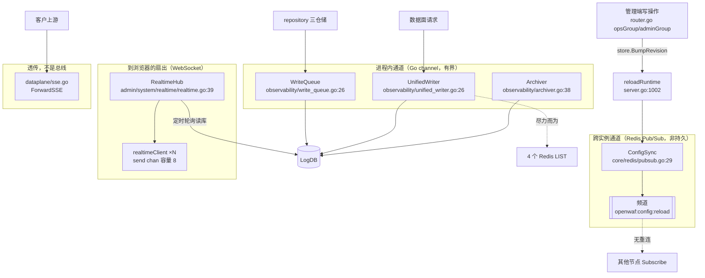
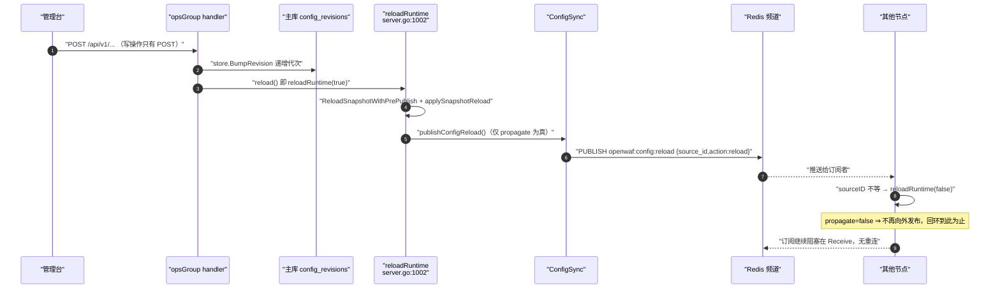
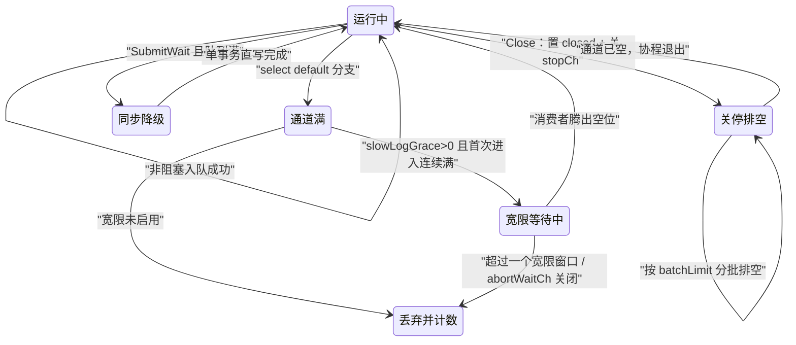
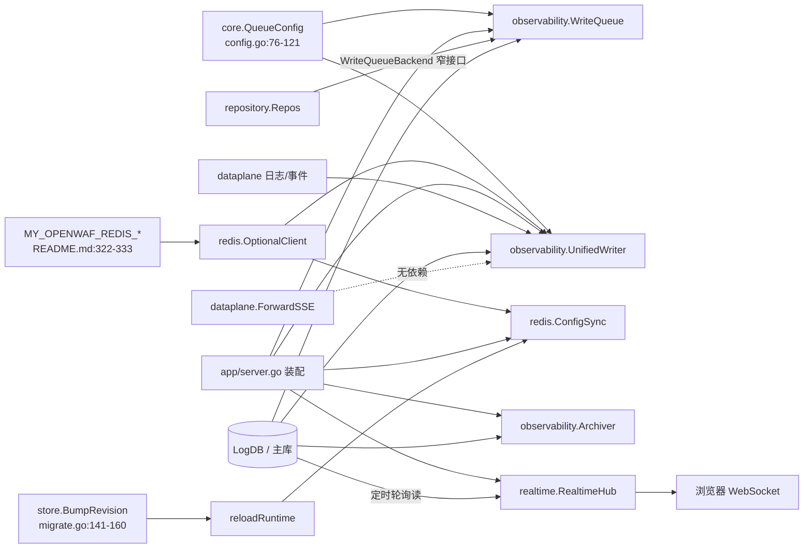

# 消息队列集成

> [返回 第三方集成](第三方集成.md) · [返回 扩展与插件系统](../扩展与插件系统.md)

<cite>
**本文档引用的文件**
- [README.md](file://README.md)
- [go.mod](file://go.mod)
- [internal/core/redis/redis.go](file://internal/core/redis/redis.go)
- [internal/core/redis/pubsub.go](file://internal/core/redis/pubsub.go)
- [internal/core/config.go](file://internal/core/config.go)
- [internal/app/server.go](file://internal/app/server.go)
- [internal/observability/write_queue.go](file://internal/observability/write_queue.go)
- [internal/observability/unified_writer.go](file://internal/observability/unified_writer.go)
- [internal/observability/archiver.go](file://internal/observability/archiver.go)
- [internal/observability/metrics.go](file://internal/observability/metrics.go)
- [internal/store/migrate.go](file://internal/store/migrate.go)
- [internal/store/repository/repository.go](file://internal/store/repository/repository.go)
- [internal/store/repository/security_event.go](file://internal/store/repository/security_event.go)
- [internal/admin/router.go](file://internal/admin/router.go)
- [internal/admin/system/realtime/realtime.go](file://internal/admin/system/realtime/realtime.go)
- [internal/dataplane/sse.go](file://internal/dataplane/sse.go)
- [internal/dataplane/handler.go](file://internal/dataplane/handler.go)
- [frontend/hooks/use-realtime.ts](file://frontend/hooks/use-realtime.ts)
</cite>

## 目录

1. [简介](#简介)
2. [项目结构](#项目结构)
3. [核心组件](#核心组件)
4. [架构总览](#架构总览)
5. [详细组件分析](#详细组件分析)
6. [依赖关系分析](#依赖关系分析)
7. [性能考虑](#性能考虑)
8. [故障排查指南](#故障排查指南)
9. [结论](#结论)
10. [附录](#附录)

## 简介

**定位纠偏**：本篇沿用目录里既有的文件名 `消息队列集成`，但项目里**不存在任何消息队列中间件**。
实测依据是 `go.mod` 的 require 段：与非关系型后端有关的客户端只有
`github.com/redis/rueidis v1.0.78`，另外 `github.com/gorilla/websocket v1.5.3` 用于管理台推送；
**没有** Kafka（sarama / kafka-go）、RabbitMQ（amqplib）、Pulsar、NATS、MQTT（paho）等任何队列件。
全库对 Redis 的调用中，`Publish` 与 `Subscribe` 各只出现一次，都在 `internal/core/redis/pubsub.go`；
没有 `XADD`/`XREADGROUP`/`BRPOP` 之类的队列命令。

因此本篇的真实主题是：**本项目实际存在的进程内与跨实例异步通道**，共三条：

1. **Redis Pub/Sub 配置同步**（跨实例、非持久、无重连）——`internal/core/redis/pubsub.go`，
   频道固定 `openwaf:config:reload`，发布 2s 超时，靠 `sourceID` 抑制回环；
2. **进程内异步写通道**（仅本进程、有界队列、满即丢或同步降级）——
   `internal/observability.WriteQueue` 与 `UnifiedWriter`，配合 `Archiver` 做保留期收敛；
3. **管理台 WebSocket 扇出**（进程内发布、跨进程只到浏览器）——
   `internal/admin/system/realtime`（616 行）+ `router.go` 的 `/api/v1/realtime/ws`。

需要特别澄清一处常见误读：`internal/dataplane/sse.go` 的 `ForwardSSE` **不是**本项目的事件总线，
它是面向**客户上游**的 `text/event-stream` 响应流式透传，把上游推给浏览器的事件原样搬过去，
既不产生事件也不消费事件（详见「数据面 SSE 透传边界」一节）。

任何把本篇当作「Kafka/RabbitMQ 接入指南」的读法都会落空。若确实要接入外部队列，
真实挂载点在 `UnifiedWriter.flushBuffered` 之前与 `ConfigSync.PublishReload` 的替换处，
本篇附录给出扩展点清单。Redis 作为存储后端的能力边界见
[NoSQL 存储适配](../存储后端扩展/NoSQL%20存储适配.md)，本篇只谈「通道」不谈「存储」。

**章节来源**
- [go.mod:5-37](file://go.mod#L5-L37)
- [internal/core/redis/pubsub.go:16-22](file://internal/core/redis/pubsub.go#L16-L22)
- [internal/dataplane/sse.go:20-21](file://internal/dataplane/sse.go#L20-L21)

## 项目结构

三条通道的代码分布：跨实例广播在 `internal/core/redis`，进程内写通道在 `internal/observability`，
浏览器扇出在 `internal/admin/system/realtime`，装配与关停顺序由 `internal/app/server.go` 统一负责。

| 通道 | 路径 | 规模 | 关键符号 | 是否跨进程 |
|------|------|:----:|----------|:----------:|
| 配置同步广播 | `internal/core/redis/pubsub.go` | 132 行 | `ConfigSync`、`PublishReload`、`Subscribe` | 是（Pub/Sub） |
| 客户端工厂 | `internal/core/redis/redis.go` | 42 行 | `OptionalClient`、`Ping` | — |
| 仓储写队列 | `internal/observability/write_queue.go` | 602 行 | `WriteQueue`、`Submit`、`SubmitWait`、`SubmitPriority` | 否 |
| 观测记录写通道 | `internal/observability/unified_writer.go` | 1198 行 | `UnifiedWriter`、`deliver`、`pushToRedis` | 否（扇出副本落 Redis LIST） |
| 保留期收敛 | `internal/observability/archiver.go` | 529 行 | `Archiver`、`cleanup`、`optimizeDB` | 否 |
| 浏览器扇出 | `internal/admin/system/realtime/realtime.go` | 616 行 | `RealtimeHub`、`broadcast`、`realtimeClient` | 到客户端 |
| 上游事件流透传 | `internal/dataplane/sse.go` | 277 行 | `ForwardSSE`、`IsSSERequest` | 透传，不入总线 |
| 通道装配与关停 | `internal/app/server.go` | — | `replaceConfigSync`、`publishConfigReload` | — |



**图表来源**
- [internal/core/redis/pubsub.go:16-132](file://internal/core/redis/pubsub.go#L16-L132)
- [internal/observability/write_queue.go:26-62](file://internal/observability/write_queue.go#L26-L62)
- [internal/observability/unified_writer.go:26-109](file://internal/observability/unified_writer.go#L26-L109)
- [internal/observability/archiver.go:38-69](file://internal/observability/archiver.go#L38-L69)
- [internal/admin/system/realtime/realtime.go:39-67](file://internal/admin/system/realtime/realtime.go#L39-L67)
- [internal/dataplane/sse.go:20-89](file://internal/dataplane/sse.go#L20-L89)
- [internal/app/server.go:1002-1028](file://internal/app/server.go#L1002-L1028)
- [internal/store/migrate.go:141-160](file://internal/store/migrate.go#L141-L160)

**章节来源**
- [internal/core/redis/pubsub.go:16-132](file://internal/core/redis/pubsub.go#L16-L132)
- [internal/observability/write_queue.go:1-62](file://internal/observability/write_queue.go#L1-L62)
- [internal/observability/unified_writer.go:19-129](file://internal/observability/unified_writer.go#L19-L129)
- [internal/admin/system/realtime/realtime.go:26-67](file://internal/admin/system/realtime/realtime.go#L26-L67)

## 核心组件

三条通道的能力对照是本篇的**主表**：投递语义一栏决定你该不该把状态放上去。

| 通道 | 范围:行 | 投递语义 | 持久性 | 失败行为 | 适用场景 |
|------|---------|----------|--------|----------|----------|
| 配置重载广播 | `core/redis/pubsub.go:65-121` | 至多一次，离线即永久丢失 | 无持久化（Pub/Sub 无留存） | 发布失败仅 `warn`（:79-81），本地重载照常完成；订阅 `Receive` 返回即结束，**不重连**（:97） | 让其他节点重建快照；不是配置同步的唯一保证 |
| 仓储写队列 | `observability/write_queue.go:300-394` | 最多一次：`Submit` 满即丢；`SubmitWait`/`SubmitPriority` 满则**同步降级** | 落库即持久，队列本身进程内存 | 满丢弃计数 `dropped_full_total`；事务失败整批记失败；回调 panic 转 error（:264-286） | SQLite 单写者下的写合并，消除锁竞争 |
| 观测记录通道 | `observability/unified_writer.go:566-690` | 最多一次；有 `slowLogGrace` 宽限（默认 30s） | DB 为权威；Redis LIST 只是副本 | 连续满超宽限即丢弃并计数；关停预算 8s+5s，超时放弃剩余记录 | 访问日志/安全事件/drop/bot 评分的高吞吐落库 |
| Redis LIST 扇出 | `observability/unified_writer.go:1094-1152` | 尽力而为，先于 DB 事务推送 | `LTRIM` 上限 + 7 天 TTL | 单条 `resp.Error` 即整批判失败，只 `warn`，DB 事务继续 | 外部实时消费方的低延迟副本；**不可当可靠队列** |
| 管理台 WS 扇出 | `admin/system/realtime/realtime.go:467-581` | 每客户端有界队列 8，满则丢最旧再塞新 | 无（快照可重取） | 再塞仍失败则直接踢掉该客户端连接（:477-479） | 控制台实时看板与播报 |
| 上游 SSE 透传 | `dataplane/sse.go:20-89` | 逐块搬运，不缓存不重放 | 无 | 上游错误直接返回给数据面处理 | 客户自有事件流穿过 WAF |
| 保留期清理 | `observability/archiver.go:332-401` | 定时任务，非消息 | 删除即生效 | 仓储 panic 被转 error（:137-144），单表失败不杀循环 | 控制存储增长 |

两条设计口径必须先固定：**权威状态只在关系库**，Redis 上的频道与 LIST 都是通知或副本；
**所有队列都是「有界 + 丢弃可观测」**，没有任何一条通道具备 ACK、重试、死信或回放语义。
需要可靠消费时读 DB，不读 Redis LIST。

`WriteQueue` 与 `UnifiedWriter` 是两套独立通道，不可混为一谈：前者接收「写函数」
（`func(tx *gorm.DB) error`），由仓储层调用；后者接收「记录结构体」，由数据面热路径调用。
前者的默认容量是 256 条任务，后者是 16384/8192 条记录。

**章节来源**
- [internal/core/redis/pubsub.go:65-132](file://internal/core/redis/pubsub.go#L65-L132)
- [internal/observability/write_queue.go:104-137](file://internal/observability/write_queue.go#L104-L137)
- [internal/observability/unified_writer.go:113-188](file://internal/observability/unified_writer.go#L113-L188)
- [internal/observability/unified_writer.go:1094-1162](file://internal/observability/unified_writer.go#L1094-L1162)
- [internal/admin/system/realtime/realtime.go:26-27](file://internal/admin/system/realtime/realtime.go#L26-L27)
- [internal/dataplane/sse.go:20-89](file://internal/dataplane/sse.go#L20-L89)

## 架构总览

一次管理端写操作从提交到「所有节点生效」的完整链路如下。注意发布发生在重载**之后**，
且 `propagate=false` 的订阅侧重载不会再向外广播——这切断了无限回环。



**图表来源**
- [internal/app/server.go:859-866](file://internal/app/server.go#L859-L866)
- [internal/app/server.go:1002-1028](file://internal/app/server.go#L1002-L1028)
- [internal/core/redis/pubsub.go:64-121](file://internal/core/redis/pubsub.go#L64-L121)
- [internal/store/migrate.go:141-160](file://internal/store/migrate.go#L141-L160)
- [internal/admin/router.go:255-305](file://internal/admin/router.go#L255-L305)

进程内侧的关键分支在入队那一刻：`deliver` 先用非阻塞 `select` 试投，投进即返回；
投不进且宽限未启用时立刻丢弃并计数；启用宽限（生产默认 30s）时按「连续满」的起点统一计时，
最多拖慢一个窗口，之后退回丢弃。这个「连续满」判据而不是「按条计时」是有意为之——
按条计时会在数据库长期落后时把入队延迟无上界地叠加，把数据面拖死。

**章节来源**
- [internal/observability/unified_writer.go:629-690](file://internal/observability/unified_writer.go#L629-L690)
- [internal/observability/unified_writer.go:155-188](file://internal/observability/unified_writer.go#L155-L188)
- [internal/app/server.go:1002-1028](file://internal/app/server.go#L1002-L1028)

## 详细组件分析

### 通道一：Redis Pub/Sub 配置同步

频道与消息形态（`pubsub.go:16-22`）：

```go
const configSyncChannel = "openwaf:config:reload"
const configSyncActionReload = "reload"

type configSyncMessage struct {
	SourceID string `json:"source_id"`
	Action   string `json:"action"`
}
```

发布侧只有一个入口 `PublishReload`：构造 JSON、2s 超时、失败只写 `warn`（:77-81）；
`cs == nil` 或 `client == nil` 直接返回（:66-68），未启用 Redis 的部署完全无感。
`NewConfigSync` 在 `client == nil` 时返回 nil（:39-41），调用方必须做接口判空。

订阅侧有两个必须知道的边界：

1. **无重连**。`Subscribe` 只调用一次 `client.Receive`（:97），返回即订阅结束，没有任何重启循环。
   Redis 端断连后本节点静默失去跨节点重载通知，只能靠下一次本地变更或重启恢复。
2. **裸 `"reload"` 串会自我回环**。`Receive` 回调先判 `msg.Message == configSyncActionReload`
   （:98-104），命中就无条件执行 `reload()`，**不比对 `source_id`**；JSON 分支的回环抑制在
   :111-116。因此手工 `PUBLISH openwaf:config:reload reload` 会让发起节点自己也多重载一次。

```go
// internal/core/redis/pubsub.go:111-120
if event.Action != configSyncActionReload {
	return
}
if event.SourceID != "" && event.SourceID == cs.sourceID {
	return
}
cs.log.Info("received config sync reload")
if err := reload(); err != nil {
	cs.log.Error("config sync reload failed", slog.Any("err", err))
}
```

`sourceID` 缺省时由 8 字节随机数十六进制生成（:45-47、:56-62）。`replaceConfigSync`
（`server.go:834-847`）传的是空串，因此每次 Redis 热切换都会得到新的 `sourceID`。
关停路径值得注意：`Subscribe` 内部起了一条协程，`stopCh` 关闭时调用的是
`cs.client.Close()`（:93-96）——关的是**共享** client，所以热切换必须「先新建、再关旧」，
复用同一实例会把新订阅一起误杀。

| 键设计 | 值 | 位置 | 说明 |
|--------|----|------|------|
| 频道名 | `openwaf:config:reload` | `pubsub.go:16` | 全库唯一 Pub/Sub 频道 |
| 动作常量 | `reload` | `pubsub.go:17` | 同时是旧格式的裸串兼容值 |
| 消息体 | `{"source_id":"16hex","action":"reload"}` | `pubsub.go:19-22`、`:69-72` | `source_id` 为空即失去回环抑制 |
| 发布超时 | 2s | `pubsub.go:77` | 与限流 50ms、扇出 5s 分属不同预算 |
| 订阅 context | `context.Background()` | `pubsub.go:97` | 不受请求取消影响，由 `stopCh` 收尾 |
| 客户端拨号超时 | 5s（`Dialer.Timeout`） | `redis.go:26` | 写超时 3s（:27） |
| 键体系归属 | 不写任何键 | — | Pub/Sub 与 `openwaf:`/`owaf:`/`waf:` 三套前缀无关 |

**章节来源**
- [internal/core/redis/pubsub.go:16-132](file://internal/core/redis/pubsub.go#L16-L132)
- [internal/core/redis/redis.go:18-42](file://internal/core/redis/redis.go#L18-L42)
- [internal/app/server.go:834-866](file://internal/app/server.go#L834-L866)

### 通道二：WriteQueue 仓储写队列

`WriteQueue` 接收的是**写函数**而非记录，接口契约在仓储侧以窄接口定义，避免
`store → observability` 的反向依赖：

```go
// internal/store/repository/repository.go:11-14
type WriteQueueBackend interface {
	Submit(fn func(tx *gorm.DB) error)
	SubmitWait(fn func(tx *gorm.DB) error) error
}
```

`Repos.SetWriteQueue` 只接到三个仓储：`AccessLog`、`SecurityEvent`、`DropEvent`
（`repository.go:99-102`）。装配点在 `server.go:328-335`，容量、批大小、ticker 周期
全部来自 `rt.Config.Queue`。

三种提交方式的语义差异是这套通道的核心：

| 方法 | 满时行为 | 返回 | 使用方 |
|------|----------|------|--------|
| `Submit`（:300-325） | 直接丢弃，`dropped_full_total` 计数 + 限频 warn | 无 | 热路径异步补写 |
| `SubmitWait`（:332-362） | 降级为**同步执行**，`sync_fallback_total` 计数 | `error` | 调用方必须知道结果 |
| `SubmitPriority`（:365-394） | 同上同步降级 | `error` | 鉴权变更等紧急写，入队即触发 flush |

关闭队列后三种入口统一走 `dropped_closed_total` 并返回 `ErrWriteQueueClosed`（:65、:306-311）。
`submitMu` 读写锁把「检查 closed」与「发送」组成一个临界区，杜绝「检查时未关闭、
发送时消费循环已退出」的悬空任务（:33-38 注释、:426-439）。

批执行的原子性口径也值得单列：`flushBatch` 在**单个事务**里跑完整批任务，
每个回调先拿一个 `SAVEPOINT wq_i`，失败则 `RollbackTo`（:539-561），
所以一条写坏的记录不会连累同批其余记录；但事务级错误会让**整批**都不算持久化，
包括那些回调返回 nil 的（:564-579）。这里刻意**不重试**——通用写函数没有幂等契约，
提交结果不明时重试可能造成重复写入。



**图表来源**
- [internal/observability/unified_writer.go:629-690](file://internal/observability/unified_writer.go#L629-L690)
- [internal/observability/unified_writer.go:702-744](file://internal/observability/unified_writer.go#L702-L744)
- [internal/observability/write_queue.go:300-394](file://internal/observability/write_queue.go#L300-L394)
- [internal/observability/write_queue.go:426-499](file://internal/observability/write_queue.go#L426-L499)

**章节来源**
- [internal/observability/write_queue.go:26-62](file://internal/observability/write_queue.go#L26-L62)
- [internal/observability/write_queue.go:264-286](file://internal/observability/write_queue.go#L264-L286)
- [internal/observability/write_queue.go:300-602](file://internal/observability/write_queue.go#L300-L602)
- [internal/store/repository/repository.go:11-14](file://internal/store/repository/repository.go#L11-L14)
- [internal/store/repository/repository.go:99-102](file://internal/store/repository/repository.go#L99-L102)
- [internal/app/server.go:328-335](file://internal/app/server.go#L328-L335)

### 通道三：UnifiedWriter 观测记录通道

四条独立有界通道，默认容量与批参数（`unified_writer.go:124-129`、`:399-409`）：

| 通道 | 记录类型 | 默认容量 | 触发 flush |
|------|----------|:--------:|-----------|
| `eventCh` | `store.SecurityEvent` | 16384 | 四类累计 ≥ 256 或 3s 定时 |
| `accessCh` | `store.AccessLog` | 16384 | 同上 |
| `dropCh` | `store.DropEvent` | 8192 | 同上 |
| `botScoreCh` | `store.BotScoreLog` | 8192 | 同上 |

`drainLimit` 取 `4 × BatchSize` 以限制单次事务体积（:407-409），定时分支用 `drainChanInto`
把四路一次性吸到上限（:783-788）。硬上限集中在 `:113-120`：容量 1M、批 10K、flush 周期 60s、
慢速宽限 5m；越界由 `clampUnifiedWriterOptions` 钳制并打 WARN（:289-327），`BatchInterval` 不设上界。

关停预算分两段：`unifiedWriterCloseTimeout = 8s`（逐批之间检查的排空 deadline）加
`unifiedWriterCloseGrace = 5s`（兜底等待 loop 退出），因为 deadline 打不断已进入驱动的
那一次写入（:341-349、:702-744）。`abortWaitCh` 与 `stopCh` 必须是两个 `sync.Once`
（:67-71 注释）：前者在取写锁**之前**关闭，让正在慢速等待的入队立刻退回丢弃，
`Close` 才可能拿到 `submitMu` 写锁；共用一个 `Once` 会让第二次 `Do` 变空操作，
`stopCh` 永不关闭、排空分支永不执行。

Redis 扇出在同一个 flush 里、**先于** DB 事务执行（:921-927），整批 5s 超时，
四个 LIST 各自 `LPUSH` + `LTRIM` + `EXPIRE 7d`（:1094-1152）：

| 键 | 结构 | LTRIM 上限 | TTL | 位置 |
|----|------|:----------:|:---:|------|
| `openwaf:security_events` | LIST | 99999 | 7 天 | `:1130` |
| `openwaf:access_logs` | LIST | 99999 | 7 天 | `:1137` |
| `openwaf:drop_events` | LIST | 49999 | 7 天 | `:1144` |
| `openwaf:bot_scores` | LIST | 49999 | 7 天 | `:1151` |

因为扇出先于落库，Redis 里可能短暂存在尚未持久化的记录；反过来说，
`pushToRedis` 失败只把 `failed` 置真并告警，不影响落库、也不重试——
这四个 LIST 是**尽力而为的下游副本**，不是可靠队列。

**章节来源**
- [internal/observability/unified_writer.go:113-188](file://internal/observability/unified_writer.go#L113-L188)
- [internal/observability/unified_writer.go:289-327](file://internal/observability/unified_writer.go#L289-L327)
- [internal/observability/unified_writer.go:390-420](file://internal/observability/unified_writer.go#L390-L420)
- [internal/observability/unified_writer.go:667-744](file://internal/observability/unified_writer.go#L667-L744)
- [internal/observability/unified_writer.go:895-1009](file://internal/observability/unified_writer.go#L895-L1009)
- [internal/observability/unified_writer.go:1094-1162](file://internal/observability/unified_writer.go#L1094-L1162)

### 通道四：Archiver 保留期收敛

`Archiver` 不是消息通道，但它是三条通道的下游收敛点，且旧文档对它有两处错误必须订正：

1. **默认清理间隔是 24 小时，不是 1 小时**（`defaultArchiverIntervalSeconds`，:53-57）；
   且 `loop` 是「先等 timer 再看 stopCh」（:219-242），**启动时不预跑清理**。
2. **分批删除 5000 行 / 每批之间 sleep 50ms**（`repository/security_event.go:410-431`），
   用 `id IN (SELECT id ... LIMIT 5000)` 的方式缩小锁范围；`access_logs`、`drop_events`、
   `threat_intel_sync_logs` 三张表同口径。

保留配置有三个来源，由低到高依次覆盖：构造参数（30 天，`server.go:352-357`）、
系统设置里的 `retention_config` JSON、单项键 `security_event_retention_days` /
`access_log_retention_days`（:244-330）；天数取 0 表示**永不清理**，负值回退 0 并告警（:94-104）。
清理之后按方言做维护：SQLite 走 `PRAGMA optimize` + `wal_checkpoint(PASSIVE)` +
`wal_checkpoint(TRUNCATE)`，MySQL 走 `OPTIMIZE/ANALYZE TABLE`，PostgreSQL 走 `VACUUM ANALYZE`，
统一 30s 超时（:409-472、:474-511）。

需要登记的实测缺口：`bot_score_logs` 与 `stats_retention_days` 都**没有对应的清理分支**，
`SetRetention` 在生产路径上无调用方，归档器本身也没有专属指标。

**章节来源**
- [internal/observability/archiver.go:53-69](file://internal/observability/archiver.go#L53-L69)
- [internal/observability/archiver.go:94-133](file://internal/observability/archiver.go#L94-L133)
- [internal/observability/archiver.go:219-242](file://internal/observability/archiver.go#L219-L242)
- [internal/observability/archiver.go:332-401](file://internal/observability/archiver.go#L332-L401)
- [internal/observability/archiver.go:409-511](file://internal/observability/archiver.go#L409-L511)
- [internal/store/repository/security_event.go:410-431](file://internal/store/repository/security_event.go#L410-L431)
- [internal/app/server.go:352-357](file://internal/app/server.go#L352-L357)

### 通道五：RealtimeHub 的 WebSocket 扇出

这是唯一真正「到进程外」的推送通道，但它推的是**从数据库轮询出来的快照**，
不是事件总线：`Start` 用四个 ticker 驱动——dashboard 2s、runtime/upstreams/heartbeat 5s、
audit 3s、fingerprints 15s（`realtime.go:236-239`），每个分支先 `hasSubscribers(topic)` 判空，
没人订阅就不查库（:250-283、:456-465），快照构建统一走 `repo.List(0, 20, filter)`（:289-311）。

主题白名单共 6 个 + 1 个通配（:29-37、:513-525）：

| 主题 | 消息 type | 周期 | 数据来源 |
|------|-----------|:----:|----------|
| `dashboard` | `dashboard_snapshot` | 2s | `dashboard.BuildDashboardSnapshot` |
| `runtime` | `runtime_snapshot` | 5s | `health.StatusSnapshot` |
| `upstreams` | `upstream_snapshot` | 5s | `adminupstream.BuildUpstreamStatus` |
| `audit` | `access_log_snapshot` / `security_event_snapshot` | 3s | 两个仓储各取 20 条 |
| `fingerprints` | `fingerprint_snapshot` | 15s | `ListFingerprints` |
| `heartbeat` | `heartbeat` | 5s | 固定 `{connection:"active"}` |
| `all` | — | — | 解析成空集合，`subscribes` 恒真（:483-489、:502-504） |

缺省订阅集是 `runtime + upstreams + heartbeat`（:492-496）；信封固定
`schema: "admin.realtime.v1"`，带全局递增 `seq`（:26、:425-433）。
背压策略很粗暴但正确：每客户端 `send` 队列容量 8（:27），`enqueue` 满了先丢一条最旧的再试，
仍失败就返回 false，`broadcast` 随即把该客户端整个摘掉（:539-562、:476-480）——
慢消费者被断开而不是拖住整条扇出路径；写超时 3s（:571）。

鉴权走一次性票据而不是 Bearer：`GET /api/v1/realtime/ticket` 在 `readGroup` 下（`router.go:248`），
签发 32 字节随机 hex、60 秒过期（`realtime.go:187-197`、`:612-616`）；
`GET /api/v1/realtime/ws` 直接挂在根实例上（`router.go:424`，不在 `api` 分组，因此**不吃**
`AuthMiddleware`），由 `consumeTicket` 校验并从 map 里删除实现「只能用一次」（:588-602），
票据非法直接 401 JSON，不进入协议升级（:204-214）；`CheckOrigin` 只允许与 `r.Host` 同源（:173-181）。
前端 `use-realtime.ts` 每 55 秒主动换票重连、异常后 3 秒退避重连。

**章节来源**
- [internal/admin/system/realtime/realtime.go:26-67](file://internal/admin/system/realtime/realtime.go#L26-L67)
- [internal/admin/system/realtime/realtime.go:166-233](file://internal/admin/system/realtime/realtime.go#L166-L233)
- [internal/admin/system/realtime/realtime.go:235-311](file://internal/admin/system/realtime/realtime.go#L235-L311)
- [internal/admin/system/realtime/realtime.go:425-616](file://internal/admin/system/realtime/realtime.go#L425-L616)
- [internal/admin/router.go:248](file://internal/admin/router.go#L248)
- [internal/admin/router.go:424](file://internal/admin/router.go#L424)
- [frontend/hooks/use-realtime.ts:11-23](file://frontend/hooks/use-realtime.ts#L11-L23)
- [frontend/hooks/use-realtime.ts:55-107](file://frontend/hooks/use-realtime.ts#L55-L107)

### 数据面 SSE 透传边界

`internal/dataplane/sse.go` 的定位必须说清楚：它是**反向代理的一段流式转发实现**，
与项目自身的通知机制无关。判定只看客户端 `Accept` 是否含 `text/event-stream`
（`IsSSERequest`，:262-277，且要求其后是串尾或 `;`/`,`/空白，避免 `text/event-streamx` 误判）。

转发路径的要点：逐跳头、`Host` 与内部标记头 `x-openwaf-internal-*` 一律不转发给上游
（`sse.go:39-49`、`:115-117`）；上游响应头按 `IsHopByHop` 与 `Connection` 令牌过滤（:60-68）；
强制 `Cache-Control: no-cache`、**删除** `Connection` 与 `Content-Length`、`SetContentLength(-1)`、
`ImmediateHeaderFlush = true`（:77-81）；优先走 `StreamResponseViaHijack`，失败才回落
`SetBodyStream`（:83-86）；`sseBodyStream` 用 `mutex + cond` 跟踪活跃读者，确保 `cleanup`
等所有 `Read` 退出后才 `rc.Close()` 并取消上游 context（:141-215）。

数据面在主 switch 里排在扩展 CONNECT 与 WebSocket 之后（`handler.go:1126-1131`），
命中 SSE 的请求不参与响应体记录与大小统计（:1229）。

结论：**本篇的三条通道与 SSE 透传没有任何交汇**。若客户上游用 SSE 推事件，WAF 只做搬运；
WAF 自己的事件出口是 Redis LIST 扇出与 `openwaf_writer_*` 指标，两者不可混用。

**章节来源**
- [internal/dataplane/sse.go:20-117](file://internal/dataplane/sse.go#L20-L117)
- [internal/dataplane/sse.go:141-215](file://internal/dataplane/sse.go#L141-L215)
- [internal/dataplane/sse.go:262-277](file://internal/dataplane/sse.go#L262-L277)
- [internal/dataplane/handler.go:1126-1131](file://internal/dataplane/handler.go#L1126-L1131)
- [internal/dataplane/handler.go:1229](file://internal/dataplane/handler.go#L1229)

### 能力边界

| 能力 | 是否具备 | 证据 | 替代方案 |
|------|:--------:|------|----------|
| 外部 MQ 客户端（Kafka/RabbitMQ/Pulsar/NATS/MQTT） | 否 | `go.mod` require 段无相关依赖 | 需自行接入，挂载点见附录 |
| 持久化队列 / 离线消息 | 否 | Pub/Sub 无留存，`pubsub.go:97` | 读关系库或 Redis LIST 副本 |
| ACK / 重试 / 死信 / 回放 | 否 | `Submit` 满即丢（:314-320）；扇出失败不重试（:1155-1159） | DB 为准，指标核对丢弃计数 |
| 消费组与分区 | 否 | 全库无 `XREADGROUP`/`BRPOP` | 外部消费者自取 LIST |
| 断线自动重订阅 | 否 | `Receive` 单次调用即退出（:97） | 触发一次本地变更或重启节点 |
| 事务级批量提交 | 是 | 写队列单事务 + 逐 job SAVEPOINT（:539-561） | — |
| 背压不阻塞热路径 | 是 | `deliver` 非阻塞快路径 + 有界宽限（:629-690） | 宽限设 0 回到「满即丢」 |
| 丢弃量可观测 | 是 | `openwaf_write_queue_*` / `openwaf_writer_dropped_total`（`metrics.go:773-914`） | — |
| 跨实例事件广播 | 部分 | 只有配置重载一种动作（`pubsub.go:17`） | 需要新动作需扩消息体与白名单 |
| 有序性保证 | 否 | 四路通道各自独立，批内顺序不跨类 | 单类型内保持入队顺序 |
| 慢客户端隔离 | 是 | 队列满即摘除连接（`realtime.go:476-480`） | — |

**章节来源**
- [go.mod:5-37](file://go.mod#L5-L37)
- [internal/core/redis/pubsub.go:64-121](file://internal/core/redis/pubsub.go#L64-L121)
- [internal/observability/write_queue.go:300-394](file://internal/observability/write_queue.go#L300-L394)
- [internal/observability/write_queue.go:539-602](file://internal/observability/write_queue.go#L539-L602)
- [internal/observability/unified_writer.go:629-690](file://internal/observability/unified_writer.go#L629-L690)
- [internal/observability/unified_writer.go:1154-1161](file://internal/observability/unified_writer.go#L1154-L1161)
- [internal/observability/metrics.go:773-914](file://internal/observability/metrics.go#L773-L914)
- [internal/admin/system/realtime/realtime.go:476-480](file://internal/admin/system/realtime/realtime.go#L476-L480)

### 新增一条跨实例通知通道的流程

现有 Pub/Sub 只有一个动作值，扩第二个动作是最小可行路径；引入外部 MQ 则是另一量级的改动。
下面按「先语义、再载荷、最后接线」的顺序给出步骤表。

| 步 | 动作 | 参照位置 | 完成判据 | 跳过的后果 |
|:--:|------|----------|----------|------------|
| 1 | 明确投递语义（至多一次 / 是否需要持久） | `pubsub.go:65-121` 现状 | 一句话写出「断连会怎样」 | 把通知当事实源，出现长期不一致 |
| 2 | 决定消息载荷形态，保留 `source_id` | `pubsub.go:19-22` | JSON 分支，不用裸串 | 发起节点自我回环，重复重载 |
| 3 | 扩动作常量并在订阅回调白名单里判定 | `pubsub.go:17`、`:111-113` | 未知动作直接 return | 任意消息都能触发重载 |
| 4 | 发布点唯一化，走 `publishConfigReload` 式封装 | `server.go:859-866` | 不在 handler 里散落 `PUBLISH` | 发布时机与重载顺序错乱 |
| 5 | 设定发布超时并只做「尽力」语义 | `pubsub.go:77-81` | 失败仅 warn，本地动作已完成 | MQ 抖动拖垮管理 API 响应 |
| 6 | 评估是否需要重连包装 | `pubsub.go:97` | 明确写清「不重连」或补一层循环 | 断连后静默失去通知 |
| 7 | 关停路径只关被替换的实例 | `server.go:834-847` | 先新建后 `old.Close()` | 共享 client 被误关 |
| 8 | 回填本篇通道对照表与能力边界表 | 本文件 | 表格行与代码行号一致 | 文档与实现漂移 |

扩展第二个动作时，载荷与订阅侧判定必须同改：新增动作值需要在 `:111-113` 的白名单判定里显式放行，
而回环抑制（`event.SourceID != "" && event.SourceID == cs.sourceID`）对任何动作都应生效。

**章节来源**
- [internal/core/redis/pubsub.go:16-132](file://internal/core/redis/pubsub.go#L16-L132)
- [internal/app/server.go:834-866](file://internal/app/server.go#L834-L866)

### 新增一类异步写入的流程

给 `WriteQueue` 加一个新消费方（或新增一类观测记录）时的顺序，与上表同理但风险面不同。

| 步 | 动作 | 参照位置 | 完成判据 | 跳过的后果 |
|:--:|------|----------|----------|------------|
| 1 | 选通道：写函数进 `WriteQueue`，记录进 `UnifiedWriter` | `repository.go:11-14`、`unified_writer.go:566-596` | 不出现「结构体硬塞进写队列」 | 两套语义混用，计数不可解释 |
| 2 | 决定满时策略：丢弃 / 同步降级 / 宽限等待 | `write_queue.go:300-394`、`unified_writer.go:629-690` | 三种入口各有一处单测 | 热路径被 DB 抖动拖住 |
| 3 | 入口钳制参数，越界回退默认并告警 | `write_queue.go:147-162`、`unified_writer.go:289-327` | 容量 0 不出现（0 会让全部提交走 default 分支） | 静默整类丢弃 |
| 4 | 批内加 SAVEPOINT，保证单条失败不污染整批 | `write_queue.go:539-561` | 同批一条坏记录其余仍入库 | 一条坏日志毁一批 |
| 5 | panic 一律转 error | `write_queue.go:264-286` | 回调 panic 后队列仍存活 | 可观测路径打崩进程 |
| 6 | 丢弃计数与限频告警分开 | `write_queue.go:236-256`、`unified_writer.go:513-529` | `/metrics` 可见，日志不刷屏 | 故障期日志变二次过载 |
| 7 | 关停走有界排空，不在批内无上限循环 | `unified_writer.go:816-874` | 预算内完成或计入丢弃 | 进程无法退出 |
| 8 | 若需跨节点可见，再考虑 Redis 扇出并保持「先扇出后落库」口径 | `unified_writer.go:921-927`、`:1094-1152` | 明确 LIST 不可靠 | 下游把副本当权威 |

**章节来源**
- [internal/observability/write_queue.go:147-162](file://internal/observability/write_queue.go#L147-L162)
- [internal/observability/write_queue.go:236-286](file://internal/observability/write_queue.go#L236-L286)
- [internal/observability/write_queue.go:300-394](file://internal/observability/write_queue.go#L300-L394)
- [internal/observability/write_queue.go:539-602](file://internal/observability/write_queue.go#L539-L602)
- [internal/observability/unified_writer.go:289-327](file://internal/observability/unified_writer.go#L289-L327)
- [internal/observability/unified_writer.go:513-529](file://internal/observability/unified_writer.go#L513-L529)
- [internal/observability/unified_writer.go:816-874](file://internal/observability/unified_writer.go#L816-L874)
- [internal/store/repository/repository.go:11-14](file://internal/store/repository/repository.go#L11-L14)

## 依赖关系分析



**图表来源**
- [internal/core/config.go:76-121](file://internal/core/config.go#L76-L121)
- [internal/app/server.go:328-357](file://internal/app/server.go#L328-L357)
- [internal/app/server.go:1002-1028](file://internal/app/server.go#L1002-L1028)
- [internal/store/repository/repository.go:11-14](file://internal/store/repository/repository.go#L11-L14)
- [internal/store/migrate.go:141-160](file://internal/store/migrate.go#L141-L160)
- [internal/admin/system/realtime/realtime.go:166-185](file://internal/admin/system/realtime/realtime.go#L166-L185)
- [internal/dataplane/sse.go:20-22](file://internal/dataplane/sse.go#L20-L22)
- [README.md:311-340](file://README.md#L311-L340)

依赖方向上刻意存在两处「窄接口」，都是为了阻断 import cycle：
`repository.WriteQueueBackend`（只暴露 `Submit`/`SubmitWait`，让仓储不 import observability）与
`proxy.LuaResponseRewrite` 式的查找函数注入。新增消费方必须沿用同一手法，
不要让 `store` 或 `proxy` 直接依赖上层包。

| 外部实体 | 类型 | 交互方向 | 协议/方式 | 触发时机 | 失败影响 | 容错处理 |
|----------|------|:--------:|-----------|----------|----------|----------|
| Redis 实例（频道） | 消息通道 | 双向 | RESP Pub/Sub | 管理端写操作后 | 其他节点不重载 | 发布 2s 超时仅告警；本地重载不受影响 |
| Redis 实例（LIST） | 下游副本 | 出向 | RESP `LPUSH/LTRIM/EXPIRE` | 每次 flush | 副本缺失 | 整批 5s；DB 事务照常 |
| LogDB / 主库 | 存储 | 出向 | GORM | 批 flush | 记录未持久化 | SAVEPOINT 隔离 + 失败计数 |
| 浏览器管理台 | 消费者 | 出向 | WebSocket | 2/3/5/15s 轮询 | 看板滞后 | 票据 60s + 慢客户端摘除 |
| 客户上游 | 数据源 | 双向 | HTTP SSE 透传 | 客户端 `Accept` 命中 | 上游错误回数据面 | 无缓存、无重放 |
| 外部 MQ | 第三方 | — | — | — | — | 未接入，本项目无此依赖 |

**章节来源**
- [internal/store/repository/repository.go:9-26](file://internal/store/repository/repository.go#L9-L26)
- [internal/core/redis/pubsub.go:64-82](file://internal/core/redis/pubsub.go#L64-L82)
- [internal/observability/unified_writer.go:1094-1162](file://internal/observability/unified_writer.go#L1094-L1162)
- [internal/app/server.go:300-335](file://internal/app/server.go#L300-L335)

## 性能考虑

- **入队必须非阻塞**。热路径只允许一次 `select`：`deliver` 的快路径与 `WriteQueue.Submit`
  都是这个形状（`unified_writer.go:630-636`、`write_queue.go:314-320`）。任何新增的
  「等一会儿再丢」都必须有窗口上限，且以「连续满」计时而非按条计时。
- **合并写入的收益点在事务数**。`flushBatch` 把整批放进一个事务并逐 job 加 SAVEPOINT
  （`write_queue.go:539-561`），`UnifiedWriter` 把四类记录放进一个事务
  （`unified_writer.go:936-1009`），这是 SQLite 单写者下消除锁竞争的主要手段。
- **预算要分层**。发布 2s、扇出整批 5s、KV 单命令 1s、排空 8s+5s、归档维护 30s、
  WS 写 3s。新增调用点必须显式 `context.WithTimeout`，不要沿用无超时写法。
- **告警必须限频**。两处丢弃告警都限 10s 一条（`write_queue.go:67`、`unified_writer.go:330`），
  计数器仍逐条累加；持续背压下逐条打日志会在磁盘 I/O 上二次放大故障。
- **轮询式扇出的成本随订阅者增长**。`RealtimeHub.Start` 每个分支先查
  `hasSubscribers` 再查库（`realtime.go:250-283`），没有客户端时零 DB 开销；
  若要提高频率，应改为事件驱动而不是缩短 ticker。
- **容量调大不等于不丢**。真正的丢失发生在 DB 长期落后：宽限窗口之后一律退回丢弃，
  上限 5m 只是把「能救的削峰」救回来（`unified_writer.go:117-120`、`config.go:105`）。

[本节为总结，无需特定文件来源]

## 故障排查指南

| 症状 | 原因 | 排查 | 方案 |
|------|------|------|------|
| 改了配置但其他节点没生效 | `Receive` 返回后不重连 | 看 `config_sync` logger 是否还在打 `received config sync reload` | 触发一次本地变更或重启该节点 |
| 一次变更后节点重载了两次 | 消息是裸串 `"reload"`，绕过 `sourceID` 抑制 | `redis-cli PUBLISH` 或抓 `pubsub.go:98` 分支 | 改发 JSON `{source_id,action}` |
| `openwaf_write_queue_dropped_full_total` 增长 | 队列 256 满 | `Stats()` 的 `queue_len/queue_capacity` | 调大 `MY_OPENWAF_QUEUE_WRITE_CAPACITY` 或降载 |
| `openwaf_write_queue_sync_fallback_total` 增长 | `SubmitWait/Priority` 满则同步直写 | 对照 `last_batch_duration_ms` | DB 慢是根因，扩容量无效 |
| `openwaf_writer_dropped_total{type="access_log"}` 增长 | DB 持续落后超过宽限窗口 | `MY_OPENWAF_QUEUE_SLOW_LOG_GRACE` 生效值 | 调大宽限（上限 5m）或查 DB |
| 关停时日志缺失 | 排空预算 8s 用尽后放弃剩余记录 | 日志 `unified writer close timed out` | 缩短 flush 周期或降流量 |
| Redis LIST 有记录但 DB 没有 | 扇出先于落库 | `flushBuffered` 顺序（`:921-936`） | 属预期语义，下游需以 DB 为准 |
| 管理台看板不动 | 票据过期 / 慢客户端被摘除 | ticket 60s；`realtimeClient.enqueue` 返回 false | 前端换票重连；降低刷新频率 |
| 归档未按预期清理 | 启动不预跑，间隔默认 24 小时 | `db_optimize_interval_hours` 设置键 | 等待一轮或临时调小间隔 |
| `bot_score_logs` 无限增长 | 归档器无该表清理分支 | `Archiver.cleanup` 分支清单 | 属已知缺口，需外部清理 |

```bash
# 通道侧可调项（密码一律脱敏）
export MY_OPENWAF_REDIS_ADDR="127.0.0.1:6379"
export MY_OPENWAF_QUEUE_EVENT_BUFFER_SIZE=16384   # 上限 1048576
export MY_OPENWAF_QUEUE_BATCH_SIZE=256            # 上限 10000
export MY_OPENWAF_QUEUE_FLUSH_INTERVAL=3s         # 上限 60s
export MY_OPENWAF_QUEUE_WRITE_CAPACITY=256
export MY_OPENWAF_QUEUE_WRITE_BATCH_SIZE=64
export MY_OPENWAF_QUEUE_SLOW_LOG_GRACE=30s        # 显式设 0 即关闭宽限

# 验证 Pub/Sub 是否在跑（注意：裸串会触发自我回环，仅排障使用）
redis-cli SUBSCRIBE openwaf:config:reload

# 回归口径：改动可观测性通道后至少跑这三组
CGO_ENABLED=1 go test -tags=quickjs ./internal/observability/... ./internal/core/redis/... ./internal/store/...
```

**章节来源**
- [internal/core/config.go:97-121](file://internal/core/config.go#L97-L121)
- [internal/core/config.go:443-505](file://internal/core/config.go#L443-L505)
- [internal/observability/metrics.go:773-914](file://internal/observability/metrics.go#L773-L914)
- [internal/observability/unified_writer.go:702-744](file://internal/observability/unified_writer.go#L702-L744)
- [internal/observability/archiver.go:219-242](file://internal/observability/archiver.go#L219-L242)
- [internal/core/redis/pubsub.go:97-116](file://internal/core/redis/pubsub.go#L97-L116)
- [README.md:311-340](file://README.md#L311-L340)

## 结论

本篇把「消息队列集成」标题下的虚构内容全部替换为实测事实：**项目没有任何 MQ 客户端**，
真实的异步能力由三条通道构成——Redis Pub/Sub 负责跨实例的「重载提醒」这一种动作，
`WriteQueue` 与 `UnifiedWriter` 负责进程内的有界批量落库，`RealtimeHub` 负责到浏览器的轮询式扇出。
三者的共同取舍是：**放弃可靠投递换取不阻塞热路径**，再用「丢弃必须计数、告警必须限频、
关停必须有界」把不可靠变成可观测。

对扩展者的判断标准只有一条：某个状态丢了会怎样。丢了只是看板晚几秒的，走 WebSocket；
丢了要重算的，走进程内队列并接受丢弃计数；丢了会导致集群长期不一致的，
**必须落到关系库并由修订号驱动重载**，不能依赖 Pub/Sub——它至多一次、不重连、无留存。

订正清单：外部 MQ 由「可扩展建议」改列为「未实现」；归档间隔 1 小时订正为 24 小时且启动不预跑；
`UnifiedWriter` 批大小订正为 256 并补上默认 30s 慢速宽限；SSE 由「事件流」纠偏为「上游透传」；
新增 Pub/Sub 无重连与裸串自我回环两条硬边界。

**章节来源**
- [go.mod:5-37](file://go.mod#L5-L37)
- [internal/core/redis/pubsub.go:64-132](file://internal/core/redis/pubsub.go#L64-L132)
- [internal/observability/write_queue.go:300-394](file://internal/observability/write_queue.go#L300-L394)
- [internal/observability/unified_writer.go:566-744](file://internal/observability/unified_writer.go#L566-L744)
- [internal/observability/archiver.go:53-69](file://internal/observability/archiver.go#L53-L69)

## 附录

### 配置项表

| 配置项 | 载体 | 默认值 | 硬上限 | 生效点 |
|--------|------|:------:|:------:|--------|
| `MY_OPENWAF_QUEUE_EVENT_BUFFER_SIZE` | 环境变量 | 16384 | 1M | `config.go:448`、`server.go:341` |
| `MY_OPENWAF_QUEUE_DROP_BUFFER_SIZE` | 环境变量 | 8192 | 1M | `config.go:455` |
| `MY_OPENWAF_QUEUE_BATCH_SIZE` | 环境变量 | 256 | 10000 | `config.go:462` |
| `MY_OPENWAF_QUEUE_FLUSH_INTERVAL` | 环境变量 | 3s | 60s | `config.go:469` |
| `MY_OPENWAF_QUEUE_WRITE_BATCH_SIZE` | 环境变量 | 64 | 10000 | `config.go:476` |
| `MY_OPENWAF_QUEUE_WRITE_CAPACITY` | 环境变量 | 256 | 1M | `config.go:483` |
| `MY_OPENWAF_QUEUE_WRITE_INTERVAL` | 环境变量 | 50ms | 不设上界 | `config.go:490` |
| `MY_OPENWAF_QUEUE_SLOW_LOG_GRACE` | 环境变量 | 未设（运行时折算 30s） | 5m | `config.go:497-503`、`unified_writer.go:205-213` |
| `MY_OPENWAF_REDIS_ADDR` | 环境变量 | 空（不启用） | — | `README.md:322`、`redis.go:19-21` |
| `retention_config` | 系统设置键 | 30/30/30/7 天 | Duration 上界 | `archiver.go:255-272` |
| `security_event_retention_days` / `access_log_retention_days` | 系统设置键 | 30 | — | `archiver.go:306-311` |
| `db_optimize_interval_hours` | 系统设置键 | 24 | Duration 上界 | `archiver.go:314-329` |
| `realtimeClientQueueSize` | 源码常量 | 8 | — | `realtime.go:27` |
| `unifiedWriterCloseTimeout` / `unifiedWriterCloseGrace` | 源码常量 | 8s / 5s | — | `unified_writer.go:344`、`:349` |

`SlowLogGrace` 的三态需要单独说明：`0` 在 options 里表示「未配置」，运行时由
`effectiveSlowLogGrace` 折算成 30s；真正关闭必须走 `SlowLogGraceDisabled`，
环境变量侧把 `MY_OPENWAF_QUEUE_SLOW_LOG_GRACE=0` 同时置上该布尔（`config.go:500`）。

**章节来源**
- [internal/core/config.go:76-121](file://internal/core/config.go#L76-L121)
- [internal/core/config.go:443-505](file://internal/core/config.go#L443-L505)
- [internal/observability/unified_writer.go:113-153](file://internal/observability/unified_writer.go#L113-L153)
- [internal/observability/unified_writer.go:205-213](file://internal/observability/unified_writer.go#L205-L213)
- [internal/observability/write_queue.go:104-137](file://internal/observability/write_queue.go#L104-L137)
- [internal/observability/archiver.go:244-330](file://internal/observability/archiver.go#L244-L330)
- [README.md:311-340](file://README.md#L311-L340)

### 若要真正接入外部 MQ，挂载点在哪

下表是给未来需求的诚实答案，**当前均为未实现**：

| 需求 | 唯一合理挂载点 | 位置 | 必须先解决的问题 |
|------|----------------|------|------------------|
| 事件导出到 Kafka/RabbitMQ | `flushBuffered` 内、`pushToRedis` 同一层 | `unified_writer.go:921-931` | 需要新的有界通道与独立关停预算，不能阻塞 DB 事务 |
| 配置变更事件持久化 | `publishConfigReload` 之外新增持久通道 | `server.go:859-866` | Pub/Sub 无法保证送达，需 DB 修订号兜底 |
| 可靠下游消费 | 新增 outbox 表 + CDC | `repository.go` 事务侧 | 现有 SAVEPOINT 不提供幂等键 |
| 多实例 WS 会话共享 | 不适用 | `realtime.go:182-184` | 票据与连接集合都在进程内存，天然单实例 |

**章节来源**
- [internal/observability/unified_writer.go:916-936](file://internal/observability/unified_writer.go#L916-L936)
- [internal/app/server.go:859-866](file://internal/app/server.go#L859-L866)
- [internal/store/repository/repository.go:9-26](file://internal/store/repository/repository.go#L9-L26)
- [internal/admin/system/realtime/realtime.go:166-185](file://internal/admin/system/realtime/realtime.go#L166-L185)

### 相关文档

- [第三方集成](第三方集成.md)：对外集成面总览与逐条证伪清单；[服务集成](服务集成.md)：出站协议类集成；
  [监控系统集成](监控系统集成.md)：指标导出与采集侧
- [NoSQL 存储适配](../存储后端扩展/NoSQL%20存储适配.md)：Redis 键空间与降级口径（同族处理方式）；
  [存储后端扩展](../存储后端扩展/存储后端扩展.md)：替换 KV / 限流后端的完整流程
- [SSE 事件推送](../../数据平面处理/SSE%20事件推送.md)：上游透传侧的同一批事实

[本节为总结，无需特定文件来源]
