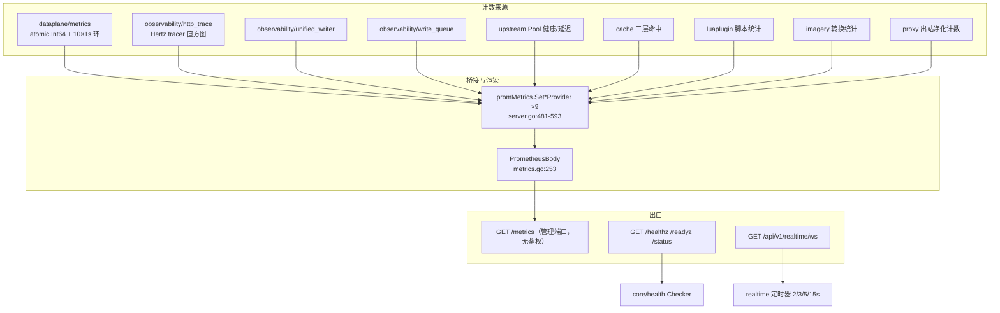
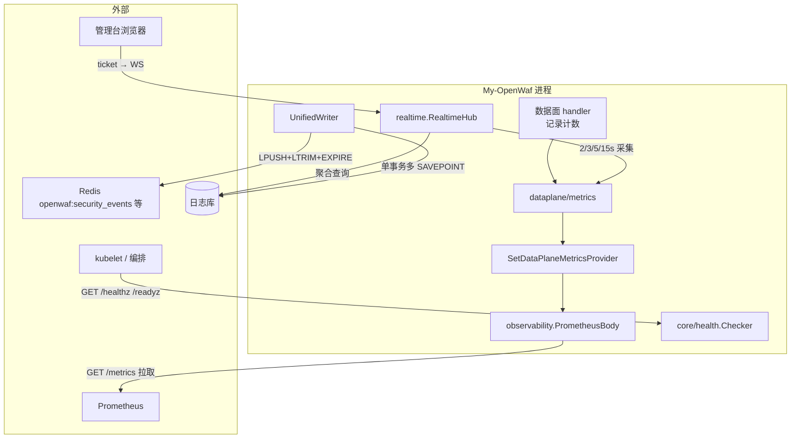
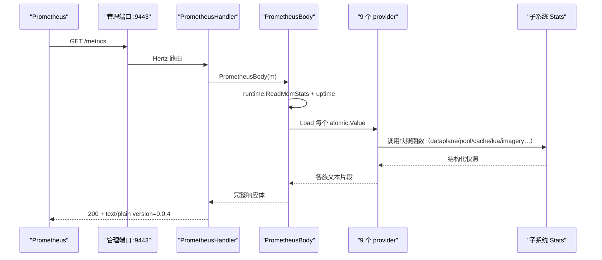
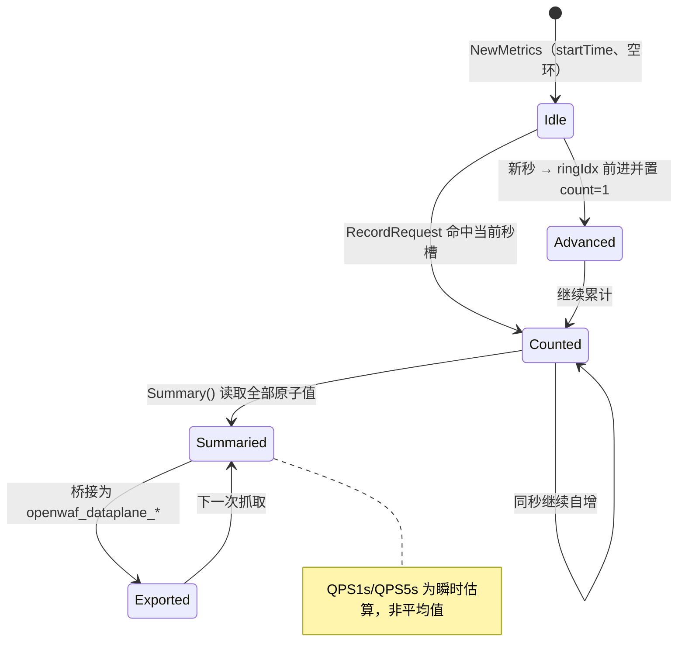
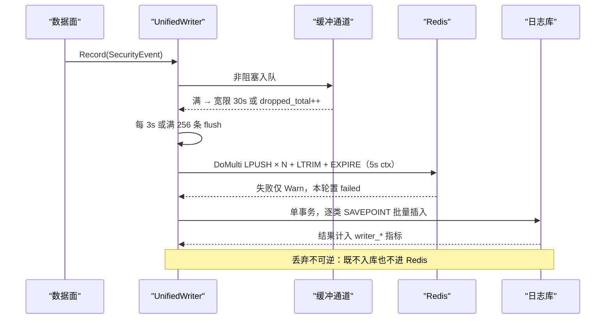
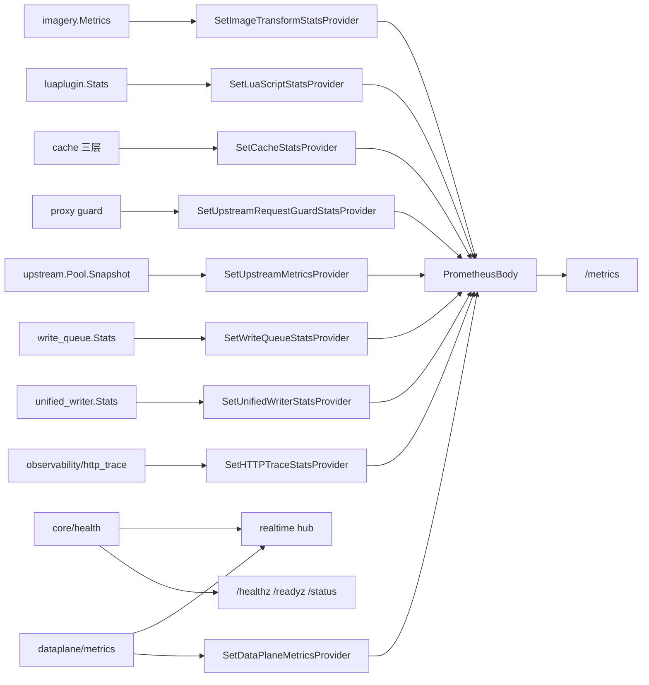
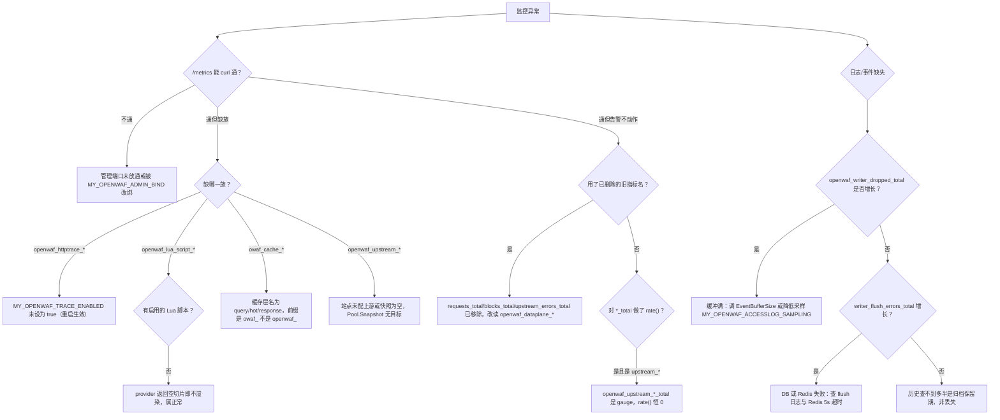

# 监控系统集成

> [返回 扩展与插件系统](../扩展与插件系统.md)

<cite>
**本文档引用的文件**
- [server.go](file://internal/app/server.go)
- [router.go](file://internal/admin/router.go)
- [metrics.go](file://internal/observability/metrics.go)
- [http_trace.go](file://internal/observability/http_trace.go)
- [unified_writer.go](file://internal/observability/unified_writer.go)
- [write_queue.go](file://internal/observability/write_queue.go)
- [archiver.go](file://internal/observability/archiver.go)
- [metrics.go](file://internal/dataplane/metrics/metrics.go)
- [health.go](file://internal/core/health/health.go)
- [realtime.go](file://internal/admin/system/realtime/realtime.go)
- [config.go](file://internal/core/config.go)
- [main.go](file://cmd/main.go)
- [go.mod](file://go.mod)
</cite>

## 目录

1. [简介](#简介)
2. [项目结构](#项目结构)
3. [核心组件](#核心组件)
4. [架构总览](#架构总览)
5. [详细组件分析](#详细组件分析)
6. [依赖关系分析](#依赖关系分析)
7. [性能考虑](#性能考虑)
8. [故障排查指南](#故障排查指南)
9. [结论](#结论)
10. [附录](#附录)

## 简介

本篇只讲**可核对的监控暴露面**。My-OpenWaf 不推指标、不写日志到远端、不发告警，它只提供一个**拉取式文本端点**和三个 JSON 探针，外加一个可选 pprof。任何「已集成 Prometheus Remote Write / Grafana Agent / Datadog / NewRelic / OpenTelemetry Collector」的描述都不成立：`go.mod` 既没有 `prometheus/client_golang`，也没有 OTel/Jaeger/Zipkin 依赖（`go.mod:5-38`），`/metrics` 的文本是自己 `fmt.Sprintf` 拼出来的（`internal/observability/metrics.go:253`、`:771`）。

真实暴露面清单：

| 暴露面 | 路径 | 端口 | 鉴权 | 格式 | 装配位置 |
|---|---|---|:----:|---|---|
| 指标 | `GET /metrics` | 管理端口（默认 `:9443`） | **无** | `text/plain; version=0.0.4; charset=utf-8` | `internal/app/server.go:1056` |
| 存活 | `GET /healthz` | 管理端口 | **无** | JSON | `server.go:1053` |
| 就绪 | `GET /readyz` | 管理端口 | **无** | JSON | `server.go:1054` |
| 运行时状态 | `GET /status` | 管理端口 | **无** | JSON | `server.go:1055` |
| 管理台实时推送 | `GET /api/v1/realtime/ws` | 管理端口 | 一次性票据 | WebSocket | `router.go:424` |
| 性能剖析 | `/debug/pprof/*` | `MY_OPENWAF_PPROF_BIND`（默认不监听） | **无** | pprof | `cmd/main.go:29-41` |
| 业务聚合查询 | `GET /api/v1/dashboard/summary` 等 | 管理端口 | JWT/API Key | JSON | `router.go:203` |

抓取前提（缺一条就会看到「指标缺项」而非报错）：

| 前提 | 判据 | 未满足时的表现 |
|---|---|---|
| 网络可达管理端口 | `:9443` 未绑公网或已被防火墙收敛 | 抓取超时；同时 `/healthz` 也不可达 |
| 无鉴权即公开 | 四个探针与 `/metrics` 注册在 `api` 组之外（`router.go:110` 只对 `/api/v1` 挂鉴权） | 任何能连上端口的进程都能读拓扑与计数 |
| provider 已挂载 | 9 个 `Set*Provider` 在 `server.go:481-593` 装配 | 对应指标族整体缺席 |
| HTTPTrace 显式开启 | `MY_OPENWAF_TRACE_ENABLED=true`（`server.go:482`） | `openwaf_httptrace_*` 完全不存在 |
| Lua 脚本在跑 | `SetLuaScriptStatsProvider` 返回空切片时不渲染 | `openwaf_lua_script_*` 缺席 |
| 存在上游探活目标 | `SetUpstreamMetricsProvider` 读 `Pool.Snapshot`（`server.go:508`） | `openwaf_upstream_*` 全 0 |

**章节来源**
- [go.mod:5-38](file://go.mod#L5-L38)
- [internal/observability/metrics.go:241-253](file://internal/observability/metrics.go#L241-L253)
- [internal/app/server.go:1053-1056](file://internal/app/server.go#L1053-L1056)
- [internal/admin/router.go:110](file://internal/admin/router.go#L110)
- [cmd/main.go:29-41](file://cmd/main.go#L29-L41)

## 项目结构

监控栈分四层：**计数来源 → 快照桥接 → 文本渲染 → 拉取出口**。中间没有 Agent、没有远端写入器。下表为**模块清单表**。

| 层 | 模块 | 路径 | 职责 | 规模(行) | 测试 |
|---|---|---|---|:--------:|:----:|
| 计数来源 | 数据面原子计数 | `internal/dataplane/metrics` | 请求/状态/WAF/唯一 IP 计数与 10×1s QPS 环 | 161 | 有 |
| 计数来源 | Hertz tracer | `internal/observability/http_trace.go` | 阶段耗时直方图与字节计数 | 487 | 有 |
| 计数来源 | 统一写入器 | `internal/observability/unified_writer.go` | 四类记录缓冲、批量落库、Redis 扇出 | 1198 | 有 |
| 计数来源 | 通用写队列 | `internal/observability/write_queue.go` | 仓储异步写与丢弃计数 | 602 | 有 |
| 计数来源 | 上游池 | `internal/upstream/health.go` | 健康态与延迟样本 | 981 | 有 |
| 桥接 | provider 装配 | `internal/app/server.go:481-593` | 9 个 `Set*Provider` 单位换算与结构适配 | — | 有 |
| 渲染 | 文本导出 | `internal/observability/metrics.go` | `PrometheusBody` 拼接各族片段 | 935 | 有 |
| 出口 | 管理端路由 | `internal/app/server.go:1053-1056` | `/metrics`、探针 | — | 有 |
| 留存 | 归档器 | `internal/observability/archiver.go` | 按保留期删除与 DB optimize | 529 | 有 |
| 消费 | 管理台实时 | `internal/admin/system/realtime` | 票据 + 主题扇出 | 616 | 有 |



**图表来源**
- [internal/app/server.go:481-593](file://internal/app/server.go#L481-L593)
- [internal/observability/metrics.go:253-345](file://internal/observability/metrics.go#L253-L345)
- [internal/dataplane/metrics/metrics.go:13-33](file://internal/dataplane/metrics/metrics.go#L13-L33)
- [internal/observability/http_trace.go:14-56](file://internal/observability/http_trace.go#L14-L56)

**章节来源**
- [internal/app/server.go:481-481](file://internal/app/server.go#L481)
- [internal/observability/metrics.go:241-345](file://internal/observability/metrics.go#L241-L345)

## 核心组件

三个符号构成全部对外契约：

核心符号的代码上下文表：

| 符号 | 位置 | 职责 | 上游调用者 | 下游依赖 | 副作用 | 影响面 |
|---|---|---|---|---|---|---|
| `PrometheusHandler` | `internal/observability/metrics.go:242` | Hertz 处理器包装 | `server.go:1056` 路由注册 | `PrometheusBody` | 触发 9 个 provider 求值 | 高：抓取契约 |
| `PrometheusBody` | `metrics.go:253` | 进程指标 + 拼接各族片段 | `PrometheusHandler`、测试 | `runtime.ReadMemStats`、`atomic.Value` providers | 无 | 高 |
| `Set*Provider`（9 个） | `metrics.go:166-239` | 用 `atomic.Value` 挂载快照函数 | `server.go:481-593` | 各子系统 Stats | nil provider 被忽略 | 中 |
| `Metrics.Summary` | `internal/dataplane/metrics/metrics.go:146` | 原子值一次性读出 | `server.go:492` 桥接 | 环形桶 + IP 去重表 | 无 | 高：QPS 真值 |
| `UnifiedWriter.Stats` | `internal/observability/unified_writer.go` | 队列深度与丢弃计数 | `metrics.go:303` 渲染 | 原子字段 | 无 | 中 |
| `Checker.StatusSnapshot` | `internal/core/health/health.go:73` | `/status` 载荷 | `/status`、realtime 5s tick | 快照 + runtime | 无 | 中 |

**两套计数体系必须分开理解**，这是本主题最容易写错的地方：

| 体系 | 载体 | 出口 | 典型名 |
|---|---|---|---|
| 数据面原子计数 | `dataplane/metrics` 结构体字段 | 经 `SetDataPlaneMetricsProvider` 桥接后输出 `openwaf_dataplane_*` | `openwaf_dataplane_requests_total` |
| 观测性进程指标 | `observability.Metrics` 只持 `Uptime` | `PrometheusBody` 直接渲染 | `openwaf_uptime_seconds` |

`observability` 包里曾经存在的 `openwaf_requests_total`、`openwaf_blocks_total`、`openwaf_observes_total`、`openwaf_upstream_errors_total` **已连同字段与 Record 方法一并移除**（原因写在 `metrics.go:265-273` 的注释里：同一语义两条路径各持一份计数，会制造第二真相）。凡照旧名抓取的仪表盘都会拿到空序列。

**章节来源**
- [internal/observability/metrics.go:146-239](file://internal/observability/metrics.go#L146-L239)
- [internal/observability/metrics.go:265-273](file://internal/observability/metrics.go#L265-L273)
- [internal/dataplane/metrics/metrics.go:131-161](file://internal/dataplane/metrics/metrics.go#L131-L161)
- [internal/core/health/health.go:73-104](file://internal/core/health/health.go#L73-L104)

## 架构总览

系统上下文表描述「谁来抓、抓什么、抓不到会怎样」：

| 外部实体 | 类型 | 方向 | 协议 | 触发时机 | 数据内容 | 失败影响 | 容错 |
|---|---|:----:|---|---|---|---|---|
| Prometheus / VictoriaMetrics | 监控 | 入向 | HTTP GET | 抓取周期 | 指标文本 | 看板与告警缺数据 | 无（不影响转发） |
| 编排系统探针 | 运维 | 入向 | HTTP GET | 探针周期 | JSON 状态 | 实例被摘流或重启 | 就绪三条件短路 |
| 管理台浏览器 | 前端 | 入向 | WebSocket + REST | 登录后 | 主题快照 | 视图停更 | 单客户端队列 8，满则丢 |
| 性能剖析使用者 | 运维 | 入向 | HTTP | 手工 | pprof | 无 | 默认不监听 |
| Redis（扇出方向为出向） | 存储 | 出向 | RESP `DoMulti` | 每次 flush | 四类事件 JSON | 实时消费落后 | 失败记警告并置 `failed` |
| 日志数据库 | 存储 | 出向 | GORM 事务 | 批量 | 事件与访问日志 | 记录丢弃计数上升 | 缓冲 + 宽限 |



**图表来源**
- [internal/app/server.go:481-508](file://internal/app/server.go#L481-L508)
- [internal/observability/metrics.go:241-345](file://internal/observability/metrics.go#L241-L345)
- [internal/observability/unified_writer.go:918-930](file://internal/observability/unified_writer.go#L918-L930)
- [internal/admin/system/realtime/realtime.go:235-240](file://internal/admin/system/realtime/realtime.go#L235-L240)

## 详细组件分析

### 指标渲染与抓取时序

`PrometheusHandler` 没有缓冲、没有缓存：每次抓取都重新求值全部 provider，因此 gauge 反映的是抓取瞬间的值（`internal/observability/metrics.go:242-250`）。响应体以固定 5 条进程指标开头，再按 provider 挂载顺序拼接（`:273-345`）。

抓取链路的流程步骤表：

| 步 | 动作 | 执行位置 | 输入 | 输出 | 失败分支 | 可观测点 |
|:--:|---|---|---|---|---|---|
| 1 | 抓取请求进入管理端口 | `internal/app/server.go:1056` | GET `/metrics` | 处理器调用 | 端口不通则超时 | 抓取端 target state |
| 2 |  读运行时内存统计 | `internal/observability/metrics.go:258` | `runtime.MemStats` | alloc/sys/pause | 无 | `openwaf_memory_*` |
| 3 | 计算 uptime | `metrics.go:261` | `Metrics.Uptime` | 秒 | 无 | `openwaf_uptime_seconds` |
| 4 | 逐个 `atomic.Value.Load` | `metrics.go:299-344` | provider | 片段字符串 | provider 未挂载 → 跳过 | 对应族整体缺席 |
| 5 | label 值转义 | `metrics.go:568` | 名称含 `\`、`"`、换行 | 合法文本 | 不转义会破坏解析 | 抓取报 parse error |
| 6 | 设置内容类型并返回 | `metrics.go:246-248` | 文本 | 200 | 无 | `Content-Type: text/plain; version=0.0.4` |



**图表来源**
- [internal/observability/metrics.go:241-345](file://internal/observability/metrics.go#L241-L345)
- [internal/app/server.go:1056](file://internal/app/server.go#L1056)

**章节来源**
- [internal/observability/metrics.go:241-345](file://internal/observability/metrics.go#L241-L345)
- [internal/observability/metrics.go:556-586](file://internal/observability/metrics.go#L556-L586)

### 真实指标族清单

下表全部取自 `metrics.go` 渲染字符串与装配位置，未列出的名字即为不存在。

| 族 | 类型 | 标签 | 渲染函数 | 数据来源 |
|---|---|---|---|---|
| `openwaf_uptime_seconds`、`openwaf_goroutines`、`openwaf_memory_alloc_bytes`、`openwaf_memory_sys_bytes`、`openwaf_gc_pause_total_ns` | gauge/counter | 无 | `PrometheusBody` `:273` | `runtime` |
| `openwaf_dataplane_qps` | gauge | `window="1s\|5s"` | `prometheusDataPlaneMetrics` `:402` | `Metrics.QPS` |
| `openwaf_dataplane_requests_total`、`openwaf_dataplane_builtin_hits_total`、`openwaf_dataplane_unique_ips_total`、`openwaf_dataplane_attack_ips_total` | counter | 无 | 同上 `:402` | 原子字段 |
| `openwaf_dataplane_status_total` | counter | `class="2xx\|4xx\|5xx"` | 同上 | 原子字段 |
| `openwaf_dataplane_waf_actions_total` | counter | `action="block\|observe"` | 同上 | 原子字段 |
| `openwaf_dataplane_uptime_seconds` | gauge | 无 | 同上 | `UptimeSeconds` |
| `owaf_cache_hits_total`、`owaf_cache_misses_total`、`owaf_cache_errors_total` | counter | `cache="query\|hot\|response"` | `prometheusCacheStats` `:530` | 三层缓存命中统计 |
| `openwaf_writer_queue_len`、`openwaf_writer_dropped_total` | gauge/counter | `type="security_event\|access_log\|drop_event\|bot_score"` | `prometheusUnifiedWriterStats` `:771` | 写入器原子计数 |
| `openwaf_writer_flushes_total`、`openwaf_writer_flush_errors_total`、`openwaf_writer_failed_records_total`、`openwaf_writer_total_flushed_records` | counter | 无 | 同上 | flush 结果 |
| `openwaf_writer_last_flush_{records,failed_records,duration_ms,unix_nano}` | gauge | 无 | 同上 | 最近一次 flush |
| `openwaf_write_queue_*`（`len/capacity/closed/submitted/enqueued/dropped_full/dropped_closed/sync_fallback/executed/succeeded/failed/batches/last_batch_*`） | gauge/counter | 无 | `prometheusWriteQueueStats` `:838` | 通用写队列 |
| `openwaf_upstream_{healthy,unhealthy,known,checked}_total` | **gauge** | 无 | `prometheusUpstreamMetrics` `:455` | `Pool.Snapshot` |
| `openwaf_upstream_{latency_samples_total,average_latency_ms,max_last_latency_ms}` | gauge | 无 | 同上 | 延迟样本 |
| `openwaf_upstream_request_{header_names_dropped,header_values_dropped,paths_sanitized,security_headers_dropped}_total` | counter | 无 | `prometheusUpstreamRequestGuardStats` `:505` | `proxy.UpstreamRequestGuardSnapshot` |
| `openwaf_lua_script_{runs,failures,timeouts}_total`、`openwaf_lua_script_avg_duration_ms` | counter/gauge | `script`、`stage` | `prometheusLuaScriptStats` `:598` | Lua 引擎 Stats |
| `openwaf_httptrace_{samples,skipped,errors,skipped_bytes,request_bytes,response_bytes}_total` | counter | `proto` | `prometheusHTTPTraceStats` `:654` | Hertz tracer |
| `openwaf_httptrace_phase_duration_seconds_{bucket,sum,count}` | histogram | `phase`、`proto` | 同上 `:723` | 14 个 µs 上界桶 + `+Inf` |
| `openwaf_imagery_{applied,skipped,timed_out,gate_skipped}_total`、`openwaf_imagery_gate_{limit,in_use}`、`openwaf_imagery_webp_dynamic_available` | counter/gauge | 无 | `prometheusImageTransformStats` `:358` | `imagery.Metrics()` |

两个命名陷阱必须写明，否则告警会静默失效：`openwaf_upstream_*_total` 后缀是 `_total` 但类型是 **gauge**（当前健康目标数量，不做 `rate()`）；`owaf_cache_*` 前缀是 `owaf_` 而非 `openwaf_`，与 Redis 键的双前缀体系同源。

**章节来源**
- [internal/observability/metrics.go:273-345](file://internal/observability/metrics.go#L273-L345)
- [internal/observability/metrics.go:358-452](file://internal/observability/metrics.go#L358-L452)
- [internal/observability/metrics.go:455-554](file://internal/observability/metrics.go#L455-L554)
- [internal/observability/metrics.go:598-724](file://internal/observability/metrics.go#L598-L724)
- [internal/observability/metrics.go:771-880](file://internal/observability/metrics.go#L771-L880)

### 数据面计数与 QPS 环

`dataplane.Metrics` 用 7 个 `atomic.Int64` + 10 槽环形桶（每槽 1 秒）实现近似 QPS：写入时若当前秒槽位不匹配就前进一格并重置为 1，读窗口时把 `now-ts < windowSec` 的槽求和除以窗口（`internal/dataplane/metrics/metrics.go:48-62`、`:112-125`）。唯一 IP 与攻击 IP 用互斥锁保护的 `map[string]struct{}` 去重，**作用域是进程生命周期**，进程重启即归零（`:80-109`，注释见 `:10`）。



**图表来源**
- [internal/dataplane/metrics/metrics.go:33-62](file://internal/dataplane/metrics/metrics.go#L33-L62)
- [internal/dataplane/metrics/metrics.go:112-161](file://internal/dataplane/metrics/metrics.go#L112-L161)

`openwaf_httptrace_phase_duration_seconds` 的桶上界以**微秒**累加，14 个有限上界（50µs…1s）加一个 `+Inf`（`internal/observability/http_trace.go:44-58`）；协议取不到值时落在 `proto="unknown"`，这类样本代表 keep-alive 空闲回收路径，**不能当成脏数据过滤**——`samples_total` 与 `phase="total" ∧ proto!="unknown"` 之差就是连接层放弃量（`:26-39`）。`phase="server_handle"` 含同步上游等待，不是 WAF 纯计算耗时（`:18-21`）。

**章节来源**
- [internal/dataplane/metrics/metrics.go:10-161](file://internal/dataplane/metrics/metrics.go#L10-L161)
- [internal/observability/http_trace.go:14-58](file://internal/observability/http_trace.go#L14-L58)

### 事件写入、Redis 扇出与留存

| 参数 | 默认值 | 上限 | 位置 |
|---|---|---|---|
| SecurityEvent/AccessLog 通道容量 | 16384 | 1<<20 | `internal/observability/unified_writer.go:125` |
| DropEvent/BotScore 通道容量 | 8192 | 1<<20 | `:126` |
| 批量阈值 | 256 | 10000 | `:127` |
| 刷新间隔 | 3s | 60s | `:128` |
| 慢日志宽限 | 30s（0 表示未配置） | 5min | `:172`、`:119` |
| 丢弃告警节流 | 10s | — | `:330` |
| 通用写队列容量/批量/间隔 | 256 / 64 / 50ms | — | `internal/observability/write_queue.go:112-114` |
| Redis 事件键 | `openwaf:security_events`、`openwaf:access_logs`、`openwaf:drop_events`、`openwaf:bot_scores` | — | `unified_writer.go:1130-1151` |
| Redis 列表裁剪 | `LTRIM 0 99999`（事件/访问）、`0 49999`（drop/bot） | — | `:1120-1121` |
| Redis TTL | 7 天 | — | `:1103` |
| 归档保留 | 30 天（事件/访问/drop） | — | `internal/observability/archiver.go:54` |
| 归档间隔 | 24 小时 | 可被 `db_optimize_interval_hours` 覆盖 | `:57`、`:314` |

写入器生命周期：数据面 `Record` 入队 → 满则先走 30s 慢日志宽限、仍满则丢弃并计数（`openwaf_writer_dropped_total{type=...}`）→ 每 3s 或满 256 条 flush：**先 `pushToRedis`，再单事务多 SAVEPOINT 落库**（`internal/observability/unified_writer.go:923-930`）。Redis 推送失败只记警告并把本轮标 `failed`，不回滚也不重投（`:1153-1158`）。归档器 `loop` **先等定时器再干活**，因此进程启动时不会立刻清理（`internal/observability/archiver.go:218-240`），且威胁情报同步日志复用 `drop_event_retention_days` 清理（`:388-391`）。



**图表来源**
- [internal/observability/unified_writer.go:918-930](file://internal/observability/unified_writer.go#L918-L930)
- [internal/observability/unified_writer.go:1094-1158](file://internal/observability/unified_writer.go#L1094-L1158)
- [internal/observability/unified_writer.go:113-130](file://internal/observability/unified_writer.go#L113-L130)

**章节来源**
- [internal/observability/unified_writer.go:113-184](file://internal/observability/unified_writer.go#L113-L184)
- [internal/observability/write_queue.go:104-135](file://internal/observability/write_queue.go#L104-L135)
- [internal/observability/archiver.go:54-64](file://internal/observability/archiver.go#L54-L64)
- [internal/observability/archiver.go:218-240](file://internal/observability/archiver.go#L218-L240)
- [internal/observability/archiver.go:332-391](file://internal/observability/archiver.go#L332-L391)

### 探针与实时推送

`/healthz` 恒真；`/readyz` 要求快照已加载、生命周期管理器全部监听器就绪、DB `Ping()` 通过（`internal/core/health/health.go:29-42`）。`/status` 返回 `revision`、站点数、监听器数、goroutine、`heap_alloc`、Go 版本与 CPU 数（`:73-104`），这三个端点都不需要凭据。

实时推送与 `/metrics` 是两条独立路径：`POST /api/v1/realtime/ticket` 发一次性票据（60s 有效，`internal/admin/system/realtime/realtime.go:187-197`），WebSocket 升级前校验票据，失败直接 401 不升级（`:204-214`）。主题与节拍固定：`dashboard` 2s、`runtime`/`upstreams`/`heartbeat` 5s、`audit` 3s、`fingerprints` 15s（`:235-240`），无订阅者时该主题不采集（`hasSubscribers` `:456`）。

**章节来源**
- [internal/core/health/health.go:29-104](file://internal/core/health/health.go#L29-L104)
- [internal/admin/system/realtime/realtime.go:26-240](file://internal/admin/system/realtime/realtime.go#L26-L240)
- [internal/admin/router.go:424](file://internal/admin/router.go#L424)

### 若要新增一个指标族：扩展点与实现片段

新增指标不引入第三方库，只需两步：在 `observability` 增加一个 provider 与渲染函数，在 `app/server.go` 装配。以下模板与 `SetLuaScriptStatsProvider` 同构（`internal/app/server.go:564-580`、`internal/observability/metrics.go:598-620`）：

```go
// 1) internal/observability/metrics.go：定义快照与渲染（参考 prometheusCacheStats 的写法）
func prometheusFooStats(items []FooStats) string {
	var b strings.Builder
	b.WriteString("\n# HELP openwaf_foo_runs_total Foo executions\n")
	b.WriteString("# TYPE openwaf_foo_runs_total counter\n")
	for _, it := range items {
		fmt.Fprintf(&b, "openwaf_foo_runs_total{name=%q} %d\n",
			escapePrometheusLabelValue(it.Name), it.Runs)
	}
	return b.String()
}

// 2) internal/app/server.go:582-593 之后：挂 provider（nil 会被安全忽略）
promMetrics.SetFooStatsProvider(func() []observability.FooStats { /* 读子系统 Stats() */ })
```

`Metrics` 的 9 个 provider 字段都是 `atomic.Value`，未挂载即跳过，不会 panic；因此**「族缺失」的正确排查顺序是先看装配、再看子系统是否有数据**（`internal/observability/metrics.go:148-159`）。

**章节来源**
- [internal/observability/metrics.go:148-159](file://internal/observability/metrics.go#L148-L159)
- [internal/observability/metrics.go:530-620](file://internal/observability/metrics.go#L530-L620)
- [internal/app/server.go:564-593](file://internal/app/server.go#L564-L593)

## 依赖关系分析

外部服务依赖表：

| 依赖 | 用途 | 接入方式 | 配置来源 | 超时 | 重试 | 降级 | 可用性影响 |
|---|---|---|---|:----:|:----:|---|---|
| Prometheus（拉取方） | 指标采集 | HTTP GET | 抓取端 | 抓取端 | 抓取端 | 无 | 看板与告警 |
| 日志库（SQLite/MySQL/PG） | 事件与访问日志留存 | GORM 单事务 | `MY_OPENWAF_LOG_DSN` | 未设置（风险） | 无 | 丢弃计数 | 历史查询 |
| Redis | 事件扇出给实时消费方 | `DoMulti` | `MY_OPENWAF_REDIS_*` | 5s（`unified_writer.go:1101`） | 无 | 仅记警告 | 实时消费落后 |
| Hertz tracer | 阶段耗时来源 | 进程内 | `MY_OPENWAF_TRACE_ENABLED` | — | — | 族缺席 | 延迟可视化 |
| 编排系统 | 探针消费 | HTTP | 部署侧 | 部署侧 | 部署侧 | 摘流 | 实例存活判定 |



**图表来源**
- [internal/app/server.go:481-593](file://internal/app/server.go#L481-L593)
- [internal/observability/metrics.go:166-239](file://internal/observability/metrics.go#L166-L239)

问题检测结果表（按当前代码实测登记，不在本文修改范围）：

| 编号 | 类别 | 严重度 | 现象 | 位置 |
|---|---|:----:|---|---|
| I-01 | 安全 | 高 | `/metrics`、`/status`、探针无任何鉴权 | `internal/app/server.go:1053-1056` |
| I-02 | 架构 | 中 | 归档器自身没有专属指标，清理失败只能翻日志 | `internal/observability/archiver.go:332-391` |
| I-03 | 代码质量 | 中 | `stats_retention_days` 被读取并归一但无删除分支消费 | `archiver.go:29`、`:111`、`:154` |
| I-04 | 代码质量 | 低 | `bot_score_logs` 只在 DB optimize 清单里，没有保留清理分支 | `archiver.go:332-391`、`:479` |
| I-05 | 最佳实践 | 低 | `SetRetention` 生产无调用方，保留期只能靠设置项在下一 tick 生效 | `archiver.go:196` |

**章节来源**
- [internal/observability/archiver.go:26-64](file://internal/observability/archiver.go#L26-L64)
- [internal/observability/archiver.go:196-196](file://internal/observability/archiver.go#L196)
- [internal/app/server.go:1053-1056](file://internal/app/server.go#L1053-L1056)

## 性能考虑

- 抓取路径零缓存零分配复用：`PrometheusBody` 每次用 `fmt.Sprintf` 生成片段（`internal/observability/metrics.go:273`），代价是分配，换来的是永远没有陈旧值；对高频抓取（<5s）建议放长 `scrape_interval`。
- `runtime.ReadMemStats` 每次抓取只调用一次，但会产生一次短暂停顿（`metrics.go:258-259`），因此不要把 `/metrics` 当作高频健康检查端点使用。
- 数据面计数全原子，`Summary()` 一次读 12 个值，无锁；唯一例外是 IP 去重表的互斥锁（`internal/dataplane/metrics/metrics.go:80-109`），高基数流量下该锁是热点，`unique_ips_total` 因此是进程级近似值。
- 写入器批量 256 / 3s 与 `DoMulti` 合并（`internal/observability/unified_writer.go:1154`）使 DB 与 Redis 各只承担一次往返；宽限 30s 把「DB 落后」转化为「请求变慢」而不是「日志丢失」。
- 实时推送在无订阅者时不采集，节流成本随视图打开数增长（`internal/admin/system/realtime/realtime.go:456-467`）。

**章节来源**
- [internal/observability/metrics.go:253-299](file://internal/observability/metrics.go#L253-L299)
- [internal/dataplane/metrics/metrics.go:80-125](file://internal/dataplane/metrics/metrics.go#L80-L125)
- [internal/observability/unified_writer.go:1094-1160](file://internal/observability/unified_writer.go#L1094-L1160)

## 故障排查指南



**图表来源**
- [internal/app/server.go:481-487](file://internal/app/server.go#L481-L487)
- [internal/observability/metrics.go:265-273](file://internal/observability/metrics.go#L265-L273)
- [internal/observability/metrics.go:455-554](file://internal/observability/metrics.go#L455-L554)
- [internal/observability/unified_writer.go:113-130](file://internal/observability/unified_writer.go#L113-L130)
- [internal/observability/archiver.go:218-240](file://internal/observability/archiver.go#L218-L240)

- 「历史数据突然查不到」优先怀疑保留清理而不是丢数：归档器在启动时**不预跑**，因此问题通常在进程存活满一个间隔后才显现（`internal/observability/archiver.go:218-240`）。
- 「多实例指标对不上」优先怀疑 `unique_ips_total` 与 `*_uptime_seconds` 的进程作用域，以及快照代次差异（`/status` 的 `revision`）。

**章节来源**
- [internal/observability/archiver.go:218-240](file://internal/observability/archiver.go#L218-L240)
- [internal/core/health/health.go:73-104](file://internal/core/health/health.go#L73-L104)
- [internal/dataplane/metrics/metrics.go:10-109](file://internal/dataplane/metrics/metrics.go#L10-L109)

## 结论

本篇把监控暴露面收敛到可验证的一页：**一个无鉴权的 `/metrics`（自实现文本格式，18 个真实指标族）+ 三个 JSON 探针 + 一条 WebSocket 推送通道 + 可选 pprof**。相比旧版，本轮做了三类硬订正——把 `openwaf_requests_total` 等已删除指标与据此编写的告警表达式全部替换为 `openwaf_dataplane_*` 真值；把「未使用标签」改为按族列出真实标签（`window/class/action/type/cache/script/stage/proto/phase/name`）；把 OpenTelemetry、Datadog、NewRelic 从「集成」降级为「可作为 Prometheus 抓取端使用」，并删除了不存在的 drop/CVE/bot 指标与 `PUT/DELETE` 端点写法。

下一步建议：给归档器补一组专属指标（对应 I-02），把 `stats_retention_days` 接上或删除（I-03），以及在部署文档中强制要求 `/metrics` 所在端口不得暴露公网（I-01）。

## 附录

### Prometheus 抓取配置（可直接用）

```yaml
# 管理端口默认 :9443（internal/core/config.go:362-364）；端点无鉴权，必须内网可达
scrape_configs:
  - job_name: "my-openwaf"
    metrics_path: /metrics
    static_configs:
      - targets: ["waf-01.internal:9443"]
        labels: { instance_group: "edge" }
```

```bash
# 验证暴露面（预期：5 条进程指标 + 已挂载 provider 的族）
curl -s http://127.0.0.1:9443/metrics | head -20
curl -s http://127.0.0.1:9443/readyz
curl -s http://127.0.0.1:9443/status
```

端点与端口来自实测装配：`/metrics` 在管理服务器（`internal/app/server.go:1056`），管理地址默认 `:9443`（`internal/core/config.go:362-364`）。

**章节来源**
- [internal/app/server.go:1056](file://internal/app/server.go#L1056)
- [internal/core/config.go:362-364](file://internal/core/config.go#L362-L364)

### 告警规则（只使用真实存在的指标）

| 目标 | 表达式 | 依据 |
|---|---|---|
| 事件丢失 | `rate(openwaf_writer_dropped_total[5m]) > 0` | `internal/observability/metrics.go:780-786` |
| 写库/扇出失败 | `rate(openwaf_writer_flush_errors_total[5m]) > 0` | `metrics.go:791-792` |
| 拦截量激增 | `rate(openwaf_dataplane_waf_actions_total{action="block"}[5m])` | `metrics.go:421-422` |
| 上游 5xx 激增 | `rate(openwaf_dataplane_status_total{class="5xx"}[5m])` | `metrics.go:415-417` |
| 后端不可用 | `openwaf_upstream_healthy_total == 0 and openwaf_upstream_known_total > 0` | `metrics.go:455-460` |
| QPS 崩塌 | `openwaf_dataplane_qps{window="1s"} < 阈值` | `metrics.go:406` |
| 缓存穿透 | `rate(owaf_cache_errors_total{cache="hot"}[5m]) > 0` | `metrics.go:550` |
| Lua 脚本失败 | `rate(openwaf_lua_script_failures_total[5m]) > 0` | `metrics.go:617-618` |
| webp 退化为纯 Go | `openwaf_imagery_webp_dynamic_available == 0` | `metrics.go:364-366` |
| 阶段耗时右移 | `histogram_quantile(0.95, rate(openwaf_httptrace_phase_duration_seconds_bucket{phase="server_handle"}[5m]))` | `metrics.go:723-724` |

**章节来源**
- [internal/observability/metrics.go:406-422](file://internal/observability/metrics.go#L406-L422)
- [internal/observability/metrics.go:455-460](file://internal/observability/metrics.go#L455-L460)
- [internal/observability/metrics.go:550-550](file://internal/observability/metrics.go#L550)
- [internal/observability/metrics.go:616-724](file://internal/observability/metrics.go#L616-L724)
- [internal/observability/metrics.go:780-791](file://internal/observability/metrics.go#L780-L791)
- [internal/core/config.go:362-364](file://internal/core/config.go#L362-L364)

### 相关管理端点（真实路由，写操作只有 POST）

| 端点 | 方法 | 位置 | 用途 |
|---|---|---|---|
| `/api/v1/dashboard/summary` | GET | `internal/admin/router.go:203` | 仪表板聚合 |
| `/api/v1/security-events/timeline` | GET | `router.go:171` | 事件时间线（只计终止动作） |
| `/api/v1/security-events/stats` | GET | `router.go:170` | 事件统计 |
| `/api/v1/drop-stats` | GET | `router.go:243` | 24 小时阻断统计 |
| `/api/v1/drop-events` | GET | `router.go:244` | 阻断事件列表 |
| `/api/v1/bot-stats` | GET | `router.go:217` | 机器人检测统计 |
| `/api/v1/bot-scores` | GET | `router.go:218` | 评分日志 |
| `/api/v1/upstreams/status` | GET | `router.go:245` | 上游健康 |
| `/api/v1/cve-feed/status` | GET | `router.go:222` | CVE 源同步状态（内存态） |
| `/api/v1/threat-intel-sync-logs` | GET | `router.go:158` | 情报同步历史（已落库） |
| `/api/v1/realtime/ticket` | GET | `router.go:248` | 一次性 WS 票据 |
| `/api/v1/log-config` | GET/POST | `router.go:214`、`:395` | 日志配置（改动即时生效） |

**章节来源**
- [internal/admin/router.go:158-248](file://internal/admin/router.go#L158-L248)
- [internal/admin/router.go:203-222](file://internal/admin/router.go#L203-L222)

### 未实现的外部监控后端

| 声称的集成 | 实况 | 若要接，真实接入点 |
|---|---|---|
| OpenTelemetry / Jaeger / Zipkin | 未实现，无 SDK 依赖 | `internal/observability/http_trace.go:14-24` 阶段常量可 1:1 映射为 span |
| Datadog / NewRelic Agent 直连 | 未实现 | 只能作为 Prometheus 抓取端，或自行拉 `/metrics` 后转发 |
| Remote Write | 未实现 | 在 `internal/observability/metrics.go:345` 之后追加推流器，不改动渲染 |
| Alertmanager / 邮件 / IM Webhook 告警 | 未实现，全库无发送器 | `internal/observability/unified_writer.go:923` 的事件出口旁路 |
| Elasticsearch / Loki 日志转发 | 未实现 | 日志仅 stdout 与文件；事件出口同上（`unified_writer.go:923`） |
| S3 / OSS 归档 | 未实现 | `internal/observability/archiver.go:332-391` 删除前插入导出 |

[本节为总结，无需特定文件来源]
