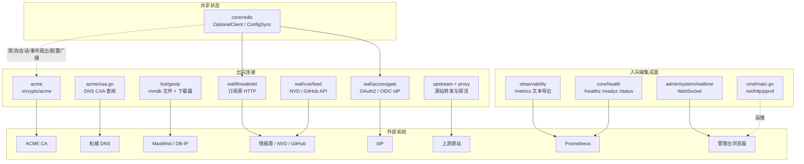
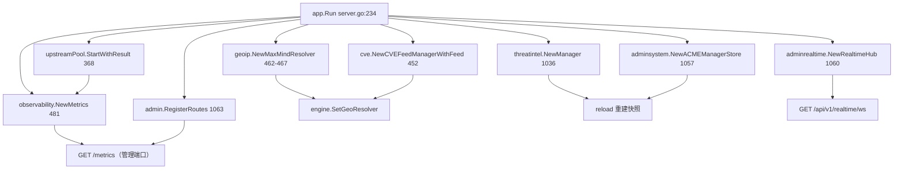
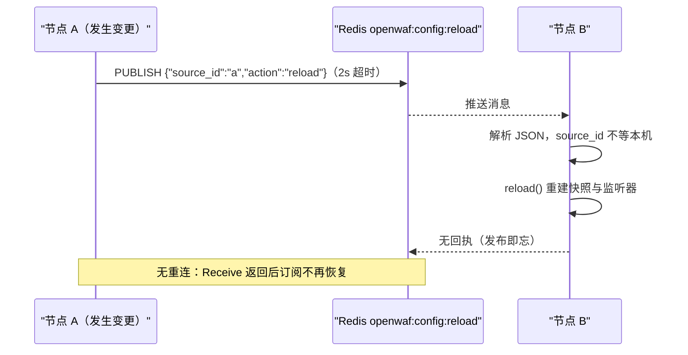
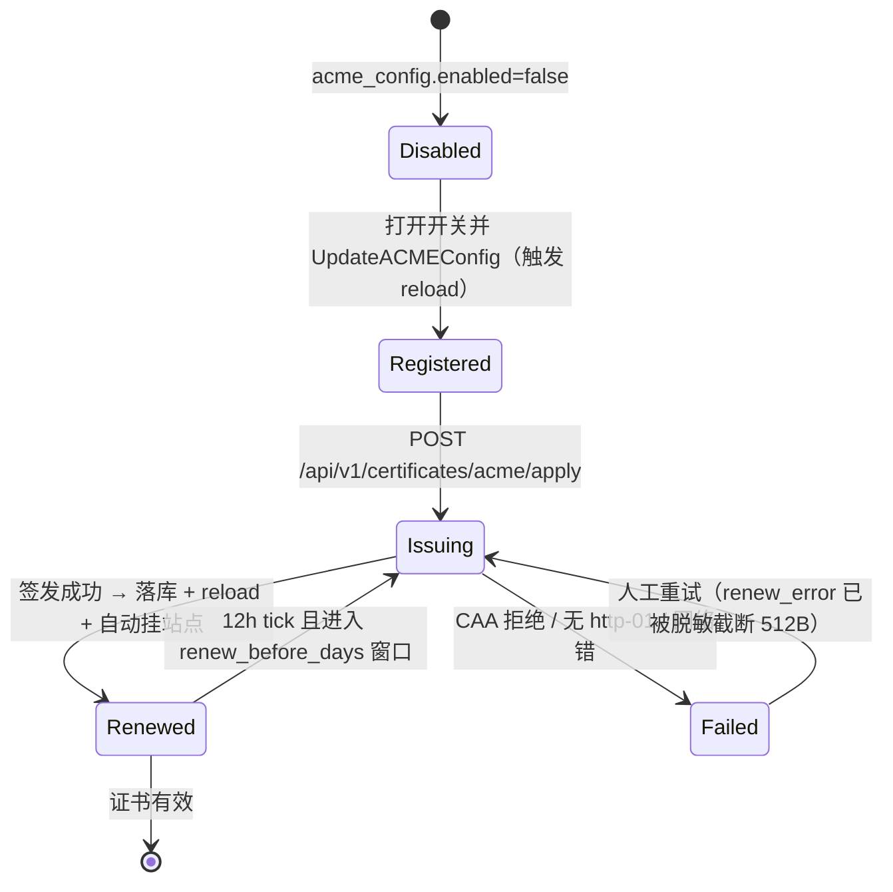
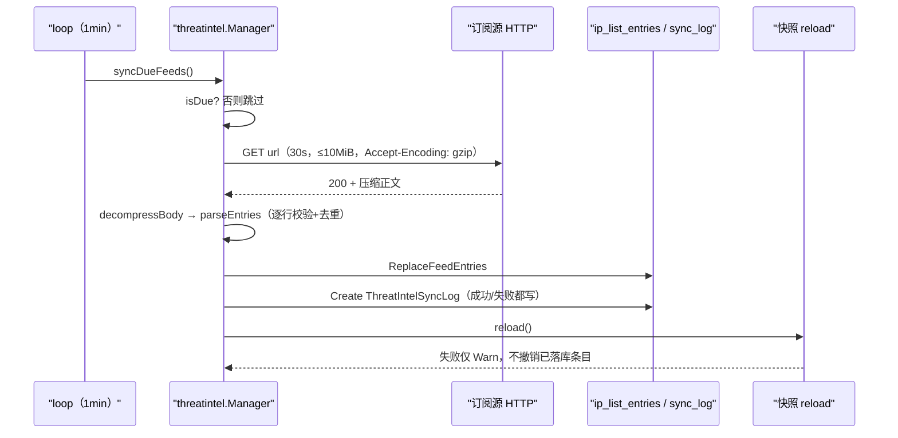
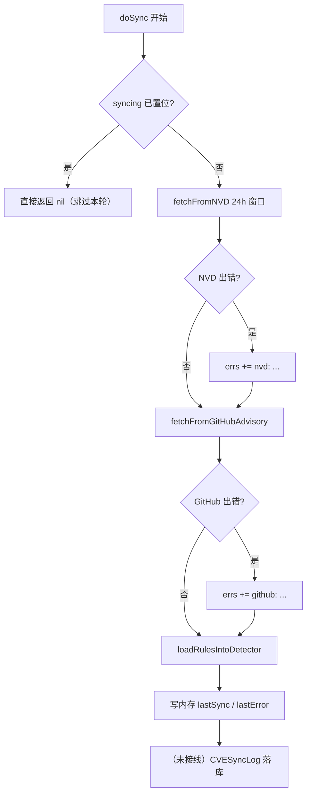
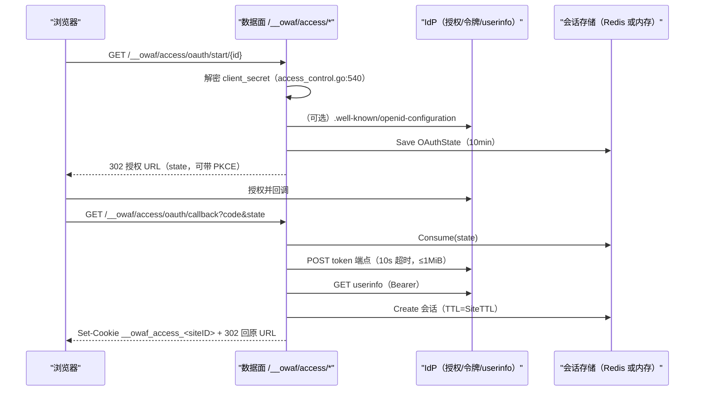
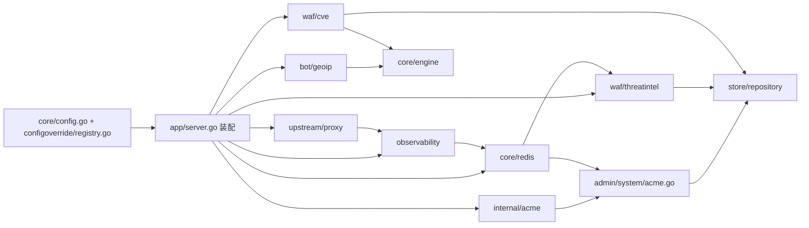
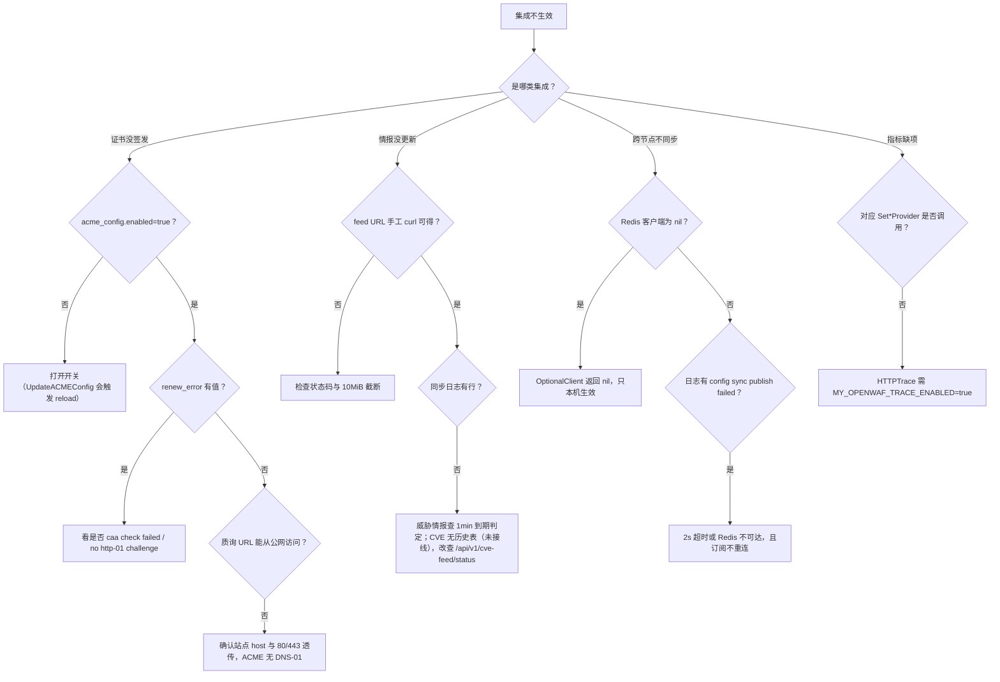

# 第三方集成

> [返回 扩展与插件系统](../扩展与插件系统.md)

<cite>
**本文档引用的文件**
- [cmd/main.go](file://cmd/main.go)
- [go.mod](file://go.mod)
- [README.md](file://README.md)
- [server.go](file://internal/app/server.go)
- [router.go](file://internal/admin/router.go)
- [config.go](file://internal/core/config.go)
- [registry.go](file://internal/core/configoverride/registry.go)
- [redis.go](file://internal/core/redis/redis.go)
- [pubsub.go](file://internal/core/redis/pubsub.go)
- [acme.go](file://internal/acme/acme.go)
- [caa.go](file://internal/acme/caa.go)
- [acme.go](file://internal/admin/system/acme.go)
- [fetch.go](file://internal/waf/bot/geoip/fetch.go)
- [geoip.go](file://internal/waf/bot/geoip/geoip.go)
- [manager.go](file://internal/waf/threatintel/manager.go)
- [feed.go](file://internal/waf/cve/feed.go)
- [oauth.go](file://internal/waf/accessgate/oauth.go)
- [gate.go](file://internal/waf/accessgate/gate.go)
- [store_redis.go](file://internal/waf/accessgate/store_redis.go)
- [providers.go](file://internal/admin/access/providers.go)
- [access_control.go](file://internal/dataplane/access_control.go)
- [unified_writer.go](file://internal/observability/unified_writer.go)
- [archiver.go](file://internal/observability/archiver.go)
- [metrics.go](file://internal/observability/metrics.go)
- [health.go](file://internal/upstream/health.go)
- [scheme_alias.go](file://internal/upstream/scheme_alias.go)
- [proxy.go](file://internal/proxy/proxy.go)
- [outbound.go](file://internal/security/outbound.go)
- [health.go](file://internal/core/health/health.go)
- [realtime.go](file://internal/admin/system/realtime/realtime.go)
- [cve_rule.go](file://internal/store/repository/cve/cve_rule.go)
- [repository.go](file://internal/store/repository/repository.go)
</cite>

## 目录

1. [简介](#简介)
2. [项目结构](#项目结构)
3. [核心组件](#核心组件)
4. [架构总览](#架构总览)
5. [详细组件分析](#详细组件分析)
6. [依赖关系分析](#依赖关系分析)
7. [性能考虑](#性能考虑)
8. [故障排查指南](#故障排查指南)
9. [结论](#结论)
10. [附录](#附录)

## 简介

本篇是「第三方集成」主题目录的总览，回答三个问题：My-OpenWaf 实际对外连接了哪些系统、每条连接的确切代码位置与失败行为、以及**哪些常被写进 WAF 文档但本项目根本没有实现的集成**。

结论必须先讲清楚：本项目的对外集成面是**收敛的**。`go.mod` 的 require 段实测只有 rueidis、ristretto、gorm（sqlite/mysql/postgres 三驱动）、quic-go、gopher-lua、quickjs-go、gmsm、maxminddb-golang、webp、freetype、go-captcha、utls、go-ja4、gorilla/websocket、hertz 等（`go.mod:5-38`），**没有任何消息队列客户端、没有 Elasticsearch/Loki 写入器、没有对象存储 SDK、没有 OpenTelemetry/Jaeger SDK、没有 SMTP 或 IM 机器人 SDK、也没有 prometheus/client_golang**——`/metrics` 的文本格式是自己渲染的（`internal/observability/metrics.go:253`）。凡把 Kafka、RabbitMQ、ES 远程写入、S3 归档、告警机器人写成本项目能力的描述，都是虚构，本文按下表口径逐条证伪。

集成清单表（本表是全目录三篇文档的状态基准，子篇不得另立说法）：

| 外部系统 | 接入方式与位置 | 配置项 | 当前状态 | 失败行为 |
|---|---|---|---|---|
| Redis | rueidis 客户端 `internal/core/redis/redis.go:17` | `MY_OPENWAF_REDIS_ADDR/PASSWORD/DB` | 已实现 | 地址为空返回 nil 客户端，各模块降级内存态 |
| Redis Pub/Sub 配置同步 | 频道 `openwaf:config:reload` `internal/core/redis/pubsub.go:16` | 同上 | 已实现 | 发布 2s 超时仅告警 `pubsub.go:78-82`；**无重连** |
| ACME CA（默认 Let's Encrypt） | `golang.org/x/crypto/acme` 客户端 `internal/acme/acme.go:19`、`acme.go:129` | 系统设置 `acme_config` | 已实现（仅 HTTP-01） | 续期失败写 `renew_error`（脱敏截断 512B）`admin/system/acme.go:427` |
| 权威 DNS（CAA 查询） | 自建 DNS 查询 `internal/acme/caa.go:225` | `acme_config.caa_dns_server` | 已实现（默认关闭） | 查询失败按策略拒绝签发 `acme.go:124-126` |
| MaxMind / DB-IP `.mmdb` 库文件 | 本地文件打开 `internal/waf/bot/geoip/geoip.go:50` | `MY_OPENWAF_GEOIP_DB`（README.md:334） | 已实现（文件加载） | 库缺失时评分恒 0，Bot 判定不中断 |
| GeoIP 库自动下载 | `geoip.GeoIPBootstrap` `internal/waf/bot/geoip/fetch.go:77` | 无 | **未接线**：全库无生产调用点 | 不执行；需自行在 `server.go:462` 前挂载 |
| NVD CVE API 2.0 | `internal/waf/cve/feed.go:278`、`:296` | `MY_OPENWAF_CVE_FEED_ENABLED`、`MY_OPENWAF_NVD_API_KEY`、`MY_OPENWAF_CVE_FEED_INTERVAL` | 已实现 | 单页失败即该源本轮失败，记 `last_error` |
| GitHub Advisory API | `internal/waf/cve/feed.go:530` | 同上（共用 feed 开关） | 已实现 | 与 NVD 错误合并进 `last_error` `feed.go:171-190` |
| CVE 同步历史表 | `repository.CVESyncLogRepo.Create` `internal/store/repository/cve/cve_rule.go:303` | 无 | **未接线**：feed 循环不写该表 | 历史不可查，仅内存 `SyncStatus` |
| 威胁情报订阅源（HTTP） | `internal/waf/threatintel/manager.go:229` | `threat_intel_feeds` 表（URL/认证头/周期） | 已实现 | 失败写 `LastError` + 同步日志 `manager.go:182-184` |
| OAuth2 / OIDC 身份提供方 | `internal/waf/accessgate/oauth.go:194`、发现 `:307` | 站点访问控制提供方 | 已实现 | 出站 10s 超时 `oauth.go:26`；失败回落登录页 |
| 上游源站 | 转发 `internal/proxy/proxy.go`、探活 `internal/upstream/health.go:609` | 站点 upstream 列表 | 已实现 | 探活 10s 间隔 / 2s 超时 `server.go:368-374` |
| Prometheus 抓取 | 文本导出 `internal/observability/metrics.go:241` | 无 | 已实现（管理端口 `server.go:1056`） | 抓取失败只影响外部看板 |
| 管理台实时推送 | WebSocket `internal/admin/system/realtime/realtime.go:204` | 无 | 已实现（一次性票据 60s） | 票据无效直接 401，不升级 |
| Go pprof | `cmd/main.go:29-41` | `MY_OPENWAF_PPROF_BIND` | 已实现（默认关闭） | 未设地址则不监听 |
| Kafka / RabbitMQ / Pulsar / NATS / MQTT | 无依赖、无代码 | — | **未实现** | — |
| Elasticsearch / Loki / Filebeat 转发 | 无代码；日志只写 stdout 或文件 | `MY_OPENWAF_LOG_FILE`（README.md:338） | **未实现** | — |
| SMTP / 钉钉 / 飞书 / Slack / Telegram / Webhook 告警 | 无代码、无任何告警发送器 | — | **未实现** | — |
| S3 / OSS / COS 对象存储归档 | 无代码；归档即数据库删除 | `internal/observability/archiver.go:388` | **未实现** | — |
| OpenTelemetry / Jaeger / Zipkin 分布式追踪 | 无 SDK；`http_trace.go` 是进程内 Hertz 阶段直方图 | `MY_OPENWAF_TRACE_ENABLED` | **未实现** | — |
| LDAP / AD | 无代码；访问控制只支持 password/oauth2/oidc 三类提供方 `internal/admin/access/providers.go:20` | — | **未实现** | — |
| Consul / etcd / ZooKeeper 服务发现 | 无代码；上游列表来自快照静态配置 | — | **未实现** | — |
| gRPC 感知代理（protobuf 编解码 / 方法级路由） | 仅 scheme 别名归一 `internal/upstream/scheme_alias.go:22-28` 与 `application/grpc` 不缓存判断 `internal/proxy/proxy.go:1548` | 上游 URL 前缀 | **未实现**（字节透传已实现） | 按 HTTP/2 透传，不解析消息体 |

子篇分工：出站与协议类集成见 [服务集成](服务集成.md)，指标与事件出口见 [监控系统集成](监控系统集成.md)，消息队列一节见 [消息队列集成](消息队列集成.md)（该篇已按实测重写为「进程内与跨实例异步通道」，上表「未实现」行对应其扩展点附录）。

**章节来源**
- [go.mod:5-38](file://go.mod#L5-L38)
- [README.md:311-340](file://README.md#L311-L340)

## 项目结构

集成相关代码按「谁在外呼」划分，而不是按技术栈堆叠。下表为**模块清单表**，行数为实测非测试代码规模。

| 模块 | 路径 | 职责 | 核心符号 | 规模(行) | 测试 |
|---|---|---|---|:--------:|:----:|
| ACME | `internal/acme` | 账户注册、HTTP-01 签发、续期窗口、CAA | `Manager`、`ShouldRenewAt` | 967 | 有 |
| ACME 控制面 | `internal/admin/system/acme.go` | 配置读写、申请/续期端点、manager 缓存 | `ACMEManagerStore` | 752 | 有 |
| TLS 元数据 | `internal/tlsmeta` | 版本与套件名/能力对照 | `cipher_suites.go` | 435 | 有 |
| GeoIP | `internal/waf/bot/geoip` | mmdb 打开与评分、库自举下载 | `MaxMindResolver`、`GeoIPBootstrap` | 607 | 有 |
| 威胁情报 | `internal/waf/threatintel` | 订阅源拉取、解压、IP/CIDR 解析、全量替换 | `Manager` | 415 | 有 |
| CVE 情报源 | `internal/waf/cve/feed.go` | NVD/GitHub 拉取、CWE→正则、CVSS→severity | `CVEFeedManager` | 6117（含检测器） | 有 |
| Redis 协调 | `internal/core/redis` | 可选客户端、配置重载广播 | `OptionalClient`、`ConfigSync` | 174 | 有 |
| 访问控制网关 | `internal/waf/accessgate` | 密码/OAuth2/OIDC 流程、会话与 state 存储 | `OAuthFlow`、`Gate` | 1672 | 有 |
| 访问控制控制面 | `internal/admin/access` | 提供方 CRUD、client_secret 加解密 | `ListProviders` | 1077 | 有 |
| 观测性 | `internal/observability` | `/metrics` 渲染、HTTPTrace、写入器、归档 | `Metrics`、`UnifiedWriter` | 4205 | 有 |
| 数据面指标 | `internal/dataplane/metrics` | 原子计数与 10×1s 环形 QPS | `Metrics.Summary` | 161 | 有 |
| 上游与探活 | `internal/upstream` | 健康池、HTTP 探测、scheme 别名 | `Pool`、`HTTPProbeWithResult` | 1231 | 有 |
| 出站代理 | `internal/proxy` | 转发、头净化、协议分派 | `UpstreamRequestGuardSnapshot` | 6009 | 有 |
| 出站头安全 | `internal/security` | 转发身份头重建 | `RebuildOutboundForwardingHeaders` | 439 | 有 |
| 健康探针 | `internal/core/health` | `/healthz` `/readyz` `/status` | `Checker.Ready` | 105 | 有 |
| 实时推送 | `internal/admin/system/realtime` | 票据 + WebSocket 扇出 | `RealtimeHub` | 616 | 有 |
| PoW 前端产物 | `wasm-pow-solver/` | Rust 编译产物落 `challenge/powdata` | `Makefile: optimize` | — | 无 |



**图表来源**
- [internal/acme/acme.go:19](file://internal/acme/acme.go#L19)
- [internal/acme/caa.go:225](file://internal/acme/caa.go#L225)
- [internal/waf/bot/geoip/geoip.go:50](file://internal/waf/bot/geoip/geoip.go#L50)
- [internal/waf/threatintel/manager.go:229](file://internal/waf/threatintel/manager.go#L229)
- [internal/waf/cve/feed.go:278](file://internal/waf/cve/feed.go#L278)
- [internal/waf/accessgate/oauth.go:194](file://internal/waf/accessgate/oauth.go#L194)
- [internal/upstream/health.go:609](file://internal/upstream/health.go#L609)
- [internal/core/redis/pubsub.go:16](file://internal/core/redis/pubsub.go#L16)
- [internal/observability/metrics.go:241](file://internal/observability/metrics.go#L241)
- [cmd/main.go:29](file://cmd/main.go#L29)

**章节来源**
- [internal/app/server.go:462](file://internal/app/server.go#L462)
- [internal/app/server.go:1056](file://internal/app/server.go#L1056)

## 核心组件

四条集成主线共享同一套约定：**每条出向连接自带超时与体积上限，每个后台循环失败只降级不致命，所有可选依赖以 nil 客户端起步**。

- `acme.Manager`：持有 `*acme.Client` 与进程内生成的 P-256 账户密钥（`internal/acme/acme.go:73`），密钥**不落盘**，因此进程重启后由 `Register` 重新注册（409 视为已注册，`acme.go:387-396`）。
- `threatintel.Manager`：一个 goroutine 轮询到期订阅源，30s 超时、10MiB 响应上限、gzip/deflate/zlib 自适应解压、逐行 `net.ParseIP`/`ParseCIDR` 校验（`internal/waf/threatintel/manager.go:25-32`、`:269-324`、`:346-390`）。
- `cve.CVEFeedManager`：同一条 `doSync` 依次拉 NVD 与 GitHub Advisory，两者错误合并后写内存 `SyncStatus`（`internal/waf/cve/feed.go:152-190`）。
- `coreredis.ConfigSync`：JSON 载荷带 `source_id` 做回环抑制（`internal/core/redis/pubsub.go:19-22`、`:113-116`），订阅循环不重连。
- `accessgate.OAuthFlow` + `RedisSessionStore`：数据面认证出向统一走带 10s 超时的专用客户端（`internal/waf/accessgate/oauth.go:26-32`），会话与 state 键前缀 `owaf:access:*`、单命令 100ms 超时（`internal/waf/accessgate/store_redis.go:15-21`）。

核心符号的代码上下文表（改动影响面判断用）：

| 组件 | 位置 | 职责 | 上游调用者 | 下游依赖 | 失败语义 |
|---|---|---|---|---|---|
| `acmepkg.NewManager` | `internal/acme/acme.go:64` | 构造 CA 客户端 | `admin/system/acme.go:314` | `golang.org/x/crypto/acme` | 返回 error，ACME 关闭 |
| `Manager.renewDue` | `internal/admin/system/acme.go:402` | 窗口内续期 | `ACMEManagerStore.RenewLoop` `:372` | 证书表、`reload` | 逐域名 continue |
| `Manager.fetchAndParse` | `internal/waf/threatintel/manager.go:229` | 拉取订阅源 | `syncFeedInternal` `:180` | `http.Client` | 写 `LastError` + 同步日志 |
| `CVEFeedManager.doSync` | `internal/waf/cve/feed.go:152` | 双源同步 | `loop` `:139`、`SyncNow` `:120` | NVD、GitHub API、`cve_rules` | 合并错误入 `lastError` |
| `ConfigSync.PublishReload` | `internal/core/redis/pubsub.go:64` | 广播重载 | 管理端 reload 链 | rueidis `PUBLISH` | 2s 超时仅告警 |
| `OAuthFlow.ExchangeCode` | `internal/waf/accessgate/oauth.go:194` | 授权码换令牌 | `handleAccessOAuthCallback` | IdP token 端点 | 返错并回落登录页 |
| `UnifiedWriter.pushToRedis` | `internal/observability/unified_writer.go:1094` | 事件扇出 | `flush` `:923-926` | rueidis `DoMulti` | 失败记警告并标记 failed |
| `Pool.StartWithResult` | `internal/upstream/health.go:587` | 上游探活 | `server.go:368` | 源站 | 目标标记不健康 |

**章节来源**
- [internal/acme/acme.go:64-95](file://internal/acme/acme.go#L64-L95)
- [internal/admin/system/acme.go:281-331](file://internal/admin/system/acme.go#L281-L331)
- [internal/waf/threatintel/manager.go:158-226](file://internal/waf/threatintel/manager.go#L158-L226)
- [internal/waf/cve/feed.go:120-190](file://internal/waf/cve/feed.go#L120-L190)
- [internal/core/redis/pubsub.go:64-127](file://internal/core/redis/pubsub.go#L64-L127)
- [internal/waf/accessgate/oauth.go:194-249](file://internal/waf/accessgate/oauth.go#L194-L249)
- [internal/observability/unified_writer.go:918-930](file://internal/observability/unified_writer.go#L918-L930)
- [internal/upstream/health.go:587-609](file://internal/upstream/health.go#L587-L609)

## 架构总览

集成拓扑的唯一汇合点是 `app.Run()`：所有出向客户端与后台循环都在这里构造并启动，所有入向端点都挂在**管理端口**（默认 `:9443`，`internal/core/config.go:362-364`）上，数据面只负责透传 ACME challenge 与访问控制端点。

| 层次 | 承载 | 位置 | 对外契约 |
|---|---|---|---|
| 启动装配 | `app.Run` | `internal/app/server.go:234` | 环境变量 + 系统设置 |
| 出向客户端 | acme / feed / threatintel / accessgate / upstream | `server.go:452`、`:1036`、`:368` | HTTPS/DNS/TCP |
| 共享后端 | rueidis 单客户端多路复用 | `internal/core/redis/redis.go:17` | RESP |
| 入向被监控面 | `/metrics` `/healthz` `/readyz` `/status` | `server.go:1053-1056` | 文本 / JSON，**无鉴权** |
| 入向管理面 | `/api/v1/*` 217 端点 | `internal/admin/router.go:89` | JWT / API Key |
| 入向实时 | `/api/v1/realtime/ws` | `router.go:424` | 一次性票据 |
| 数据面透传 | `/.well-known/acme-challenge/`、`/__owaf/access/*` | `internal/dataplane/handler.go:91`、`access_control.go:59-63` | HTTP |



**图表来源**
- [internal/app/server.go:452](file://internal/app/server.go#L452)
- [internal/app/server.go:462-474](file://internal/app/server.go#L462-L474)
- [internal/app/server.go:1036-1039](file://internal/app/server.go#L1036-L1039)
- [internal/app/server.go:1053-1061](file://internal/app/server.go#L1053-L1061)
- [internal/app/server.go:368-374](file://internal/app/server.go#L368-L374)

**章节来源**
- [internal/app/server.go:234](file://internal/app/server.go#L234)
- [internal/core/config.go:362-364](file://internal/core/config.go#L362-L364)
- [internal/admin/router.go:89](file://internal/admin/router.go#L89)

## 详细组件分析

### Redis：唯一的共享后端

Redis 是可选依赖：`OptionalClient` 在地址为空时返回 `nil`，各模块据此走内存分支（`internal/core/redis/redis.go:17-33`，拨号超时 5s、写超时 3s、`DisableCache: true`）。跨节点一致性只有 Pub/Sub 一条通道，频道名固定 `openwaf:config:reload`，载荷为 `{"source_id","action"}`。

配置广播的流程步骤表：

| 步 | 动作 | 执行位置 | 输入 | 输出 | 失败分支 | 可观测点 |
|:--:|---|---|---|---|---|---|
| 1 | 管理端变更落库后触发 reload | `internal/admin/router.go` 各写端点 | 请求体 | 新快照代次 | 返回 500 | 访问日志 |
| 2 | 组装 JSON 载荷 | `internal/core/redis/pubsub.go:70-73` | sourceID + action | payload | 序列化失败仅告警 | `config sync payload marshal failed` |
| 3 | `PUBLISH` 带 2s 超时 | `pubsub.go:76-82` | 频道与载荷 | OK | **仅 Warn 日志，不回滚** | `config sync publish failed` |
| 4 | 他节点 `Receive` 回调 | `pubsub.go:96-127` | 消息串 | 触发本地 reload | reload 错误记 Error | `config sync reload failed` |
| 5 | 回环抑制 | `pubsub.go:113-116` | `event.SourceID` | 命中则 return | 裸 `"reload"` 串走 `:98-105` 分支**不比对来源** | 自我回环重载 |



**图表来源**
- [internal/core/redis/pubsub.go:16](file://internal/core/redis/pubsub.go#L16)
- [internal/core/redis/pubsub.go:64-127](file://internal/core/redis/pubsub.go#L64-L127)

**章节来源**
- [internal/core/redis/redis.go:17-42](file://internal/core/redis/redis.go#L17-L42)
- [internal/core/redis/pubsub.go:16-127](file://internal/core/redis/pubsub.go#L16-L127)

### ACME：签发、质询回吐与续期窗口

签发路径是真实的 `golang.org/x/crypto/acme` 客户端（`internal/acme/acme.go:129`），**只支持 HTTP-01**：授权对象里找不到 `http-01` 就直接报错（`acme.go:146-155`），没有 DNS-01 与 TLS-ALPN-01。质询响应存内存 map，由两处回吐：管理端 `GET /.well-known/acme-challenge/:token`（`internal/admin/router.go:425-437`）与数据面 `dpOpts.ACMEChallengeResponse`（`internal/app/server.go:1058`、`internal/dataplane/handler.go:91`）。

| 步 | 动作 | 执行位置 | 输入 | 输出 | 失败分支 |
|:--:|---|---|---|---|---|
| 1 | 读 `acme_config` 并归一默认值 | `internal/admin/system/acme.go:192-213` | 系统设置 | `ACMEConfig` | 缺项回落默认（LE 生产 URL、30 天窗口） |
| 2 | 按配置指纹缓存 manager | `acme.go:299-330` | cacheKey（5 字段） | `acmeManager` | `!cfg.Enabled` → `ACME is disabled` |
| 3 | CAA 预检 | `internal/acme/acme.go:124` | 域名 + 策略 | 通过/中止 | 不匹配即 `caa check failed` |
| 4 | `AuthorizeOrder` → 接受 http-01 | `acme.go:129-182` | 域名 | 有效授权 | 任一环节返错 |
| 5 | `CreateOrderCert` 取链 | `acme.go:200` | CSR | DER 链 | 失败进 onRenew 回调 |
| 6 | 落库并 reload | `admin/system/acme.go:343-350` | PEM + 到期 | 证书行 | reload 失败记 Error |
| 7 | 12h tick 续期判定 | `acme.go:372-386` + `internal/acme/acme.go:288` | `ExpiresAt` | 窗口内续期 | `ShouldRenewAt` 对零值过期时间返回 true |



**图表来源**
- [internal/admin/system/acme.go:372-441](file://internal/admin/system/acme.go#L372-L441)
- [internal/acme/acme.go:118-237](file://internal/acme/acme.go#L118-L237)
- [internal/acme/acme.go:288-293](file://internal/acme/acme.go#L288-L293)

**章节来源**
- [internal/acme/acme.go:19](file://internal/acme/acme.go#L19)
- [internal/acme/acme.go:58-61](file://internal/acme/acme.go#L58-L61)
- [internal/acme/acme.go:101-237](file://internal/acme/acme.go#L101-L237)
- [internal/admin/system/acme.go:173-180](file://internal/admin/system/acme.go#L173-L180)
- [internal/admin/router.go:425-437](file://internal/admin/router.go#L425-L437)
- [internal/dataplane/handler.go:91](file://internal/dataplane/handler.go#L91)

### GeoIP：文件已接线，自动下载未接线

`MaxMindResolver` 通过 maxminddb 打开 city/asn 两个库文件（`internal/waf/bot/geoip/geoip.go:50`），路径来自 `MY_OPENWAF_GEOIP_DB`（`internal/core/config.go:387`），仅当 `bot.enabled` 为真才构造并注入引擎（`internal/app/server.go:462-474`）。同包内确实存在一套完整的下载器：候选清单在 `internal/waf/bot/geoip/fetch.go:28-57`（GeoLite2/DB-IP 四个 `.mmdb` 固定地址 + sha256 锚点），20s 客户端超时与 16MiB 体积上限（`fetch.go:98`、`:131`）。

**实测关键差异**：`GeoIPBootstrap` 除自身定义与测试外**没有任何调用点**（全库检索仅命中 `fetch.go:77` 一处函数定义），因此当前部署形态下 GeoIP 库必须人工放置。若要接线，最小改动落在解析器构造之前：

```go
// 现有代码 internal/app/server.go:462-467
var geoResolver *geoip.MaxMindResolver
botCfg := rt.Config.Bot
// 待补：在构造解析器之前调用自举钩子 internal/waf/bot/geoip/fetch.go:77
// member := geoip.GeoIPBootstrap(botCfg.GeoIPDBPath, rt.Config.DataDir)
// botCfg.GeoIPDBPath = member.CityPath（失败时保持原值，不阻塞启动）
if botCfg.Enabled {
	geoResolver = geoip.NewMaxMindResolver(botCfg.GeoIPDBPath, botCfg.GeoIPDBPath, botCfg)
	eng.SetGeoResolver(geoResolver, botCfg.ScoreThreshold)
}
```

失败行为已按「不致命」设计：显式路径缺失时只告警并回落下载分支（`fetch.go:82-84`），资产目录创建失败也只是记 `NoAssetDir` 后返回空路径（`fetch.go:133-137`），库缺失时 `ScoreIP` 返回 0，不阻断请求。

**章节来源**
- [internal/waf/bot/geoip/geoip.go:44-50](file://internal/waf/bot/geoip/geoip.go#L44-L50)
- [internal/waf/bot/geoip/geoip.go:153](file://internal/waf/bot/geoip/geoip.go#L153)
- [internal/waf/bot/geoip/fetch.go:28-98](file://internal/waf/bot/geoip/fetch.go#L28-L98)
- [internal/app/server.go:462-474](file://internal/app/server.go#L462-L474)
- [internal/core/config.go:387-391](file://internal/core/config.go#L387-L391)

### 威胁情报：出向拉取并已写同步日志

`threatintel.Manager` 每分钟检查一次到期订阅源（`internal/waf/threatintel/manager.go:31`、`:98-111`），单源周期由 `SyncInterval` 决定、非正值按 1h 兜底（`manager.go:136-145`）。拉取带可选认证头与 `Accept-Encoding: gzip`（`manager.go:234-239`），响应限 10MiB（`manager.go:250`），解析逐行校验 IP/CIDR 并去重（`manager.go:346-390`）。全量替换成功后调用 `reload`（`manager.go:187-202`），每次同步无论成败都写一条 `ThreatIntelSyncLog`（`manager.go:207-226`），历史由归档器按 `drop_event_retention_days` 清理（`internal/observability/archiver.go:388-391`）。

| 步 | 动作 | 执行位置 | 输入 | 输出 | 失败分支 |
|:--:|---|---|---|---|---|
| 1 | 列出启用订阅源 | `manager.go:115` | DB | feeds | 记 Error 并返回 |
| 2 | 到期判定 | `manager.go:136-145` | `LastSyncAt` | bool | — |
| 3 | 同 feed 去重锁 | `manager.go:160-171` | feedID | 占位 | 已在同步则直接返回 nil |
| 4 | HTTP 拉取 | `manager.go:229-253` | URL + 认证头 | 原始字节 | 非 200 即错 |
| 5 | 解压 | `manager.go:269-324` | Content-Encoding | 正文 | 解压失败如实返错 |
| 6 | 解析条目 | `manager.go:346-390` | 正文 | `IPListEntry` | 非法行跳过不整体失败 |
| 7 | 全量替换 + reload | `manager.go:187-202` | 条目 | 新快照 | reload 失败仅 Warn |



**图表来源**
- [internal/waf/threatintel/manager.go:98-133](file://internal/waf/threatintel/manager.go#L98-L133)
- [internal/waf/threatintel/manager.go:158-226](file://internal/waf/threatintel/manager.go#L158-L226)

**章节来源**
- [internal/waf/threatintel/manager.go:25-32](file://internal/waf/threatintel/manager.go#L25-L32)
- [internal/waf/threatintel/manager.go:229-324](file://internal/waf/threatintel/manager.go#L229-L324)
- [internal/observability/archiver.go:388-391](file://internal/observability/archiver.go#L388-L391)
- [internal/app/server.go:1036-1039](file://internal/app/server.go#L1036-L1039)

### CVE 情报源：拉取已实现，同步历史未接线

NVD 侧固定窗口为最近 24 小时（`internal/waf/cve/feed.go:298-299`），单页 50 条、最多 50 页，无 key 时页间 6s、有 key 时 1.2s（`feed.go:281-295`），请求头 `apiKey` 仅在有密钥时附加（`feed.go:366`）。GitHub 侧固定 `type=reviewed&per_page=30`，带 `X-GitHub-Api-Version: 2022-11-28`（`feed.go:530-535`）。两者都使用 30s 独立的 `http.Client`（`feed.go:296`、`:528`）。规则生成本质是「CWE→通用正则 + target」映射（`feed.go:640-666`，CWE-352 明确返回空以跳过），CVSS 仅用于推导 severity（`feed.go:614-623`），**不涉及 CPE 与受影响版本区间**。

同步周期实测 6h，解析失败或非正值都回落 6h（`internal/app/server.go:448-451`；默认串见 `internal/core/config.go:399-405`）。

未接线项：`CVESyncLog` 表与仓库方法都存在（`internal/store/cve/cve.go:38`、`internal/store/repository/cve/cve_rule.go:303`、已注册进 `Repos.CVESyncLog` `internal/store/repository/repository.go:78`），但 `feed.go` 全文不引用它——与威胁情报形成明确对照。若要对齐，插入点在 `doSync` 收尾统计处（`feed.go:152-190`）。



**图表来源**
- [internal/waf/cve/feed.go:152-190](file://internal/waf/cve/feed.go#L152-L190)
- [internal/waf/cve/feed.go:276-300](file://internal/waf/cve/feed.go#L276-L300)
- [internal/waf/cve/feed.go:528-535](file://internal/waf/cve/feed.go#L528-L535)

**章节来源**
- [internal/waf/cve/feed.go:276-295](file://internal/waf/cve/feed.go#L276-L295)
- [internal/waf/cve/feed.go:605-666](file://internal/waf/cve/feed.go#L605-L666)
- [internal/app/server.go:448-453](file://internal/app/server.go#L448-L453)
- [internal/core/config.go:393-405](file://internal/core/config.go#L393-L405)
- [internal/store/repository/cve/cve_rule.go:297-311](file://internal/store/repository/cve/cve_rule.go#L297-L311)

### 访问控制 IdP：OAuth2 / OIDC 真实出向

旧文档「仓库中未发现 OAuth/LDAP 的直接实现」的表述是错的。OAuth2/OIDC 授权码流程已完整实现于数据面：生成授权 URL（可带 PKCE S256，`internal/waf/accessgate/oauth.go:163-169`）、`POST` 换令牌（`:194-249`）、`GET` userinfo 取身份（`:252-304`）、OIDC `.well-known/openid-configuration` 自动发现（`:307-336`），state 有效期 10 分钟（`:147`）。端点路径为 `/__owaf/access/oauth/start/{id}` 与 `/__owaf/access/oauth/callback`（`internal/dataplane/access_control.go:59-63`、`:174-178`）。`client_secret` 以 JWT 主密钥经 HKDF 派生 AES-256-GCM 加密落库、响应只回显遮蔽值（`internal/admin/access/crypto.go:15-29`、`providers.go:55-96`）。LDAP 与 SAML 仍为**未实现**，提供方类型白名单只有 `password|oauth2|oidc`（`internal/admin/access/providers.go:20`、`:211`）。



**图表来源**
- [internal/waf/accessgate/oauth.go:136-191](file://internal/waf/accessgate/oauth.go#L136-L191)
- [internal/waf/accessgate/oauth.go:194-304](file://internal/waf/accessgate/oauth.go#L194-L304)
- [internal/dataplane/access_control.go:233-331](file://internal/dataplane/access_control.go#L233-L331)
- [internal/waf/accessgate/gate.go:163-165](file://internal/waf/accessgate/gate.go#L163-L165)

**章节来源**
- [internal/waf/accessgate/oauth.go:17-32](file://internal/waf/accessgate/oauth.go#L17-L32)
- [internal/waf/accessgate/gate.go:15-45](file://internal/waf/accessgate/gate.go#L15-L45)
- [internal/waf/accessgate/store_redis.go:15-21](file://internal/waf/accessgate/store_redis.go#L15-L21)
- [internal/admin/access/providers.go:111-130](file://internal/admin/access/providers.go#L111-L130)
- [internal/dataplane/access_control.go:21-35](file://internal/dataplane/access_control.go#L21-L35)

## 依赖关系分析

依赖方向单一：`internal/app` 装配具体客户端，业务包只依赖抽象接口（`acmeManager`、`SessionStore`、`OAuthStateStore`、`RateLimiterBackend`），因此 Redis 缺失时替换实现即可，不需改调用点。

| 依赖 | 用途 | 接入方式 | 配置来源 | 超时 | 重试 | 降级 |
|---|---|---|---|:----:|:----:|---|
| Redis | 限流、KV、会话、事件扇出、配置广播 | rueidis 单客户端 | `MY_OPENWAF_REDIS_*`、`redis_config` | 拨号 5s / 写 3s / 发布 2s | 无 | nil 客户端 → 内存态 |
| ACME CA | 证书签发与续期 | x/crypto/acme HTTP | 设置 `acme_config` | 未设置（风险，随 ctx） | 12h tick 重跑 | 记 `renew_error` |
| 权威 DNS | CAA 记录查询 | 自建 UDP 查询 | `acme_config.caa_dns_server` | 3s | 无 | 策略拒绝签发 |
| MaxMind/DB-IP | IP 地理与 ASN 评分 | mmdb 文件只读 | `MY_OPENWAF_GEOIP_DB` | —（本地） | — | 评分 0 |
| NVD API | CVE 规则增量 | HTTPS GET | `MY_OPENWAF_CVE_*` | 30s | 6h 一轮 | `last_error` |
| GitHub Advisory | CVE 规则补充 | HTTPS GET | 共用 feed 开关 | 30s | 6h 一轮 | 与 NVD 合并错误 |
| 情报订阅源 | IP/CIDR 黑名单 | HTTPS GET | `threat_intel_feeds` | 30s | 1min 检查 | `LastError` + 同步日志 |
| IdP | 站点访问控制 | OAuth2/OIDC HTTP | 站点访问控制提供方 | 10s | 无 | 回落登录页 |
| 上游源站 | 业务转发与探活 | http.Transport / h2c / QUIC | 站点 upstream | 探活 2s | 10s 重探 | 标记不健康 |
| Prometheus | 指标采集 | 拉取 `/metrics` | 无 | 抓取端决定 | 抓取端决定 | 看板缺失 |



**图表来源**
- [internal/app/server.go:448-474](file://internal/app/server.go#L448-L474)
- [internal/app/server.go:1036-1039](file://internal/app/server.go#L1036-L1039)
- [internal/app/server.go:1207-1233](file://internal/app/server.go#L1207-L1233)
- [internal/core/configoverride/registry.go:290](file://internal/core/configoverride/registry.go#L290)

能力边界（本文档最重要的一张判定表，用于防止再次写入虚构能力）：

| 能力 | 状态 | 依据 |
|---|:----:|---|
| 事件导出到消息队列 | 未实现 | `go.mod` 无 MQ 依赖；唯一事件出口是写库 + Redis 列表（`internal/observability/unified_writer.go:923-930`） |
| 主动告警通知（邮件/IM/Webhook） | 未实现 | 全库无 SMTP/Webhook 代码；只有日志与 `/metrics` 计数器 |
| 集中式日志远端转发 | 未实现 | 日志仅 stdout 与可选文件（README.md:338-340） |
| 对象存储归档 | 未实现 | 归档即批量 DELETE（`internal/observability/archiver.go:332-391`） |
| 分布式链路追踪上报 | 未实现 | HTTPTrace 只产进程内直方图（`internal/observability/http_trace.go:14-24`） |
| DNS-01 / TLS-ALPN-01 签发 | 未实现 | 只找 `http-01`（`internal/acme/acme.go:146-155`） |
| GeoIP 库自动更新 | 未接线 | 下载器存在但无调用点（`internal/waf/bot/geoip/fetch.go:77`） |
| LDAP / SAML 认证 | 未实现 | 类型白名单三项（`internal/admin/access/providers.go:20`） |
| 动态服务发现 | 未实现 | 上游集合来自快照（`internal/app/server.go:368-372`） |

**章节来源**
- [internal/observability/unified_writer.go:918-930](file://internal/observability/unified_writer.go#L918-L930)
- [internal/observability/archiver.go:186-192](file://internal/observability/archiver.go#L186-L192)
- [internal/observability/http_trace.go:14-24](file://internal/observability/http_trace.go#L14-L24)
- [internal/upstream/scheme_alias.go:22-28](file://internal/upstream/scheme_alias.go#L22-L28)
- [internal/proxy/proxy.go:1548](file://internal/proxy/proxy.go#L1548)
- [internal/security/outbound.go:33-52](file://internal/security/outbound.go#L33-L52)

## 性能考虑

出向连接全部在后台 goroutine，不进请求热路径；唯一进入热路径的是访问控制 IdP 换取令牌（每个新会话一次），已用 10s 超时 + 1MiB 响应上限封顶（`internal/waf/accessgate/oauth.go:26-32`、`:225`）。Redis 事件扇出在 flush 阶段用 `DoMulti` 批处理（`internal/observability/unified_writer.go:1154`），失败不阻塞写库路径。指标侧的抓取成本可忽略：`/metrics` 每次请求只做一次 `runtime.ReadMemStats` 加 9 个 provider 快照（`internal/observability/metrics.go:253-345`）。

**章节来源**
- [internal/observability/metrics.go:253-345](file://internal/observability/metrics.go#L253-L345)
- [internal/observability/unified_writer.go:1094-1160](file://internal/observability/unified_writer.go#L1094-L1160)

## 故障排查指南



**图表来源**
- [internal/admin/system/acme.go:402-441](file://internal/admin/system/acme.go#L402-L441)
- [internal/waf/threatintel/manager.go:136-145](file://internal/waf/threatintel/manager.go#L136-L145)
- [internal/core/redis/pubsub.go:76-116](file://internal/core/redis/pubsub.go#L76-L116)
- [internal/app/server.go:481-487](file://internal/app/server.go#L481-L487)

- Redis 不可达不会导致进程退出：`OptionalClient` 建连失败返回 nil（`internal/core/redis/redis.go:30-31`），排查时先看日志是否出现 `redis_enabled=false` 语义分支（`server.go:1127`）。
- 配置同步「发布成功但远端不生效」的两种真实原因：远端订阅协程已因 `Receive` 返回而结束（无重连），或载荷被当作裸串走 `pubsub.go:98-105` 分支导致本机自我回环。
- GeoIP 表现为「Bot 分数恒 0」时，先确认库文件是否存在——不要假设会自动下载。

**章节来源**
- [internal/core/redis/redis.go:17-33](file://internal/core/redis/redis.go#L17-L33)
- [internal/core/redis/pubsub.go:96-127](file://internal/core/redis/pubsub.go#L96-L127)
- [internal/acme/acme.go:146-155](file://internal/acme/acme.go#L146-L155)
- [internal/waf/bot/geoip/geoip.go:153](file://internal/waf/bot/geoip/geoip.go#L153)
- [internal/app/server.go:1127](file://internal/app/server.go#L1127)

## 结论

本轮成果是把「第三方集成」从泛泛而谈改成可核对的事实集：一条集成清单表覆盖 23 项外部系统，逐项给到接入位置、配置项、状态与失败行为；把 Redis、ACME、GeoIP、威胁情报、CVE、IdP、上游、监控、实时推送九条主线分别落到流程步骤表或代码上下文表；并订正了三类长期错误——把 OAuth 说成未实现（实际已完整实现授权码 + PKCE + OIDC 发现）、把 gRPC 说成协议级支持（实际只有 scheme 别名与透传）、把未接线的 GeoIP 下载器与 CVE 同步历史表描述成在用能力。

遗留风险按优先级：ACME 出向没有显式超时（依赖调用方 ctx）、`ConfigSync` 无重连、`/metrics` 与探针无鉴权、`CVESyncLog` 与 `GeoIPBootstrap` 两处「已写未接」。下一步建议先接 `GeoIPBootstrap`（改动面最小、收益直接），再给 `doSync` 补 CVE 同步历史落库。

## 附录

### 配置项速查

| 配置项 | 类型 | 默认值 | 作用域 | 生效方式 | 安全等级 |
|---|---|---|---|---|---|
| `MY_OPENWAF_ADMIN_BIND` | string | `:9443` | 进程 | 重启 | 普通 |
| `MY_OPENWAF_REDIS_ADDR` | string | 空 | 进程 | `POST /api/v1/redis-config` 热换 | 敏感 |
| `MY_OPENWAF_REDIS_PASSWORD` | string | 空 | 进程 | 同上 | **机密** |
| `MY_OPENWAF_GEOIP_DB` | string | 空 | 进程 | 重载（换库需重启或 Reload） | 普通 |
| `MY_OPENWAF_CVE_FEED_ENABLED` | bool | 假 | 进程 | 重启 | 普通 |
| `MY_OPENWAF_CVE_FEED_INTERVAL` | duration | `6h` | 进程 | 重启 | 普通 |
| `MY_OPENWAF_NVD_API_KEY` | string | 空 | 进程 | 重启 | **机密** |
| `MY_OPENWAF_CVE_AUTO_APPROVE` | bool | 假 | 同步 | 重启 | 普通 |
| `acme_config.directory_url` | string | LE 生产 URL | 站点无关 | 保存即 reload | 普通 |
| `acme_config.renew_before_days` | int | `30` | 续期循环 | 下次 tick | 普通 |
| `acme_config.caa_dns_server` | string | 空 | CAA 查询 | 下次签发 | 普通 |
| `MY_OPENWAF_TRACE_ENABLED` | bool | 假 | 指标 | 重启 | 普通 |
| `MY_OPENWAF_PPROF_BIND` | string | 空 | 进程 | 重启 | **机密**（不应暴露公网） |
| `MY_OPENWAF_CAPTCHA_DIR` | string | 内置目录 | 挑战 | 重载 | 普通 |

**章节来源**
- [internal/core/config.go:362-364](file://internal/core/config.go#L362-L364)
- [internal/core/config.go:387-412](file://internal/core/config.go#L387-L412)
- [internal/core/config.go:516-518](file://internal/core/config.go#L516-L518)
- [internal/core/configoverride/registry.go:290](file://internal/core/configoverride/registry.go#L290)
- [internal/core/configoverride/registry.go:336](file://internal/core/configoverride/registry.go#L336)
- [internal/core/configoverride/registry.go:372](file://internal/core/configoverride/registry.go#L372)
- [internal/admin/system/acme.go:173-180](file://internal/admin/system/acme.go#L173-L180)
- [cmd/main.go:29](file://cmd/main.go#L29)

### 若要实现未实现项，真实扩展点

| 目标 | 必须改的位置 | 理由 |
|---|---|---|
| 消息队列导出 | `internal/observability/unified_writer.go:923`（flush 内 Redis 扇出旁） | 这是唯一已聚合四类事件的出口 |
| 告警通知 | `internal/observability/unified_writer.go` 丢弃计数 + `archiver.go` 清理结果 | 丢弃量与清理失败是唯一需要人知的信号 |
| 分布式追踪 | `internal/observability/http_trace.go:14-24` 阶段常量 | 阶段名与 OTel span 一一对应 |
| LDAP 认证 | `internal/admin/access/providers.go:20` 白名单 + `internal/dataplane/access_control.go:190` | 类型判定与验证分支都在此 |
| 服务发现 | `internal/app/server.go:368-372` 的 `snapshotUpstreams` 回调 | 探活目标集合已抽象为函数 |
| GeoIP 自动更新 | `internal/app/server.go:462` 之前调用 `geoip.GeoIPBootstrap` | 解析器构造前是唯一安全插入点 |
| CVE 同步历史 | `internal/waf/cve/feed.go:152-190` 收尾处 | `Repos.CVESyncLog` 已就绪（`repository.go:78`） |

[本节为总结，无需特定文件来源]

### 相关文档索引

- [服务集成](服务集成.md)：出站协议、上游健康、访问控制与连接池细节
- [监控系统集成](监控系统集成.md)：`/metrics` 真实指标族与抓取前提
- [消息队列集成](消息队列集成.md)：进程内与跨实例异步通道，兼列 MQ 未实现与扩展点
- [扩展与插件系统](../扩展与插件系统.md)：域总览

[本节为索引，无需特定文件来源]
