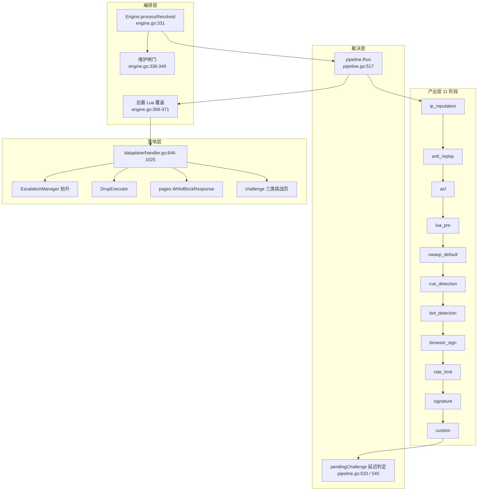
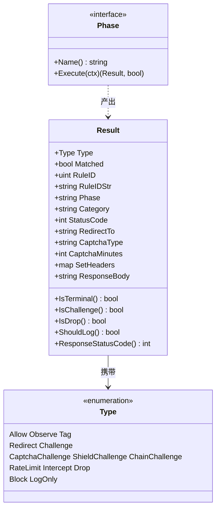
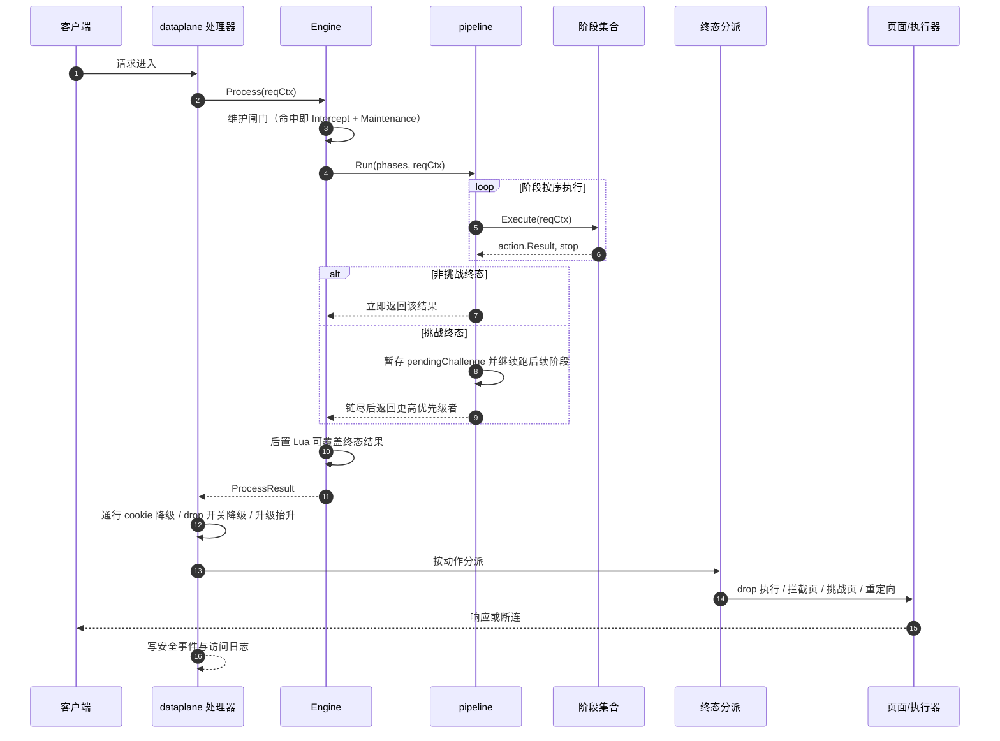
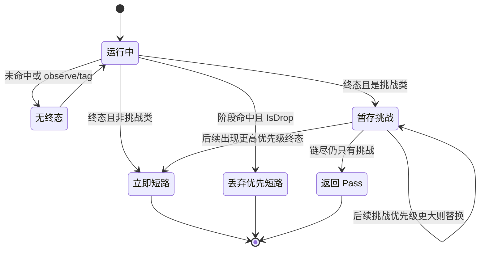
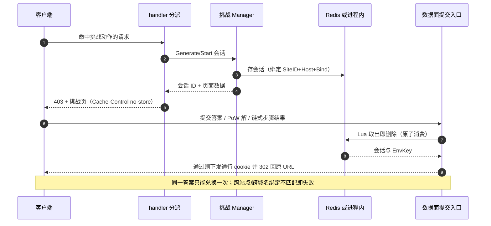
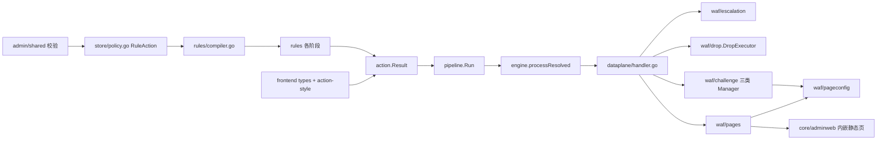

# 动作集成

> [返回 扩展与插件系统](../扩展与插件系统.md)

<cite>
**本文档引用的文件**
- [action.go](file://internal/core/action/action.go)
- [pipeline.go](file://internal/core/pipeline/pipeline.go)
- [engine.go](file://internal/core/engine/engine.go)
- [phases.go](file://internal/core/rules/phases.go)
- [compiler.go](file://internal/core/rules/compiler.go)
- [lua_phase.go](file://internal/core/rules/lua_phase.go)
- [handler.go](file://internal/dataplane/handler.go)
- [challenge.go](file://internal/dataplane/challenge.go)
- [handler_support.go](file://internal/dataplane/handler_support.go)
- [drop.go](file://internal/waf/drop/drop.go)
- [block.go](file://internal/waf/pages/block.go)
- [config.go](file://internal/waf/pageconfig/config.go)
- [captcha.go](file://internal/waf/challenge/captcha.go)
- [pages.go](file://internal/waf/challenge/pages.go)
- [shield.go](file://internal/waf/challenge/shield.go)
- [chain.go](file://internal/waf/challenge/chain.go)
- [escalation.go](file://internal/waf/escalation/escalation.go)
- [policy.go](file://internal/store/policy.go)
- [security_event.go](file://internal/store/repository/security_event.go)
- [access_log.go](file://internal/store/repository/access_log.go)
- [helpers.go](file://internal/admin/shared/helpers.go)
- [build.go](file://internal/snapshot/build.go)
- [types.ts](file://frontend/lib/types.ts)
- [action-style.ts](file://frontend/lib/action-style.ts)
</cite>

## 目录

1. [简介](#简介)
2. [项目结构](#项目结构)
3. [核心组件](#核心组件)
4. [架构总览](#架构总览)
5. [详细组件分析](#详细组件分析)
6. [依赖关系分析](#依赖关系分析)
7. [性能考虑](#性能考虑)
8. [故障排查指南](#故障排查指南)
9. [结论](#结论)
10. [附录](#附录)

## 简介

「动作（action）」是 WAF 检测的唯一出口契约：任何阶段判定命中后，只能产出一个 `action.Result`，由其后的裁决层决定短路还是继续、由数据面决定回什么页。本文站在**扩展开发**视角描述这条契约，回答三件事：

- 动作有哪些、各自语义与优先级如何（`internal/core/action`，393 行）；
- 一个动作从阶段产出到落地响应要穿过几层，每层的判定依据是什么（`internal/core/pipeline` 678 行 + `internal/dataplane/handler.go`）；
- 新增一个动作到底要改哪些文件（文末逐项清单，全部给到行号）。

有一条项目级约定必须先讲清楚：**挑战类动作必须按 WAF action 语义建模并渲染各自的挑战页**——`captcha_challenge` 显示配置的具体验证码类型（算式/点击/滑块/旋转），`shield_challenge` 走 5 秒盾流程（PoW + 环境指纹 + 行为采样），`chain_challenge` 展示链式步骤进度。任何把这三者写成「返回 403 通用状态码页」的描述都是错误的：它们的**默认状态码确实都是 403**（`DefaultStatusCode`，action.go:284-307），但响应体是挑战页而非拦截页，客户端行为完全不同。

## 项目结构

动作系统横跨六层，各层只依赖下一层的抽象：

| 层 | 路径 | 职责 | 核心符号 | 规模(行) |
|----|------|------|----------|:--------:|
| 契约 | `internal/core/action` | 类型、结果、优先级、状态码、内部码 | `Type`、`Result`、`TerminalPriority` | 393 |
| 裁决 | `internal/core/pipeline` | 阶段有序链、终态与延迟挑战、请求/响应改写 | `Phase`、`Run`、`RequestCtx` | 678 |
| 编排 | `internal/core/engine` | 按站点装配阶段链、维护闸门、后置 Lua 覆盖 | `processResolved`、`getOrBuildPhases` | 646 |
| 产出 | `internal/core/rules` | 11 个阶段各自产出结果 | `hit`、`normalizeConfiguredAction`、各 `*Phase` | 4048 |
| 落地 | `internal/dataplane` | 分派渲染、drop 执行、升级抬升、日志与事件 | `handlePipelineResult`、`effectiveCaptchaType` | 8836 |
| 呈现 | `internal/waf/pages`、`pageconfig`、`challenge`、`drop` | 拦截/维护/挑战三类页面与执行器 | `WriteBlockResponse`、`WriteCaptchaChallengeResponse`、`DropExecutor` | 848 + 274 + 6110 + 113 |



**图表来源**
- [internal/core/engine/engine.go:331-378](file://internal/core/engine/engine.go#L331-L378)
- [internal/core/pipeline/pipeline.go:517-560](file://internal/core/pipeline/pipeline.go#L517-L560)
- [internal/core/engine/engine.go:465-548](file://internal/core/engine/engine.go#L465-L548)
- [internal/dataplane/handler.go:646-1025](file://internal/dataplane/handler.go#L646-L1025)

**章节来源**
- [internal/core/engine/engine.go:331-378](file://internal/core/engine/engine.go#L331-L378)
- [internal/core/engine/engine.go:465-548](file://internal/core/engine/engine.go#L465-L548)
- [internal/core/pipeline/pipeline.go:499-565](file://internal/core/pipeline/pipeline.go#L499-L565)

## 核心组件

动作取值全集如下。**同优先级时取先出现者**（`pipeline.Run` 用严格大于 `>` 比较，pipeline.go:533、545），因此四个挑战类型互相之间由阶段顺序决定胜负。

| 动作值 | 常量 | 优先级 | 终态 | 默认状态码 | 内部码 | 语义 |
|--------|------|:------:|:----:|:----------:|:------:|------|
| `allow` | `Allow` | 0 | ✗ | — | — | 放行，`Pass()` 的默认值 |
| `observe` | `Observe` | 10 | ✗ | — | 1008 | 仅记录，请求继续 |
| `tag` | `Tag` | 0 | ✗ | — | — | 打标，Lua 专用非终止 |
| `redirect` | `Redirect` | 50 | ✓ | 302 | 1007 | 携带 `RedirectTo` 跳转 |
| `challenge` | `Challenge` | 60 | ✓ | 403 | 1003 | 泛化 JS 挑战，可被站点/全局 `challenge_action` 覆盖渲染 |
| `captcha_challenge` | `CaptchaChallenge` | 60 | ✓ | 403 | 1004 | 按配置类型出验证码页 |
| `shield_challenge` | `ShieldChallenge` | 60 | ✓ | 403 | 1005 | 5 秒盾：PoW + 环境指纹（+ 行为） |
| `chain_challenge` | `ChainChallenge` | 60 | ✓ | 403 | 1006 | 链式多步：env → pow → captcha |
| `rate_limit` | `RateLimit` | 70 | ✓ | 429 | 1002 | 限流响应 |
| `intercept` | `Intercept` | 80 | ✓ | 403 | 1001 | 拦截页 |
| `drop` | `Drop` | 90 | ✓ | 无响应 | 1000 | 连接层关闭 |
| `block`（别名） | `Block` | 归一为 80 | ✓ | 403 | 1001 | 历史数据兼容，`Normalize` → `intercept` |
| `log_only`（别名） | `LogOnly` | 归一为 10 | ✗ | — | 1008 | 历史数据兼容，`Normalize` → `observe` |



**图表来源**
- [internal/core/action/action.go:5-26](file://internal/core/action/action.go#L5-L26)
- [internal/core/action/action.go:126-312](file://internal/core/action/action.go#L126-L312)
- [internal/core/pipeline/pipeline.go:276-280](file://internal/core/pipeline/pipeline.go#L276-L280)

**章节来源**
- [internal/core/action/action.go:5-119](file://internal/core/action/action.go#L5-L119)
- [internal/core/action/action.go:126-340](file://internal/core/action/action.go#L126-L340)
- [internal/core/pipeline/pipeline.go:517-560](file://internal/core/pipeline/pipeline.go#L517-L560)

## 架构总览



**图表来源**
- [internal/core/engine/engine.go:331-378](file://internal/core/engine/engine.go#L331-L378)
- [internal/core/pipeline/pipeline.go:508-560](file://internal/core/pipeline/pipeline.go#L508-L560)
- [internal/dataplane/handler.go:632-1025](file://internal/dataplane/handler.go#L632-L1025)

## 详细组件分析

### 动作契约的代码上下文

| 符号 | 位置 | 职责 | 上游调用者 | 下游依赖 | 副作用 | 影响面 |
|------|------|------|------------|----------|--------|--------|
| `Normalize` | [action.go:29](file://internal/core/action/action.go#L29) | 别名与大小写归一 | `IsValid`、`TerminalPriority`、`hit`、handler 分派 | `normalizeActionToken` | 无 | 高：所有判定路径的前置 |
| `TerminalPriority` | [action.go:88](file://internal/core/action/action.go#L88) | 终态严重度数值 | `pipeline.Run`、`escalation.ActionSeverity` | `Normalize` | 无 | 高：决定谁胜出 |
| `IsTerminal` | [action.go:168](file://internal/core/action/action.go#L168) | 是否必须短路 | `pipeline.Run`、handler:646 | `Normalize` | 无 | 高：短路语义 |
| `IsChallenge` | [action.go:193](file://internal/core/action/action.go#L193) | 四类挑战的集合判定 | `pipeline.Run` 延迟分支、handler:652、:852 | `Normalize` | 无 | 高：延迟裁决的关键 |
| `DefaultStatusCode` | [action.go:284](file://internal/core/action/action.go#L284) | 各动作规范状态码 | `ResponseStatusCode` | 无 | 无 | 中：对外契约 |
| `InternalCode` | [action.go:344](file://internal/core/action/action.go#L344) | 1xxx 内部码 | 日志与指标 | `internalCodeDescs` | 无 | 中：仅内部可观测 |
| `hit` | [phases.go:1312](file://internal/core/rules/phases.go#L1312) | 编译后规则命中 → 结果 | `custom`/`signature`/`acl` 阶段 | `Compiled` | 无 | 高：规则动作落地唯一入口 |
| `normalizeConfiguredAction` | [phases.go:1301](file://internal/core/rules/phases.go#L1301) | 配置值非法时回落 | `hit`、限流阶段 | `Normalize`、`IsValid` | 无 | 中：非法值不升级为误封 |
| `Run` | [pipeline.go:517](file://internal/core/pipeline/pipeline.go#L517) | 顺序执行与终态裁决 | `Engine.processResolved` | 各 `Phase` | 写 `RequestCtx` 缓存 | 高 |

归一化有两处细节值得注意：`normalizeActionToken`（action.go:47-70）只在字符串确实含大写时才做小写化，避免对已规范值产生无谓分配；`log` 这个值**不在** `action` 包里映射，而是由 `normalizeConfiguredAction` 单独映射成 `observe`（phases.go:1303-1305），因为它是配置层的历史写法而非类型层别名。

**章节来源**
- [internal/core/action/action.go:28-124](file://internal/core/action/action.go#L28-L124)
- [internal/core/action/action.go:167-312](file://internal/core/action/action.go#L167-L312)
- [internal/core/action/action.go:323-393](file://internal/core/action/action.go#L323-L393)
- [internal/core/rules/phases.go:1301-1339](file://internal/core/rules/phases.go#L1301-L1339)

### 优先级与终态判定

`pipeline.Run` 不是「遇终态即返回」那么简单。它对**挑战类**与**非挑战类**终态用了两套逻辑：非挑战终态立即返回；挑战终态被暂存为 `pendingChallenge` 并**继续执行后续阶段**，只有后续出现更严格优先级者才替换。这样设计的理由写在函数注释里（pipeline.go:508-516）：让 OWASP、CVE 等昂贵检测仍有机会把「挑战」升级为「拦截/丢弃」。



**图表来源**
- [internal/core/pipeline/pipeline.go:508-560](file://internal/core/pipeline/pipeline.go#L508-L560)

| 关系 | 规则 | 位置 |
|------|------|------|
| 丢弃 vs 一切 | `IsDrop` 为真立即返回，优先级 90 最高 | [pipeline.go:540-542](file://internal/core/pipeline/pipeline.go#L540-L542) |
| 拦截/限流/重定向 | 终态但非挑战，立即返回 | [pipeline.go:543-551](file://internal/core/pipeline/pipeline.go#L543-L551) |
| 四类挑战互斥 | 同档 60，严格大于才替换，故**先出现者胜** | [pipeline.go:533](file://internal/core/pipeline/pipeline.go#L533)、[545](file://internal/core/pipeline/pipeline.go#L545) |
| 挑战 vs 更高终态 | 后续 `intercept`/`rate_limit` 覆盖暂存挑战 | [pipeline.go:543-551](file://internal/core/pipeline/pipeline.go#L543-L551) |
| stop 标志 | 阶段返回 `stop=true` 也走同一分支判定 | [pipeline.go:529-538](file://internal/core/pipeline/pipeline.go#L529-L538) |
| 观察命中聚合 | 非终态命中收集进 `ObserveHits` | [pipeline.go:523-528](file://internal/core/pipeline/pipeline.go#L523-L528) |
| 阶段内观察缓冲 | `AppendPhaseObserveHits` 避免被更强动作吞掉 | [pipeline.go:526-528](file://internal/core/pipeline/pipeline.go#L526-L528)、[pipeline.go:215-230](file://internal/core/pipeline/pipeline.go#L215-L230) |

还有一层短路不在 pipeline 内：阶段返回的 `stop` 布尔。多数终止阶段用 `return result, result.IsTerminal()` 自洽（如限流 phases.go:339、CVE phases.go:870），而 ACL 白名单命中会 `stop=true` 直接结束检测。站点白名单的 `Allow` 不短路、全局白名单短路的差异属于阶段语义，见 [docs/WAF 引擎系统/处理阶段详解](../../WAF%20引擎系统/处理阶段详解/处理阶段详解.md)。

**章节来源**
- [internal/core/pipeline/pipeline.go:214-230](file://internal/core/pipeline/pipeline.go#L214-L230)
- [internal/core/pipeline/pipeline.go:493-565](file://internal/core/pipeline/pipeline.go#L493-L565)
- [internal/core/rules/phases.go:316-340](file://internal/core/rules/phases.go#L316-L340)
- [internal/core/rules/phases.go:853-871](file://internal/core/rules/phases.go#L853-L871)

### 阶段链与动作产出点

阶段链实测 11 个阶段，按启用条件动态入链（engine.go:467 预分配容量 11）：

| 序 | 阶段名 | 装配位置 | 可产出动作 | 判定依据 |
|:--:|--------|----------|------------|----------|
| 1 | `ip_reputation` | [engine.go:480](file://internal/core/engine/engine.go#L480) | `allow`、`intercept`、`drop` | 名单命中与信誉分，phases.go:376/392/413/423 |
| 2 | `anti_replay` | [engine.go:483](file://internal/core/engine/engine.go#L483) | `intercept` | nonce 校验失败，phases.go:1279 |
| 3 | `acl` | [engine.go:487](file://internal/core/engine/engine.go#L487) | `allow`、`intercept`、`observe` | 预编译 ACL 规则 |
| 4 | `lua_pre` | [engine.go:493](file://internal/core/engine/engine.go#L493) | 任意合法动作 + 请求改写 | 脚本决策，lua_phase.go:94-130 |
| 5 | `owasp_default` | [engine.go:497](file://internal/core/engine/engine.go#L497) | 配置动作 + `captcha_type` | 累计分值与敏感度档位，phases.go:695-718 |
| 6 | `cve_detection` | [engine.go:500](file://internal/core/engine/engine.go#L500) | 配置动作，可自动升 `drop` | 正则命中 + 严重度，phases.go:831-836 |
| 7 | `bot_detection` | [engine.go:509](file://internal/core/engine/engine.go#L509) | `drop`/`intercept`/`challenge`/`observe` | 分级判定，phases.go:561-591 |
| 8 | `browser_sign` | [engine.go:514](file://internal/core/engine/engine.go#L514) | 配置动作，非法回落 `challenge` | 签名头校验，phases.go:1368-1377 |
| 9 | `rate_limit` | [engine.go:519](file://internal/core/engine/engine.go#L519) | `rate_limit`(429) 或配置动作 | 窗口超限，phases.go:316-340 |
| 10 | `signature` | [engine.go:525](file://internal/core/engine/engine.go#L525) | 规则配置的任意合法动作 | 经 `hit(Compiled)` |
| 11 | `custom` | [engine.go:528](file://internal/core/engine/engine.go#L528) | 同上 | 经 `hit(Compiled)` |

`Compiled.Action` 是规则表里的字符串直转（compiler.go:57），运行时动作在 `hit()` 里归一并带出 `StatusCode`/`RedirectTo`/`CaptchaType`/`CaptchaMinutes` 四个执行参数（phases.go:1325-1338）。这就是「一条规则能配置什么动作」与「阶段实际产出什么动作」之间的唯一转换点——新增动作不需要改每个阶段，只需保证这条链上每一跳都能识别它。

Lua 前置阶段是唯一能产出 `tag` 的入口，且它对无法识别的动作选择**忽略而非拦截**（lua_phase.go:95-98），terminal 判定为「非 `tag` 且非 `observe`」（lua_phase.go:130）。

**章节来源**
- [internal/core/engine/engine.go:465-548](file://internal/core/engine/engine.go#L465-L548)
- [internal/core/rules/phases.go:316-340](file://internal/core/rules/phases.go#L316-L340)
- [internal/core/rules/phases.go:373-433](file://internal/core/rules/phases.go#L373-L433)
- [internal/core/rules/phases.go:561-591](file://internal/core/rules/phases.go#L561-L591)
- [internal/core/rules/phases.go:695-718](file://internal/core/rules/phases.go#L695-L718)
- [internal/core/rules/phases.go:831-871](file://internal/core/rules/phases.go#L831-L871)
- [internal/core/rules/phases.go:1368-1377](file://internal/core/rules/phases.go#L1368-L1377)
- [internal/core/rules/compiler.go:51-60](file://internal/core/rules/compiler.go#L51-L60)
- [internal/core/rules/lua_phase.go:88-130](file://internal/core/rules/lua_phase.go#L88-L130)

### 数据面分派与降级

终态结果回到数据面后还要过四道判定，顺序不可调换（handler.go:646-713）：

```go
// internal/dataplane/handler.go:647-668（节选逻辑）
if challengePassed && result.Action.IsChallenge() { result.Action = action.Pass() }        // 通行 cookie
if result.Action.IsChallenge() && VerifyChallengePassCookieWithClaims(...) { … }             // 质询 cookie
if result.Action.IsDrop() && !dropEnabled(opts.Engine) { result.Action.Type = action.Intercept } // drop 总开关
```

| 动作 | 落地位置 | 渲染/执行实现 | 失败与降级 |
|------|----------|----------------|------------|
| `drop` | [handler.go:713-795](file://internal/dataplane/handler.go#L713-L795) | h2 RST_STREAM / h3 reset / `DropExecutor.Execute` | 拿不到可关连接 → 降级 403 拦截页并写明原因（:796-837） |
| `intercept` | [handler.go:976-1024](file://internal/dataplane/handler.go#L976-L1024) | `pages.WriteBlockResponse` | Lua 响应改写成功则不写拦截页（:1017） |
| `rate_limit` | 同 `intercept` 分支 | `WriteBlockResponse`，429 文案分支 | 站点 `BlockStatus` 只覆盖 403（block.go:34-36） |
| `challenge` | [handler.go:852-931](file://internal/dataplane/handler.go#L852-L931) | 先被 `siteChallengeAction` 覆盖成具体挑战类型 | 对应 Manager 为 `nil` → 回落 JS 挑战页 |
| `captcha_challenge` | [handler.go:904-911](file://internal/dataplane/handler.go#L904-L911) | `challenge.WriteCaptchaChallengeResponse` | Manager 缺失 → JS 挑战页 |
| `shield_challenge` | [handler.go:912-918](file://internal/dataplane/handler.go#L912-L918) | `ShieldManager.WriteShieldChallengeResponse` | 同上 |
| `chain_challenge` | [handler.go:919-924](file://internal/dataplane/handler.go#L919-L924) | `challenge.WriteChainChallengeResponse` | 同上 |
| `redirect` | [handler.go:934-974](file://internal/dataplane/handler.go#L934-L974) | `c.Redirect(statusCode, RedirectTo)` | 无 `RedirectTo` 不产生合法跳转（风险） |

`drop` 的降级分支值得单独记：历史行为是写 502，当前实现改为 403，注释明确说明 502 会让客户端误判为上游故障（handler.go:796-806）。由于当前 http2 fork 未提供流级重置，h2 请求恒走降级分支——也就是说**h2 上的 `drop` 实际表现为 403 拦截**。

**章节来源**
- [internal/dataplane/handler.go:632-713](file://internal/dataplane/handler.go#L632-L713)
- [internal/dataplane/handler.go:713-840](file://internal/dataplane/handler.go#L713-L840)
- [internal/dataplane/handler.go:852-1024](file://internal/dataplane/handler.go#L852-L1024)
- [internal/dataplane/handler_support.go:350-375](file://internal/dataplane/handler_support.go#L350-L375)
- [internal/waf/drop/drop.go:44-90](file://internal/waf/drop/drop.go#L44-L90)

### 挑战类动作的页面语义

这是本项目最容易写错的一块。三类挑战各自有独立的会话结构、页面模板与求解回环，**都不是通用状态码页**。

| 动作 | 渲染入口 | 页面内容 | 关键参数来源 |
|------|----------|----------|--------------|
| `captcha_challenge` | [pages.go:112](file://internal/waf/challenge/pages.go#L112) | 按类型出图：`math` 算式、`click` 顺序点击、`slide` 滑块、`rotate` 旋转 | `effectiveCaptchaType`（challenge.go:517-532） |
| `shield_challenge` | [shield.go:512](file://internal/waf/challenge/shield.go#L512) | 5 秒盾流程：PoW WASM 分片脚本 + 环境指纹信封 +（可选）行为采样 | `ShieldConfig`：难度、`AutoStartDelay`、`TimeoutSecs`、`MaxRetries`、`RequireHTTP2/3` |
| `chain_challenge` | [pages.go:154](file://internal/waf/challenge/pages.go#L154) | 链式步骤进度页（第 N 步 / 共 M 步 + 步骤圆点） | `configuredSteps()`，默认 `env → pow → captcha` 三步 |
| `challenge`（泛化） | [block.go:97](file://internal/waf/pages/block.go#L97) | JS 挑战页 + PoW 分片脚本 + 环境采集 | `pageconfig.ChallengePageConfig` |

验证码类型的继承链是三级 + 兜底，必须按此顺序描述，不能简化成「读全局配置」：

1. 规则级 `Result.CaptchaType` 合法则优先（`effectiveCaptchaType` 第一跳，challenge.go:518）；
2. 否则站点级 `rt.ChallengeCaptchaType`（:521-525）；
3. 否则全局 `sn.Protection.CaptchaType`（:526-530）；
4. 兜底 `"math"`（:531）。

而规则级 `CaptchaType` 只有在动作确实是 `captcha_challenge` 时才会被保留——OWASP 与 CVE 阶段都会显式清空非该动作的类型值（phases.go:714-716、:840），避免「动作是 intercept 却带着验证码类型」这类脏数据进入事件。

泛化 `challenge` 是唯一会被覆盖渲染的动作：`siteChallengeAction` 先看站点 `challenge_action`，再看全局 `Protection.ChallengeAction`，只接受四个挑战值（challenge.go:493-510）。规则里**显式选定的** `captcha_challenge`/`shield_challenge`/`chain_challenge` 不被站点或全局默认值顶替，这一点在 handler.go:889-898 的注释里写得很明确。



**图表来源**
- [internal/waf/challenge/captcha.go:273-314](file://internal/waf/challenge/captcha.go#L273-L314)
- [internal/waf/challenge/chain.go:313-328](file://internal/waf/challenge/chain.go#L313-L328)
- [internal/dataplane/handler.go:1027-1038](file://internal/dataplane/handler.go#L1027-L1038)
- [internal/core/redis/redis.go:18-42](file://internal/core/redis/redis.go#L18-L42)

链式挑战的第三步有特殊约束：CAPTCHA 作为最终人工校验，**不允许按客户端环境分数条件跳过**，归一化时强制 `Condition="all"`（chain.go:227-235）；步骤列表为空则整体回落到默认三步（chain.go:238-240）。会话状态 TTL 为 10 分钟（chain.go:74）。

**章节来源**
- [internal/dataplane/handler.go:852-931](file://internal/dataplane/handler.go#L852-L931)
- [internal/dataplane/challenge.go:493-532](file://internal/dataplane/challenge.go#L493-L532)
- [internal/waf/challenge/pages.go:43-160](file://internal/waf/challenge/pages.go#L43-L160)
- [internal/waf/challenge/captcha.go:28-53](file://internal/waf/challenge/captcha.go#L28-L53)
- [internal/waf/challenge/captcha.go:273-340](file://internal/waf/challenge/captcha.go#L273-L340)
- [internal/waf/challenge/shield.go:512-575](file://internal/waf/challenge/shield.go#L512-L575)
- [internal/waf/challenge/chain.go:24-35](file://internal/waf/challenge/chain.go#L25-L35)
- [internal/waf/challenge/chain.go:204-242](file://internal/waf/challenge/chain.go#L205-L250)
- [internal/waf/challenge/chain.go:313-328](file://internal/waf/challenge/chain.go#L313-L328)
- [internal/waf/challenge/chain.go:531-545](file://internal/waf/challenge/chain.go#L531-L545)
- [internal/waf/pageconfig/config.go:9-59](file://internal/waf/pageconfig/config.go#L9-L59)
- [internal/core/rules/phases.go:710-716](file://internal/core/rules/phases.go#L710-L716)

### 呈现层的选择顺序

拦截页的取值顺序是「站点原文 HTML → 全局默认 HTML → 配置化模板页 → 内嵌静态页」，每一步都可能改变状态码：

| 步 | 判定 | 位置 | 结果 |
|:--:|------|------|------|
| 1 | `res.ResponseStatusCode()` | [action.go:310](file://internal/core/action/action.go#L310) | 规则级 `StatusCode` 优先，否则动作默认值 |
| 2 | `rt.BlockHTML` 非空 | [block.go:31-33](file://internal/waf/pages/block.go#L31-L33) | 站点自定义模板 |
| 3 | `statusCode == 403 && rt.BlockStatus > 0` | [block.go:34-36](file://internal/waf/pages/block.go#L34-L36) | 站点状态码覆盖（**仅对 403 生效**） |
| 4 | `sn.DefaultBlockHTML` | [block.go:26-28](file://internal/waf/pages/block.go#L26-L28) | 全局默认 HTML |
| 5 | `sn.BlockPage` + 限流文案分支 | [block.go:44-54](file://internal/waf/pages/block.go#L44-L54) | 配置化品牌页，429 与 403 文案不同 |
| 6 | 内嵌 `block/index.html` | [block.go:57](file://internal/waf/pages/block.go#L57) | 最后回退 |

模板渲染刻意做了信息最小化：`renderTemplatePage` 只向自定义模板注入 `RequestID` 与 `StatusCode`，`RuleID`/`Phase`/`Category`/`MatchDesc` 一律留空（block.go:190-218），防止自定义页面把 WAF 内部判定细节暴露给客户端。

**章节来源**
- [internal/waf/pages/block.go:19-58](file://internal/waf/pages/block.go#L19-L58)
- [internal/waf/pages/block.go:88-137](file://internal/waf/pages/block.go#L88-L137)
- [internal/waf/pages/block.go:190-267](file://internal/waf/pages/block.go#L190-L267)
- [internal/waf/pageconfig/config.go:9-110](file://internal/waf/pageconfig/config.go#L9-L110)

### 连锁升级对动作的就地抬升

升级抬升发生在数据面分派内、渲染之前，是**唯一能在判定链末端改写动作**的机制（handler.go:679-702）。其严重度直接复用动作优先级，并把 legacy 的 `block` 显式折算成 `drop`（escalation.go:244-249）：

| 步骤 | 逻辑 | 位置 |
|:--:|------|------|
| 1 | 记录本次命中 | [handler.go:680](file://internal/dataplane/handler.go#L680) |
| 2 | 按窗口计数解析目标动作 | [escalation.go:105-117](file://internal/waf/escalation/escalation.go#L105-L117)、[:235-243](file://internal/waf/escalation/escalation.go#L235-L243) |
| 3 | 仅当更严格才替换 | [handler.go:682](file://internal/dataplane/handler.go#L682) |
| 4 | 九个 case 映射回 `action.Type` | [handler.go:683-696](file://internal/dataplane/handler.go#L683-L696) |
| 5 | 追加 `[escalated→x]` 便于溯源 | [handler.go:699](file://internal/dataplane/handler.go#L699) |

case 表包含 `block` 与 `drop` 两个键但都映射到 `action.Drop`，因此升级步骤里的 `block` 语义等同丢弃；这与 `Normalize` 把 `block` 归成 `intercept` 是**两套口径**，配置连锁步骤时应直接写 `drop`。

**章节来源**
- [internal/dataplane/handler.go:679-702](file://internal/dataplane/handler.go#L679-L702)
- [internal/waf/escalation/escalation.go:105-120](file://internal/waf/escalation/escalation.go#L105-L120)
- [internal/waf/escalation/escalation.go:235-249](file://internal/waf/escalation/escalation.go#L235-L249)

### 新增一个动作要改哪些文件

以下顺序即最小改动路径，全部为本轮实读定位：

| 序 | 文件:行 | 要做什么 | 漏改后果 |
|:--:|---------|----------|----------|
| 1 | `action.go:8-26` | 增加 `Type` 常量 | 无类型可用 |
| 2 | `action.go:31`、`:40` | 把新值加入 `Normalize` 的两处合法枚举 | 新动作被当成未知串 |
| 3 | `action.go:75`、`:79` | 加入 `IsValid` 两处枚举 | 配置校验直接拒绝 |
| 4 | `action.go:88-119` | 加入 `TerminalPriority` 两处 | 优先级 0，永远竞争不过别人 |
| 5 | `action.go:168-272` | 视语义补 `IsTerminal`/`ShouldLog`/`IsChallenge` 等 | 不短路或不记日志 |
| 6 | `action.go:284-307` | 补 `DefaultStatusCode` | 需要响应时状态码为 0 |
| 7 | `action.go:323-387` | 补内部码常量、`InternalCode` 分支与描述表 | 日志与指标缺归因 |
| 8 | `policy.go:39-53` | 补 `RuleAction` 常量与 `NormalizeAction` | 规则表存不下该动作 |
| 9 | `helpers.go:243-250`、`:268-290` | 补 CC 规则与挑战动作白名单校验 | 管理端 400 拒绝保存 |
| 10 | `build.go:1164-1184` | 补 `normalizeCCAction` 映射 | 快捷配置回落成 `challenge` |
| 11 | `phases.go:1301-1310` | 确认 `normalizeConfiguredAction` 认它 | 运行时被降级为 `intercept` |
| 12 | `handler.go:683-696` | 补升级映射 case | 连锁步骤无法升到该动作 |
| 13 | `handler.go:903-927` 或 `:976` 分支 | 补渲染分支与 Manager 缺失回退 | 落到默认拦截页 |
| 14 | `pages/` 或 `challenge/pages.go` | 新增或复用渲染函数 | 无页面可出 |
| 15 | `security_event.go:617-618` | 补终止/挑战动作集合 | 时间线漏统计该动作 |
| 16 | `access_log.go:133-143`、`:415` | 补访客归类与终止动作字面量 | 统计口径漏一类 |
| 17 | `types.ts:257-269` | 补 `RuleAction` 联合类型 | 前端类型不通过 |
| 18 | `action-style.ts:22-36`、`:57-66`、`:69-84` | 补色调、严重度、可翻译集合 | 徽章显示 unknown 灰色 |
| 19 | `frontend/lib/i18n/locales/{zh,en}.json` | 补 `securityEvents.action.*` 文案 | 列表显示原始英文值 |
| 20 | `frontend/scripts/check-site-challenge-contract.ts` | 若属挑战类，补契约断言 | 校验脚本与实现漂移 |

前 7 步都在同一个包内，是「契约层」；8-16 是「贯通层」；17-20 是「呈现层」。按项目的 WAF 配置一致性规则，第 8、9、17、18、19 步属于**必须同步**项，缺任一项就会形成第二配置源或前端显示不一致。

**章节来源**
- [internal/core/action/action.go:5-119](file://internal/core/action/action.go#L5-L119)
- [internal/core/action/action.go:167-393](file://internal/core/action/action.go#L167-L393)
- [internal/store/policy.go:37-60](file://internal/store/policy.go#L37-L60)
- [internal/admin/shared/helpers.go:243-290](file://internal/admin/shared/helpers.go#L243-L290)
- [internal/snapshot/build.go:1164-1186](file://internal/snapshot/build.go#L1163-L1185)
- [internal/core/rules/phases.go:1301-1339](file://internal/core/rules/phases.go#L1301-L1339)
- [internal/dataplane/handler.go:679-931](file://internal/dataplane/handler.go#L679-L931)
- [internal/store/repository/security_event.go:617-618](file://internal/store/repository/security_event.go#L617-L618)
- [internal/store/repository/access_log.go:130-143](file://internal/store/repository/access_log.go#L130-L143)
- [frontend/lib/types.ts:257-269](file://frontend/lib/types.ts#L257-L269)
- [frontend/lib/action-style.ts:11-84](file://frontend/lib/action-style.ts#L11-L84)

### 动作测试与验证

- 契约单测：`internal/core/action/action_test.go`（352 行）覆盖归一、优先级与判定；`internal/core/pipeline/pipeline_test.go`（216 行）覆盖延迟挑战与覆盖逻辑。
- 阶段级：`internal/core/rules/phases_test.go` 用 `runtimeAction` 断言配置值到运行值的映射，`bot_score_action_levels_test.go` 专门防「日志动作 ≠ 实际处置动作」的双写分叉。
- 数据面：`internal/dataplane/handler_test.go` 用动作名到动作名的期望表驱动分派断言，`antireplay_config_test.go` 与 `antireplay_handler_test.go` 钉住 intercept 走拦截页、challenge 走挑战页的分界。
- 前端契约：`frontend/scripts/check-site-challenge-contract.ts` 断言挑战动作集合与站点字段，配合 `README.md:422-452` 列出的 `check:*` 脚本执行。
- 验证一个新动作的最小闭环：写规则 → 触发请求 → 核对安全事件的 `action` 与 `status_code` → 核对访问日志的 `waf_action` → 核对 `/metrics` 的 `openwaf_dataplane_waf_actions_total`。

**章节来源**
- [internal/core/action/action_test.go:1-352](file://internal/core/action/action_test.go#L1-L352)
- [internal/core/pipeline/pipeline_test.go:1-216](file://internal/core/pipeline/pipeline_test.go#L1-L216)
- [internal/dataplane/antireplay_config_test.go:320-380](file://internal/dataplane/antireplay_config_test.go#L320-L380)
- [README.md:422-452](file://README.md#L422-L452)

## 依赖关系分析



**图表来源**
- [internal/core/pipeline/pipeline.go:517-560](file://internal/core/pipeline/pipeline.go#L517-L560)
- [internal/core/engine/engine.go:331-378](file://internal/core/engine/engine.go#L331-L378)
- [internal/dataplane/handler.go:852-1024](file://internal/dataplane/handler.go#L852-L1024)

依赖方向上有三条硬规则：`pipeline` 不认识 HTTP 框架（因此改写只能挂在 `RequestCtx` 上，由数据面写回，pipeline.go:282-297）；`action` 包零依赖（只用 `strings`，所以任何层都能引用它）；`waf/pages` 依赖 `snapshot` 与 `challenge`，因此呈现层不能反向被引擎层调用。

**章节来源**
- [internal/core/action/action.go:1-3](file://internal/core/action/action.go#L1-L3)
- [internal/core/pipeline/pipeline.go:282-306](file://internal/core/pipeline/pipeline.go#L282-L306)
- [internal/waf/pages/block.go:1-17](file://internal/waf/pages/block.go#L1-L17)

## 性能考虑

- 阶段链按「(修订, 站点防护配置, Lua 集合, 依赖状态) 四判据」缓存并整体复用，动作类型不参与缓存键，因此新增动作不会造成缓存膨胀（engine.go:456-464、543-545）。
- 裁决层每请求零额外分配：观察命中复用 `observeHitsBuf`，`pendingChallenge` 用指针暂存而非拷贝整个结果（pipeline.go:518-519、533-536）。
- 挑战延迟裁决意味着「注定被覆盖的挑战」会多跑后续阶段。这是有意取舍：让昂贵检测有机会升级处置。若需要极致延迟，应把限流/OWASP 顺序前移而不是取消延迟。
- `drop` 是唯一不产生 HTTP 响应的动作，省去模板渲染；但统计日志做了节流（前 16 条 + 每 1024 条一次，drop.go:70-72），避免高频断连打爆日志。
- 安全事件写入携带 20 余个归因字段（handler.go:862-887），全部来自主动透传而非反射，扩展动作时应同步补齐映射，否则事件详情出现空洞。

**章节来源**
- [internal/core/engine/engine.go:456-548](file://internal/core/engine/engine.go#L456-L548)
- [internal/core/pipeline/pipeline.go:517-560](file://internal/core/pipeline/pipeline.go#L517-L560)
- [internal/waf/drop/drop.go:44-90](file://internal/waf/drop/drop.go#L44-L90)
- [internal/dataplane/handler.go:860-888](file://internal/dataplane/handler.go#L860-L888)

## 故障排查指南

| 症状 | 原因 | 排查 | 方案 |
|------|------|------|------|
| 配了动作却总是 403 拦截页 | 配置值不在 `IsValid` 集合，被降级为 `intercept` | `normalizeConfiguredAction`（phases.go:1306-1308） | 补齐 `action` 包枚举与校验白名单 |
| 两个规则同时命中，出的不是预期动作 | 同档挑战取先出现者，跨档取更高优先级 | 看 `MatchDesc` 与阶段顺序 | 调整规则所属阶段或提高动作档位 |
| `drop` 表现成 403 | Drop 开关关闭，或协议级重置不可用 | handler.go:664-668、:796-806 | 启用 Drop 策略；h2 场景按 403 语义理解 |
| 验证码页显示的类型和规则里不一样 | 规则级类型非法，逐级回落到站点/全局/`math` | `effectiveCaptchaType` | 用四个合法值之一 |
| 挑战反复弹同一页 | 会话绑定（SiteID/Host/Bind）与请求不匹配，或跨节点无 Redis | `takeSessionWithBinding` | 校验绑定与 Redis 可用性 |
| 通行 cookie 不生效 | cookie 校验含 IP/UA/Host/站点绑定 | handler.go:652-656 | 确认客户端身份未变 |
| 429 页显示成 Forbidden 文案 | 限流动作被配成 `intercept` 而非 `rate_limit` | `DefaultStatusCode` 与 block.go:45 的限流分支 | 规则动作改为 `rate_limit` |
| 事件时间线看不到某动作 | 不在终止动作集合内 | `terminalSecurityEventActions` | 同步补集合（第 15 步） |
| 前端某动作徽章是灰色 | `ACTION_TONE` 未登记该键 | action-style.ts:22-36 | 补色调与 i18n |

**章节来源**
- [internal/core/rules/phases.go:1301-1310](file://internal/core/rules/phases.go#L1301-L1310)
- [internal/dataplane/handler.go:647-806](file://internal/dataplane/handler.go#L647-L806)
- [internal/dataplane/challenge.go:493-532](file://internal/dataplane/challenge.go#L493-L532)
- [internal/waf/pages/block.go:19-57](file://internal/waf/pages/block.go#L19-L57)
- [internal/store/repository/security_event.go:617-618](file://internal/store/repository/security_event.go#L617-L618)
- [frontend/lib/action-style.ts:22-36](file://frontend/lib/action-style.ts#L22-L36)

## 结论

动作系统的好味道来自一处收敛：**所有阶段只能产出 `action.Result`，所有裁决只看一张优先级表，所有落地只走一个分派函数**。扩展一个动作的成本线性的分布在 20 个位置，而不是散落在每个阶段里。

- **SRP**：契约（action）、裁决（pipeline）、编排（engine）、分派（handler）、呈现（pages/challenge）各自单一职责。
- **OCP**：新增动作不改既有阶段，只在链上补枚举与映射。
- **KISS**：优先级用整数、同档用「先出现者」，没有权重矩阵也没有规则评分参与终态选择。
- **DRY**：`escalation.ActionSeverity` 直接复用 `TerminalPriority`，避免第二套严重度定义。
- **YAGNI 的反面教材**：`block` 在升级 case 里被当作 `drop`、在 `Normalize` 里被当作 `intercept`，两套历史口径都保留着——这是兼容成本，不是设计。新配置请只用规范值。

已知风险：`redirect` 缺少 `RedirectTo` 非空校验；h2 上 `drop` 恒降级为 403；泛化 `challenge` 的覆盖语义容易被误解为「站点配置可以改规则动作」，实际只作用于泛化值。

## 附录

### 内部状态码速查

| 内部码 | 常量 | 动作 | 描述 |
|:------:|------|------|------|
| 1000 | `InternalCodeDrop` | `drop` | TCP 立即断开，不发 HTTP 响应 |
| 1001 | `InternalCodeIntercept` | `intercept` | WAF 拦截 |
| 1002 | `InternalCodeRateLimit` | `rate_limit` | 速率限制 |
| 1003 | `InternalCodeChallenge` | `challenge` | JS 挑战 |
| 1004 | `InternalCodeCaptchaChallenge` | `captcha_challenge` | 图形验证码 |
| 1005 | `InternalCodeShieldChallenge` | `shield_challenge` | 5 秒盾 |
| 1006 | `InternalCodeChainChallenge` | `chain_challenge` | 链式挑战 |
| 1007 | `InternalCodeRedirect` | `redirect` | 安全重定向 |
| 1008 | `InternalCodeObserve` | `observe` | 仅观察放行 |
| 1009-1015 | `IPBlock`…`SemanticBlock` | 非动作类 | 来源归因，不由 `InternalCode` 返回 |

1xxx 段与标准 HTTP 状态码互不冲突，仅用于内部日志与指标，绝不发给客户端（action.go:317-340）。

**章节来源**
- [internal/core/action/action.go:317-393](file://internal/core/action/action.go#L317-L393)

### 维护模式与 observe/tag 的边界

- 维护模式**不是动作类型**。它是 `processResolved` 在跑阶段链之前的闸门，产出的是一个 `Type: Intercept` + `Phase: "maintenance"` 的结果并置 `ProcessResult.Maintenance`（engine.go:336-348），数据面据此调用 `WriteMaintenanceResponse`（handler.go:632-644），与拦截页走不同渲染。
- `observe` 命中不短路，但会进 `ObserveHits` 并在 handler 里逐条写观测日志（handler.go:595-629），最终仍走上游转发。
- `tag` 优先级 0 且非终止，Lua 用它给下游打标签；`Result.Tags`、`SetHeaders`、`ResponseBody` 三个指针字段是 Lua/JS 插件的专用出口（action.go:162-164）。

**章节来源**
- [internal/core/engine/engine.go:324-378](file://internal/core/engine/engine.go#L324-L378)
- [internal/dataplane/handler.go:595-644](file://internal/dataplane/handler.go#L612-L644)
- [internal/core/action/action.go:126-165](file://internal/core/action/action.go#L126-L165)
- [internal/core/rules/lua_phase.go:120-135](file://internal/core/rules/lua_phase.go#L120-L135)

### 请求改写出口

动作之外，阶段还能通过 `RequestCtx` 挂改写意图，由数据面在管道返回后写回真实请求：

| 出口 | 结构 | 位置 | 校验要点 |
|------|------|------|----------|
| 请求改写 | `RequestMutator` | [pipeline.go:290-297](file://internal/core/pipeline/pipeline.go#L290-L297) | method/path/query/头名合法性整体校验，任一非法即整份失败 |
| 就地生效 | `ApplyRequestMutation` | [pipeline.go:319-388](file://internal/core/pipeline/pipeline.go#L319-L388) | 应用后清派生缓存，后续阶段看到改写后的视图 |
| 响应改写 | `ResponseMutator` | [pipeline.go:463-473](file://internal/core/pipeline/pipeline.go#L463-L473) | 状态码 0 表示不改；`Body` 为 nil 表示不改 |
| 保留头禁令 | `mutationHeaderName` | [pipeline.go:398-410](file://internal/core/pipeline/pipeline.go#L398-L410) | Host、Content-Length、Transfer-Encoding、逐跳头等一律拒绝 |

保留头清单与 `jsplugin` 的 `isForbiddenJSHeader`、`luaplugin` 的 `allowedRequestHeader` 逐项一致（pipeline.go:392-396 注释），三处若不同步会出现「脚本侧允许、管道侧拒绝」的错位。

**章节来源**
- [internal/core/pipeline/pipeline.go:282-410](file://internal/core/pipeline/pipeline.go#L282-L410)
- [internal/core/pipeline/pipeline.go:457-491](file://internal/core/pipeline/pipeline.go#L457-L491)

### 术语表

| 术语 | 英文 | 含义 | 同义/易混 | 出处 |
|------|------|------|-----------|------|
| 终态 | terminal | 必须短路且不上游 | 与「命中」不等价 | `action.go:168` |
| 延迟挑战 | pending challenge | 挑战暂存、后续可被覆盖 | 非「延后响应」 | `pipeline.go:519` |
| 同档先现 | first-appears wins | 同优先级保留先产出者 | 非规则优先级 | `pipeline.go:533` |
| 泛化挑战 | generic challenge | `challenge`，渲染类型由站点/全局覆盖 | 非具体挑战 | `challenge.go:493` |
| 通行 cookie | challenge pass cookie | 解出错战后签发的短期凭证 | 非验证码会话 | `handler.go:1027` |
| 内部码 | internal code | 1xxx 归因码，不出现在响应里 | 非 HTTP 状态码 | `action.go:323` |

**章节来源**
- [internal/core/action/action.go:167-340](file://internal/core/action/action.go#L167-L340)
- [internal/core/pipeline/pipeline.go:508-560](file://internal/core/pipeline/pipeline.go#L508-L560)
- [internal/dataplane/challenge.go:493-532](file://internal/dataplane/challenge.go#L493-L532)
- [internal/dataplane/handler.go:1027-1038](file://internal/dataplane/handler.go#L1027-L1038)
