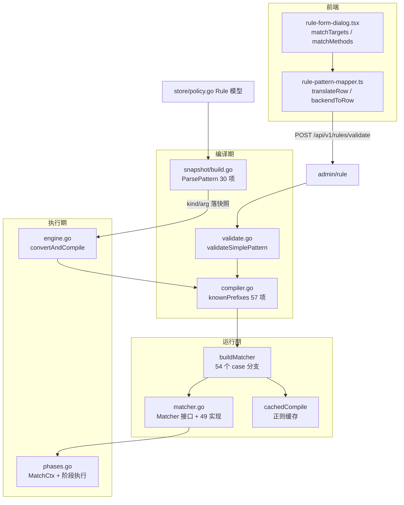
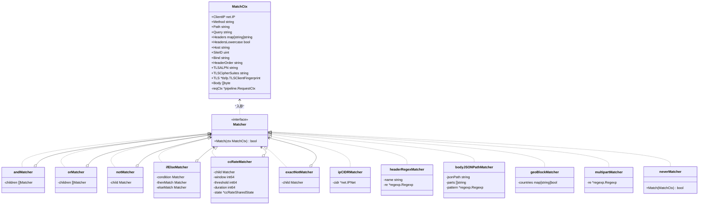
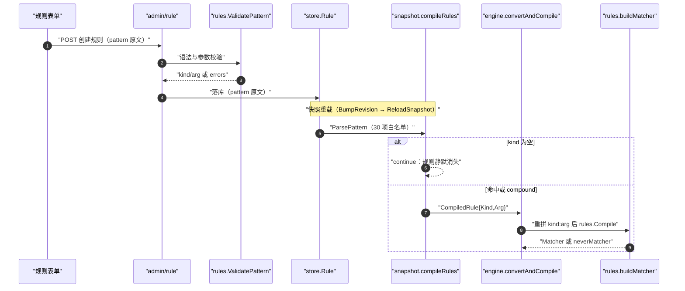
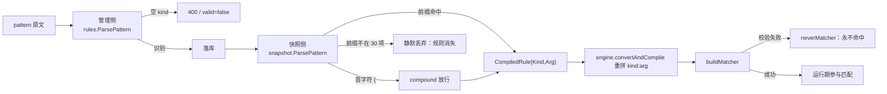
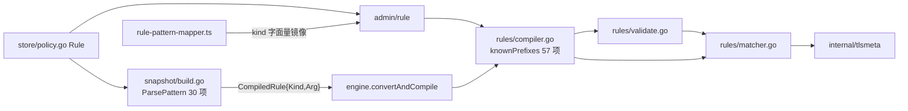
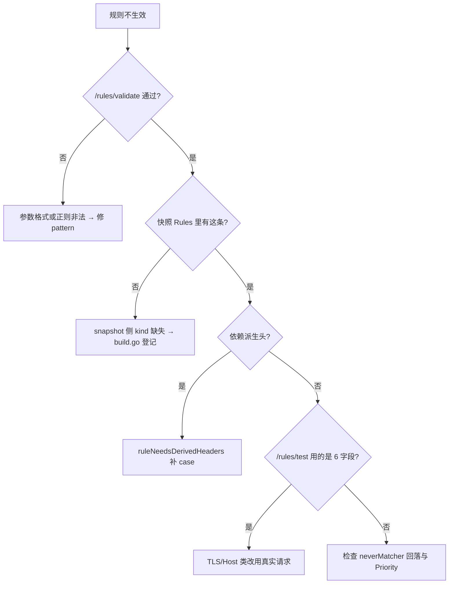

# 匹配器开发

> [返回 扩展与插件系统](../扩展与插件系统.md) · [返回规则引擎扩展](规则引擎扩展.md)

<cite>
**本文档引用的文件**
- [matcher.go](file://internal/core/rules/matcher.go)
- [compiler.go](file://internal/core/rules/compiler.go)
- [phases.go](file://internal/core/rules/phases.go)
- [validate.go](file://internal/core/rules/validate.go)
- [engine.go](file://internal/core/engine/engine.go)
- [build.go](file://internal/snapshot/build.go)
- [policy.go](file://internal/store/policy.go)
- [rule.go](file://internal/admin/rule/rule.go)
- [validate.go](file://internal/admin/rule/validate.go)
- [router.go](file://internal/admin/router.go)
- [rule-pattern-mapper.ts](file://frontend/app/(dashboard)/rules/components/rule-pattern-mapper.ts)
- [rule-form-dialog.tsx](file://frontend/app/(dashboard)/rules/components/rule-form-dialog.tsx)
- [匹配器扩展开发.md](file://docs/WAF%20引擎系统/规则匹配器/匹配器扩展开发.md)
- [规则编译器.md](file://docs/WAF%20引擎系统/规则编译器.md)
</cite>

## 目录

1. [简介](#简介)
2. [项目结构](#项目结构)
3. [核心组件](#核心组件)
4. [架构总览](#架构总览)
5. [详细组件分析](#详细组件分析)
6. [依赖关系分析](#依赖关系分析)
7. [性能考虑](#性能考虑)
8. [故障排查指南](#故障排查指南)
9. [结论](#结论)
10. [附录](#附录)

## 简介
本指南面向需要**新增匹配器 kind** 的开发者，从扩展视角讲清四件事：`Matcher` 接口的真实契约、kind 从 DSL 文本到运行期匹配器的完整登记链、两处互不相通的前缀白名单造成的静默丢弃、以及可直接照做的两条新增流程。

必须与实测一致的四个前提，历史文档在这四点上的写法全部作废：
- `Matcher` 只有一个方法 `Match(ctx MatchCtx) bool`（`internal/core/rules/matcher.go:20-23`）。**不存在 5 参数形式** `Match(ip, method, path, query, headers)`，旧 classDiagram 一律按 `MatchCtx` 重画。
- 兜底匹配器只有 `neverMatcher`（`matcher.go:504-508`）。**`alwaysMatcher` 不存在**，全仓库无该类型；「恒真」需求由 `notMatcher` 包 `neverMatcher` 或直接放宽条件实现。
- `neverMatcher` 是 fail-closed 降级：`Compile` 在校验失败时直接把 matcher 置为 `&neverMatcher{}`（`compiler.go:50-53`），规则照常入库、照常排序、**永不命中**。
- 存在**两处** kind 白名单：引擎侧 `rules.knownPrefixes` 57 项（`compiler.go:119-142`）与快照侧 `snapshot.ParsePattern` 内联 30 项（`internal/snapshot/build.go:1205-1215`）。后者不 import `rules`，27 项差集导致裸 DSL 在 `compileRules`（`build.go:920-934`）被静默丢弃。新增 kind 必须同时登记两处。

引擎侧实现现状见 [规则编译器](../../WAF%20引擎系统/规则编译器.md) 与 [匹配器扩展开发](../../WAF%20引擎系统/规则匹配器/匹配器扩展开发.md)，本文件不复制其表格。

## 项目结构
匹配器扩展面分布在 3 个后端包与 2 个前端文件。下表为**模块清单表**，行数为实测非测试代码。

| 模块 | 路径 | 行数 | 职责 | 扩展时改什么 |
|------|------|:----:|------|--------------|
| 匹配器族 | `internal/core/rules/matcher.go` | 1928 | `Matcher` 接口、49 个匹配器类型、`buildMatcher`、`cachedCompile`、复合树 | 新匹配器类型 + 新 case 分支 |
| DSL 解析 | `internal/core/rules/compiler.go` | 170 | `Compiled`、`Compile`、`knownPrefixes`（57 项）、`ParsePattern` | 追加 kind 到 `knownPrefixes` |
| 保存期校验 | `internal/core/rules/validate.go` | 257 | `ValidatePattern`、`validateSimplePattern` 36 类显式校验 | 追加参数校验分支 |
| 匹配上下文 | `internal/core/rules/phases.go` | 1391 | `MatchCtx` 16 字段、`fillMatchCtxFromPipeline`、派生头判据 | 需要新输入时扩字段 |
| 引擎转换 | `internal/core/engine/engine.go` | 646 | `convertAndCompile` 把快照规则还原成 pattern 再编译 | 一般无需改动 |
| 快照白名单 | `internal/snapshot/build.go` | 1644 | 第二份 `ParsePattern`（30 项）与 `compileRules` 静默丢弃点 | **必须同步追加 kind** |
| 规则模型 | `internal/store/policy.go` | 97 | `RulePhase` 5 值、`RuleAction` 13 值、`Rule` 字段 | 新增规则级参数时改 |
| 管理接口 | `internal/admin/rule/rule.go` | 463 | `CreateRule`/`UpdateRule`/`TestRule` 与 phase/action 白名单 | 新 phase 或动作时改 |
| 校验接口 | `internal/admin/rule/validate.go` | 277 | `ValidateRule`、`GetRuleTemplates` 23 条模板 | 追加模板 |
| 前端映射 | `frontend/app/(dashboard)/rules/components/rule-pattern-mapper.ts` | 994 | `translateRow` 正映射、`backendToRow` 反映射、36 处 kind 字面量 | 双向都要加 |
| 前端表单 | `frontend/app/(dashboard)/rules/components/rule-form-dialog.tsx` | 915 | `matchTargets`/`matchMethods`/`formSchema` | 新目标或方法时加选项 |



**图表来源**
- [compiler.go:119-170](file://internal/core/rules/compiler.go#L119-L170)
- [build.go:920-934](file://internal/snapshot/build.go#L920-L934)
- [build.go:1197-1222](file://internal/snapshot/build.go#L1197-L1222)
- [matcher.go:1473-1774](file://internal/core/rules/matcher.go#L1473-L1774)
- [validate.go:26-44](file://internal/core/rules/validate.go#L26-L44)
- [engine.go:625-645](file://internal/core/engine/engine.go#L625-L645)
- [router.go:283-284](file://internal/admin/router.go#L283-L284)

**章节来源**
- [matcher.go:20-23](file://internal/core/rules/matcher.go#L20-L23)
- [compiler.go:119-142](file://internal/core/rules/compiler.go#L119-L142)
- [build.go:920-934](file://internal/snapshot/build.go#L920-L934)
- [validate.go:123-257](file://internal/core/rules/validate.go#L123-L257)
- [rule-pattern-mapper.ts:72-100](file://frontend/app/(dashboard)/rules/components/rule-pattern-mapper.ts#L72-L100)
- [rule-form-dialog.tsx:55-88](file://frontend/app/(dashboard)/rules/components/rule-form-dialog.tsx#L55-L88)

## 核心组件
### 扩展点总表
| 扩展点 | 接口定义 | 注册位置 | 现有实现数 | 约束 |
|---|---|---|:--:|---|
| 匹配器类型 | `Matcher` 接口 `matcher.go:20-23` | `buildMatcher` switch `matcher.go:1474-1774` | 49 个类型 / 54 个 case 分支 / 58 个 kind | 参数非法必须回落 `neverMatcher`，不得 panic |
| kind 前缀（引擎侧） | `knownPrefixes` `compiler.go:119-142` | 同处 `kinds` 切片 | 57 项 | 不加则 `ParsePattern` 返回空 kind，规则被 `Compile` 跳过 |
| kind 前缀（快照侧） | `ParsePattern` `build.go:1197-1222` | `prefixes` 切片 `build.go:1205-1215` | 30 项 | **不 import rules**，与引擎侧互不相通 |
| 保存期校验 | `validateSimplePattern` `validate.go:123-257` | switch `validate.go:128-255` | 36 类显式分支 | 未列出的 kind 只校验前缀成员资格 |
| 复合算子 | `buildCompound` `matcher.go:1878-1926` | switch `matcher.go:1880-1926` | `and`/`or`/`not`/`if`/`if_else`/`ifelse`/`cc_rate` + 叶子 | 校验在 `validateCompoundNode` `validate.go:54-104` |
| 匹配上下文取值 | `MatchCtx` `phases.go:32-50` | `fillMatchCtxFromPipeline` `phases.go:72-104` | 16 字段 | 新字段需同步 `reqCtx` 懒缓存访问器 |
| 派生头需求 | `ruleNeedsDerivedHeaders` `phases.go:236-247` | 同处 switch | 5 个 kind + compound 递归 | 漏登记则 TLS/头顺序字段为空 |
| 前端正向映射 | `translateRow` `rule-pattern-mapper.ts:72` | (target, method) 分支 | 36 处 kind 字面量 | 不被支持组合返回 `invalid` |
| 前端反向映射 | `backendToRow` `rule-pattern-mapper.ts:601` | kind→行 switch | 与正向成对 | 漏一处则规则回显丢失 |
| 规则模板 | `GetRuleTemplates` `admin/rule/validate.go:83` | `templates` 切片 84-269 | 23 条 | 模板 kind 必须两处白名单都在 |

**章节来源**
- [matcher.go:20-23](file://internal/core/rules/matcher.go#L20-L23)
- [matcher.go:1473-1774](file://internal/core/rules/matcher.go#L1473-L1774)
- [compiler.go:119-142](file://internal/core/rules/compiler.go#L119-L142)
- [build.go:1197-1222](file://internal/snapshot/build.go#L1197-L1222)
- [validate.go:26-257](file://internal/core/rules/validate.go#L26-L257)
- [rule-pattern-mapper.ts:72-601](file://frontend/app/(dashboard)/rules/components/rule-pattern-mapper.ts#L72-L601)

### 匹配器类型族
`Matcher` 是单方法接口，49 个实现按「叶子匹配器 / 复合节点 / 兜底」三类组织。下面是接口族的真实继承关系，成员签名取自代码。



**图表来源**
- [matcher.go:20-23](file://internal/core/rules/matcher.go#L20-L23)
- [matcher.go:25-38](file://internal/core/rules/matcher.go#L25-L38)
- [matcher.go:281-320](file://internal/core/rules/matcher.go#L281-L320)
- [matcher.go:368-386](file://internal/core/rules/matcher.go#L368-L386)
- [matcher.go:488-508](file://internal/core/rules/matcher.go#L488-L508)
- [matcher.go:523-530](file://internal/core/rules/matcher.go#L523-L530)
- [matcher.go:600-606](file://internal/core/rules/matcher.go#L600-L606)
- [matcher.go:653-658](file://internal/core/rules/matcher.go#L653-L658)
- [phases.go:32-50](file://internal/core/rules/phases.go#L32-L50)

**章节来源**
- [matcher.go:20-23](file://internal/core/rules/matcher.go#L20-L23)
- [matcher.go:281-320](file://internal/core/rules/matcher.go#L281-L320)
- [matcher.go:1473-1774](file://internal/core/rules/matcher.go#L1473-L1774)
- [matcher.go:1878-1926](file://internal/core/rules/matcher.go#L1878-L1926)
- [phases.go:32-50](file://internal/core/rules/phases.go#L32-L50)
- [rule-pattern-mapper.ts:45-60](file://frontend/app/(dashboard)/rules/components/rule-pattern-mapper.ts#L45-L60)

## 架构总览
一条规则从入库到生效要穿过 **两个独立的 kind 解析器**，这是匹配器扩展最重要的一张图：快照构建期用 `snapshot.ParsePattern`（30 项），引擎编译期用 `rules.ParsePattern`（57 项）。两者串联，前一关丢掉的东西后一关再也看不到。

| 关卡 | 函数 | 白名单规模 | 未识别时行为 | 可观测性 |
|:--:|---|:--:|---|---|
| 1 管理侧 | `admin/rule.ValidateRule` → `rules.ParsePattern` `validate.go:51` | 57 | 返回 `valid=false` + 提示 | HTTP 200 + errors |
| 2 保存侧 | `rules.ValidatePattern` `validate.go:28-34` | 57 + 36 类参数校验 | 拒绝写入 | 400 |
| 3 快照侧 | `snapshot.ParsePattern` `build.go:1197-1222` | **30** | `kind==""` → `continue` | **静默丢弃** |
| 4 引擎侧 | `engine.convertAndCompile` → `rules.Compile` `compiler.go:40-78` | 57 | `neverMatcher` 兜底 | 无命中，无报错 |
| 5 构造侧 | `buildMatcher` `matcher.go:1473-1774` | 58 kind | `default: neverMatcher` | 无命中 |

**为什么 27 项差集会「裸 DSL 被丢，但复合叶子能绕开」**：`compileRules` 只在 `ParsePattern` 返回空 kind 时丢弃；而 `build.go:1201-1203` 对以 `{` 开头的 pattern 无条件返回 `("compound", raw)`，不看内层 kind。复合叶子随后在 `buildCompound` 的 `case ""` 分支交给 `buildMatcher(cond.Kind, cond.Arg)`（`matcher.go:1920-1923`），而 `buildMatcher` 走的是引擎侧全集。于是形如 `{"op":"and","children":[{"kind":"path_wildcard","arg":"*.aspx"}]}` 的规则能用上只在 57 项里登记的 kind。

这不是设计而是缺陷：靠包一层 `and` 才能生效，等于让 27 个 kind 的裸写法不可用。正确做法仍是**两处都登记**，复合包装只作为临时验证手段。差集 27 项清单见附录。



**图表来源**
- [build.go:920-934](file://internal/snapshot/build.go#L920-L934)
- [build.go:1197-1222](file://internal/snapshot/build.go#L1197-L1222)
- [compiler.go:40-78](file://internal/core/rules/compiler.go#L40-L78)
- [engine.go:625-645](file://internal/core/engine/engine.go#L625-L645)
- [validate.go:26-44](file://internal/core/rules/validate.go#L26-L44)
- [rule.go:232-240](file://internal/admin/rule/rule.go#L232-L240)

**章节来源**
- [build.go:920-934](file://internal/snapshot/build.go#L920-L934)
- [compiler.go:40-78](file://internal/core/rules/compiler.go#L40-L78)
- [engine.go:625-645](file://internal/core/engine/engine.go#L625-L645)
- [matcher.go:1473-1774](file://internal/core/rules/matcher.go#L1473-L1774)
- [validate.go:26-44](file://internal/core/rules/validate.go#L26-L44)

## 详细组件分析

### kind 登记表
57 个 kind 按匹配对象归组。「两处白名单」列标注该 kind 是否同时在 `rules.knownPrefixes`（57）与 `snapshot.ParsePattern`（30）中；只在引擎侧的 27 项裸 DSL 会被快照丢掉。

| kind 组 | 匹配对象 | 代表 kind | 快照侧是否登记 | 校验规则 |
|---|---|---|:--:|---|
| IP/CIDR | `ctx.ClientIP` | `allow_ip`、`block_ip` | 是 | `validate.go:140-146` 要求合法 IP 或 CIDR |
| 地域 | `ctx.ClientIP` + GeoIP | `geo_block` | **否** | `validate.go:136` 非空即可 |
| 路径 | `ctx.Path` | `block_path`、`block_path_exact`、`block_path_regex`、`path_contains`、`path_not_contains`、`path_not_exact`、`path_wildcard` | 部分（前三个是） | `validate.go:129-132`、`147-153`、`212-223` |
| 完整 URL | Path+Query+Host 拼接 | `full_url_contains`、`full_url_regex`、`full_url_wildcard`、`full_url_not_exact` | **否** | `validate.go:135-136` 非空 |
| Host | `ctx.Host` | `host`、`host_full`、`host_regex`、`host_contains`、`host_not_contains`、`host_wildcard`、`host_not_exact` | 仅 `host` | `validate.go:135-136`、`147-153` |
| 查询串 | `ctx.Query` | `block_query_contains`、`block_query_regex` | 是 | `validate.go:133-139`、`147-153` |
| 查询参数 | 解析后的 query values | `query_param`、`query_param_regex`、`query_param_not_exact` | 仅 `query_param` | `validate.go:172-184` 要求 `param:value` |
| 请求头 | `ctx.Headers` | `block_header`、`block_header_exact`、`block_header_prefix`、`block_header_regex`、`block_header_not_exact`、`header_regex`、`header_wildcard` | 仅 `block_header`/`block_header_regex` | `validate.go:154-171` 要求 `name:value` |
| User-Agent | 头 `user-agent` | `block_user_agent`、`block_user_agent_regex` | 是 | `validate.go:133-139`、`147-153` |
| 方法 / 内容类型 | `ctx.Method`、`ctx.ContentType` | `block_method`、`block_content_type` | 是 | `validate.go:133-139` |
| Body | `ctx.Body` | `body_contains`、`body_regex`、`block_body_contains`、`block_body_regex`、`body_not_exact`、`body_wildcard` | 仅 `body_contains`/`body_regex` | `validate.go:185-195` |
| JSON 路径 | 请求体 JSON 取值 | `block_body_json_path` | **否** | `validate.go:196-205` |
| Multipart | 上传段 | `block_multipart` | **否** | `validate.go:206-211` 正则可选 |
| Cookie / Referer | 对应头 | `cookie_contains`、`referer_contains` | 是 | `validate.go:135-136` |
| TLS 指纹 | `ctx.TLS` 与派生串 | `tls_ja3`、`tls_ja3_hash`、`tls_ja4`、`tls_version`、`tls_sni`、`tls_alpn`、`tls_cipher_suite`、`tls_cipher_suites` | 是 | `validate.go:239-254` 版本/套件归一化 |
| 头顺序 | `ctx.HeaderOrder` | `header_order_contains`、`header_order_regex` | 是 | `validate.go:133-139`、`147-153` |
| 复合 | 递归子树 | `compound` | 是（首字符 `{` 即返回） | `validate.go:46-104` |

`header_order_contains`、`header_order_regex`、`tls_alpn`、`tls_cipher_suite`、`tls_cipher_suites` 五个 kind 需要派生头，登记在 `ruleNeedsDerivedHeaders`（phases.go:236-250）；`compound` 走递归判定（phases.go:251-299）。

**图表来源**
- [compiler.go:119-142](file://internal/core/rules/compiler.go#L119-L142)
- [build.go:1205-1215](file://internal/snapshot/build.go#L1205-L1215)
- [validate.go:123-255](file://internal/core/rules/validate.go#L123-L255)
- [matcher.go:1473-1774](file://internal/core/rules/matcher.go#L1473-L1774)

**章节来源**
- [compiler.go:119-142](file://internal/core/rules/compiler.go#L119-L142)
- [build.go:1197-1222](file://internal/snapshot/build.go#L1197-L1222)
- [validate.go:123-257](file://internal/core/rules/validate.go#L123-L257)
- [phases.go:236-299](file://internal/core/rules/phases.go#L236-L299)
- [matcher.go:1473-1774](file://internal/core/rules/matcher.go#L1473-L1774)

### 实现约束与代码上下文（代码上下文表）
新增匹配器前必须理解的四条契约，逐条来自代码；下表即代码上下文表。

| 契约 | 定义 | 约束内容 | 违反后果 |
|---|---|---|---|
| 单方法接口 | `matcher.go:20-23` | 只有 `Match(ctx MatchCtx) bool`，无 error 返回 | 无法上报表内错误，只能靠 false |
| 只读且幂等 | 全体 49 实现的 `Match` | 不得修改 `MatchCtx`，不得阻塞 | 并发阶段共享同一 ctx，会产生数据竞争 |
| fail-closed | `matcher.go:1329-1335`、`1772-1773` | 参数非法回落 `neverMatcher`，绝不回落「恒真」 | 语法错误规则拦下全部流量 |
| 校验/构造双关 | `compiler.go:50-53` | 校验失败时 `Compile` 直接塞 `neverMatcher`，构造失败时 `buildMatcher` 塞 `neverMatcher` | 两处都要过，缺一即永不命中 |

兜底实现全文如下，它是唯一「永不匹配」类型；`alwaysMatcher` 在仓库中不存在。

```go
// internal/core/rules/matcher.go:504-508
type neverMatcher struct{}

func (m *neverMatcher) Match(MatchCtx) bool {
	return false
}

// internal/core/rules/compiler.go:50-53 —— 校验失败即 fail-closed 降级
matcher := Matcher(&neverMatcher{})
if len(validateParsedPattern(kind, arg)) == 0 {
	matcher = buildMatcher(kind, arg)
}
```

**章节来源**
- [matcher.go:20-23](file://internal/core/rules/matcher.go#L20-L23)
- [matcher.go:504-508](file://internal/core/rules/matcher.go#L504-L508)
- [matcher.go:1329-1335](file://internal/core/rules/matcher.go#L1329-L1335)
- [compiler.go:40-78](file://internal/core/rules/compiler.go#L40-L78)

### 新增一个匹配器的流程
以下用新增 `body_bytes_gt`（请求体字节数大于阈值）为例，给出可照做的步骤序列（**流程步骤表**）。

| 步 | 动作 | 文件:行 | 必须一致点 |
|:--:|---|---|---|
| 1 | 写匹配器类型与 `Match` 方法 | `internal/core/rules/matcher.go`（参照 `bodyContainsMatcher` 510-518） | 参数非法返回 `neverMatcher` 语义 |
| 2 | 在 `buildMatcher` 加 case 分支 | `matcher.go:1474-1774`，在 `default`（1772）之前 | 分支返回类型须实现 `Matcher` |
| 3 | 追加引擎侧 kind | `compiler.go:120-135` 的 `kinds` 切片 | 与第 2 步的 case 字面量逐字符一致 |
| 4 | 追加快照侧 kind | `internal/snapshot/build.go:1205-1215` 的 `prefixes`，**带尾冒号** | 漏此步裸 DSL 被 `compileRules` 丢弃 |
| 5 | 加保存期参数校验 | `validate.go:128-255` switch | 至少校验非空，避免空参数恒真匹配 |
| 6 | 判断是否需要派生头 | 若用到 ALPN/套件/头顺序，登记 `phases.go:236-250` | 否则 `MatchCtx` 对应字段为空串 |
| 7 | 正则类请用缓存 | `cachedCompile` 复用 `matcher.go:1791-1808` | 禁止在 `Match` 内 `regexp.Compile` |
| 8 | 前端正/反映射 | `rule-pattern-mapper.ts:72`（`translateRow`）与 `601`（`backendToRow`） | 两处成对，否则回显丢条件 |
| 9 | 前端表单选项 | `rule-form-dialog.tsx:55`（`matchTargets`）/`73`（`matchMethods`） | 新 target 或 method 时改 |
| 10 | 模板与文档 | `admin/rule/validate.go:84-269` 追加模板 | 共 23 条模板的同等格式 |
| 11 | 单测 | `matcher_test.go`、`compiler_test.go`、`wildcard_test.go` 风格 | 断言不得退化为 `neverMatcher` |

最小实现与注册片段：

```go
// internal/core/rules/matcher.go —— 第 1 步
type bodyBytesGTMatcher struct{ size int }

// Match 只读 ctx.Body；非法参数已在 buildMatcher 拦截，此处不再判错。
func (m *bodyBytesGTMatcher) Match(ctx MatchCtx) bool {
	return len(ctx.Body) > m.size
}

// internal/core/rules/matcher.go —— 第 2 步，加在 buildMatcher 的 default 之前
	case "body_bytes_gt":
		n, err := strconv.Atoi(strings.TrimSpace(arg))
		if err != nil || n < 0 {
			return &neverMatcher{}
		}
		return &bodyBytesGTMatcher{size: n}
```

```go
// internal/core/rules/compiler.go:120-135 —— 第 3 步
"kookie_placeholder", // 示意：紧跟已有条目追加 "body_bytes_gt"

// internal/snapshot/build.go:1205-1215 —— 第 4 步（注意带尾冒号）
"body_bytes_gt:",

// internal/core/rules/validate.go:128-255 —— 第 5 步
	case "body_bytes_gt":
		if _, err := strconv.Atoi(strings.TrimSpace(arg)); err != nil {
			return "body_bytes_gt 需要非负整数字节阈值"
		}
```

验证顺序建议：先用 `POST /api/v1/rules/validate` 确认引擎侧认得（router.go:284），再用 `POST /api/v1/rules/test` 确认能命中（router.go:283），最后**必须**新建一条裸 DSL 规则并触发快照重载，确认规则没有在第 4 关消失——前两个接口都只走引擎侧 57 项白名单，验不出快照侧缺口。



**图表来源**
- [compiler.go:144-170](file://internal/core/rules/compiler.go#L144-L170)
- [build.go:1197-1222](file://internal/snapshot/build.go#L1197-L1222)
- [engine.go:625-645](file://internal/core/engine/engine.go#L625-L645)
- [matcher.go:1473-1774](file://internal/core/rules/matcher.go#L1473-L1774)


```bash
# 第 3/4 步一致性自检：两份白名单差集应为 0（compound 除外）
rg -o '"[a-z0-9_]+":' internal/snapshot/build.go | tr -d '":' | sort -u > /tmp/snap.txt
rg -A20 'kinds := \[\]string\{' internal/core/rules/compiler.go | rg -o '"[a-z0-9_]+"' | tr -d '"' | sort -u > /tmp/rules.txt
comm -23 /tmp/rules.txt /tmp/snap.txt   # 输出即裸 DSL 会被丢弃的 kind
```

**图表来源**
- [matcher.go:510-514](file://internal/core/rules/matcher.go#L510-L514)
- [matcher.go:1474-1774](file://internal/core/rules/matcher.go#L1474-L1774)
- [compiler.go:119-142](file://internal/core/rules/compiler.go#L119-L142)
- [build.go:1205-1215](file://internal/snapshot/build.go#L1205-L1215)
- [validate.go:123-255](file://internal/core/rules/validate.go#L123-L255)

**章节来源**
- [matcher.go:504-518](file://internal/core/rules/matcher.go#L504-L518)
- [matcher.go:1473-1808](file://internal/core/rules/matcher.go#L1473-L1808)
- [compiler.go:40-78](file://internal/core/rules/compiler.go#L40-L78)
- [build.go:920-934](file://internal/snapshot/build.go#L920-L934)
- [validate.go:123-257](file://internal/core/rules/validate.go#L123-L257)
- [router.go:283-284](file://internal/admin/router.go#L283-L284)
- [rule-pattern-mapper.ts:72-100](file://frontend/app/(dashboard)/rules/components/rule-pattern-mapper.ts#L72-L100)
- [rule-form-dialog.tsx:55-88](file://frontend/app/(dashboard)/rules/components/rule-form-dialog.tsx#L55-L88)

### 新增一个复合算子的流程
复合算子（`and`/`or`/`not`/`if`/`cc_rate`）与 kind 是两套登记面：算子只在 `compound` 内部流通，**不需要**动两处前缀白名单，因为 `snapshot.ParsePattern` 见首字符 `{` 就整串放行。

| 步 | 动作 | 文件:行 | 说明 |
|:--:|---|---|---|
| 1 | 扩 JSON 结构体字段 | `matcher.go:1810-1822`（`compoundCondition`）与 `validate.go:11-24`（`compoundPattern`） | 两份结构体字段必须对齐 |
| 2 | 加构造分支 | `buildCompound` switch `matcher.go:1880-1926` | 子节点一律递归 `buildCompound` |
| 3 | 加校验分支 | `validateCompoundNode` switch `validate.go:56-103` | 校验失败即 `neverMatcher` |
| 4 | 派生头递归 | `compoundConditionNeedsDerivedHeaders` `phases.go:251-299` | 新算子若有子树必须补该 case |
| 5 | 序列化/反序列化 | `rule-pattern-mapper.ts:493`（`CompoundNode`）、`534`、`921` | 前端复合编辑器同步 |
| 6 | 描述截断 | `compiledMatchDesc` `compiler.go:80-85` | `compound` 且 arg>60 折叠为 `compound:{...}` |

算子语义的实测事实：`and`/`or` 要求 children 非空；`not` 与 `cc_rate` 要求 children 恰好 1 个；`if`/`if_else`/`ifelse` 要求 `if` 与 `then` 同时存在，`else` 可选；`cc_rate` 另要求 `window>0`、`threshold>0`、`duration_unit` ∈ {`""`,`seconds`,`minutes`} 且 `duration`/`duration_seconds` 非负（`validate.go:56-103`）。`op` 为空视为叶子，转 `buildMatcher(cond.Kind, cond.Arg)`（`matcher.go:1920-1923`）。

**章节来源**
- [matcher.go:1810-1822](file://internal/core/rules/matcher.go#L1810-L1822)
- [matcher.go:1878-1926](file://internal/core/rules/matcher.go#L1878-L1926)
- [validate.go:11-104](file://internal/core/rules/validate.go#L11-L104)
- [phases.go:251-299](file://internal/core/rules/phases.go#L251-L299)
- [compiler.go:80-85](file://internal/core/rules/compiler.go#L80-L85)
- [rule-pattern-mapper.ts:493-600](file://frontend/app/(dashboard)/rules/components/rule-pattern-mapper.ts#L493-L600)

### 需要跨请求状态的匹配器
`ccRateMatcher` 是仓库内唯一持有可变共享状态的匹配器，可作为「频次类匹配器」的唯一样板：状态放在包级 `sync.Map ccRateStates`（`matcher.go:45`），按 `ccRateStateKey` 复用同一 `ccRateSharedState`，每请求 `Match` 内加 `mu` 锁并做 60 秒清扫（`matcher.go:47-90`）。

| 要点 | 实测取值 | 位置 |
|---|---|---|
| 计数键 | `bind\|siteID\|归一化 Host\|clientIP` | `ccRateKey` → `RateLimitKey`（`phases.go:63-70`） |
| 清扫周期 | 距上次 `lastSweep ≥ 60` 秒才清 | `matcher.go:67-73` |
| 封禁延续 | `blockedTill > now` 直接命中 | `matcher.go:76-78` |
| 无窗口短路 | `window<=0 \|\| threshold<=0` 时子条件命中即命中 | `matcher.go:51-53` |
| 规则级入口 | `applyRuleFrequencyLimit` 把 `window_seconds`+`request_count` 包成 `cc_rate` | `build.go:955-972` |

新写状态型匹配器请沿用同一计数键函数，不要只按 Host 建键：同一 `bind` 下的 `*` 兜底站点与显式 host 站点会互相挤占配额。

**章节来源**
- [matcher.go:25-90](file://internal/core/rules/matcher.go#L25-L90)
- [matcher.go:107-109](file://internal/core/rules/matcher.go#L107-L109)
- [phases.go:63-70](file://internal/core/rules/phases.go#L63-L70)
- [build.go:955-972](file://internal/snapshot/build.go#L955-L972)

### 正则缓存、排序与命中归因
- 正则缓存：`regexCache` 是 `sync.RWMutex` + `map[string]*regexp.Regexp`（`matcher.go:1785-1788`），读多写少路径先 `RLock` 命中直接返回，未命中编译后 `Lock` 写入（`matcher.go:1791-1808`）。**无容量上限、无淘汰**：pattern 由管理员输入，长期运行会单调增长，这是已知风险而非文档笔误；「热更新时重启清理」的说法不成立，因为规则文本改变只会新增键。
- 通配符不是正则优先：`path_wildcard`/`full_url_wildcard`/`host_wildcard`/`body_wildcard`/`header_wildcard` 经 `globToRegexSource`/`parseGlob` 编译为 `wildcardTester`（`matcher.go:1341-1350`），`*foo*` 形态走 ASCII 折叠 contains，其余回落 `(?i)` 正则。
- 排序：`Compile` 按 `Priority` 升序、同优先级按 `ID` 升序（`compiler.go:71-76`）；`Compiled` 生成后 `ruleIDStr = "rule:" + Phase + ":" + Kind`、`matchDesc = kind + ":" + arg`（`compiler.go:67-68`），复合规则 arg 超 60 字符折叠（`compiler.go:80-85`）。
- 命中归因：阶段执行体命中即调用 `hit(rules[i])` 生成 `action.Result`，`Category` 取 kind、`Phase` 取规则阶段（`phases.go:1312-1339`），随后 `return r, r.IsTerminal()`。
- **一个订正**：ACL 阶段的 `allow` **不短路**后续阶段。`executeCompiledPhase` 的 `allowShortCircuit bool` 形参在函数体内完全未被使用（`phases.go:112-129`），`aclPhase.Execute` 传 `true`、`signaturePhase.Execute` 传 `false`（`phases.go:148-150`、`169-171`），两者行为相同：命中第一条规则就停止遍历本阶段，`allow` 非终态因此继续跑链。历史文档「ACL Allow 跳过后续所有阶段」的写法全部作废。
- 持久化侧的 phase 只有三个可用：`validatePersistedRulePhase` 只接受 `acl`/`signature`/`custom`（`admin/rule/rule.go:288-296`）；`allow` 动作只允许出现在 `acl` 阶段（`rule.go:270-285`），`tag` 被拒绝。写操作只有 POST（`/{id}/update`、`/{id}/delete`、`/rules/test`、`/rules/validate`），无 PUT/DELETE。

```go
// internal/core/rules/phases.go:112-129 —— 形参存在但未使用
func executeCompiledPhase(ctx *pipeline.RequestCtx, rules []Compiled,
	allowShortCircuit bool, needsDerivedHeaders bool) (action.Result, bool) {
	// ...
	for i := range rules {
		if !rules[i].Match(mc) {
			continue
		}
		r := hit(rules[i])
		return r, r.IsTerminal() // 与 allowShortCircuit 无关
	}
	return action.Pass(), false
}
```

**章节来源**
- [matcher.go:1785-1808](file://internal/core/rules/matcher.go#L1785-L1808)
- [matcher.go:1341-1350](file://internal/core/rules/matcher.go#L1341-L1350)
- [compiler.go:67-85](file://internal/core/rules/compiler.go#L67-L85)
- [compiler.go:71-76](file://internal/core/rules/compiler.go#L71-L76)
- [phases.go:112-147](file://internal/core/rules/phases.go#L112-L147)
- [phases.go:1312-1339](file://internal/core/rules/phases.go#L1312-L1339)
- [rule.go:270-296](file://internal/admin/rule/rule.go#L270-L296)

### 调试与测试入口
| 入口 | 路径/函数 | 位置 | 覆盖范围 | 盲区 |
|---|---|---|---|---|
| 语法校验 | `POST /api/v1/rules/validate` | `router.go:284`、`admin/rule/validate.go:34-81` | 引擎侧 57 项 + 参数校验 | **不经过**快照侧 30 项 |
| 干跑匹配 | `POST /api/v1/rules/test` | `router.go:283`、`rule.go:224-266` | 单条 pattern 对合成请求 | 强制 `Phase=custom`、`Action=observe` |
| 模板浏览 | `GET /api/v1/rules/templates` | `router.go:146`、`validate.go:83-277` | 23 条模板 | 仅覆盖常用 kind |
| 引擎直评 | `Engine.Evaluate` | `engine.go:575-587` | ACL/签名/自定义三阶段 | 不读快照、不建阶段链 |
| 单测 | `internal/core/rules/*_test.go` | `matcher_test.go`、`compiler_test.go`、`wildcard_test.go` | kind 识别与 never 回落 | 需自加快照侧往返用例 |

`TestRule` 构造的 `MatchCtx` 只填 `ClientIP/Method/Path/Query/Headers/Body` 六个字段（`rule.go:251-258`），因此 TLS 指纹、头顺序、Host、SiteID 类 kind 在该接口**恒不命中**，属预期而非 bug；要验这类 kind 请用真实请求或 `Engine.Evaluate` 之外的快照重载路径。

**章节来源**
- [router.go:146](file://internal/admin/router.go#L146)
- [router.go:283-284](file://internal/admin/router.go#L283-L284)
- [validate.go:34-81](file://internal/admin/rule/validate.go#L34-L81)
- [rule.go:224-266](file://internal/admin/rule/rule.go#L224-L266)
- [engine.go:575-587](file://internal/core/engine/engine.go#L575-L587)

## 依赖关系分析
- 包内依赖：`matcher.go` 只依赖标准库加 `internal/tlsmeta`（TLS 版本/套件归一化），不依赖 `store`；`compiler.go` 依赖 `action` 与 `store`；`validate.go` 与 `matcher.go` 共享 `knownPrefixes` 与 `cachedCompile`，形成「校验-构造」闭环。
- 跨包重复：`internal/snapshot` 自带一份 `ParsePattern` 与 30 项前缀表，**不 import `internal/core/rules`**，这是 27 项差集的结构性成因，也是本仓库最需要消除的 DRY 违例。
- 外部依赖：`regexp`（RE2，无回溯爆炸但有长度代价）、`net`（CIDR）、`net/url`（query 解析）、`mime/multipart`（上传段）。
- 前端：`rule-pattern-mapper.ts` 与后端 kind 是**手工镜像**，无代码生成，二者漂移不会被编译或测试自动发现。

| 依赖方 | 被依赖方 | 依据 | 耦合强度 | 扩展影响 |
|---|---|---|:--:|---|
| `rules/compiler.go` | `store.Rule` | `compiler.go:9` | 强 | 新增规则字段需同步 `Compiled` |
| `rules/compiler.go` | `core/action` | `compiler.go:8` | 强 | 动作归一化在 `phases.go:1301-1310` |
| `rules/matcher.go` | `internal/tlsmeta` | `matcher.go:16` | 中 | TLS kind 归一化 |
| `rules/validate.go` | `rules` 包内 `knownPrefixes` | `validate.go:124-126` | 强 | 校验与构造同一份表 |
| `snapshot/build.go` | 自备前缀表 | `build.go:1205-1215` | 无（重复） | **必须手工同步** |
| `engine/engine.go` | `rules` | `engine.go:12`、`625-645` | 强 | 规则还原为 pattern |
| `admin/rule` | `rules` | `validate.go:51`、`rule.go:232` | 强 | 管理侧只走引擎侧白名单 |
| 前端 mapper | kind 字面量 | `rule-pattern-mapper.ts:72`、`601` | 弱（文本） | 漂移无编译检查 |



**图表来源**
- [compiler.go:3-10](file://internal/core/rules/compiler.go#L3-L10)
- [matcher.go:3-16](file://internal/core/rules/matcher.go#L3-L16)
- [validate.go:1-9](file://internal/core/rules/validate.go#L1-L9)
- [build.go:1197-1222](file://internal/snapshot/build.go#L1197-L1222)
- [engine.go:625-645](file://internal/core/engine/engine.go#L625-L645)

**章节来源**
- [matcher.go:3-16](file://internal/core/rules/matcher.go#L3-L16)
- [compiler.go:3-10](file://internal/core/rules/compiler.go#L3-L10)
- [build.go:1197-1222](file://internal/snapshot/build.go#L1197-L1222)
- [rule.go:232](file://internal/admin/rule/rule.go#L232)
- [rule-pattern-mapper.ts:72](file://frontend/app/(dashboard)/rules/components/rule-pattern-mapper.ts#L72)

## 性能考虑
- 优先用「比较」而非「正则」：49 个实现里只有 `*_regex` 与 `*_wildcard` 走正则。新 kind 若能用 `strings.Contains`/`HasPrefix`/`bytes.Contains` 表达，就别上正则。
- 正则一律走 `cachedCompile`（`matcher.go:1791-1808`）：编译成本只在构造期付一次，`Match` 内不得再 `regexp.Compile`。缓存无淘汰，kind 参数基数即缓存规模，需避免用高基数动态值做 pattern。
- 复合树短路：`andMatcher` 逐个 children，遇 false 立即返回；`orMatcher` 遇 true 立即返回（`matcher.go:281-301`）。把便宜的子条件放前面能减少昂贵子树执行。
- 派生头是按需付费：只有规则里出现 5 个需要派生头的 kind 之一，`fillMatchCtxFromPipeline` 才会拼接 ALPN/密码套件/头顺序串（`phases.go:72-104`、`227-234`）。给冷门 kind 引入派生头需求会增加全站开销。
- 每请求一次解析：`bodyJSONPath` 与 `queryParam` 类匹配器把解析结果挂在 `reqCtx` 的懒缓存上（`pipeline.go:144-167`），新 kind 若需重复解析同一 Body/Query，请复用 `CachedJSONBodyObject`/`CachedMatcherQueryValues`，不要自己解析。
- 遍历成本线性：`executeCompiledPhase` 对已排序规则做顺序遍历，命中即停（`phases.go:112-129`）。规则数量大时靠 `Priority` 把便宜且常命中的放前面。

**章节来源**
- [matcher.go:281-301](file://internal/core/rules/matcher.go#L281-L301)
- [matcher.go:1785-1808](file://internal/core/rules/matcher.go#L1785-L1808)
- [phases.go:72-104](file://internal/core/rules/phases.go#L72-L104)
- [phases.go:227-234](file://internal/core/rules/phases.go#L227-L234)
- [phases.go:112-129](file://internal/core/rules/phases.go#L112-L129)
- [pipeline.go:144-167](file://internal/core/pipeline/pipeline.go#L144-L167)

## 故障排查指南
匹配器类故障的共同特征是「规则存在、无报错、永不命中」，因此排查必须按关卡顺序做。

| 症状 | 根因 | 定位方法 | 修复 |
|---|---|---|---|
| 裸 DSL 规则完全不生效 | kind 只在引擎侧 57 项，未进快照侧 30 项 | 查快照 `SiteRuntime.Rules` 是否含该 ID | 在 `build.go:1205-1215` 追加带尾冒号的项 |
| 同类规则包一层 `and` 就生效 | `snapshot.ParsePattern` 对 `{` 开头无条件放行 | 对比 `build.go:1201-1203` 与 `compiler.go:152-154` | 视为临时验证手段，仍要登记白名单 |
| `/rules/validate` 通过但线上不生效 | 校验只走引擎侧白名单 | 见「调试与测试入口」表 | 补快照侧后重载快照 |
| `/rules/test` 恒 `matched=false` | 该接口只填 6 个 ctx 字段，TLS/Host/SiteID 类 kind 无输入 | `rule.go:251-258` | 用真实请求验证 |
| 规则永不命中但无报错 | `neverMatcher` 兜底（校验或构造失败） | 用 `POST /api/v1/rules/validate` 看 `errors` | 修参数格式 |
| 正则规则永不命中 | `cachedCompile` 编译失败回落 never | `matcher.go:1496-1500` 分支 | 用 RE2 兼容写法 |
| TLS/头顺序 kind 不命中 | 未登记 `ruleNeedsDerivedHeaders` | `phases.go:236-250` | 补 case，或改用不依赖派生串的 kind |
| Body 类 kind 不命中 | `ctx.Body` 为空（上游未缓冲或已截断） | 看访问日志的请求体字段 | 确认站点体采样配置 |
| 匹配器命中但动作不符 | 动作在持久化期被归一化/拒绝 | `rule.go:270-296`：`allow` 只许 `acl`，`tag` 被拒 | 换阶段或换动作 |
| 规则顺序不符 | `Priority` 相同按 `ID` 升序 | `compiler.go:71-76` | 显式设置不同 `Priority` |
| 复合规则被整条拒绝 | 算子 children 数量或字段不合规 | `validate.go:56-103` | 按算子约束调整 JSON |
| 前端保存后条件消失 | `backendToRow` 未覆盖新 kind | `rule-pattern-mapper.ts:601` | 补反映射分支 |



**图表来源**
- [build.go:1197-1222](file://internal/snapshot/build.go#L1197-L1222)
- [compiler.go:40-78](file://internal/core/rules/compiler.go#L40-L78)
- [phases.go:236-250](file://internal/core/rules/phases.go#L236-L250)
- [rule.go:251-258](file://internal/admin/rule/rule.go#L251-L258)
- [validate.go:56-103](file://internal/core/rules/validate.go#L56-L103)

**章节来源**
- [build.go:1197-1222](file://internal/snapshot/build.go#L1197-L1222)
- [compiler.go:40-78](file://internal/core/rules/compiler.go#L40-L78)
- [validate.go:26-44](file://internal/core/rules/validate.go#L26-L44)
- [validate.go:56-103](file://internal/core/rules/validate.go#L56-L103)
- [rule.go:224-296](file://internal/admin/rule/rule.go#L224-L296)
- [rule-pattern-mapper.ts:601](file://frontend/app/(dashboard)/rules/components/rule-pattern-mapper.ts#L601)

## 结论
匹配器扩展的关键不在「写一个 `Match` 方法」——那是一行接口实现——而在**穿过两条互不相通的 kind 白名单**。实测的 57/30/27 三个数字决定了：只登记引擎侧的 kind 只能以复合叶子的形式生效，裸 DSL 会在快照编译期无声消失。

本次迭代成果：把 `Matcher` 签名从作废的 5 参数形式订正为 `Match(MatchCtx)`；删除不存在的 `alwaysMatcher`；明确 `neverMatcher` 的 fail-closed 语义与双重降级点（`compiler.go:50-53` 与 `buildMatcher` default）；补齐扩展点总表、kind 登记表、实现约束表、两张流程步骤表、状态型匹配器要点表、测试入口表、依赖矩阵表与 12 行排查表；把 20 处裸「章节来源」升级为规范加粗标记。

设计原则落点：
- KISS：新增 kind 是「一张表 + 一个 case + 一条校验」，不引入注册中心。
- YAGNI：不预造 kind 元数据框架；`TestRule` 的 6 字段局限按现状说明而非扩展接口。
- DRY：本文件把「两处白名单必须同时登记」写成硬步骤，正是为了对冲仓库中已存在的重复；长期正解是让 `snapshot` 复用 `rules.knownPrefixes`，但那属于代码改动，不在文档迭代范围。
- SOLID：`Matcher` 是单一方法抽象，`buildMatcher` 是唯一装配点，新增类型符合开闭原则；校验与构造分离（`validate.go` 与 `matcher.go`）保证保存期与运行期可独立演进。

遇到的问题：历史正文大量结论（ACL allow 短路、正则缓存需重启清理、`matcher_test.go` 可直接验快照侧）与实测不符，处理方式是在对应小节给出「一个订正」并补真实行号，而非保留旧说法。

[本节为总结，无需特定文件来源]

## 附录

### DSL 速查
| 形式 | 写法 | 解析结果 |
|---|---|---|
| 简单规则 | `block_ip:192.168.1.0/24` | `kind="block_ip"`、`arg="192.168.1.0/24"` |
| 通配规则 | `path_wildcard:*.aspx` | `_wildcard` 后缀保留 arg 首尾空白（`compiler.go:164-166`） |
| 与 | `{"op":"and","children":[{"kind":"block_path","arg":"/api"},{"kind":"block_method","arg":"DELETE"}]}` | `andMatcher` |
| 或 | `{"op":"or","children":[…]}` | `orMatcher` |
| 非 | `{"op":"not","children":[{…}]}`（必须恰好 1 个子节点） | `notMatcher` |
| 条件 | `{"op":"if","if":{…},"then":{…},"else":{…}}` | `ifElseMatcher` |
| 频次 | `{"op":"cc_rate","children":[{…}],"window":60,"threshold":5,"duration":300,"duration_unit":"seconds"}` | `ccRateMatcher` |
| 裸叶子 | `{"kind":"path_wildcard","arg":"*.aspx"}` | `op` 为空即转 `buildMatcher`（`matcher.go:1920-1923`） |

`ParsePattern` 细节：先 `TrimLeftFunc(unicode.IsSpace)`；首字符 `{` 直接判复合；否则取第一个冒号前的候选前缀查表，未命中返回空 kind（`compiler.go:146-170`）。

**章节来源**
- [compiler.go:144-170](file://internal/core/rules/compiler.go#L144-L170)
- [matcher.go:1920-1923](file://internal/core/rules/matcher.go#L1920-L1923)
- [validate.go:11-104](file://internal/core/rules/validate.go#L11-L104)
- [validate.go:84-269](file://internal/admin/rule/validate.go#L84-L269)

### 两处白名单的 27 项差集
以下 kind 只在引擎侧 `knownPrefixes`（57 项）中，未进快照侧 `prefixes`（30 项），裸 DSL 写法会被 `compileRules` 丢弃：

`geo_block`、`block_header_exact`、`block_header_prefix`、`full_url_not_exact`、`path_not_exact`、`host_not_exact`、`block_header_not_exact`、`query_param_not_exact`、`body_not_exact`、`block_body_contains`、`block_body_regex`、`block_body_json_path`、`query_param_regex`、`path_contains`、`path_not_contains`、`path_wildcard`、`full_url_wildcard`、`host_wildcard`、`body_wildcard`、`header_wildcard`、`host_full`、`host_regex`、`host_contains`、`host_not_contains`、`full_url_contains`、`full_url_regex`、`block_multipart`

差集恰好 27 项，且快照侧 30 项是引擎侧 57 项的真子集（无「只在快照侧」的反向差集）。

**章节来源**
- [compiler.go:119-142](file://internal/core/rules/compiler.go#L119-L142)
- [build.go:1205-1215](file://internal/snapshot/build.go#L1205-L1215)
- [build.go:920-934](file://internal/snapshot/build.go#L920-L934)

### 相关文档
| 主题 | 文档 | 分工 |
|---|---|---|
| 引擎侧匹配器实现现状 | [匹配器扩展开发](../../WAF%20引擎系统/规则匹配器/匹配器扩展开发.md) | 接口契约、类型体系与后端步骤 |
| 编译期流程与降级 | [规则编译器](../../WAF%20引擎系统/规则编译器.md) | `Compile` 排序、元数据与失败降级表 |
| 内置 kind 逐个说明 | [内置匹配器](../../WAF%20引擎系统/内置匹配器/内置匹配器.md) | 按匹配对象分篇的实现细节 |
| 新增执行阶段 | [执行阶段系统](执行阶段系统.md) | 阶段注册与三处白名单 |
| 复合条件语义 | [复合匹配器](../../WAF%20引擎系统/规则匹配器/复合匹配器.md) | 算子树的行为描述 |

[本节为索引，无需特定文件来源]
