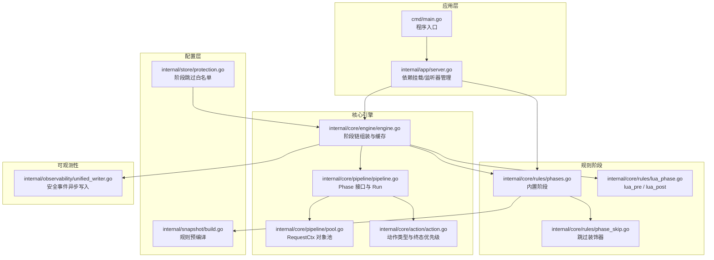
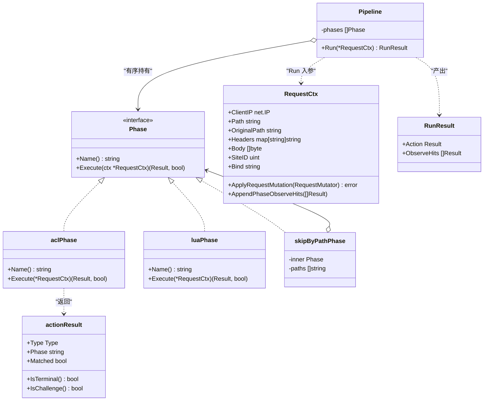
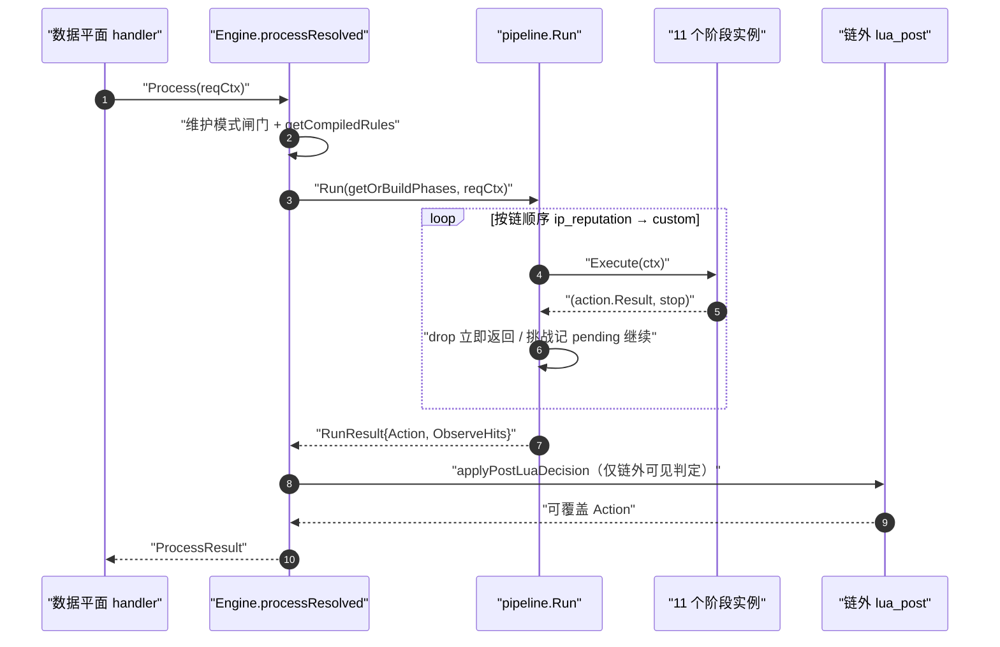
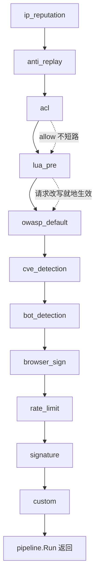
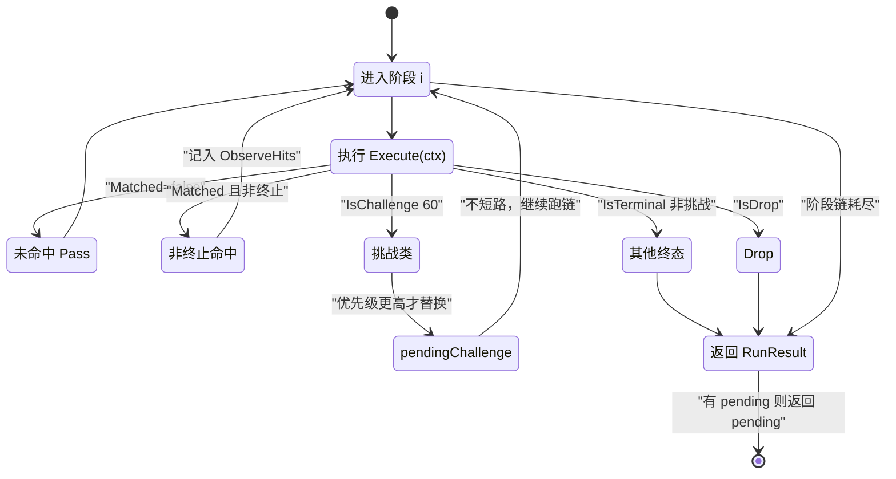
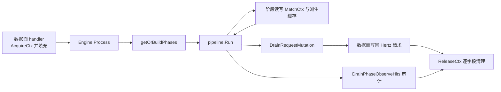
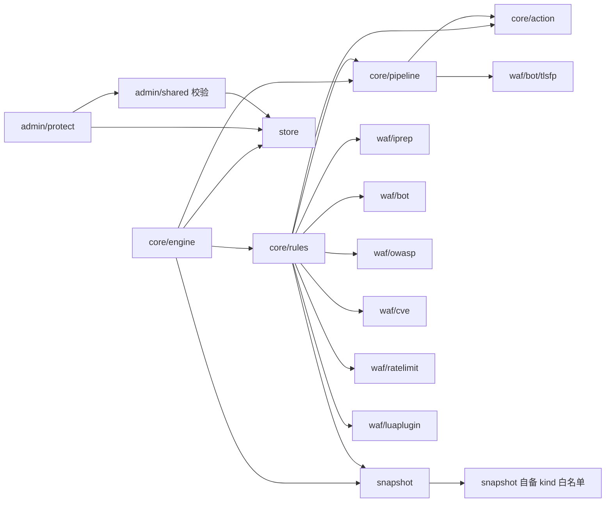
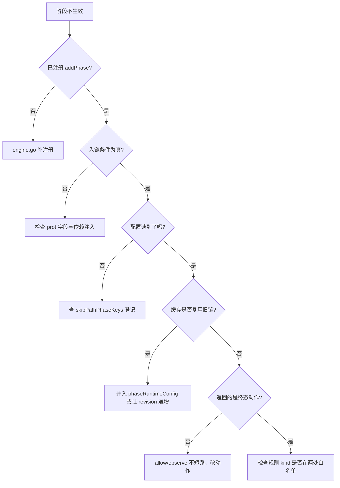

# 执行阶段系统

> [返回 扩展与插件系统](../扩展与插件系统.md) · [返回规则引擎扩展](规则引擎扩展.md)

<cite>
**本文档引用的文件**
- [pipeline.go](file://internal/core/pipeline/pipeline.go)
- [pool.go](file://internal/core/pipeline/pool.go)
- [phases.go](file://internal/core/rules/phases.go)
- [phase_skip.go](file://internal/core/rules/phase_skip.go)
- [lua_phase.go](file://internal/core/rules/lua_phase.go)
- [compiler.go](file://internal/core/rules/compiler.go)
- [engine.go](file://internal/core/engine/engine.go)
- [action.go](file://internal/core/action/action.go)
- [protection.go](file://internal/store/protection.go)
- [site.go](file://internal/store/site.go)
- [build.go](file://internal/snapshot/build.go)
- [json_bind.go](file://internal/admin/shared/json_bind.go)
- [bot.go](file://internal/waf/bot/bot.go)
- [ratelimit.go](file://internal/waf/ratelimit/ratelimit.go)
- [执行阶段系统.md](file://docs/扩展与插件系统/规则引擎扩展/执行阶段系统.md)
- [管道执行机制.md](file://docs/WAF%20引擎系统/引擎核心架构/管道执行机制.md)
- [处理阶段详解.md](file://docs/WAF%20引擎系统/处理阶段详解/处理阶段详解.md)

</cite>

## 目录

1. [简介](#简介)
2. [项目结构](#项目结构)
3. [核心组件](#核心组件)
4. [架构总览](#架构总览)
5. [详细组件分析](#详细组件分析)
6. [依赖关系分析](#依赖关系分析)
7. [性能考虑](#性能考虑)
8. [故障排查指南](#故障排查指南)
9. [结论](#结论)
10. [附录](#附录)

## 简介
本文件从**扩展开发视角**阐述 My-OpenWaf 的执行阶段系统，回答三个问题：阶段链由什么构成、要新增一个阶段该改哪些文件、新增一个阶段开关要走哪条配置链路。

- 阶段划分：引擎实测组装 **11 个阶段**，顺序为 `ip_reputation → anti_replay → acl → lua_pre → owasp_default → cve_detection → bot_detection → browser_sign → rate_limit → signature → custom`，注册点在 `internal/core/engine/engine.go:479-529`，链容量预分配 11（engine.go:467）。历史文档常写成「9 阶段」，缺 `lua_pre`（492-494）与 `browser_sign`（513-515）两段，本文件一律以 11 阶段为准。
- 上下文传递：`pipeline.RequestCtx` 是阶段间唯一上下文载体（pipeline.go:15-100），阶段通过它读写派生缓存、观察命中与请求改写意图。
- 配置与调度：阶段按「依赖非空」或「防护配置为真」两类条件入链；终态判定由 `action.TerminalPriority` 决定，drop 90 / intercept 80 / rate_limit 70 / 四类挑战同 60 / redirect 50，同档取先出现者（action.go:88-119、pipeline.go:517-560）。
- 扩展红线：阶段名同时受**三处**约束——`Phase.Name()` 返回值、`store.skipPathPhaseKeys` 跳过白名单、`admin/shared.ValidateSkipPathByPhase` 入参校验。漏登记第三处会让新阶段的跳过配置在保存期直接报 400。
- 边界：引擎侧实现现状由 [处理阶段详解](../../WAF%20引擎系统/处理阶段详解/处理阶段详解.md)、[管道执行机制](../../WAF%20引擎系统/引擎核心架构/管道执行机制.md)、[规则编译器](../../WAF%20引擎系统/规则编译器.md) 承载，本文件不复制其表格，只写扩展动作与需改动文件。

## 项目结构
执行阶段系统的可扩展面分布在 5 个包内。下表为**模块清单表**，按「扩展时必须触碰的顺序」排列，行数为实测非测试代码。

| 模块 | 路径 | 行数 | 承担职责 | 扩展相关性 |
|------|------|:----:|----------|------------|
| 管道契约 | `internal/core/pipeline/pipeline.go` | 565 | `Phase` 接口、`RequestCtx`、`RequestMutator`/`ResponseMutator`、`Run` 短路算法 | 新阶段实现该接口 |
| 上下文池 | `internal/core/pipeline/pool.go` | 113 | `sync.Pool` 复用 `RequestCtx`，`ReleaseCtx` 逐字段清理 | 新增上下文字段必须同步清理 |
| 阶段实现 | `internal/core/rules/phases.go` | 1391 | 9 个内置阶段结构体与构造函数、`MatchCtx`、`hit` 归因 | 新阶段主体落此包 |
| 阶段装饰器 | `internal/core/rules/phase_skip.go` | 49 | `NewSkipByPathPhase` 按路径跳过单个阶段 | 新阶段自动被包装 |
| Lua 阶段 | `internal/core/rules/lua_phase.go` | 235 | `lua_pre` / `lua_post` 两阶段与 `LuaPluginEvaluator` 抽象 | 脚本型扩展的接入样板 |
| 规则编译 | `internal/core/rules/compiler.go` | 170 | `Compiled`、`Compile`、`knownPrefixes` 57 项 kind 白名单 | 阶段消费其产物 |
| 引擎编排 | `internal/core/engine/engine.go` | 646 | 阶段链组装与缓存、依赖打包 `phaseRuntimeConfig` | 新阶段的唯一注册点 |
| 动作定义 | `internal/core/action/action.go` | 393 | 13 种 `Type`、`TerminalPriority`、`Result` 判定方法 | 新阶段返回其结果 |
| 配置存储 | `internal/store/protection.go` | 476 | `SkipPathByPhase` 字段、`skipPathPhaseKeys` 9 项 | 阶段名第三处登记 |
| 快照构建 | `internal/snapshot/build.go` | 1644 | `compileRules` 与第二份 30 项 kind 白名单 | 规则类阶段的前置漏斗 |



**图表来源**
- [pipeline.go:15-100](file://internal/core/pipeline/pipeline.go#L15-L100)
- [phases.go:29-52](file://internal/core/rules/phases.go#L29-L52)
- [phase_skip.go:19-36](file://internal/core/rules/phase_skip.go#L19-L36)
- [lua_phase.go:24-37](file://internal/core/rules/lua_phase.go#L24-L37)
- [engine.go:441-529](file://internal/core/engine/engine.go#L441-L529)
- [protection.go:323-336](file://internal/store/protection.go#L323-L336)

**章节来源**
- [pipeline.go:14-100](file://internal/core/pipeline/pipeline.go#L14-L100)
- [phases.go:29-52](file://internal/core/rules/phases.go#L29-L52)
- [engine.go:441-529](file://internal/core/engine/engine.go#L441-L529)
- [protection.go:63-66](file://internal/store/protection.go#L63-L66)
- [build.go:920-934](file://internal/snapshot/build.go#L920-L934)

## 核心组件
下表为**代码上下文表**，列出扩展阶段时必须逐个理解的类型与函数，签名严格取自实测代码。

| 符号 | 定义位置 | 签名/形态 | 扩展时的用法 |
|------|----------|-----------|--------------|
| `Phase` | `pipeline.go:277-280` | `Name() string` / `Execute(ctx *RequestCtx) (action.Result, bool)` | 新阶段实现这两个方法 |
| `RequestCtx` | `pipeline.go:15-100` | 导出字段 + 非导出派生缓存 | 阶段唯一输入/输出载体 |
| `Run` | `pipeline.go:517-560` | `Run(phases []Phase, ctx *RequestCtx) RunResult` | 决定短路与挑战延迟语义 |
| `RunResult` | `pipeline.go:493-497` | `{Action action.Result; ObserveHits []action.Result}` | 阶段产物的汇聚体 |
| `executeCompiledPhase` | `phases.go:112-129` | `(ctx, rules, allowShortCircuit, needsDerivedHeaders)` | 规则阶段公共执行体 |
| `hit` | `phases.go:1312-1339` | `hit(c Compiled) action.Result` | 把命中转成可审计结果；`MatchCtx` 见 `phases.go:32-50` |
| `NewSkipByPathPhase` | `phase_skip.go:31-36` | `(inner Phase, paths []string) Phase` | 按路径跳过装饰器 |
| `LuaPluginEvaluator` | `lua_phase.go:15-18` | `HasScripts(stage)` / `Evaluate(ctx, stage, req)` | 脚本型扩展的依赖倒置样板 |
| `getOrBuildPhases` | `engine.go:441-547` | 组装 + 无锁缓存 | 新阶段的唯一注册点 |
| `phaseRuntimeConfig` | `engine.go:72-77` | 4 字段不可变依赖包 | 新阶段外部依赖挂载处 |
| `TerminalPriority` | `action.go:88-119` | `TerminalPriority(t Type) int` | 决定同轮谁胜出 |



**图表来源**
- [pipeline.go:15-100](file://internal/core/pipeline/pipeline.go#L15-L100)
- [pipeline.go:276-280](file://internal/core/pipeline/pipeline.go#L276-L280)
- [pipeline.go:493-565](file://internal/core/pipeline/pipeline.go#L493-L565)
- [phases.go:130-146](file://internal/core/rules/phases.go#L130-L146)
- [phases.go:603-616](file://internal/core/rules/phases.go#L603-L616)
- [lua_phase.go:24-53](file://internal/core/rules/lua_phase.go#L24-L53)

**章节来源**
- [pipeline.go:276-280](file://internal/core/pipeline/pipeline.go#L276-L280)
- [pipeline.go:493-506](file://internal/core/pipeline/pipeline.go#L493-L506)
- [phases.go:112-146](file://internal/core/rules/phases.go#L112-L146)
- [phases.go:1312-1339](file://internal/core/rules/phases.go#L1312-L1339)
- [lua_phase.go:15-53](file://internal/core/rules/lua_phase.go#L15-L53)
- [phase_skip.go:19-49](file://internal/core/rules/phase_skip.go#L19-L49)

## 架构总览
执行阶段系统采用「按站点动态组装的阶段链」模式：`Engine.processResolved` 先取维护模式闸门，再取预编译规则与生效防护配置，调用 `getOrBuildPhases` 得到 `[]pipeline.Phase`，交给 `pipeline.Run` 顺序执行，最后在链外补一次后置 Lua 判定（engine.go:331-378）。

下图给出全链调用顺序与终止返回点；`bot_detection`、`cve_detection` 是 `Name()` 实际返回值，不是简称。



**图表来源**
- [engine.go:331-378](file://internal/core/engine/engine.go#L331-L378)
- [engine.go:479-529](file://internal/core/engine/engine.go#L479-L529)
- [pipeline.go:517-560](file://internal/core/pipeline/pipeline.go#L517-L560)
- [phases.go:141-146](file://internal/core/rules/phases.go#L141-L146)
- [phases.go:354-356](file://internal/core/rules/phases.go#L354-L356)
- [phases.go:486-488](file://internal/core/rules/phases.go#L486-L488)

## 详细组件分析

### 阶段属性总表
`getOrBuildPhases` 按固定顺序组装，每个阶段有独立的入链条件。下表逐字取自 `Name()` 返回值与注册行，是新增阶段时对齐顺序与命名的唯一依据。

| 序 | 阶段名 `Name()` | 构造函数 | 定义 `Name()` 行 | 入链条件 | 注册行 |
|:--:|---|---|---|---|---|
| 1 | `ip_reputation` | `NewIPReputationPhase` | `phases.go:356` | `e.ipRep != nil` | `engine.go:480` |
| 2 | `anti_replay` | `NewAntiReplayPhase` | `phases.go:1251` | 依赖非空 ∧ `rt.AntiReplayEnabled` | `engine.go:483` |
| 3 | `acl` | `NewACLPhasePrecompiled` | `phases.go:146` | `len(cr.ACL) > 0` | `engine.go:487` |
| 4 | `lua_pre` | `NewLuaPhase(lp, StagePre)` | `lua_phase.go:41` | 存在 pre 阶段脚本 | `engine.go:493` |
| 5 | `owasp_default` | `NewOWASPPhase` | `phases.go:616` | `prot.OWASPEnabled` | `engine.go:497` |
| 6 | `cve_detection` | `NewCVEPhase` | `phases.go:742` | `prot.CVEEnabled ∧ e.cveDetector != nil` | `engine.go:500` |
| 7 | `bot_detection` | `NewBotPhaseWithGeoAndLimiter` | `phases.go:488` | `prot.BotDetectionEnabled` | `engine.go:509` |
| 8 | `browser_sign` | `NewBrowserSignPhase` | `phases.go:1351` | `prot.BrowserSignEnabled` | `engine.go:514` |
| 9 | `rate_limit` | `NewReqRateLimitPhase` | `phases.go:314` | `prot.RequestRateLimitEnabled ∧ 限流器非空` | `engine.go:519` |
| 10 | `signature` | `NewSignaturePhasePrecompiled` | `phases.go:167` | `len(cr.Signature) > 0` | `engine.go:525` |
| 11 | `custom` | `NewCustomPhasePrecompiled` | `phases.go:188` | `len(cr.Custom) > 0` | `engine.go:528` |

两点必须注意：
- 第 10、11 项**绕过 `addPhase` 闭包**直接 `append`，因为 `signature`/`custom` 是用户自建规则，停用规则本身即可，不再叠加路径跳过（engine.go:522-523 注释）。
- `acl` 阶段的 `allow` **不短路后续阶段**：`executeCompiledPhase` 的 `allowShortCircuit` 形参（phases.go:112）在函数体内未被使用，实际返回的是 `r.IsTerminal()`，而 `action.Allow` 不在终态集合内（action.go:168-179）。ACL allow 的真实效果只是「本条规则命中即停止遍历本阶段剩余规则」。



**图表来源**
- [engine.go:479-529](file://internal/core/engine/engine.go#L479-L529)
- [phases.go:112-129](file://internal/core/rules/phases.go#L112-L129)
- [phases.go:141-146](file://internal/core/rules/phases.go#L141-L146)
- [phases.go:310-314](file://internal/core/rules/phases.go#L310-L314)
- [phases.go:348-356](file://internal/core/rules/phases.go#L348-L356)
- [phases.go:469-488](file://internal/core/rules/phases.go#L469-L488)

**章节来源**
- [engine.go:467-529](file://internal/core/engine/engine.go#L467-L529)
- [phases.go:112-129](file://internal/core/rules/phases.go#L112-L129)
- [phases.go:141-190](file://internal/core/rules/phases.go#L141-L190)
- [action.go:168-179](file://internal/core/action/action.go#L168-L179)
- [处理阶段详解.md](file://docs/WAF%20引擎系统/处理阶段详解/处理阶段详解.md)

### 终态判定与短路语义
`pipeline.Run` 不是「遇到任何终止动作立即返回」的朴素循环，而是三档处理：

1. `stop == true` 且非挑战类：立刻返回该结果（phases.go 各阶段把 `IsTerminal()` 作为 stop 传回）。
2. `IsDrop()`：无条件立刻返回，TCP 关闭且不发送 HTTP 响应。
3. 挑战类（`challenge` / `captcha_challenge` / `shield_challenge` / `chain_challenge`）：**记为 pendingChallenge 继续跑完链**，若后续出现更高 `TerminalPriority` 则覆盖，否则末尾返回它（pipeline.go:529-558）。

| 动作 `Type` | `TerminalPriority` | 是否终态 | 默认状态码 | 短路表现 |
|---|:--:|:--:|:--:|---|
| `drop` | 90 | 是 | 0（不发响应） | 立即返回并关闭 TCP |
| `intercept` | 80 | 是 | 403 | 立即返回 |
| `rate_limit` | 70 | 是 | 429 | 立即返回 |
| `challenge` | 60 | 是 | 403 | 记 pending，继续跑链 |
| `captcha_challenge` | 60 | 是 | 403 | 同上；同档取先出现者 |
| `shield_challenge` | 60 | 是 | 403 | 同上 |
| `chain_challenge` | 60 | 是 | 403 | 同上 |
| `redirect` | 50 | 是 | 302 | 立即返回 |
| `observe` | 10 | 否 | 0 | 记入 `ObserveHits`，继续 |
| `allow` | 0 | 否 | 0 | 继续（不短路） |
| `tag` | 0 | 否 | 0 | 非终止打标 |

同档（四个挑战类型同为 60）**取链上先出现者**，因为覆盖条件是严格 `>`（pipeline.go:533、545）。



**图表来源**
- [pipeline.go:517-560](file://internal/core/pipeline/pipeline.go#L517-L560)
- [action.go:88-119](file://internal/core/action/action.go#L88-L119)
- [action.go:167-203](file://internal/core/action/action.go#L167-L203)
- [action.go:283-312](file://internal/core/action/action.go#L283-L312)

**章节来源**
- [pipeline.go:508-560](file://internal/core/pipeline/pipeline.go#L508-L560)
- [action.go:86-124](file://internal/core/action/action.go#L86-L124)
- [action.go:167-312](file://internal/core/action/action.go#L167-L312)
- [engine.go:363-373](file://internal/core/engine/engine.go#L363-L373)

### 上下文传递、请求改写与对象池
- `RequestCtx` 是阶段间唯一上下文（pipeline.go:15-100）：请求标识、`Bind`、客户端 IP、方法、`Path` 与不可变的 `OriginalPath`、原始查询串、Host、头、体、TLS 指纹、站点 ID。
- 派生缓存三族：`BodyTargets`（OWASP/CVE 共用体抽取结果）、`matcherJSONBody`/`matcherQueryValues`/`matcherHeaders`（匹配器懒解析）、`derivedALPN`/`derivedHeaderOrder`/`derivedCipherSuites`（指纹拼接串）。每请求至多算一次，跨阶段复用。
- 阶段内观察命中：某阶段先产生 observe 命中、随后返回更强终止动作时，用 `AppendPhaseObserveHits` 暂存，由 `Run` 每轮 `DrainPhaseObserveHits` 收走（pipeline.go:214-230）。
- 请求改写出口 `RequestMutator`：`Method`/`Path`/`RawQuery`/`Body` 用指针区分「不改」与「显式置空」，头变更用 `SetHeaders`/`DeleteHeaders` 两张表（pipeline.go:290-297）。`ApplyRequestMutation` **先整体校验再整体应用**，任一非法即整份失败（pipeline.go:319-388）。保留头 `host`、`content-length`、`transfer-encoding`、`connection`、`keep-alive`、`te`、`trailer`、`upgrade`、`proxy-*` 一律拒绝（pipeline.go:398-410）。
- 响应改写出口 `ResponseMutator` 只服务链外 Lua post，由数据面转交 proxy 的响应变换链（pipeline.go:463-491）。
- 对象池：`AcquireCtx`/`ReleaseCtx` 复用 `RequestCtx`，池容量上限 `maxPooledHeaderMapLen 128`、`maxPooledHeaderKeysCap 64`、`maxPooledObserveHitsCap 32`（pool.go:12-17）。**新增上下文字段必须在 `ReleaseCtx` 补清理**，否则跨请求脏读。



**图表来源**
- [pipeline.go:15-100](file://internal/core/pipeline/pipeline.go#L15-L100)
- [pipeline.go:102-120](file://internal/core/pipeline/pipeline.go#L102-L120)
- [pipeline.go:214-230](file://internal/core/pipeline/pipeline.go#L214-L230)
- [pipeline.go:283-388](file://internal/core/pipeline/pipeline.go#L283-L388)
- [pipeline.go:457-491](file://internal/core/pipeline/pipeline.go#L457-L491)
- [pool.go:19-113](file://internal/core/pipeline/pool.go#L19-L113)

**章节来源**
- [pipeline.go:14-257](file://internal/core/pipeline/pipeline.go#L14-L257)
- [pipeline.go:276-491](file://internal/core/pipeline/pipeline.go#L276-L491)
- [pool.go:10-113](file://internal/core/pipeline/pool.go#L10-L113)
- [phases.go:72-110](file://internal/core/rules/phases.go#L72-L110)
- [管道执行机制.md](file://docs/WAF%20引擎系统/引擎核心架构/管道执行机制.md)

### 新增一个阶段的流程
本节是扩展阶段的核心交付物：按顺序照做即可让新阶段 `content_filter` 进入链、参与跳过配置且不破坏缓存。

| 步 | 动作 | 文件:行 | 验收 |
|:--:|---|---|---|
| 1 | 定义阶段结构体与 `Name()`/`Execute()` | 新建 `internal/core/rules/content_filter_phase.go` | `Name()` 返回 `"content_filter"`，全链唯一 |
| 2 | 暴露构造函数，返回 `pipeline.Phase` | 同文件，参照 `phases.go:1347-1351` | 依赖为 nil 时不入链的判断留在引擎侧 |
| 3 | 在引擎注册点插入 `addPhase` | `engine.go:479-529` 目标顺序处 | 位置决定优先级语义，插错档会抢/让终态 |
| 4 | 把新依赖挂进 `phaseRuntimeConfig` | `engine.go:72-77`，setter 参照 `engine.go:160-180` | 走 `updatePhaseDeps`，缓存判据自动覆盖 |
| 5 | 登记阶段名到跳过白名单 | `internal/store/protection.go:326-336` | `IsSkipPathPhaseKey("content_filter")` 为真 |
| 6 | 若需路径级跳过，无需改装饰器 | `phase_skip.go:31-36` | `addPhase` 已自动包装 |
| 7 | 加链容量预分配 | `engine.go:467` 的 `0, 11` → `0, 12` | 与注释里的阶段清单同步（engine.go:356-357） |
| 8 | 补单测：入链/跳过/终态覆盖 | 参照 `internal/core/engine/phase_skip_test.go` | 缓存失效用例必须有 |
| 9 | 前端与保护页配置同步 | `internal/admin/protect/protection.go:87-89`、`169-174` | `skip_path_by_phase` 能存能回显 |

注册片段与最小实现：

```go
package rules

import (
	"My-OpenWaf/internal/core/action"
	"My-OpenWaf/internal/core/pipeline"
)

// contentFilterPhase 是新增阶段的样板：无外部状态，依赖由构造函数注入。
type contentFilterPhase struct {
	enabled   bool
	threshold int
}

// NewContentFilterPhase 返回阶段实例。依赖缺失时不要返回 nil 阶段，
// 而是在引擎注册点用条件判断决定是否入链。
func NewContentFilterPhase(enabled bool, threshold int) pipeline.Phase {
	return &contentFilterPhase{enabled: enabled, threshold: threshold}
}

// Name 必须与 store.skipPathPhaseKeys 中登记的键逐字符一致。
func (p *contentFilterPhase) Name() string { return "content_filter" }

// Execute 返回 (action.Result, stop)。stop 用 result.IsTerminal() 推导，
// 不要自己造第二套短路判据，否则与 pipeline.Run 的挑战延迟语义冲突。
func (p *contentFilterPhase) Execute(ctx *pipeline.RequestCtx) (action.Result, bool) {
	if !p.enabled || ctx == nil {
		return action.Pass(), false
	}
	body := ctx.Body
	if len(body) == 0 {
		return action.Pass(), false
	}

	// 只读上下文字段；跨阶段数据请写回 ctx 导出字段并同步 ReleaseCtx 清理。
	if len(body) > p.threshold {
		r := action.Result{
			Type:     action.Observe,
			Matched:  true,
			Phase:    p.Name(),
			Category: "content_filter",
			MatchDesc: "body exceeds threshold",
		}
		return r, r.IsTerminal()
	}
	return action.Pass(), false
}
```

引擎注册片段与跳过白名单登记（`engine.go:513-519` 之间、`protection.go:326-336`）：

```go
	if prot.BrowserSignEnabled {
		addPhase(rules.NewBrowserSignPhase(prot))
	}
	// 新增阶段：条件入链，跳过装饰由 addPhase 统一处理
	if prot.ContentFilterEnabled {
		addPhase(rules.NewContentFilterPhase(prot.ContentFilterEnabled, prot.ContentFilterThreshold))
	}

// internal/store/protection.go:326-336
var skipPathPhaseKeys = map[string]struct{}{
	"ip_reputation":  {}, "anti_replay": {}, "acl": {}, "lua_pre": {},
	"owasp_default":  {}, "cve_detection": {}, "bot_detection": {},
	"browser_sign":   {}, "content_filter": {}, // 新增：逐字符取自 Phase.Name()
	"rate_limit":     {},
}
```

**章节来源**
- [engine.go:72-77](file://internal/core/engine/engine.go#L72-L77)
- [engine.go:160-180](file://internal/core/engine/engine.go#L160-L180)
- [engine.go:467-529](file://internal/core/engine/engine.go#L467-L529)
- [phases.go:1347-1351](file://internal/core/rules/phases.go#L1347-L1351)
- [phase_skip.go:19-49](file://internal/core/rules/phase_skip.go#L19-L49)
- [protection.go:323-336](file://internal/store/protection.go#L323-L336)

### 新增一个阶段开关的流程
阶段开关指控制「某阶段是否入链」的防护配置项。实测的入链判据只有两类来源：`prot *store.ProtectionConfig` 的布尔字段，或引擎依赖是否非空（engine.go:479-529）。新增布尔开关要走完整链路，否则会出现「站点级无法继承全局」或「改了不生效」。

| 步 | 动作 | 文件:行 | 关键点 |
|:--:|---|---|---|
| 1 | 全局字段落库 | `internal/store/protection.go`（结构体字段区） | TEXT/布尔不设 DB 默认值，避免 MySQL Error 1101 |
| 2 | 站点级三态字段 | `internal/store/site.go:86-90` 同区 | 用 `*bool`：nil=继承，`false`=覆盖关闭 |
| 3 | 快照合并 | `internal/snapshot/build.go:725-734`、`764-765` | 仅当站点值非 nil 才覆盖档位 |
| 4 | 生效配置指针参与缓存判据 | `engine.go:461`（`entry.prot == prot`） | 指针相等即复用链，无需额外判据 |
| 5 | 引擎入链条件 | `engine.go:479-529` 目标顺序处 | 与开关字段一一对应 |
| 6 | Admin 读写与校验 | `internal/admin/protect/protection.go:87-89`、`169-174` | 跳过类配置必须过 `ValidateSkipPathByPhase` |
| 7 | 站点覆盖绑定 | `internal/admin/shared/json_bind.go:105-145` | 空值置 nil 表示继承，不得存成 false |
| 8 | 前端表单与说明 | `frontend/app/(dashboard)/sites/detail/page.tsx` 的防护区 | 表达为「继承全局 / 覆盖启用 / 覆盖关闭」 |
| 9 | 契约校验脚本 | `README.md:422-452` 列出的 `check:*` | 新增字段须通过既有契约检查 |

三态语义的硬约束（与 `docs/WAF 引擎系统/引擎核心架构` 的实测结论一致）：站点级 nullable 字段为 nil 时是**继承**，绝不能把空值保存成 `false` 或 `0`；清空覆盖要显式写「覆盖为关闭」，而不是删字段。

```go
// internal/store/site.go —— 站点级三态开关样板（照抄 SkipPathByPhase 的指针写法）
// ContentFilterEnabled 为 nil 表示继承全局；&false 表示本站显式关闭。
ContentFilterEnabled *bool `gorm:"column:content_filter_enabled;default:null" json:"content_filter_enabled,omitempty"`

// internal/snapshot/build.go —— 合并在非 nil 时才覆盖
if site.ContentFilterEnabled != nil {
	p.ContentFilterEnabled = *site.ContentFilterEnabled
}
```

**章节来源**
- [protection.go:63-66](file://internal/store/protection.go#L63-L66)
- [site.go:86-90](file://internal/store/site.go#L86-L90)
- [build.go:725-734](file://internal/snapshot/build.go#L725-L734)
- [engine.go:441-467](file://internal/core/engine/engine.go#L441-L467)
- [protection.go:87-89](file://internal/admin/protect/protection.go#L87-L89)
- [protection.go:169-174](file://internal/admin/protect/protection.go#L169-L174)

### 阶段跳过装饰器与第三处白名单
`addPhase` 闭包（engine.go:472-477）在 `prot.GetSkipPathByPhase()` 非空时给每个阶段包一层 `skipByPathPhase`：命中跳过列表返回 `(action.Pass(), false)`，`Pass()` 的 `Matched` 为零值 false，因此既不记 observe 也不短路——是「跳过这一个检测」而非「放行整个请求」；`Name()` 透传 inner（phase_skip.go:38）；判定同时要求 `OriginalPath` 与当前 `Path` 都命中（phase_skip.go:41-48），防止 Lua pre 改写路径后绕过。

**三处白名单**是新增阶段最容易踩的坑：

| 处 | 位置 | 内容 | 漏登记的后果 |
|:--:|---|---|---|
| 1 | `phases.go` / `lua_phase.go` 各 `Name()` | 阶段名字符串 | 与跳过键不匹配，配置永不生效 |
| 2 | `store/protection.go:326-336` | `skipPathPhaseKeys` 9 项 | `normalizeSkipPathByPhase` **静默丢弃**未知键 |
| 3 | `admin/shared/json_bind.go:44-64` | `ValidateSkipPathByPhase` | 保存期直接报错 `unsupported phase` |

第 2 处的静默丢弃与第 3 处的显式报错是同一份 `IsSkipPathPhaseKey` 的两个调用方向，因此**只登记一处不够**：管理侧写入会被拒，直存库的旧数据会被读侧丢。

```go
// internal/store/protection.go:349-352 —— 唯一判据
func IsSkipPathPhaseKey(phase string) bool {
	_, ok := skipPathPhaseKeys[phase]
	return ok
}
```

**图表来源**
- [engine.go:467-477](file://internal/core/engine/engine.go#L467-L477)
- [phase_skip.go:19-49](file://internal/core/rules/phase_skip.go#L19-L49)
- [protection.go:323-379](file://internal/store/protection.go#L323-L379)
- [json_bind.go:43-63](file://internal/admin/shared/json_bind.go#L43-L63)

**章节来源**
- [engine.go:467-477](file://internal/core/engine/engine.go#L467-L477)
- [phase_skip.go:9-49](file://internal/core/rules/phase_skip.go#L9-L49)
- [protection.go:348-379](file://internal/store/protection.go#L348-L379)
- [json_bind.go:43-63](file://internal/admin/shared/json_bind.go#L43-L63)
- [handler.go:283](file://internal/dataplane/handler.go#L283)

### 引擎侧阶段族的扩展边界
既有 11 阶段分三族，扩展新阶段前要先确认自己属于哪一族的替代者。

| 族 | 阶段 | 外部能力来源 | 未注入时 | 扩展提示 |
|---|---|---|---|---|
| 门禁 | `ip_reputation` | `e.ipRep` | 不入链 | 全局白名单 stop=true 短路；站点级 `Allow` stop=false **不短路**（`phases.go:348-433`） |
| 门禁 | `anti_replay` | `deps.antiReplay` | 不入链 | 受缓存键 `antiReplayEnabled` 影响 |
| 门禁 | `acl` | `cr.ACL` | 规则空则不入链 | allow 不短路（`phases.go:112-129`） |
| 脚本 | `lua_pre` | `e.luaPlugins` | 无脚本则不入链 | 唯一能就地改写请求的阶段 |
| 内置 | `owasp_default` | `prot` | 开关关闭不入链 | 敏感度 6 档 |
| 内置 | `cve_detection` | `e.cveDetector` | detector 为 nil 不入链 | 动作映射见引擎侧文档 |
| 内置 | `bot_detection` | `ipRep`+`geoResolver`+限流后端 | 限流未启用时行为分恒 0 | `engine.go:502-509` |
| 内置 | `browser_sign` | `prot` | 开关关闭不入链 | — |
| 内置 | `rate_limit` | `deps.reqRateLimiter` | 限流器为 nil 不入链 | 键 `bind\|siteID\|host\|ip` |
| 用户规则 | `signature` | `cr.Signature` | 规则空则不入链 | 绕过 `addPhase`，不参与跳过 |
| 用户规则 | `custom` | `cr.Custom` | 规则空则不入链 | 绕过 `addPhase`，不参与跳过 |

四条判据：
- 想让新阶段「命中即结束整个检测」，必须返回终态动作（`intercept`/`drop`/`rate_limit`/四类挑战/`redirect`），而不是 `allow`——`allow` 既非终态也不短路。
- 内置族的外部能力统一经 `phaseRuntimeConfig` 打包（engine.go:72-77），setter 用 `updatePhaseDeps` 原子替换（engine.go:146-158），并作为阶段链缓存的第 4 判据 `entry.deps == deps`（engine.go:461）。**新增依赖必须挂进这个结构体**，否则热更新后缓存会复用旧链。
- 用户规则族受**两处 kind 白名单**串联约束：新 kind 若未同时登记在 `snapshot/build.go:1205-1215` 的 30 项白名单，规则会在快照编译期被 `compileRules` 静默丢弃，阶段根本拿不到它。详见 [匹配器开发](匹配器开发.md) 的 kind 登记表。
- Lua 后置策略不是管道阶段：`processResolved` 在 `pipeline.Run` 返回之后才调用 `applyPostLuaDecision`（engine.go:369-371），因为只有链外能读到「已被拦截」的判定并实现「对特定误报放行」。同类需求做成链尾阶段会永远读不到终止结果。

**章节来源**
- [engine.go:72-77](file://internal/core/engine/engine.go#L72-L77)
- [engine.go:146-180](file://internal/core/engine/engine.go#L146-L180)
- [engine.go:363-428](file://internal/core/engine/engine.go#L363-L428)
- [engine.go:441-529](file://internal/core/engine/engine.go#L441-L529)
- [phases.go:112-129](file://internal/core/rules/phases.go#L112-L129)
- [phases.go:348-433](file://internal/core/rules/phases.go#L348-L433)

### 阶段链缓存与失效判据
新阶段「不生效」多半是缓存判据没覆盖新输入。`getOrBuildPhases` 的键与判据分两层：

| 层 | 字段 | 位置 | 变更时机 |
|---|---|---|---|
| 缓存键 | `policyID` | `engine.go:447` | 站点换策略 |
| 缓存键 | `siteID` | `engine.go:448` | 天然按站点隔离 |
| 缓存键 | `antiReplayEnabled` | `engine.go:449` | 站点级防重放开关 |
| 判据 | `snap.revision == rev` | `engine.go:460` | 快照代次变化即整表重建 |
| 判据 | `entry.prot == prot`（指针） | `engine.go:461` | 防护配置合并结果变化 |
| 判据 | `entry.lua == lp` 与 `entry.luaRevision` | `engine.go:461` | Lua 引擎热替换；脚本增删改但快照 revision 未变 |
| 判据 | `entry.deps == deps` | `engine.go:461` | `phaseRuntimeConfig` 原子替换 |

并发是 `atomic.Pointer` 无锁读 + `phasesWriteMu` 写时复制（engine.go:98-103、532-547），**不是 RWMutex**；规则缓存无 LRU/MaxCost。新阶段若引入上述之外的新输入（如独立于 `phaseRuntimeConfig` 的 setter），必须自补判据，否则链会复用旧实例。

**章节来源**
- [engine.go:72-77](file://internal/core/engine/engine.go#L72-L77)
- [engine.go:96-103](file://internal/core/engine/engine.go#L96-L103)
- [engine.go:129-158](file://internal/core/engine/engine.go#L129-L158)
- [engine.go:441-467](file://internal/core/engine/engine.go#L441-L467)
- [engine.go:531-547](file://internal/core/engine/engine.go#L531-L547)
- [engine.go:386-428](file://internal/core/engine/engine.go#L386-L428)

## 依赖关系分析
- 组件耦合：`Engine` 依赖快照、限流后端、`iprep`、`geoip`、`cve`、`antireplay`；`rules` 依赖 `pipeline` 与 `action`；`pipeline` 只依赖 `action` 与 `tlsfp`，不认识 hertz，改写意图因此必须挂在 `RequestCtx` 上由数据面写回。
- 外部依赖：Hertz（数据面）、Redis（配置同步，可选）、SQLite（存储与迁移）。无 Go 包级循环导入，但 `snapshot.compileRules` 自备一份与 `rules` 不同的 kind 白名单，属跨包重复知识。

| 依赖方向 | 依赖方 | 被依赖方 | 依据 | 扩展影响 |
|---|---|---|---|---|
| 强 | `core/rules` | `core/pipeline` | `phases.go:18` | 阶段契约变更需全量重编 |
| 强 | `core/rules` | `core/action` | `phases.go:17` | 终态判据唯一定义处 |
| 强 | `core/rules` | `snapshot` | `phases.go:19` | 归一化 Host 影响计数键 |
| 强 | `core/engine` | `core/rules` | `engine.go:11` | 新阶段注册点 |
| 强 | `core/engine` | `store` | `engine.go:14` | 防护配置读取 |
| 弱 | `core/pipeline` | `waf/bot/tlsfp` | `pipeline.go:11` | 仅取指纹值类型 |
| 弱 | `core/rules` | `waf/*` 能力包 | `phases.go:22-29` | 阶段能力注入；`pipeline` 不认识 hertz，改写只能延后写回 |



**图表来源**
- [phases.go:3-29](file://internal/core/rules/phases.go#L3-L29)
- [pipeline.go:3-12](file://internal/core/pipeline/pipeline.go#L3-L12)
- [engine.go:3-22](file://internal/core/engine/engine.go#L3-L22)
- [build.go:1197-1222](file://internal/snapshot/build.go#L1197-L1222)
- [json_bind.go:43-63](file://internal/admin/shared/json_bind.go#L43-L63)

**章节来源**
- [engine.go:3-22](file://internal/core/engine/engine.go#L3-L22)
- [phases.go:3-29](file://internal/core/rules/phases.go#L3-L29)
- [pipeline.go:3-12](file://internal/core/pipeline/pipeline.go#L3-L12)
- [build.go:920-934](file://internal/snapshot/build.go#L920-L934)

## 性能考虑
- 对象池：`RequestCtx` 经 `sync.Pool` 复用，容量上限见 pool.go:12-17；新阶段不要长期持有 `ctx` 指针或转存 `Body`，否则跨请求泄漏。
- 短路收益：`drop`/`intercept` 立即返回；四类挑战故意**不**立即返回而是继续跑链，代价是多跑若干阶段，收益是避免低优先级挑战压制高优先级判定。扩展阶段应尽量排在其应让位的检测之前。
- `needsDerivedHeaders` 按需计算：只有规则出现 `tls_alpn`/`tls_cipher_suite(s)`/`header_order_contains`/`header_order_regex`（或复合条件含它们）时才拼接派生串（phases.go:228-247）。新阶段要同类派生值请复用 `ctx.DerivedALPN`/`DerivedCipherSuites`/`DerivedHeaderOrder` 闭包缓存，不要算第二遍。
- 阶段链缓存：链按 `{policyID, siteID, antiReplayEnabled}` 缓存，热路径只付一次 `atomic.Pointer.Load`；`addPhase` 包装装饰器只在 `skipMap` 非空时引入一层调用（engine.go:472-477），未配置跳过时零开销。
- 计数键统一：限流、bot 行为分、规则 `cc_rate` 三类窗口共用 `RateLimitKey`（phases.go:63-70），键含 `bind` 与归一化 Host。新阶段若要建自己的窗口，请复用该函数而不是只按 Host 建键。
- 建议：新阶段 `Execute` 内避免分配；暂存命中走 `AppendPhaseObserveHits`；能力缺失时返回 `action.Pass(), false` 而非错误动作。
**章节来源**
- [pool.go:10-113](file://internal/core/pipeline/pool.go#L10-L113)
- [pipeline.go:214-257](file://internal/core/pipeline/pipeline.go#L214-L257)
- [pipeline.go:508-560](file://internal/core/pipeline/pipeline.go#L508-L560)
- [phases.go:63-70](file://internal/core/rules/phases.go#L63-L70)
- [phases.go:228-247](file://internal/core/rules/phases.go#L228-L247)
- [engine.go:467-477](file://internal/core/engine/engine.go#L467-L477)

## 故障排查指南
扩展阶段后最常见的失败模式与定位顺序：

| 症状 | 根因 | 定位 | 修复 |
|---|---|---|---|
| 新阶段从不执行 | 未在 `engine.go:479-529` 注册；或入链条件恒假 | 打印 `len(phases)`，比对阶段属性表 | 补注册；确认 `prot` 字段与依赖非空 |
| 阶段顺序不符预期 | 插入位置错 | `engine.go:479-529` 逐行核对 | 移到目标档；注意同挑战档取先出现者 |
| 路径跳过配置保存报 400 | `content_filter` 未进 `skipPathPhaseKeys` | `json_bind.go:50-52` 返回 `unsupported phase` | 登记 `protection.go:326-336` |
| 路径跳过配置存了不生效 | 同上，但走的是直存库路径 | `normalizeSkipPathByPhase` 静默丢键（`protection.go:360-379`） | 同上 |
| 改配置后行为不变 | 缓存判据未覆盖新输入 | 比对缓存失效判据表 | 依赖并入 `phaseRuntimeConfig`；或让快照 revision 递增 |
| 返回 allow 但后续照跑 | allow 非终态，且不短路 | `action.go:167-179`、`phases.go:112-129` | 用终态动作；命中要记日志需 `Matched=true` 且动作在 `ShouldLog` 集合内 |
| 高并发下请求体串号 / 改写头无效 | 前者是新增字段未在 `ReleaseCtx` 清理；后者命中保留头名单 | `pool.go:37-113`、`pipeline.go:398-410` | 补清理并按上限重建；改写只能碰非保留头 |
| 观测到 CPU 高 | 新阶段在每请求做了可缓存派生计算 | 用 `Derived*` 闭包缓存样板 | 复用 pipeline 的派生缓存模式 |



**图表来源**
- [engine.go:467-529](file://internal/core/engine/engine.go#L467-L529)
- [protection.go:323-379](file://internal/store/protection.go#L323-L379)
- [json_bind.go:43-63](file://internal/admin/shared/json_bind.go#L43-L63)
- [action.go:167-272](file://internal/core/action/action.go#L167-L272)
- [pipeline.go:398-410](file://internal/core/pipeline/pipeline.go#L398-L410)
- [pool.go:37-113](file://internal/core/pipeline/pool.go#L37-L113)

**章节来源**
- [engine.go:441-529](file://internal/core/engine/engine.go#L441-L529)
- [phases.go:112-129](file://internal/core/rules/phases.go#L112-L129)
- [protection.go:348-379](file://internal/store/protection.go#L348-L379)
- [json_bind.go:43-63](file://internal/admin/shared/json_bind.go#L43-L63)
- [action.go:167-272](file://internal/core/action/action.go#L167-L272)
- [pool.go:37-113](file://internal/core/pipeline/pool.go#L37-L113)

## 结论
执行阶段系统对扩展者只暴露三个真正的接入点：`pipeline.Phase` 接口、`engine.getOrBuildPhases` 的注册块、`store.skipPathPhaseKeys` 的阶段名白名单。三者都足够小，新增一个阶段不需要改动短路与审计逻辑。

本次迭代成果：阶段链从错误的「9 阶段」订正为实测 11 阶段；澄清 allow 不短路；补齐终态优先级与「同档取先出现者」语义；散点要点转为模块清单表、代码上下文表、阶段属性表、依赖矩阵表、两张流程步骤表与排查表；补齐两篇硬要求流程节。

KISS/YAGNI/DRY/SOLID 落点：
- KISS：阶段只由 `Name()` + `Execute()` 两个方法构成，注册是一行 `addPhase`。
- YAGNI：不为「未来可能的阶段元数据注册中心」造表，注册点保持直读直写。
- DRY：规则类阶段共用 `executeCompiledPhase`，窗口共用 `RateLimitKey`，派生值共用 `Derived*` 闭包缓存。
- SOLID：`LuaPluginEvaluator` 是包内定义的最小接口，阶段依赖抽象；新增阶段是「扩展」而非修改既有阶段（OCP）。

已知问题：`allowShortCircuit` 形参在 `executeCompiledPhase` 中未被使用，属代码事实而非文档笔误，本文件按现状描述。下一步若要「allow 即放行整链」，应新增显式动作判定而不是复用该形参。

[本节为总结，无需特定文件来源]

## 附录

### 阶段名与注册行自检命令
三处登记的一致性可用以下命令一次核对：

|---|---|:--:|---|
```bash
# 交付前自检：阶段名、注册行、跳过白名单三处必须一致
rg -n '^func \(p \*\w+[Pp]hase\) Name\(\) string \{ return' internal/core/rules
rg -n 'addPhase\(rules\.|phases = append\(phases, rules\.' internal/core/engine/engine.go
rg -n -A12 'var skipPathPhaseKeys' internal/store/protection.go
# 三处输出的阶段名集合应逐字符对齐；signature/custom 允许缺席白名单
go test ./internal/core/engine/ -run PhaseSkip
```

**章节来源**
- [engine.go:479-529](file://internal/core/engine/engine.go#L479-L529)
- [protection.go:326-336](file://internal/store/protection.go#L326-L336)

### 相关扩展文档
| 主题 | 文档 | 分工 |
|---|---|---|
| 新增匹配器 kind | [匹配器开发](匹配器开发.md) | 两处 kind 白名单与登记流程 |
| 新增编译规则能力 | [规则编译器扩展](规则编译器扩展.md) | 编译期校验与降级 |
| 新增动作类型 | [动作集成](动作集成.md) | `TerminalPriority` 与响应侧接入 |
| 规则引擎扩展总览 | [规则引擎扩展](规则引擎扩展.md) | 扩展点选型与模块清单 |
| 引擎侧实现现状 | [处理阶段详解](../../WAF%20引擎系统/处理阶段详解/处理阶段详解.md) · [管道执行机制](../../WAF%20引擎系统/引擎核心架构/管道执行机制.md) | 各阶段内部算法阈值；`Run` 循环与缓存细节 |

[本节为索引，无需特定文件来源]
