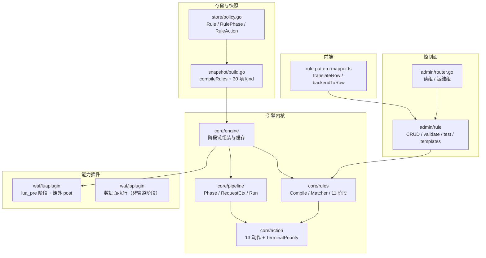
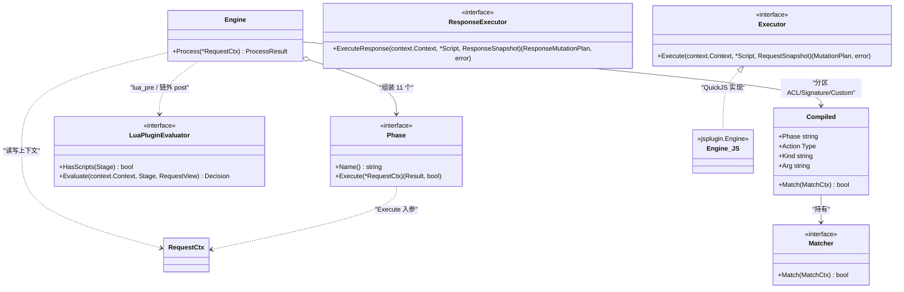
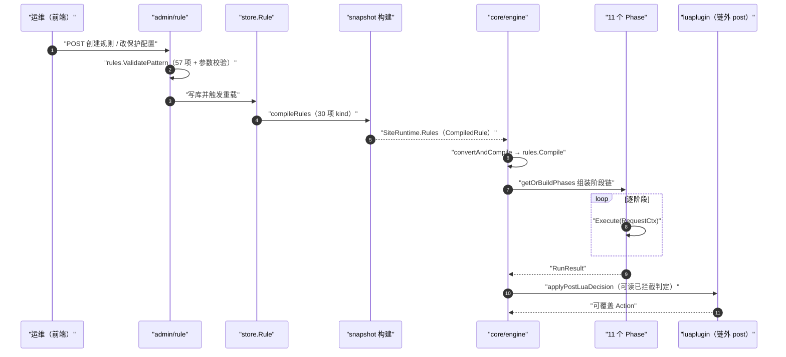
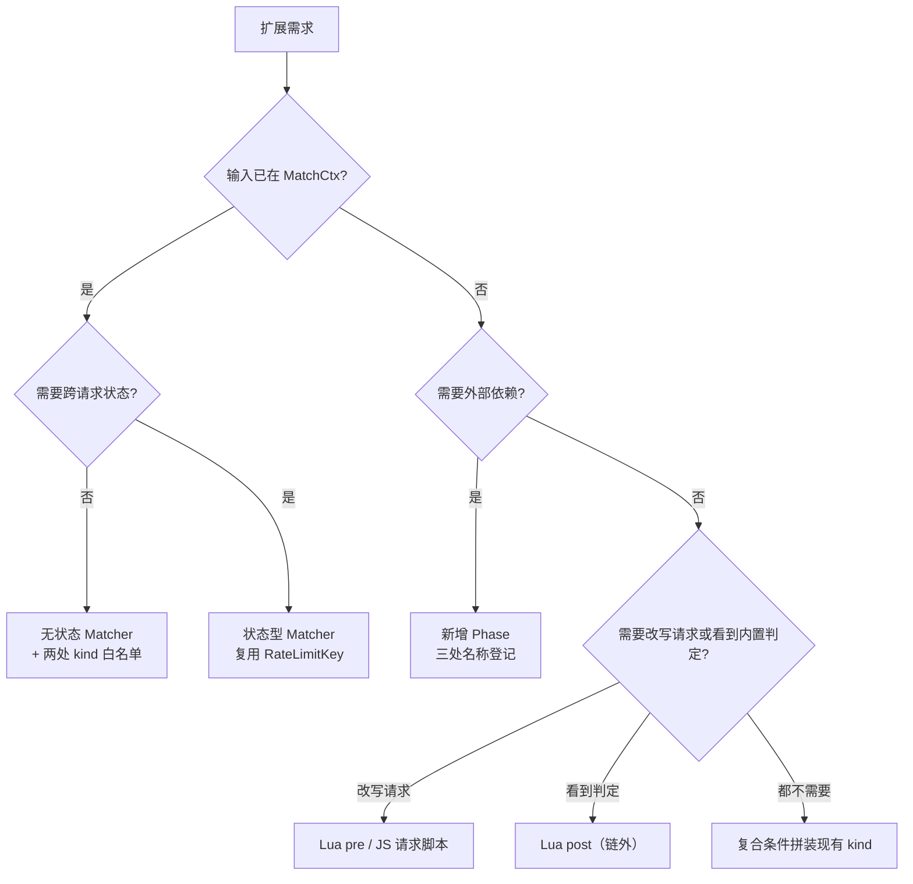
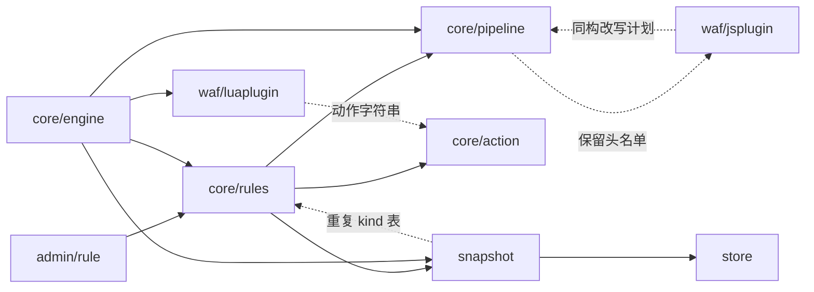

# 规则引擎扩展

> [返回 扩展与插件系统](../扩展与插件系统.md)

<cite>
**本文档引用的文件**
- [compiler.go](file://internal/core/rules/compiler.go)
- [matcher.go](file://internal/core/rules/matcher.go)
- [phases.go](file://internal/core/rules/phases.go)
- [validate.go](file://internal/core/rules/validate.go)
- [phase_skip.go](file://internal/core/rules/phase_skip.go)
- [lua_phase.go](file://internal/core/rules/lua_phase.go)
- [pipeline.go](file://internal/core/pipeline/pipeline.go)
- [pool.go](file://internal/core/pipeline/pool.go)
- [action.go](file://internal/core/action/action.go)
- [engine.go](file://internal/core/engine/engine.go)
- [build.go](file://internal/snapshot/build.go)
- [policy.go](file://internal/store/policy.go)
- [protection.go](file://internal/store/protection.go)
- [rule.go](file://internal/admin/rule/rule.go)
- [validate.go](file://internal/admin/rule/validate.go)
- [router.go](file://internal/admin/router.go)
- [engine.go](file://internal/waf/luaplugin/engine.go)
- [runtime.go](file://internal/waf/luaplugin/runtime.go)
- [script.go](file://internal/waf/jsplugin/script.go)
- [types.go](file://internal/waf/jsplugin/types.go)
- [rule-pattern-mapper.ts](file://frontend/app/(dashboard)/rules/components/rule-pattern-mapper.ts)
- [rule-form-dialog.tsx](file://frontend/app/(dashboard)/rules/components/rule-form-dialog.tsx)
</cite>

## 目录

1. [简介](#简介)
2. [项目结构](#项目结构)
3. [核心组件](#核心组件)
4. [架构总览](#架构总览)
5. [详细组件分析](#详细组件分析)
6. [依赖关系分析](#依赖关系分析)
7. [性能考虑](#性能考虑)
8. [故障排查指南](#故障排查指南)
9. [结论](#结论)
10. [附录](#附录)

## 简介
本文件是「规则引擎扩展」主题目录的总览，负责三件事：给出规则引擎全部可扩展面的选型地图、明确每条扩展路线需要登记的位置、把与引擎侧文档的分工讲清楚。

面向的扩展类型只有四条主线，超出这四条的需求不属于规则引擎：

| 扩展意图 | 落点 | 详解文档 |
|---|---|---|
| 让引擎多做一个检测步骤 | 新增 `pipeline.Phase` 并在引擎注册 | [执行阶段系统](执行阶段系统.md) |
| 让规则 DSL 多一种条件 | 新增 `Matcher` 类型 + kind 登记 | [匹配器开发](匹配器开发.md) |
| 让规则多带一个参数或动作 | 扩 `Compiled` 字段与动作映射 | [规则编译器扩展](规则编译器扩展.md)、[动作集成](动作集成.md) |
| 不改编码、用脚本表达策略 | Lua / JS 插件 | [Lua 策略插件](../Lua%20策略插件.md) |

四条主线共享同一条实测事实链，任何一条写错都会导致「改了不生效」：阶段链是 **11 阶段**（不是旧文档的 9 阶段）；`Matcher` 只有 `Match(MatchCtx) bool` 一个方法（**不存在 5 参数形式**）；兜底匹配器只有 `neverMatcher`（**`alwaysMatcher` 不存在**）；kind 白名单存在**两处**且不互通；写操作只有 POST。

## 项目结构
规则引擎扩展涉及后端 6 个包与前端 2 个文件。下表为**模块清单表**，行数为实测非测试代码。

| 层 | 包/文件 | 行数 | 职责 | 扩展入口 |
|---|---|:----:|---|---|
| 契约层 | `internal/core/pipeline` | 678 | `Phase`、`RequestCtx`、`Run`、改写出口 | 实现 `Phase` |
| 动作层 | `internal/core/action` | 393 | 13 种动作、`TerminalPriority`、`Result` | 返回 `Result` |
| 规则层 | `internal/core/rules` | 4048 | 编译、匹配器、11 个阶段实现、校验 | kind/阶段/参数 |
| 编排层 | `internal/core/engine` | 646 | 阶段链组装与缓存、插件挂载 | 注册新阶段 |
| 快照层 | `internal/snapshot/build.go` | 1644 | 规则预编译（第二份 kind 白名单） | **必须同步登记** |
| 存储层 | `internal/store` | 2347 | `Rule`/`RulePhase`/`RuleAction`/`ProtectionConfig` | 新增配置字段 |
| 控制面 | `internal/admin/rule` | 740 | 规则 CRUD、校验、干跑、模板 | 模板与校验 |
| 脚本面 | `internal/waf/luaplugin` | 2059 | Lua 引擎、`RequestView`、`Decision`、DryRun | 脚本型策略 |
| 脚本面 | `internal/waf/jsplugin` | 2191 | QuickJS 引擎、`MutationPlan`、故障记录 | 脚本型策略 |
| 前端 | `rules/components/rule-pattern-mapper.ts` | 994 | kind 正/反映射与复合树序列化 | 双向映射 |
| 前端 | `rules/components/rule-form-dialog.tsx` | 915 | 目标/方法下拉与表单校验 | 选项与校验 |



**图表来源**
- [engine.go:441-530](file://internal/core/engine/engine.go#L441-L530)
- [pipeline.go:276-280](file://internal/core/pipeline/pipeline.go#L276-L280)
- [build.go:920-934](file://internal/snapshot/build.go#L920-L934)
- [router.go:146](file://internal/admin/router.go#L146)
- [handler.go:390](file://internal/dataplane/handler.go#L390)
- [engine.go:186-210](file://internal/core/engine/engine.go#L186-L210)

**章节来源**
- [compiler.go:119-142](file://internal/core/rules/compiler.go#L119-L142)
- [build.go:1197-1222](file://internal/snapshot/build.go#L1197-L1222)
- [engine.go:441-530](file://internal/core/engine/engine.go#L441-L530)
- [policy.go:27-55](file://internal/store/policy.go#L27-L55)
- [runtime.go:26-34](file://internal/waf/luaplugin/runtime.go#L26-L34)

## 核心组件
### 关键接口与数据结构（代码上下文表）
下表是四条扩展路线共享的代码上下文，签名与行号取自实测代码。

| 符号 | 定义 | 形态 | 扩展约束 |
|---|---|---|---|
| `Phase` | `pipeline.go:277-280` | `Name() string` / `Execute(*RequestCtx) (action.Result, bool)` | 阶段名需三处一致（见执行阶段系统） |
| `RequestCtx` | `pipeline.go:15-100` | 导出请求字段 + 非导出派生缓存 | 新字段必须在 `ReleaseCtx` 清理 |
| `Run` | `pipeline.go:517-560` | 三档短路：drop 立返、挑战延迟、其余按优先级 | 不得自建第二套短路判据 |
| `Compiled` | `compiler.go:13-29` | 10 导出字段 + 4 非导出运行时字段 | 新参数需 `ensureCompiledMetadata` 兼容 |
| `Matcher` | `matcher.go:20-23` | 单方法 `Match(ctx MatchCtx) bool` | 只读、幂等、fail-closed |
| `MatchCtx` | `phases.go:32-50` | 16 字段匹配子集 | 新输入要同步 `fillMatchCtxFromPipeline` |
| `neverMatcher` | `matcher.go:504-508` | 恒 false | 唯一兜底类型，无 `alwaysMatcher` |
| `knownPrefixes` | `compiler.go:119-142` | 57 项 map | 与快照侧 30 项不互通 |
| `snapshot.ParsePattern` | `build.go:1197-1222` | 30 项内联前缀表 | 不 import `rules` |
| `ValidatePattern` | `validate.go:28-34` | 返回 `(kind, arg, errs)` | 校验失败 → `neverMatcher` |
| `action.Type` | `action.go:8-26` | 13 个取值（含 3 个进阶挑战） | `TerminalPriority` 必须显式分档 |
| `luaplugin.Stage` | `runtime.go:26-34` | `StagePre="pre"` / `StagePost="post"` | post 不在管道内 |
| `luaplugin.Decision` | `runtime.go:79-115` | 动作 + 改写 + 标签 | 不认识的动作一律忽略 |
| `jsplugin.Executor` | `script.go:203-205` | `Execute(ctx, *Script, RequestSnapshot) (MutationPlan, error)` | 跨 stage 执行被拒 |
| `jsplugin.MutationPlan` | `types.go:152-171` | 指针字段区分「不改」与「显式置空」 | 保留头由 `ValidateMutationPlan` 拒绝 |

**章节来源**
- [pipeline.go:15-100](file://internal/core/pipeline/pipeline.go#L15-L100)
- [pipeline.go:276-280](file://internal/core/pipeline/pipeline.go#L276-L280)
- [compiler.go:13-29](file://internal/core/rules/compiler.go#L13-L29)
- [matcher.go:20-23](file://internal/core/rules/matcher.go#L20-L23)
- [phases.go:32-50](file://internal/core/rules/phases.go#L32-L50)
- [action.go:8-26](file://internal/core/action/action.go#L8-L26)

### 扩展点总表
| 扩展点 | 接口/结构定义 | 注册位置 | 现有实现数 | 约束 |
|---|---|---|:--:|---|
| 执行阶段 | `Phase` `pipeline.go:277-280` | `engine.go:479-529` | 11 | 名称需三处登记；链容量预分配需同步 |
| 阶段跳过 | `NewSkipByPathPhase` `phase_skip.go:31-36` | `skipPathPhaseKeys` `protection.go:326-336` | 9 | `signature`/`custom` 故意不参与 |
| 匹配器 | `Matcher` `matcher.go:20-23` | `buildMatcher` `matcher.go:1474-1774` | 49 类型 / 58 kind | 非法参数回落 never |
| kind 白名单 | `knownPrefixes` `compiler.go:119-142` | 同处 | 57 | 与快照侧差集 27 |
| kind 白名单（快照） | `ParsePattern` `build.go:1197-1222` | `prefixes` `build.go:1205-1215` | 30 | 漏登记即静默丢弃 |
| 参数校验 | `validateSimplePattern` `validate.go:123-257` | switch `validate.go:128-255` | 36 类 | 缺省只校验成员资格 |
| 复合算子 | `buildCompound` `matcher.go:1878-1926` | switch `matcher.go:1880-1926` | 7 个 op | 无需动前缀白名单 |
| 规则字段 | `Compiled` `compiler.go:13-29` | `store.Rule` `policy.go:70-97` | 12 字段 | 三态字段用指针 |
| 动作类型 | `action.Type` `action.go:8-26` | `TerminalPriority` `action.go:88-119` | 13 | 同档取先出现者 |
| 规则阶段（持久化） | `store.RulePhase` `policy.go:27-35` | `validatePersistedRulePhase` `rule.go:288-296` | 5 枚举 / 3 可用 | 用户规则只能 `acl`/`signature`/`custom` |
| Lua 策略 | `LuaPluginEvaluator` `lua_phase.go:15-18` | `SetLuaPlugins` `engine.go:186`；`server.go:401` | 2 阶段 | 未识别动作忽略 |
| JS 策略 | `Executor` `script.go:203-210` | `SetJSPlugins` `engine.go:202`；`server.go:429`、`439`、`874` | 请求/响应两执行器 | 非管道阶段，在数据面执行 |
| 前端 kind | `translateRow` `rule-pattern-mapper.ts:72` | `backendToRow` `601` | 36 处字面量 | 双向必须成对 |
| 规则模板 | `GetRuleTemplates` `admin/rule/validate.go:83` | `templates` `84-269` | 23 | 覆盖常用 kind |



**图表来源**
- [pipeline.go:276-280](file://internal/core/pipeline/pipeline.go#L276-L280)
- [matcher.go:20-23](file://internal/core/rules/matcher.go#L20-L23)
- [compiler.go:13-37](file://internal/core/rules/compiler.go#L13-L37)
- [lua_phase.go:15-18](file://internal/core/rules/lua_phase.go#L15-L18)
- [script.go:203-210](file://internal/waf/jsplugin/script.go#L203-L210)
- [engine.go:83-115](file://internal/core/engine/engine.go#L83-L115)

**章节来源**
- [engine.go:479-529](file://internal/core/engine/engine.go#L479-L529)
- [matcher.go:1473-1774](file://internal/core/rules/matcher.go#L1473-L1774)
- [compiler.go:119-142](file://internal/core/rules/compiler.go#L119-L142)
- [build.go:1205-1215](file://internal/snapshot/build.go#L1205-L1215)
- [protection.go:326-336](file://internal/store/protection.go#L326-L336)
- [validate.go:123-257](file://internal/core/rules/validate.go#L123-L257)

## 架构总览
规则引擎的扩展面在一条请求生命周期上的位置如下：管理期决定「规则能不能存」，快照期决定「规则能不能进运行时」，编译期决定「规则会不会命中」，编排期决定「哪个阶段来跑它」。

| 期 | 触发 | 关键函数 | 扩展落点 |
|---|---|---|---|
| 管理期 | POST 创建/更新规则 | `admin/rule.CreateRule` `rule.go:98` | 模板、校验、kind 提示 |
| 校验期 | 同上 | `rules.ValidatePattern` `validate.go:28` | 参数校验分支 |
| 快照期 | `BumpRevision` → 重载 | `snapshot.compileRules` `build.go:920` | **第二份 kind 白名单** |
| 编译期 | 站点首次命中或代次变化 | `rules.Compile` `compiler.go:40`、`convertAndCompile` `engine.go:625` | `Compiled` 字段与元数据 |
| 编排期 | 同上 | `getOrBuildPhases` `engine.go:441` | 阶段注册与跳过白名单 |
| 执行期 | 每请求 | `pipeline.Run` `pipeline.go:517` | 终态判定与改写写回 |
| 链外 | 每请求 | `applyPostLuaDecision` `engine.go:369-371` | Lua post 覆盖判定 |



**图表来源**
- [rule.go:98-140](file://internal/admin/rule/rule.go#L98-L140)
- [validate.go:26-44](file://internal/core/rules/validate.go#L26-L44)
- [build.go:920-934](file://internal/snapshot/build.go#L920-L934)
- [engine.go:331-378](file://internal/core/engine/engine.go#L331-L378)
- [engine.go:441-530](file://internal/core/engine/engine.go#L441-L530)
- [pipeline.go:517-560](file://internal/core/pipeline/pipeline.go#L517-L560)

## 详细组件分析

### 扩展路线选型
先判断需求属于哪条路线，再动代码。判据只看一件事：**是否需要引擎在请求路径上多做一次判定**。

| 需求表述 | 路线 | 是否要重载快照 | 是否改 Go |
|---|---|:--:|:--:|
| 「按某个新字段拦截」且该字段已在 `MatchCtx` | 新增 kind + 匹配器 | 是 | 是（两处白名单） |
| 「按某个新字段拦截」且字段不在 `MatchCtx` | 先扩 `MatchCtx`，再走上一行 | 是 | 是 |
| 「满足条件时打标签/改写请求/自定义响应」 | Lua `pre` 或 JS 脚本 | 视配置 | 否 |
| 「内置判定之后对特定误报放行」 | Lua `post`（链外） | 否 | 否 |
| 「加一种需要跨请求计数的检测」 | 状态型匹配器（参照 `ccRateMatcher`） | 是 | 是 |
| 「加一类与规则无关的检测（如协议一致性）」 | 新增 `Phase` | 是 | 是（三处登记） |
| 「规则要多带一个参数（如新的响应控制）」 | 扩 `store.Rule` + `Compiled` | 是 | 是 |
| 「只要换动作展示或响应码」 | 复用既有 `action.Type` | 否 | 否 |

四条路线的取舍理由：`MatchCtx` 只有 16 个字段，凡是它已携带的信息用 kind 表达成本最低（一个 struct + 一个 case）；不在其中的信息（如响应内容、上游状态）不要硬塞进管道，改用 Lua post 或 JS response 脚本；需要外部 IO 或持久状态的检测才升级为独立阶段，因为它必须拿到依赖注入位。

**章节来源**
- [phases.go:32-50](file://internal/core/rules/phases.go#L32-L50)
- [matcher.go:25-90](file://internal/core/rules/matcher.go#L25-L90)
- [engine.go:72-77](file://internal/core/engine/engine.go#L72-L77)
- [lua_phase.go:15-18](file://internal/core/rules/lua_phase.go#L15-L18)
- [types.go:152-171](file://internal/waf/jsplugin/types.go#L152-L171)

### 两处 kind 白名单与静默丢弃
本仓库最需要记住的扩展陷阱。两份前缀表串联使用，第二份只有 30 项，导致 27 个 kind 的**裸 DSL 写法无法生效**。

| 侧 | 函数 | 位置 | 规模 | 是否 import rules |
|---|---|---|:--:|:--:|
| 引擎 | `rules.ParsePattern` | `compiler.go:119-170` | 57 | — |
| 快照 | `snapshot.ParsePattern` | `build.go:1197-1222` | 30 | 否 |

| 后果 | 表现 | 规避 |
|---|---|---|
| 裸 DSL 丢弃 | `compileRules` 见 `kind==""` 直接 `continue`，规则不进快照 | 新 kind 同时登记两处 |
| 复合包装可绕开 | `build.go:1201-1203` 对首字符 `{` 无条件返回 `compound`，叶子随后由 `buildCompound` 交回 `buildMatcher` | 只作为临时验证，不作长期方案 |
| 校验接口验不出 | `/rules/validate`、`/rules/test` 都只走引擎侧 | 必须走「建规则 → 重载 → 观察」全流程 |

新增 kind 的最小登记片段（两处 + 一处校验）：

```go
// 1) internal/core/rules/compiler.go:120-135 —— 无尾冒号
"path_wildcard", "full_url_wildcard", "host_wildcard", "body_wildcard", "header_wildcard",

// 2) internal/snapshot/build.go:1205-1215 —— 必须带尾冒号
"body_bytes_gt:",

// 3) internal/core/rules/matcher.go —— buildMatcher 的 default 之前
	case "body_bytes_gt":
		n, err := strconv.Atoi(strings.TrimSpace(arg))
		if err != nil || n < 0 {
			return &neverMatcher{} // fail-closed：唯一兜底类型
		}
		return &bodyBytesGTMatcher{size: n}
```

**章节来源**
- [compiler.go:119-170](file://internal/core/rules/compiler.go#L119-L170)
- [build.go:920-934](file://internal/snapshot/build.go#L920-L934)
- [build.go:1197-1222](file://internal/snapshot/build.go#L1197-L1222)
- [matcher.go:504-508](file://internal/core/rules/matcher.go#L504-L508)
- [matcher.go:1473-1774](file://internal/core/rules/matcher.go#L1473-L1774)
- [匹配器开发.md](file://docs/扩展与插件系统/规则引擎扩展/匹配器开发.md)

### 阶段链扩展点
11 阶段的注册块在 `engine.go:479-529`，其中 `lua_pre`（492-494）与 `browser_sign`（513-515）是旧文档最常漏掉的两段。扩展要点：

- 阶段名同时受三处约束：`Phase.Name()`、`store.skipPathPhaseKeys`（`protection.go:326-336`，9 项）、`admin/shared.ValidateSkipPathByPhase`。漏第二处会被 `normalizeSkipPathByPhase` 静默丢弃，漏第三处保存即报 `unsupported phase`。
- `signature`/`custom` 直接 `append` 而不走 `addPhase`（`engine.go:525`、`528`），因此不享受路径跳过；这是刻意为之——停用规则本身即可。
- ACL 与 IP 信誉站点白名单的 `allow` **不短路**：`executeCompiledPhase` 的 `allowShortCircuit` 形参未被使用（`phases.go:112-129`）。
- 终态优先级：drop 90 / intercept 80 / rate_limit 70 / 四类挑战同 60 / redirect 50；**同档取链上先出现者**（`action.go:88-119`、`pipeline.go:533`、`545`）。

```go
// 新增阶段的两处最小改动
// A. internal/core/rules/<new>_phase.go
func (p *contentFilterPhase) Name() string { return "content_filter" }

func (p *contentFilterPhase) Execute(ctx *pipeline.RequestCtx) (action.Result, bool) {
	result := p.evaluate(ctx)                 // 只读 ctx
	return result, result.IsTerminal()        // 不自建短路判据
}

// B. internal/core/engine/engine.go:479-529 目标顺序处
	if prot.ContentFilterEnabled {
		addPhase(rules.NewContentFilterPhase(...))
	}
```

**章节来源**
- [engine.go:467-529](file://internal/core/engine/engine.go#L467-L529)
- [phases.go:112-129](file://internal/core/rules/phases.go#L112-L129)
- [protection.go:323-379](file://internal/store/protection.go#L323-L379)
- [action.go:86-124](file://internal/core/action/action.go#L86-L124)
- [pipeline.go:508-560](file://internal/core/pipeline/pipeline.go#L508-L560)
- [执行阶段系统.md](file://docs/扩展与插件系统/规则引擎扩展/执行阶段系统.md)

### 脚本型扩展接入面
不改编码时，Lua 与 JS 是两条独立路径，接入面差别很大。

| 项 | Lua | JS |
|---|---|---|
| 运行位置 | `lua_pre` 为管道阶段；`post` 在链外 | 数据面执行，**不是**管道阶段 |
| 挂载点 | `engine.go:186`，`server.go:401` | `engine.go:202`，`server.go:429`、`439`、`874` |
| 阶段枚举 | `StagePre="pre"` / `StagePost="post"`（`runtime.go:26-34`） | 请求/响应两类执行器（`script.go:203-210`） |
| 判定结构 | `Decision`（`runtime.go:79-115`） | `MutationPlan`（`types.go:152-171`） |
| 改写出口 | `RequestMutation`/`ResponseMutation` | `MutationPlan` 指针字段 |
| 干跑 | `DryRun`（`dryrun.go:56`）、`Validate`（`129`） | `Validate`（`types.go:617`）、`ValidateWithOptions`（`623`） |
| 无锁读 | `atomic.Pointer[scriptSet]`（`engine.go:42-52`） | CGO QuickJS 运行时；`RuntimeAvailable()` 探测 |
| 动作容错 | 不认识的动作一律忽略（`lua_phase.go:46-51` 注释所述） | `ValidateMutationPlan` 拒绝保留头与不安全改写 |

```lua
-- Lua pre：只读判定 + 可选改写（示例仅示意契约，不是新增 API）
function handle(ctx)
  if ctx.path:find("^/api/") and ctx.headers["x-internal-token"] == nil then
    return "intercept", "missing internal token"
  end
  return nil
end
```

```go
// Go 侧对 Lua 阶段的依赖倒置（lua_phase.go:15-18 原样）
type LuaPluginEvaluator interface {
	HasScripts(stage luaplugin.Stage) bool
	Evaluate(ctx context.Context, stage luaplugin.Stage, req luaplugin.RequestView) luaplugin.Decision
}
```

**章节来源**
- [lua_phase.go:15-53](file://internal/core/rules/lua_phase.go#L15-L53)
- [engine.go:185-214](file://internal/core/engine/engine.go#L185-L214)
- [engine.go:42-60](file://internal/waf/luaplugin/engine.go#L42-L60)
- [runtime.go:26-34](file://internal/waf/luaplugin/runtime.go#L26-L34)
- [runtime.go:79-115](file://internal/waf/luaplugin/runtime.go#L79-L115)
- [dryrun.go:56-129](file://internal/waf/luaplugin/dryrun.go#L56-L129)

### 新增一条可扩展规则的端到端流程
以「新增 kind 并让一条规则真正生效」为验收目标，给出可照做的步骤序列（**流程步骤表**）与每步的验证命令。

| 步 | 动作 | 文件:行 | 验证 |
|:--:|---|---|---|
| 1 | 写匹配器与构造分支 | `matcher.go:1474-1774` | `go test ./internal/core/rules/ -run Matcher` |
| 2 | 登记引擎侧 kind | `compiler.go:120-135` | `POST /api/v1/rules/validate` 返回 `valid=true` |
| 3 | 登记快照侧 kind（带尾冒号） | `build.go:1205-1215` | 快照里能看到该规则 ID |
| 4 | 加参数校验 | `validate.go:128-255` | 非法参数被 400 拒绝 |
| 5 | 判断派生头需求 | `phases.go:236-250` | TLS/头顺序类能命中 |
| 6 | 前端正反映射 | `rule-pattern-mapper.ts:72`、`601` | 保存后回显不丢条件 |
| 7 | 前端表单选项 | `rule-form-dialog.tsx:55`、`73` | 可视化模式可选 |
| 8 | 追加模板 | `admin/rule/validate.go:84-269` | `GET /api/v1/rules/templates` 含新条目 |
| 9 | 落库并触发重载 | `POST` 创建规则接口 | 访问日志出现该 rule id |
| 10 | 真实请求验证 | 数据面 | 命中动作与 `Priority` 预期一致 |

```bash
# 步骤 2/3 一致性自检：两份白名单差集应只包含 compound
rg -o '"[a-z0-9_]+":' internal/snapshot/build.go | tr -d '":' | sort -u > /tmp/snap.txt
rg -A20 'kinds := \[\]string\{' internal/core/rules/compiler.go \
  | rg -o '"[a-z0-9_]+"' | tr -d '"' | sort -u > /tmp/rules.txt
comm -23 /tmp/rules.txt /tmp/snap.txt

# 步骤 10 前确认规则真的进了快照
go test ./internal/snapshot/ -run CompileRules
```

**章节来源**
- [matcher.go:1473-1808](file://internal/core/rules/matcher.go#L1473-L1808)
- [compiler.go:119-170](file://internal/core/rules/compiler.go#L119-L170)
- [build.go:920-934](file://internal/snapshot/build.go#L920-L934)
- [validate.go:26-257](file://internal/core/rules/validate.go#L26-L257)
- [rule.go:98-140](file://internal/admin/rule/rule.go#L98-L140)
- [rule-pattern-mapper.ts:72](file://frontend/app/(dashboard)/rules/components/rule-pattern-mapper.ts#L72)

### 新增一类扩展能力的选型流程
当需求不落在上一节路径上时，按此决策序列定位归属。

| 步 | 判断 | 是 → | 否 → |
|:--:|---|---|---|
| 1 | 需要的输入已在 `MatchCtx` 16 字段内？ | 走 kind 路线（步 2） | 走阶段或脚本路线（步 4） |
| 2 | 是否只需布尔判定？ | 写无状态匹配器 | 参照 `ccRateMatcher` 建状态型匹配器 |
| 3 | 是否需要新参数？ | 扩 `store.Rule` + `Compiled`，注意三态用指针 | 直接进入步 6 |
| 4 | 是否需要外部依赖（网络/文件/DB）？ | 升级为 `Phase`，依赖挂 `phaseRuntimeConfig` | 用脚本路线 |
| 5 | 是否需要改写上游请求？ | Lua `pre` 或 JS 请求脚本（保留头受限） | 进入步 6 |
| 6 | 是否需要看到「已被拦截」的结果？ | Lua `post`（链外执行，可覆盖判定） | 管道内阶段即可 |
| 7 | 是否需要新动作语义？ | 扩 `action.Type` 并显式给 `TerminalPriority` | 完成 |

三个「不要做」：不要在 `Match` 内做 IO；不要给挑战类动作随便分档（同档取先出现者，随意同分会让优先级不可预期）；不要把 `allow` 当作放行整链的手段（它非终态也不短路）。



**图表来源**
- [phases.go:32-50](file://internal/core/rules/phases.go#L32-L50)
- [matcher.go:25-90](file://internal/core/rules/matcher.go#L25-L90)
- [engine.go:72-77](file://internal/core/engine/engine.go#L72-L77)
- [protection.go:326-336](file://internal/store/protection.go#L326-L336)
- [engine.go:363-378](file://internal/core/engine/engine.go#L363-L378)

**章节来源**
- [pipeline.go:290-320](file://internal/core/pipeline/pipeline.go#L290-L320)
- [lua_phase.go:35-53](file://internal/core/rules/lua_phase.go#L35-L53)
- [action.go:86-124](file://internal/core/action/action.go#L86-L124)
- [protection.go:323-379](file://internal/store/protection.go#L323-L379)

## 依赖关系分析
- 纵向：控制面 → 存储 → 快照 → 引擎 → 规则/管道 → 动作，单向依赖，无 Go 包级循环导入。
- 横向重复：`snapshot` 与 `rules` 各持一份 kind 前缀表；`jsplugin` 与 `luaplugin` 各持一份改写计划结构（`MutationPlan` 与 `RequestMutation` 同构）；`pipeline`、`jsplugin`、`luaplugin` 三处各自维护保留头名单，且注释明确要求逐项一致（`pipeline.go:391-397`）。这三处重复是新增扩展时最容易只改一处的地方。
- 外部依赖：`gopher-lua`（Lua 运行时）、QuickJS（CGO，可构建为 stub 时 `RuntimeAvailable()` 返回 false）、SQLite、可选 Redis。

| 依赖方 | 被依赖方 | 依据 | 重复风险 |
|---|---|---|---|
| `core/engine` | `core/rules`、`core/pipeline`、`snapshot`、`store` | `engine.go:8-23` | 阶段注册清单需与预分配容量一致 |
| `core/rules` | `core/pipeline`、`core/action`、`snapshot`、`store`、`waf/*` | `phases.go:16-29` | `MatchCtx` 字段与 `RequestCtx` 需同步 |
| `core/pipeline` | `core/action`、`waf/bot/tlsfp` | `pipeline.go:10-11` | 保留头名单第三份副本 |
| `snapshot/build.go` | `store`（自备 kind 表，不 import rules） | `build.go:1197-1222` | **kind 白名单重复** |
| `admin/rule` | `core/rules`、`store` | `validate.go:9-10`、`rule.go:232` | 校验只覆盖引擎侧 |
| `waf/jsplugin` | `pipeline.MutationPlan` 同构约定 | `types.go:152-171` | 改写计划结构重复 |
| `waf/luaplugin` | `store`、`action` 语义 | `runtime.go:79-115` | 动作取值需与 `action.Normalize` 对齐 |



**图表来源**
- [engine.go:3-23](file://internal/core/engine/engine.go#L3-L23)
- [phases.go:3-29](file://internal/core/rules/phases.go#L3-L29)
- [pipeline.go:3-12](file://internal/core/pipeline/pipeline.go#L3-L12)
- [build.go:1197-1222](file://internal/snapshot/build.go#L1197-L1222)
- [pipeline.go:390-410](file://internal/core/pipeline/pipeline.go#L390-L410)
- [types.go:152-171](file://internal/waf/jsplugin/types.go#L152-L171)

**章节来源**
- [engine.go:3-23](file://internal/core/engine/engine.go#L3-L23)
- [phases.go:3-29](file://internal/core/rules/phases.go#L3-L29)
- [pipeline.go:390-410](file://internal/core/pipeline/pipeline.go#L390-L410)
- [validate.go:9-10](file://internal/admin/rule/validate.go#L9-L10)

## 性能考虑
- 规则侧成本在编译期一次性付清：`Compile` 构造 matcher 并按 `Priority`、`ID` 排序，运行期只做遍历与匹配；因此新增 kind 的正则编译成本落在快照重载，而不是每请求。
- 阶段链与规则各有缓存：规则按 `{siteID,policyID}`（`engine.go:34-37`），阶段链按 `{policyID,siteID,antiReplayEnabled}` 加 4 项判据（`engine.go:446-461`）。扩展时新增运行时依赖必须走 `updatePhaseDeps`，否则缓存会复用旧链。
- 匹配器成本排序（从低到高）：`strings` 比较 < CIDR 包含 < 缓存正则 < 通配符 < 需要派生串的 kind < 状态型（加锁） < 依赖外部能力的阶段（GeoIP、OWASP 扫描）。
- 每请求一次派生：ALPN/密码套件/头顺序串通过 `Derived*` 闭包缓存在 `RequestCtx` 上，跨阶段复用（`pipeline.go:232-257`）。新阶段需要同类值时复用该模式，不要重算。
- 对象池约束：`RequestCtx` 来自 `sync.Pool`，池容量上限见 `pool.go:12-17`。扩展上下文时同步 `ReleaseCtx`，否则会跨请求脏读并驻留大 map。
- 挑战类动作会跑完整条链：`pipeline.Run` 对挑战只记 pending、不中断（`pipeline.go:529-538`）。若把新阶段排在前段并返回挑战，后面所有检测仍会执行。

**章节来源**
- [compiler.go:40-78](file://internal/core/rules/compiler.go#L40-L78)
- [engine.go:34-37](file://internal/core/engine/engine.go#L34-L37)
- [engine.go:441-467](file://internal/core/engine/engine.go#L441-L467)
- [pipeline.go:232-257](file://internal/core/pipeline/pipeline.go#L232-L257)
- [pipeline.go:508-560](file://internal/core/pipeline/pipeline.go#L508-L560)
- [pool.go:10-113](file://internal/core/pipeline/pool.go#L10-L113)

## 故障排查指南
| 症状 | 根因 | 定位 | 修复 |
|---|---|---|---|
| 规则存了不生效 | kind 只在引擎侧 57 项 | 查快照 `SiteRuntime.Rules` | 补 `build.go:1205-1215` |
| 包一层 `and` 才生效 | 快照侧对 `{` 无条件放行 | `build.go:1201-1203` | 视为缺陷证据，仍登记白名单 |
| `/rules/validate` 与 `/rules/test` 都通过但线上无效 | 两接口不经快照侧；`test` 只填 6 字段 | `rule.go:224-266` | 走真实请求或重载快照验证 |
| 新阶段从不执行 | 未注册或入链条件恒假 | `engine.go:479-529` | 补注册；核对 `prot` 字段 |
| 跳过配置报 400 | 阶段名未进 `skipPathPhaseKeys` | `json_bind.go:50-52` | 登记 `protection.go:326-336` |
| 改配置无效果 | 阶段链缓存判据未覆盖新输入 | `engine.go:459-464` | 依赖并入 `phaseRuntimeConfig` |
| 规则永不命中且无报错 | `neverMatcher` 兜底（校验或构造失败） | `compiler.go:50-53` | 修参数格式 |
| 高并发下请求体串号 | 新增上下文字段未在 `ReleaseCtx` 清理 | `pool.go:37-113` | 补清理 |
| 改写头无效 | 命中保留头名单 | `pipeline.go:398-410` | 只改非保留头 |
| Lua 脚本动作不生效 | 返回了不被 `action.Normalize` 认识的动作 | `lua_phase.go:46-51` | 用 13 个合法取值 |
| JS 插件整体不执行 | 构建产物为 stub，QuickJS 不可用 | `RuntimeAvailable()` | 用带 CGO 的构建 |
| 前端保存后条件消失 | `backendToRow` 未覆盖新 kind | `rule-pattern-mapper.ts:601` | 补反映射 |

```bash
# 一次性核对三处 kind / 阶段名 / 动作登记是否齐备
comm -23 /tmp/rules.txt /tmp/snap.txt                       # 应为空（compound 除外）
rg -c '^func \(p \*\w+ [Pp]hase\) Name\(\)' internal/core/rules/phases.go
rg -n -A12 'var skipPathPhaseKeys' internal/store/protection.go
go test ./internal/core/rules/ ./internal/snapshot/ -run 'Compile|Pattern'
```

**章节来源**
- [build.go:920-934](file://internal/snapshot/build.go#L920-L934)
- [compiler.go:40-78](file://internal/core/rules/compiler.go#L40-L78)
- [engine.go:441-529](file://internal/core/engine/engine.go#L441-L529)
- [protection.go:323-379](file://internal/store/protection.go#L323-L379)
- [rule.go:224-266](file://internal/admin/rule/rule.go#L224-L266)
- [pool.go:37-113](file://internal/core/pipeline/pool.go#L37-L113)

## 结论
规则引擎的可扩展性集中在四个真实接入点上：`Phase`（阶段）、`Matcher` + 两处 kind 白名单（条件）、`Compiled`/`store.Rule`（参数）、`action.Type`（结果），外加 Lua/JS 两条不改代码的旁路。总览的价值在于给出选型地图与登记清单，具体实现步骤分别由 [执行阶段系统](执行阶段系统.md)、[匹配器开发](匹配器开发.md)、[规则编译器扩展](规则编译器扩展.md)、[动作集成](动作集成.md) 承载。

本次迭代成果：订正阶段链为实测 11 阶段；按 `Match(MatchCtx)` 重画接口关系并删除不存在的 `alwaysMatcher` 与 5 参数签名；清除已废弃路径（`admin/handler_rule.go`、`store/models.go`、`waf/eval.go`、`frontend/components`）；补齐模块清单表、代码上下文表、扩展点总表、路线选型表、流程步骤表、依赖矩阵表与 12 行排查表；明确持久化规则阶段只有 3 个可用、写操作只有 POST。

原则落点：KISS——四条路线各自只需一个接入点；YAGNI——不为「未来可能的规则插件框架」抽象，脚本需求直接走 Lua/JS；DRY——把三处已知重复（kind 表、改写计划结构、保留头名单）显式列出而非假装不存在；SOLID——`LuaPluginEvaluator` 与 `jsplugin.Executor` 都是消费方定义的最小接口，依赖倒置成立。

遇到的问题：原文档多处把「ACL allow 短路」「Evaluate/EvaluateWithBot 位于 eval.go」「前端存在 `RULE_KINDS`」当作事实。处理方式是逐条回到代码验证后改写；`RULE_KINDS` 实际不存在，前端 kind 是散落在 `translateRow`/`backendToRow` 的 36 处字面量。下一步建议：让 `snapshot` 复用 `rules.knownPrefixes` 以消除 27 项差集，这属于代码改动，需另轮处理。

[本节为总结，无需特定文件来源]

## 附录

### 主题目录索引
| 文档 | 定位 | 硬要求覆盖 |
|---|---|---|
| [执行阶段系统](执行阶段系统.md) | 新增阶段的两条流程与三处登记 | 阶段属性表、流程步骤表 |
| [匹配器开发](匹配器开发.md) | 新增 kind 的登记链与白名单陷阱 | kind 登记表、失败排查表 |
| [规则编译器扩展](规则编译器扩展.md) | 编译期校验、元数据与降级 | 编译流程步骤表 |
| [动作集成](动作集成.md) | 新动作与响应侧接入 | `TerminalPriority` 表 |
| [Lua 策略插件](../Lua%20策略插件.md) | 脚本型策略契约 | 脚本接口表 |

**章节来源**
- [执行阶段系统.md](file://docs/扩展与插件系统/规则引擎扩展/执行阶段系统.md)
- [匹配器开发.md](file://docs/扩展与插件系统/规则引擎扩展/匹配器开发.md)
- [规则编译器扩展.md](file://docs/扩展与插件系统/规则引擎扩展/规则编译器扩展.md)
- [动作集成.md](file://docs/扩展与插件系统/规则引擎扩展/动作集成.md)

### 术语与事实速查
| 术语 | 权威取值 | 依据 |
|---|---|---|
| 阶段链规模 | 11 | `engine.go:467`、`479-529` |
| `Matcher` 方法数 | 1（`Match(MatchCtx)`） | `matcher.go:20-23` |
| 兜底匹配器 | 仅 `neverMatcher` | `matcher.go:504-508` |
| kind 白名单 | 引擎 57 / 快照 30 / 差集 27 | `compiler.go:119-142`、`build.go:1205-1215` |
| 匹配器实现数 | 49 类型 / 58 kind / 54 个 case | `matcher.go` |
| 复合算子 | and、or、not、if、if_else、ifelse、cc_rate、空 op 叶子 | `matcher.go:1880-1926` |
| 动作类型 | 13（含 `block`/`log_only` 两个 legacy） | `action.go:8-26` |
| 终态优先级 | 90/80/70/60×4/50，同档取先出现者 | `action.go:88-119` |
| 持久化规则可用阶段 | `acl`、`signature`、`custom` | `rule.go:288-296` |
| 阶段跳过白名单 | 9 项（无 `signature`/`custom`） | `protection.go:326-336` |
| 写操作动词 | 仅 POST | `router.go` 实测 |
| 规则模板数 | 23 | `validate.go:84-269` |

[本节为速查索引，取值均见上表依据列]
